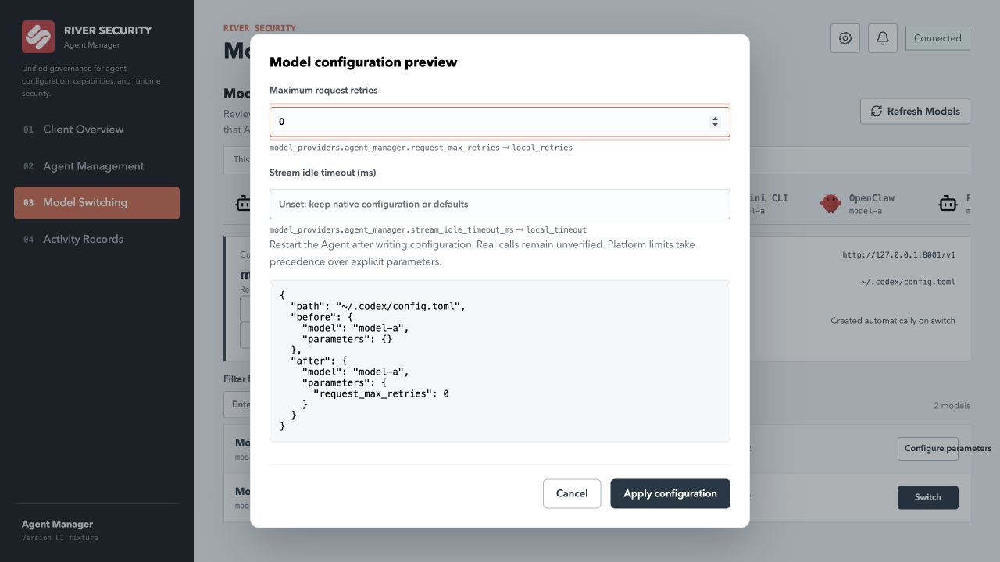
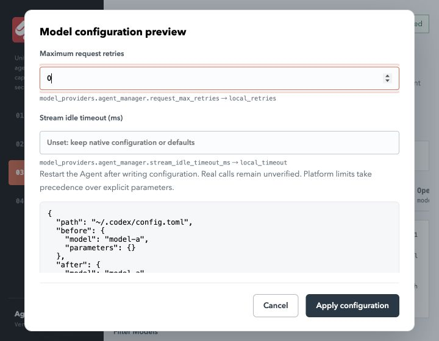
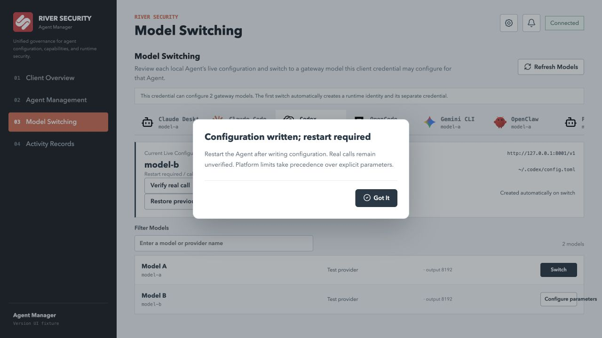
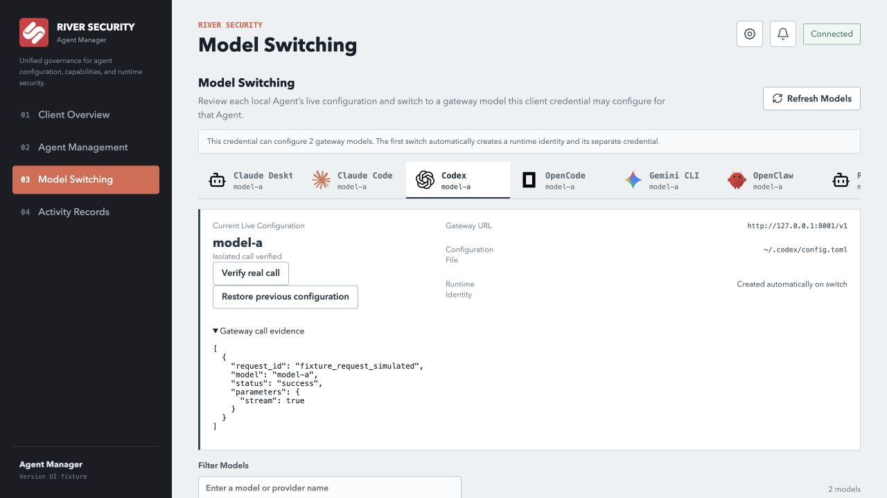
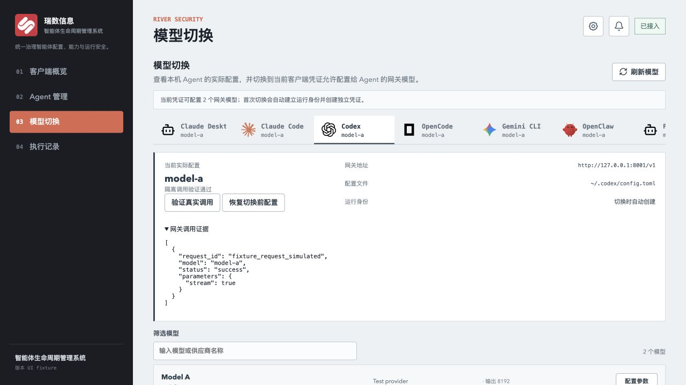
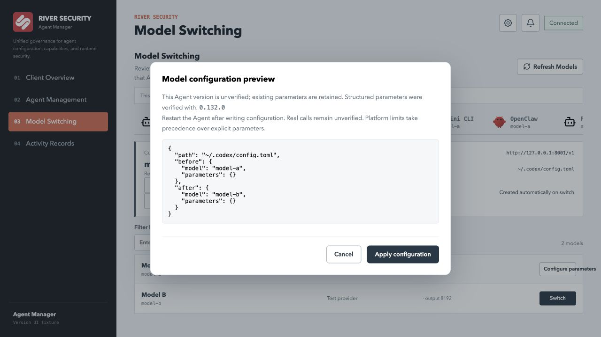
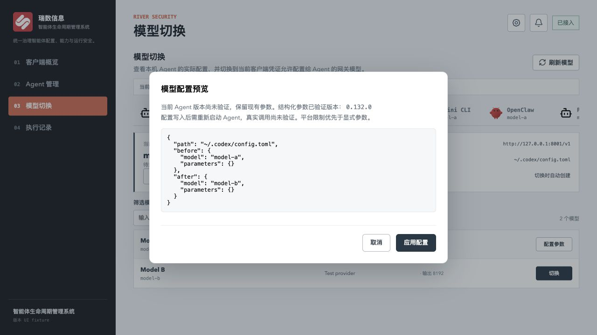
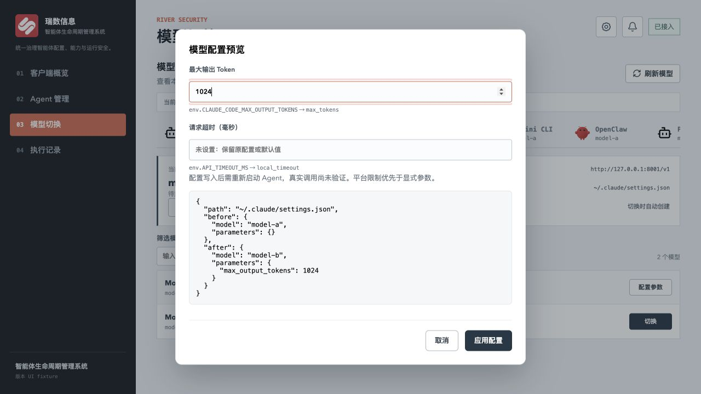
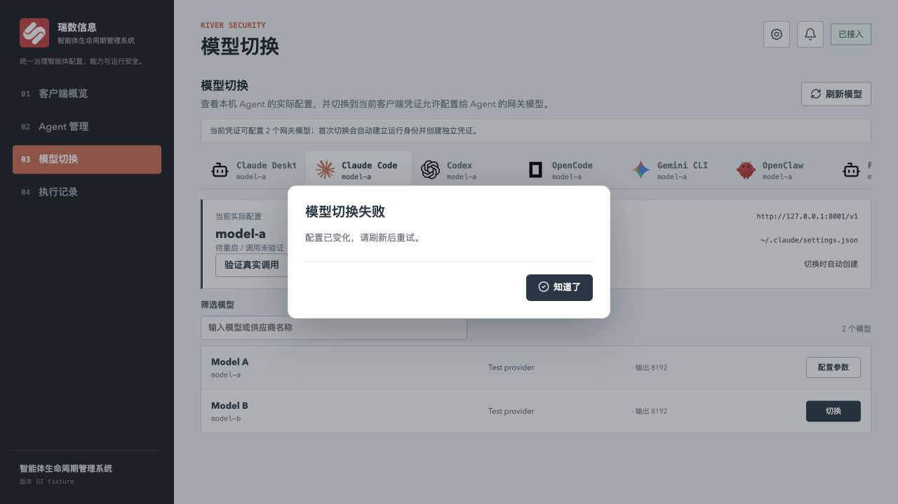

# 模型切换验证记录 / Model switching evidence

本记录区分配置适配、自动化测试、真实 Agent 调用和界面夹具。当前改动未提交、未推送、未部署；本地开发服务器会加载工作区代码。真实调用使用用户指定的本地测试网关 `http://127.0.0.1:8001`、专用测试客户端和独立临时 HOME，不修改正在工作的 Agent 配置。凭据不包含在记录中。

This record separates configuration adapters, automated tests, native Agent calls and UI fixtures. Changes are uncommitted and undeployed. Local development servers load workspace code. Native calls use the designated local test gateway, a dedicated test client and temporary homes. Working Agent configurations and credentials are not included in this evidence.

## 固定基线 / Pinned baseline

[cc-switch v3.20.3](https://github.com/farion1231/cc-switch/releases/tag/v3.20.3)，commit `d695a2d77fd9081eafd3e9eedcbf2a97b3410928`。依据该提交的 Agent 枚举、配置读写代码和表单检查能力，README 声明不作为真实调用证据。

The comparison uses the Agent enumeration, native configuration writers and forms at the pinned commit. README support claims are not execution evidence.

基线表单可设置内容如下；原生片段编辑允许超出表单的字段，是否被对应 Agent 读取仍需查该版本原生文档并实测。以下是基线配置能力，不是本项目已开放参数表。

The baseline forms expose the following configuration. Native snippet editors can contain additional fields whose effectiveness depends on the Agent version. This is the baseline inventory, not the implemented parameter list for this project.

| Agent | 基线模型相关设置 / Baseline model-related settings |
|---|---|
| Claude Code | Base URL、认证字段、默认模型、Sonnet/Opus/Fable/Haiku 档位映射及显示名、原生 settings / endpoint, authentication, default and tier mappings, native settings |
| Claude Desktop | 推理 provider、gateway 地址与认证、模型路由与显示名、3p profile / provider, endpoint/authentication, model routes, display labels, 3p profile |
| Codex | TOML provider/default model、模型目录和 reasoning levels、协议转换时的推理设置 / provider/default model, model catalog, reasoning levels and proxy reasoning conversion |
| Gemini CLI | Base URL、API Key、模型、settings 与环境配置 / endpoint, key, model, settings and environment |
| Grok Build | 原生 TOML 模型 profile、默认 profile、认证与 API backend / native model/default profiles, authentication and API backend |
| OpenCode | SDK npm 类型、Base URL、认证、headers、models、额外 provider options / SDK, endpoint, authentication, headers, models and provider options |
| OpenClaw | provider API、模型 ID/名称、reasoning、输入类型、contextWindow、maxTokens / provider API and model metadata |
| Hermes | Base URL、API mode、模型 ID/名称、context_length、rate-limit delay / endpoint, API mode, model metadata and rate-limit delay |
| Pi | provider API/headers/compat、模型 ID/名称、reasoning、input、contextWindow、maxTokens、thinkingLevelMap / provider and model metadata |

代码来源：[固定提交的 provider forms](https://github.com/farion1231/cc-switch/tree/d695a2d77fd9081eafd3e9eedcbf2a97b3410928/src/components/providers/forms) 与 [原生配置实现](https://github.com/farion1231/cc-switch/tree/d695a2d77fd9081eafd3e9eedcbf2a97b3410928/src-tauri/src)。原生配置通常由新进程或重启后的 Agent 读取；运行中热切换、代理接管与原生文件切换不是同一生效路径。本次没有运行 cc-switch 客户端，不声称验证其热切换或上游调用。

Sources: the pinned provider forms and native configuration implementations above. Native files are typically consumed by a new or restarted Agent. Proxy takeover and in-process switching have different activation paths. cc-switch itself was not executed in this work, so its hot switching and upstream calls are not claimed as verified.

| Agent | 基线配置方式 / Baseline mechanism | 本次配置适配 / Implemented configuration |
|---|---|---|
| Claude Code | settings.json 环境变量切换 / environment switch | `.claude/settings.json`，Anthropic 网关 |
| Claude Desktop | 3p deployment + configLibrary profile | macOS Claude/Claude-3p 配置与专用 profile；Windows 常规路径 |
| Codex | TOML provider + 默认模型 / default model | `.codex/config.toml`，Responses 网关 |
| Gemini CLI | settings + dotenv | `.gemini/settings.json`、`.env`，Gemini 转换入口 |
| Grok Build | TOML model profile | `.grok/config.toml`，Responses 网关 |
| OpenCode | 添加 provider / additive provider | `.config/opencode/opencode.json` 或 JSONC，Chat Completions |
| OpenClaw | 添加 provider / additive provider | `.openclaw/openclaw.json`，Chat Completions |
| Hermes | YAML model/provider + dotenv | `.hermes/config.yaml`、`.env`，Chat Completions |
| Pi | models.json provider 注册 / provider registration | `.pi/agent/models.json`，另设置 settings.json 默认 provider/model |

与基线的已知差异：本项目通过受治理的网关和独立 Agent 凭证配置；不是任意供应商配置编辑器。Claude Desktop 支持 LOCALAPPDATA 与 Claude/Claude-3p 前缀目录发现，多候选时停止；Windows 尚未实测。Pi 本次额外设置默认模型。三个适配器尚无产品内自动调用验证命令：Claude Desktop、Grok Build、OpenClaw。配置写入不能替代这些 Agent 的调用验收。

Known differences: this implementation configures the governed gateway with independent Agent credentials, rather than arbitrary provider profiles. Claude Desktop resolves LOCALAPPDATA and Claude/Claude-3p directory prefixes, stopping on ambiguity; Windows execution remains unverified. Pi also receives a default model. Automatic native verification is not yet available for Claude Desktop, Grok Build or OpenClaw; writing their configuration is not execution acceptance.

Codex 推理强度和输出详细程度未开放：在 0.132.0 与 `deepseek-v4-flash` 网关别名组合中，配置虽保存成功，实际请求未包含对应字段（`req_7841bbcb8dca`），验证因此失败。官方配置参考将这些参数限定于支持的模型；已有原生字段仍保留。它们不能从 cc-switch 表单存在或 TOML 读回推断为本项目已验证能力。

Codex reasoning effort and verbosity are not exposed. With 0.132.0 and the `deepseek-v4-flash` gateway alias, the native request omitted both configured fields (`req_7841bbcb8dca`), so verification failed. The [official reference](https://learn.chatgpt.com/docs/config-file/config-reference) limits them to supported models. Existing native fields are preserved; cc-switch forms and TOML readback are not proof of effective support here.

## 真实调用矩阵 / Native execution matrix

结构化参数按共享契约中的精确版本集合开放：Claude Code 2.1.220、Codex 0.132.0、Hermes 0.17.0。未知、其他版本及预发布版本不能提交显式参数修改，仍可保留原参数切换模型。管理台响应、桌面发现、服务端预检和客户端执行共用该规则；客户端执行及验证前复核版本，避免排队期间升级后继续使用旧能力信息。

Structured parameters use the exact verified version set in the shared contract: Claude Code 2.1.220, Codex 0.132.0 and Hermes 0.17.0. Unknown, other and prerelease versions cannot submit explicit parameter changes; model switching can preserve existing parameters. Console responses, desktop discovery, server preflight and client execution share this rule. Execution and verification recheck the installed version against queued or stale capabilities.

Hermes 的原生 `--version` 会同步检查更新；版本发现因此读取已安装入口对应的 `hermes_cli/__init__.py` 元数据，不运行更新检查。无法确定安装布局或元数据不一致时报告未知版本。测试覆盖包版本变化但启动脚本不变的情况。

Hermes `--version` performs a synchronous update check. Discovery instead reads `hermes_cli/__init__.py` metadata resolved from the installed entry point. Unknown layouts or conflicting metadata report an unknown version. Tests cover package upgrades whose entry script remains unchanged.

操作系统均为本机 macOS arm64。下列成功仅证明对应命令、版本、模型和协议组合，不外推到其他系统、版本或完整工作流。

All native rows use macOS arm64. Success applies only to the stated version, model, protocol and command mode.

| Agent / version | 协议 / Protocol | 网关模型 / Gateway model | 结果 / Result | 审计 request_id / Audit evidence |
|---|---|---|---|---|
| Claude Code 2.1.220 | Anthropic | glm_Anthropic/glm-5.3-flash | 最小提示、隔离调用成功；stream=true、max_tokens=1024 / minimal isolated call passed | `req_7b958b7331b3` |
| Codex 0.132.0 | Responses | deepseek-v4-flash | 最小提示、隔离调用成功；stream=true；本地 request_max_retries=0 / minimal isolated call passed | `req_19d980067551` |
| Hermes 0.17.0, commit 3f9944ba | Chat Completions | deepseek-v4-flash | 隔离调用成功；stream=true、max_tokens=1024 / isolated call passed | `req_1cfe5ce0a1f4` |
| Pi 0.84.1 | Chat Completions | deepseek-v4-flash | 最小提示、隔离调用成功；stream=true、max_completion_tokens=16384 / minimal isolated call passed | `req_e2893c88c08a` |
| Gemini CLI 0.45.2 | Gemini → Chat Completions | deepseek-v4-flash | 最小隔离调用成功，stream=true、temperature=1、top_p=0.95 / minimal isolated call passed | `req_2ec6e4e04bfb` |
| OpenCode 1.1.51 | Chat Completions | deepseek-v4-flash | 复用已安装依赖，隔离请求到达网关；Prompt Guard 阻断 / isolated request with existing dependencies, policy blocked | `req_de67b614a5c2` |
| OpenClaw | Chat Completions | — | 本机缺少二进制 / binary unavailable |
| Grok Build | Responses | — | 本机缺少二进制 / binary unavailable |
| Claude Desktop 1.52386.0 | Anthropic | — | 已读取应用版本；缺少隔离桌面测试用户，未启动 / app version read; isolated desktop user unavailable, not launched |

部分 Agent 默认系统提示被当前 Prompt Guard 拦截；验证未修改或关闭网关策略。Claude Code、Codex、Pi 的成功行使用最小系统提示，不能作为默认提示、工具调用或既有会话重启成功的证据。网关中独立请求记录可按上述 ID 复核；普通文档不收录原始 prompt、response 或 Pipeline Trace。

Some default Agent system prompts were blocked by Prompt Guard. Gateway policy was not weakened. Successful Claude Code, Codex and Pi rows use minimal system prompts and do not prove default workflows, tools or restart behavior. Audit IDs identify the requests; raw prompts, responses and Pipeline Trace are excluded from this document.

## 自动化与界面证据 / Automated and UI evidence

### 工具与恢复实测 / Native tools and recovery

- Claude Code 2.1.220：隔离文件 Read 工具、结果回传和最终文件内容回答通过。三个流式请求均成功：`req_859d4ded2380`、`req_957fdb6c03d6`、`req_4092c3bd3c94`；模型 `glm_Anthropic/glm-5.3-flash`，max_tokens=1024。
- Pi 0.84.1：隔离文件 read 工具、结果回传和最终文件内容回答通过。请求 `req_15270cb81272`、`req_c922264a5a69`；模型 `deepseek-v4-flash`，流式响应。
- Codex 0.132.0：只读 sandbox 中的文件工具、结果回传和包含随机文件内容的最终回答通过；三个 Responses 流式请求均成功：`req_1df4425b226f`、`req_348136046d7f`、`req_6e30db4ce8be`，模型 `deepseek-v4-flash`。
- Hermes 0.17.0：独立目录、原生 file toolset、quiet 模式下完成文件读取、结果回传与最终内容回答。`req_a964c75dbeb2`、`req_3714349ee951` 均成功，模型 `deepseek-v4-flash`，stream=true、max_tokens=1024。
- Codex 0.132.0：同一隔离配置目录先调用 `deepseek-v4-flash`（`req_750e11e36e77`），切换 `deepseek-v4-pro`（`req_7e39799d7716`），恢复原文件和凭据后再次调用 flash（`req_9bb9f0d4e81f`），均成功。每次启动独立 Agent 进程；恢复后的模型与配置指纹等于 A。
- Native file-tool tests passed for Claude Code, Pi, Codex and Hermes, including result submission and final output containing the random test file contents. Codex uses a read-only sandbox; Hermes uses its native file toolset and quiet mode, which suppresses tool previews. Codex also passed A→B→restore A in one isolated configuration directory, starting fresh processes and verifying the restored model and revision. The audit IDs above identify each stage.

安全审计摘录：[gateway-evidence.json](gateway-evidence.json)。初次工具测试的随机长标记触发 `encoded_instruction`；改用普通短语后通过，未改变网关策略。工具测试允许最终回答包含解释性文字，但只接受 assistant 输出，且要求实际工具结果请求已回传。

Sanitized audit extract: [gateway-evidence.json](gateway-evidence.json). Initial long random markers triggered `encoded_instruction`; ordinary test phrases passed without policy changes. Tool tests accept explanatory assistant text around file contents and separately require a submitted tool result.

OpenCode 自动验证目前限定 1.1.51：复制本机已安装的同版本 plugin、SDK 及 zod 4.1.8 到临时目录，关闭自动更新、默认插件下载及外部项目配置；不安装依赖。版本或依赖不匹配会报告不可验证。该次请求触发 system 来源的 `tool_abuse` 与 `encoded_instruction`。

OpenCode verification currently supports 1.1.51 only, copying matching installed plugin/SDK packages and zod 4.1.8 into a temporary directory. Automatic updates, default plugin downloads and external project configuration are disabled for the probe. No dependencies are installed. Other versions or missing packages report unavailable verification. This call was blocked by system-source `tool_abuse` and `encoded_instruction` rules.

通过真实客户端任务链再次执行 Codex A→B→恢复 A：任务 59–64 全部成功，包含两次配置、三次验证和一次恢复。成功审计依次为 `req_db5577a39229`、`req_937ed6c79d44`、`req_7c19b983f246`。

The actual client task path also passed Codex A→B→restore A: tasks 59–64 succeeded, including two applications, three verifications and one restoration. The corresponding audit IDs are listed above.

Hermes、Pi、Claude Code 也通过相同的真实任务链。每个 Agent 的六个任务均成功；恢复后重新读取的模型和配置指纹等于 A，随后启动新进程并通过调用验证。

Hermes, Pi and Claude Code also passed the same real task path. Each Agent's six tasks succeeded. Restored model and configuration revision matched A, followed by a successful call from a new process.

| Agent | 任务 / Tasks | A → B → 恢复 A / Restored A | 各阶段成功审计 / Successful audit by stage |
|---|---|---|---|
| Hermes 0.17.0 | 68–73 | deepseek-v4-flash → deepseek-v4-pro → flash | `req_cafcd094905a` → `req_087d07a75ec4` → `req_9c3ded89c31c` |
| Pi 0.84.1 | 74–79 | deepseek-v4-flash → deepseek-v4-pro → flash | `req_94c6ebb14ace` → `req_7ee2ceb88974` → `req_27edf619fc26` |
| Claude Code 2.1.220 | 80–85 | glm_Anthropic/glm-5.3-flash → deepseek-v4-flash → glm | `req_2e3859bfbd7c` → `req_04d27c67f6b1` → `req_0a7cccecd99c` |

Hermes 与 Claude Code 三阶段均观测到 `max_tokens=1024`；Pi 三阶段为 `max_completion_tokens=16384`。全部为流式调用，操作系统为 macOS arm64。

Hermes and Claude Code emitted `max_tokens=1024` throughout; Pi emitted `max_completion_tokens=16384`. All calls were streaming on macOS arm64.

### 原生故障注入 / Native fault injection

使用本机 Claude Code 2.1.220、Codex 0.132.0、独立 HOME 和本地故障服务，无真实凭据，不调用上游模型。六个子用例全部通过；这是原生 Agent 参数生效证据，但不是网关或上游成功响应证据。

Six subcases passed using installed Claude Code 2.1.220 and Codex 0.132.0, fresh homes and a loopback fault server. No real credentials or upstream models were used. These tests prove native parameter consumption, not gateway or upstream success.

| 参数 / Parameter | 设置 / Setting | 实际行为 / Observation |
|---|---|---|
| Codex `request_max_retries` | 0 / 2 | 503 响应下共 1 / 3 次请求 / 1 / 3 requests on HTTP 503 |
| Codex `stream_idle_timeout_ms` | 1000 / 2500 | 1019 / 2515ms 后报告 SSE 空闲超时 / native SSE idle timeout |
| Claude Code `timeout_ms` | 1000 / 2500 | 1000 / 2501ms 后断开未响应请求 / disconnect of an unanswered request |

Codex 测试单独关闭 stream reconnect，以测量 request retries，避免两层重试相乘。流超时以原生 `idle timeout waiting for SSE` 错误及服务端接收请求后的时间计量；TCP 连接关闭不是唯一超时判据。可复现测试见 `scanner/internal/managedclient/model_native_fault_test.go`，需显式设置 `AM_TEST_NATIVE_FAULTS=1`；默认测试跳过原生执行。[完整测试输出](native-faults.txt)。

The Codex fixture disables its separate stream reconnect loop to isolate request retries. Stream timing uses the native SSE idle-timeout error and elapsed time since the server received the request; TCP closure alone is insufficient. Set `AM_TEST_NATIVE_FAULTS=1` to run the opt-in test above; ordinary suites skip native execution. See the linked test output.

Gemini 0.45.2 的原生 A→B→恢复 A 任务链通过（8.47 秒）：`req_c1e87d297147`、`req_a58013e9bbaf`、`req_51ce6c15257f` 分别确认 deepseek-v4-flash、deepseek-v4-pro、deepseek-v4-flash。文件工具实测通过（3.81 秒），`req_151607b3f9e2` 和 `req_d2aad59e8e36` 均成功；Agent 使用 `read_file` 读取提示中未提供的随机文件内容，将一个工具结果回传后返回正确内容。调用采用原生流式 Gemini 协议，由网关转换为 Chat Completions。

Gemini 0.45.2 passed the native A→B→restore A task chain in 8.47 seconds, with the three audit IDs above confirming flash→pro→flash. Its file-tool test passed in 3.81 seconds: both listed requests succeeded, one function result was submitted, and the assistant returned random file content absent from the prompt. Native streaming Gemini requests were converted to Chat Completions by the gateway.

连接探测使用独立的空工作目录，凭据与配置保存在其父级隔离 HOME；macOS 使用权限为 0700 的短临时路径，避免向模型发送系统临时目录标识。Gemini 连接探测设置 `tools.core=[]`，文件工具测试仅启用 `read_file`。这些设置只作用于测试目录。工作配置与网关策略未改变。OpenCode 的原生 `<env>` 上下文仍触发 `tool_abuse`（`req_6b3e063ffd22`），未将该组合记为通过。

Connection probes use an empty workspace separate from the isolated HOME holding credentials and configuration. On macOS, a short private temporary path avoids sending the operating system's temporary-directory identifier. Gemini's connection probe disables core tools; the file-tool test enables only `read_file`. These settings affect only test directories. Working configuration and gateway policy are unchanged. OpenCode's native `<env>` context still triggers `tool_abuse` (`req_6b3e063ffd22`), so that combination remains blocked.

- Go 配置测试覆盖首次配置、已有配置、九种适配器、参数读回、无关配置保留、A→B、原字节恢复、修改冲突、软链接、锁、JSONC/JSON5 和 TOML 类型。它们使用临时目录，不是真实 Agent 调用。
- 后端网关与客户端回归 186 项通过（87.35 秒）；增加版本校验后，相关客户端、契约与验证测试 58 项通过（19.63 秒）。范围包括客户端任务、凭证轮换、验证证据门禁、Gemini/Responses 转换和模型网关。真实调用与模拟测试分开列示。
- The gateway/client suite passed 186 tests in 87.35 seconds. After version gating, the affected client, contract and verification suite passed 58 tests in 19.63 seconds. Coverage includes tasks, credential rotation, audit gates and protocol conversion. Go configuration tests use temporary directories and are not native execution evidence.
- 增加继承值与写入前预检后，相关后端 59 项通过（17.52 秒）。接口测试覆盖排队后输出上限降低及模型禁用；Go 模拟故障证明预检失败不会领取凭证或修改文件。这些是自动化模拟证据，非真实上游故障注入。
- After inherited-value and pre-write preflight validation, 59 affected backend tests passed in 17.52 seconds. API tests cover lower output limits and model disabling after task creation. A Go failure fixture proves no credential issuance or file changes after failed preflight. These are automated simulations, not injected faults against a real upstream.

加入写入前预检后，Codex 0.132.0 的实际任务链 A→B→恢复 A 再次通过（19.15 秒），对应成功请求：`req_cb6e02c9d24b`、`req_f96ee9b20a1f`、`req_bb40f286bd3c`。Go 全包、两端 i18n 与构建均重新通过。

With pre-write preflight enabled, Codex 0.132.0 passed the native A→B→restore A task chain again in 19.15 seconds, with the three successful audit IDs above. All Go packages, both i18n suites and both builds passed again.
- Go `go test ./...` 全部通过；Windows amd64 与 Linux amd64 的 managedclient 测试二进制交叉编译通过，未在对应系统执行。管理台 i18n 门禁、22 项测试和 Vite 构建通过；桌面 26 项 i18n 测试与 macOS arm64 Tauri 应用构建通过。构建产物未安装或部署。仍有 Python 弃用警告及 Vite 大分块警告。
- All Go packages passed. Windows amd64 and Linux amd64 managedclient test binaries cross-compiled successfully but were not executed on those systems. Console i18n checks, 22 tests and Vite build passed. Desktop i18n passed 26 tests and the macOS arm64 Tauri application built successfully. Build artifacts were not installed or deployed. Python deprecation warnings and Vite chunk-size warnings remain.

版本校验上线到本地代码后，再次通过实际任务验证：Codex `req_71b1819841ec`，Claude Code `req_9c1cb8bf7992`，Hermes `req_4f2227eb2dee`。三者均使用显式参数；Codex/Claude Code 的本地超时为 30000ms，输出上限参数仍由调用证据核对。发现缓存版本已更新，避免沿用缺少版本能力信息的旧缓存。

Native task verification passed again after version gating: Codex, Claude Code and Hermes audit IDs are listed above. Each used explicit parameters; Codex/Claude Code local timeouts were 30000ms, and output limits remained checked against call evidence. Discovery cache version was advanced to invalidate older capability snapshots.

下列截图使用实际桌面前端和模拟 sidecar，证明渲染与交互文案；不证明服务端写入或真实 Agent 调用。管理台登录后的界面验证仍待测试管理员会话。

These screenshots render the actual desktop frontend against a simulated sidecar. They prove UI rendering and interaction copy, not backend writes or native execution. Authenticated console UI verification awaits a test administrator session.

## 尚未完成的验收 / Outstanding acceptance

最终增量回归：64 项后端客户端、契约与验证测试通过（21.51 秒），包括畸形上报配置返回稳定错误；Go 全包通过（managedclient 41.482 秒）；包含最新探测目录隔离修复的 macOS 桌面应用构建通过（22.45 秒）。本地构建产物未安装或发布。`git diff --check` 与本次凭据泄漏检查通过。

Final incremental checks: 64 backend client, contract and verification tests passed in 21.51 seconds, including stable errors for malformed reported configuration. All Go packages passed (managedclient: 41.482 seconds). The macOS desktop bundle containing the probe workspace isolation fix built successfully in 22.45 seconds. The bundle was not installed or published. Whitespace and credential-leak checks passed.

九种 Agent 的真实调用、跨操作系统与版本矩阵、完整工具回传、真实 A→B 后恢复、全部参数的上游能力前置校验，以及管理台登录后的中英文交互尚未全部完成。此记录不将这些组合记为通过。

Native coverage for all nine Agents, cross-platform/version coverage, complete tool round trips, live A→B restoration, upstream capability preflight for every parameter, and authenticated bilingual console interaction are not all complete. These combinations are not recorded as passed.

其他 Agent 的工具回传、非流式原生调用、运行中会话重启，以及其他版本的参数验证也未完成。本次没有开放高级原生片段编辑或完整的快速/推理/子 Agent 模型映射表单。

Tool round trips for other Agents, native non-streaming calls, restart of existing sessions and parameter verification for other versions remain incomplete. Advanced native snippet editing and complete fast/reasoning/sub-Agent model mapping forms are not implemented.
