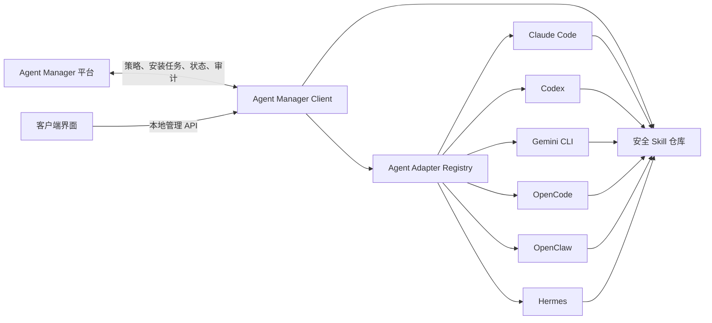

# Agent Manager Client 实施计划

> 2026-07-17 补充完成：客户端安全治理与 Agent 强授权双模式、Skill 选择性接管、未知 Skill 自动处置、隔离区索引与单项恢复、离线策略缓存、审计事件补报、任务取消/重试、后台服务真实状态及 Windows 用户级服务均已实现。平台与桌面端已同步展示治理方式、当前问题和中文处置原因。

本文档用于确认和跟踪 Agent Manager Client（Agent Manager 客户端）的实施范围。客户端内置支持 Claude Code、Codex、Gemini CLI、OpenCode、OpenClaw、Hermes 和 TeleAgent，也允许用户登记具有 Skill 目录的自定义 Agent，统一管理可用 Skill 的发现、接管、安装、更新、完整性校验和异常处置。TeleAgent 的用户标识不是固定值，客户端通过 `.config/TeleAgent/users/*/skills` 展开实际存在的用户 Skill 目录。

实施原则：客户操作保持“安装、连接、接管”三步；内部适配不同 Agent 的目录差异，不要求客户手工配置 Hook、MCP 或 Skill 路径。

## 1. 产品目标

### 1.1 要解决的问题

- 客户本地多个 Agent 分别维护 Skill，来源和版本不可控。
- Agent 不一定遵循 Skill 中“使用前验证”的提示。
- Hook 配置因 Agent 而异，接入和维护成本较高。
- 用户可以手工安装、修改或替换 Skill，平台无法及时发现。
- 平台目前知道 Skill 是否批准，但不知道哪些客户端实际安装了哪些版本。

### 1.2 首版目标

- 自动发现本机 Claude Code、Codex、Gemini CLI、OpenCode、OpenClaw、Hermes、TeleAgent。
- 支持登记自定义 Agent 名称及 Skill 根目录，不要求为每种工具开发专用适配器。
- 扫描现有 Skill，生成接管预览，不直接删除客户文件。
- 将受治理 Skill 统一保存到 Agent Manager 安全仓库。
- Agent 原生 Skill 目录只保留客户端创建的链接或受控副本。
- 只允许从 Agent Manager 安装状态为 `APPROVED` 的 Skill。
- 定时检查 Skill 是否新增、删除或修改。
- 发现异常时告警、备份或恢复平台批准版本。
- 平台能够查看客户端、Agent、已安装 Skill 和异常记录。

### 1.3 首版不承诺

- 不承诺阻止拥有 root、管理员权限的用户绕过客户端。
- 不证明 Agent 每次运行时都实际调用了某个 Skill。
- 不替代 Claude Code Hook、Hermes Runtime Adapter 等运行时治理能力。
- 不管理 Agent 的模型供应商、会话、Prompt 或普通配置。

## 2. 客户使用流程

客户只需要完成以下步骤：

1. 安装 Agent Manager Client。
2. 输入 Agent Manager 地址和客户端接入凭证。
3. 客户端自动发现并匹配平台智能体，用户点击“开始接管”。

同一类型只有一个可匹配智能体时自动完成；无法确定时才要求用户选择一次。

首次接管流程：


完成接管后，客户日常操作只有：

- 在 Agent Manager 平台选择 Skill 并安装到指定客户端或 Agent。
- 在客户端查看同步状态和异常。
- 必要时恢复备份或重新接管。

## 3. 总体架构



Agent Manager Client 内部由两部分组成，对客户只呈现一个产品：

- 后台服务：负责发现、同步、验签、巡检和审计。
- 桌面界面：负责连接、接管预览、状态展示和人工操作。

后台服务是核心。关闭客户端窗口不影响定时巡检和平台任务执行。

## 4. 本地目录设计

首版使用用户级目录，避免一开始要求系统管理员权限：

```text
~/.agent-manager/
  client.db
  config.json
  skills/
    <skill-id>/
      <version-or-signature>/
        SKILL.md
        manifest.json
        ...
  backups/
    <timestamp>/
  pending/
    <agent-type>/
      <skill-name>/
  logs/
```

目录用途：

- `skills/`：平台批准且签名一致的安全仓库。
- `backups/`：接管前的原始目录备份，支持恢复。
- `pending/`：平台不存在、未批准、签名不一致或无法解析的 Skill。
- `client.db`：客户端、Agent、安装清单、任务和巡检状态。

Agent 原生目录继续使用，降低兼容风险：

```text
~/.claude/skills/
~/.codex/skills/
~/.gemini/skills/
~/.config/opencode/skills/
~/.openclaw/skills/
~/.hermes/skills/
```

默认优先创建指向安全仓库的目录链接；平台或操作系统不支持时，降级为原子文件同步。适配器必须记录实际使用的是 `symlink` 还是 `copy`。

## 5. Agent 适配器

每个适配器只负责以下能力：

1. 判断 Agent 是否安装。
2. 返回 Agent 版本、配置位置和能力声明。
3. 在支持 Skill 管理时，返回该 Agent 的 Skill 搜索目录。
4. 将安全仓库中的 Skill 映射到 Agent 原生目录。
5. 枚举原生目录中不受客户端管理的内容。

首版适配器：

| 工具 | 默认 Skill 目录 | 首版能力 |
|---|---|---|
| Claude Code | `~/.claude/skills` | 完整接管、安装、卸载和巡检 |
| Codex | `~/.codex/skills` | 完整接管、安装、卸载和巡检；兼容识别 `~/.agents/skills` |
| Gemini CLI | `~/.gemini/skills` | 完整接管、安装、卸载和巡检 |
| OpenCode | `~/.config/opencode/skills` | 完整接管、安装、卸载和巡检 |
| OpenClaw | `~/.openclaw/skills` | 完整接管、安装、卸载和巡检 |
| Hermes | `~/.hermes/skills` | 完整接管、安装、卸载和巡检 |
| TeleAgent | `~/.config/TeleAgent/users/*/skills` | 展开动态用户目录后发现、接管、安装、卸载和巡检 |
| 自定义 Agent | 用户选择或输入 | 完整接管、安装、卸载和巡检 |

内置适配器负责识别常见工具的默认目录；其他 Agent 只要具有明确的 Skill 根目录，即可通过自定义 Agent 接入。OpenClaw 的完整 Skill 管理由 Agent Manager 自有适配器实现，不依赖 CC Switch 是否在当前版本开放对应界面。

项目级 Skill 目录首版不自动遍历、扫描或接管，避免在未选择工作区时扩大文件访问范围。后续支持新工具时只新增适配器，不修改接管主流程。

## 6. 首次接管逻辑

首次接管只解决“哪些现有 Skill 可以继续使用”，不在此过程中启动完整安全扫描、自动提交或审批。

### 6.1 发现

- 检查内置工具的安装状态和版本，并加载用户登记的自定义 Agent。
- 仅对声明 `skill_management=true` 的适配器检查已知用户级 Skill 目录。
- 枚举包含 `SKILL.md` 的直接子目录。
- 记录 Agent 类型、Skill 路径和目录来源。
- 自动匹配平台智能体；无法唯一匹配时由用户选择。

### 6.2 Skill 识别

对每个本地 Skill 只执行：

- 解析 `SKILL.md` 中的 `name`；解析失败时使用目录名展示。
- 使用与平台一致的算法计算文件签名。
- 不执行 Skill 代码，不运行 Sandbox，不启动规则、深度或 LLM 分析。
- 不跟随指向 Skill 根目录外部的软链接。

### 6.3 平台比对

客户端按已匹配的平台智能体，将本地 Skill 的名称和签名批量提交平台比对，只保留两种结果：

| 结果 | 条件 | 确认接管后的处理 |
|---|---|---|
| 可接管 | 当前智能体已绑定该 Skill、平台状态为 `APPROVED` 且签名一致 | 迁入安全仓库并继续启用 |
| 待处理 | 其他全部情况 | 备份后移入 `pending/`，不再提供给 Agent |

待处理包括：智能体未授权、平台不存在、未批准、已拒绝、已取消、签名不一致或无法解析名称。首次接管不自动上传这些 Skill，也不自动下载平台版本替换。

### 6.4 安全迁移

- 接管前创建完整备份。
- 先在临时目录构建新的 Agent Skill 目录。
- 只把“可接管”的 Skill 放入安全仓库。
- 其余 Skill 移入 `pending/`。
- 构建完成后再原子替换 Agent 原生目录。
- 任一步失败则恢复原目录。
- 首版不直接永久删除任何客户 Skill。

### 6.5 接管预览

确认页至少显示：

- 发现的 Agent。
- 本地 Agent 与平台智能体的匹配关系。
- 现有 Skill 总数。
- 可接管、待处理的数量。
- 每个 Skill 的名称、来源目录、比对结果和计划操作。
- 备份保存位置。

## 7. 平台安装与卸载

### 7.1 安装流程

1. 管理员在平台选择客户端、Agent 和 Skill。
2. 平台确认 Skill 已批准、Agent 已绑定该 Skill。
3. 创建客户端安装任务。
4. 客户端轮询取得任务并下载 Skill 包。
5. 校验 manifest、内容签名和平台发布签名。
6. 原子写入安全仓库。
7. 映射到目标 Agent 的原生目录。
8. 上报成功或失败原因。

### 7.2 卸载流程

- 删除 Agent 原生目录中的受控映射。
- 无其他 Agent 使用该版本时，可清理安全仓库缓存。
- 客户原始备份不随卸载自动删除。

### 7.3 平台撤销

当 Skill 变为不可加载状态时：

- 客户端下次同步立即移除 Agent 入口。
- 安全仓库中的文件保留短期缓存，但不可重新安装。
- 上报“平台撤销下架”审计事件。

## 8. 定时巡检

首版不实现文件系统实时监听，后台服务每 5 分钟执行一次轻量巡检，每 30 分钟执行一次完整签名对账。

轻量巡检：

- 原生目录中的链接是否存在。
- 是否出现新的未受控 Skill 目录。
- 已安装 Skill 的文件数量、大小、mtime 是否变化。
- Agent 配置或 Skill 根目录是否发生变化。

完整对账：

- 重新计算 manifest 和内容签名。
- 与本地批准记录及平台签名比较。
- 校验平台状态和 Agent 绑定关系。

异常处置模式：

| 模式 | 行为 |
|---|---|
| `audit` | 只告警并上报，不修改文件 |
| `repair` | 备份异常内容，恢复平台批准版本 |
| `block` | 备份异常内容并移除 Agent 入口 |

首版默认使用 `audit`；完成客户验证后再将企业环境默认值调整为 `repair`。

## 9. 平台接口计划

### 9.1 客户端注册

```http
POST /api/v1/clients/register
POST /api/v1/clients/heartbeat
GET  /api/v1/clients/{client_id}/policy
```

注册信息：

- 客户端 ID、主机名、操作系统、架构。
- 客户端版本。
- 当前用户和设备标识的脱敏值。
- 已发现 Agent 类型、版本和 Skill 管理能力。

### 9.2 接管与清单

```http
POST /api/v1/clients/{client_id}/inventory
POST /api/v1/clients/{client_id}/takeover-report
GET  /api/v1/clients/{client_id}/inventory
```

### 9.3 安装任务

```http
GET  /api/v1/clients/{client_id}/tasks
POST /api/v1/clients/{client_id}/tasks/{task_id}/result
GET  /api/v1/clients/{client_id}/skills/{skill_id}/package
```

任务类型首版只包含：

- `install_skill`
- `remove_skill`
- `rescan`
- `repair_skill`

### 9.4 异常上报

```http
POST /api/v1/clients/{client_id}/events
```

事件类型：

- `client_registered`
- `agent_discovered`
- `takeover_completed`
- `skill_installed`
- `skill_removed`
- `unmanaged_skill_found`
- `skill_modified`
- `skill_repaired`
- `skill_blocked`
- `client_offline`

## 10. 客户端凭证和权限

新增“客户端接入凭证”，不复用 Scanner 或 Agent Runtime 凭证。

最小权限：

- `client:register`
- `client:heartbeat`
- `client:read-policy`
- `client:read-tasks`
- `client:report-inventory`
- `client:report-events`
- `client:submit-skill`
- `client:download-approved-skill`

要求：

- 凭证明文只展示一次，服务端只保存 hash。
- 凭证绑定客户端或首次注册后锁定客户端 ID。
- 支持禁用、吊销、过期、IP/CIDR 和并发限制。
- 客户端凭证与模型网关、Scanner、Agent Runtime 凭证分开。
- 本地凭证优先写入操作系统凭证存储；首版无法支持时，使用权限为当前用户只读写的配置文件。

## 11. 发布包签名

现有内容签名用于判断文件是否变化；客户端下载还需要验证发布来源。

Skill 发布包：

```text
skill.zip
manifest.json
manifest.sig
```

首版使用 Ed25519：

- Agent Manager 保存发布私钥。
- 客户端保存平台公钥。
- `manifest.sig` 对规范化后的 `manifest.json` 签名。
- 下载、缓存或本地文件被替换时，客户端必须拒绝安装。

## 12. 平台页面计划

### 12.1 客户端管理

菜单建议放在：

```text
智能体管理
  智能体列表
  客户端管理
  统一凭证中心
  接入与运行
```

客户端列表展示：

- 客户端名称、操作系统、客户端版本。
- 在线状态、最后心跳。
- 已发现 Agent 数量。
- 支持 Skill 管理的 Agent 数量。
- 已安装 Skill 数量。
- 异常 Skill 数量。
- 接管状态。

### 12.2 客户端详情

包含：

- Agent 清单。
- 每个 Agent 的能力状态和 Skill 根目录。
- Skill 安装清单。
- 最近异常。
- 待执行任务。
- 安装、卸载、重新扫描操作。

### 12.3 客户端界面

首版只包含四个页面：

- 连接平台。
- Agent 发现。
- 接管预览。
- 运行状态。

不在客户端重复实现平台的 Skill 审批、策略编辑和用户管理。

## 13. 本地技术选型

### 13.1 MVP

先实现无 GUI 的 Go 单二进制后台服务：

```text
client/
  cmd/agent-manager-client/
  internal/agent/
  internal/inventory/
  internal/store/
  internal/sync/
  internal/verify/
  internal/client/
```

原因：

- 与现有 Go Scanner 的单二进制交付方式一致。
- 文件扫描、哈希、定时任务和跨平台目录处理足够。
- 客户端不需要 Python、Node 或 Docker。

### 13.2 GUI

后台流程稳定后再增加 Tauri 2 桌面界面。桌面界面通过本地 API 或子进程协议调用后台服务，不复制扫描和同步逻辑。

CC Switch 只参考以下能力：

- 多 Agent 目录适配。
- 统一 Skill 仓库。
- 链接和文件复制两种同步方式。
- 原子写入和自动备份。
- Windows、macOS、Linux 打包方式。

不引入供应商切换、代理、会话管理、Prompt 管理等无关能力。

## 14. 数据模型

### 14.1 平台新增表

`managed_clients`

- `client_id`
- `name`
- `hostname`
- `os`
- `arch`
- `client_version`
- `status`
- `last_seen_at`
- `registered_by`
- `created_at`

`client_agents`

- `client_id`
- `agent_type`
- `managed_agent_id`
- `agent_version`
- `install_path`
- `skills_path`
- `skill_management_supported`
- `capabilities_json`
- `takeover_status`
- `last_scanned_at`

`client_skill_installs`

- `client_id`
- `agent_type`
- `skill_id`
- `skill_name`
- `signature`
- `install_mode`
- `status`
- `installed_at`
- `verified_at`

`client_tasks`

- `client_id`
- `task_type`
- `payload_json`
- `status`
- `created_at`
- `started_at`
- `finished_at`
- `error`

首版事件复用现有操作审计或新增轻量 `client_events`。不要把完整 Skill 文件内容写入事件表。

### 14.2 本地数据库

本地 SQLite 只保存：

- 平台连接和客户端 ID。
- Agent 发现结果。
- 受控 Skill 安装记录。
- 最近任务和巡检结果。
- 备份路径。

平台是最终状态来源，本地数据库可以重建。

## 15. 实施阶段

### Phase 0：方案确认

- [x] 确认产品名称：`Agent Manager Client` / “Agent Manager 客户端”。
- [x] 确认首版内置支持六类工具，并支持登记自定义 Agent。
- [x] 确认默认处置模式为 `audit`。
- [x] 确认用户级目录作为首版安全仓库。
- [x] 确认项目级 Skill 首版不自动遍历、扫描或接管。
- [x] 确认先开发 Go 后台服务，GUI 后置。

验收：本文件中的开放项全部确认。

### Phase 1：本地发现与只读扫描

- [x] 创建 Go Client 工程。
- [x] 实现设备 ID、配置加载和本地 SQLite。
- [x] 实现统一适配器接口和能力声明。
- [x] 实现 Claude Code、Codex、Gemini CLI、OpenCode、OpenClaw、Hermes 六个适配器及自定义 Agent 目录配置。
- [x] 实现本地 Agent 与平台智能体匹配。
- [x] 发现用户级 Skill 目录。
- [x] 复用 Go Scanner 的忽略规则、manifest 和 fingerprint 逻辑。
- [x] 输出本地 JSON inventory，不修改任何文件。

验收：

- 在 macOS 上正确识别已安装的六类内置工具。
- Claude Code、Codex、Gemini CLI、OpenCode、OpenClaw、Hermes 能发现各自的用户级 Skill。
- 自定义 Agent 可通过名称和绝对 Skill 根目录加入发现结果，移除登记时不删除原目录。
- 同名 Skill 以路径和签名区分。
- 无法唯一匹配的平台智能体会要求用户选择，不会静默绑定。
- 软链接不会逃逸到 Skill 根目录外。
- 扫描失败能定位到具体 Agent 和目录。

### Phase 2：平台客户端 API

- [x] 新增客户端凭证类型和权限。
- [x] 新增客户端注册、心跳、策略接口。
- [x] 新增 inventory 和事件上报接口。
- [x] 新增客户端、Agent、安装清单数据表。
- [x] 增加管理员权限和操作审计。

验收：

- 客户端能注册并持续心跳。
- 平台能查看 Agent 和 Skill inventory。
- 禁用凭证后客户端请求立即拒绝。
- 普通用户不能查看不属于自己的客户端。

### Phase 3：首次接管

- [x] 实现名称、路径和签名批量比对。
- [x] 校验平台智能体的 Skill 授权范围。
- [x] 生成接管预览。
- [x] 实现完整备份。
- [x] 实现安全仓库迁移。
- [x] 实现链接优先、复制降级。
- [x] 实现失败回滚。
- [x] 上报接管报告。

验收：

- 取消确认时不修改任何文件。
- 接管失败能恢复原目录。
- 除“当前智能体已授权、已批准且签名一致”以外的 Skill 全部进入 `pending/`。
- 当前智能体未绑定的 Skill 即使已批准也进入 `pending/`。
- 首次接管不会触发完整扫描、自动提交或自动审批。
- 当前智能体已授权、已批准且签名一致的 Skill 接管后可正常被 Agent 发现。

### Phase 4：平台安装、卸载与发布签名

- [x] 增加 Ed25519 发布签名。
- [x] 增加安装任务和结果接口。
- [x] 客户端下载并验签 Skill 包。
- [x] 实现安装、卸载、重新扫描、修复任务。
- [x] 平台 Skill 详情增加“安装到客户端”。

验收：

- 非 `APPROVED` Skill 无法创建安装任务。
- 未绑定当前 Agent 的 Skill 无法安装。
- 篡改下载包后安装失败。
- 重复任务幂等，不生成重复目录或链接。

### Phase 5：定时巡检

- [x] 实现 5 分钟轻量巡检。
- [x] 实现 30 分钟完整签名对账。
- [x] 实现 `audit`、`repair`、`block` 三种处置。
- [x] 新增异常事件和平台展示。
- [x] 处理平台撤销和客户端离线展示。

验收：

- 手工新增 Skill 能在一个巡检周期内发现。
- 修改已安装 Skill 能产生明确的异常事件。
- `repair` 模式会先备份再恢复。
- 平台不可达时不删除正常的本地 Skill，也不允许新安装。

### Phase 6：平台客户端管理页面

- [x] 新增客户端列表。
- [x] 新增客户端详情。
- [x] 展示 Agent、Skill、任务和异常。
- [x] 增加安装、卸载、重扫和修复操作。
- [x] 增加客户端凭证创建说明和下载入口。

验收：

- 管理员能完成客户端治理闭环，不需要查询数据库。
- 状态、失败原因和最后同步时间清晰。
- 操作按钮有 loading、disabled 和后端幂等保护。

### Phase 7：桌面 GUI

- [x] 创建 Tauri 2 客户端。
- [x] 实现平台连接和凭证保存。
- [x] 实现 Agent 发现和接管预览。
- [x] 实现运行状态、异常和备份恢复。
- [x] 配置 macOS、Windows、Linux 安装包构建。
- [x] 增加 Tauri Updater、更新包签名流水线和操作系统代码签名方案。

验收：

- 新用户无需命令行即可完成安装、连接和接管。
- GUI 退出后后台服务继续运行。
- 升级客户端不丢失配置、备份和安装清单。

### Phase 8：强管模式（后续）

以下内容不进入首版：

- 系统服务账号和系统级只读安全仓库。
- MDM / 企业托管配置。
- 禁止用户修改 Agent Skill 搜索路径。
- 文件系统实时监听。
- 项目级 Skill 自动接管。
- MCP Skill Runtime。
- Agent 实际调用链审计。

只有在标准模式稳定且客户明确要求不可绕过时再启动。

## 16. 测试计划

### 单元测试

- 六类内置工具及自定义 Agent 的目录发现。
- 适配器能力声明和 Skill 目录发现。
- 不支持 Skill 管理的适配器不得进入接管、安装或巡检流程。
- `SKILL.md` 元数据解析。
- manifest、签名和软链接边界。
- 平台名称和签名比对。
- 安装任务幂等。
- 迁移失败回滚。

### 集成测试

- 客户端注册、心跳、任务轮询。
- 批准、拒绝、取消和签名不一致 Skill。
- 多 Agent 安装同一个 Skill。
- 同名不同签名 Skill。
- 平台断网、超时、凭证过期。

### 跨平台测试

- macOS：内置工具和自定义 Agent 发现、软链接、LaunchAgent、应用签名。
- Linux：适用工具发现、软链接、systemd user service、文件权限。
- Windows：适用工具发现、junction/symlink 权限、文件复制降级、Windows Service 后续兼容。

### 破坏性场景

- 接管过程中客户端退出。
- 安装过程中磁盘空间不足。
- 原 Agent 目录被其他进程同时修改。
- 安全仓库文件被篡改。
- 用户手工删除链接或创建同名目录。
- 平台撤销正在使用的 Skill。

## 17. 文档计划

实现过程中同步维护：

- `docs/project-guide.md`：补充客户端治理定位和主流程。
- `docs/external-agent-integration.md`：区分客户端、Hook、Runtime Adapter。
- 新增现场安装说明：客户端安装、连接、接管、恢复。
- 新增运维说明：日志、备份、升级、离线和故障排查。

本实施计划完成后保留作为进度和验收记录；若产品范围发生变化，先更新本文件再开发。

## 18. 需要确认的决策

开始实施前需要确认：

1. 产品名称是否确定为 `Agent Manager Client`，中文名称“Agent Manager 客户端”。
2. 是否确认内置支持六类常见工具，并允许其他 Agent 通过 Skill 根目录接入。
3. 首版是否只支持用户级 Skill，不自动接管项目级 Skill。
4. 首版异常默认只告警，还是默认自动恢复。
5. 首版是否接受“链接优先、复制降级”，而不是强制所有 Agent 改用一个自定义目录。
6. 未注册 Skill 是否只移入 `pending/`，不自动上传平台扫描。
7. 首版开发顺序是否确定为“Go 后台服务 -> 平台页面 -> Tauri GUI”。
