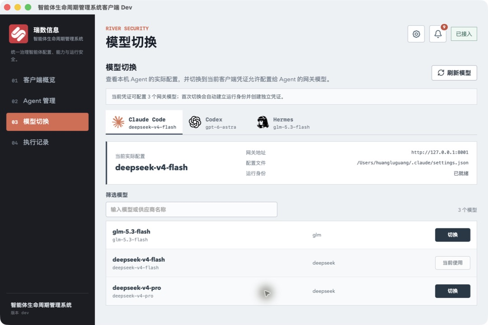
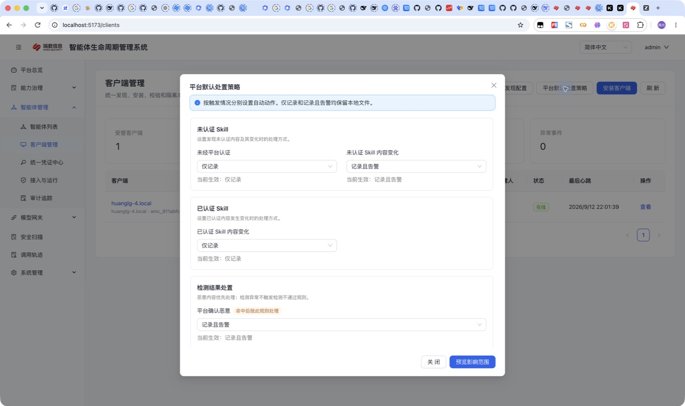
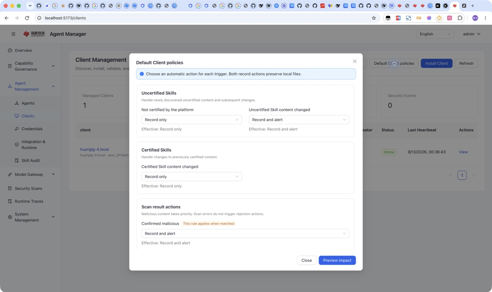

# Agent Manager Client 使用说明

Agent Manager Client 用于统一发现、接管和巡检本机 Agent 的 Skill 目录。它直接管控文件入口，不依赖 Agent 是否遵循提示词、Skill 指令或 Hook。

客户端支持两种治理方式：

- 客户端安全治理（默认）：Skill 已在平台批准且本地内容签名一致即可使用，不要求创建或绑定平台智能体。
- Agent 强授权：除批准状态和签名外，还要求本机 Agent 绑定平台智能体，并校验该智能体的 Skill 允许范围。

客户端当前内置支持以下 Agent：

- Claude Code
- Codex
- Gemini CLI
- OpenCode
- OpenClaw
- Hermes
- TRAE CN
- TRAE
- Cursor
- CodeBuddy
- WorkBuddy
- Qoder、Qoder CN、QoderWork、ZCode

客户端还识别可由 OpenCode、Cursor 等读取的共用 `.agents/skills` 目录，并在界面中单独标明共享边界。以上 Agent 和目录支持 Skill 发现、接管、安装和巡检。其他工具可在桌面端点击“添加 Agent”，填写名称并选择或输入 Skill 根目录；自定义 Agent 会复用同一套治理流程。

## 平台发现配置与桌面入口

平台“客户端管理 → Agent 发现配置”可按名称或标识搜索 Agent，设置启用状态、适用系统和
一个或多个 Skill 根目录。相对路径从客户端用户主目录解析，每行一个目录。本机单独设置
的目录优先；没有配置缓存时使用客户端内置定义。目录不存在时不会因保存配置而自动创建。

Qoder、Qoder CN、QoderWork、ZCode 的预置目录分别为 `.qoder/skills`、`.qoder-cn/skills`、
`.qoderwork/skills`、`.zcode/skills`。Claude Desktop、Kimi Work、Doubao Work 的预置条目
默认关闭且没有目录，确认实际路径后再配置启用。

保存发现配置会创建同步任务，在线客户端通过长轮询接收任务、读取最新配置并重新发现。
离线客户端继续使用已缓存配置。排查时分别核对“配置已同步”和“目录已发现”，不要只凭
平台心跳判断目录是否生效。

桌面“客户端概览”包含总览、运行与同步、检测策略、扫描能力和客户端信息。
“Agent 管理”按 Agent 切换本地 Skills、检测记录和隔离副本。“执行记录”分为巡检与处置、
平台任务，支持筛选和分页。右上角齿轮进入设置，铃铛进入安全通知。

## 模块化治理的边界

客户端的治理单元是“本机 Agent 类型 + 实际 Skill 根目录 + 具体 Skill + 可选的平台
Agent 绑定”，而不是把整台主机视为一个不可拆分的可信单元：

- 一个本机 Agent 可以配置一个或多个实际 Skill 根目录；客户端会解析符号链接，避免同一
  物理目录仅因路径别名被重复识别。
- Agent 强授权模式下，每个支持 Skill 管理的本机 Agent 分别绑定平台 Agent，并按该
  Agent 的 Skill 允许范围过滤安装和巡检结论。
- 修改、修复、移除和隔离以具体 Skill 安装记录为目标。执行后仍应核对目标 Agent、路径、
  版本、任务状态和事件，不能只依赖按钮提示。
- 共用 `.agents/skills` 目录单独显示可能的读取者，但目录本身不能证明实际调用者身份，
  因此不承担 Agent 强授权绑定。
- 启用会修改文件的动作前，先使用“仅记录”或“记录且告警”核对根目录、共享边界和事件归属。

帮助中心“场景实践 → 客户端模块化治理”提供一台 Codex 与 Claude Code 共存工作站的
完整演练和下载清单。

## 客户端设置

右上角“设置”集中管理当前设备的偏好：

- 显示语言：简体中文或英文。
- 默认打开页面：客户端读取状态后优先进入的页面。
- 系统通知：控制是否把安全事件和新版本发送到操作系统通知中心；本地通知记录不受影响。
- 最低提醒级别：低于所选级别的事件只保留在客户端通知中心。
- 同一内容签名、风险结论、处置动作和策略版本对应一个持续告警；后续巡检只累计观察次数，不重复发送系统通知。上述结论或处置结果发生变化，以及已隔离或卸载后同一内容重新出现时，会生成新的通知。客户端升级时会折叠旧版本产生的同类重复告警，避免历史待发送记录继续弹出。
- 后台运行：连接后自动启动用户级后台服务；查看状态并在失败时重试启动。
- 自动检查更新：控制接入平台后的静默更新检查。
- 更新通道：正式通道或测试通道；测试通道尚未发布版本时按“已是最新版”处理。
- 诊断：选择日志保留时间与导出最近天数，打开日志或数据目录，导出不含接入凭证明文、原始数据库和 Skill 源文件的报告。诊断包中的 `runtime.jsonl` 会记录客户端命令、后台治理动作及文件锁竞争；锁竞争失败还包含持锁进程 PID、锁更新时间和锁龄，可用于关联前后操作。发送前仍应检查主机、路径和运行信息。

客户端不提供通知提示音设置。

客户端内部语言与 macOS Finder 中的应用名称相互独立。Finder 会按照 macOS
系统首选语言读取安装包内的 `InfoPlist.strings`：中文显示“智能体生命周期管理系统客户端”，
英文显示“Agent Manager Client”。切换客户端内部语言不会立即重命名 Finder 中的应用。
各语言共用同一安装包，不需要重复打包。

## 1. 构建

桌面版（推荐）：

```bash
cd client/desktop
npm install
npm run build
```

macOS 安装包输出到 `client/desktop/src-tauri/target/release/bundle/macos/`。CI 会按 macOS、Windows、Linux 分别生成桌面安装包。

只构建后台单二进制：

```bash
cd scanner
./scripts/package.sh v0.1.0
```

输出文件位于 `scanner/releases/`：

```text
agent-manager-client-darwin-arm64
agent-manager-client-darwin-amd64
agent-manager-client-linux-amd64
agent-manager-client-linux-arm64
```

## 2. 创建客户端凭证

管理台进入：

```text
智能体管理 -> 统一凭证中心 -> 创建凭证
```

在统一凭证中心选择“给客户端使用”。如果希望在桌面客户端里切换本机 Agent 使用的网关模型，同时勾选“允许客户端为本机 Agent 自动创建运行凭证”。该选项默认关闭；客户端凭证明文仍只展示一次。开启后还可以设置“允许客户端配置的模型”：留空表示所有已启用模型，选择具体模型则形成客户端的委派上限。这个允许列表不代表客户端凭证本身可以调用模型。

## 3. 注册客户端

```bash
export AGENT_MANAGER_CLIENT_SERVER="http://127.0.0.1"
export AGENT_MANAGER_CLIENT_TOKEN="amat_xxx"

./agent-manager-client-darwin-arm64 register
```

客户端自动发现本机 Agent 和用户级 Skill，并上报平台。管理台进入：

```text
智能体管理 -> 客户端管理
```

默认使用“客户端安全治理”，无需绑定平台智能体。只有切换为“Agent 强授权”后，才需要在客户端详情中选择平台智能体；同类型只有一个候选时平台会自动匹配。

### 在桌面客户端切换网关模型

桌面客户端的“模型切换”页以本机实际配置为入口，而不是以平台 Agent 表单为入口：

1. 先选择本机发现并报告模型配置能力的 Agent。配置适配覆盖 Claude Code、Claude Desktop、Codex、Gemini CLI、Grok Build、OpenCode、OpenClaw、Hermes 和 Pi；各版本实测结果见 [验证矩阵](acceptance/model-switching-2026-09-13/README.md)。
2. 页面直接读取本机配置文件，显示当前模型、网关地址和配置路径。
3. 模型列表只显示当前客户端凭证委派范围内、且模型与供应商都已启用的网关模型。
4. 点击“切换”，检查参数表单和配置差异。“未设置”保留原配置；填写值才显式修改。如果该本机 Agent 尚无运行身份且客户端获准委派凭证，平台创建归属当前客户端的托管 Agent 并绑定。
5. 客户端保存备份、写入并重新读取配置，显示待重启状态。有调用验证能力的 Agent 可执行“验证调用”，用隔离配置和最小提示核对真实响应与网关审计。现有会话仍需重启。
6. “恢复配置”恢复最近备份，执行前核对当前文件版本；出现后续编辑时报告冲突。失败任务可查看原因并重试，原版本条件仍然有效。

**English:** Select a discovered Agent with model configuration capability, choose an authorized model, and review Agent-specific parameters and the configuration preview. Unset fields preserve existing values. The client backs up, writes and reads back the configuration. Existing sessions need restarting. Where available, “Verify call” checks an isolated native response against gateway audit evidence. Recovery restores the latest backup only if the current files still match. See the [matrix](acceptance/model-switching-2026-09-13/README.md) for actual native coverage.



> 截图使用脱敏示例数据。页面中的“网关地址”和“配置文件”来自本机实际配置。

#### 网关地址从哪里来

桌面客户端不提供单独的“模型网关地址”输入框。首次接入或在“客户端概览 -> 修改连接”中填写的 **Agent Manager 地址**，同时作为自动写入模型配置时的网关根地址：

- Claude Code 直接把该地址写入 `ANTHROPIC_BASE_URL`，调用 `POST /v1/messages`。
- Codex 和 Hermes 会把该地址规范化为以 `/v1` 结尾的 Base URL，分别调用 `POST /v1/responses` 和 `POST /v1/chat/completions`。
- 如果接入地址本身已经以 `/v1` 结尾，客户端不会重复追加。

这里的 Agent Manager 地址不是上游模型供应商地址。管理员仍需在“模型网关 -> 供应商 / 模型”中配置 OpenAI、Anthropic、DeepSeek 等上游地址和密钥；桌面客户端只把本机 Agent 指向 Agent Manager 网关。部署时应确保客户端所在主机能够访问该地址，并且反向代理已经转发上述模型协议路径。

客户端接入凭证本身不能调用模型或 MCP。切换时，sidecar 通过具体任务一次性领取绑定目标 Agent 的独立运行凭证，凭证明文不进入任务载荷、客户端状态接口或桌面渲染进程。自动创建的托管 Agent 只是运行身份和审计载体，不表示模型需要与 Agent 类型匹配；模型范围仍由客户端凭证委派范围和网关启用状态决定。生成的凭证固定包含 `runtime:verify-signature`、`runtime:can-load`、`runtime:check-tool` 和 `model:chat`，且只允许本次选择的模型；不包含 `runtime:govern`。如果该平台 Agent 已有允许的 MCP 网关，生成凭证还会带上 `mcp:connect`、`mcp:list-tools`、`mcp:call-tools`，并保留相同网关允许列表；MCP 服务器配置仍由单独的 MCP 功能管理。

当前写入范围：

| Agent | 实际配置 | 网关协议 |
|---|---|---|
| Claude Code | 合并 `~/.claude/settings.json` 中的 `ANTHROPIC_BASE_URL`、`ANTHROPIC_MODEL`、`ANTHROPIC_AUTH_TOKEN` | `POST /v1/messages` |
| Codex | 合并 `~/.codex/config.toml`，创建 `agent_manager` model provider，写入 `wire_api = "responses"` 和 Agent 独立 bearer token | `POST /v1/responses` |
| Hermes | 合并 `~/.hermes/config.yaml` 的 `model.default/provider/base_url/api_mode`，并把 Agent 独立凭证写入权限为 `0600` 的 `~/.hermes/.env` | `POST /v1/chat/completions` |

修改前的配置会备份到 `~/.agent-manager/config-backups/`。写入只替换模型路由相关字段，并保留其他设置；包含凭证的配置文件使用当前用户私有权限。命令行也可以执行相同流程：

```bash
./agent-manager-client-darwin-arm64 switch-model \
  --agent-type codex \
  --model gpt-5-codex
```

首次未关联时额外传 `--managed-agent-id <agent-id>`；后续调用会复用已有关联。

不在内置列表中的 Agent，无需开发新适配器。进入“Agent 管理 → 添加 Agent”，填写便于识别的名称，并选择包含多个 Skill 子目录的绝对路径。移除自定义 Agent 只取消登记，不会删除该目录中的文件。客户端安全治理无需在平台重复创建 Agent；Agent 强授权模式下，先在平台创建“自定义 Agent”，再在客户端选择对应的平台智能体。

## 4. 命令行接管已有目录

先预览，不修改文件：

```bash
./agent-manager-client-darwin-arm64 takeover \
  --skill /Users/example/.codex/skills/code-review
```

确认预览后执行：

```bash
./agent-manager-client-darwin-arm64 takeover \
  --skill /Users/example/.codex/skills/code-review \
  --confirm
```

Agent 强授权模式再增加 `--agent codex=codex-agent`。上述预览和确认属于命令行接管流程；桌面日常操作入口为“Agent 管理”，按本地 Skill、检测记录和隔离副本分别处理。

接管规则：

- 客户端安全治理：Skill 为 `APPROVED` 且签名一致时进入 `~/.river-security/agent-manager/skills/`。
- Agent 强授权：还必须通过智能体允许范围校验。
- 其他 Skill：备份后移入 `~/.river-security/agent-manager/pending/`。
- 用户在选择性接管中明确未勾选的路径保留原状，并记为当前治理范围外；接管完成后新出现的未知 Skill 仍会按策略检测。
- 原始内容备份到 `~/.river-security/agent-manager/backups/`。
- 接管失败时恢复原目录。
- 已接管的 Skill 在刷新预览时显示“已接管”，不会再次复制、备份或替换。

`~/.agent-manager/` 只保存配置、数据库、日志、锁和运行触发文件。升级时，客户端会把旧版 `skills`、`pending`、`quarantine`、`backups` 内容迁入 `~/.river-security/agent-manager/`，并保留旧路径兼容入口，现有 Agent 软链接无需重新接管。

## 5. 启动后台巡检

执行一次心跳、任务和完整性检查：

```bash
./agent-manager-client-darwin-arm64 run-once
```

持续运行：

```bash
./agent-manager-client-darwin-arm64 run --interval 30s
```

本地状态保存在：

```text
~/.agent-manager/client.db
```

默认常规巡检周期为 5 分钟，完整巡检周期为 30 分钟；文件变化也会触发检查。
心跳最长约每 10 秒一次。平台任务通过独立长轮询获取，分类策略和发现配置的同步任务
无需等待下一次心跳。网络重连、执行队列和平台不可用仍可能造成延迟。

手动巡检入口为“设置 → 后台运行 → 查看运行诊断 → 立即执行巡检”，按当前有效策略执行。
平台不可达时继续使用最近成功同步的策略，事件持久化后等待补报；平台验证或下载失败
需要在恢复连接后重试。

### Token 压缩 / Token compression

管理台“客户端策略 → Token 压缩”设置模型切换自动签发凭据的压缩开关和级别（均衡、保守、激进），支持平台默认与单客户端覆盖。默认关闭。保存更新已有自动运行凭据；新建和轮换凭据继承当前值。长轮询同步桌面端配置及版本，网关在后续请求中读取凭据配置。实际节省量取决于内容，可在模型网关调用记录中查看。

**Client policies → Token compression** configures compression and its balanced, conservative, or aggressive level for runtime credentials issued by model switching. It defaults to off and supports platform defaults and per-client overrides. Saving updates existing automatic credentials; new and rotated credentials inherit the current values. Long polling synchronizes desktop settings and versions, while subsequent gateway requests use the saved credential settings. Savings depend on content and can be inspected in gateway request records.

### Prompt 防护 / Prompt Guard

管理台“客户端管理 → 平台默认客户端策略”配置公共 Prompt 防护；客户端详情的“客户端策略”可继承默认或单独覆盖。默认仅记录，支持关闭、仅记录、告警并放行、阻断风险请求。阻断模式拦截高风险及不可信来源的中风险命中。LLM 复核开关目前仅保存，网关尚未执行 LLM 复核。

保存前预览展示各客户端的新旧配置和将更新的自动运行凭证数量。保存后更新模型切换自动创建的有效运行凭证，后续新建与轮换凭证继承当前策略。模型网关在后续请求中执行新配置，无需重新切换模型。现有长轮询下发策略同步任务，桌面“检测策略”展示已缓存的防护模式、复核开关及同步状态；离线缓存不代表网关仍使用旧策略。

Configure shared Prompt Guard settings under **Client Management → Default Client policies**. Individual **Client policies** can inherit or override them. The default is log only. Modes are off, log only, warn and allow, and block risky requests. Block mode stops high-risk findings and medium-risk findings from untrusted sources. The LLM review flag is currently stored without executing an LLM review.

The preview shows each client's current and proposed settings and affected automatic credential count. Saving updates active runtime credentials created by model switching; newly issued and rotated credentials inherit the current policy. Subsequent gateway requests use the saved settings without another model switch. Existing long polling delivers policy synchronization tasks. Desktop policy details show cached settings and synchronization status; offline cache does not indicate the gateway still uses that policy.





### 分类处置策略

平台默认策略提供公共规则；客户端详情可逐项继承默认或单独设置。单台客户端覆盖项不随
默认值变化。客户端“检测策略”显示本机已同步的有效规则。

| 触发情况 | 可用动作 |
| --- | --- |
| 未经平台认证、未认证 Skill 内容变化 | 仅记录、记录且告警、提交平台检测、隔离 |
| 已认证 Skill 内容变化 | 仅记录、记录且告警、提交平台检测、隔离、恢复可信版本 |
| 平台确认恶意 | 仅记录、记录且告警、隔离、卸载（保留恢复副本） |
| 变化内容检测不通过（有可信版本） | 仅记录、记录且告警、隔离、恢复可信版本 |
| 内容检测不通过（无可信版本） | 仅记录、记录且告警、隔离 |

“仅记录”和“记录且告警”均保留本地文件，后者还产生安全告警。平台确认当前内容恶意时，
按恶意内容规则处置。上传失败、超时和扫描错误不等于检测不通过，不触发拒绝处置规则。

保存前预览按客户端汇总 Agent 数、Skill 数和预计动作，逐层展开查看 Agent、Skill 与目录。
“暂无法预估”表示资料不足，实际执行仍会重新校验。策略同步成功表示配置已应用，具体
Skill 是否处置完成需在事件和执行记录中确认。平台客户端详情最近事件每页 10 条，支持
翻看更早记录。

## 6. 平台安装和卸载

在“客户端管理”中：

1. 打开客户端详情。
2. 点击目标 Agent 的“下发 Skill”。
3. 选择 `APPROVED` Skill。

Agent 强授权模式下，需要先绑定平台智能体，列表只显示该智能体允许使用的 Skill。

客户端通过长轮询获取任务后，会验证 Ed25519 发布签名和逐文件 SHA-256。签名或文件哈希不一致时拒绝安装。

## 7. 备份恢复

桌面客户端在“设置 → 高级恢复”中可以查看历史备份并发起按 Skill 的恢复任务。执行时仍需平台授权和内容校验。命令行也可以操作：

```bash
./agent-manager-client-darwin-arm64 backups
./agent-manager-client-darwin-arm64 restore --backup 20260716T120000Z --confirm
```

恢复前会再次备份当前同名 Skill。备份目录只接受 `~/.river-security/agent-manager/backups/` 下的真实目录；升级后的客户端仍可读取旧版 `~/.agent-manager/backups/`。备份不跟随外部软链接，内置和自定义 Agent 均按当前登记的 Skill 根目录恢复。

隔离副本位于对应 Agent 的“隔离副本”页，可提交当前内容检测。提交时按行显示状态；已有提交批次运行时，点击其他 Skill 的“提交检测”会提示等待当前提交完成。如果恰逢后台自动恢复等文件操作，客户端会在保持文件互斥保护的前提下等待最多 5 秒，锁释放后继续提交，超时才提示稍后重试。
通过平台批准后，后台按提交对应的版本、原 Agent 和原路径尝试安装或恢复。
精确匹配平台已有批准版本的隔离内容也可进入自动恢复检查，不要求重复提交。

自动恢复需要当前内容、策略和授权均通过校验。原路径已有内容、目录无法确定、源文件
失效或权限错误会阻止恢复；不会仅凭同名覆盖当前文件。手动隔离不会因后台匹配自动解除。
“检测通过”仅是检测结论，不能当作恢复已完成。未恢复时查看安全通知、行详情和执行记录。

同名 Skill 在平台批准不等于任意本地副本已认证；认证需要实际内容匹配。
“认证状态待确认”应展开查看具体原因，路径损坏或指纹校验失败不会靠等待自行修复。

客户端提交默认允许总内容 100 MiB、单文件 20 MiB、最多 20000 文件。
客户端凭证默认请求体为 102400 KB，旧凭证保持原配置；服务端限制另行校验。
指纹不一致属于内容校验问题，不应通过扩大上传额度处理。

命令行可只读查看隔离记录：

```bash
./agent-manager-client-darwin-arm64 quarantine
```

## 8. 后台服务

桌面客户端连接后自动配置当前用户级后台服务：macOS 使用 LaunchAgent，Linux 使用 systemd user service，Windows 使用登录计划任务。可在“设置 → 后台运行 → 查看运行诊断”核对服务状态并立即执行巡检。停止后台服务会同时停止平台任务同步。

```bash
./agent-manager-client-darwin-arm64 install-service
./agent-manager-client-darwin-arm64 service-status
./agent-manager-client-darwin-arm64 uninstall-service
```

后台定时任务使用轻量巡检，并按策略周期执行完整文件校验；桌面端“立即执行巡检”和命令行 `run-once` 会强制执行一次完整文件校验。

桌面客户端启动时只校准后台服务状态：服务未运行或后台二进制 SHA256 已变化时才会重启。因服务恢复或二进制升级而发生的重启会请求一次完整巡检；后台服务正常且二进制未变化时不会重启，也不会中断正在执行的巡检。`reconcile-service --force-restart` 仅用于明确的人工修复，不属于日常桌面启动流程。

## 9. 客户端自动更新

正式桌面安装包提供“检查更新”。客户端使用本地客户端凭证访问 Agent Manager，并由 Tauri Updater 校验 Ed25519 更新签名；无签名、签名错误或平台不匹配的更新包不会安装。确认更新后，界面会显示下载进度，安装前暂停后台服务，安装完成后自动重启桌面客户端；新版本启动时会校准并恢复后台服务。若下载或安装失败，客户端会恢复原后台服务并显示失败原因。正式通道读取 `latest.json`，测试通道读取 `preview.json`；未发布测试清单时服务端返回 `204 No Content`，客户端不会将其显示为连接错误。

后台客户端复用任务长轮询接收正式通道和测试通道的最新版本信号。桌面端发现所选通道版本变化后，仍通过 Tauri Updater 重新获取并验证签名更新清单，然后弹出更新提示；长轮询信号本身不携带安装包或签名。选择“1 小时后提醒”会只推迟当前版本，到期后再次弹出提示；如果期间发布了更高版本，则立即按新版本提示。原有六小时检查保留为旧服务端或长轮询版本信号不可用时的兼容兜底。

管理台“安装客户端”会先签发仅对所选安装包有效的短时下载票据，再交给浏览器原生下载；实际进度可在浏览器下载列表中查看。票据保存在 HttpOnly Cookie 中，不会把登录凭证或下载票据暴露在 URL；浏览器可以使用原生 Range 分段下载和续传。Tauri 自动更新使用独立的签名更新端点。

生成更新签名密钥：

```bash
cd client/desktop
npx tauri signer generate -w ~/.tauri/agent-manager-client.key
```

在 GitHub 仓库“Settings → Secrets and variables → Actions”中配置以下 Repository secrets：

```text
AGENT_MANAGER_UPDATER_PUBLIC_KEY
AGENT_MANAGER_UPDATER_PRIVATE_KEY
AGENT_MANAGER_UPDATER_PRIVATE_KEY_PASSWORD
```

macOS 构建支持两种模式。仓库未配置变量时默认为 `adhoc`，用于内部测试；Tauri 会对完整 App Bundle 执行 ad-hoc 签名，流水线上仍会执行严格签名校验。浏览器下载的测试包首次运行时需要在 Finder 中右键应用并选择“打开”，或由测试人员自行移除该文件的 quarantine 属性，不能作为正式客户发行版。

正式发行时，在 GitHub 仓库的 Repository variables 中设置：

```text
AGENT_MANAGER_MACOS_SIGNING_MODE=developer-id
```

同时使用 Apple Developer Program 账号申请 `Developer ID Application` 证书，并配置以下 Repository secrets：

```text
APPLE_CERTIFICATE
APPLE_CERTIFICATE_PASSWORD
APPLE_ID
APPLE_PASSWORD
APPLE_TEAM_ID
```

`APPLE_CERTIFICATE` 是包含私钥的 `.p12` 证书经 `openssl base64 -A` 编码后的完整内容；`APPLE_CERTIFICATE_PASSWORD` 是导出 `.p12` 时设置的密码；`APPLE_PASSWORD` 必须使用 Apple ID 的 App 专用密码。Updater 的 Ed25519 密钥与 Apple 代码签名是两套独立机制，正式发行时缺少任意一套都不能形成可交付的 macOS 自动更新版本。

如果 Actions 报错 `SecKeychainItemImport` 或 `failed to import keychain certificate`，优先检查 `APPLE_CERTIFICATE` 是否误填成 `.cer`、文件路径或文件名，以及 `APPLE_CERTIFICATE_PASSWORD` 是否与 `.p12` 的导出密码一致。正式流水线会在构建前验证 Base64、`.p12` 密码、Developer ID Application 证书类型和私钥是否存在。

版本使用 `YY.MM.DD.N`，最后一段是当天发布序号，从 `1` 开始递增。例如 2026 年 3 月 15 日第一次和第二次发布：

```bash
git tag client-v26.03.15.1
git push github client-v26.03.15.1

git tag client-v26.03.15.2
git push github client-v26.03.15.2
```

客户端界面、安装包文件名和发布目录保留四段显示版本。构建脚本会将其转换成 Tauri 使用的三段内部版本，例如 `26.03.15.2` 转换为 `26.3.1502`，用于可靠比较同日多次发布。序号允许 `1`–`99`；不要使用 SemVer 构建元数据 `+N`，因为它不参与版本新旧比较。

推送 `client-v*` 标签后，[GitHub Actions 工作流](../.github/workflows/agent-manager-client.yml) 会使用 GitHub 托管的 macOS ARM、macOS Intel、Windows x64 和 Linux x64 Runner 构建安装包。macOS 测试模式会校验完整 ad-hoc 签名和 DMG 完整性；`developer-id` 模式还会强制检查 Developer ID、Hardened Runtime、DMG 公证票据和 Gatekeeper 评估。任何一项失败都会终止整个发布，不会同步到管理台。最终的 `agent-manager-client-update-feed` Artifact 包含安装包、自动更新包和 `latest.json`；也可以在 Actions 页面手动运行工作流，先验证四个平台的普通构建。

生产发布由标签为 `agent-manager-release` 的 GitHub self-hosted runner 自动同步到内部发布环境：版本文件保存到 `/home/ubuntu/releases/client-YY.MM.DD.N`。流水线比较候选 `latest.json` 与当前内部版本，只有候选版本不低于当前版本时才更新 `/home/ubuntu/skill-manager/scanner/releases` 和 `client-latest`；较旧构建只归档，不会覆盖最新版。企业微信通知地址通过 Repository Secret `WECHAT_WEBHOOK_URL` 配置，不写入仓库。

下载并解压最终 Artifact 后，将其中的文件放入服务端：

```text
scanner/releases/
  latest.json
  agent-manager-client-26.03.15.2-darwin-aarch64.dmg
  agent-manager-client-26.03.15.2-darwin-x86_64.dmg
  agent-manager-client-26.03.15.2-windows-x86_64.exe
  agent-manager-client-26.03.15.2-linux-x86_64.AppImage
  agent-manager-client-26.03.15.2-darwin-aarch64.app.tar.gz
  agent-manager-client-26.03.15.2-darwin-x86_64.app.tar.gz
```

管理台“客户端管理 → 安装客户端”按四段版本比较，只展示最新版本的 `.dmg`、`.exe` 和 `.AppImage`，历史版本即使仍保存在发布目录中也不会出现在下载列表。Windows 和 Linux 复用安装包执行更新，macOS 的更新压缩包不会出现在手动下载列表。正式构建左下角显示完整版本，例如 `版本 26.03.15.2`；本地 `npm run dev` 或普通 `npm run build` 显示 `版本 dev`。

正式客户端在成功接入平台后会静默检查一次更新，运行期间每 6 小时再次检查，重新回到前台时也会在超过检查间隔后补查。发现新版本后会发送一次系统通知，并将“检查更新”按钮改为“可更新 版本号”；客户端不会在启动时强制弹出更新窗口，也不会对同一版本重复发送系统通知。用户点击“可更新”后可查看说明并确认安装。

更新检查和文件下载均要求有效的客户端接入凭证。内网 HTTP 可以使用，但更新包仍必须通过内置公钥验签；生产环境优先使用 HTTPS。

## 10. 操作系统代码签名

Updater 签名只证明更新包来自 Agent Manager 发布流程，不能替代操作系统代码签名。正式交付前还需要：

- macOS：Apple Developer ID Application 证书签名，并完成 notarization；正式标签流水线已强制执行签名与公证门禁。
- Windows：使用企业代码签名证书或 Azure Artifact Signing 对安装程序签名。
- Linux：按客户软件源要求对 AppImage 或仓库包执行 GPG 签名。

证书、私钥和密码只能保存在 CI Secret 或专用签名服务中，不写入仓库。没有平台证书时仍可生成内部测试安装包，但不应作为正式客户发行版。
