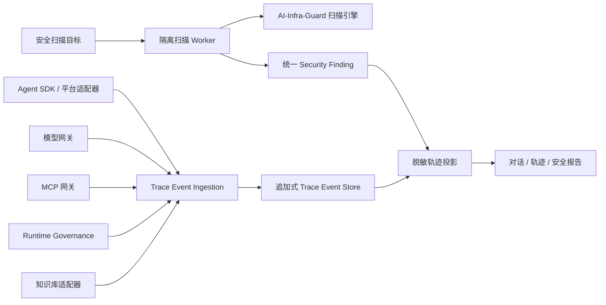

# 智能体安全平台下一版本实施计划

> 状态：P0～P6 开发项和 P7-01～P7-11 已完成并通过内部验收；P2 外部平台和客户环境仍等待用户实测
>
> 本文件是本项目下一版本智能体风险扫描、MCP/工具扫描和统一调用轨迹建设的唯一执行清单。开发、测试、文档和验收必须以这里的任务状态为准。

当前下一项：`P7-12` 完成银行验收环境部署、回归、证据包和遗留问题清单；P2 客户环境实测并入该项。

| 阶段 | 内容 | 状态 |
|---|---|---|
| Phase 0 | 版本、许可和开发基线 | 已完成 |
| Phase 1 | 扫描基础设施和统一模型 | 已完成 |
| Phase 2 | AI-Infra-Guard Agent 风险扫描 | 已完成 |
| Phase 3 | MCP Server 和 Tool 风险扫描 | 已完成 |
| Phase 4 | 统一调用轨迹后端 | 已完成 |
| Phase 5 | 轨迹和扫描管理界面 | 已完成 |
| Phase 6 | 环境策略、报告和安全联动 | 已完成 |
| Phase 7 | 集成、性能、部署和交付 | 进行中（P7-01～P7-11 已完成） |

## 1. 清单使用规则

1. `[ ]` 表示未完成，`[x]` 表示实现、验证和必要文档均已完成。
2. 不能因为“代码已编写”就勾选；对应测试或人工验收未通过时仍保持 `[ ]`。
3. 每完成一项，在“实施证据”中记录日期、提交或文件、验证命令和结果。
4. 范围、架构或验收标准变化时，先更新本文件，再修改代码。
5. 每次开始工作前先读取本文件，从第一个未完成且依赖已满足的任务继续。
6. 不提前批量勾选，不用“基本完成”代替验收结果。
7. 全部任务完成并经版本验收后，本文件转为验收记录；若团队不再需要历史记录，则按项目约定删除。

## 2. 已确认事实、项目决定和待验证项

### 2.1 已确认事实

- [x] 已检查招商银行需求文档中下一版本相关条目，目标包含 Agent 风险扫描、MCP/工具风险扫描、运行时敏感行为检测和调用证据。
- [x] 已检查 AI-Infra-Guard 主仓库，确认适合作为独立扫描 Worker 的能力来源，不直接集成其整套 Web 平台。
- [x] 已检查 DeepSeek Harness 的 Session 和 Trajectory 设计，确认轨迹页面是追加式 Session 事件日志的投影，不是仅由 LLM 网关日志生成。
- [x] 已检查当前 Agent Manager 的模型网关、MCP 网关和 Runtime Governance 数据模型，确认三者能提供部分轨迹事件。
- [x] 已确认模型网关不能独立提供本地工具实际执行结果、可靠知识库来源和完整 Turn/Step 边界。

### 2.2 已确认项目决定

- [x] 首期 Agent 扫描范围与锁定版本的 AI-Infra-Guard 支持范围保持一致。
- [x] 自研 Agent 平台暂不承诺专用适配器，首期提供通用 HTTP/WebSocket 接入和可扩展适配器接口。
- [x] 测试、预生产和生产环境都允许接入，但采用不同执行模式和安全限制。
- [x] 完整调用轨迹采用“Agent SDK/平台适配器 + 模型网关 + MCP 网关 + Runtime Governance”的多源采集架构。
- [x] 轨迹界面参考 DeepSeek Harness 的信息架构和交互，不直接依赖其内部 UI 包。

### 2.3 尚未验证或尚未决定

- [ ] 与客户确认正式验收时使用的 AI-Infra-Guard 版本、平台清单和攻击用例基线。
- [ ] 与客户确认生产主动扫描的审批人、维护窗口和允许目标。
- [ ] 与客户确认原始 Prompt、模型响应、工具参数和工具结果的留存周期。
- [x] 已取得客户提供的 TC260-003 原文，并按附录 A 完成五大类 31 项风险映射。
- [ ] 与客户确认最终报告版式、逐项合格口径和 OWASP ASI 联合展示格式。
- [ ] 对自研 Agent 平台取得接口、认证、会话和工具调用样例后完成适配性评估。

## 3. 目标范围

### 3.1 本版本交付

- Agent 风险扫描任务、策略、结果、证据和报告。
- MCP Server 和 Tool 风险扫描、Schema 漂移检测及资产关联。
- 模型网关、MCP 网关、Runtime Governance 和 Agent SDK 的统一轨迹事件。
- 对话/轨迹双视图、时间线、调用详情、风险、审批和耗时展示。
- 测试、预生产和生产环境的分级执行模式。
- 轨迹与安全发现、OWASP ASI 风险分类的关联。
- 中英文管理界面、权限、审计、部署和接入文档。

### 3.2 本版本不承诺

- 不承诺未知自研 Agent 平台零开发接入。
- 不承诺仅通过模型网关还原完整 Agent 执行轨迹。
- 不允许生产环境默认执行无限制主动攻击测试。
- 不把 AI-Infra-Guard 原始分数直接描述为银行正式风险评分。
- 不把 Sandbox 或应用层事件描述为精确 syscall、文件访问或完整进程树审计。
- 不展示或持久化模型的隐藏推理内容；只保存协议实际返回且策略允许保留的字段。

## 4. 总体架构



实施原则：

- 扫描引擎以独立 Worker 运行，不与主 API 进程共享执行权限。
- 事件表只保存索引、状态和关联字段；敏感 Payload 分离加密保存。
- 网关缺少 Agent 事件时必须标记为部分轨迹，不推测缺失步骤。
- 第一版使用现有数据库和后台任务能力，不为了轨迹单独引入 Kafka 等大型基础设施。
- 所有外部扫描目标必须经过 SSRF 防护、目标白名单、超时、并发和响应大小限制。

## 5. 统一数据设计

### 5.1 安全扫描实体

建议新增或扩展以下实体：

- `security_targets`：目标平台、环境、端点、认证引用和能力声明。
- `security_scan_policies`：执行模式、用例集、预算、并发、工具限制和审批要求。
- `security_scan_tasks`：任务状态、版本、目标、策略快照、开始/结束时间和停止原因。
- `security_scan_cases`：用例、轮次、请求、响应摘要和执行状态。
- `security_findings`：标准风险编码、严重级别、证据、修复建议和状态。
- `security_scan_artifacts`：原始扫描结果、脱敏报告和导出文件引用。

### 5.2 轨迹实体

建议新增：

- `runtime_trace_sessions`：一次 Agent 会话或扫描会话的主记录。
- `runtime_trace_events`：追加式事件索引，按 `trace_id + seq` 排序。
- `runtime_trace_payloads`：加密原始 Payload 与脱敏投影。
- `runtime_trace_exports`：导出任务、脱敏级别、下载人和过期时间。

事件最小字段：

```json
{
  "schema_version": "runtime-trace@1",
  "event_id": "evt_xxx",
  "trace_id": "tr_xxx",
  "seq": 18,
  "event_time": "2026-08-28T10:00:00Z",
  "received_at": "2026-08-28T10:00:00Z",
  "tenant_id": "tenant-1",
  "agent_id": "agent-1",
  "session_id": "session-1",
  "turn_id": "turn-3",
  "step_id": "step-1",
  "source": "mcp_gateway",
  "type": "tool.result",
  "request_id": "req_xxx",
  "call_id": "call_xxx",
  "parent_call_id": null,
  "status": "completed",
  "duration_ms": 34,
  "payload_ref": "payload-id",
  "risk_codes": ["ASI_TOOL_ABUSE"]
}
```

必须支持的关联字段：

- `trace_id`
- `session_id`
- `turn_id`
- `step_id`
- `request_id`
- `call_id`
- `parent_call_id`
- `agent_id`
- `tenant_id`

轨迹完整度：

- `full`：Agent/平台事件和网关事件均已接入。
- `gateway_partial`：有模型或 MCP 网关事件，缺少 Agent 会话事件。
- `model_only`：只有模型网关事件。
- `mcp_only`：只有 MCP 网关事件。

### 5.3 首期事件类型

- `turn.start`、`turn.end`
- `step.start`、`step.end`
- `message.user`
- `context.injected`
- `model.request`、`model.response`、`model.error`
- `tool.call`、`tool.result`、`tool.error`
- `mcp.call`、`mcp.result`、`mcp.error`
- `knowledge.retrieval`
- `policy.decision`
- `approval.requested`、`approval.resolved`
- `runtime.blocked`、`runtime.killed`
- `security.finding`

## 6. 环境与执行模式

| 环境 | 默认模式 | 行为边界 |
|---|---|---|
| 测试/Sandbox | `active_full` | 允许完整多轮攻击和受控工具测试 |
| 预生产 | `active_safe` | 使用只读凭据，限制外部副作用 |
| 生产 | `passive` 或 `read_only` | 被动监测或低影响验证 |
| 生产特批 | `active_safe` | 审批、维护窗口和专用测试身份下执行 |

执行模式定义：

- `passive`：只分析已有请求和轨迹，不向目标发送测试请求。
- `read_only`：允许发送测试请求，但禁止调用写入或破坏性工具。
- `active_safe`：允许受控多轮测试，要求预算、白名单和 Kill Switch。
- `active_full`：允许完整攻击用例；生产环境策略默认拒绝。

## 7. 分阶段实施清单

### Phase 0：版本、许可和开发基线

- [x] P0-01 锁定 AI-Infra-Guard commit/tag，记录支持平台、扫描入口和已知限制。
- [x] P0-02 检查 Apache-2.0、NOTICE 和第三方依赖义务，生成复用清单。
- [x] P0-03 锁定 DeepSeek Harness 参考版本，只记录事件模型和 UI 参考，不建立运行时依赖。
- [x] P0-04 建立安全扫描和轨迹能力发现及紧急关停机制，产品默认开启且无需 `.env` 配置。
- [x] P0-05 确定数据库迁移、Worker 镜像和离线部署方案。
- [x] P0-06 为新 API、后台任务、错误码和审计事件建立稳定编码表。

Phase 0 验收：

- [x] A0-01 版本、许可证、能力范围和不支持项有可复核记录。
- [x] A0-02 未启用功能不会出现在菜单中，也不会开放未受保护的接口。
- [x] A0-03 离线构建不在运行时从 GitHub 拉取代码或规则。

### Phase 1：扫描基础设施和统一模型

- [x] P1-01 新增安全目标、扫描策略、扫描任务、用例、发现和产物数据模型及迁移。
- [x] P1-02 实现扫描目标凭据加密存储、掩码返回、更新和吊销。
- [x] P1-03 实现扫描任务创建、查询、取消、超时和幂等控制。
- [x] P1-04 实现独立扫描 Worker 和主平台任务领取协议。
- [x] P1-05 实现 Worker 心跳、租约、失败重试和僵尸任务回收。
- [x] P1-06 实现目标 URL/CIDR 校验、DNS 重绑定防护和出站白名单。
- [x] P1-07 实现请求轮次、Token、费用、并发、时间和响应大小预算。
- [x] P1-08 实现统一 `SecurityFinding` 严重级别、证据和状态模型。
- [x] P1-09 实现管理员与安全审计角色权限，普通用户只能访问授权目标。
- [x] P1-10 为任务、凭据、策略、导出和取消动作补充审计日志。

Phase 1 验收：

- [x] A1-01 同一个幂等键重复提交不会创建多个扫描任务。
- [x] A1-02 凭证明文只在创建时展示一次，数据库和接口不返回明文。
- [x] A1-03 未经目标与策略双重白名单的内网地址，以及环回、云元数据和策略禁止地址无法通过目标校验。
- [x] A1-04 Worker 异常退出后任务能重试或进入明确失败状态，不永久运行。
- [x] A1-05 到达任一预算后停止发起新请求并记录停止原因。
- [x] A1-06 新增后端错误均返回稳定 `error_code` 和中英文可渲染参数。

### Phase 2：AI-Infra-Guard Agent 风险扫描

- [x] P2-01 封装 AI-Infra-Guard Agent Scan 为本项目 Worker Adapter。
- [x] P2-02 将锁定版本支持的平台类型映射为 `security_target` 类型。
- [x] P2-03 实现通用 HTTP/WebSocket 请求、认证和响应转换配置。
- [x] P2-04 实现单轮、多轮、会话延续和会话重置能力。
- [x] P2-05 将原始测试用例、轮次和结果转换为统一扫描用例记录。
- [x] P2-06 将上游风险转换为稳定风险编码，不直接采用其总分作为最终评级。
- [x] P2-07 保存脱敏证据、原始产物引用、规则版本和扫描引擎版本。
- [x] P2-08 实现扫描任务列表、详情、发现处置和前后版本比较 API。
- [x] P2-09 增加至少一个可重复的安全目标 Mock，覆盖正常、超时和恶意响应。
- [x] P2-10 增加 Prompt Injection、敏感信息泄露、越权和工具滥用测试样例。

Phase 2 验收：

- [x] A2-01 锁定版本声明支持的每类接入方式至少完成一个连接测试。
- [x] A2-02 多轮用例能保持会话，任务详情可以按轮次查看请求和响应证据。
- [x] A2-03 上游新增未知风险类型时进入 `unmapped`，不会被静默归为低风险。
- [x] A2-04 原始结果、归一化 Finding 和报告结论可相互追溯。
- [x] A2-05 响应中包含 HTML、超大内容或恶意字段时不会污染管理台或日志。

内部验收边界：A2-01 对 21 类 Provider 执行锁定 Adapter 的请求路由/转换契约测试，通用 HTTP
使用本地真实服务验证；外部 SaaS 因没有客户账号和授权目标，尚未做真实账户连通性验证。P2
完整引擎已在隔离镜像内导入，但实际攻击扫描仍需要配置评估模型和经授权的目标，不能把 Mock
契约测试表述为客户环境实测。Adapter 对锁定版上游“未分类类型默认 ASI10”的行为做了额外
交叉校验：只有 Finding 类型显式携带对应 ASI 编码才映射，未知类型进入 `unmapped`。评估模型
终止错误或全程没有成功目标对话时任务 fail-closed，不生成“安全”结论。

网络边界：目标在创建、任务领取和每次调用前均重新解析并核对 DNS Pin；当前 HTTPX/WebSocket
建连仍由传输库自行解析，不是 socket 级固定 IP，存在很窄的检查—建连时间窗。生产部署必须同时
配置 Worker 出站网络策略；该限制不应被描述为完整的传输层 DNS 固定。

### Phase 3：MCP Server 和 Tool 风险扫描

- [x] P3-01 基于锁定版 AI-Infra-Guard 的 MCP 风险分类标签和描述净化契约，实现本平台元数据 Worker Adapter；不宣称执行完整上游 MCP Scan。
- [x] P3-02 将扫描目标关联现有 MCP Gateway、Server、Tool 和 Schema Hash。
- [x] P3-03 实现 Tool 描述注入、工具投毒、危险参数和高风险操作检查。
- [x] P3-04 实现扫描时 Schema 与已批准 Schema 的漂移比较。
- [x] P3-05 实现高风险发现与现有审批、禁用和调用策略的联动建议。
- [x] P3-06 扫描阶段默认不执行具有写入、删除、转账或外发副作用的工具。
- [x] P3-07 实现 MCP 扫描结果、证据和修复建议 API。
- [x] P3-08 增加恶意 Tool 描述、Schema 漂移和危险工具测试服务器。

Phase 3 验收：

- [x] A3-01 发现能定位到具体 Gateway、Server、Tool 和 Schema Hash。
- [x] A3-02 Tool 描述注入、Schema 漂移和危险参数样例均能检出。
- [x] A3-03 未经允许的副作用工具在扫描阶段不会被实际调用。
- [x] A3-04 高风险发现可生成审批或禁用建议，但不会未经授权自动改变生产策略。

P3 实现边界：锁定版上游 MCP 动态模式包含真实 `call_mcp_tool` exploit 路径，不能直接用于生产
默认扫描。当前 Adapter 是平台自研元数据检查器，只复用上游分类标签和描述净化契约，不执行
上游 `Agent.scan()`、动态分析、LLM 分析或 SARIF 转换。执行时只读取任务创建时冻结且已脱敏、
限深、限长的 MCP Gateway 元数据快照，常见凭据/PII 值会被删除，原文只保留 SHA-256。已知注入、
副作用和危险参数信号在完整原始元数据上先提取为无原文摘要；投影发生截断、丢项、限深或完整分析
达到上限时，强制生成 `mcp_metadata_projection_incomplete` 高风险 Finding，不允许静默判定为安全。
Adapter 不连接 Server、不领取 Server 凭据、不暴露 `tools/call`。空 Gateway/空 Tool 集合拒绝创建
任务，处置项均为 `suggestion_only`，不自动修改 Tool、Gateway Binding 或审批策略。

### Phase 4：统一调用轨迹后端

- [x] P4-01 新增 Trace Session、Event、Payload 和 Export 数据模型及迁移。
- [x] P4-02 实现 `runtime-trace@1` schema、服务端顺序号和 schema version 校验。
- [x] P4-03 实现 `POST /api/v1/runtime-traces/{trace_id}/events:batch`。
- [x] P4-04 实现事件幂等键、重复批次去重和乱序客户端时间处理。
- [x] P4-05 实现原始 Payload 加密、脱敏投影和权限隔离。
- [x] P4-06 模型网关发布 request、response、error、Token、耗时和 Prompt Security 事件。
- [x] P4-07 MCP 网关发布 call、result、error、审批、Schema 和耗时事件。
- [x] P4-08 Runtime Governance 发布策略决定、预算、审批、阻断和 Kill Switch 事件。
- [x] P4-09 实现 Agent SDK 最小版本，支持 Turn、Step、Message、Tool 和关联 ID。
- [x] P4-10 实现知识检索事件，显式记录知识库、文档、Chunk 和脱敏摘要。
- [x] P4-11 实现 `full`、`gateway_partial`、`model_only`、`mcp_only` 完整度计算。
- [x] P4-12 实现按会话、Agent、时间、风险、Tool 和 request ID 查询。
- [x] P4-13 实现轨迹保留、过期清理和导出任务。
- [x] P4-14 实现轨迹数据量、写入失败、积压和清理监控。

Phase 4 验收：

- [x] A4-01 SDK 示例能还原完整 Turn、Step、模型请求和 Tool Call/Result 链。
- [x] A4-02 仅走模型网关的请求显示 `model_only` 或 `gateway_partial`，不伪造 Agent 步骤。
- [x] A4-03 同一事件或批次重复上报不会产生重复轨迹记录。
- [x] A4-04 Tool Call 和 Result 通过 `call_id` 关联，嵌套调用通过 `parent_call_id` 展示。
- [x] A4-05 客户端时钟偏差不会破坏服务端 `seq` 顺序。
- [x] A4-06 普通角色无法查询原始 Prompt、响应、工具参数和工具结果。
- [x] A4-07 管理员或隐私审计角色查看、导出原始内容时产生审计记录。
- [x] A4-08 网关轨迹发布失败不阻塞主模型或 MCP 请求，但必须计数并告警。

### Phase 5：轨迹和扫描管理界面

- [x] P5-01 新增安全扫描目标、策略、任务、发现和报告页面。
- [x] P5-02 新增“对话 / 轨迹”双视图和 Input、Model、Tools、MCP、Knowledge、Policy 时间线。
- [x] P5-03 实现 Turn/Step 分组、父子调用展开和事件状态展示。
- [x] P5-04 实现 Summary、Payload、Result、Schema、Timing、Security 详情页签。
- [x] P5-05 实现 Token、首字延迟、模型耗时、平台耗时和工具耗时展示。
- [x] P5-06 实现风险、审批、拦截、Kill Switch 和轨迹完整度标记。
- [x] P5-07 实现事件和 Finding 的双向跳转。
- [x] P5-08 实现按 Turn、Tool、风险、错误和 request ID 搜索。
- [x] P5-09 实现大轨迹分页、按需加载和虚拟滚动。
- [x] P5-10 实现脱敏 JSON/PDF 导出入口和原始导出二次授权提示。
- [x] P5-11 所有新增文案使用语义化 i18n Key，提供简体中文和英文。
- [x] P5-12 检查英文长文案、表格、抽屉、弹窗、移动端和无数据状态。

Phase 5 验收：

- [x] A5-01 1 万事件测试会话可以打开、搜索和分页，不一次性加载全部 Payload。
- [x] A5-02 完整与部分轨迹在列表和详情中均有清晰、稳定的状态标识。
- [x] A5-03 页面不通过中文或英文显示文本判断业务逻辑。
- [x] A5-04 原始内容默认不可见，切换查看和导出均符合权限策略。
- [x] A5-05 `npm run test:i18n` 和 `npm run build` 通过。

### Phase 6：环境策略、报告和安全联动

- [x] P6-01 在扫描目标和策略中实现环境、执行模式和允许能力字段。
- [x] P6-02 生产环境默认拒绝 `active_full`。
- [x] P6-03 生产 `active_safe` 要求维护窗口、目标白名单、专用身份和人工审批。
- [x] P6-04 实现工具读写属性和生产 Tool denylist。
- [x] P6-05 实现扫描任务预览，展示将执行的用例、轮次、工具和预算。
- [x] P6-06 实现任务级 Kill Switch，停止排队和未开始请求。
- [x] P6-07 将扫描发现和运行事件映射到稳定 OWASP ASI 风险编码。
- [x] P6-08 实现版本对比报告，区分新增、未变化、已修复和无法复测。
- [x] P6-09 实现报告模板版本和判定口径快照。
- [x] P6-10 对 TC260 映射标记“已验证、部分覆盖、未覆盖”，不虚报覆盖率。

Phase 6 验收：

- [x] A6-01 生产环境未审批主动扫描被服务端拒绝，不能只依赖前端禁用。
- [x] A6-02 Kill Switch 后不再发起新请求，进行中请求按配置取消或超时结束。
- [x] A6-03 只读模式调用写工具时被服务端策略阻断并留下轨迹。
- [x] A6-04 新任务报告中的每个风险可以追溯到用例、事件、证据和规则版本；历史缺项记录显示为不完整，不倒填。
- [x] A6-05 没有证据的控制项显示“未验证”，不显示“通过”。

### Phase 7：集成、性能、部署和交付

- [x] P7-01 增加完整接入 Demo，演示 Agent SDK、模型网关、MCP 和轨迹关联。
- [x] P7-02 增加 Gateway-only Demo，演示部分轨迹和完整度提示。
- [x] P7-03 增加扫描 Worker、API 和前端端到端测试。
- [x] P7-04 增加并发扫描、长会话、大 Payload 和事件批量写入性能测试。
- [x] P7-05 增加 Worker 镜像、Compose 配置、健康检查和资源限制。
- [x] P7-06 验证 x86_64 和 ARM64 离线构建及运行。
- [x] P7-07 更新 `docs/project-guide.md`，描述产品能力和业务流程。
- [x] P7-08 更新 `docs/model-gateway.md`，描述轨迹事件、关联头和隐私边界。
- [x] P7-09 更新 `docs/external-agent-integration.md`，描述 SDK 和适配器接入。
- [x] P7-10 更新 `docs/docker-deployment.md` 和离线部署文档，描述 Worker 部署。
- [x] P7-11 更新帮助中心中英文内容，且只描述已经启用的能力。
- [ ] P7-12 完成银行验收环境部署、回归、证据包和遗留问题清单。

Phase 7 验收：

- [x] A7-01 后端完整测试和新增 targeted tests 通过。
- [x] A7-02 前端 i18n 测试和生产构建通过。
- [x] A7-03 Compose 服务健康，Worker 中断、恢复和升级过程经过验证。
- [x] A7-04 x86_64、ARM64 构建产物和离线安装步骤经过实际验证。
- [x] A7-05 文档、页面、API 和实际启用功能一致。
- [x] A7-06 银行验收矩阵逐项提供结果、证据和未满足原因。

### 四类扫描目标与完整 AI-Infra-Guard 扩展

- [x] EXT-01 将扫描目标拆分为 `agent`、`mcp`、`llm`、`ai_infrastructure` 四类资产，并以独立
  `connector_type` 表达 Dify/Coze/OpenAI-compatible/HTTP/WebSocket/MCP Gateway/网络端点连接方式。
- [x] EXT-02 以固定 AI-Infra-Guard `v4.6.0` 源码、锁文件、整树哈希、LICENSE、NOTICE 和 SBOM
  构建仅内部可访问且强制认证的扫描服务，运行时不下载源码或依赖。
- [x] EXT-03 实现真实 LLM 红队任务、逐 Prompt Case、评估状态、Finding、加密产物、幂等恢复、心跳、
  重试、超时和进程组 Kill Switch；目标模型与评估模型凭据相互独立。
- [x] EXT-04 实现显式 URL 基础设施扫描、HTTP 授权、DNS/预期 IP、目标与策略双重 CIDR 校验；只有
  组件、具体版本与版本规则命中的 CVE 才生成 Finding，其余证据不足结果保持 `unverified`。
- [x] EXT-05 修复上游结果附件上传导致任务永久 `doing`、类型化模型参数未脱敏和结果传输信封未解包问题，
  并增加对应回归测试。
- [x] EXT-06 管理台支持四类目标和任务参数，默认开启；目标、策略和任务表首列固定窄宽度，目标凭据使用
  固定列宽、单行省略和完整掩码悬浮提示，避免长文本遮挡后续列。
- [x] EXT-07 重新构建并实际验证 AMD64、ARM64 内部扫描服务镜像的非 root、只读、依赖导入、健康和
  进程组取消；使用受控 OpenAI-compatible 目标完成一次真实 LLM 红队，使用授权私网 HTTP 目标完成一次
  真实基础设施扫描，并把两类真实上游结果成功转换为平台 Case/Finding/Artifact。

EXT-07 的本地受控验收不替代 P7-12 银行现场验收。LLM 上游在本次受控用例中形成 1 个 Prompt Case、
1 个越狱信号 Finding 和 1 个报告产物；基础设施目标未暴露可确认组件版本，因此形成 1 个 `unverified`
Case、0 个 Finding 和 1 个报告产物。两次任务的上游 SQLite 共检查 5 处凭据字段，均为脱敏值。当前仍需
银行提供正式双架构发布包、目标主机、角色、授权目标、模型额度和证据存储引用后才能关闭 P7-12。

## 8. 总体验收场景

- [x] E2E-01 Prompt Injection 被识别，Finding、请求、响应和轨迹证据一致。
- [x] E2E-02 模型产生 Tool Call，经 MCP 审批后执行，Call/Result 正确关联。
- [x] E2E-03 本地工具不经过 MCP 网关，但通过 SDK 出现在完整轨迹中。
- [x] E2E-04 RAG 检索显示知识库、文档和 Chunk，敏感正文默认脱敏。
- [x] E2E-05 网关单独接入时显示部分轨迹，不显示虚假的 Turn/Step。
- [x] E2E-06 生产主动扫描未经审批被拒绝。
- [x] E2E-07 Kill Switch 触发后停止新调用，停止原因进入任务和轨迹。
- [x] E2E-08 同一 Agent 两个版本的扫描结果可比较新增、未变化和已修复风险。
- [x] E2E-09 普通角色不能通过列表、搜索、详情或导出获取原始敏感内容。
- [x] E2E-10 AI-Infra-Guard 或 Worker 异常退出时任务明确失败或重试，不永久卡住。

## 9. 建议代码落点

具体名称可在实现时调整，但职责边界保持稳定：

```text
agent_manager/
  security_scanning/
    adapters/
      ai_infra_guard_agent.py
      ai_infra_guard_mcp.py
      generic_http.py
    findings.py
    policies.py
    worker.py

backend/
  routers/
    security_scans.py
    runtime_traces.py
  services/
    trace_events.py
    trace_redaction.py

web/src/
  views/
    SecurityScanTargets.vue
    SecurityScanTasks.vue
    SecurityFindings.vue
    RuntimeTraces.vue
  components/trace/

demo/
  runtime-trace-sdk/
  gateway-partial-trace/
```

新增 API 时同步考虑登录权限、稳定错误码、审计日志、幂等、防重复提交和前端兼容。

## 10. 验证命令基线

任务实际落地后按改动范围执行；下列测试文件需要在对应 Phase 中创建：

```bash
uv run pytest tests/test_security_scan_api.py -q
uv run pytest tests/test_ai_infra_guard_adapter.py -q
uv run pytest tests/test_ai_infra_guard_mcp_adapter.py -q
uv run pytest tests/test_runtime_traces.py -q
uv run pytest tests/test_runtime_governance.py -q
uv run pytest tests/test_mcp_gateway.py -q
uv run pytest
```

```bash
source ~/.nvm/nvm.sh
nvm use 22.21.1
cd web
npm run test:i18n
npm run build
```

```bash
docker compose config
docker compose build
docker compose up -d
docker compose ps
```

命令成功只代表对应检查通过，不自动证明业务验收场景通过。E2E 和生产策略仍需单独记录证据。

## 11. 风险和控制

| 风险 | 控制措施 | 状态 |
|---|---|---|
| 扫描攻击影响生产 | 环境分级、审批、预算、工具 denylist、Kill Switch | 已实施（P6-03、P6-04、P6-06） |
| 外部目标形成 SSRF | URL/CIDR 校验、DNS 重绑定防护、目标与策略双重白名单 | P1 已实施 |
| 轨迹保存 PII 或密钥 | Payload 分离加密、脱敏投影、严格 RBAC、导出审计 | P4 已实施 |
| 网关数据被误认为完整轨迹 | `trace_completeness` 强制展示 | P4 已实施 |
| 上游项目接口变化 | 锁定版本、Adapter 隔离、兼容测试 | P2 已实施 |
| 上游风险分数误导 | 使用平台稳定风险编码和策略汇总 | P2 已实施 |
| 轨迹写入影响主调用 | best-effort 隔离写入、失败计数和告警 | P4 已实施 |
| 大会话拖垮页面 | 分页、Payload 延迟加载、虚拟滚动 | 待实施 |

## 12. 实施证据

每勾选一项至少补一条证据；同一批变更可以合并记录多个任务 ID。

| 日期 | 任务 ID | 文件/提交 | 验证命令或操作 | 结果 |
|---|---|---|---|---|
| 2026-08-28 | 需求与技术调研 | 本文档第 2 节 | 核对需求文档、上游仓库和当前代码 | 已确认范围与数据边界 |
| 2026-08-28 | P0-01、P0-02、P0-03、A0-01 | `deploy/agent-security/`、`docs/agent-security-p0-baseline.md` | 对照官方 tag/Commit、LICENSE、NOTICE、Provider 和 Session/Trajectory 源文件 | 锁定 AIG `v4.6.0`、DSH `dsh-v0.1.2-alpha.1`，许可和限制可复核 |
| 2026-08-28 | P0-04、P0-06、A0-02 | Backend、Web、`tests/test_agent_security_p0.py`、`web/scripts/feature-flags.test.mjs` | `uv run pytest tests/test_agent_security_p0.py tests/test_backend_main_routes.py -q`、`npm run test:features` | 页面默认开启且无需 `.env`；紧急关停时菜单隐藏、API 返回稳定错误码 |
| 2026-08-28 | P0-05、A0-03 | Dockerfile、Compose、P0 技术基线 | 实际导入 Backend App、`docker compose config`、本地 lock/无网络导入检查 | 路由挂载成功，运行时只读取镜像内 lock |
| 2026-08-28 | P0 回归 | 全仓库 | `uv run pytest -q` | 543 passed、3 skipped；无失败 |
| 2026-08-28 | P0 前端 | `web/` | Node 22.21.1 下 `npm run test:i18n`、`npm run build` | i18n 通过，生产构建成功 |
| 2026-08-28 | P1-01、P1-08 | `backend/models.py`、`backend/main.py`、`backend/security_scan_schemas.py` | 临时数据库导入 Backend、检查表和 `agent_security_p1_v1` 迁移标记 | 8 张 P1 表、统一 Finding/用例/产物模型和迁移均生效 |
| 2026-08-28 | P1-02、P1-03、P1-09、P1-10、A1-01、A1-02、A1-06 | `backend/routers/security_scans.py`、`tests/test_agent_security_p1.py` | `uv run pytest tests/test_agent_security_p0.py tests/test_agent_security_p1.py tests/test_backend_main_routes.py -q` | 26 项专项测试通过；凭据、幂等、权限、稳定错误和防篡改审计通过 |
| 2026-08-28 | P1-04、P1-05、A1-04 | `services/agent-security-worker/`、`build.sh`、`docker-compose.yaml` | 构建 `agent-manager-security-worker:p1-acceptance`、检查 Compose profile、租约过期与 Worker 协议测试 | ARM64 非 root 镜像构建成功；心跳、租约、重试、失败和僵尸回收通过 |
| 2026-08-28 | P1-06、P1-07、A1-03、A1-05 | `backend/security_scan_controls.py`、P1 专项测试 | 私网/环回/元数据/DNS 变化和六类预算测试 | 默认阻断与双重白名单生效；任一预算超限均返回明确停止原因 |
| 2026-08-28 | P1 全量回归 | 全仓库 | `uv run pytest -q` | 558 passed、3 skipped；无失败 |
| 2026-08-28 | P1 前端与部署 | `web/`、Compose、Docker 文档 | `npm run test:features`、`npm run test:i18n`、`npm run build`、`docker compose --profile agent-security config` | 页面无需 `.env` 默认开启；i18n、生产构建和 Worker 安全限制通过 |
| 2026-08-28 | P2-01、P2-02、P2-03、A2-01 | `services/agent-security-worker/`、`deploy/agent-security/upstreams.lock.json` | 校验上游 tag/Commit/源码哈希；21 类 Provider 路由契约和本地 HTTP 连接测试 | AIG `v4.6.0` Agent Scan 已隔离封装；通用 HTTP 真实 Mock 通过，外部 SaaS 待客户账号实测 |
| 2026-08-28 | P2-04、P2-05、P2-06、A2-02、A2-03 | Worker Adapter、扫描任务 API、专项测试 | 单轮、多轮、延续、重置、用例轮次和未知类型测试 | 会话状态加密延续；未知类型稳定进入 `unmapped/medium` |
| 2026-08-28 | P2-07、P2-08、A2-04、A2-05 | `backend/routers/security_scans.py`、`backend/security_scan_controls.py` | 原始产物加密、脱敏、处置、比较、权限和恶意内容测试 | 原始/归一化结果可追溯；原始内容仅特权角色显式查看并审计 |
| 2026-08-28 | P2-09、P2-10 | `demo/agent-security-mock-target/` | 正常、超时、超大、恶意字段及四类风险输入测试 | 可重复 Mock 和验收输入已固定，Mock 不伪造 Finding |
| 2026-08-28 | P2 Worker 镜像 | Worker Dockerfile、Compose、SBOM | `docker build --platform linux/arm64 -f services/agent-security-worker/Dockerfile -t agent-manager-security-worker:p2-review .`；无网络、只读根文件系统容器导入检查 | 镜像 `sha256:0d6ff155…` 为 ARM64、UID 10001；修复后 Adapter/Worker、AIG 引擎和 42 包 SBOM 可在无网络只读容器导入 |
| 2026-08-28 | P2 专项回归 | P2 实现 | `uv run pytest tests/test_ai_infra_guard_adapter.py -q` | 34 passed；覆盖密封凭据、后台续租、HTTP/WebSocket、真实上游未知类型回退、评估模型/目标 fail-closed、结果归一化、会话和恶意内容 |
| 2026-08-28 | P2 兼容与全量回归 | 全仓库 | P0/P1/P2 targeted、`uv run pytest -q`、Ruff、Python 编译检查 | targeted 60 passed；全量 592 passed、3 skipped；静态检查通过 |
| 2026-08-28 | P2 前端回归 | `web/` | Node 22.21.1 下 `npm run test:features`、`npm run test:i18n`、`npm run build` | 功能开关测试 3 passed；i18n 和生产构建通过，上游归属已展示 |
| 2026-08-28 | P2 独立复核修复 | P2 Adapter、Worker、归一化与 Finding API | 对照锁定上游 `report.py` 和 `llm.py`；增加真实 ASI10 回退、终止模型错误、零成功目标对话、转义 JSON 密钥和原型污染键测试 | 未知风险不再误归 `rogue_agent`；不完整扫描不再报安全；处置详情可查询；日志/证据脱敏边界收紧 |
| 2026-08-28 | P3-01、P3-02、P3-07、A3-01 | MCP Adapter、扫描目标/任务 API、`mcp-assessment` API、锁定上游源码 | 创建 Gateway/Server/Tool 后冻结允许 Tool、当前/已批准 Schema Hash；领取 `mcp_risk_scan` 并回传统一结果 | Finding、资产和建议可定位 Gateway/Server/Tool/Schema；原始脱敏报告加密保存 |
| 2026-08-28 | P3-03、P3-04、P3-08、A3-02 | `tests/test_ai_infra_guard_mcp_adapter.py` | 恶意 MCP Server Mock 返回描述注入、危险金融 Tool/参数；发现后修改 Schema 制造漂移 | 描述注入/工具投毒、危险参数、高风险操作和 Schema 漂移均检出 |
| 2026-08-28 | P3-05、P3-06、A3-03、A3-04 | MCP Adapter、Worker、专项测试 | 检查 Mock `tools/call` 计数、数据库 Tool 状态和建议执行模式 | 扫描阶段 `tools/call=0`；输出审批/禁用/调用策略/Schema 复核建议，全部为 `suggestion_only`，生产配置未变化 |
| 2026-08-28 | P3 专项与全量回归 | P0-P3、MCP Gateway、Backend | targeted、`uv run pytest -q`、Ruff、Python 编译、lock JSON 校验 | targeted 75 passed；全量 596 passed、3 skipped；静态检查通过 |
| 2026-08-28 | P3 Worker 镜像 | Worker Dockerfile、vendored MCP Scan、SBOM、Compose | ARM64 构建 `agent-manager-security-worker:p3-review`；无网络、只读根文件系统导入；Compose 渲染 | 镜像 `sha256:74a35bc0…`、UID 10001；Agent/MCP 上游包与 Adapter 可导入，SBOM 43 包，Compose 安全限制生效 |
| 2026-08-28 | P3 文档与前端基线回归 | 项目/部署/离线/Worker 文档、基线页中英文文案 | Node 22.21.1 下 `npm run test:features`、`npm run test:i18n`、`npm run build` | 功能开关 3 passed；中英文检查和生产构建通过；页面明确 P3 后端已接入、P5 管理界面和完整轨迹未启用 |
| 2026-08-28 | P3 首轮独立复核 | P3 Backend、元数据 Adapter、上游锁、专项测试 | Subagent 审查空资产、明文快照、来源归属、长描述、camelCase 和整树供应链校验 | 识别 6 项问题并完成首轮修复；复核继续发现通用脱敏覆盖和“先裁剪后检测”绕过，未在此时提前判定闭环 |
| 2026-08-28 | P3 二轮复核修复 | MCP 元数据净化、完整原文信号摘要、投影完整性 Finding、回归测试 | 覆盖邮箱、手机号、身份证、银行卡、Bearer/JWT/常见 Token；将注入放在第 8193 字后、危险参数放在第 101 项和第 9 层 | 原始值不进入任务快照/Worker；尾部注入和裁剪外参数仍能检出；任何不完整投影强制产生高风险 Finding |
| 2026-08-28 | P3 Subagent 最终闭环复核 | 敏感键语义匹配、递归上下文、Schema key 净化、供应链锁和 P3 全路径 | 复验 `api_token`、`authToken.metadata.default`、`credentials`、`secretKey`、`github_pat_` 及邮箱/手机号 key；P3 专项、P0-P3/MCP 联合和全量回归 | Subagent 未发现新增高/中风险并确认可闭环；P3 7 passed、联合 74 passed、全量 599 passed/3 skipped，Ruff、编译、整树哈希和 diff 检查通过 |
| 2026-08-28 | P3 最终 Worker 镜像 | Worker Dockerfile、整树哈希脚本、锁定源码和 SBOM | ARM64 重建；构建期整树/关键文件 hash；无网络、只读根文件系统导入 | 镜像 `sha256:4470db72…`、ARM64、UID 10001；整树校验在依赖安装前通过；Agent/MCP Adapter/Worker 可导入，SBOM 43 包 |
| 2026-08-28 | P4-01～P4-05、P4-11～P4-14、A4-02～A4-08 | `backend/models.py`、`backend/runtime_trace_schemas.py`、`backend/services/runtime_traces.py`、`backend/routers/runtime_traces.py`、`tests/test_runtime_traces.py` | 反向客户端时间、批次/事件冲突、父子 Call、四类完整度、RBAC、原始审计、导出、清理、指标和发布失败注入 | 4 项 P4 专项测试通过；服务端 seq、加密/脱敏、幂等、查询、保留和 best-effort 边界符合验收 |
| 2026-08-28 | P4-06～P4-10、A4-01 | 模型网关、MCP 网关、Runtime Governance、`agent_manager/runtime_trace.py`、`demo/runtime-trace-sdk/` | SDK 关联字段、模型/MCP/治理发布点和知识检索事件检查；模型/MCP/治理旧测试联合回归 | Agent 身份只取可信绑定；完整/部分轨迹按真实来源计算；93 项 P4 与兼容专项测试通过 |
| 2026-08-28 | P4 全量回归 | 全仓库 | `uv run pytest -q`、Ruff import/新增文件检查、Python 编译、`git diff --check` | 603 passed、3 skipped；无失败，静态与补丁格式检查通过 |
| 2026-08-29 | P1～P4 Subagent 交叉复核与修复 | 身份/RBAC、Worker 协议、预算、脱敏、轨迹幂等、留存和资源保护 | 复核租户与来源绑定、同批次冲突、并发领取、完成结果契约、PII/密钥绕过、大请求、自动清理和同步导出边界 | 已修复可局部闭环的问题；169 项交叉复核专项通过。DNS 到实际 socket 的严格绑定、审计与业务写入的事务原子性保留为后续架构加固项，不宣称已解决 |
| 2026-08-29 | P1～P4 修复后最终回归 | 全仓库、`web/` | `uv run pytest -q`；Node 22.21.1 下 `npm run test:features`、`npm run test:i18n`、`npm run build`；Ruff、Python 编译和 `git diff --check` | 后端 618 passed、3 skipped；功能开关 3 passed；中英文检查和生产构建通过；静态与补丁格式检查通过 |
| 2026-08-29 | P5-01 扫描管理界面 | `web/src/views/AgentSecurityScans.vue`、API、路由、导航、语义化 i18n | `npm run test:features`、`npm run test:agent-security-ui`、`npm run test:i18n`、`npm run build`；浏览器检查中英文、五阶段切换、目标弹窗、390px 断点和控制台；P0～P3 后端专项回归 | 前端契约 3 passed、功能开关 3 passed、i18n 与生产构建通过；后端 74 passed；桌面/移动无页面横向溢出且控制台无错误，未写入测试业务数据 |
| 2026-08-29 | P5-02 对话/轨迹双视图 | `web/src/views/RuntimeTraceExplorer.vue`、`web/src/runtimeTraceView.js`、API、路由、导航、语义化 i18n | `npm run test:runtime-trace-ui`、`npm run test:features`、`npm run test:agent-security-ui`、`npm run test:i18n`、`npm run build`；轨迹/网关/治理后端专项回归；复用已登录浏览器检查中英文路由、菜单和空数据状态 | 前端轨迹契约 3 passed、功能开关 3 passed、扫描页面 3 passed，i18n 与生产构建通过；后端 86 passed；六泳道按服务端 `seq` 投影且页面不请求原始 Payload；当前环境无轨迹数据，浏览器只验证了真实空数据状态，未写入测试业务数据 |
| 2026-08-29 | P5-03 Turn/Step 与父子调用层级 | `web/src/views/RuntimeTraceExplorer.vue`、`web/src/runtimeTraceView.js`、语义化 i18n 和轨迹前端契约测试 | `npm run test:runtime-trace-ui`、`npm run test:features`、`npm run test:agent-security-ui`、`npm run test:i18n`、`npm run build`；轨迹/网关/治理后端专项回归；已登录浏览器检查中英文路由和真实空状态 | 轨迹契约 8 passed、功能开关 3 passed、扫描页面 3 passed，i18n 与构建通过；后端 86 passed；连续片段分组不改变 `seq`，跨 Step 父子调用可折叠，未知状态保留协议原值；当前环境无轨迹数据，浏览器未验证有数据视觉效果且未写入测试业务数据 |
| 2026-08-29 | P5-04 六页签事件详情 | `web/src/views/RuntimeTraceExplorer.vue`、`web/src/runtimeTraceView.js`、语义化 i18n 和轨迹前端契约测试 | `npm run test:runtime-trace-ui`、`npm run test:features`、`npm run test:agent-security-ui`、`npm run test:i18n`、`npm run build`；轨迹/网关/治理后端专项回归；已登录浏览器检查中英文空状态和 390×844 视口 | 轨迹契约 9 passed、功能开关 3 passed、扫描页面 3 passed，i18n 与构建通过；后端 86 passed；六页签仅基于现有脱敏事件投影，页面不请求原始 Payload 或导出接口；当前环境 0 条轨迹，浏览器未验证有数据抽屉视觉效果且未写入测试业务数据 |
| 2026-08-29 | P5-05 Token 与耗时信号 | 模型网关轨迹发布、`web/src/runtimeTraceView.js`、`web/src/views/RuntimeTraceExplorer.vue`、语义化 i18n 和前后端契约测试 | `uv run pytest tests/test_runtime_traces.py tests/test_llm_gateway.py tests/test_mcp_gateway.py tests/test_runtime_governance.py tests/test_backend_main_routes.py -q`；`npm run test:runtime-trace-ui`、`npm run test:features`、`npm run test:agent-security-ui`、`npm run test:i18n`、`npm run build`；已登录浏览器检查中英文有数据页面和 Timing 详情 | 后端 87 passed，轨迹前端契约 10 passed，功能开关/扫描页面各 3 passed，i18n 与构建通过；真实环境 40 条轨迹，样例轨迹正确展示 41,046 Token；历史事件缺少新分段耗时时显示“未采集”。流式 TTFT 只计首个有效输出块；390px 无页面溢出，但现有全局侧栏会压缩主内容，保留给 P5-12 处理，本次未写入测试业务数据 |
| 2026-08-29 | P5-06、A5-02 风险与治理标记 | `web/src/runtimeTraceView.js`、`web/src/views/RuntimeTraceExplorer.vue`、语义化 i18n 和轨迹前端契约测试 | `npm run test:runtime-trace-ui`、`npm run test:features`、`npm run test:agent-security-ui`、`npm run test:i18n`、`npm run build`；相关后端 87 项回归；已登录浏览器检查中英文、40 条真实轨迹和 390px 极窄宽度 | 轨迹契约 11 passed；列表和详情均显示完整度与风险等级；审批待处理按请求 ID 配对，拦截/Kill Switch 只按稳定事件类型、状态码和风险编码汇总。真实样本为仅模型轨迹且无治理事件，正确显示 0/未观察到；桌面无溢出和控制台错误，治理面板在全局侧栏压缩下也不再自行横向溢出，未写入测试业务数据 |
| 2026-08-29 | P5-07 事件与 Finding 双向跳转 | Finding 可选 `trace_id + event_id` 关联字段、服务端存在性/归属校验与受保护查询、两端精确深链、语义化中英文文案 | P0/P1/轨迹/模型网关/MCP/运行治理/主路由相关后端回归；`npm run test:runtime-trace-ui`、`npm run test:agent-security-ui`、`npm run test:features`、`npm run test:i18n`、`npm run build`；Python 编译与差异检查 | 后端 114 passed，前端轨迹/扫描契约 16 passed，功能开关 3 passed，i18n 与生产构建通过；只有同时保存且经服务端校验的 `trace_id + event_id` 才展示双向入口，越权 Finding 详情返回 403、事件关联列表静默排除不可见项；历史 Finding 不猜测关联。浏览器停在登录页且无可复用会话，未把自动化结果冒充已登录页面验收 |
| 2026-08-29 | P5-08 五维证据搜索 | 轨迹/事件服务端查询参数、搜索参数规范化、证据检索带、可撤销条件、URL 查询状态、中英文无结果说明 | 轨迹后端专项与 P0/P1/模型网关/MCP/运行治理/主路由相关回归；`npm run test:runtime-trace-ui`、`npm run test:agent-security-ui`、`npm run test:features`、`npm run test:i18n`、`npm run build`；Python 编译、Ruff 与差异检查 | Turn ID、Tool 名称、风险等级、错误和 Request ID 均按稳定协议字段服务端搜索；会话条件取交集，事件条件继续在所选会话内取交集；错误只识别 `*.error` 类型或 `error/failed/timed_out` 状态，不搜索显示文案和 Payload。浏览器仍无可复用登录会话，真实页面验收边界未改变 |
| 2026-08-29 | P5-09、A5-01 大轨迹优化 | 事件 `after_seq` 游标、200 条按需续页、对话/六泳道可视窗口、手动续页入口、中英文加载状态 | 直接构造 10,000 事件测试会话，以 Tool 精确搜索得到 5,000 条，检查两批各 200 条游标续页、顺序、无重复和无 Payload；10,000 项前端窗口计算；相关后端与前端回归、i18n、构建、Ruff、编译和差异检查 | 首屏不再请求 1,000 条事件；服务端按唯一 `seq` 续页并返回 `has_more + next_after_seq`，页面接近底部或点击按钮才加载下一批；10,000 项窗口中实际物化少于 32 项。115 项后端、16 项轨迹前端契约及其他前端检查通过；浏览器无可复用登录会话，未执行真实登录后的视觉验收 |
| 2026-08-29 | P5-10、A5-04 轨迹证据导出 | 脱敏 JSON/PDF、PDF 分级报告、原始 JSON 二次授权、一次性令牌、权限与安全审计、双语导出闸门 | 缺少授权、错误密码、正确密码、令牌重放、原始内容、脱敏 PDF MIME/文本/敏感值排除；PDF 代表样本渲染 4 页并检查字体、表格、重复表头、页脚和页码；相关后端/前端回归、i18n、构建、Ruff、编译和差异检查 | 脱敏导出沿用轨迹读取权限；原始导出仅管理员/超级管理员/隐私审计角色可申请，当前密码换取绑定用户和轨迹的 5 分钟单次令牌，失败授权、成功授权和导出均写安全审计；原始 PDF 被服务端拒绝。121 项后端与 17 项轨迹前端契约通过；页面未提供原始内容查看开关，默认始终只显示脱敏投影；浏览器无可复用登录会话，未执行真实登录后的弹窗视觉验收 |
| 2026-08-29 | P5-11、A5-03、A5-05 双语语义化门禁 | 安全基线、扫描管理和调用轨迹四个命名空间；残留查询、治理、性能、序号、层级、目标类型和凭据类型展示常量；专项 i18n 门禁 | Node 22.21.1 下 `npm run test:i18n`、`npm run test:agent-security-ui`、`npm run test:runtime-trace-ui`、`npm run test:features`、`npm run build`；`git diff --check` | 四个命名空间简体中文和英文叶子键完全同构；三个新增页面禁止 `legacy.*`、硬编码中文及按翻译结果做条件、相等比较或文本匹配。专项 i18n 3 passed、扫描契约 4 passed、轨迹契约 17 passed、功能开关 3 passed，生产构建通过；布局和真实双语页面视觉总验收属于 P5-12 |
| 2026-08-29 | P5-12、Phase 5 响应式和双语总验收 | 全局管理台移动导航、安全扫描五阶段、调用轨迹真实数据、表格、目标/导出弹窗、事件详情抽屉和空状态 | Chrome 已登录本地页面，1440×900 与 390×844 下逐项检查中英文、页面/容器宽度、弹窗滚动、抽屉页签和控制台；Node 22.21.1 下扫描契约、轨迹契约、功能开关、i18n、构建及差异检查 | 修复 390px 固定 240px 侧栏挤压、英文阶段说明截断和长 Trace ID 撑宽；移动端主内容从 150px 恢复到 389px，页面无横向溢出，宽表和六泳道只在自身容器滚动。中英文五类空状态、48 条真实轨迹、普通/原始导出弹窗、目标弹窗和六页签事件抽屉通过；控制台 0 error/warn，扫描契约 5 passed、轨迹契约 18 passed、i18n 3 passed、功能开关 3 passed，生产构建通过；未创建或修改业务数据 |
| 2026-08-29 | P6-01 环境与能力边界字段 | 目标/策略数据库模型与 SQLite 增量迁移、API Schema、任务快照与审计、扫描管理中英文表单和兼容策略筛选、项目指南 | 环境枚举与能力枚举校验；环境不一致和能力越权拒绝；兼容任务由 Worker 领取并核对不可变快照；旧 SQLite 表迁移；专项及全量后端回归；Node 22.21.1 下扫描契约、i18n 和生产构建；Ruff、Python 编译、差异检查 | 后端专项 89 passed，全量 624 passed/3 skipped；扫描页面契约 6 passed、i18n 3 passed，生产构建通过；旧 SQLite 加列通过；服务端稳定拒绝环境不匹配和能力越权。P6-02～P6-04 的生产模式限制、审批和 Tool denylist 尚未提前实现 |
| 2026-08-29 | P6-02 生产环境拒绝 `active_full` | 策略创建/更新与任务创建三层服务端校验、稳定错误码、扫描管理双语禁用和提示、项目指南 | 创建生产 `active_full`；将测试 `active_full` 改为生产；将生产只读改为 `active_full`；直接注入历史非法策略后创建任务；前端契约、i18n、生产构建、全量回归和静态检查 | 三类策略写入均以 `agent_security.production_active_full_forbidden` 拒绝，历史非法策略在任务入口继续被 409 阻断；P6 后端专项 23 passed，全量 625 passed/3 skipped；扫描页面契约 7 passed、i18n 3 passed，生产构建通过。P6-03 的生产 `active_safe` 审批尚未实现，因此 A6-01 保持未完成 |
| 2026-08-29 | P6-03、A6-01 生产 `active_safe` 单次审批 | 策略生产目标白名单/UTC 维护窗口/专用身份字段、活动凭据版本绑定、一次性审批模型与 API、任务/Worker 强制校验、扫描管理双语交互、SQLite 增量迁移、项目指南 | 缺少四项控制、窗口超过 24 小时、目标不在白名单、无凭据、无审批、审批重放、凭据轮换、幂等重试、Worker 快照与超时上限；旧 SQLite 实表升级；前端契约、i18n、生产构建、全量回归、Ruff、Python 编译 | 未审批生产主动安全任务以稳定错误码拒绝；审批精确绑定目标、策略、窗口、身份和活动凭据版本，创建任务后原子消费，凭据轮换后 Worker 阻断；P6 后端专项 25 passed，SQLite/主路由 6 passed，全量 628 passed/3 skipped；扫描页面契约 8 passed、i18n 3 passed，生产构建通过。P6-04 Tool denylist 与 P6-06 Kill Switch 未提前实现 |
| 2026-08-30 | P6-04、A6-03 Tool 读写属性与生产 denylist | MCP Tool `access_mode`、Gateway 可信环境/执行模式/denylist、管理台双语配置、扫描快照、SQLite 增量迁移和项目指南 | 只读模式写 Tool、未分类 Tool、生产 denylist、被动模式和生产 `active_full` 绕过；`tools/list` 隐藏与 `tools/call` 上游前阻断；历史非法配置、环境伪造、无效绑定、旧 SQLite 升级、调用审计和 Runtime Trace；前后端专项、全量回归、Ruff、编译、i18n 和生产构建 | 阻断依据只取服务端 Gateway 配置；破坏性 Tool 强制审批；稳定错误码进入调用审计和轨迹风险编码。后端专项 27 passed，全量 631 passed/3 skipped；扫描/i18n 契约 12 passed、i18n 门禁 3 passed，Node 22.21.1 生产构建通过；P6-05 任务预览和 P6-06 Kill Switch 未提前实现 |
| 2026-08-30 | P6-05 服务端扫描任务预览 | `scan-preview@1` 响应、任务预览 API、预览指纹与过期拒绝、控制面/Agent/MCP 三类计划、管理台双语预览和项目指南 | 权限、环境、能力、会话和生产审批复用正式创建校验；预览无任务写入且不消费审批；控制面确定用例、Agent 动态阶段/Skill、MCP 逐 Tool 元数据用例；Prompt 不回显、Tool 不调用、预算一致、策略变更后旧指纹拒绝；前后端专项、全量回归、Ruff、编译、i18n 和生产构建 | 管理台必须先生成预览才能创建；Agent 具体 Prompt/轮次明确标记运行时动态，不把预算上限冒充预计值；MCP Tool 固定显示 `will_call=false`。后端专项 73 passed，全量 634 passed/3 skipped；扫描/i18n 契约 13 passed、i18n 门禁 3 passed，Node 22.21.1 生产构建通过；P6-06 Kill Switch 未提前实现 |
| 2026-08-30 | P6-06、A6-02 任务级 Kill Switch | 任务独立 Kill Switch 状态/操作人/时间/原因、管理员 API、领取双重排除、心跳/完成/租约回收强制收敛、管理台双语紧急停止弹窗和详情、SQLite 增量迁移、项目指南 | 普通用户越权；排队任务不领取；重复启用幂等；运行任务心跳停止；成功完成上报不能覆盖；Worker 失联不重排；运行时收到停止心跳后不调用目标；旧 SQLite 升级；全量回归、Ruff、Python 编译、扫描页面契约、i18n 和生产构建 | Kill Switch 后不再开始新目标或评估器请求；在途请求按目标 `timeout_ms`（默认 30 秒）或评估器客户端超时结束，请求返回后任务时长/总超时继续阻止后续请求，不虚报强制断开。后端专项 3 passed，全量 636 passed/3 skipped；扫描页面契约 11 passed、i18n 门禁 3 passed，Node 22.21.1 生产构建通过。E2E-07 的 Runtime Trace 停止事件联动未提前勾选，留待 P6-07/P7 联调 |
| 2026-08-30 | P6-07 版本化 OWASP ASI 风险映射 | `backend/agentic_risk_taxonomy.py`、Finding/Runtime Trace 持久化与 API、扫描报告和轨迹双语标签、SQLite 增量迁移、项目指南 | 固定官方第一版公开草案 Commit；精确映射 ASI01～ASI10 和已审核平台码；未知/部分映射不猜测；Finding 保存映射快照，运行事件保留源风险码并追加 ASI；旧库加列；后端 169 项专项、全量回归、Ruff、编译、差异检查；Node 22.21.1 下扫描/轨迹契约、i18n 和生产构建 | 后端专项 169 passed，全量 639 passed/3 skipped；扫描契约 12 passed、轨迹契约 19 passed、i18n 3 passed，生产构建通过；新增/相关文件 Ruff、Python 编译和差异检查通过。未知码保持 `unmapped/partial`，不再借用 ASI10 兜底。P6-07 不包含 P6-09 的报告判定口径快照，因此 A6-04 保持未完成 |
| 2026-08-30 | P6-08 扫描版本对比报告 | `security-scan-comparison@1` API、覆盖指纹、重复 Finding 多重匹配、扫描报告双语对比弹窗、项目指南 | 同目标/类型/时间顺序约束；新增、未变化、已修复/未复现、无法复测四组；当前/基线失败、覆盖配置变化、引擎变化；续接会话不误报修复；API 不返回原始 Prompt；后端专项、全量回归、Ruff、编译、差异检查；Node 22.21.1 下扫描契约、i18n 和生产构建 | 后端专项 81 passed，全量 639 passed/3 skipped；扫描契约 13 passed、i18n 3 passed，生产构建通过；相关文件 Ruff、Python 编译和差异检查通过。只有成功且覆盖/引擎一致的扫描缺失项进入“已修复/未复现”，其余保守进入“无法复测”。P6-08 不包含 P6-09 的报告模板和判定规则版本快照，因此 A6-04 保持未完成 |
| 2026-08-30 | P6-09 报告模板和判定口径快照 | `security-report-contract@1`、任务/Finding 版本字段、详情与审计型 JSON 导出、扫描报告双语判定口径页签、SQLite 增量迁移、项目指南 | 任务创建时冻结，不在查看时套用最新规则；任务成功和空 Finding 不等于安全；阻断/错误用例及缺少证据保持未验证；控制面、Agent 动态、MCP 元数据三类范围限制；历史任务不倒填；后端专项、全量回归、Ruff、编译、扫描/i18n 契约和 Node 22.21.1 生产构建 | 新任务固定模板与规则版本，Finding 继承规则版本，详情和导出返回同一快照；历史任务显示 `legacy_unversioned`。后端专项 36 passed，全量 642 passed/3 skipped；扫描契约 14 passed、i18n 3 passed，生产构建通过；相关文件 Ruff 和 Python 编译通过（`backend/main.py` 保留项目既有 E402 基线）。P6-09 只补齐规则版本追溯，不能替代缺失的精确事件或证据，因此 A6-04、A6-05 保持未完成 |
| 2026-08-30 | P6-10、A6-05 TC260-003 五大类 31 项覆盖矩阵 | `TC260-003-2024-02-29@1`、报告契约/模板 `@2`、31 项冻结快照、扫描报告双语矩阵、项目指南 | 以客户提供 PDF 和 SHA-256 固定附录 A；8+9+5+7+2 精确目录；平台能力覆盖与目标测评分离；无证据目标一律未验证；Agent Scan 不冒充 TC260 内容评测；不计算覆盖率；历史报告不动态改写；专项、全量、Ruff、编译、扫描/i18n 契约和 Node 22.21.1 构建 | 当前能力保守标记 0 项已验证、7 项部分覆盖、24 项未覆盖。专项 34 passed，全量 646 passed/3 skipped，扫描契约 15 passed、i18n 3 passed，生产构建、Ruff 和 Python 编译通过。逐项目标状态均为未验证，完成 A6-05；A6-04 仍待 P7 端到端证据联调 |
| 2026-08-30 | P7-01 完整 Agent 接入 Demo | `demo/agent-security-full-integration/`、关联契约测试、项目指南 | 同一 Trace 下串联 Agent SDK、知识检索、模型网关、本地 Tool 和 MCP Tool；模型/MCP 复用服务端可信身份和关联 ID；MCP 审批待处理时停止且不伪造成功；输出不包含 Token、模型正文或 Tool 结果；真实网关模块专项、全量、Ruff、Python 编译和差异检查 | Demo 契约 4 passed，Runtime Trace/模型网关/MCP 联合专项 85 passed，全量 650 passed/3 skipped。自动测试使用确定性假上游并同时回归真实网关模块；未使用客户真实模型或 MCP 凭证，因此不勾选 E2E 场景和 A6-04，后者留待 P7-03 Worker Finding 证据联调 |
| 2026-08-30 | P7-02 Gateway-only 部分轨迹 Demo | `demo/agent-security-gateway-only/`、Demo 契约测试、Runtime Trace 真实持久化测试、项目指南 | `model`、`mcp`、`combined` 三模式分别对应 `model_only`、`mcp_only`、`gateway_partial`；不调用 Agent SDK、不发送 Turn/Step；可选登录只读令牌回查完整度、来源和空层级，未回查时明确返回 `submitted_unverified`；MCP 待审批不冒充执行成功 | Demo 5 passed，完整/部分 Demo、Runtime Trace、模型网关和 MCP 联合专项 90 passed，全量 655 passed/3 skipped，Ruff、Python 编译和差异检查通过。真实服务测试确认模型和 MCP 同轨迹且无 SDK 时为 `gateway_partial`，Turn/Step 均为空；未在登录后的真实客户页面运行，因此 E2E-05 保持未勾选 |
| 2026-08-30 | P7-03、A6-04 Worker/API/前端证据追溯闭环 | Worker 完成入口、Finding `traceability`、`security.finding` 轨迹事件、扫描管理双语界面、端到端契约测试、项目/接入文档 | 实际驱动 Worker `_run_agent_scan` 经 API 回传用例、Finding 和加密产物；核对任务详情、单项/反查、审计导出和数据库轨迹事件；缺用例或空证据稳定拒绝；历史缺项显示 `incomplete`；前端验证完整和历史响应 | Worker/API 专项 68 passed，全量 657 passed/3 skipped；扫描界面契约 16 passed、i18n 3 passed，Node 22.21.1 生产构建通过；Ruff、Python 编译和差异检查通过。扫描证据事件不伪造 Agent Turn/Step；未调用客户真实外部 Provider，因此 E2E-01～E2E-05 不因此勾选 |
| 2026-08-30 | P7-04 扫描与轨迹有界负载回归 | `tests/test_agent_security_p1.py`、`tests/test_ai_infra_guard_adapter.py`、`tests/test_runtime_traces.py`、项目/性能文档 | 24 路并发领取 24 个任务并校验 8 个并发租约无重复；120 用例/120 Finding、1200 轮会话计数、2 MiB 加密产物完成闭环；1000 事件最大批次、100 Turn 和 4 MiB 加密 Payload 写入/游标查询；保留 30 秒宽松退化门槛 | 新增 3 项负载测试全部通过，本机单次测试调用耗时约 0.7 秒量级；相关专项 82 passed，全量 660 passed/3 skipped，Ruff、Python 编译和差异检查通过。轨迹凭证默认请求体上限仍为 1 MiB；4 MiB 用例显式使用 10 MiB 测试凭证上限。数据只是隔离 SQLite/TestClient 回归，不是银行生产容量或 SLA |
| 2026-08-30 | P7-05 Worker 镜像、健康检查和资源限制 | Worker 健康标记、Dockerfile、Compose、部署测试和部署文档 | 本机 ARM64 构建 `agent-manager-security-worker:p7-05-review`；检查 UID、镜像健康命令、SIGTERM、LICENSE/NOTICE/SBOM；在只读根文件系统、`/tmp` tmpfs、无 capability、`no-new-privileges`、128 PIDs、512 MiB 和 1 CPU 下执行健康探测；渲染默认与自定义 Compose 资源值；长任务续租健康回归、Ruff、Python 编译、差异检查和全量测试 | 镜像 `sha256:8d1cb1bd…`、ARM64、UID/GID 10001，受限容器健康探测通过；长任务成功续租会刷新健康标记，避免扫描超过健康窗口时被误判；专项 54 passed，全量 663 passed/3 skipped。当时只验证本机 ARM64 镜像，P7-06、A7-03、A7-04 尚未完成；后续三项均已分别补证 |
| 2026-08-30 | P7-06 x86_64/ARM64 Worker 离线构建及运行 | `scripts/verify-agent-security-worker-image.sh`、离线发布 CI、双架构部署文档和部署契约测试 | 在 ARM64 Docker 主机原生构建 ARM64、通过模拟器构建 x86_64；两种镜像均在断网、只读根文件系统、无 capability、`no-new-privileges` 和默认资源限制下运行；分别导出 `.tar.xz`、移除精确测试标签、从归档重新 `docker load` 并再次运行；发布流水线加载 x86/ARM 完整镜像归档后执行同一门禁 | ARM64 镜像 `sha256:8d1cb1bd…`、归档 43 MiB、归档 SHA-256 `5127e0d5…`；x86_64 镜像 `sha256:53d3c1c7…`、归档 45 MiB、归档 SHA-256 `4e6f244a…`；两架构 UID/GID 10001、健康命令、LICENSE/NOTICE/SBOM 和离线受限运行均通过。部署专项 4 passed，全量 664 passed/3 skipped，Shell/YAML/Ruff/差异检查通过。该步骤当时只验证 Worker 镜像归档；A7-04 后续已用完整平台包补证，银行双架构目标主机仍未验证 |
| 2026-08-30 | P7-07 项目指南产品能力与业务流程 | `docs/project-guide.md`、安全基线中英文范围文案、文档契约测试 | 对照当前路由、导航、扫描/轨迹 API 和已启用页面；补充七域能力地图、Skill 准入/Agent-MCP 测评/运行证据三条流程、角色操作顺序和“智能体安全”首次使用步骤；补齐 Worker/API/前端代码索引和架构图；修正章节层级/编号及“轨迹仍待后续”的过时页面文案；校验本地文档链接、文档助手、i18n、功能开关、扫描/轨迹界面契约和生产构建 | 文档专项 11 passed，本地链接 0 缺失；i18n 3 passed、功能开关 3 passed、扫描界面 16 passed、轨迹界面 19 passed，Node 22.21.1 生产构建通过；Ruff 和差异检查通过。文档明确页面默认开启不等于外部目标已验收，MCP 元数据扫描不调用 Tool，任务成功或零 Finding 不自动等于安全 |
| 2026-08-30 | P7-08 模型网关轨迹与隐私边界 | `docs/model-gateway.md`、文档契约测试 | 对照模型入口、Runtime Trace 发布点、响应头、RBAC、原始授权和导出实现；记录九个关联字段、三类模型事件、实际诊断头、可信身份边界以及隐私链路/统一轨迹/普通审计的区别；修正重复章节编号 | 模型、轨迹、Demo、部署和文档联合专项 87 passed；本地链接 0 缺失。文档明确当前模型入口不读取自定义关联 Header，原始 Payload 加密且仅特权角色经 5 分钟一次性授权查看，PDF 只导出脱敏内容 |
| 2026-08-30 | P7-09 外部 Agent SDK 与适配器接入 | `docs/external-agent-integration.md`、文档契约测试 | 增加 Client、Verifier、Hook、自研 Runtime、Gateway-only 和框架适配选择矩阵；补充 Runtime Trace SDK 的模型/MCP 关联示例、五类凭据边界、失败关闭/可观测性 best-effort 分界、隐私取证规则和当前缺口 | 同批联合专项 87 passed；本地链接 0 缺失。文档不再把已实现的流式反替换和脱敏导出写成未来能力，也不把 Gateway-only 描述成完整 Agent 轨迹 |
| 2026-08-30 | P7-10 Worker 在线与离线部署运维 | `docs/docker-deployment.md`、`docs/offline-deployment.md`、`tests/test_agent_security_worker_deployment.py` | 补齐 Worker 创建/查看/吊销、Secret 注入、Token 轮换、中断与租约恢复、升级、明确回滚和任务级取证流程；校验 Compose/镜像门禁与实际 API 名称 | 部署与文档专项 9 passed，联合专项 87 passed，差异检查通过。文档明确页面默认开启与运行凭据无关；镜像健康不能替代任务级验收。该步骤完成时尚未执行任务级演练；后续本机隔离 Compose 已补齐 A7-03，银行现场仍未验证 |
| 2026-08-30 | P7-11 中英文帮助中心 | `web/src/docs/content.js`、`web/scripts/docs-search.test.mjs` | 在智能体管理分组新增“智能体安全与调用轨迹”双语文章；覆盖已启用范围、扫描流程、证据解释、Worker、轨迹完整度和隐私导出；核对导航、页面路由、搜索排序、双语一致性和生产构建 | 帮助中心 16 passed、i18n 3 passed、功能开关 3 passed、扫描界面 16 passed、轨迹界面 19 passed，Node 22.21.1 生产构建通过。内容明确页面默认开启不代表目标已验收、MCP 不调用 Tool、succeeded/零 Finding 不等于安全、原始证据受限；未写入规划中或隐藏能力 |
| 2026-08-30 | P7-12 内部回归与银行证据包准备（未完成现场验收） | `docs/acceptance/agent-security-vnext/`、`scripts/collect-agent-security-acceptance-evidence.sh`、验收包契约测试 | 建立 15 项银行验收矩阵、证据目录/哈希规范和 6 项遗留清单；实现拒绝相对路径与覆盖非空目录、不读取 `.env`/容器环境且不改变服务状态的采集脚本；执行全量后端和全部前端门禁；只读检查原项目 Compose | 后端 671 passed/3 skipped；前端帮助 16、i18n 3、功能开关 3、扫描界面 16、轨迹界面 19 passed，生产构建通过；矩阵逐项包含内部结果/证据、银行结果、现场证据、未满足原因和关闭条件，A7-06 已完成。A7-04 后续已由当前工作树双架构完整包补证，但仍未提供银行主机、正式 tag 产物、权限、Worker Secret、评估模型或授权真实目标，故 P7-12 保持未勾选，不能用本地证据冒充现场通过 |
| 2026-08-30 | A7-03 本机隔离 Compose/Worker 韧性验收 | `docs/acceptance/agent-security-vnext/local-compose-resilience-2026-08-30.md`、隔离项目 `agent-security-p712-local` | 当前工作树 Backend 与独立网络/数据卷启动；核对 Backend、Frontend、Sandbox、Nginx 和 Worker 健康；领取任务后停止 Worker，等待租约到期并执行 recover；重启后复跑；从旧 Worker 镜像升级到 P7 镜像并用新任务回归，再回滚到明确旧镜像并复跑 | 核心服务与 Worker 均进入 healthy；中断任务 attempt 1 → pending/lease_expired_retry → attempt 2 succeeded，recover 返回 retried=1；升级镜像 `8d1cb1bd…` 和回滚镜像 `4470db72…` 的回归任务均 succeeded；测试 Worker 身份已吊销并停止。A7-03 已完成，但该证据不是银行现场或正式双架构完整离线安装证据 |
| 2026-08-30 | A7-04 双架构完整离线包本地验收 | `package-release.sh --source-dir`、`docs/acceptance/agent-security-vnext/local-dual-architecture-offline-2026-08-30.md`、ARM/x86 完整归档 | 修复当前未提交工作树无法打包、相对安装器路径和归档根目录漂移；分别构建五类业务镜像，生成完整包；精确移除测试标签后从 `.tar.xz` 重载；执行 Worker 门禁和独立 Compose 健康/首页验证 | ARM64 原生完整包 SHA-256 `38d080da…`，x86_64 完整包 SHA-256 `aa8f29ed…`；两架构五类镜像架构一致、Worker 断网受限门禁通过、Backend/Frontend/Sandbox/Nginx healthy、首页可访问。x86 为 ARM 主机模拟执行；测试项目和独立卷已删除。A7-04 已完成内部验收，但 BANK-12、BANK-13、P7-12 仍待正式 tag 和银行目标主机 |
| 2026-08-30 | P7-12 现场证据机器门禁和离线来源追溯 | `acceptance-results.example.json`、证据 finalize/validate 脚本、`release-provenance.json`、正式离线 CI | 15 项稳定 ID 和状态结构；通过项必须引用证据；失败/未验证必须有原因、责任人和关闭条件；最终封包拒绝符号链接并纳入结果文件哈希；完成校验验证安全相对路径、文件存在、SHA-256、双架构来源、时区、独立复核和敏感信息复核；离线包在删除 `.git` 前固化版本、Commit、架构、来源模式和 dirty 状态；采集器禁止 Compose 解析 `.env`；CI 上传前校验两个包的 provenance；离线目录执行仓库回归时以干净 provenance 替代不存在的 Git 元数据 | 正常完整样例通过；篡改证据、必验项不适用、dirty provenance 均被门禁拒绝；正式双架构 provenance 必须版本/Commit 一致且来自干净 `git_clone`；离线目录 fallback、无 `.env` 解析参数及来源清洁度分支通过契约测试；联合专项 11 passed、GitLab YAML 解析、Ruff/Python 编译/Shell 语法和差异检查通过。该门禁防止误签，但没有生成银行现场事实，P7-12 仍待现场执行 |
| 2026-08-30 | E2E-01～E2E-10 内部总体验收回归 | `e2e-regression-cases.json`、`run-agent-security-e2e-regression.sh`、`local-e2e-regression-2026-08-30.md` | 固定 10 个场景到 12 个集成测试的映射；覆盖 Finding/轨迹、MCP 审批、SDK 本地工具、RAG 脱敏、Gateway-only、生产策略、Kill Switch/只读、版本对比、敏感数据权限和 Worker 租约恢复；输出 JUnit、日志、结果 JSON、工作树指纹和哈希清单 | 12 passed；三份证据哈希复核通过；当前工作树 SHA-256 `bdf9b143…`。结果明确标记 `bank_environment_equivalent=false`，只支持内部 E2E 勾选，不替代 P7-12 银行现场 15 项验收 |
| 2026-08-30 | 前端供应链修复和双架构完整包复验 | `web/package.json`、`web/package-lock.json`、`web/Dockerfile`、`local-dual-architecture-offline-2026-08-30.md` | 升级 Axios/Vite，并以 overrides 固定安全的 esbuild、PostCSS、nanoid；将 low 及以上漏洞设为镜像构建失败门禁；重跑全部 P7 前端门禁和生产构建；重新构建 ARM64/x86_64 完整包，删除专用标签后从包内归档重载并执行 Worker 受限门禁 | `npm audit` 从 1 low/5 high 降为 0；前端 57 项门禁和生产构建通过；ARM 包 SHA-256 `7fe94594…`、x86 包 `821ebb15…`；两架构五类镜像一致且 Worker 门禁通过；独立 ARM Frontend 门禁镜像构建成功且测试标签已删除。内部包来自 dirty worktree，不替代正式 tag 或银行目标主机验收 |
| 2026-08-30 | P7-12 正式证据工作区初始化和进行中校验 | `initialize-agent-security-bank-acceptance.py`、`validate-agent-security-acceptance-evidence.py`、验收模板和 README | 从两份正式包读取 provenance，强制干净 clone、同版本、同 Commit 和正确架构；计算完整包哈希；生成 15 项未验证结果及关闭条件；区分进行中与最终完成状态 | 正常双架构正式包可生成工作区并通过非完成校验；dirty 包被拒绝；进行中允许空完成时间和未完成敏感复核，`--require-complete` 仍拒绝。验收包专项 9 passed、Ruff 和 Python 编译通过；该工具不生成银行现场通过事实 |
| 2026-08-30 | P7-12 逐项状态、哈希和独立复核闭环 | `manage-agent-security-bank-acceptance.py`、最终校验器和验收 README | 逐项更新稳定状态和相对证据；通过项强制证据文件；失败/未验证强制原因、责任人和关闭条件；自动重算汇总与 manifest；15 项通过后只进入待复核；独立复核确认后设置完成时间并执行最终门禁；失败原子回滚 | 初始化 → 15 项更新 → pending_review → 独立复核 → `--require-complete` 全链路通过；缺证据更新被拒绝且文件不变；过时的第二套 evidence manifest schema 已删除。验收包专项 9 passed；该闭环仍不能替代银行授权人员执行场景并产生真实证据 |
| 2026-08-30 | P7-12 现场执行顺序和证据映射 | `bank-acceptance-runbook.md`、`bank-acceptance-execution-plan.json` | 将 15 项分为只读、创建记录、授权目标调用、服务变更和平台安装；固定执行阶段、角色和证据目录；逐项列出真实 API/Demo、停止条件、脱敏边界和关闭步骤 | 15 个稳定 ID 全覆盖；BANK-05 明确上游 `tools/call` 增量必须为 0；模拟 x86 不得关闭 BANK-12；最终仍以独立复核和机器门禁为准。验收契约测试覆盖映射完整性；现场授权与结果仍未提供 |
| 2026-08-30 | P7-12 当前工作树全量回归刷新 | 全部 `tests/`、BANK-15 内部结果和 GAP-07 | 在新增验收初始化/状态工具、供应链修复和执行手册后重新执行完整 pytest；同步当前矩阵并单列升级兼容风险 | 收集 681 项，678 passed/3 skipped，80.05 秒，无失败；6243 条弃用告警没有被隐藏或当作通过能力，已记录为 GAP-07。该结果是 dirty 本地工作树基线，不替代银行部署 Commit 的现场 BANK-15 |
| 2026-08-30 | P7-12 进场就绪门禁 | `check-agent-security-bank-readiness.py`、`bank-readiness.example.json`、现场手册 | 现场连接前关闭式检查正式双架构包、版本/Commit、真实主机架构、独立复核、七类角色、五类行为授权、变更窗口、授权 Agent 的网络/TLS/模型/预算、MCP 审计来源和证据存储；配置出现密码、Token、Key、Cookie 或凭据字段时直接拒绝 | 完整非敏感样例通过并输出 `ready=true`；敏感字段样例被拒绝；联合验收专项 14 passed、Python 编译和差异检查通过。该结果只证明输入契约可执行，不代表银行输入已经提供或任一 BANK 场景通过 |
| 2026-08-30 | P7-12 逐项开工授权凭据 | `manage-agent-security-bank-acceptance.py start`、最终证据校验器、验收 README/现场手册 | 每个 BANK 用例执行前重新验证就绪配置，核对工作区身份、操作人、当前变更窗口和固定行为类别授权；按真实 Agent、MCP、amd64/arm64 主机或环境记录目标引用；只保存配置哈希，不复制凭据；配置校验期间变化、窗口外执行、错误操作人和重复开工均拒绝 | 旧的“直接填写 15 项通过”夹具被最终门禁拒绝；补齐 15 项开工凭据后初始化→开工→结果→独立复核全链路通过；错误操作人和重复开工测试通过。该机制防止绕过授权，但不生成银行授权事实 |
| 2026-08-30 | P7-12 结构化遗留问题闭环 | `remaining-issues.json`、`manage-agent-security-bank-acceptance.py issue`、最终证据校验器 | 初始化七项已知缺口；支持现场新增 GAP；open 强制原因、责任人和关闭条件；resolved 强制关闭说明和证据；accepted 强制脱敏审批证据、风险接受引用、责任人、关闭条件和未来复核时间；GAP-01～GAP-04 作为现场完成性缺口禁止风险接受 | “15 项通过但遗留项仍 open”被最终签署拒绝；前四项证据关闭、后三项限时风险接受后全链路通过；汇总、重复编号、路径和哈希均由机器校验。由此修复 README 曾声明 `remaining-issues.md`、实际初始化和最终门禁却未生成或验证的缺口 |
| 2026-08-30 | P7-12 签署证据与变更失效 | `manage-agent-security-bank-acceptance.py complete`、最终证据校验器、验收 README/现场手册 | 最终完成强制独立复核人、脱敏签署证据、外部签署引用、批准存储引用和敏感信息确认；签署时间与完成时间绑定；完成后更新任何用例或遗留问题时自动清除旧签署、完成时间和敏感复核状态 | 缺签署记录的完整样例被拒绝；有效签署全链路通过；完成后重开 GAP-05 自动回到 `pending_review` 且旧 signoff 被删除。工具不能认证自然人身份，最终真实性仍依赖银行审批系统和签署证据本身 |
| 2026-08-30 | P7-12 最终校验器符号链接独立防线 | `validate-agent-security-acceptance-evidence.py`、验收契约测试 | 最终校验器不再依赖 finalize 脚本，独立拒绝证据根目录、manifest、结果文件、证据文件及任意父目录中的符号链接，防止手工 manifest 经链接读取验收目录外内容 | 创建指向目录外证据的目录链接后直接运行 `--require-complete` 被拒绝；正常完整证据仍通过。Ruff 和验收专项通过 |
| 2026-08-30 | P7-12 证据目录与 manifest 完整闭包 | `validate-agent-security-acceptance-evidence.py`、验收契约测试 | 比对整个证据目录的普通文件集合与 manifest 条目，并复算每个文件 SHA-256，不再只校验被结果直接引用的文件；拒绝 FIFO 等特殊文件 | finalization 后新增未列入文件被拒绝；把未引用附件纳入 manifest 后再篡改仍被拒绝；正常完整证据通过。避免未复核或敏感附件在签署后混入包内 |
| 2026-08-30 | P7-12 文本证据明显秘密扫描 | `validate-agent-security-acceptance-evidence.py`、验收契约测试 | 对常见 UTF-8 文本证据执行低误报强特征检查，覆盖私钥头、Bearer、Cookie、JWT、URL 凭据和非脱敏敏感字段；错误不回显秘密；大于 64 MiB 的单文本要求拆分；二进制仍保留人工复核边界 | 明文 Bearer 日志被拒绝且 stderr 不含 Token；改为 `<redacted>` 后完整门禁通过。该扫描是人工敏感复核的补充，不声称能识别所有业务秘密或解析 PDF/图片 |
| 2026-08-30 | P7-08～P7-12 完成性复审 | 当前工作树、P7 文档/帮助中心、验收目录、正式包输入 | 逐项核对 P7-08 模型网关轨迹与隐私边界、P7-09 SDK/适配器、P7-10 Worker/离线部署、P7-11 中英文帮助，以及 P7-12 就绪/开工/结果/遗留项/签署/哈希门禁；同时核对当前 Git、安装包和银行配置事实 | P7-08～P7-11 证据存在并保持勾选；P7-12 工程门禁已具备，但当前 `RENA-1347` 的 HEAD `3f9ea539…` 尚有 88 个工作树条目（49 个未跟踪），不能作为获批干净发布来源；根目录旧 `agent-manager_v1.0.0_arm.tar.gz` 不含 `release-provenance.json` 且没有配对 x86 包，不能用于初始化；仓库内只有就绪配置示例，没有实际银行配置。下一动作只能是形成获批 Commit/tag 与正式双架构包，并取得银行主机、角色、授权、目标和存储引用后执行 BANK-01～BANK-15；未获授权不得由开发工具代造 |

## 13. 参考资料

- [AI-Infra-Guard](https://github.com/Tencent/AI-Infra-Guard)
- [DeepSeek Harness](https://github.com/deepseek-ai/deepseek-harness)
- [DeepSeek Harness Session](https://github.com/deepseek-ai/deepseek-harness/blob/master/docs/subsystems/session.zh.md)
- [DeepSeek Harness Session Telemetry](https://github.com/deepseek-ai/deepseek-harness/blob/master/docs/subsystems/session-telemetry.zh.md)
- [DeepSeek Harness UI Trajectory](https://github.com/deepseek-ai/deepseek-harness/blob/master/packages/client/ui-trajectory/README.zh.md)
- [OWASP Agentic Security Initiative Top Ten 第一版公开草案（固定 Commit）](https://github.com/GenAI-Security-Project/GenAI-Agent-Security-Initiative/tree/e1deaca619dd35608645c0ca8ffce1cc4a019193/agentic-top-10/Sprint%201-first-public-draft-expanded)
- [TC260-003《生成式人工智能服务安全基本要求》官方原文](https://www.tc260.org.cn/upload/2024-03-01/1709282398070082466.pdf)
- [智能体安全平台 P0 技术基线](agent-security-p0-baseline.md)
- [项目主指南](project-guide.md)
- [模型网关](model-gateway.md)
- [外部 Agent 接入](external-agent-integration.md)
- [Docker 部署](docker-deployment.md)
