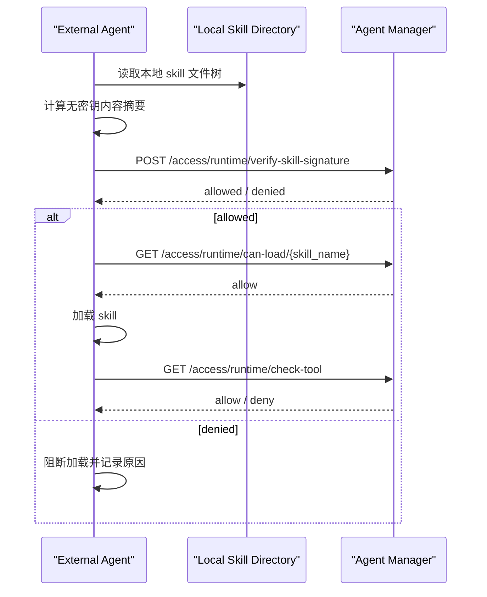

# Agent Skill Signature Verification

AIDR 的产品适配器负责识别各宿主的 Skill 调用与文件访问字段；后端的来源校验使用
`backend/aidr_adapters/` 中的产品定义。验签、内容摘要和 Agent 授权仍由公共治理链路处理。
TeleAgent 的结构化日志与审核接入、证据范围见
[外部 Agent 集成](external-agent-integration.md#aidr-产品适配器与-teleagent--product-adapters-and-teleagent)。

Product adapters identify host-specific Skill evidence; signature verification, content digests and Agent authorization
remain shared governance services. See the integration guide for TeleAgent's evidence and enforcement boundaries.

## Overview

宿主事件采集与工具策略默认按[客户端 AIDR 插件 Hook](hook-integration.md)接入；同步加载校验及手工脚本见[开发者：加载前验签](developer-skill-verification.md)。

**English:** Start host audit and tool policies with [Client AIDR plugin Hooks](hook-integration.md). For synchronous loading checks and manual scripts, use [Developer: pre-load verification](developer-skill-verification.md).

### 验签请求与检测负载 / Verification and scan load

验签与加载检查仅查询 Registry 状态、签名和授权所需元数据，不加载完整扫描报告；每次调用仍读取当前已提交状态，
并同步保存审计。只读查询使用独立 SQLite WAL 快照，减少扫描写锁造成的读取排队；审计写入仍受 SQLite 单写者约束。
导入解压与摘要准备采用独立并发额度。具体配置、复现测试与现场验收边界见
[API 响应说明](project-guide.md#114-skill-检测期间的-api-响应--api-responsiveness-during-skill-scans)。

**English:** Runtime checks read committed registry metadata without loading full scan reports and still persist audits
synchronously. WAL snapshots reduce read contention; audit writes still share SQLite's writer. Import preparation has
separate bounded capacity. These changes require deployed mixed-load validation for latency guarantees.

### 异步使用审计与加载前验签

本文下述主动调用验签接口的加载前集成，与“Skill 使用审计”的异步观察是两个调用时点。使用审计由后台日志采集器计算或复用本地 SHA-256 摘要，平台核对已签名批准摘要及当前批准、撤销和授权状态；同步 Hook 路径不读取整个 Skill 目录。审计结果不代表宿主实际加载成功，也不证明加载瞬间内容。

使用审计默认最长复用摘要 300 秒，复用前检查文件元数据，保留原观察时间；缓存到期或检测到变化后全量重读。平台状态默认独立按 30 秒调度刷新。两种核对方式、资源上限及告警分类见 [项目指南](project-guide.md#skill-使用证据与认证告警)。离线、证据不足及超限均保持待确认。元数据缓存不是防篡改证明，Windows 同大小且恢复 mtime 的变化可能到到期重读才发现；需要调用时证明的宿主仍须实现可靠的加载前拦截与内容绑定。

**English:** Load-time verification and asynchronous usage audit occur at different times. Background log collection computes or reuses a local SHA-256 digest; the platform verifies the signed approved digest and current approval, revocation and authorization. Hook execution does not hash the directory. Reused digests retain the original observation time. Metadata caching is not tamper-proof attestation or proof of successful loading. Reliable pre-load interception and content binding are required for invocation-time guarantees.

### 从平台指引开始 / Start from the platform guide

在智能体列表或详情打开“接入指引”，选择 Skill 加载与工具检查能力，在凭证中心确认 `runtime:verify-signature`、`runtime:can-load` 和所需工具检查权限。返回指引后，在真实加载路径接入下列接口；验签记录证明一次校验的结果，实际代码加载仍须由运行端控制。关联凭证记录本身不代表凭证仍有效。

**English:** Open the Agent integration guide from its list or detail entry, select Skill checks, and confirm signature, load and required tool scopes in Credential Center. Return to the guide and integrate the endpoints below in the actual Loader. Verification records prove check results; the runtime must enforce loading decisions. A linked credential record does not establish current validity.

### 主动验签集成

支持本地 Skill 指令的运行端可在“接入与运行 → Agent Skill Verifier”使用分步指引：选择身份、创建两项最小权限的运行凭证、下载并配置、执行 `verify --path`、按 Agent ID 核对运行审计。已由客户端发现的 Agent 复用现有身份。安装包与一次终端验证不保证后续 Agent 自动执行，必须在实际会话核对调用；强制拦截需要 Loader / Hook / SDK。

**English:** For runtimes supporting local Skill instructions, use Integration & Runtime → Agent Skill Verifier: select an identity, create a runtime credential with the two minimal verification scopes, install and configure, run `verify --path`, then match audit records by Agent ID. Reuse Client-discovered identities. Installation and a terminal check do not ensure future Agent invocation; verify the real session. Mandatory enforcement requires a Loader / Hook / SDK.

实际 Codex 验收须在同一会话连续使用，确认每次都有新的独立 Verifier 命令，并在本地内容篡改、缺少运行凭证、凭证吊销后停止读取和执行目标。`exec_command` 显式设置 `login: false`，避免登录 Shell 执行路径替换本次启动环境；使用工具实际退出码和平台审计核对。可复跑命令见 [Verifier 宿主验收](../demo/agent-manager-skill-verifier/README.md#真实-codex-宿主验收--real-codex-acceptance)。

**English:** For real Codex acceptance, repeat use in the same session and require a fresh standalone Verifier call each time. Confirm that tampering, missing runtime credentials and revocation stop target reads and execution. Set `login: false` explicitly in `exec_command` to preserve the current launch environment, then correlate actual command exit codes with platform audit. See the [reproducible host acceptance](../demo/agent-manager-skill-verifier/README.md#真实-codex-宿主验收--real-codex-acceptance).

同一个 Agent 还需要调用 MCP 时，先在智能体中选择允许的 MCP 网关，再为运行凭证增加所需的 `mcp:*` 权限和网关子集，按照接入指引配置 `/mcp/{gateway_slug}`。Skill 验签与 MCP 工具授权分别在各自入口执行，MCP 工具调用成功不代表 Skill 已通过内容验签。

**English:** To use MCP with the same Agent, configure its allowed gateways, grant the runtime credential the required `mcp:*` scopes and a gateway subset, then configure `/mcp/{gateway_slug}` using the integration guide. Skill signature checks and MCP authorization run at their respective boundaries; a successful MCP call does not prove Skill content verification.

对于外部 Agent 来说，只传 `skill_name` 调 `can-load` 只能完成“注册状态检查”，不能证明 Agent 本地这份 skill 内容还是审批通过时的那一份。

更安全的接法是：

1. Agent 在本地对 skill 目录计算无密钥内容摘要
2. 把本地摘要通过 `local_signature` 字段发送给 Agent Manager
3. Agent Manager 与服务端 Ed25519 签名信封中的摘要做比对
4. 一致才允许加载

当前接口：

- 推荐外部 Agent 使用：`POST /api/v1/access/runtime/verify-skill-signature`
- 旧接口 `POST /api/v1/runtime/verify-skill-signature` 已停用并返回 `410 Gone`

`/api/v1/access/runtime/...` 使用管理台 `智能体管理 / 统一凭证中心` 创建的 Agent 运行凭证，不需要管理员登录态。创建凭证时至少勾选：

- `runtime:verify-signature`
- `runtime:can-load`

运行端另行接入工具调用权限检查时，再添加 `runtime:check-tool`；Verifier 的 `verify` 不调用该接口。

token 鉴权的 `can-load` 不接受 `skill_path`，避免外部 token 探测服务端本地文件。外部 Agent 应先提交本地计算的 `local_signature` 做验签，再调用 name-only `can-load`。

## Why This Is Needed

如果只传 skill 名称，会有这个风险：

- skill 本地内容被修改了
- skill 名字没变
- registry 中仍然存在这个合法 skill
- 仅按名称检查时，服务端无法发现内容已被篡改

因此：

- `skill_name only` 适合只读、强受控目录
- `local_signature` 校验适合外部 Agent、自主分发或本地可写目录

## Signature Algorithm

Agent 不持有服务端私钥。服务端批准 Skill 时使用 Ed25519 私钥签名，
Agent 侧只计算确定性的 SHA256 内容摘要。

当前算法定义在 [signer.py](../agent_manager/core/signer.py)：

1. 递归遍历 skill 根目录下所有文件
2. 按相对路径排序
3. 对每个文件内容计算 `SHA256`
4. 生成文本行：

```text
relative/path/to/file:FILE_SHA256
```

5. 把所有行按顺序拼接，并在每行末尾追加 `\n`
6. Agent 对拼接结果计算 SHA256，并通过 `local_signature` 提交摘要
7. 服务端把摘要放入 `ed25519:v1:<key-id>:<digest>:<signature>` 信封并签名

服务端公钥可通过 `GET /api/v1/runtime/signing-public-key` 获取，返回
`Ed25519` 算法、`key_id`（公钥 SHA256 前 16 位）和 `public_key`（Raw 格式
Base64）。该端点无需认证：公钥本身是公开信息，返回它不泄露任何机密；端点
只读、不触发私钥创建，服务启动时由 `initialize_signing_identity()` 显式完成
密钥初始化。

私钥只允许存在于 Agent Manager 服务端，禁止复制到 Agent、Scanner 或 Hook。

> **多副本部署**：多副本（或多进程）部署时，所有副本必须通过
> `AGENT_MANAGER_SIGNING_PRIVATE_KEY_PATH` 指向**同一个私钥文件**（例如挂载
> 到共享卷）。否则每个副本会各自生成不同的 Ed25519 身份，导致 A 副本批准的
> Skill 签名在 B 副本上验证失败——这是静默失败，日志只会出现 signature
> mismatch，不会显式报错。建议部署后先调用一次 `signing-public-key` 确认各
> 副本返回相同的 `key_id`。

## Python Example

下面这个示例与服务端当前实现兼容：

```python
from __future__ import annotations

import hashlib
from pathlib import Path


def file_sha256(path: Path) -> str:
    h = hashlib.sha256()
    with open(path, "rb") as f:
        for chunk in iter(lambda: f.read(65536), b""):
            h.update(chunk)
    return h.hexdigest()


def compute_skill_digest(skill_path: str | Path) -> str:
    root = Path(skill_path)
    parts: list[str] = []

    for file_path in sorted(root.rglob("*")):
        if file_path.is_file():
            rel = file_path.relative_to(root).as_posix()
            parts.append(f"{rel}:{file_sha256(file_path)}\n")

    content = "".join(parts).encode()

    return hashlib.sha256(content).hexdigest()


if __name__ == "__main__":
    skill_dir = "/path/to/skill"
    print(compute_skill_digest(skill_dir))
```

## Request Example

请求体：

```json
{
  "skill_name": "byd-stock-news",
  "skill_id": "optional-skill-id",
  "local_signature": "agent本地计算出的签名",
  "agent_id": "agent-1"
}
```

调用示例：

```bash
curl -X POST "http://localhost/api/v1/access/runtime/verify-skill-signature" \
  -H "Content-Type: application/json" \
  -H "Authorization: Bearer amat_xxx" \
  -d '{
    "skill_name": "byd-stock-news",
    "local_signature": "your-local-signature",
    "agent_id": "agent-1"
  }'
```

返回示例：

```json
{
  "allowed": true,
  "reason": "signature verified",
  "skill_id": "7c7b6a86-4cd1-4946-a83c-5d6d4d1f5f98",
  "skill_name": "byd-stock-news",
  "status": "APPROVED",
  "risk_level": "benign",
  "signature_match": true
}
```

## Recommended Agent Flow

推荐外部 Agent 按下面顺序接入：



## Response Semantics

- `allowed=true`
  说明该 skill 已注册、状态可加载、且本地签名与已批准签名一致
- `allowed=false`
  常见原因：
  - skill 不在 registry
  - skill 当前不是 `APPROVED/DEPLOYED`
  - registry 中没有签名
  - Agent 上传的 `local_signature` 与批准签名不一致

## Audit Events

服务端会记录这些审计事件：

- `skill_signature_verified`
  本地签名校验通过
- `skill_tamper_detected`
  本地签名与批准签名不一致
- `skill_load_blocked`
  skill 不存在或状态不允许

## Notes

- 旧的 `/api/v1/runtime/...` 治理接口已停用。无论 Agent 是否和服务端同机，都应使用 Agent 运行凭证访问 `/api/v1/access/runtime/...`。
- `/api/v1/access/runtime/can-load/{skill_name}` 不接收 `skill_path`；先在 Agent 本地计算 `local_signature` 并调用 `verify-skill-signature`，再进行加载许可检查。
