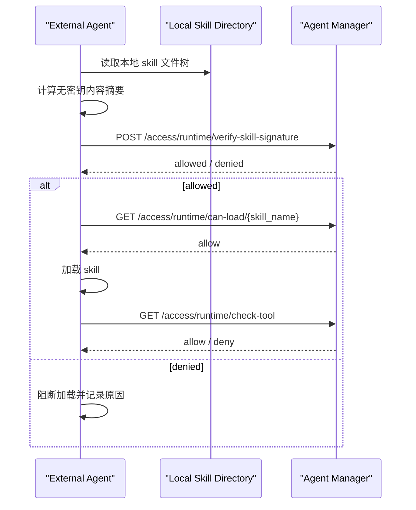

# Agent Skill Signature Verification

## Overview

对于外部 Agent 来说，只传 `skill_name` 调 `can-load` 只能完成“注册状态检查”，不能证明 Agent 本地这份 skill 内容还是审批通过时的那一份。

更安全的接法是：

1. Agent 在本地对 skill 目录计算无密钥内容摘要
2. 把本地摘要通过 `local_signature` 字段发送给 Agent Manager
3. Agent Manager 与服务端 Ed25519 签名信封中的摘要做比对
4. 一致才允许加载

当前接口：

- 推荐外部 Agent 使用：`POST /api/v1/access/runtime/verify-skill-signature`
- 旧接口 `POST /api/v1/runtime/verify-skill-signature` 已停用并返回 `410 Gone`

`/api/v1/access/runtime/...` 使用管理台 `智能体管理 / 统一凭证中心` 创建的 Agent 运行凭证，不需要管理员登录态。创建凭证时至少勾选：

- `runtime:verify-signature`
- `runtime:can-load`
- `runtime:check-tool`

token 鉴权的 `can-load` 不接受 `skill_path`，避免外部 token 探测服务端本地文件。外部 Agent 应先提交本地计算的 `local_signature` 做验签，再调用 name-only `can-load`。

## Why This Is Needed

如果只传 skill 名称，会有这个风险：

- skill 本地内容被修改了
- skill 名字没变
- registry 中仍然存在这个合法 skill
- 仅按名称检查时，服务端无法发现内容已被篡改

因此：

- `skill_name only` 适合只读、强受控目录
- `local_signature` 校验适合外部 Agent、自主分发或本地可写目录

## Signature Algorithm

Agent 不持有服务端私钥。服务端批准 Skill 时使用 Ed25519 私钥签名，
Agent 侧只计算确定性的 SHA256 内容摘要。

当前算法定义在 [signer.py](/Users/huangluguang/Desktop/Project/skill-manager/agent_manager/core/signer.py)：

1. 递归遍历 skill 根目录下所有文件
2. 按相对路径排序
3. 对每个文件内容计算 `SHA256`
4. 生成文本行：

```text
relative/path/to/file:FILE_SHA256
```

5. 把所有行按顺序拼接，并在每行末尾追加 `\n`
6. Agent 对拼接结果计算 SHA256，并通过 `local_signature` 提交摘要
7. 服务端把摘要放入 `ed25519:v1:<key-id>:<digest>:<signature>` 信封并签名

服务端公钥可通过 `GET /api/v1/runtime/signing-public-key` 获取，返回
`Ed25519` 算法、`key_id`（公钥 SHA256 前 16 位）和 `public_key`（Raw 格式
Base64）。该端点无需认证：公钥本身是公开信息，返回它不泄露任何机密；端点
只读、不触发私钥创建，服务启动时由 `initialize_signing_identity()` 显式完成
密钥初始化。

私钥只允许存在于 Agent Manager 服务端，禁止复制到 Agent、Scanner 或 Hook。

> **多副本部署**：多副本（或多进程）部署时，所有副本必须通过
> `AGENT_MANAGER_SIGNING_PRIVATE_KEY_PATH` 指向**同一个私钥文件**（例如挂载
> 到共享卷）。否则每个副本会各自生成不同的 Ed25519 身份，导致 A 副本批准的
> Skill 签名在 B 副本上验证失败——这是静默失败，日志只会出现 signature
> mismatch，不会显式报错。建议部署后先调用一次 `signing-public-key` 确认各
> 副本返回相同的 `key_id`。

## Python Example

下面这个示例与服务端当前实现兼容：

```python
from __future__ import annotations

import hashlib
from pathlib import Path


def file_sha256(path: Path) -> str:
    h = hashlib.sha256()
    with open(path, "rb") as f:
        for chunk in iter(lambda: f.read(65536), b""):
            h.update(chunk)
    return h.hexdigest()


def compute_skill_digest(skill_path: str | Path) -> str:
    root = Path(skill_path)
    parts: list[str] = []

    for file_path in sorted(root.rglob("*")):
        if file_path.is_file():
            rel = file_path.relative_to(root).as_posix()
            parts.append(f"{rel}:{file_sha256(file_path)}\n")

    content = "".join(parts).encode()

    return hashlib.sha256(content).hexdigest()


if __name__ == "__main__":
    skill_dir = "/path/to/skill"
    print(compute_skill_digest(skill_dir))
```

## Request Example

请求体：

```json
{
  "skill_name": "byd-stock-news",
  "skill_id": "optional-skill-id",
  "local_signature": "agent本地计算出的签名",
  "agent_id": "agent-1"
}
```

调用示例：

```bash
curl -X POST "http://localhost:8000/api/v1/access/runtime/verify-skill-signature" \
  -H "Content-Type: application/json" \
  -H "Authorization: Bearer amat_xxx" \
  -d '{
    "skill_name": "byd-stock-news",
    "local_signature": "your-local-signature",
    "agent_id": "agent-1"
  }'
```

返回示例：

```json
{
  "allowed": true,
  "reason": "signature verified",
  "skill_id": "7c7b6a86-4cd1-4946-a83c-5d6d4d1f5f98",
  "skill_name": "byd-stock-news",
  "status": "APPROVED",
  "risk_level": "benign",
  "signature_match": true
}
```

## Recommended Agent Flow

推荐外部 Agent 按下面顺序接入：



## Response Semantics

- `allowed=true`
  说明该 skill 已注册、状态可加载、且本地签名与已批准签名一致
- `allowed=false`
  常见原因：
  - skill 不在 registry
  - skill 当前不是 `APPROVED/DEPLOYED`
  - registry 中没有签名
  - Agent 上传的 `local_signature` 与批准签名不一致

## Audit Events

服务端会记录这些审计事件：

- `skill_signature_verified`
  本地签名校验通过
- `skill_tamper_detected`
  本地签名与批准签名不一致
- `skill_load_blocked`
  skill 不存在或状态不允许

## Notes

- 旧的 `/api/v1/runtime/...` 治理接口已停用。无论 Agent 是否和服务端同机，都应使用 Agent 运行凭证访问 `/api/v1/access/runtime/...`。
- `/api/v1/access/runtime/can-load/{skill_name}` 不接收 `skill_path`；先在 Agent 本地计算 `local_signature` 并调用 `verify-skill-signature`，再进行加载许可检查。
