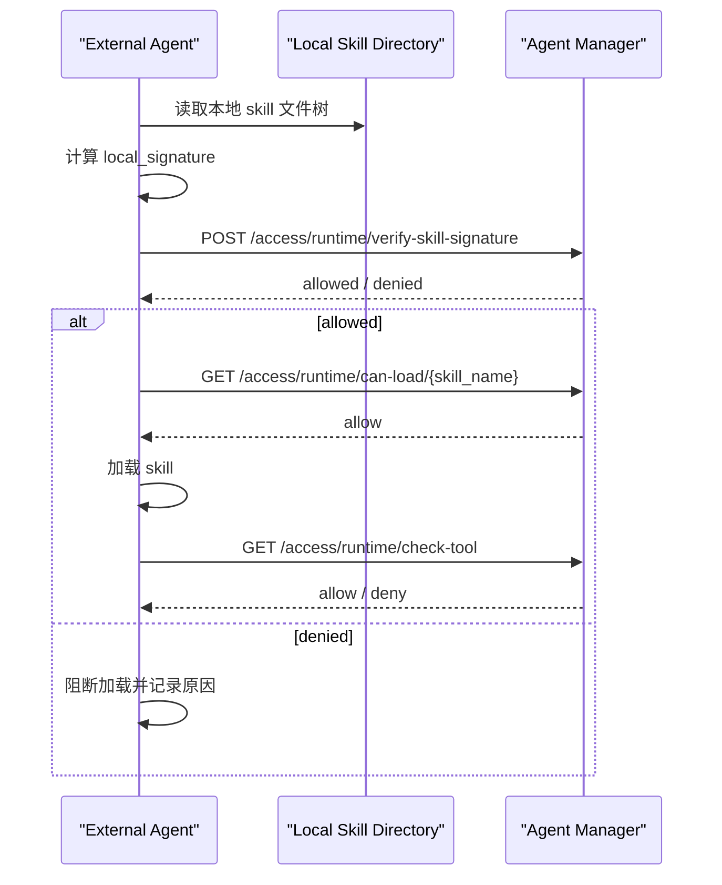

# Agent Skill Signature Verification

## Overview

对于外部 Agent 来说，只传 `skill_name` 调 `can-load` 只能完成“注册状态检查”，不能证明 Agent 本地这份 skill 内容还是审批通过时的那一份。

更安全的接法是：

1. Agent 在本地对 skill 目录计算签名
2. 把本地签名发送给 Agent Manager
3. Agent Manager 用 registry 中存储的签名做比对
4. 一致才允许加载

当前接口：

- 推荐外部 Agent 使用：`POST /api/v1/access/runtime/verify-skill-signature`
- 兼容内部或已有集成：`POST /api/v1/runtime/verify-skill-signature`

`/api/v1/access/runtime/...` 使用管理台“扫描器接入”页面创建的接入 Token，不需要管理员登录态。创建 token 时至少勾选：

- `runtime:verify-signature`
- `runtime:can-load`
- `runtime:check-tool`

token 鉴权的 `can-load` 不接受 `skill_path`，避免外部 token 探测服务端本地文件。外部 Agent 应先提交本地计算的 `local_signature` 做验签，再调用 name-only `can-load`。

## Why This Is Needed

如果只传 skill 名称，会有这个风险：

- skill 本地内容被修改了
- skill 名字没变
- registry 中仍然存在这个合法 skill
- 仅按名称检查时，服务端无法发现内容已被篡改

因此：

- `skill_name only` 适合只读、强受控目录
- `local_signature` 校验适合外部 Agent、自主分发或本地可写目录

## Signature Algorithm

Agent 侧必须和 Agent Manager 使用同样的签名算法。

当前算法定义在 [signer.py](/Users/huangluguang/Desktop/Project/skill-manager/agent_manager/core/signer.py)：

1. 递归遍历 skill 根目录下所有文件
2. 按相对路径排序
3. 对每个文件内容计算 `SHA256`
4. 生成文本行：

```text
relative/path/to/file:FILE_SHA256
```

5. 把所有行按顺序拼接，并在每行末尾追加 `\n`
6. 如果配置了 `AGENT_MANAGER_SIGNING_KEY`
   使用 `HMAC-SHA256`
7. 如果没有配置 signing key
   使用普通 `SHA256`

## Python Example

下面这个示例与服务端当前实现兼容：

```python
from __future__ import annotations

import hashlib
import hmac
import os
from pathlib import Path


def file_sha256(path: Path) -> str:
    h = hashlib.sha256()
    with open(path, "rb") as f:
        for chunk in iter(lambda: f.read(65536), b""):
            h.update(chunk)
    return h.hexdigest()


def compute_skill_signature(skill_path: str | Path, signing_key: str | None = None) -> str:
    root = Path(skill_path)
    parts: list[str] = []

    for file_path in sorted(root.rglob("*")):
        if file_path.is_file():
            rel = file_path.relative_to(root).as_posix()
            parts.append(f"{rel}:{file_sha256(file_path)}\n")

    content = "".join(parts).encode()

    if signing_key:
        return hmac.new(signing_key.encode(), content, hashlib.sha256).hexdigest()
    return hashlib.sha256(content).hexdigest()


if __name__ == "__main__":
    skill_dir = "/path/to/skill"
    key = os.environ.get("AGENT_MANAGER_SIGNING_KEY")
    print(compute_skill_signature(skill_dir, signing_key=key))
```

## Request Example

请求体：

```json
{
  "skill_name": "byd-stock-news",
  "skill_id": "optional-skill-id",
  "local_signature": "agent本地计算出的签名",
  "agent_id": "agent-1"
}
```

调用示例：

```bash
curl -X POST "http://localhost:8000/api/v1/access/runtime/verify-skill-signature" \
  -H "Content-Type: application/json" \
  -H "Authorization: Bearer smsc_live_xxx" \
  -d '{
    "skill_name": "byd-stock-news",
    "local_signature": "your-local-signature",
    "agent_id": "agent-1"
  }'
```

返回示例：

```json
{
  "allowed": true,
  "reason": "signature verified",
  "skill_id": "7c7b6a86-4cd1-4946-a83c-5d6d4d1f5f98",
  "skill_name": "byd-stock-news",
  "status": "APPROVED",
  "risk_level": "benign",
  "signature_match": true
}
```

## Recommended Agent Flow

推荐外部 Agent 按下面顺序接入：



## Response Semantics

- `allowed=true`
  说明该 skill 已注册、状态可加载、且本地签名与已批准签名一致
- `allowed=false`
  常见原因：
  - skill 不在 registry
  - skill 当前不是 `APPROVED/DEPLOYED`
  - registry 中没有签名
  - Agent 上传的 `local_signature` 与批准签名不一致

## Audit Events

服务端会记录这些审计事件：

- `skill_signature_verified`
  本地签名校验通过
- `skill_tamper_detected`
  本地签名与批准签名不一致
- `skill_load_blocked`
  skill 不存在或状态不允许

## Notes

- 如果服务端和 Agent 在同一台机器，也可以继续用内部兼容接口：
  - `GET /api/v1/runtime/can-load/{skill_name}?skill_path=...`
- 但对于外部 Agent，更推荐 `local_signature` 模式，因为服务端通常无法直接访问 Agent 的本地目录。
