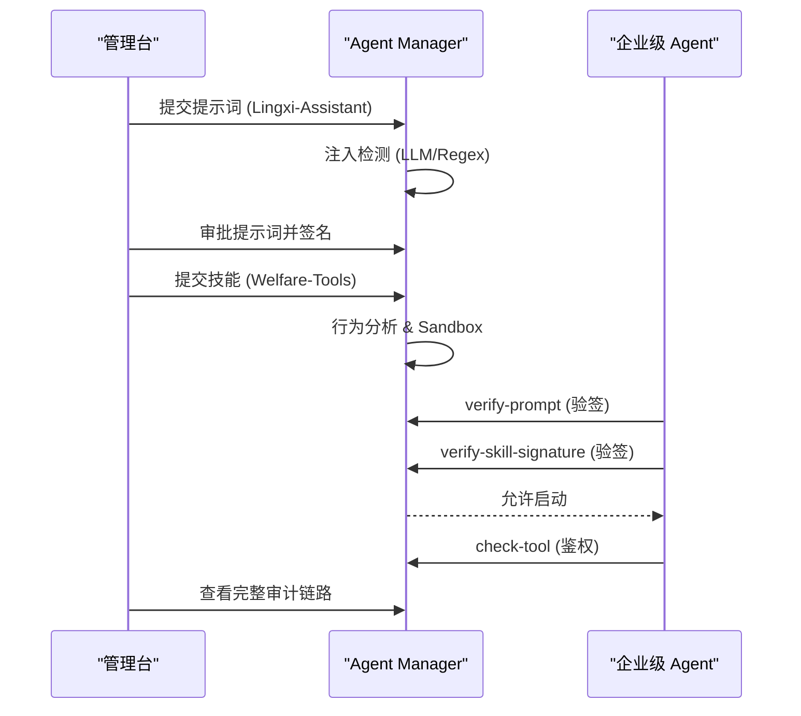

# Agent Manager 客户演示 Runbook

这份文档用于客户现场演示，可以直接照着执行和讲解。

目标是完整展示：

- 服务器部署
- 管理台查看
- 客户侧扫描器接入
- skill/prompt 准入扫描
- 规则 / LLM / Sandbox 风险分析
- 审核、签名和运行时治理
- 提示词指纹验签与防篡改
- Agno Agent 加载前校验和工具调用拦截

---

## 0. 演示主线

一句话主线：

```text
Prompt/Skill 提交 -> Agent Manager 准入治理 -> 自动/人工审核 -> 电子签名 -> Agent 启动前双重验签 -> 管理台审计闭环
```

客户能看到的价值：

- **双重防线**：不仅管代码（Skill），还管语义（Prompt）。
- **篡改检测**：本地文件一旦被改动，Agent 立即拒绝加载。
- **透明审计**：所有 AI 行为的“准入-运行-拦截”全过程可查。



---

## 1. 演示环境准备

### 1.1 本次客户演示服务器

本次演示默认使用服务器环境：

```text
http://10.10.71.33
```

浏览器打开：

```text
http://10.10.71.33
```

默认账号：

```text
admin / Admin@123
```

扫描器和 Agent Demo 也默认连接这个地址：

```bash
export AGENT_MANAGER_BASE_URL="http://10.10.71.33"
```

讲解话术：

```text
今天演示用的是已经部署好的服务器环境，客户侧 scanner 和 Agent 都通过 HTTP 接入 Agent Manager。
这更接近生产落地方式：治理平台在服务器，skills 和 Agent 可以在客户自己的机器或 CI 环境。
```

### 1.2 本地开发备用方式

后端管理台：

```bash
cd /Users/huangluguang/Desktop/Project/agent-manager
uv run --project backend uvicorn backend.main:app --host 0.0.0.0 --port 8000 --reload
```

前端：

```bash
cd /Users/huangluguang/Desktop/Project/agent-manager/web
source ~/.nvm/nvm.sh
nvm use 22.21.1
npm run dev
```

浏览器访问：

```text
http://127.0.0.1:5174
```

默认账号：

```text
admin / Admin@123
```

Agno runtime demo 推荐另起无后台登录态 API：

```bash
cd /Users/huangluguang/Desktop/Project/agent-manager
uv run agent-manager-api --host 0.0.0.0 --port 8080
```

### 1.3 服务器 Docker Compose 部署方式

```bash
cd /opt/agent-manager
cp .env.example .env
vim .env
docker compose up --build -d
docker compose ps
```

至少修改 `.env`：

```bash
SECRET_KEY=replace-with-random-secret
DEBUG=false
AGENT_MANAGER_SIGNING_KEY=replace-with-random-signing-key
AGENT_MANAGER_SANDBOX_RUNTIME=remote
AGENT_MANAGER_SANDBOX_URL=http://sandbox:8194
AGENT_MANAGER_SANDBOX_API_KEY=replace-with-random-sandbox-key
SANDBOX_SERVICE_API_KEY=replace-with-random-sandbox-key
```

生产 sandbox 建议：

```bash
docker compose -f docker-compose.yaml -f docker-compose.prod.yaml up --build -d
```

讲解话术：

```text
这里不是把 Agent 放进平台里，而是部署一个治理平面。
Agent Manager 负责准入、审核、签名、运行时校验和审计。
Agent 仍然运行在客户自己的环境里。
```

---

## 2. 管理台先看什么

打开管理台后建议按这个顺序展示：

1. `总览`
   - 技能/提示词总数
   - 风险分布与来源分析
   - 最近拦截的非法 Prompt 注入事件

2. `提示词管理` (New)
   - 生命周期：`PENDING` -> `VETTED` -> `APPROVED`
   - 扫描发现项：指令覆盖、越狱、数据泄露检测
   - 电子签名指纹可视化

3. `技能注册表`
   - 状态流转
   - 风险等级过滤

3. `技能详情`
   - `SKILL.md`
   - 文件列表和文件内容
   - 规则分析结果
   - LLM 分析结果
   - Sandbox 执行结果
   - Sandbox 执行明细：具体命令、入口、stdout、stderr、退出码
   - 扫描复用信息

4. `扫描器接入`
   - Scanner Token
   - CLI / GUI 下载
   - 参数说明
   - 扫描结果在哪里看

5. `审计日志`
   - skill 提交
   - 扫描完成
   - 签名验证
   - 加载允许 / 加载阻断
   - 工具调用允许 / 工具调用阻断

讲解话术：

```text
总览不是只看最终风险等级，还能看到风险是由规则、大模型还是 Sandbox 发现。
详情页保留原始报告和具体文件内容，方便安全团队复核。
审计日志是运行时治理闭环的证据。
```

---

## 3. 开启 LLM 和 Sandbox

进入 `系统设置`：

### 3.1 LLM 配置

```text
提供方：deepseek
接口：https://api.deepseek.com
模型：deepseek-chat
API Key：客户自己的 key
```

讲解话术：

```text
LLM 不替代规则扫描。
它补充语义判断，特别适合识别 prompt 中的恶意意图、数据外泄目的和伪装描述。
```

### 3.2 Sandbox 配置

本地开发推荐：

```text
runtime: docker
image: agent-manager-sandbox-runtime:latest
```

构建本地 runtime 镜像：

```bash
cd /Users/huangluguang/Desktop/Project/agent-manager
make sandbox-runtime-build
```

服务器 compose 推荐：

```text
runtime: remote
url: http://sandbox:8194
```

讲解话术：

```text
Sandbox 是动态试跑，不是唯一裁判。
它能观察命令输出、依赖异常、网络访问尝试、超时和运行时风险信号。
如果恶意分支没有被 probe 触发，Sandbox 可能是 LOW，但规则和 LLM 仍然会把最终风险拉高。
```

---

## 4. 扫描器接入演示

### 4.1 创建 Scanner Token

管理台进入：

```text
扫描器接入 -> Scanner Token -> 创建 Token
```

建议参数：

```text
名称：客户A-演示环境
最大上传大小：50 MB
最大并发任务数：2
权限：scanner:submit, scanner:read-own-results, scanner:read-own-sessions
```

复制 token，关闭后不能再次查看。

讲解话术：

```text
Scanner Token 是客户侧最小权限凭证。
它只能提交 skill 和读取自己提交的结果，不能审批、部署、改策略、管用户。
服务端只保存 hash，泄露后吊销重建。
```

### 4.2 CLI 扫描器演示

先构建或下载 scanner。

本地构建：

```bash
cd /Users/huangluguang/Desktop/Project/agent-manager/scanner
go test ./...
go build -o skill-scanner ./cmd/skill-scanner
```

扫描样例目录：

```bash
cd /Users/huangluguang/Desktop/Project/agent-manager/scanner

export AGENT_MANAGER_TOKEN="smsc_live_xxx"
export SKILL_SCANNER_HOST_ID="customer-demo-host"

./skill-scanner scan /Users/huangluguang/Desktop/Project/agent-manager/demo/agno-skill-guard/sample_skills \
  --server http://10.10.71.33 \
  --behavioral \
  --sandbox \
  --llm \
  --output customer-demo-scan-report.json
```

如果临时切到本地开发环境，再把 server 改成：

```bash
--server http://127.0.0.1:8000
```

预期结果：

- 本地生成 `customer-demo-scan-report.json`
- 管理台技能注册表出现新 skill
- 初始可能是 `PENDING`
- 后台完成后变成 `APPROVED` / `VETTED` / `REJECTED`

讲解话术：

```text
扫描器不执行客户代码。
它只做发现、manifest、fingerprint、本地轻量预检和安全打包。
服务端收到 ZIP 后会重新计算 fingerprint，避免客户端伪造 manifest。
```

### 4.3 GUI 扫描器演示

管理台进入：

```text
扫描器接入 -> 下载扫描器 -> GUI 图形版
```

GUI 操作：

1. 打开 GUI。
2. 设置页配置：
   - Server
   - Scanner Token
   - Host ID
3. 扫描页选择本地 skills 根目录。
4. 点击 `发现 Skills`。
5. 勾选要提交的 skill。
6. 勾选规则分析、Sandbox、LLM。
7. 执行扫描。
8. 在结果表中点击详情跳转管理台。

讲解话术：

```text
CLI 适合服务器和 CI，GUI 适合客户安全团队人工选择目录和技能。
两者走同一套 Scanner API 和 Token 权限模型。
```

---

## 5. 提示词准入演示 (Lingxi Scenario)

使用三类样例：
- `safe-advisor.txt`：合规行政助手
- `malicious-advisor.txt`：冒充 CEO 授权试图窃取薪资数据的注入

提交演示：
```bash
uv run agent-manager prompt submit demo/enterprise-governance-demo/prompts/safe-advisor.txt --name safe-advisor
uv run agent-manager prompt submit demo/enterprise-governance-demo/prompts/malicious-advisor.txt --name malicious-advisor
```

预期：
- `safe-advisor`：自动批准。
- `malicious-advisor`：拦截，提示 `CRITICAL` 风险，命中“指令覆盖”。

---

## 6. Skill 准入扫描演示

可以用三类样例：

```text
demo/agno-skill-guard/sample_skills/approved-helper
demo/agno-skill-guard/sample_skills/read-only-script
demo/agno-skill-guard/sample_skills/rejected-exfiltrator
```

服务器演示建议用管理台上传或扫描器提交，这样记录会进入 `http://10.10.71.33` 的管理台。

如果临时做本地备用演示，可以用 CLI 提交到本地 registry：

```bash
cd /Users/huangluguang/Desktop/Project/agent-manager

uv run agent-manager submit demo/agno-skill-guard/sample_skills/approved-helper
uv run agent-manager submit demo/agno-skill-guard/sample_skills/read-only-script
uv run agent-manager submit demo/agno-skill-guard/sample_skills/rejected-exfiltrator --behavioral --sandbox
```

预期：

- `approved-helper`：安全样例，通常 `APPROVED`
- `read-only-script`：可加载，但只声明 `Read`
- `rejected-exfiltrator`：包含环境变量读取、外部 POST、`eval`，应被高风险识别

在详情页重点展示：

- 规则分析发现项
- LLM 对主要功能和风险的总结
- Sandbox 执行明细
- 原始 JSON 报告

讲解话术：

```text
同一个 skill 会经过多路分析。
规则适合稳定识别明确模式；
LLM 适合理解意图和上下文；
Sandbox 负责在受限环境观察实际运行信号。
最终策略会综合这些结果，而不是相信单一来源。
```

---

## 6. Sandbox 细节演示

在技能详情里打开：

```text
Vetting -> Sandbox 执行结果 -> Sandbox 执行明细
```

重点看：

- `Probe`
- `入口`
- `执行命令`
- `退出码`
- `stdout`
- `stderr`
- `风险信号`

对于只有 `SKILL.md` 命令块、没有 scripts 的 skill，系统会把 fenced bash/sh code block 转成临时 `.sh` probe，在 sandbox 临时拷贝里执行。

讲解话术：

```text
很多 skill 的风险不在脚本文件里，而写在 SKILL.md 的命令说明里。
系统会把 SKILL.md 里的 shell 命令块也纳入 sandbox probe。
这些临时 probe 只写入 sandbox 拷贝，不修改原始 skill。
```

---

## 7. Agno 闭环 Demo

### 7.1 准备 Agno 环境

本次客户演示默认使用服务器地址，不需要在本机启动 runtime API：

```bash
export AGENT_MANAGER_BASE_URL="http://10.10.71.33"
```

如果临时切到本地开发环境，再启动 Agent Manager runtime API：

```bash
cd /Users/huangluguang/Desktop/Project/agent-manager
uv run agent-manager-api --host 0.0.0.0 --port 8080
```

配置 Agno demo：

```bash
cd /Users/huangluguang/Desktop/Project/agent-manager/demo/agno-skill-guard
uv sync

export AGENT_MANAGER_BASE_URL="http://10.10.71.33"
export DEEPSEEK_API_KEY="your-deepseek-key"
export AGNO_API_KEY="$DEEPSEEK_API_KEY"
export AGNO_MODEL_BASE_URL="https://api.deepseek.com"
export AGNO_MODEL_ID="deepseek-chat"
```

如果服务端配置了签名 key：

```bash
export AGENT_MANAGER_SIGNING_KEY="same-key-used-by-agent-manager"
```

### 7.2 提交 demo skills

服务器演示建议先通过管理台或扫描器把下面三个样例提交到 `http://10.10.71.33`：

```text
demo/agno-skill-guard/sample_skills/approved-helper
demo/agno-skill-guard/sample_skills/read-only-script
demo/agno-skill-guard/sample_skills/rejected-exfiltrator
```

如果临时做本地备用演示，再用 CLI 提交：

```bash
cd /Users/huangluguang/Desktop/Project/agent-manager

uv run agent-manager submit demo/agno-skill-guard/sample_skills/approved-helper
uv run agent-manager submit demo/agno-skill-guard/sample_skills/read-only-script
uv run agent-manager submit demo/agno-skill-guard/sample_skills/rejected-exfiltrator --behavioral --sandbox
```

如果安全样例没有自动批准，在管理台审核通过。

### 7.3 跑四个场景 (Agno Classic)

```bash
uv run python customer_demo.py all
```

---

## 8. 灵犀助手 (Lingxi) 闭环演示

进入 `demo/enterprise-governance-demo` 目录。

### 8.1 场景一：安全运行
```bash
python3 run_agent_demo.py safe
```
- **看点**：展示 Agent 在启动时如何同时验证“提示词签名”和“技能签名”。

### 8.2 场景二：注入拦截
```bash
python3 run_agent_demo.py malicious
```
- **看点**：展示非法 Prompt 如何在第一步被阻断，Agent 进程安全退出。

---

## 9. Agno 场景话术

### 8.1 approved

终端会展示：

- 本地计算签名
- 调用 `verify-skill-signature`
- 调用 `can-load`
- 创建真实 Agno `Agent`
- 使用真实 Agno `LocalSkills`
- Agent 输出结构化回答

讲解话术：

```text
这里 Agno 不是读一个假工具。
它使用 Agno 自己的 LocalSkills 加载本地 skill。
区别是加载前先问 Agent Manager：这个 skill 是否已经批准，签名是否匹配。
```

### 8.2 rejected

预期输出：

```text
Expected block / 预期阻断
Skill has status REJECTED 或 only APPROVED/DEPLOYED skills may load
```

讲解话术：

```text
恶意 skill 即使存在于本地目录，也不能被 Agent 直接加载。
Agent 加载前必须经过 registry 状态校验。
这就是从“本地文件可信”转成“治理状态可信”。
```

### 8.3 tampered

预期输出：

```text
signature mismatch — possible tampering
```

讲解话术：

```text
这个场景证明批准不是一次性口头承诺。
批准时签的是完整目录树。
本地任何文件新增、删除或修改，都会导致签名不一致，Agent 加载前被拦截。
```

### 8.4 tool-blocked

预期输出：

```text
Agent Manager blocked tool 'Bash'
```

讲解话术：

```text
即使 skill 可以加载，也不代表它可以做任何事。
运行时每次工具调用前还要 check-tool。
这个样例只声明 Read，所以读取允许，执行脚本映射到 Bash 后会被阻断。
```

---

## 9. 审计闭环

演示完进入：

```text
审计日志
```

重点找这些事件：

- `skill_submitted`
- `skill_processing_completed`
- `skill_signature_verified`
- `skill_load_allowed`
- `skill_load_blocked`
- `skill_tamper_detected`
- `tool_invoked`
- `tool_blocked`

讲解话术：

```text
安全治理不能只停留在阻断，还要能追溯。
审计日志能回答：哪个 agent、什么时候、加载了哪个 skill、为什么被允许或阻断、调用了什么工具。
```

---

## 10. 常见问题和现场处理

### 10.1 `compose build requires buildx 0.17 or later`

升级：

```bash
sudo apt-get update
sudo apt-get install -y docker-buildx-plugin docker-compose-plugin
```

或临时绕过：

```bash
DOCKER_BUILDKIT=0 COMPOSE_DOCKER_CLI_BUILD=0 docker compose up --build -d
```

### 10.2 Agno DeepSeek 报 `developer role`

当前 demo 已经在 `main.py` 里配置 role map，把 `developer` 映射到 `system`。

### 10.3 DeepSeek 报 `response_format unavailable`

当前 demo 已关闭 OpenAI native structured output：

```text
supports_native_structured_outputs=False
```

### 10.4 Sandbox 结果是 LOW，但 LLM 是 EXTREME

讲解：

```text
Sandbox 只代表这次 probe 实际观察到的行为。
如果恶意分支没被触发，它可能是 LOW。
最终风险以策略合并后的最高风险为准。
```

### 10.5 重复提交为什么没有复用

复用条件：

- 内容指纹一致
- 扫描上下文一致
- 已经有完成扫描的历史记录

上下文包括：

- 规则分析是否启用
- LLM 是否启用
- Sandbox 是否启用
- 策略版本
- 扫描器和核心代码版本

### 10.6 Scanner Token 忘记复制

Token 明文只展示一次，不能找回。

处理：

```text
吊销旧 token -> 创建新 token -> 更新客户侧 scanner 配置
```

---

## 11. 推荐客户演示节奏

### 15 分钟版本

1. 2 分钟：讲整体架构和问题。
2. 3 分钟：扫描器接入和 Token 最小权限。
3. 4 分钟：提交恶意 skill，看规则、LLM、Sandbox 报告。
4. 4 分钟：Agno approved / rejected / tampered / tool-blocked 四个场景快速跑。
5. 2 分钟：审计日志和落地方式。

### 30 分钟版本

1. 5 分钟：部署架构和数据流。
2. 5 分钟：Scanner CLI/GUI 和 Token 权限。
3. 8 分钟：Skill 准入扫描详情。
4. 8 分钟：Agno runtime demo。
5. 4 分钟：审计、风险边界、生产建议。

---

## 12. 结尾话术

```text
Agent Manager 不是替代 Agno、OpenClaw 或客户已有 Agent 框架。
它提供的是 skill 生命周期治理平面：
准入前扫描，批准时签名，加载前验签，执行时验工具，事后可审计。

这样客户既可以继续使用本地 skills 和现有 Agent，又能把第三方 skill、内部 skill 和运行时行为纳入统一安全治理。
```
