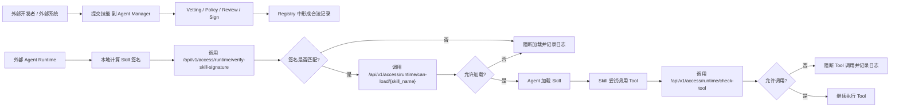
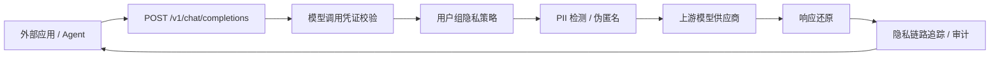
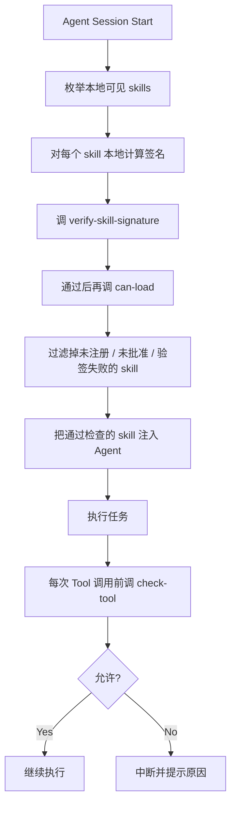

# External Agent Integration

## Overview

这个项目本身不是一个“运行 skill 的平台”，而是一个“管理 skill 准入和运行时治理的中心”。

外部系统或外部 Agent 接入它，通常有四种模式：

- 模式零：使用 Agent Manager Client 统一接管本地 Skill
- 模式一：把 Agent Manager 当作审批和验票中心
- 模式二：把 Agent Manager 当作 skill 制品登记中心
- 模式三：把 Agent Manager 当作 LLM 隐私代理

最推荐的是模式一。这样外部 Agent 仍然使用自己的 skill 加载机制，但在关键节点调用 Agent Manager 做校验和审计。

如果客户需要统一管理 Claude Code、Codex、Gemini CLI、OpenCode、OpenClaw、Hermes 等本地 Skill 目录，优先使用 Agent Manager Client。它不依赖 Agent 是否遵循 Skill 指令，说明见 [agent-manager-client.md](agent-manager-client.md)。

## Mode 1: Governance Gateway

在这个模式下，外部 Agent 自己保有 skill 文件，并在运行前调用 Agent Manager 的运行时检查接口。



### Typical Flow

1. 开发者先把 skill 提交到 Agent Manager。
2. Agent Manager 完成 vetting、policy 检查、审批和签名。
3. 外部 Agent 在真正加载 skill 前，先本地计算 skill 签名。
4. Agent 调用 `verify-skill-signature` 校验本地内容是否与审批时一致。
5. 如果签名匹配，再调用 `can-load` 检查 registry 状态。
6. Skill 在运行中每次要调用工具前，再调用 `check-tool`。
7. Agent Manager 记录允许或阻断的审计事件。

### Current APIs

外部 Agent 推荐使用管理台 `智能体管理 / 统一凭证中心` 创建的 `Agent 运行凭证`，并绑定对应 Agent。最关键会用到这三个凭证鉴权接口：

- `POST /api/v1/access/runtime/verify-skill-signature`，需要 `runtime:verify-signature`
- `GET /api/v1/access/runtime/can-load/{skill_name}`，需要 `runtime:can-load`
- `GET /api/v1/access/runtime/check-tool`，需要 `runtime:check-tool`

旧的 `/api/v1/runtime/...` 治理路径已停止使用并返回 `410 Gone`。所有 Agent 都应迁移到带 Agent 运行凭证的 `/api/v1/access/runtime/...`；管理员 JWT 只用于管理面。

注意：`/api/v1/access/runtime/can-load/{skill_name}` 不接受 `skill_path`。外部 Agent 应先本地计算签名并调用 `verify-skill-signature`，再做 name-only `can-load`。

如果外部系统还需要查看 skill 状态，也可以读：

- `GET /api/v1/skills`
- `GET /api/v1/skills/{id}`

### Universal Skill Verifier

对于 Codex、Claude Code 这类支持本地 skill 指令的 Agent，可以使用仓库内置的通用示例：

- `demo/agent-manager-skill-verifier/skills/agent-manager-skill-verifier/`

它不使用 Claude Code hook、Codex 专用 adapter 或平台绑定配置，适合首版用来规范 Agent 行为：

- 发现或安装第三方 skill 后，先上传到 Agent Manager 扫描。
- 用户要求使用第三方 skill 前，先检查内容完整性、审批状态和 Agent 授权范围。
- 未提交、扫描中、待审核、已拒绝、未形成可信版本、内容不匹配或状态不可加载时，默认阻断使用。

管理台提供下载入口：

- `智能体管理`
- `接入与运行`
- `下载 Skill Verifier`

后端下载接口：

```http
GET /api/v1/scanner/skill-verifier/download
```

执行 `verify` 的 Agent 运行凭证至少需要这些权限：

- `runtime:verify-signature`
- `runtime:can-load`

如果运行时还会在每次 Tool 调用前执行权限检查，再增加 `runtime:check-tool`。`submit` 和 `status` 使用独立的 Scanner 接入凭证，不应与 Agent 运行凭证混用。

安装到 Codex：

```bash
mkdir -p ~/.codex/skills
unzip agent-manager-skill-verifier.zip -d ~/.codex/skills/
```

安装到 Claude Code：

```bash
mkdir -p ~/.claude/skills
unzip agent-manager-skill-verifier.zip -d ~/.claude/skills/
```

配置运行环境：

```bash
export AGENT_MANAGER_VERIFIER_BASE_URL="http://localhost"
export AGENT_MANAGER_AGENT_RUNTIME_TOKEN="amat_xxx"
export AGENT_ID="<agent-id>"
```

Verifier 只计算无密钥内容摘要，不得配置或持有服务端签名私钥。

提交第三方 skill：

```bash
python <skills-dir>/agent-manager-skill-verifier/scripts/agent_manager_skill_verifier.py submit \
  --path /path/to/third-party-skill \
  --behavioral \
  --deep-scan
```

查看状态：

```bash
python <skills-dir>/agent-manager-skill-verifier/scripts/agent_manager_skill_verifier.py status \
  --skill-id <skill-id>
```

使用前检查内容完整性和加载授权：

```bash
python <skills-dir>/agent-manager-skill-verifier/scripts/agent_manager_skill_verifier.py verify \
  --path /path/to/third-party-skill
```

这类接法依赖 Agent 遵循 Skill 指令和脚本退出码。需要事件自动触发时，在具体 Agent 的生命周期事件上接 Hook 或 runtime adapter。

### Event Hook

Hook 的接入点应与检查目标一一对应：

| 事件点 | 必须执行的检查 | 通过条件 |
|---|---|---|
| Skill 读取或加载前 | 本地计算内容摘要，依次调用 `verify-skill-signature` 和 `can-load` | 两个接口均返回 `allowed=true`，状态为可加载状态 |
| Tool 执行前 | 调用 `check-tool`，传入 Skill 名称、Tool 名称和稳定的 Agent ID | 接口返回 `allowed=true` |

Claude Code 和 Trae 可参考 `demo/claude-code-api-hook/agent_guard_hook.py`，在 `PreToolUse` 中使用绝对路径启动脚本：

```json
{
  "hooks": {
    "PreToolUse": [
      {
        "matcher": "",
        "hooks": [
          {
            "type": "command",
            "command": "python3 /absolute/path/skill-manager/demo/claude-code-api-hook/agent_guard_hook.py"
          }
        ]
      }
    ]
  }
}
```

该示例读取 `AGENT_MANAGER_BASE_URL`、`AGENT_MANAGER_API_TOKEN` 和 `AGENT_ID`。`AGENT_MANAGER_API_TOKEN` 的值必须是绑定该 Agent 的运行凭证。对于能识别出的 Skill 调用，内容不一致、未授权、API 错误或网络错误会以退出码 `2` 阻止；成功时返回 `0`。诊断日志位于 `~/.agent-manager/logs/agent_guard_hook.log`。无法解析的输入和非 Skill 调用不进入 Skill 校验，因此上线前必须用目标 Agent 的真实事件验证 Skill 名称与目录提取结果。

OpenClaw 示例位于 `demo/openclaw-agent-manager-hook/`：

- `agent:bootstrap` 内部 Hook 枚举可见 Skill，执行签名和加载许可检查。
- `before_tool_call` 通过插件 Hook 调用 `check-tool`，必须接入实际 OpenClaw 插件工程。
- 事件中的会话身份必须稳定映射到平台登记的 Agent ID，不能直接假设任意 session key 就是 Agent ID。

推广前至少演练平台不可达、凭证过期、Skill 路径缺失、内容变化和 Tool 未授权五类场景，并同时核对 Agent 侧结果、Hook 日志与平台运行审计。

## Mode 2: Registry As Artifact Catalog

在这个模式下，Agent Manager 主要负责记录“哪些 skill 是已批准或已部署的”，外部系统根据 registry 信息决定应该拉取哪个 skill。


### 版本与下载

平台已按 Skill 名称族管理内容版本：

- `GET /api/v1/skills/{skill_id}/versions` 查询所有内容版本。
- `GET /api/v1/skills/{skill_id}/diff?base=...&target=...` 比较两个版本。
- `GET /api/v1/skills/{skill_id}/download?version=...` 下载指定版本。
- 客户端接口默认解析到最新可信版本，也可以显式传 `version_id` 下载或恢复历史可信版本。

查询接口中的 `skill_id` 表示 Skill 家族，`version_id` 表示一个不可变内容版本。审批、拒绝、重新检测、部署和退役等生命周期写操作必须使用 `version_id`；平台不会把家族 ID 自动解析为最新版，避免并发产生新版本时误操作其他内容。删除整个 Skill 家族时才使用家族 `skill_id`。

外部 Agent 做 name-only 校验时解析最新可信版本；如果本地内容属于较旧的可信版本，应同时传版本 ID 或内容签名，以免把“最新版本”误当成“本机实际版本”。多环境发布地址仍需由外部分发系统管理。

## Mode 3: LLM Privacy Proxy

外部应用或 Agent 可以把 Agent Manager 当作 OpenAI-compatible 或 Anthropic-compatible 模型网关使用。



运行时接口：

- `POST /v1/chat/completions`
  OpenAI SDK 兼容路径，适合把 SDK 的 `base_url` 指到 Agent Manager。
- `POST /chat/completions`
  兼容部分客户端把 `base_url` 配成不含 `/v1` 时直接拼接的路径。
- `GET /v1/models` / `GET /models`
  OpenAI-compatible 模型列表，只返回当前模型调用凭证允许访问的启用模型。
- `POST /api/v1/llm/chat/completions`
  Agent Manager 命名空间路径，适合内部服务显式调用。
- `POST /v1/messages`
  Anthropic Messages 兼容路径，Claude Code 可通过 `ANTHROPIC_BASE_URL` 和 `ANTHROPIC_AUTH_TOKEN` 接入。
- `POST /v1/responses`
  OpenAI Responses 兼容路径，Codex 可通过 `~/.codex/config.toml` 的自定义 model provider、`wire_api = "responses"` 和 Agent 运行凭证接入。

鉴权使用 `智能体管理 / 统一凭证中心` 创建的模型调用凭证，或显式授予 `model:chat` 的 Agent 运行凭证：

```http
Authorization: Bearer amat_xxx
```

模型调用凭证用于模型调用：

- 可绑定用户或用户组
- 可限制可访问模型
- 可限制请求体大小和并发数
- 可配置 Prompt 防护和可选 Token 压缩
- 明文只展示一次，服务端只保存 hash

Docker Compose 的根路径 `/` 由管理台前端使用。外部模型客户端应使用 `/v1`，或使用会自动拼接 `/chat/completions` 的根地址配置，不要直接 POST `/`。

完整说明见：

- [model-gateway.md](model-gateway.md)

## Mode 4: MCP Gateway

支持 Streamable HTTP 的 Agent 或 MCP Client 可以只连接 Agent Manager，不直接配置各个上游 MCP Server：

```json
{
  "type": "streamable-http",
  "url": "https://agent-manager.example.com/mcp/readonly",
  "headers": {
    "Authorization": "Bearer amat_xxx"
  }
}
```

管理员先在 `MCP 服务` 中发现上游 Tool，再在 `MCP 网关` 中选择要发布的 Tool，最后在 `统一凭证中心` 创建 `MCP 网关凭证`。凭证绑定虚拟网关而不是智能体。当前支持 `initialize`、`ping`、`tools/list` 和 `tools/call`；stdio、Resources 和 Prompts 不在首版范围内。

生产环境的上游 MCP Endpoint 默认只允许 HTTPS。每次连接前会重新解析 DNS，拒绝私网、回环、链路本地、保留地址和不在 `MCP_OUTBOUND_ALLOWLIST` 中的目标；HTTP 只能通过开发配置显式启用。响应大小、Tool 每分钟调用量和并发数均有独立限制。

标记为高风险或要求审批的 Tool 会进入限时 Tool 级审批流程：首次 `tools/call` 返回 JSON-RPC `-32002`，并在 `error.data.approval_request_id` 中给出申请 ID。管理员在 `能力治理 / MCP 调用审批` 查看首次调用上下文并批准或拒绝。批准后，网关会自动按 MCP Token、Gateway、Tool 和 Schema 匹配有效授权；调用方无需回传申请 ID，并可在有效期内使用不同参数重复调用同一 Tool。参数仅作为审批和审计上下文，不是授权匹配条件。Schema 变化、授权到期、Token 或网关失效后必须重新审批。调用方也可以使用同一个 MCP 网关凭证访问 `GET /mcp/{gateway_slug}/approvals/{request_id}` 查询状态。

原有 `POST /api/v1/mcp/approvals` 直接签发一次性凭证的接口继续保留，调用方仍可通过 `params._meta.agent_manager_approval` 消费，但它主要用于已有集成和受控调试；正式人工审批应使用调用自动产生的待办流程。

## Boundaries

这套系统当前负责的是：

- skill 提交
- vetting
- policy 判定
- 审批
- 签名
- 部署状态
- 运行时放行判断
- 审计日志
- LLM 模型调用隐私代理
- LLM 隐私链路追踪
- 远程 MCP Tool 聚合、授权和调用审计
- Agent Manager Client 的本地 Agent 发现、可信 Skill 下发、持续巡检、恢复、隔离和移除

这套系统当前不负责的是：

- 真正执行 skill
- 提供统一 skill runtime 或 stdio MCP runtime
- 帮外部 Agent 解析和运行不同框架的 skill

## Recommended Integration Pattern

如果你要给外部 Agent 接入，推荐按下面的方式做：



### Why This Pattern

原因很直接：

- 不要求你改外部 Agent 的核心 runtime
- 只需要在“加载前验签/放行”和“调用前”两个点加拦截
- 可以最大程度复用当前 Agent Manager 的现有能力
- 审计链路也完整

## What To Build Next

后续可以继续补充：

1. 面向外部 Agent 的细粒度独立 token / API key 鉴权。
2. 按环境区分 `dev / staging / prod` 的发布指针。
3. 版本保留、归档和存储配额策略。

模型网关方向的后续增强：

1. 支持 streaming 响应的增量反替换
2. 引入更完整的 NER / Presidio 识别器
3. 对 API Key 做跨进程 / 分布式限流
4. 对 Trace 增加脱敏导出视图

## Summary

一句话说清楚：

**外部 Agent 不是来这里“运行 skill”的，而是来这里“确认这个 skill 能不能被运行”。**

当前最实用的接法就是：

- 提交 skill 到 Agent Manager 做准入治理
- Agent 本地计算 skill 签名并调用 `verify-skill-signature`
- Agent 加载前调 `can-load`
- Agent 调工具前调 `check-tool`
- 所有关键动作都留审计

当前已经可用的辅助接口：

- `GET /api/v1/skills/{id}/files`
  返回 skill 目录内的相对路径、文件大小和修改时间
- `POST /api/v1/access/runtime/verify-skill-signature`
  校验外部 Agent 本地计算的签名是否与批准记录一致
- `GET /api/v1/access/runtime/can-load/{skill_name}`
  校验 skill 注册状态是否允许加载
- `GET /api/v1/access/runtime/check-tool`
  校验运行时 tool 调用是否在允许范围内
