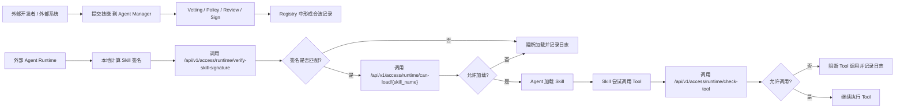
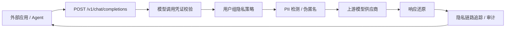
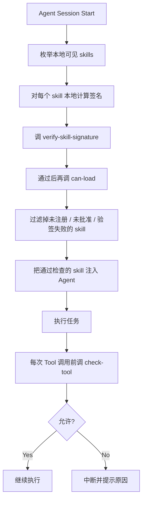

# External Agent Integration

## Overview

这个项目本身不是统一 Agent Runtime，也不替外部 Agent 执行 Skill；它提供 Skill 准入、Agent/MCP
安全测评、模型/MCP 网关、运行时放行和统一证据轨迹。

外部系统或外部 Agent 接入它，通常有六类方式：

- 使用 Agent Manager Client 统一接管本地 Skill
- 把 Agent Manager 当作审批和验票中心
- 把 Agent Manager 当作 Skill 制品登记中心
- 把 Agent Manager 当作 LLM 隐私代理
- 用 Runtime Trace SDK 上报 Agent Turn、Step、Message、Tool 和知识检索事件
- 通过 MCP Gateway 使用受治理的远程 Tool

对已有自研 Runtime，优先接入 Governance API 和 Runtime Trace SDK。这样外部 Agent 仍使用自己的
Skill 加载机制，但在关键节点调用 Agent Manager 做校验、阻断和审计。

如果客户需要统一管理 Claude Code、Codex、Gemini CLI、OpenCode、OpenClaw、Hermes 等本地 Skill 目录，优先使用 Agent Manager Client。它不依赖 Agent 是否遵循 Skill 指令，说明见 [agent-manager-client.md](agent-manager-client.md)。

### 接入方式选择

| 场景 | 推荐组件 | 必须接入的控制点 | 当前边界 |
|---|---|---|---|
| 批量治理本地 Agent/Skill | Agent Manager Client | 接管、安装、巡检、隔离和恢复 | 最完整的本地目录治理；不替代 Agent 自身 Sandbox |
| Agent 支持 Skill 指令但没有生命周期 Hook | Universal Skill Verifier | 提交、状态、加载前验签 | 依赖 Agent 遵循指令和脚本退出码，不能覆盖所有调用路径 |
| Agent 有稳定的加载/Tool Hook | Claude Code、Codex、OpenClaw 等 Hook Adapter | 加载前验签与放行、Tool 前检查 | 只对实际能拦截的事件失败关闭；必须用目标版本实机验收事件结构 |
| 自研 Agent Runtime | Runtime Trace SDK + Governance API | Turn/Step、模型/MCP 关联、Skill 加载和 Tool 调用 | 推荐方式，可形成 `full` 轨迹；接入方负责正确划分真实生命周期 |
| 只能改模型/MCP Base URL | Gateway-only | 模型 `metadata`、MCP `params._meta` | 只能形成 `model_only`、`mcp_only` 或 `gateway_partial`，不能伪造 Agent 层级 |
| Agno/LangGraph 等框架 | 对应 Demo 的 Loader/Tool Hook | 框架加载 Skill 前和工具执行前 | 示例是适配起点，不代表所有版本、工具和并发路径均已覆盖 |

最小权限凭证不能混用：Scanner 接入凭证只负责提交和读取自己的扫描；Agent 运行凭证负责验签、
加载、Tool 检查和可选轨迹/模型/MCP；普通模型调用凭证不能冒充 Agent；MCP 网关凭证只访问被授权
Gateway。管理员 JWT 只用于管理面，不应放进 Agent Runtime。

## Governance Gateway

模型切换的配置位置、参数、生效与恢复方式见 [客户端模型切换](model-gateway.md#客户端模型切换--client-model-switching)。对标九种 Agent 的配置适配与真实执行结果分别记录在 [验证矩阵](acceptance/model-switching-2026-09-13/README.md)；已写入不等于调用验证通过。

For model configuration locations, parameters, activation and recovery, see [Client model switching](model-gateway.md#客户端模型切换--client-model-switching). Configuration adapters and native execution results for the nine benchmark Agents are separately documented in the [validation matrix](acceptance/model-switching-2026-09-13/README.md). A successful write is not a verified call.

在这个模式下，外部 Agent 自己保有 skill 文件，并在运行前调用 Agent Manager 的运行时检查接口。



### Typical Flow

1. 开发者先把 skill 提交到 Agent Manager。
2. Agent Manager 完成 vetting、policy 检查、审批和签名。
3. 外部 Agent 在真正加载 skill 前，先本地计算 skill 签名。
4. Agent 调用 `verify-skill-signature` 校验本地内容是否与审批时一致。
5. 如果签名匹配，再调用 `can-load` 检查 registry 状态。
6. Skill 在运行中每次要调用工具前，再调用 `check-tool`。
7. Agent Manager 记录允许或阻断的审计事件。

### Current APIs

外部 Agent 推荐使用管理台 `智能体管理 / 统一凭证中心` 创建的 `Agent 运行凭证`，并绑定对应 Agent。最关键会用到这三个凭证鉴权接口：

- `POST /api/v1/access/runtime/verify-skill-signature`，需要 `runtime:verify-signature`
- `GET /api/v1/access/runtime/can-load/{skill_name}`，需要 `runtime:can-load`
- `GET /api/v1/access/runtime/check-tool`，需要 `runtime:check-tool`

旧的 `/api/v1/runtime/...` 治理路径已停止使用并返回 `410 Gone`。所有 Agent 都应迁移到带 Agent 运行凭证的 `/api/v1/access/runtime/...`；管理员 JWT 只用于管理面。

注意：`/api/v1/access/runtime/can-load/{skill_name}` 不接受 `skill_path`。外部 Agent 应先本地计算签名并调用 `verify-skill-signature`，再做 name-only `can-load`。

如果外部系统还需要查看 skill 状态，也可以读：

- `GET /api/v1/skills`
- `GET /api/v1/skills/{id}`

### Universal Skill Verifier

对于 Codex、Claude Code 这类支持本地 skill 指令的 Agent，可以使用仓库内置的通用示例：

- `demo/agent-manager-skill-verifier/skills/agent-manager-skill-verifier/`

它不使用 Claude Code hook、Codex 专用 adapter 或平台绑定配置，适合首版用来规范 Agent 行为：

- 发现或安装第三方 skill 后，先上传到 Agent Manager 扫描。
- 用户要求使用第三方 skill 前，先检查内容完整性、审批状态和 Agent 授权范围。
- 未提交、扫描中、待审核、已拒绝、未形成可信版本、内容不匹配或状态不可加载时，默认阻断使用。

管理台提供下载入口：

- `智能体管理`
- `接入与运行`
- `下载 Skill Verifier`

后端下载接口：

```http
GET /api/v1/scanner/skill-verifier/download
```

执行 `verify` 的 Agent 运行凭证至少需要这些权限：

- `runtime:verify-signature`
- `runtime:can-load`

如果运行时还会在每次 Tool 调用前执行权限检查，再增加 `runtime:check-tool`。`submit` 和 `status` 使用独立的 Scanner 接入凭证，不应与 Agent 运行凭证混用。

## Unified Runtime Trace

新创建的 Agent 运行凭证默认包含 `runtime:trace`。历史凭证不会被后台静默提权，需要管理员在
统一凭证中心显式增加该 Scope 或重新签发。平台页面默认启用 Runtime Trace，不需要通过 `.env`
打开页面；部署配置中的禁用开关只用于紧急回退。

最小流程：

1. `POST /api/v1/runtime-traces` 创建 Trace，服务端从凭证绑定关系确定 `agent_id`。
2. SDK 缓冲 `runtime-trace@1` 事件，并批量调用
   `POST /api/v1/runtime-traces/{trace_id}/events:batch`。
3. 调模型网关时，把 `RuntimeTraceClient.gateway_metadata()` 放入 OpenAI `metadata`。
4. 调 MCP 网关时，把同一对象合并到 JSON-RPC `params._meta`。
5. 管理端通过 Trace、Session、Agent、时间、风险、Tool 或 request ID 查询。

Python 最小 SDK 位于 `agent_manager/runtime_trace.py`，可运行示例位于
`demo/runtime-trace-sdk/`。SDK 支持 Turn、Step、用户消息、Tool Call/Result、知识检索和父子
`call_id`。服务端 `seq` 按接收顺序分配，不依赖客户端时钟；同一 `batch_id` 或 `event_id`
重复上报会去重，内容冲突则返回稳定错误码。

最小关联示例：

```python
from agent_manager.runtime_trace import RuntimeTraceClient

trace = RuntimeTraceClient("https://agent-manager.example.com", "amat_xxx")
trace.create_trace("business-session-001")
turn_id = trace.turn_start(payload={"goal": "query policy and call governed tools"})
step_id = trace.step_start(turn_id, payload={"name": "model-reasoning"})

model_metadata = trace.gateway_metadata(turn_id=turn_id, step_id=step_id, call_id="call-model-001")
# 放入 OpenAI-compatible 请求的 metadata。

mcp_metadata = trace.gateway_metadata(
    turn_id=turn_id,
    step_id=step_id,
    call_id="call-mcp-001",
    parent_call_id="call-model-001",
)
# 放入 MCP JSON-RPC params._meta。

trace.step_end(turn_id, step_id)
trace.turn_end(turn_id)
trace.flush()
```

不要把 Token、完整 Prompt、模型响应或 Tool 结果打印到示例日志。SDK 事件的 `payload` 会作为原始
Payload 加密保存并产生脱敏投影；接入方知道字段本身含敏感数据时，应同时提供安全的
`redacted_payload`。`best_effort=True` 只适合观测事件：它会在平台暂时不可达时保留待发送事件，
但不能用于 Skill 加载或 Tool 权限判定。安全放行接口网络失败时必须失败关闭。

需要同时验证 SDK、模型网关、本地 Tool、MCP Gateway 和知识检索关联时，运行
`demo/agent-security-full-integration/full_agent.py`。该示例要求绑定 Agent 的组合凭证具备
`runtime:trace`、`model:chat` 和 `mcp:call-tools`，并显式传递相同的 Trace/Turn/Step/Call 关联字段。
高风险 MCP Tool 返回待审批后示例停止；管理员批准后，调用方通过
`AGENT_MANAGER_MCP_APPROVAL_REQUEST` 携带原审批申请 ID 再运行，不能在示例中绕过审批。

只接入模型/MCP 网关而没有 Agent SDK 时，参考 `demo/agent-security-gateway-only/`。示例不得发送伪造的
`turn_id` 或 `step_id`，并按实际来源区分 `model_only`、`mcp_only` 和 `gateway_partial`。如提供具备轨迹读取
权限的短期登录 Bearer Token，脚本会回查并验证完整度；未提供时只报告 `submitted_unverified`，不宣称验证通过。

完整度含义：

- `full`：存在 Agent SDK 事件，且已关联模型或 MCP 网关事件。
- `model_only`：只有模型网关事件。
- `mcp_only`：只有 MCP 网关事件。
- `gateway_partial`：存在其他部分事件，但不足以还原完整 Agent 步骤。

普通拥有者只能读取脱敏投影；原始 Payload 和原始导出仅管理员、隐私审计角色可用，并产生审计
事件；安全审计角色可跨目标读取脱敏轨迹，但不能读取原始内容。知识检索事件显式记录知识库、
文档、Chunk 和脱敏摘要，不要求保存完整原始文档。

安全扫描 Worker 回传 Finding 时，每项必须提供可解析到本次用例的 `case_external_id` 和非空 `evidence`。如果评估器已获得目标 Agent 的精确
轨迹事件，可同时传入 `trace_id` 和 `event_id`，服务端会校验存在性和归属范围。若没有目标运行轨迹，不应伪造 Turn/Step；服务端会为该
Finding 生成独立的 `security.finding` 扫描证据事件。结果 API 中的 `traceability` 才是用例、事件、证据摘要和判定口径版本是否齐全的权威状态。

安装到 Codex：

```bash
mkdir -p ~/.codex/skills
unzip agent-manager-skill-verifier.zip -d ~/.codex/skills/
```

安装到 Claude Code：

```bash
mkdir -p ~/.claude/skills
unzip agent-manager-skill-verifier.zip -d ~/.claude/skills/
```

配置运行环境：

```bash
export AGENT_MANAGER_VERIFIER_BASE_URL="http://localhost"
export AGENT_MANAGER_AGENT_RUNTIME_TOKEN="amat_xxx"
export AGENT_ID="<agent-id>"
```

Verifier 只计算无密钥内容摘要，不得配置或持有服务端签名私钥。

提交第三方 skill：

```bash
python <skills-dir>/agent-manager-skill-verifier/scripts/agent_manager_skill_verifier.py submit \
  --path /path/to/third-party-skill \
  --behavioral \
  --deep-scan
```

查看状态：

```bash
python <skills-dir>/agent-manager-skill-verifier/scripts/agent_manager_skill_verifier.py status \
  --skill-id <skill-id>
```

使用前检查内容完整性和加载授权：

```bash
python <skills-dir>/agent-manager-skill-verifier/scripts/agent_manager_skill_verifier.py verify \
  --path /path/to/third-party-skill
```

这类接法依赖 Agent 遵循 Skill 指令和脚本退出码。需要事件自动触发时，在具体 Agent 的生命周期事件上接 Hook 或 runtime adapter。

### Event Hook

完整的 Claude Code、TraeCode、Codex 和 OpenClaw 配置、凭证权限、验收及排查步骤见 [hook-integration.md](hook-integration.md)。其中 TraeCode 部分是基于官方协议的待验证适配，不是已通过实机验收的集成。本节只保留运行时检查顺序和关键边界。

Hook 的接入点应与检查目标一一对应：

| 事件点 | 必须执行的检查 | 通过条件 |
|---|---|---|
| Skill 读取或加载前 | 本地计算内容摘要，依次调用 `verify-skill-signature` 和 `can-load` | 两个接口均返回 `allowed=true`，状态为可加载状态 |
| Tool 执行前 | 调用 `check-tool`，传入 Skill 名称、Tool 名称和稳定的 Agent ID | 接口返回 `allowed=true` |

Claude Code 可参考 `demo/claude-code-api-hook/agent_guard_hook.py`，在 `PreToolUse` 中使用绝对路径启动脚本：

```json
{
  "hooks": {
    "PreToolUse": [
      {
        "matcher": "",
        "hooks": [
          {
            "type": "command",
            "command": "python3 /absolute/path/skill-manager/demo/claude-code-api-hook/agent_guard_hook.py"
          }
        ]
      }
    ]
  }
}
```

该示例读取 `AGENT_MANAGER_BASE_URL`、`AGENT_MANAGER_API_TOKEN` 和 `AGENT_ID`。`AGENT_MANAGER_API_TOKEN` 的值必须是绑定该 Agent 的运行凭证。对于能识别出的 Skill 调用，内容不一致、未授权、API 错误或网络错误会以退出码 `2` 阻止；成功时返回 `0`。诊断日志位于 `~/.agent-manager/logs/agent_guard_hook.log`。无法解析的输入和非 Skill 调用不进入 Skill 校验，因此上线前必须用目标 Agent 的真实事件验证 Skill 名称与目录提取结果。

TraeCode 官方已支持 `PreToolUse` 和命令退出码 `2` 拒绝，但 Agent Manager 尚未完成真实 TraeCode 端到端验证。其项目级配置位置是 `.trae/hooks.json`，macOS / Linux 用户级配置才是 `~/.trae-cn/hooks.json`；具体配置、官方来源和待验证项见 [Hook 接入指南](hook-integration.md#4-traecode--trae-cn-接入状态)。

Codex 使用独立示例 `demo/codex-agent-manager-hook/`。把环境文件保存在仓库外，复制或合并 `hooks.json.example` 到项目 `.codex/hooks.json` 或用户级 `~/.codex/hooks.json`，将脚本和环境文件改成绝对路径；重启后在 Codex CLI 运行 `/hooks` 并信任该 Hook。当前示例在受支持的 `PreToolUse` 路径前校验全部受治理 Skill，但尚未覆盖所有 Shell、WebSearch 和其他 Tool，不能解释为全路径强制拦截。

OpenClaw 示例位于 `demo/openclaw-agent-manager-hook/`：

- `agent:bootstrap` 内部 Hook 枚举可见 Skill，执行签名和加载许可检查。
- `before_tool_call` 通过插件 Hook 调用 `check-tool`，必须接入实际 OpenClaw 插件工程。
- 事件中的会话身份必须稳定映射到平台登记的 Agent ID，不能直接假设任意 session key 就是 Agent ID。

推广前至少演练平台不可达、凭证过期、Skill 路径缺失、内容变化和 Tool 未授权五类场景，并同时核对 Agent 侧结果、Hook 日志与平台运行审计。

## Registry As Artifact Catalog

在这个模式下，Agent Manager 主要负责记录“哪些 skill 是已批准或已部署的”，外部系统根据 registry 信息决定应该拉取哪个 skill。


### 版本与下载

平台已按 Skill 名称族管理内容版本：

- `GET /api/v1/skills/{skill_id}/versions` 查询所有内容版本。
- `GET /api/v1/skills/{skill_id}/diff?base=...&target=...` 比较两个版本。
- `GET /api/v1/skills/{skill_id}/download?version=...` 下载指定版本。
- 客户端接口默认解析到最新可信版本，也可以显式传 `version_id` 下载或恢复历史可信版本。

查询接口中的 `skill_id` 表示 Skill 家族，`version_id` 表示一个不可变内容版本。审批、拒绝、重新检测、部署和退役等生命周期写操作必须使用 `version_id`；平台不会把家族 ID 自动解析为最新版，避免并发产生新版本时误操作其他内容。删除整个 Skill 家族时才使用家族 `skill_id`。

外部 Agent 做 name-only 校验时解析最新可信版本；如果本地内容属于较旧的可信版本，应同时传版本 ID 或内容签名，以免把“最新版本”误当成“本机实际版本”。多环境发布地址仍需由外部分发系统管理。

## LLM Privacy Proxy

外部应用或 Agent 可以把 Agent Manager 当作 OpenAI-compatible 或 Anthropic-compatible 模型网关使用。



运行时接口：

- `POST /v1/chat/completions`
  OpenAI SDK 兼容路径，适合把 SDK 的 `base_url` 指到 Agent Manager。
- `POST /chat/completions`
  兼容部分客户端把 `base_url` 配成不含 `/v1` 时直接拼接的路径。
- `GET /v1/models` / `GET /models`
  OpenAI-compatible 模型列表，只返回当前模型调用凭证允许访问的启用模型。
- `POST /api/v1/llm/chat/completions`
  Agent Manager 命名空间路径，适合内部服务显式调用。
- `POST /v1/messages`
  Anthropic Messages 兼容路径，Claude Code 可通过 `ANTHROPIC_BASE_URL` 和 `ANTHROPIC_AUTH_TOKEN` 接入。
- `POST /v1/responses`
  OpenAI Responses 兼容路径，Codex 可通过 `~/.codex/config.toml` 的自定义 model provider、`wire_api = "responses"` 和 Agent 运行凭证接入。

鉴权使用 `智能体管理 / 统一凭证中心` 创建的模型调用凭证，或显式授予 `model:chat` 的 Agent 运行凭证：

```http
Authorization: Bearer amat_xxx
```

模型调用凭证用于模型调用：

- 可绑定用户或用户组
- 可限制可访问模型
- 可限制请求体大小和并发数
- 可配置 Prompt 防护和可选 Token 压缩
- 明文只展示一次，服务端只保存 hash

Docker Compose 的根路径 `/` 由管理台前端使用。外部模型客户端应使用 `/v1`，或使用会自动拼接 `/chat/completions` 的根地址配置，不要直接 POST `/`。

完整说明见：

- [model-gateway.md](model-gateway.md)

## Dify 资产清单接入

### 三种凭据的获取与配置

帮助中心的 `/docs/dify-security-access` 提供中英文逐步操作、连接字段截图和排错表。
三种用途分别保存在“安全扫描 → 扫描目标 → 凭据”中，选择 `Bearer 令牌` 类型，
填入原始 Key（不包含 `Bearer ` 前缀）；不要把密钥写入目标的高级 JSON。

| 用途 | 获取位置 | 调用范围 |
|---|---|---|
| `dify_app_api` | Dify 工作室 → 目标应用 → 访问 API → API 密钥，由有权限的人员创建 | 已发布应用的动态调用 |
| `dify_console_api` | 支持 Admin API Key 的自托管部署配置，由部署管理员提供 | Console 应用信息、DSL、草稿及应用枚举 |
| `dify_knowledge_api` | 当前官方入口为知识库列表右上角 Service API；部分版本从单库 API Access 进入 | 创建账号可见的知识库 API，内容采集另外要求授权 |

App Key 绑定具体应用，Knowledge Key 的范围可能覆盖创建账号可见的多个知识库，并非默认单库只读。
单库 API Access 还可控制该库是否允许 API 访问。入口和权限应与正在运行的 Dify 版本核对。
参考 [Dify API 入门](https://docs.dify.ai/en/api-reference/guides/get-started) 和
[Knowledge API](https://docs.dify.ai/en/api-reference/guides/knowledge)。

**App API：**先发布并验证目标应用，在访问 API 页复制服务 API 基址，例如
`https://dify.example.com/v1`，保存为目标运行地址。不要填编排页或分享链接。
当前动态适配器用 `config.extra.dify_type` 选择 `chat` 或 `workflow`，通过
`extra.inputs` 传入业务变量，并将测试 Prompt 放进 `query`；Workflow 必须兼容该输入约定。
新发现应用需要自己的 App Key，不继承来源模板应用的运行凭据。

**Console Admin API：**已核对 Dify 1.6.0 的
[配置定义](https://github.com/langgenius/dify/blob/1.6.0/api/configs/feature/__init__.py) 和
[认证实现](https://github.com/langgenius/dify/blob/1.6.0/api/extensions/ext_login.py)。
支持该认证机制的部署由管理员配置以下变量。使用分服务环境文件的目录结构时，
编辑 `dify/docker/envs/core-services/api.env`，确认 Compose 的 `api` 服务通过 `env_file`
引用该文件；不同版本的配置文件位置以实际部署为准：

```dotenv
ADMIN_API_KEY_ENABLE=true
ADMIN_API_KEY=<ADMIN_KEY_FROM_SECRET_STORE>
```

两个变量默认未启用/未设置。密钥由安全随机源生成并存入部署 Secret。
`env_file` 在创建容器时注入；`docker restart` 或 `docker compose restart api` 不会重新读取
修改后的值。由部署管理员在 `dify/docker` 目录重新创建 API 容器：

```bash
cd dify/docker
docker compose up -d --no-deps --force-recreate api
```

若原部署使用 `-f`、`-p` 或 `--profile`，更新时保留相同参数，以操作正确的 Compose 项目。
容器启动后按下方只读接口验证配置是否生效，不能只凭容器处于运行状态判断。
此认证可按 `X-WORKSPACE-ID` 选定工作空间 owner 身份，属于高权限凭据。
Dify Cloud、其他版本及定制版本须核对同版本支持情况，不能假定都有这一机制。

Console Base URL 填 API 服务根地址（例如 `https://dify.example.com`），不附带 `/v1` 或
`/console/api`。App ID 取自 `/app/<APP_ID>/workflow` 等应用 URL 中的 UUID。
Workspace ID 为工作空间 tenant UUID，不是名称；由部署管理员确认，或由有权限的用户在浏览器
Network 中核对当前工作空间响应的 `id` 与 `name`。不要复制 Cookie 或整份网络日志。
在有权限且能访问 Dify 的终端，将下面前四行替换为实际服务根地址、Workspace UUID、App UUID
和 Admin Key，复制整段执行（Bash / Zsh）。地址使用实际协议、域名/IP 与端口；Key 不含 `Bearer ` 前缀。
两条请求均为只读 GET，不执行应用：

```bash
DIFY_CONSOLE_BASE_URL='https://dify.example.com'
DIFY_WORKSPACE_ID='<WORKSPACE_ID>'
DIFY_APP_ID='<APP_ID>'
DIFY_ADMIN_KEY='<ADMIN_KEY>'

curl --silent --show-error --include \
  --connect-timeout 10 --max-time 30 \
  --header "Authorization: Bearer ${DIFY_ADMIN_KEY}" \
  --header "X-WORKSPACE-ID: ${DIFY_WORKSPACE_ID}" \
  --header 'Accept: application/json' \
  "${DIFY_CONSOLE_BASE_URL%/}/console/api/apps/${DIFY_APP_ID}"

curl --silent --show-error --include \
  --connect-timeout 10 --max-time 30 \
  --header "Authorization: Bearer ${DIFY_ADMIN_KEY}" \
  --header "X-WORKSPACE-ID: ${DIFY_WORKSPACE_ID}" \
  --header 'Accept: application/json' \
  "${DIFY_CONSOLE_BASE_URL%/}/console/api/apps/${DIFY_APP_ID}/export?include_secret=false"

unset DIFY_ADMIN_KEY
```

`--include` 显示 HTTP 状态和响应头；连接超时为 10 秒，单次请求最长 30 秒。
第一条应返回 HTTP 200 和应用详情，核对 `id`/`name`；第二条应返回 HTTP 200 和包含 DSL 内容的 JSON：外层 `data` 字段是 YAML 字符串，
解析后可看到 `app`、`kind: app`、`version` 和 `workflow` 等内容；其中 `version` 是 DSL 格式版本。
原始 JSON 中的 `\n`、`\uXXXX` 是换行和 Unicode 转义，不是乱码或导出失败。
401 先检查开关、API 进程环境变量、Key 与 Workspace ID；403/404 检查权限、App ID 与路由。
HTML 或 3xx 不算验证成功；curl 退出码 0 也可能对应 HTTP 401，应以实际 HTTP 状态和响应内容判断。
不支持该认证或导出的版本可使用不含密钥的手动 DSL 进行即时采集，在线定时采集仍需 Console 支持。

**Knowledge API：**保存独立 Knowledge Key 后，通过 `GET /v1/datasets?page=1&limit=20`
分页核对可见数据集和 UUID。需要内容检查时，在资产清单任务中明确确认授权并限制文档、分段和字节数。
配置凭据不等于授权内容读取；隐藏的 DSL 知识库引用也不一定是可直接调用的 Dataset UUID。

### 采集内容与证据边界

Dify 智能体使用扫描管理中的独立 `dify_asset_inventory` 类型采集资产。目标运行地址继续服务原有动态
Agent 扫描；资产采集另外要求显式配置 Console Base URL、Workspace ID 和 App ID。默认采集链路是：

```text
Dify Console App 详情 + include_secret=false DSL 导出
  -> Console 草稿工作流按相同 knowledge-retrieval 节点 ID 解析 Dataset UUID
  -> DSL 节点、Prompt 摘要、Tool、MCP 和知识库引用
  -> 已显式绑定的 MCP tools/list 快照
  -> 同一 App ID 且同归属范围的 Runtime Trace
  -> 多来源资产快照与加密 Artifact
```

在目标凭据中选择 `Dify Console Admin API` 用途保存 Admin API Key。该值不会进入目标 JSON、任务参数、
日志、响应或 Artifact，只在 Worker 领取该任务时通过密封信封传递。系统不使用浏览器 Cookie 自动登录；
Console API 无法导出时可由管理员选择手动 DSL 回退。所有 Console 请求固定
`include_secret=false`，并执行 HTTPS、DNS、CIDR、重定向白名单、10 MiB 响应上限、超时和有界重试检查。

Prompt 原文和知识库内容默认不采集。Prompt 原文需管理员明确启用，存储后仍需再次确认和审计才能查看；
知识库内容检查需业务授权、独立 `Dify Knowledge API` 凭据，并通过 `/v1/datasets` 相关分页接口在
文档/分段/字节和超时上限内串行读取。默认产物只包含 Prompt 哈希、长度、变量引用，以及知识分段哈希和
脱敏元数据，不把原文发送给外部模型。

部分 Dify 版本会在导出 DSL 中隐藏 Dataset ID。Console 自动采集会额外读取
`GET /console/api/apps/{app_id}/workflows/draft`，仅在节点 ID 相同、两侧节点类型均为
`knowledge-retrieval` 且草稿 UUID 唯一合法时建立映射，再由 Knowledge API 读取元数据。系统不按名称、标题、
数组位置或字符串相似度猜测；无法可靠映射时资产保持未验证。草稿来源会明确标记
`draft_may_differ_from_published_workflow`，不能当作已发布工作流事实。知识库内容仍只有在管理员明确确认授权后
才读取，未授权扫描只读取可用元数据。

Dify Provider 与 MCP Server 必须按 Provider ID 显式绑定。DSL 只能证明 MCP Tool 已配置，完整工具清单
来自绑定 Server 最近一次真实 `tools/list` 发现；系统不按名称猜测。节点或 Tool 的 `executed` 来自
Runtime Trace，不能由 DSL 推断。采集成功只表示任务完成，仍应查看各字段的来源/验证状态以及 DSL、Console、
Knowledge、MCP 和 Runtime Trace 的覆盖状态。

## MCP Gateway

支持 Streamable HTTP 的 Agent 或 MCP Client 可以只连接 Agent Manager，不直接配置各个上游 MCP Server：

```json
{
  "type": "streamable-http",
  "url": "https://agent-manager.example.com/mcp/readonly",
  "headers": {
    "Authorization": "Bearer amat_xxx"
  }
}
```

管理员先在 `MCP 服务` 中发现上游 Tool，再在 `MCP 网关` 中选择要发布的 Tool，最后在 `统一凭证中心` 创建 `MCP 网关凭证`。凭证绑定虚拟网关而不是智能体。当前支持 `initialize`、`ping`、`tools/list` 和 `tools/call`；stdio、Resources 和 Prompts 不在首版范围内。

生产环境的上游 MCP Endpoint 默认只允许 HTTPS。每次连接前会重新解析 DNS，拒绝私网、回环、链路本地、保留地址和不在 `MCP_OUTBOUND_ALLOWLIST` 中的目标；HTTP 只能通过开发配置显式启用。响应大小、Tool 每分钟调用量和并发数均有独立限制。

标记为高风险或要求审批的 Tool 会进入限时 Tool 级审批流程：首次 `tools/call` 返回 JSON-RPC `-32002`，并在 `error.data.approval_request_id` 中给出申请 ID。管理员在 `能力治理 / MCP 调用审批` 查看首次调用上下文并批准或拒绝。批准后，网关会自动按 MCP Token、Gateway、Tool 和 Schema 匹配有效授权；调用方无需回传申请 ID，并可在有效期内使用不同参数重复调用同一 Tool。参数仅作为审批和审计上下文，不是授权匹配条件。Schema 变化、授权到期、Token 或网关失效后必须重新审批。调用方也可以使用同一个 MCP 网关凭证访问 `GET /mcp/{gateway_slug}/approvals/{request_id}` 查询状态。

原有 `POST /api/v1/mcp/approvals` 直接签发一次性凭证的接口继续保留，调用方仍可通过 `params._meta.agent_manager_approval` 消费，但它主要用于已有集成和受控调试；正式人工审批应使用调用自动产生的待办流程。

## Boundaries

这套系统当前负责的是：

- skill 提交
- vetting
- policy 判定
- 审批
- 签名
- 部署状态
- 运行时放行判断
- 审计日志
- LLM 模型调用隐私代理
- LLM 隐私链路追踪
- 统一 Runtime Trace 写入、查询、脱敏/原始导出和保留期清理
- 远程 MCP Tool 聚合、授权和调用审计
- Agent Manager Client 的本地 Agent 发现、可信 Skill 下发、持续巡检、恢复、隔离和移除

这套系统当前不负责的是：

- 真正执行 skill
- 提供统一 skill runtime 或 stdio MCP runtime
- 帮外部 Agent 解析和运行不同框架的 skill

## Recommended Integration Pattern

如果你要给外部 Agent 接入，推荐按下面的方式做：



### Why This Pattern

原因很直接：

- 不要求你改外部 Agent 的核心 runtime
- 只需要在“加载前验签/放行”和“调用前”两个点加拦截
- 可以最大程度复用当前 Agent Manager 的现有能力
- 审计链路也完整

## Current Gaps

以下能力当前仍不能宣称已经完成：

1. 所有第三方 Agent 版本和所有 Tool 路径的 Hook 强制拦截；示例必须在目标版本实机复验。
2. W3C `traceparent` / OpenTelemetry 自动桥接；当前关联使用 Runtime Trace SDK、模型 `metadata` 和 MCP `params._meta`。
3. 多主机分布式并发/速率限制和租户级磁盘高水位控制；当前生产基线仍以共享服务和数据库边界为准。
4. stdio MCP、统一 Skill Runtime、服务端内置模型工具、后台 Responses 任务和 WebSocket 语义。
5. 客户环境中的真实 Provider、生产网络、账户权限和完整银行验收矩阵；仓库自动测试不能替代这些证据。

## Summary

一句话说清楚：

**外部 Agent 仍由自己的 Runtime 执行任务；Agent Manager 负责确认能否加载/调用，并把模型、MCP、风险和证据纳入治理。**

当前最实用的接法就是：

- 提交 skill 到 Agent Manager 做准入治理
- Agent 本地计算 skill 签名并调用 `verify-skill-signature`
- Agent 加载前调 `can-load`
- Agent 调工具前调 `check-tool`
- 用 Runtime Trace SDK 上报真实 Turn/Step，并把相同关联字段传给模型和 MCP 网关
- 所有关键动作都留脱敏轨迹和安全审计

当前已经可用的辅助接口：

- `GET /api/v1/skills/{id}/files`
  返回 skill 目录内的相对路径、文件大小和修改时间
- `POST /api/v1/access/runtime/verify-skill-signature`
  校验外部 Agent 本地计算的签名是否与批准记录一致
- `GET /api/v1/access/runtime/can-load/{skill_name}`
  校验 skill 注册状态是否允许加载
- `GET /api/v1/access/runtime/check-tool`
  校验运行时 tool 调用是否在允许范围内
