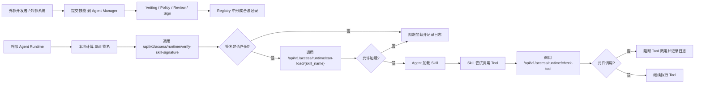
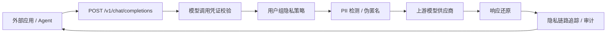
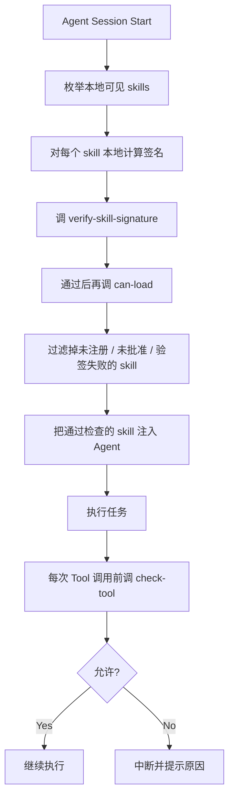

# External Agent Integration

客户端托管接入的图文操作入口为平台帮助中心 `/docs/aidr-client`；三通道对比见 `/docs/aidr-overview`，平台策略与审批见 `/docs/aidr-policies`。自研 Agent 的加载前同步校验与客户端基于日志的后台 Skill 内容观察有不同证据边界，详见 `/docs/aidr-skill-audit`。

For illustrated managed-client onboarding, use `/docs/aidr-client` in the platform Help Center. See `/docs/aidr-overview` for channel comparison and `/docs/aidr-policies` for policies/approvals. Synchronous pre-load verification in custom Agents and log-driven background Skill observation have different evidence boundaries, explained in `/docs/aidr-skill-audit`.

## Hook 命令规则 / Hook command rules

接收器支持 `aidr.tool-policy/3` 的可选 `command` 条件，字段为 `executable`、`args_all`、`args_any`、`path_prefix`、`pipe_to`。规则仍带 `id / agent / tool / decision`；原生工具规则兼容 schema 1/2。命令输入仅从受支持 Shell 工具的原始 `tool_input.command` 或 `tool_input.cmd` 读取，在脱敏前本地匹配。工具名（不区分大小写，允许命名空间前缀）：Bash、exec、exec_command、Shell、run_terminal_cmd、run_shell_command。其他工具不套用命令条件；工具名规则仍可单独管控。

仅调用前事件携带 `command_match`：`schema_version: 1`、`policy_revision`、`matched`、`unresolved`。这是认证设备接收器的判断报告，服务端依据持久化事件及当前版本核对审批，并非服务端独立复核原始命令。匹配报告不包含命令正文或参数；现有 `input_digest`、调用身份、队列和严格 ACK 保持。规则解析未知与规则实际命中分别记录；审批授权仅能消费一次，策略更新使旧审批失效。

解析不确定的条件不计为命中；没有其他明确命中的规则时采用策略默认决定。拦截模式的调用前事件额外携带接收器生成的 `control_decision`（decision、rule_id、matched_rule_ids、policy_revision、code、可选 unresolved），随原事件一次性持久化并上传。该字段不采信宿主输入，表示接收器的控制决定；审批后续结果仍以独立审批回执为准。仅审计事件及旧记录可不带该字段。

**English:** Unresolved conditions do not match; absent a confirmed rule match, the configured default applies. In intercept mode, the receiver persists its initial `control_decision` with the pre-tool event before upload. Host input cannot supply this field. It describes the receiver decision, while later approval outcomes use separate receipts. Audit-only and historical events may omit it.

**English:** Signed command policies use schema 3 with optional executable/argument/path/pipeline conditions. The receiver matches original pre-tool input locally before redaction and reports only the policy revision and matched/unresolved rule IDs. The server trusts this authenticated receiver observation within the persisted event and exact approval scope; it does not independently reparse unavailable raw input. Existing digest, queue, ACK and one-use grant semantics remain. The literal matcher is bounded and does not interpret arbitrary script code or resolve filesystem aliases. See [rule editing and acceptance](project-guide.md) for rollout and UI checks.

## Overview

平台启动时自动补齐初始全局工具规则版本 1（空规则、默认允许）；已有全局版本和设备单独规则保持不变。客户端默认继承该已发布版本，下次控制快照同步时获得设备签名。

**English:** Startup seeds global tool revision 1 (empty rules, allow fallback) when no global revision exists. Existing global revisions and client overrides are preserved. Inheriting clients receive a device-signed policy on their next control snapshot.

工具与命令规则支持全局默认和客户端整套覆盖。新客户端默认继承，存量设备规则保留；控制快照按设备生成签名版本，客户端使用原有验签和同步协议。命令条件需要接收器报告 `command_rules_schema=1`；不满足时等待升级，保留原本地策略。实际应用以设备报告为准，Hook 运行模式独立配置。配置入口和中英文验收清单见 [项目指南](project-guide.md)。

**English:** Tool rules support global defaults and complete client overrides. New clients inherit; existing device rules are preserved. Control snapshots materialize a device-scoped signed revision using the existing verification and synchronization protocol. Command conditions require a recent `command_rules_schema=1` receiver report. Incompatible or offline clients keep their verified local policy until synchronization succeeds; actual application and Hook mode are tracked separately.

这个项目本身不是统一 Agent Runtime，也不替外部 Agent 执行 Skill；它提供 Skill 准入、Agent/MCP
安全测评、模型/MCP 网关、运行时放行和统一证据轨迹。

外部系统或外部 Agent 接入它，通常有六类方式：

- 使用 Agent Manager Client 统一接管本地 Skill
- 把 Agent Manager 当作审批和验票中心
- 把 Agent Manager 当作 Skill 制品登记中心
- 把 Agent Manager 当作 LLM 隐私代理
- 用 Runtime Trace SDK 上报 Agent Turn、Step、Message、Tool 和知识检索事件
- 通过 MCP Gateway 使用受治理的远程 Tool

对已有自研 Runtime，优先接入 Governance API 和 Runtime Trace SDK。这样外部 Agent 仍使用自己的
Skill 加载机制，但在关键节点调用 Agent Manager 做校验、阻断和审计。

如果客户需要统一管理 Claude Code、Codex、Gemini CLI、OpenCode、OpenClaw、Hermes 等本地 Skill 目录，优先使用 Agent Manager Client。它不依赖 Agent 是否遵循 Skill 指令，说明见 [agent-manager-client.md](agent-manager-client.md)。

Claude/Codex AIDR 接入按实际原生接口和日志格式检测兼容性，不要求客户使用同一个精确小版本；版本、接口可用、原生信任及事件到达分别展示。平台需先更新，再更新客户端。具体规则与验收边界见 [客户端兼容说明](agent-manager-client.md#agent-小版本兼容与接入检查)。

**English:** AIDR integration checks native interfaces and log formats across minor versions. Interface availability, native trust and actual delivery remain separate. Upgrade the platform before clients; see the client compatibility guide.

客户端默认按平台策略自动接入普通 Hook 插件并启动接收器；Codex 原生信任和受管系统授权仍由用户完成。安装与授权状态可直接在平台插件接入页查看，参见[自动采集与 Hook 状态](agent-manager-client.md#接入后自动采集与-hook-状态)。

Ordinary Hook access and receiver startup follow the default platform policy automatically. Native Codex trust and managed system authorization remain user actions; the platform displays these states separately.

### 接入方式选择

| 场景 | 推荐组件 | 必须接入的控制点 | 当前边界 |
|---|---|---|---|
| 批量治理本地 Agent/Skill | Agent Manager Client | 接管、安装、巡检、隔离和恢复 | 最完整的本地目录治理；不替代 Agent 自身 Sandbox |
| Agent 支持 Skill 指令但没有生命周期 Hook | Universal Skill Verifier | 提交、状态、加载前验签 | 依赖 Agent 遵循指令和脚本退出码，不能覆盖所有调用路径 |
| Agent 有稳定的加载/Tool Hook | Claude Code、Codex、OpenClaw 等 Hook Adapter | 加载前验签与放行、Tool 前检查 | 只对实际能拦截的事件失败关闭；必须用目标版本实机验收事件结构 |
| 自研 Agent Runtime | Runtime Trace SDK + Governance API | Turn/Step、模型/MCP 关联、Skill 加载和 Tool 调用 | 推荐方式，可形成 `full` 轨迹；接入方负责正确划分真实生命周期 |
| 只能改模型/MCP Base URL | Gateway-only | 模型 `metadata`、MCP `params._meta` | 只能形成 `model_only`、`mcp_only` 或 `gateway_partial`，不能伪造 Agent 层级 |
| Agno/LangGraph 等框架 | 对应 Demo 的 Loader/Tool Hook | 框架加载 Skill 前和工具执行前 | 示例是适配起点，不代表所有版本、工具和并发路径均已覆盖 |

最小权限凭证不能混用：Scanner 接入凭证只负责提交和读取自己的扫描；Agent 运行凭证负责验签、
加载、Tool 检查和可选轨迹/模型/MCP；普通模型调用凭证不能冒充 Agent；MCP 网关凭证只访问被授权
Gateway。管理员 JWT 只用于管理面，不应放进 Agent Runtime。

## Governance Gateway

模型切换的配置位置、参数、生效与恢复方式见 [客户端模型切换](model-gateway.md#客户端模型切换--client-model-switching)。对标九种 Agent 的配置适配与真实执行结果分别记录在 [验证矩阵](acceptance/model-switching-2026-09-13/README.md)；已写入不等于调用验证通过。

For model configuration locations, parameters, activation and recovery, see [Client model switching](model-gateway.md#客户端模型切换--client-model-switching). Configuration adapters and native execution results for the nine benchmark Agents are separately documented in the [validation matrix](acceptance/model-switching-2026-09-13/README.md). A successful write is not a verified call.

在这个模式下，外部 Agent 自己保有 skill 文件，并在运行前调用 Agent Manager 的运行时检查接口。



### Typical Flow

1. 开发者先把 skill 提交到 Agent Manager。
2. Agent Manager 完成 vetting、policy 检查、审批和签名。
3. 外部 Agent 在真正加载 skill 前，先本地计算 skill 签名。
4. Agent 调用 `verify-skill-signature` 校验本地内容是否与审批时一致。
5. 如果签名匹配，再调用 `can-load` 检查 registry 状态。
6. Skill 在运行中每次要调用工具前，再调用 `check-tool`。
7. Agent Manager 记录允许或阻断的审计事件。

### Current APIs

外部 Agent 推荐使用管理台 `智能体管理 / 统一凭证中心` 创建的 `Agent 运行凭证`，并绑定对应 Agent。最关键会用到这三个凭证鉴权接口：

- `POST /api/v1/access/runtime/verify-skill-signature`，需要 `runtime:verify-signature`
- `GET /api/v1/access/runtime/can-load/{skill_name}`，需要 `runtime:can-load`
- `GET /api/v1/access/runtime/check-tool`，需要 `runtime:check-tool`

旧的 `/api/v1/runtime/...` 治理路径已停止使用并返回 `410 Gone`。所有 Agent 都应迁移到带 Agent 运行凭证的 `/api/v1/access/runtime/...`；管理员 JWT 只用于管理面。

注意：`/api/v1/access/runtime/can-load/{skill_name}` 不接受 `skill_path`。外部 Agent 应先本地计算签名并调用 `verify-skill-signature`，再做 name-only `can-load`。

如果外部系统还需要查看 skill 状态，也可以读：

- `GET /api/v1/skills`
- `GET /api/v1/skills/{id}`

### Universal Skill Verifier

对于 Codex、Claude Code 这类支持本地 skill 指令的 Agent，可以使用仓库内置的通用示例：

- `demo/agent-manager-skill-verifier/skills/agent-manager-skill-verifier/`

它不使用 Claude Code hook、Codex 专用 adapter 或平台绑定配置，适合首版用来规范 Agent 行为：

- 发现或安装第三方 skill 后，先上传到 Agent Manager 扫描。
- 用户要求使用第三方 skill 前，先检查内容完整性、审批状态和 Agent 授权范围。
- 未提交、扫描中、待审核、已拒绝、未形成可信版本、内容不匹配或状态不可加载时，默认阻断使用。

管理台提供下载入口：

- `智能体管理`
- `接入与运行`
- `下载 Skill Verifier`

后端下载接口：

```http
GET /api/v1/scanner/skill-verifier/download
```

执行 `verify` 的 Agent 运行凭证至少需要这些权限：

- `runtime:verify-signature`
- `runtime:can-load`

如果运行时还会在每次 Tool 调用前执行权限检查，再增加 `runtime:check-tool`。`submit` 和 `status` 使用独立的 Scanner 接入凭证，不应与 Agent 运行凭证混用。

## Unified Runtime Trace

新创建的 Agent 运行凭证默认包含 `runtime:trace`。历史凭证不会被后台静默提权，需要管理员在
统一凭证中心显式增加该 Scope 或重新签发。平台页面默认启用 Runtime Trace，不需要通过 `.env`
打开页面；部署配置中的禁用开关只用于紧急回退。

最小流程：

1. `POST /api/v1/runtime-traces` 创建 Trace，服务端从凭证绑定关系确定 `agent_id`。
2. SDK 缓冲 `runtime-trace@1` 事件，并批量调用
   `POST /api/v1/runtime-traces/{trace_id}/events:batch`。
3. 调模型网关时，把 `RuntimeTraceClient.gateway_metadata()` 放入 OpenAI `metadata`。
4. 调 MCP 网关时，把同一对象合并到 JSON-RPC `params._meta`。
5. 管理端通过 Trace、Session、Agent、时间、风险、Tool 或 request ID 查询。

Python 最小 SDK 位于 `agent_manager/runtime_trace.py`，可运行示例位于
`demo/runtime-trace-sdk/`。SDK 支持 Turn、Step、用户消息、Tool Call/Result、知识检索和父子
`call_id`。服务端 `seq` 按接收顺序分配，不依赖客户端时钟；同一 `batch_id` 或 `event_id`
重复上报会去重，内容冲突则返回稳定错误码。

最小关联示例：

```python
from agent_manager.runtime_trace import RuntimeTraceClient

trace = RuntimeTraceClient("https://agent-manager.example.com", "amat_xxx")
trace.create_trace("business-session-001")
turn_id = trace.turn_start(payload={"goal": "query policy and call governed tools"})
step_id = trace.step_start(turn_id, payload={"name": "model-reasoning"})

model_metadata = trace.gateway_metadata(turn_id=turn_id, step_id=step_id, call_id="call-model-001")
# 放入 OpenAI-compatible 请求的 metadata。

mcp_metadata = trace.gateway_metadata(
    turn_id=turn_id,
    step_id=step_id,
    call_id="call-mcp-001",
    parent_call_id="call-model-001",
)
# 放入 MCP JSON-RPC params._meta。

trace.step_end(turn_id, step_id)
trace.turn_end(turn_id)
trace.flush()
```

不要把 Token、完整 Prompt、模型响应或 Tool 结果打印到示例日志。SDK 事件的 `payload` 会作为原始
Payload 加密保存并产生脱敏投影；接入方知道字段本身含敏感数据时，应同时提供安全的
`redacted_payload`。`best_effort=True` 只适合观测事件：它会在平台暂时不可达时保留待发送事件，
但不能用于 Skill 加载或 Tool 权限判定。安全放行接口网络失败时必须失败关闭。

需要同时验证 SDK、模型网关、本地 Tool、MCP Gateway 和知识检索关联时，运行
`demo/agent-security-full-integration/full_agent.py`。该示例要求绑定 Agent 的组合凭证具备
`runtime:trace`、`model:chat` 和 `mcp:call-tools`，并显式传递相同的 Trace/Turn/Step/Call 关联字段。
高风险 MCP Tool 返回待审批后示例停止；管理员批准后，调用方通过
`AGENT_MANAGER_MCP_APPROVAL_REQUEST` 携带原审批申请 ID 再运行，不能在示例中绕过审批。

只接入模型/MCP 网关而没有 Agent SDK 时，参考 `demo/agent-security-gateway-only/`。示例不得发送伪造的
`turn_id` 或 `step_id`，并按实际来源区分 `model_only`、`mcp_only` 和 `gateway_partial`。如提供具备轨迹读取
权限的短期登录 Bearer Token，脚本会回查并验证完整度；未提供时只报告 `submitted_unverified`，不宣称验证通过。

完整度含义：

- `full`：存在 Agent SDK 事件，且已关联模型或 MCP 网关事件。
- `model_only`：只有模型网关事件。
- `mcp_only`：只有 MCP 网关事件。
- `gateway_partial`：存在其他部分事件，但不足以还原完整 Agent 步骤。

普通拥有者只能读取脱敏投影；原始 Payload 和原始导出仅管理员、隐私审计角色可用，并产生审计
事件；安全审计角色可跨目标读取脱敏轨迹，但不能读取原始内容。知识检索事件显式记录知识库、
文档、Chunk 和脱敏摘要，不要求保存完整原始文档。

安全扫描 Worker 回传 Finding 时，每项必须提供可解析到本次用例的 `case_external_id` 和非空 `evidence`。如果评估器已获得目标 Agent 的精确
轨迹事件，可同时传入 `trace_id` 和 `event_id`，服务端会校验存在性和归属范围。若没有目标运行轨迹，不应伪造 Turn/Step；服务端会为该
Finding 生成独立的 `security.finding` 扫描证据事件。结果 API 中的 `traceability` 才是用例、事件、证据摘要和判定口径版本是否齐全的权威状态。

安装到 Codex：

```bash
mkdir -p ~/.codex/skills
unzip agent-manager-skill-verifier.zip -d ~/.codex/skills/
```

安装到 Claude Code：

```bash
mkdir -p ~/.claude/skills
unzip agent-manager-skill-verifier.zip -d ~/.claude/skills/
```

配置运行环境：

```bash
export AGENT_MANAGER_VERIFIER_BASE_URL="http://localhost"
export AGENT_MANAGER_AGENT_RUNTIME_TOKEN="amat_xxx"
export AGENT_ID="<agent-id>"
```

Verifier 只计算无密钥内容摘要，不得配置或持有服务端签名私钥。

提交第三方 skill：

```bash
python <skills-dir>/agent-manager-skill-verifier/scripts/agent_manager_skill_verifier.py submit \
  --path /path/to/third-party-skill \
  --behavioral \
  --deep-scan
```

查看状态：

```bash
python <skills-dir>/agent-manager-skill-verifier/scripts/agent_manager_skill_verifier.py status \
  --skill-id <skill-id>
```

使用前检查内容完整性和加载授权：

```bash
python <skills-dir>/agent-manager-skill-verifier/scripts/agent_manager_skill_verifier.py verify \
  --path /path/to/third-party-skill
```

这类接法依赖 Agent 遵循 Skill 指令和脚本退出码。需要事件自动触发时，在具体 Agent 的生命周期事件上接 Hook 或 runtime adapter。

### Event Hook

完整的 Claude Code、TraeCode、Codex 和 OpenClaw 配置、凭证权限、验收及排查步骤见 [hook-integration.md](hook-integration.md)。其中 TraeCode 部分是基于官方协议的待验证适配，不是已通过实机验收的集成。本节只保留运行时检查顺序和关键边界。

Hook 的接入点应与检查目标一一对应：

| 事件点 | 必须执行的检查 | 通过条件 |
|---|---|---|
| Skill 读取或加载前 | 本地计算内容摘要，依次调用 `verify-skill-signature` 和 `can-load` | 两个接口均返回 `allowed=true`，状态为可加载状态 |
| Tool 执行前 | 调用 `check-tool`，传入 Skill 名称、Tool 名称和稳定的 Agent ID | 接口返回 `allowed=true` |

Claude Code 可参考 `demo/claude-code-api-hook/agent_guard_hook.py`，在 `PreToolUse` 中使用绝对路径启动脚本：

```json
{
  "hooks": {
    "PreToolUse": [
      {
        "matcher": "",
        "hooks": [
          {
            "type": "command",
            "command": "python3 /absolute/path/skill-manager/demo/claude-code-api-hook/agent_guard_hook.py"
          }
        ]
      }
    ]
  }
}
```

该示例读取 `AGENT_MANAGER_BASE_URL`、`AGENT_MANAGER_API_TOKEN` 和 `AGENT_ID`。`AGENT_MANAGER_API_TOKEN` 的值必须是绑定该 Agent 的运行凭证。对于能识别出的 Skill 调用，内容不一致、未授权、API 错误或网络错误会以退出码 `2` 阻止；成功时返回 `0`。诊断日志位于 `~/.agent-manager/logs/agent_guard_hook.log`。无法解析的输入和非 Skill 调用不进入 Skill 校验，因此上线前必须用目标 Agent 的真实事件验证 Skill 名称与目录提取结果。

TraeCode 官方已支持 `PreToolUse` 和命令退出码 `2` 拒绝，但 Agent Manager 尚未完成真实 TraeCode 端到端验证。其项目级配置位置是 `.trae/hooks.json`，macOS / Linux 用户级配置才是 `~/.trae-cn/hooks.json`；具体配置、官方来源和待验证项见 [Hook 接入指南](hook-integration.md#4-traecode--trae-cn-接入状态)。

Codex 使用独立示例 `demo/codex-agent-manager-hook/`。把环境文件保存在仓库外，复制或合并 `hooks.json.example` 到项目 `.codex/hooks.json` 或用户级 `~/.codex/hooks.json`，将脚本和环境文件改成绝对路径；重启后在 Codex CLI 运行 `/hooks` 并信任该 Hook。当前示例在受支持的 `PreToolUse` 路径前校验全部受治理 Skill，但尚未覆盖所有 Shell、WebSearch 和其他 Tool，不能解释为全路径强制拦截。

OpenClaw 示例位于 `demo/openclaw-agent-manager-hook/`：

- `agent:bootstrap` 内部 Hook 枚举可见 Skill，执行签名和加载许可检查。
- `before_tool_call` 通过插件 Hook 调用 `check-tool`，必须接入实际 OpenClaw 插件工程。
- 事件中的会话身份必须稳定映射到平台登记的 Agent ID，不能直接假设任意 session key 就是 Agent ID。

推广前至少演练平台不可达、凭证过期、Skill 路径缺失、内容变化和 Tool 未授权五类场景，并同时核对 Agent 侧结果、Hook 日志与平台运行审计。

## Registry As Artifact Catalog

在这个模式下，Agent Manager 主要负责记录“哪些 skill 是已批准或已部署的”，外部系统根据 registry 信息决定应该拉取哪个 skill。


### 版本与下载

平台已按 Skill 名称族管理内容版本：

- `GET /api/v1/skills/{skill_id}/versions` 查询所有内容版本。
- `GET /api/v1/skills/{skill_id}/diff?base=...&target=...` 比较两个版本。
- `GET /api/v1/skills/{skill_id}/download?version=...` 下载指定版本。
- 客户端接口默认解析到最新可信版本，也可以显式传 `version_id` 下载或恢复历史可信版本。

查询接口中的 `skill_id` 表示 Skill 家族，`version_id` 表示一个不可变内容版本。审批、拒绝、重新检测、部署和退役等生命周期写操作必须使用 `version_id`；平台不会把家族 ID 自动解析为最新版，避免并发产生新版本时误操作其他内容。删除整个 Skill 家族时才使用家族 `skill_id`。

外部 Agent 做 name-only 校验时解析最新可信版本；如果本地内容属于较旧的可信版本，应同时传版本 ID 或内容签名，以免把“最新版本”误当成“本机实际版本”。多环境发布地址仍需由外部分发系统管理。

## LLM Privacy Proxy

外部应用或 Agent 可以把 Agent Manager 当作 OpenAI-compatible 或 Anthropic-compatible 模型网关使用。

如果客户已有独立 AI 网关，客户端也可以按平台默认策略直接使用外部网关，不经过 Agent Manager 内置模型代理。Agent 注册、一次性 Key、动态 `/v1/models` 目录和 Skill 治理边界见 [外部 AI 网关接入与 Skill 治理](external-ai-gateway-integration.md)。

在“智能体管理”中创建的平台 Agent 不需要客户端。选择外部 AI 网关后，平台直接注册外部身份、拉取模型目录并保存默认模型；运行时由绑定该 Agent 且包含 `model:chat` 的 Agent 运行凭证调用 `/api/v1/runtime/external-model/credential` 领取当前外部模型连接信息。



运行时接口：

- `POST /v1/chat/completions`
  OpenAI SDK 兼容路径，适合把 SDK 的 `base_url` 指到 Agent Manager。
- `POST /chat/completions`
  兼容部分客户端把 `base_url` 配成不含 `/v1` 时直接拼接的路径。
- `GET /v1/models` / `GET /models`
  OpenAI-compatible 模型列表，只返回当前模型调用凭证允许访问的启用模型。
- `POST /api/v1/llm/chat/completions`
  Agent Manager 命名空间路径，适合内部服务显式调用。
- `POST /v1/messages`
  Anthropic Messages 兼容路径，Claude Code 可通过 `ANTHROPIC_BASE_URL` 和 `ANTHROPIC_AUTH_TOKEN` 接入。
- `POST /v1/responses`
  OpenAI Responses 兼容路径，Codex 可通过 `~/.codex/config.toml` 的自定义 model provider、`wire_api = "responses"` 和 Agent 运行凭证接入。

鉴权使用 `智能体管理 / 统一凭证中心` 创建的模型调用凭证，或显式授予 `model:chat` 的 Agent 运行凭证：

```http
Authorization: Bearer amat_xxx
```

模型调用凭证用于模型调用：

- 可绑定用户或用户组
- 可限制可访问模型
- 可限制请求体大小和并发数
- 可配置 Prompt 防护和可选 Token 压缩
- 明文只展示一次，服务端只保存 hash

Docker Compose 的根路径 `/` 由管理台前端使用。外部模型客户端应使用 `/v1`，或使用会自动拼接 `/chat/completions` 的根地址配置，不要直接 POST `/`。

完整说明见：

- [model-gateway.md](model-gateway.md)

## Dify 资产清单接入

### 三种凭据的获取与配置

帮助中心的 `/docs/dify-security-access` 提供中英文逐步操作、连接字段截图和排错表。
三种用途分别保存在“安全扫描 → 扫描目标 → 凭据”中，选择 `Bearer 令牌` 类型，
填入原始 Key（不包含 `Bearer ` 前缀）；不要把密钥写入目标的高级 JSON。

| 用途 | 获取位置 | 调用范围 |
|---|---|---|
| `dify_app_api` | Dify 工作室 → 目标应用 → 访问 API → API 密钥，由有权限的人员创建 | 已发布应用的动态调用 |
| `dify_console_api` | 支持 Admin API Key 的自托管部署配置，由部署管理员提供 | Console 应用信息、DSL、草稿及应用枚举 |
| `dify_knowledge_api` | 当前官方入口为知识库列表右上角 Service API；部分版本从单库 API Access 进入 | 创建账号可见的知识库 API，内容采集另外要求授权 |

App Key 绑定具体应用，Knowledge Key 的范围可能覆盖创建账号可见的多个知识库，并非默认单库只读。
单库 API Access 还可控制该库是否允许 API 访问。入口和权限应与正在运行的 Dify 版本核对。
参考 [Dify API 入门](https://docs.dify.ai/en/api-reference/guides/get-started) 和
[Knowledge API](https://docs.dify.ai/en/api-reference/guides/knowledge)。

**App API：**先发布并验证目标应用，在访问 API 页复制服务 API 基址，例如
`https://dify.example.com/v1`，保存为目标运行地址。不要填编排页或分享链接。
当前动态适配器用 `config.extra.dify_type` 选择 `chat` 或 `workflow`，通过
`extra.inputs` 传入业务变量，并将测试 Prompt 放进 `query`；Workflow 必须兼容该输入约定。
新发现应用需要自己的 App Key，不继承来源模板应用的运行凭据。

**Console Admin API：**已核对 Dify 1.6.0 的
[配置定义](https://github.com/langgenius/dify/blob/1.6.0/api/configs/feature/__init__.py) 和
[认证实现](https://github.com/langgenius/dify/blob/1.6.0/api/extensions/ext_login.py)。
支持该认证机制的部署由管理员配置以下变量。使用分服务环境文件的目录结构时，
编辑 `dify/docker/envs/core-services/api.env`，确认 Compose 的 `api` 服务通过 `env_file`
引用该文件；不同版本的配置文件位置以实际部署为准：

```dotenv
ADMIN_API_KEY_ENABLE=true
ADMIN_API_KEY=<ADMIN_KEY_FROM_SECRET_STORE>
```

两个变量默认未启用/未设置。密钥由安全随机源生成并存入部署 Secret。
`env_file` 在创建容器时注入；`docker restart` 或 `docker compose restart api` 不会重新读取
修改后的值。由部署管理员在 `dify/docker` 目录重新创建 API 容器：

```bash
cd dify/docker
docker compose up -d --no-deps --force-recreate api
```

若原部署使用 `-f`、`-p` 或 `--profile`，更新时保留相同参数，以操作正确的 Compose 项目。
容器启动后按下方只读接口验证配置是否生效，不能只凭容器处于运行状态判断。
此认证可按 `X-WORKSPACE-ID` 选定工作空间 owner 身份，属于高权限凭据。
Dify Cloud、其他版本及定制版本须核对同版本支持情况，不能假定都有这一机制。

Console Base URL 填 API 服务根地址（例如 `https://dify.example.com`），不附带 `/v1` 或
`/console/api`。App ID 取自 `/app/<APP_ID>/workflow` 等应用 URL 中的 UUID。
Workspace ID 为工作空间 tenant UUID，不是名称；由部署管理员确认，或由有权限的用户在浏览器
Network 中核对当前工作空间响应的 `id` 与 `name`。不要复制 Cookie 或整份网络日志。
在有权限且能访问 Dify 的终端，将下面前四行替换为实际服务根地址、Workspace UUID、App UUID
和 Admin Key，复制整段执行（Bash / Zsh）。地址使用实际协议、域名/IP 与端口；Key 不含 `Bearer ` 前缀。
两条请求均为只读 GET，不执行应用：

```bash
DIFY_CONSOLE_BASE_URL='https://dify.example.com'
DIFY_WORKSPACE_ID='<WORKSPACE_ID>'
DIFY_APP_ID='<APP_ID>'
DIFY_ADMIN_KEY='<ADMIN_KEY>'

curl --silent --show-error --include \
  --connect-timeout 10 --max-time 30 \
  --header "Authorization: Bearer ${DIFY_ADMIN_KEY}" \
  --header "X-WORKSPACE-ID: ${DIFY_WORKSPACE_ID}" \
  --header 'Accept: application/json' \
  "${DIFY_CONSOLE_BASE_URL%/}/console/api/apps/${DIFY_APP_ID}"

curl --silent --show-error --include \
  --connect-timeout 10 --max-time 30 \
  --header "Authorization: Bearer ${DIFY_ADMIN_KEY}" \
  --header "X-WORKSPACE-ID: ${DIFY_WORKSPACE_ID}" \
  --header 'Accept: application/json' \
  "${DIFY_CONSOLE_BASE_URL%/}/console/api/apps/${DIFY_APP_ID}/export?include_secret=false"

unset DIFY_ADMIN_KEY
```

`--include` 显示 HTTP 状态和响应头；连接超时为 10 秒，单次请求最长 30 秒。
第一条应返回 HTTP 200 和应用详情，核对 `id`/`name`；第二条应返回 HTTP 200 和包含 DSL 内容的 JSON：外层 `data` 字段是 YAML 字符串，
解析后可看到 `app`、`kind: app`、`version` 和 `workflow` 等内容；其中 `version` 是 DSL 格式版本。
原始 JSON 中的 `\n`、`\uXXXX` 是换行和 Unicode 转义，不是乱码或导出失败。
401 先检查开关、API 进程环境变量、Key 与 Workspace ID；403/404 检查权限、App ID 与路由。
HTML 或 3xx 不算验证成功；curl 退出码 0 也可能对应 HTTP 401，应以实际 HTTP 状态和响应内容判断。
不支持该认证或导出的版本可使用不含密钥的手动 DSL 进行即时采集，在线定时采集仍需 Console 支持。

**Knowledge API：**保存独立 Knowledge Key 后，通过 `GET /v1/datasets?page=1&limit=20`
分页核对可见数据集和 UUID。需要内容检查时，在资产清单任务中明确确认授权并限制文档、分段和字节数。
配置凭据不等于授权内容读取；隐藏的 DSL 知识库引用也不一定是可直接调用的 Dataset UUID。

### 采集内容与证据边界

Dify 智能体使用扫描管理中的独立 `dify_asset_inventory` 类型采集资产。目标运行地址继续服务原有动态
Agent 扫描；资产采集另外要求显式配置 Console Base URL、Workspace ID 和 App ID。默认采集链路是：

```text
Dify Console App 详情 + include_secret=false DSL 导出
  -> Console 草稿工作流按相同 knowledge-retrieval 节点 ID 解析 Dataset UUID
  -> DSL 节点、Prompt 摘要、Tool、MCP 和知识库引用
  -> 已显式绑定的 MCP tools/list 快照
  -> 同一 App ID 且同归属范围的 Runtime Trace
  -> 多来源资产快照与加密 Artifact
```

在目标凭据中选择 `Dify Console Admin API` 用途保存 Admin API Key。该值不会进入目标 JSON、任务参数、
日志、响应或 Artifact，只在 Worker 领取该任务时通过密封信封传递。系统不使用浏览器 Cookie 自动登录；
Console API 无法导出时可由管理员选择手动 DSL 回退。所有 Console 请求固定
`include_secret=false`，并执行 HTTPS、DNS、CIDR、重定向白名单、10 MiB 响应上限、超时和有界重试检查。

Prompt 原文和知识库内容默认不采集。Prompt 原文需管理员明确启用，存储后仍需再次确认和审计才能查看；
知识库内容检查需业务授权、独立 `Dify Knowledge API` 凭据，并通过 `/v1/datasets` 相关分页接口在
文档/分段/字节和超时上限内串行读取。默认产物只包含 Prompt 哈希、长度、变量引用，以及知识分段哈希和
脱敏元数据，不把原文发送给外部模型。

部分 Dify 版本会在导出 DSL 中隐藏 Dataset ID。Console 自动采集会额外读取
`GET /console/api/apps/{app_id}/workflows/draft`，仅在节点 ID 相同、两侧节点类型均为
`knowledge-retrieval` 且草稿 UUID 唯一合法时建立映射，再由 Knowledge API 读取元数据。系统不按名称、标题、
数组位置或字符串相似度猜测；无法可靠映射时资产保持未验证。草稿来源会明确标记
`draft_may_differ_from_published_workflow`，不能当作已发布工作流事实。知识库内容仍只有在管理员明确确认授权后
才读取，未授权扫描只读取可用元数据。

Dify Provider 与 MCP Server 必须按 Provider ID 显式绑定。DSL 只能证明 MCP Tool 已配置，完整工具清单
来自绑定 Server 最近一次真实 `tools/list` 发现；系统不按名称猜测。节点或 Tool 的 `executed` 来自
Runtime Trace，不能由 DSL 推断。采集成功只表示任务完成，仍应查看各字段的来源/验证状态以及 DSL、Console、
Knowledge、MCP 和 Runtime Trace 的覆盖状态。

## MCP Gateway

支持 Streamable HTTP 的 Agent 或 MCP Client 可以只连接 Agent Manager，不直接配置各个上游 MCP Server：

```json
{
  "type": "streamable-http",
  "url": "https://agent-manager.example.com/mcp/readonly",
  "headers": {
    "Authorization": "Bearer amat_xxx"
  }
}
```

管理员先在 `MCP 服务` 中发现上游 Tool，再在 `MCP 网关` 中选择要发布的 Tool，最后在 `统一凭证中心` 创建 `MCP 网关凭证`。凭证绑定虚拟网关而不是智能体。当前支持 `initialize`、`ping`、`tools/list` 和 `tools/call`；stdio、Resources 和 Prompts 不在首版范围内。

生产环境的上游 MCP Endpoint 默认只允许 HTTPS。每次连接前会重新解析 DNS，拒绝私网、回环、链路本地、保留地址和不在 `MCP_OUTBOUND_ALLOWLIST` 中的目标；HTTP 只能通过开发配置显式启用。响应大小、Tool 每分钟调用量和并发数均有独立限制。

标记为高风险或要求审批的 Tool 会进入限时 Tool 级审批流程：首次 `tools/call` 返回 JSON-RPC `-32002`，并在 `error.data.approval_request_id` 中给出申请 ID。管理员在 `能力治理 / MCP 调用审批` 查看首次调用上下文并批准或拒绝。批准后，网关会自动按 MCP Token、Gateway、Tool 和 Schema 匹配有效授权；调用方无需回传申请 ID，并可在有效期内使用不同参数重复调用同一 Tool。参数仅作为审批和审计上下文，不是授权匹配条件。Schema 变化、授权到期、Token 或网关失效后必须重新审批。调用方也可以使用同一个 MCP 网关凭证访问 `GET /mcp/{gateway_slug}/approvals/{request_id}` 查询状态。

原有 `POST /api/v1/mcp/approvals` 直接签发一次性凭证的接口继续保留，调用方仍可通过 `params._meta.agent_manager_approval` 消费，但它主要用于已有集成和受控调试；正式人工审批应使用调用自动产生的待办流程。

## Boundaries

这套系统当前负责的是：

- skill 提交
- vetting
- policy 判定
- 审批
- 签名
- 部署状态
- 运行时放行判断
- 审计日志
- LLM 模型调用隐私代理
- LLM 隐私链路追踪
- 统一 Runtime Trace 写入、查询、脱敏/原始导出和保留期清理
- 远程 MCP Tool 聚合、授权和调用审计
- Agent Manager Client 的本地 Agent 发现、可信 Skill 下发、持续巡检、恢复、隔离和移除

这套系统当前不负责的是：

- 真正执行 skill
- 提供统一 skill runtime 或 stdio MCP runtime
- 帮外部 Agent 解析和运行不同框架的 skill

## Recommended Integration Pattern

如果你要给外部 Agent 接入，推荐按下面的方式做：



### Why This Pattern

原因很直接：

- 不要求你改外部 Agent 的核心 runtime
- 只需要在“加载前验签/放行”和“调用前”两个点加拦截
- 可以最大程度复用当前 Agent Manager 的现有能力
- 审计链路也完整

## Current Gaps

以下能力当前仍不能宣称已经完成：

1. 所有第三方 Agent 版本和所有 Tool 路径的 Hook 强制拦截；示例必须在目标版本实机复验。
2. W3C `traceparent` / OpenTelemetry 自动桥接；当前关联使用 Runtime Trace SDK、模型 `metadata` 和 MCP `params._meta`。
3. 多主机分布式并发/速率限制和租户级磁盘高水位控制；当前生产基线仍以共享服务和数据库边界为准。
4. stdio MCP、统一 Skill Runtime、服务端内置模型工具、后台 Responses 任务和 WebSocket 语义。
5. 客户环境中的真实 Provider、生产网络、账户权限和完整银行验收矩阵；仓库自动测试不能替代这些证据。

## Summary

一句话说清楚：

**外部 Agent 仍由自己的 Runtime 执行任务；Agent Manager 负责确认能否加载/调用，并把模型、MCP、风险和证据纳入治理。**

当前最实用的接法就是：

- 提交 skill 到 Agent Manager 做准入治理
- Agent 本地计算 skill 签名并调用 `verify-skill-signature`
- Agent 加载前调 `can-load`
- Agent 调工具前调 `check-tool`
- 用 Runtime Trace SDK 上报真实 Turn/Step，并把相同关联字段传给模型和 MCP 网关
- 所有关键动作都留脱敏轨迹和安全审计

当前已经可用的辅助接口：

- `GET /api/v1/skills/{id}/files`
  返回 skill 目录内的相对路径、文件大小和修改时间
- `POST /api/v1/access/runtime/verify-skill-signature`
  校验外部 Agent 本地计算的签名是否与批准记录一致
- `GET /api/v1/access/runtime/can-load/{skill_name}`
  校验 skill 注册状态是否允许加载
- `GET /api/v1/access/runtime/check-tool`
  校验运行时 tool 调用是否在允许范围内

## AIDR 多产品适配与证据范围（2026-10-07）

Hook 的可选 `context` 元数据保留宿主明确报告的 `model`、`cwd`。Cursor 优先使用 `model_id`，其 `workspace_roots` 单独展示为工作区，不当作进程工作目录。依据：[Claude Hooks](https://code.claude.com/docs/en/hooks) 的 SessionStart 模型字段及通用 cwd、[Cursor Hooks](https://cursor.com/docs/hooks) 的模型及工作区字段；其他入口只保留实际输入中的字段，不从默认配置推断。模型最多 256 字节，路径每项最多 512 字节，工作区最多 8 项，沿用审计脱敏策略并标记处理状态。新增字段可选，旧客户端和历史事件继续兼容。

Optional Hook `context` metadata preserves explicitly reported `model` and `cwd`. Cursor prefers `model_id`; `workspace_roots` remain workspace roots, not a process working directory. Missing fields are not inferred from configuration. Metadata follows audit redaction with UTF-8 byte limits: model 256, each path 512, up to 8 workspace roots. Processing flags are retained; older clients and historical events remain compatible.

2026-10-08 本机 Codex 实验：更新现有采集组件后，真实工具 Hook 的平台记录 #13229 包含模型 `gpt-6-astra` 和当前项目工作目录；对应本地序号 13210 已 ACK，页面中英文显示通过。Claude/Cursor 的新增字段通过格式与脱敏测试，本次未重新执行它们的真实新会话验收。会话上下文使用只索引带 context 记录的局部索引，避免每次打开会话重扫旧正文。

Agent 日志还支持独立的 `model_context` 元数据协商（`X-AIDR-Model-Context: 1` / `model_context_schema: 1`），复用日志上传协议。Codex 的供应商来自 `session_meta.model_provider`，模型和推理强度/摘要设置来自原生轮次 `turn_context`；Claude Code 与 Qoder CLI 的模型来自助手消息；WorkBuddy 来自 `providerData.model`；OpenCode 来自同消息 ID 的 `modelID/providerID`。供应商 ID 是来源标识或配置别名，不推导请求地址、运营方或最终 API 请求。没有可靠轮次 ID 时只显示会话最近日志报告。当前本机 WorkBuddy、Qoder CLI、OpenCode 历史样本模型解析已通过，其他 Qoder 入口不据此标记通过。Claude 格式回归通过，新模型元数据链路的真实新调用仍需单独验收。

**English:** Log model metadata has independent protocol negotiation and uses the existing upload/ACK path. Codex provides session provider and native-turn model/settings; Claude and Qoder CLI provide assistant message models; WorkBuddy provides per-record models; OpenCode provides identity-matched message model/provider IDs. IDs may be aliases, not proven upstream endpoints. Historical local samples validate parsing only, and do not certify other product entries or fresh end-to-end calls.

2026-10-08 日志模型元数据验收：本机正在进行的 Codex 会话实际日志通过采集、队列、ACK、平台入库和中英文页面展示，平台记录 #34775 报告 `gpt-6-astra / openai / high / detailed`，对应原生轮次未被其他轮次覆盖。已检查英文 390 px 布局。WorkBuddy 9 个历史文件、Qoder CLI 3 个历史文件、OpenCode 142 个快照分别得到 326、14、91 条带模型元数据的事件；这些是只读历史样本验证。额外独立 Codex CLI 新问答退出码为 1，未取得目标模型回复，不计为完整问答通过。Go 日志/队列/上传测试、37 项后端测试、前端构建与 22 项 i18n 检查通过。升级检查修复了覆盖报告误带本地模型游标字段导致拒收的问题；已冻结的开发批次可以正常重传，模型游标状态在后续报告中只留本地，未删除积压或游标。

Local verification on 2026-10-08: real Codex tool Hook record #13229 retained the host-reported model and project working directory; local sequence 13210 was acknowledged. Chinese and English rendering passed. Claude/Cursor metadata passed format and redaction tests; fresh-session end-to-end verification was not repeated for those products. A partial index limits session-context lookups to records carrying context.

统一目录为 `backend/aidr_products.json`。产品 ID 表示产品入口，不等于库存中的 Agent 类型。`sample_versions` 是格式样本范围，不是精确版本白名单；不同 OS、入口和未来格式须分别验证。目录中的适配能力与设备实际安装、授权、事件到达、ACK 状态分开显示。

| 产品入口 | 依据 | 日志适配 | Hook 适配 | 本机验证与限制 |
| --- | --- | --- | --- | --- |
| Claude Code CLI | [官方 Hooks](https://code.claude.com/docs/en/hooks)及现有实现 | 原 JSONL、游标和数据兼容 | 原生插件、阻断与审批，保留受管安装 | 原有功能回归；本次不替代此前实机验收 |
| Codex CLI / App Server | [官方文档](https://developers.openai.com/codex/)及现有实现 | 原 rollout JSONL；仅覆盖实际落盘的来源 | 原生插件、阻断与审批，保留受管安装 | 原有功能回归；未落盘的侧边会话仍不能凭 Hook 推定存在日志 |
| WorkBuddy macOS 桌面 5.6.2 | [插件文档](https://www.codebuddy.cn/docs/workbuddy/Plugins)、本机随包 CLI 源码与真实日志 | `~/.workbuddy/projects` JSONL；输入、回复、调用、结果 | `~/.workbuddy/settings.json`；7 类事件；工具拒绝适配；未接入审批 | 已使用真实新问答验证日志与 Hook 入库；宿主工具返回 `completed` 不等于命令成功；回复阶段未知时保持未知 |
| Qoder | [桌面 Hooks](https://docs.qoder.com/qoder/hooks)、[CLI Hooks](https://docs.qoder.com/cli/hooks)、[共享设置](https://docs.qoder.com/extensions/hooks)、[Work Hooks](https://docs.qoder.com/qoderwork/hooks) | CLI 格式 1.1.57 / 1.1.61 JSONL 已适配；桌面 0.4.1 本次生成 1.1.61 格式真实日志 | qoder-hooks 共享设置已实现；qoder-work 独立设置保留；共享事件不自行确定宿主入口 | 2026-10-08 桌面 0.4.1 新调用：Hook 7 条、日志 6 条完成平台入库及 ACK。独立 CLI、IDE、Work 新调用及阻断/审批未复验 |
| Cursor IDE / 本地 Agents | [官方 Hooks](https://cursor.com/docs/hooks) | 未接入，不读取内部会话数据库 | `~/.cursor/hooks.json` version 1；7 类通用事件；`permission: allow/deny`；不提供审批 | 本机 3.12.30 本地 Agents 的真实提交、工具成功、工具失败及轮次结束已入库并在平台查看；SessionEnd 尚未实测。CLI、Cloud、Windows 未完成实机验收 |
| OpenCode CLI（仅兼容旧接入） | 本机 1.1.51 存储样本、[插件接口](https://opencode.ai/docs/plugins/) | `~/.local/share/opencode/storage/part` 完整 JSON 快照，以原生 message/session ID 读取元数据 | 官方有插件接口，当前尚未接入 | 真实历史快照解析通过；不宣称支持新版 SQLite 存储或流式插件。等待 assistant message 完成后采集文本 |
| OpenClaw Gateway | [内部 Hooks](https://docs.openclaw.ai/automation/hooks)、[插件 Hooks](https://docs.openclaw.ai/plugins/hooks) | 未接入 | 能力已文档核对，未实现适配 | 本机未发现环境。内部事件与工具插件钩子是不同接口，需要目标版本原生样本与实机验证 |
| TraeWork | [产品入口](https://www.trae.ai/work) | 未接入 | 未取得足够的公开契约或本机样本 | 已安装 Trae / Trae CN IDE 不证明 TraeWork 具备行为审计接口 |

OpenCode 当前不作为新增采集入口展示。官方插件支持工具前后、消息和会话事件，但本项目尚无对应 Hook 适配；现有日志解析仅有 1.1.51 JSON 快照依据。目录中的 `collection_visible: false` 只控制采集入口展示，不移除产品 ID、旧策略、解析器、队列或历史事件。已配置来源继续报告实际状态；新接入需另行完成目标版本适配和真实链路验收。

**English:** OpenCode is hidden from new collection setup. Official plugins expose tool, message and session events, but no Agent Manager Hook adapter is implemented. The retained log adapter is based on 1.1.51 JSON snapshots. The catalog visibility flag only affects collection presentation; existing policies, source health, queues and history remain compatible.

### 来源、安装及决策语义

- 新产品日志由全局或单机运行治理策略的 `log_sources` 选择。省略此字段保留 Claude / Codex 范围；新版客户端协议为 5。旧客户端不会收到无法应用的多产品协调任务；策略接口返回明确的升级要求，防止旧客户端忽略新采集范围而误用默认目录。平台保留待升级状态，客户端继续保留先前已接受的策略，升级后应用新版本。
- `aidr-sync --source product-id=/absolute/root` 可重复传入多个来源（最多 64），用于诊断或集成；桌面用户仍使用平台策略。一个来源的缺失、权限或可恢复读取问题单独报告，不中断其他来源。队列容量及本地数据库故障仍需整体处理。
- JSONL 使用原游标、代际与逻辑去重；OpenCode 快照检查完整内容，等待完整对象和可读原生元数据，重启续采不重新计数。身份不足时保留未关联，不按时间相近猜测。
- 日志与 Hook 继续分开显示，工具调用与结果按同来源的可靠标识组织；跨来源关系只引用，不把两条证据相加当作两次工具执行。Qoder 共享 Hook 的入口未知，不能据同名产品强制关联 CLI。
- 设置型 Hook 增量合并现有 JSON，保存无关字段、matcher 和用户 Hook；按本系统生成的精确命令识别自有条目，重复安装幂等，移除仅处理自有条目。无宿主配置目录时不创建产品安装环境。配置存在只表示已配置，启用和宿主信任仍未知，实际事件另行确认。
- 仅审计模式在接收器失败时返回宿主允许格式并保留覆盖缺口。Cursor 的权限 Hook 必须返回合法 `permission`；空对象不能代替许可。拦截模式使用各宿主决策格式；Cursor / WorkBuddy / QoderWork 不展示审批能力。通配审批规则命中这些宿主时拒绝本次工具，提示不支持审批，不伪造审批申请。
- Hook 进程若被宿主超时终止，或宿主自身跳过 Hook，桥接程序无法保证阻断。新接入产品为用户级配置，不等于防篡改或系统级受管保护；生产拦截须按目标版本另行验收。
- 日志解析支持不等于完整模型请求可见。WorkBuddy 的推理内容不采集；无法确认过程/最终回复阶段时保留 `unspecified`。原始正文继续按现有 capture、脱敏、截断和保留策略处理。
- WorkBuddy 会话日志使用每条记录的 `providerData.conversationRequestId` 关联用户消息、模型回复、工具调用和结果的轮次；缺少有效原生请求 ID 的记录保留为未归属事件。更新后的客户端从现有采集游标继续读取，新采集记录应用此映射。
- WorkBuddy session logs correlate user messages, assistant replies, tool calls and results by each record’s native `providerData.conversationRequestId`. Records without a valid request ID remain unassigned. The updated client resumes existing checkpoints and applies this mapping to newly collected records.
- WorkBuddy Hook 原生 `turn_id` 优先；缺少时，工具事件按同客户端、用户、会话、工具名与调用 ID 精确查询仍在保留期内且没有证据冲突的日志。只有唯一轮次才关联，子 Agent 身份未对齐的记录保持未归属。关联在查询时计算，不改写原始 Hook；分页固定日志快照，后来到达的日志在刷新后参与关联。缺少轮次 ID 的提交问题、开始和结束事件也保留为未归属事件，不额外生成编号轮次。
- WorkBuddy Hooks retain native `turn_id` when supplied. Otherwise, tool events resolve a unique turn from retained, non-conflicting logs matching client, user, session, tool and call ID. Unmapped subagent identities remain unassigned. Read-time correlation preserves the original Hook; pagination uses a fixed log snapshot and refresh includes later logs. Submissions and lifecycle events without a turn ID remain unassigned rather than creating numbered turns.
- 本机 WorkBuddy 5.7.6 的命令 Hook 构造及序列化代码隔离验证：`UserPromptSubmit`、`PreToolUse`、`PostToolUse`、`Stop` 未发出轮次/请求 ID；工具 Hook 提供 `call_id` 与 `tool_use_id`。内部 `session` 对象在序列化前移除。这是版本相关的代码路径验证，不代表所有宿主版本或扩展处理器的完整运行验收。
- An isolated check of the installed WorkBuddy 5.7.6 command-Hook construction and serialization found no turn/request ID in these four events. Tool Hooks carry `call_id` and `tool_use_id`; the internal `session` object is removed before serialization. This is version-specific code-path evidence, not full live acceptance of every host version or extension processor.
- WorkBuddy 5.6.2 结果适配：日志从 `providerData.toolResult.rawResponse`、Hook 从 `tool_response` 读取结构化结果。Bash/PowerShell 支持 `exitCode`；显式错误、取消、沙箱拒绝标记分别转换为宿主报告状态。正文中的“Exit Code”或模型自述不作为状态依据。成功 Hook 未提供输出时，从会话日志查看，缺少字段继续保持未知。更新作用于新采集事件，不删除游标或改写历史记录。
- WorkBuddy 5.6.2 results: logs and Hooks read native `rawResponse` metadata from their respective envelopes. Shell exit codes and explicit error/interruption/sandbox-denial flags establish host-reported status. Text output does not establish exit status; absent fields remain unknown. Output stays subject to capture/redaction limits. Existing records and cursors are preserved.

**English:** Product IDs separate entry points, not just brand names. The checked-in catalog distinguishes implemented adapters from runtime health and records sample versions without pinning exact versions. New logs opt in through `log_sources`; absent settings preserve Claude/Codex scope. Sources keep independent checkpoints and recoverable errors while reusing the durable queue and strict ACK. WorkBuddy JSONL, Qoder CLI JSONL and OpenCode 1.1.51 JSON snapshots have native-sample coverage. Settings adapters incrementally merge owned hooks for WorkBuddy, shared Qoder, QoderWork and Cursor. Configuration is not loading evidence. Qoder shared hooks cannot establish CLI/IDE identity. Cursor/WorkBuddy/QoderWork have no approval adapter; native host failures and timeouts remain product-specific. OpenClaw and TraeWork are not advertised as integrated. Raw logs are not the complete upstream model API request.

WorkBuddy 的 Agent Manager 接入使用用户 `settings.json` 中的 Hook 命令，不是插件市场安装。2026-10-08 核对本机 WorkBuddy 5.7.6 随包 `HookManager.getHooks`：直接读取 settings 中的 hooks，再另行合并插件 hooks；当前配置接入不需要独立的原生插件信任或启用步骤。能力目录的 `hook_setup.host_authorization=false`、`host_enablement=false` 表示这些步骤不适用，不会把未知的报告字段改成“已授权”。平台展示 Hook 配置安装及最近事件，客户端展示配置安装、平台策略和事件到达；其他入口保持各自的授权检查。安装成功仅代表配置已写入，平台策略、接收器和真实事件仍需分别确认。本次源码核对不代表 5.7.6 的新调用端到端验收。

**English:** WorkBuddy integration installs Hook commands into user settings, separately from marketplace plugins. Its bundled 5.7.6 `HookManager.getHooks` reads settings hooks directly, then merges plugin hooks. The catalog marks separate native authorization and enablement steps as inapplicable for this integration; unknown wire observations remain unchanged. Platform UI shows configuration and latest event; desktop UI retains configuration, policy and delivery checks. Installation proves configuration only. The 5.7.6 source check is not a new end-to-end call verification.

### 客户端一键启用 Hook

普通模式默认允许用户自行接入（`allow_user_enrollment=true`）。客户端安装器仍按各宿主协议增量合并配置；安装完成后通过认证心跳上报所选产品，等待平台有效策略应用。WorkBuddy/Cursor/Qoder 等设置型适配器卸载时撤回对应本机选择，不影响用户已有配置。宿主原生授权及新会话生效要求不变；用真实新事件及平台记录验收，不能以安装成功或配置保存替代采集成功。该路径不自动添加日志来源，也不启用系统采集。


### Skill 使用识别与认证审计

对外原生插件名为 **Agent Manager**，设置型接入为 **Agent Manager Hook**，共享服务为 **Agent Manager 本地接收器 / Agent Manager Local Receiver**。内部 `aidr-claude`、`aidr-codex`、`qoder-cli`、`qoder-hooks`、`qoder-work`、队列标识、协议字段及旧事件不迁移。Qoder 对外为一个产品，各入口在详情中分别说明。Claude manifest 没有确认过的独立显示名字段，原生插件列表仍可能显示兼容 ID；管理界面和描述统一名称。安装器继续增量合并且只卸载自有配置。

接收器通过用户 home 下的 `~/.agent-manager/aidr/hook.sock` 和 `bridge.json` 共享；同一用户下各已接入产品共用接收器，上传队列按平台与设备绑定。它不是全机所有用户共享服务。在线、已安装、已授权、宿主加载、首个事件、上传 ACK 是不同证据，保持分开呈现。

#### 数据与核对边界

- `skill_use` 是可选元数据：行为、名称、来源路径、提取依据、可选宿主加载阶段、观察摘要及时间。旧事件与逻辑 ID 不变；历史未结构化事件不回填为新调用。
- 明确的 `Skill` / `skill` 工具输入由产品模块读取。文件访问只识别结构化单文件读取及字面量 `cat …/SKILL.md`；搜索、枚举、提及、复合 shell 表达式不计为调用。Pre 只表示尝试；结果缺失为未知；工具失败独立展示。宿主加载或文件读取不能证明按技能执行了任务。
- 按设备、用户范围、产品入口、会话、原生智能体与调用 ID 关联，Codex 还要求原生轮次一致。缺少可靠身份保留独立证据；Qoder 共享 Hook 不冒充 CLI。重复前后事件与日志副本聚合为同一调用；独立调用不合并。
- 有可靠路径时，仅异步日志读取器观察本地目录内容，复用 manifest / `ContentSignature`，不上传正文；默认最多 256 个文件、单文件 2 MiB、合计 8 MiB，可在 Skill 审计策略中调整。无法读取、路径包含符号链接或超限时保留待确认及稳定原因码。Hook 决策路径不做目录哈希，只有 Hook 且缺少日志摘要时认证待确认。摘要是采集时观察，不证明调用瞬间内容；客户端是证据提供方，不是防篡改证明。
- 平台优先使用精确安装路径映射的版本 ID；其次用明确的 Skill 名称定位候选，再比较摘要。名称不构成认证；没有名称时需要摘要唯一匹配。同名不同内容不能标为已认证，候选内容不可读时待确认。已签名版本使用签名封套内批准摘要并验签，兼容旧签名校验。
- 注册、审批、撤销、内容匹配与实例授权分别展示。授权只在现有设备库存中有唯一产品实例、对应 Skill 根、明确平台绑定且非未知子智能体时核对；否则保持未知。授权沿用平台智能体现有 Skill ID / 家族 / 名称绑定语义。
- 上传沿用设备凭据、持久队列与严格 ACK；客户端不持有管理员凭据做认证查询。认证在服务器后台和页面“重新核对”进行，不进入工具决策。每次有界批次重新读取当前 registry 和策略，没有跨批次长期认证缓存；后台按 `next_check_at` 索引每批最多检查 50 条，批次之间等待 1 秒；单条按策略默认 30 秒后再次到期，大量记录存在排队延迟，页面读取即时重检当前页。
- 全局与单机“Skill 使用审计”控制认证核对和告警，默认仅审计。查询失败、路径/摘要/身份不足是待确认，不是未认证。明确不通过时写入已有客户端事件 `aidr_skill_alert`，每个调用一个 aggregate key；重传和后续结果更新不重复告警。当前状态变化会更新告警，历史记录仍可追溯。没有新增阻断。

#### 逐产品证据矩阵（本次 Skill 识别验收）

新增 `X-AIDR-Skill-Audit: 1` 与 `X-AIDR-Policy-Schema: 2` 协商 `skill_audit`，范围快照保存在设备/流/序号绑定的凭据中；未协商的旧客户端响应不包含该字段。配置项及人工复验见 [项目指南](project-guide.md#skill-使用证据与认证告警)。新观察包含 `content_status=computed|reused|unavailable|disabled`；复用保留原 `content_observed_at`，失败包含 `content_reason`，不携带摘要。离线使用已持久化的有效策略，冻结待发数据与原凭据不重写。

**English:** Skill policies are negotiated with `X-AIDR-Skill-Audit: 1` and policy schema 2. Receipt snapshots bind settings to the device, stream and sequence range. Legacy responses omit the new field. Observations distinguish computed, reused, unavailable and disabled states; reused digests keep their original timestamp. Offline policy snapshots and frozen upload bytes remain intact. Registry refresh uses bounded due batches and remains independent from local digest reuse.

| 产品 | 文档确认 | 适配已实现 | 真实样本通过 | 本机新调用端到端 | 受限或未验证 |
| --- | --- | --- | --- | --- | --- |
| WorkBuddy | [Skills](https://www.codebuddy.cn/docs/workbuddy/From-Beginner-to-Expert-Guide/Function-Description/Skills-Market)、[插件](https://www.codebuddy.cn/docs/workbuddy/Plugins) | Skill 输入；原生结果首行来源目录；日志与 Hook | macOS 5.6.2 | 隔离 Skill 的调用、Hook、日志、摘要、上传、平台认证与单次告警、页面通过 | 其他 OS / 版本；已批准、撤销等状态在隔离后端测试中覆盖，未改真实 Skill 审批 |
| Qoder | [CLI Hooks](https://docs.qoder.com/cli/hooks)及现有入口目录 | CLI `Skill` / `input.skill`；保留原生结果 | CLI 1.1.61 真实历史记录 | 未通过 | 本机 PATH 无 Qoder CLI；该样本无可靠 Skill 来源路径。IDE / Work 的 Skill 调用和 Hook 覆盖未确认 |
| OpenCode | [Skills](https://opencode.ai/v2/docs/skills)、[原生工具实现](https://github.com/anomalyco/opencode/blob/dev/packages/opencode/src/tool/skill.ts) | 1.1.51 快照 `state.input.name`、`state.metadata.dir` / name、completed | 本机历史快照，名称、路径、摘要、成功结果通过 | 本次新调用 90 秒未完成 | 未接入 OpenCode 插件事件；新版存储格式和新调用链路未验证 |
| Claude Code | [Skills](https://code.claude.com/docs/en/skills)、[插件字段](https://code.claude.com/docs/en/plugins-reference) | 模型 Skill 工具输入、明确文件读取，沿用日志与原生 Hook | 匿名格式回归通过；本次未取得新 Skill 结果 | 2.1.220 新调用 90 秒未完成 | `/skill` 用户直调路径不能等同于模型 Skill 工具路径；加载结果路径与双路径实机验收待完成 |
| Codex | 现有日志 / Hook 原生契约 | 明确单文件访问；没有宣称专用 Skill 调用 | 当前 App Hook 的读取与失败意图；搜索未生成 Skill 使用记录 | 本轮产生两条文件访问记录；Hook 结果仍未知，缺少日志摘要，认证待确认 | PATH CLI 实际为 0.132.0，与此前 App 0.160.1 不能混同；不把 Hook 意图冒充成功读取 |
| Cursor | [官方 Hooks](https://cursor.com/docs/hooks) | 已确认字段的 Skill 文件读取 | 普通工具协议既有覆盖，Skill 专用覆盖未确认 | 未完成 | 不宣称专用 Skill 调用；仍需隔离真实读取、失败及上传验收 |

WorkBuddy 实测会话 `6e506cbe-0d5a-4208-ad82-f4499fc17fdb` 的隔离 Skill 对应 Hook #11891 / #11893、日志 #23809 / #23811，聚合为一条记录；平台判定内容未登记，保持一条告警。测试提交时宿主保留的旧草稿同时要求加载另一个已有技能，实际产生两个不同调用，分别保留，未把它们合并为一次；只执行了加载，未执行其工作流。报告不包含原始正文或凭据。新的 CLI 超时尝试不能算端到端通过。

**English:** Agent Manager is the public plugin name; Agent Manager Hook denotes settings-based integration. Stable installation IDs remain compatible. The local receiver is shared per user home, not across all OS users. Skill evidence separates invocation/file access from attempt/host confirmation/failure/unknown. Strong native identity correlates sources; no time-window joins. Content hashes are bounded, asynchronous observations, not call-time attestation. Registry, signature, revocation and mapped-instance authorization are independent checks. Missing evidence and unavailable queries remain pending. Fresh bounded checks use existing device ingestion credentials and server-side registry access; audit-only alerts never enter tool decisions. WorkBuddy 5.6.2 passed a new real call through platform/UI; Qoder CLI and OpenCode passed historical source parsing only. Other entries, direct slash commands and unavailable model calls retain their explicit unverified status.


本次验证记录（2026-10-07 至 10-08）：Go `agentlog`、`hooks`、`upload` 相关包通过；后端组合回归 48 项通过，补充契约与筛选回归组合 35 项通过，客户端历史/内容相关组合 21 项通过（这些组合存在重叠，不相加作为独立用例数）。覆盖真实 Ed25519 摘要验签、撤销后重新核对、内容不符、同名多来源、身份缺失、失败/搜索、前后与跨来源去重、查询失败与恢复、设备访问权限及即时认证筛选。平台 i18n 22 项、桌面 i18n 29 项及两端构建通过，未新增 UI 单元测试。平台构建仍有既有大 chunk 提示。

仍未通过：现有 `managedclient.TestOrdinaryPacingFairnessAndRoundBound` 的最小发送间隔断言，两次观察到约 259/264 ms，低于测试要求的 295 ms；该发送调度实现和测试未在本次修改，不能将整包称为通过。真实断网恢复、全部认证分支的真实产品调用、原生宿主升级/卸载/重新信任尚未逐产品复验；安装幂等、用户配置保留和传输重试只具有相关 Go 回归证据。最小后续步骤是在隔离设备完成各产品新调用，并按客户端文档逐项对照 ACK、认证与告警，不修改业务 Skill 审批。Claude / OpenCode 先解决本机新请求超时，Qoder CLI 需提供已安装可用入口；不自动安装或登录。

实测 UI：平台简体中文及英文、390 px 窄屏（展开详情的卡片 scrollWidth = clientWidth）、认证筛选立即更新和空状态；桌面简体中文/英文的统一名称与共享接收器分别检查。测试后恢复中文及原 viewport，删除本次临时 Skill / 隔离 CLI 目录，保留全部审计历史与队列；后台与桌面已使用本次构建，系统采集进程未变更。WorkBuddy 的两条 Hook 有本地 durable ACK 回执，日志 ACK 已越过测试记录，Go/Python 内容摘要一致；每个真实调用只有一条使用记录与告警。


实现位置：
- 产品及采集：`backend/aidr_products.json`（同步生成平台、桌面与 Go 目录）、`scanner/internal/aidr/agentlog/skill_use.go`、`contracts.go`、`read.go`、`opencode.go`、`scanner/internal/aidr/hooks/event.go`。
- 认证与存储：`backend/aidr_skill_contract.py`、`aidr_skill_usage.py`、`aidr_models.py`、`aidr_contract.py`、`aidr_hooks.py`、`aidr_policy.py`、`aidr_retention.py`、`main.py`、`routers/aidr.py`、`routers/clients.py`、`routers/system.py`、`agent_manager/core/signer.py`。
- 名称与客户端：两个原生 `plugin.json`、Go `hooks/bundle.go` / `bundle.json`、桌面 `governance-workbench.js` / `i18n.js`；安装 ID 不变。
- 平台：`AidrSkillUses.vue`、`AidrTimelineEntry.vue`、`ClientAuditSessions.vue`、`AidrRedactionSettings.vue`、`AidrProductCapabilities.vue`、`ClientPluginWorkbench.vue`、`Clients.vue`、API 封装及对应 i18n 资源。
- 回归：`scanner/internal/aidr/agentlog/skill_use_test.go`、`tests/test_aidr_skill_usage.py`。当前指南、客户端说明、项目指南和插件 README 同步更新。

#### Qoder 桌面接入验收（2026-10-08）

客户端 Qoder 主入口同时展示共享设置 Hook 和关联的 CLI 格式日志能力，避免默认进入仅日志适配而隐藏 Hook 安装操作。`log_entry` 关联共享 Hook 与 CLI 格式日志能力。会话活动按相同设备与原生会话 ID 展示这两种来源，原始 `qoder-cli` / `qoder-hooks` 标识保持不变；IDE / Work 仍使用各自适配契约。Hook 使用 `~/.qoder/settings.json`，增量安装 Agent Manager Hook；该配置接入不展示独立插件授权、启用步骤。日志仍由平台 `log_sources` 单独控制，启用 Hook 不等于启用日志。

本机 Qoder 桌面 0.4.1（原生日志 runtime 1.1.61）由真实模型执行无敏感测试：`printf` 成功、`exit 7` 预期失败，然后最终回复。会话 `98bb24ed-c59e-45cb-9072-16f9886b174a` 收到 SessionStart、UserPromptSubmit、两次 PreToolUse、PostToolUse、PostToolUseFailure、Stop，共 7 条 Hook；JSONL 用户输入 1、助手回复 1、工具调用 2、工具结果 2 共 6 条，平台记录 #34987–34992，本地 6 条均已 ACK。来源模型为 `auto`，不能推断实际供应商或具体模型。轮次缺失的事件保持未归属；共享 Hook 与日志仍保留各自入口。SessionEnd、独立 CLI / IDE / Work、拦截审批和断网重传未在本次新调用中验证。日志通道曾报告 `aidr_store_busy`，经现有重试入口恢复，未删除队列或游标；随后切换来源再次复现；回归测试确认子进程继承 writer lock 会导致旧采集器关闭后无法重新打开。Unix 锁改用 `O_CLOEXEC`，不让宿主检查子进程继承队列锁。更新本地开发组件并重启普通用户后台后，实际再次启用 Qoder 日志来源，状态为运行中且取得新的 ACK，无需手动重试。

**English:** The Qoder desktop panel exposes shared Hook installation and its related CLI-format log source together. The session view groups shared Hooks and CLI-format logs by device and native session ID while preserving raw entry IDs. Qoder desktop 0.4.1 produced native runtime 1.1.61 JSONL and seven Hook events during a fresh model-driven test with one successful command, one expected failure and a final reply. Six log records were durably acknowledged and stored by the platform. Model `auto` is preserved without inventing a provider. SessionEnd, standalone CLI/IDE/Work, enforcement, approval and offline replay remain unverified in this run. A local writer-lock error recovered through the existing log retry action. A subprocess regression reproduced an inherited writer lock preventing the next collector from opening its queue; Unix locks now use `O_CLOEXEC`.

人工检查：中英文 Qoder 主入口应同时显示日志与 Hook 配置，未安装时提供启用操作，安装后不重复提供启用；切到 QoderWork 时显示独立状态；单独关闭日志策略后仍可使用 Hook；配置安装不能显示为事件已到达。保留用户既有配置，重复安装无重复 Hook，移除只清理本系统配置。

本次验证：18 项产品契约后端测试、Go Hook / 日志解析 / 本地队列 / 上传测试、平台与客户端前端构建及两侧 i18n 检查通过；队列锁继承回归在修复前失败、修复后通过。原生客户端开发窗口无法被自动化接口定位，新按钮的中英文原生窗口点击验收仍待人工完成。测试后恢复原始 Qoder 配置及平台来源范围，保留审计记录。


#### Qoder 原生轮次与模型（2026-10-09）

共享 Hook 的 `request_set_id` 用于用户提交轮次，Stop 的 `parent_request_set_id` 用于结束轮次。CLI 格式 JSONL 通过 `requestSetId`、`uuid` / `parentUuid`（含 attachment 节点）保留原生轮次；工具结果可用原生调用 ID 复用已确认的调用归属。每个来源的有界关联缓存随游标持久化，旧游标升级时分批重读已提交范围，只恢复上下文、不重新上传历史。

本机桌面 0.4.1 的普通工具 Hook 不带轮次 ID。平台只在设备、用户范围、会话、原生调用 ID 和工具名称全部一致、日志提供唯一轮次时显示关联；缺失、冲突或分页快照之后才到达的日志不改变当前页。原始 Hook 不回写。会话日志、Hook 和 Skill 列表保留来源，关联不增加调用计数。关联使用专用表达式索引，避免逐事件扫描整张操作表。

每轮分别展示实际 Hook / 日志模型，不能用会话最近模型覆盖其他轮次。Qoder 的 `Auto` / `auto` 是宿主报告的自动选择，无法据此确定实际供应商或最终模型。日志和 Hook 策略独立；只安装 Hook 不会加入 `log_sources`。

会话标题下不重复展示最近模型。轮次区域随当前标签展示对应来源的信息：Hook 标签显示本轮 Hook 模型、工作目录和工作区；会话日志标签显示本轮日志模型、供应商标识、推理强度及推理摘要设置，只展示该来源实际采集到的字段。Hook 工作目录或工作区只有会话级证据时标注“会话最近报告”，不推断为当前轮次；模型不跨轮次补齐。/ The session header omits duplicate model metadata. Turn metadata follows the selected source tab: Hooks show observed Hook models, directories and workspace roots; session logs show observed log models, provider IDs and reasoning settings. Only fields captured by the selected source are shown. Session-only Hook directory/workspace evidence is explicitly labelled as the latest session report. Models are never carried across turns.

页面人工检查 / UI manual checks：切换不同轮次及日志 / Hook 标签，确认只显示所选来源的元数据且各轮模型不串用；供应商、推理摘要设置和长工作目录保持可读；所选来源没有元数据时不出现空行；中英文及窄屏无横向溢出。/ Switch turns and source tabs; check that only the selected source metadata appears, models stay within their turns, provider/reasoning/path fields remain readable, missing metadata creates no empty row, and Chinese/English narrow layouts do not overflow.

轮次导航按当前来源显示和编号：“会话日志”仅包含有日志或消息的轮次，“Hook 事件”仅包含有 Hook 的分组；切换来源时，当前轮次若无该来源记录则返回全部轮次。/ Turn navigation and numbering follow the selected source. Agent logs show turns with log or message records; Hook events show groups with Hook records. Switching sources returns to all turns when the selected turn has no records in the new source.
未归属事件使用独立入口，不显示轮次刻度，也不计入编号和轮次总数；窄屏下拉框保留该入口。人工验收：核对中英文的“第 1 轮 / 未归属事件”，切换日志和 Hook，确认未归属原始记录仍可查看，并检查窄屏文字与键盘操作。/ Unassigned events have a separate entry and are excluded from turn ticks, numbering and totals. The compact selector keeps this entry. Manual checks: verify the numbered turn and unassigned entry in both languages, switch sources, inspect unassigned records, and check narrow-screen text and keyboard navigation.

会话活动正文默认渲染 Markdown；工具栏的“渲染 / 源文本”同步切换轮次顶部提问及时间线中的用户输入、过程回复和最终回复，不重新请求正文，也不改变已保存的原文。命令、工具输出及附带上下文保持源文本。渲染支持标题、列表、表格、链接和代码块；原始 HTML 按文本显示，链接经过安全过滤，不加载正文中的图片。/ Session activity renders Markdown by default. The Rendered / Source control switches the turn question and timeline user/progress/final messages together, without refetching or modifying stored text. Commands, tool output and attached context remain source text. Headings, lists, tables, links and code blocks are supported; raw HTML is displayed literally, links are sanitized, and embedded images are not loaded.

源文本使用带边框的等宽文本区域，保留 Markdown 标记和原始实体；渲染模式展示格式化正文。普通文字在两种模式下内容相同，附带上下文保持原文。/ Source mode uses a bordered monospace area and preserves Markdown markers and original entities; rendered mode formats the message. Plain text has the same content in both modes, and attached context remains raw.

人工检查：对比渲染与源文本中的加粗、实体字符、列表、代码块和长表格；确认顶部与时间线同步切换，源文本保留 HTML 标签与原始实体，正文权限和脱敏标记不变，并检查中英文与窄屏。/ Manually compare bold text, entities, lists, code blocks and wide tables in both modes; verify synchronized switching, original tags/entities in source mode, unchanged content permissions/redaction indicators, and Chinese/English narrow layouts.

消息卡片采用紧凑间距：类型标题与正文间隔 6px，卡片内边距为上下 10px、左右 12px，消息间距 12px；最终回复保留蓝色标识。人工检查单行、多段落、源文本、脱敏或截断提示与英文窄屏，确认正文和状态可读。/ Message cards use compact spacing: 6px between type and content, 10px vertical and 12px horizontal padding, and 12px between messages. Final replies retain their blue accent. Manually check single-line and multi-paragraph messages, source mode, redaction/truncation notes, and narrow English layouts for readable content and status.

2026-10-09 本机 Qoder 桌面 0.4.1（CLI 格式 runtime 1.1.61）新会话 `49cb6635-4354-409a-84fa-3eb14e287d7e` 完成真实模型驱动的两轮：printf 成功、exit 7 预期失败和两次最终回复。平台收到 8 条日志（输入、工具调用、工具结果、最终回复各 2）与 9 条 Hook。两轮原生 ID 分别为 `2949bc6a-0e79-47ac-acd7-219f37aa67c5`、`f69d67c0-1654-4001-920d-0fb7d413c95b`；普通工具 Hook 通过精确原生调用 ID 对照日志展示归属。设备策略 10:34 已加入 `qoder-cli`，本地严格 ACK 后队列为 0。每轮 Hook 模型为 Auto，日志原值 auto 在界面显示 Auto，不能据此推断上游模型或供应商。旧 Hook 已丢失的原生轮次不能按时间或正文猜测补齐。

此次发现轮次解析缓存 `qoder_links` 误进入 coverage 上传，导致整批被拒收并暂停日志重试。新客户端仅本地保存该缓存；平台有界兼容已冻结批次中的原生 ID 映射，正常重试后排空积压，无需重写批次、清空游标或重传已确认历史。当前策略保持仅审计及用户既有内容采集设置。

**English:** A fresh model-driven Qoder desktop 0.4.1 session (runtime 1.1.61) passed two native turns, one successful command, one expected exit 7, and both final replies. Eight log records and nine Hooks reached the platform and the local outbox drained after durable ACK. Exact call identity links ordinary tool Hooks to the native logged turn. Hook Auto and log auto display as Auto, without inferring a provider or upstream model. A leaked local `qoder_links` cache had caused frozen coverage batches to be rejected; new uploads omit it and the platform accepts bounded legacy snapshots so normal retry recovers the backlog without rewriting it. Standalone CLI, IDE, Work, SessionEnd and interception approval have not been newly validated here.

人工验收 / Manual checks：分别切换两轮，核对问题、工具成功/失败和模型来源；启用 Qoder 日志来源后核对新问答的输入、回复、工具、ACK、同会话独立时间线；重启续采不重复历史；缺少调用、同 ID 冲突或跨用户时保留未归属；检查中英文及窄屏。
