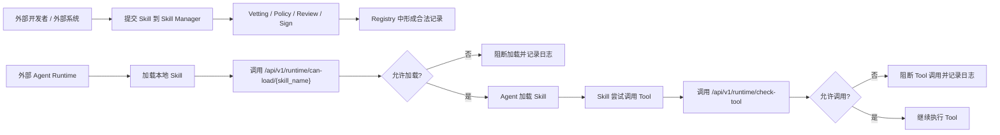
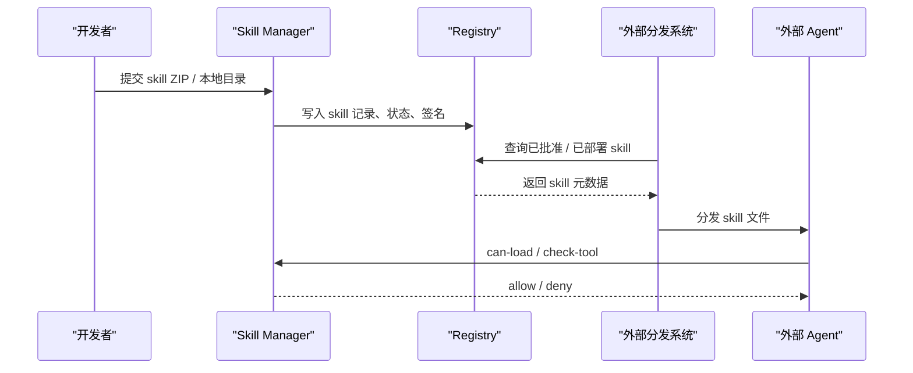
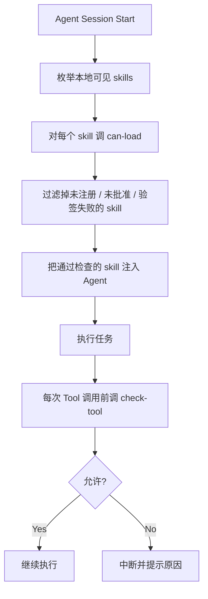

# External Agent Integration

## Overview

这个项目本身不是一个“运行 skill 的平台”，而是一个“管理 skill 准入和运行时治理的中心”。

外部系统或外部 Agent 接入它，通常有两种模式：

- 模式一：把 Skill Manager 当作审批和验票中心
- 模式二：把 Skill Manager 当作 skill 制品登记中心

最推荐的是模式一。这样外部 Agent 仍然使用自己的 skill 加载机制，但在关键节点调用 Skill Manager 做校验和审计。

## Mode 1: Governance Gateway

在这个模式下，外部 Agent 自己保有 skill 文件，并在运行前调用 Skill Manager 的运行时检查接口。

### Typical Flow

1. 开发者先把 skill 提交到 Skill Manager。
2. Skill Manager 完成 vetting、policy 检查、审批和签名。
3. 外部 Agent 在真正加载 skill 前，调用 `can-load`。
4. 如果返回允许，Agent 才真正加载 skill。
5. Skill 在运行中每次要调用工具前，再调用 `check-tool`。
6. Skill Manager 记录允许或阻断的审计事件。

### Current APIs

外部 Agent 最关键会用到这两个接口：

- `GET /api/v1/runtime/can-load/{skill_name}`
- `GET /api/v1/runtime/check-tool`

如果外部系统还需要查看 skill 状态，也可以读：

- `GET /api/v1/skills`
- `GET /api/v1/skills/{id}`

## Mode 2: Registry As Artifact Catalog

在这个模式下，Skill Manager 主要负责记录“哪些 skill 是已批准或已部署的”，外部系统根据 registry 信息决定应该拉取哪个 skill。

### Limitation

当前这个 demo 还没有正式提供这些能力：

- 下载 skill ZIP
- 导出 skill 目录
- 获取最新已部署版本文件
- 多环境发布地址

所以现在更现实的落地方式仍然是：

- 外部系统自己管理 skill 文件
- Skill Manager 负责审批、验签、运行时放行与审计

## Boundaries

这套系统当前负责的是：

- skill 提交
- vetting
- policy 判定
- 审批
- 签名
- 部署状态
- 运行时放行判断
- 审计日志

这套系统当前不负责的是：

- 真正执行 skill
- 提供统一 skill runtime
- 远程下发 skill 制品
- 帮外部 Agent 解析和运行不同框架的 skill

## Recommended Integration Pattern

如果你要给外部 Agent 接入，推荐按下面的方式做：

### Why This Pattern

原因很直接：

- 不要求你改外部 Agent 的核心 runtime
- 只需要在“加载前”和“调用前”两个点加拦截
- 可以最大程度复用当前 Skill Manager 的现有能力
- 审计链路也完整

## What To Build Next

如果要让外部系统更容易接入，建议下一步补这些接口：

1. `GET /api/v1/skills/{id}/files`
   返回 skill 内文件列表
2. `GET /api/v1/skills/{id}/download`
   下载 skill ZIP
3. `GET /api/v1/skills/deployed/latest?name=...`
   返回某个 skill 的最新已部署版本
4. 面向外部 Agent 的独立 token / API key 鉴权
5. 按环境区分 `dev / staging / prod`

## Summary

一句话说清楚：

**外部 Agent 不是来这里“运行 skill”的，而是来这里“确认这个 skill 能不能被运行”。**

当前最实用的接法就是：

- 提交 skill 到 Skill Manager 做准入治理
- Agent 加载前调 `can-load`
- Agent 调工具前调 `check-tool`
- 所有关键动作都留审计

当前已经可用的辅助接口：

- `GET /api/v1/skills/{id}/files`
  返回 skill 目录内的相对路径、文件大小和修改时间
