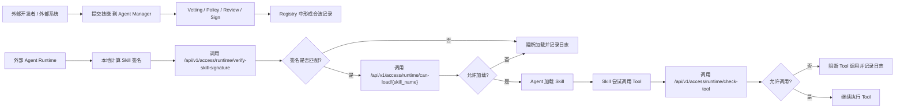
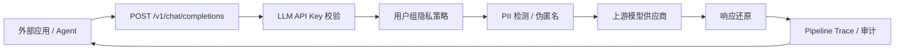
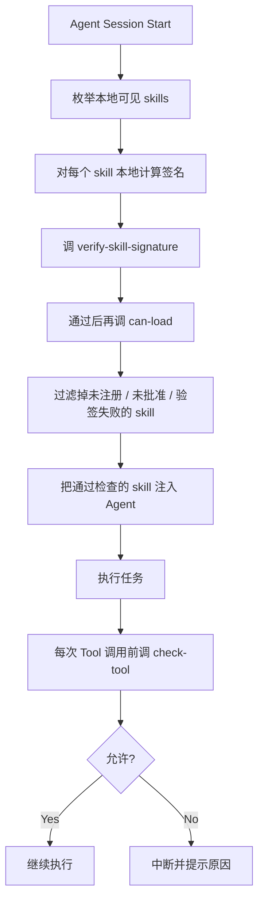

# External Agent Integration

## Overview

这个项目本身不是一个“运行 skill 的平台”，而是一个“管理 skill 准入和运行时治理的中心”。

外部系统或外部 Agent 接入它，通常有两种模式：

- 模式一：把 Agent Manager 当作审批和验票中心
- 模式二：把 Agent Manager 当作 skill 制品登记中心
- 模式三：把 Agent Manager 当作 LLM 隐私代理

最推荐的是模式一。这样外部 Agent 仍然使用自己的 skill 加载机制，但在关键节点调用 Agent Manager 做校验和审计。

## Mode 1: Governance Gateway

在这个模式下，外部 Agent 自己保有 skill 文件，并在运行前调用 Agent Manager 的运行时检查接口。



### Typical Flow

1. 开发者先把 skill 提交到 Agent Manager。
2. Agent Manager 完成 vetting、policy 检查、审批和签名。
3. 外部 Agent 在真正加载 skill 前，先本地计算 skill 签名。
4. Agent 调用 `verify-skill-signature` 校验本地内容是否与审批时一致。
5. 如果签名匹配，再调用 `can-load` 检查 registry 状态。
6. Skill 在运行中每次要调用工具前，再调用 `check-tool`。
7. Agent Manager 记录允许或阻断的审计事件。

### Current APIs

外部 Agent 推荐使用管理台 `智能体治理 / 凭证管理` 创建的 `Agent 运行凭证`，并绑定对应 Agent。最关键会用到这三个凭证鉴权接口：

- `POST /api/v1/access/runtime/verify-skill-signature`，需要 `runtime:verify-signature`
- `GET /api/v1/access/runtime/can-load/{skill_name}`，需要 `runtime:can-load`
- `GET /api/v1/access/runtime/check-tool`，需要 `runtime:check-tool`

旧的 `/api/v1/runtime/...` 路径仍保留给内部或已有集成使用。外部 Agent 不建议使用管理员 JWT。

注意：`/api/v1/access/runtime/can-load/{skill_name}` 不接受 `skill_path`。外部 Agent 应先本地计算签名并调用 `verify-skill-signature`，再做 name-only `can-load`。

如果外部系统还需要查看 skill 状态，也可以读：

- `GET /api/v1/skills`
- `GET /api/v1/skills/{id}`

### Universal Skill Guard

对于 Codex、Claude Code 这类支持本地 skill 指令的 Agent，可以使用仓库内置的通用示例：

- `demo/agent-manager-skill-guard/skills/agent-manager-skill-guard/`

它不使用 Claude Code hook、Codex 专用 adapter 或平台绑定配置，适合首版用来规范 Agent 行为：

- 发现或安装第三方 skill 后，先上传到 Agent Manager 扫描。
- 用户要求使用第三方 skill 前，先检查内容完整性、审批状态和 Agent 授权范围。
- 未提交、扫描中、待审核、已拒绝、未形成可信版本、内容不匹配或状态不可加载时，默认阻断使用。

管理台提供下载入口：

- `智能体管理`
- `接入与运行`
- `下载 Skill Guard`

后端下载接口：

```http
GET /api/v1/scanner/skill-guard/download
```

凭证至少需要这些权限：

- `scanner:submit`
- `scanner:read-own-results`
- `scanner:read-own-sessions`
- `runtime:verify-signature`
- `runtime:can-load`
- `runtime:check-tool`

安装到 Codex：

```bash
mkdir -p ~/.codex/skills
unzip agent-manager-skill-guard.zip -d ~/.codex/skills/
```

安装到 Claude Code：

```bash
mkdir -p ~/.claude/skills
unzip agent-manager-skill-guard.zip -d ~/.claude/skills/
```

配置运行环境：

```bash
export AGENT_MANAGER_BASE_URL="http://localhost:8001"
export AGENT_MANAGER_API_TOKEN="amat_xxx"
export AGENT_ID="<agent-id>"
export AGENT_MANAGER_SIGNING_KEY="和服务器 .env 中保持一致"
```

提交第三方 skill：

```bash
python <skills-dir>/agent-manager-skill-guard/scripts/agent_manager_skill_guard.py submit \
  --path /path/to/third-party-skill \
  --behavioral \
  --deep-scan
```

查看状态：

```bash
python <skills-dir>/agent-manager-skill-guard/scripts/agent_manager_skill_guard.py status \
  --skill-id <skill-id>
```

使用前检查内容完整性和加载授权：

```bash
python <skills-dir>/agent-manager-skill-guard/scripts/agent_manager_skill_guard.py verify \
  --name <skill-name> \
  --path /path/to/third-party-skill
```

这类接法依赖 Agent 遵循 skill 指令和脚本退出码，不是平台级强制拦截。如果需要强制拦截，应在具体平台上再接 hook 或 runtime adapter。

## Mode 2: Registry As Artifact Catalog

在这个模式下，Agent Manager 主要负责记录“哪些 skill 是已批准或已部署的”，外部系统根据 registry 信息决定应该拉取哪个 skill。


### Limitation

当前这个 demo 还没有正式提供这些能力：

- 下载 skill ZIP
- 导出 skill 目录
- 获取最新已部署版本文件
- 多环境发布地址

所以现在更现实的落地方式仍然是：

- 外部系统自己管理 skill 文件
- Agent Manager 负责审批、验签、运行时放行与审计

## Mode 3: LLM Privacy Proxy

外部应用或 Agent 也可以把 Agent Manager 当作 OpenAI-compatible 模型网关使用。



运行时接口：

- `POST /v1/chat/completions`
  OpenAI SDK 兼容路径，适合把 SDK 的 `base_url` 指到 Agent Manager。
- `POST /`
  兼容把配置地址当作完整 Chat Completions 请求地址直接 POST 的客户端。
- `POST /chat/completions`
  兼容部分客户端把 `base_url` 配成不含 `/v1` 时直接拼接的路径。
- `GET /v1/models` / `GET /models`
  OpenAI-compatible 模型列表，只返回当前 LLM API Key 允许访问的启用模型。
- `POST /api/v1/llm/chat/completions`
  Agent Manager 命名空间路径，适合内部服务显式调用。

鉴权使用 `智能体治理 / 凭证管理` 创建的模型调用凭证，或显式授予 `model:chat` 的 Agent 运行凭证：

```http
Authorization: Bearer amat_xxx
```

模型调用凭证用于模型调用：

- 可绑定用户或用户组
- 可限制可访问模型
- 可设置过期时间
- 可限制请求体大小和并发数
- 明文只展示一次，服务端只保存 hash

完整说明见：

- [model-gateway.md](model-gateway.md)

## Boundaries

这套系统当前负责的是：

- skill 提交
- vetting
- policy 判定
- 审批
- 签名
- 部署状态
- 运行时放行判断
- 审计日志
- LLM 模型调用隐私代理
- LLM Pipeline Trace

这套系统当前不负责的是：

- 真正执行 skill
- 提供统一 skill runtime
- 远程下发 skill 制品
- 帮外部 Agent 解析和运行不同框架的 skill

## Recommended Integration Pattern

如果你要给外部 Agent 接入，推荐按下面的方式做：



### Why This Pattern

原因很直接：

- 不要求你改外部 Agent 的核心 runtime
- 只需要在“加载前验签/放行”和“调用前”两个点加拦截
- 可以最大程度复用当前 Agent Manager 的现有能力
- 审计链路也完整

## What To Build Next

如果要让外部系统更容易接入，建议下一步补这些接口：

1. `GET /api/v1/skills/{id}/files`
   返回 skill 内文件列表
2. `GET /api/v1/skills/{id}/download`
   下载 skill ZIP
3. `GET /api/v1/skills/deployed/latest?name=...`
   返回某个 skill 的最新已部署版本
4. 面向外部 Agent 的独立 token / API key 鉴权
5. 按环境区分 `dev / staging / prod`

模型网关方向的后续增强：

1. 支持 streaming 响应的增量反替换
2. 引入更完整的 NER / Presidio 识别器
3. 对 API Key 做跨进程 / 分布式限流
4. 对 Trace 增加脱敏导出视图

## Summary

一句话说清楚：

**外部 Agent 不是来这里“运行 skill”的，而是来这里“确认这个 skill 能不能被运行”。**

当前最实用的接法就是：

- 提交 skill 到 Agent Manager 做准入治理
- Agent 本地计算 skill 签名并调用 `verify-skill-signature`
- Agent 加载前调 `can-load`
- Agent 调工具前调 `check-tool`
- 所有关键动作都留审计

当前已经可用的辅助接口：

- `GET /api/v1/skills/{id}/files`
  返回 skill 目录内的相对路径、文件大小和修改时间
- `POST /api/v1/access/runtime/verify-skill-signature`
  校验外部 Agent 本地计算的签名是否与批准记录一致
- `GET /api/v1/access/runtime/can-load/{skill_name}`
  校验 skill 注册状态是否允许加载
- `GET /api/v1/access/runtime/check-tool`
  校验运行时 tool 调用是否在允许范围内
