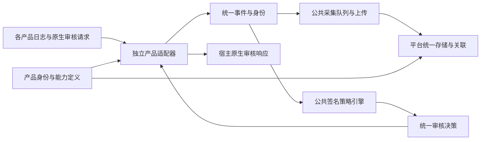
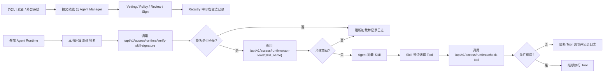
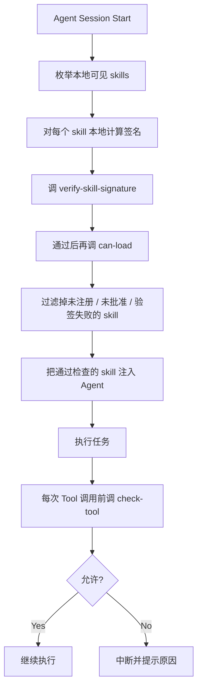

# External Agent Integration

## 检测与评测方案管理 / Scan & Evaluation Profiles

在“系统设置 → 开放 API 管理 → 检测与评测方案”中切换“Skill 检测”和“智能体评测”，查看现有方案或新增、编辑方案。页面直接使用开放接口读取的配置文件：Skill为注册表目录的 `openapi-skills.json`（或 `OPENAPI_SKILL_CONFIG`），智能体为Backend `DATA_DIR` 下的 `openapi-agents.json`（或 `OPENAPI_AGENT_CONFIG`）。文件不存在时列表为空，首次保存创建文件。

Skill方案支持接入方授权、检测模块、风险判定模式和恶意规则。智能体方案支持接入方授权、原生评测策略、已启用的评判模型、检查项、对话模式、语言、执行审批和恶意规则。执行审批仍在任务提交时校验目标、凭据和有效期。恶意规则按行填写双方确认的规则编码。

保存只修改对应方案，保留文件中的其他方案、`partners`、`callbacks` 和 `gateways`。修改方案内容时自动生成新的字符串版本；内容不变则保留版本。新提交任务读取最新方案，已受理任务、报告、回调及网关报文使用保存的快照。文件损坏时显示错误；并发编辑冲突返回409，页面保留草稿。文件保存采用进程间锁和原子替换。直接修改文件时应与页面编辑错开，并为变更内容设置新的 `version`。

管理接口使用管理台登录和 `external_access:view/create/update` 权限，创建与修改写入管理审计；不新增数据库表。Backend进程需有配置文件及父目录的读写权限，容器部署应将配置保存在持久化可写目录。

| 方法与路径 | 说明 |
| --- | --- |
| `GET /api/v1/external-access/profiles/options` | 评测策略、已启用模型和检查项选项 |
| `GET /api/v1/external-access/profiles/{kind}` | 方案列表 `items` 与配置修订标识 `revision`；kind为skill或agent |
| `POST /api/v1/external-access/profiles/{kind}` | 新增方案；请求包含 `profile_id`、列表返回的 `revision` 和 `settings` |
| `PUT /api/v1/external-access/profiles/{kind}` | 修改方案，使用相同请求结构；settings为该方案完整配置，不含version |

新增及修改返回最新列表和修订标识，方案含自动生成的 `version`。配置引用、字段和类型无效返回422，重复编号或修订冲突返回409，方案不存在返回404，存储不可读写返回503，错误均包含稳定 `error_code`。

**English:** System Settings → Open API Management → Scan & Evaluation Profiles reads the existing Skill and Agent configuration files. Add, view or edit authorized partners, analyzer switches, judgement mode and malicious rules for Skills, or evaluation policy, enabled evaluator model, checks, conversation mode, language, approval and malicious rules for Agents. Execution approval is validated against the actual target, credential and validity window at submission. Other profiles and partner/callback/gateway sections are preserved. Changed settings receive a new string version; unchanged saves retain their version. Existing tasks, reports and outbound payloads retain their snapshots. Invalid files are reported without overwriting them. Revision conflicts return 409 and retain the form draft. Writes use an inter-process lock and atomic replacement. Coordinate direct file edits with page edits and assign a new version to changed settings. The APIs above use management authentication and `external_access:view/create/update`, with management auditing and no new database tables. Store files in a persistent directory writable by the Backend, including its parent directory. Requests contain `profile_id`, the latest `revision`, and complete `settings` without `version`; responses contain updated `items` and `revision`.

人工验收 / Manual UI checklist:

- [ ] 中英文：切换两类方案，检查现有配置、接入方、检测项和版本显示；英文长文案及窄屏表格、弹窗可读。 / Switch both profile types in Chinese and English; check existing values and long labels at narrow widths.
- [ ] 新增和编辑：检查开关、策略、模型、检查项、恶意规则和审批保存后的回显，取消编辑不写入。 / Verify saved settings, including approvals, and cancellation without writes.
- [ ] 连续点击保存仅提交一次；无效字段保留草稿，并发编辑显示冲突。 / Verify single submission, retained invalid drafts and concurrent-edit conflict feedback.
- [ ] 只读角色可查看方案，创建及修改权限分别生效；保存产生管理审计。 / Check read-only access, separate create/update permissions and management audit records.
- [ ] 修改方案后提交新任务使用新版本，旧任务及报告仍显示原版本。 / Verify new submissions use the new version and existing tasks and reports retain the old version.

## Skill 开放接口 / Skill Open API

| 方法与路径 | 权限 | 返回内容 |
| --- | --- | --- |
| `POST /openapi/v1/skill-scans` | `openapi:skill-submit` | HTTP 202，`task_id`、`business_request_id`、`status`、`created_at` |
| `GET /openapi/v1/skill-scans/{task_id}` | `openapi:skill-read` | 任务状态、模块进度、报告就绪状态及回调状态 |
| `GET /openapi/v1/skill-scans/{task_id}/result` | `openapi:skill-read` | 本次报告摘要、`risk_level`、覆盖情况和五档明细计数 |
| `GET /openapi/v1/skill-scans/{task_id}/findings?limit=50` | `openapi:skill-read` | `items` 和 `next_cursor`；后续页传入 `cursor`，`limit` 为1～200 |

成功响应为 `{"request_id":"…","data":{…}}`，失败响应为 `{"request_id":"…","error":{"code":"…","message":"…","retryable":false}}`。字段错误另含 `error.details`。结果执行中返回409/RESULT_NOT_READY；终态无报告返回409/REPORT_UNAVAILABLE。认证及参数异常沿用统一调用日志记录。

可传入1～64位字母、数字、短横线或下划线组成的 `X-Request-ID`，响应头与正文原样返回；省略时生成追踪号。调用日志为每次请求保存独立编号，并用 `client_request_id` 记录调用方追踪号；列表支持两种编号查询，来源关联沿用内部编号。无效、停用、吊销或过期的 ACCESS_TOKEN 返回401/UNAUTHORIZED；权限、部门或接入方授权不足返回403/FORBIDDEN。429响应包含 `Retry-After`，字段错误按业务字段名定位。

**English:** An optional `X-Request-ID` contains 1–64 letters, digits, hyphens or underscores and is echoed in the response header and body. Without it, the service generates a trace ID. Each request keeps its own internal record ID and optional `client_request_id`; logs can be searched by either, while source links retain the internal ID. Invalid, disabled, revoked or expired ACCESS_TOKEN credentials return 401/UNAUTHORIZED; authorization failures return 403/FORBIDDEN. Rate-limit responses include `Retry-After`, and validation errors identify business fields.

接入方仅可查询本接入方且凭证已授权部门的任务；同一接入方换发凭证后，可继续读取授权部门的历史任务。调用日志关联实际 Skill 版本及业务流水，可跳转到 Skill 详情。

### 检测方案配置 / Scan profile configuration

在注册表数据目录保存 `openapi-skills.json`，也可通过 `OPENAPI_SKILL_CONFIG` 指定文件路径。回调在页面配置后，文件中的callbacks可为空对象；旧文件引用保留兼容。配置中的 `platform_ids` 使用“接入方管理”中创建的标识。提交时校验配置并保存方案版本、检测开关、当前策略和回调配置版本。

```json
{
  "profiles": {
    "skill_standard": {
      "version": "1",
      "platform_ids": ["agent-development"],
      "use_behavioral": false,
      "use_llm": false,
      "use_sandbox": true,
      "use_skillspector": false,
      "judgement_mode": "balanced",
      "malicious_rule_ids": []
    }
  },
  "callbacks": {
    "devplat_result": {
      "version": "1",
      "platform_ids": ["agent-development"]
    }
  }
}
```

`malicious_rule_ids` 填写双方确认的恶意行为规则编号：命中编号且报告包含证据摘要时输出 `malicious`；其他非 info 风险或模型风险信号输出 `suspicious`；规定模块全部完成且没有上述风险时输出 `benign`，检查不完整且无风险依据时为 null。明细 `severity` 保留五档严重度。直接修改检测配置或恶意行为规则时更新 `version`，页面保存自动生成新版本。

Sandbox 沿用系统运行配置及策略要求；LLM 需系统启用并配置。模块失败、不可用、关闭或跳过均反映在 `analyzers`、`coverage` 和 `limitations`。服务重启后，外部任务持有的执行租约到期可恢复未完成扫描；已完成扫描从对应扫描快照生成报告。回调按任务绑定的接收端版本自动发送，配置和重试操作见下文“回调与同步”。

### 调用示例 / Request example

ZIP 根目录包含有效 `SKILL.md`。`ACCESS_TOKEN` 使用已创建的访问凭证，`BASE_URL` 使用实际 HTTP 或 HTTPS 地址；`file_sha256` 替换为 ZIP 字节的实际哈希。

```json
{
  "business_request_id": "devplat-skill-001",
  "skill_id": "customer-service",
  "skill_version": "1.0.0",
  "department_id": "dept_001",
  "profile_id": "skill_standard",
  "callback_id": "devplat_result",
  "file_sha256": "<REPLACE_WITH_ACTUAL_SHA256>"
}
```

将上述内容保存为 `metadata.json`：

```bash
curl -X POST "$BASE_URL/openapi/v1/skill-scans" \
  -H "Authorization: Bearer $ACCESS_TOKEN" \
  -F 'file=@skill.zip;type=application/zip' \
  -F 'metadata=<metadata.json'

curl "$BASE_URL/openapi/v1/skill-scans/$TASK_ID" -H "Authorization: Bearer $ACCESS_TOKEN"
curl "$BASE_URL/openapi/v1/skill-scans/$TASK_ID/result" -H "Authorization: Bearer $ACCESS_TOKEN"
curl "$BASE_URL/openapi/v1/skill-scans/$TASK_ID/findings?limit=50" -H "Authorization: Bearer $ACCESS_TOKEN"
```

人工验收：中英文下检查开放 API 管理的调用日志、失败原因和 Skill 详情跳转；验证成功上传、哈希不匹配、越权部门、凭证换发、复扫及原报告查询。真实检测器、Sandbox、LLM 和现场网络另行联调。

**English:** Configure profiles and callback references in `openapi-skills.json` in the registry data directory, or set `OPENAPI_SKILL_CONFIG`. Authorize partner IDs explicitly. Submission freezes profile settings, policy and callback configuration version. Assign a new profile version when editing the file; the management page generates it automatically. A configured malicious rule with recorded evidence yields `malicious`; other non-info findings or model risk signals yield `suspicious`. Complete checks without these risks yield `benign`; incomplete checks without risk evidence yield null. Finding severity stays unchanged. Sandbox and LLM use system configuration and enablement. Missing or failed analyzers affect coverage. Execution leases allow unfinished owned scans to resume after restart; completed reports are projected from immutable run snapshots. The shared delivery service sends frozen callback payloads; receiver configuration and retry handling are described in Callbacks & Sync below. The examples above submit a ZIP with a root SKILL.md and query the returned task ID. Manually verify bilingual request logs, error reasons, Skill links, department isolation, credential rotation and historical reports after rescanning.

## 智能体开放接口 / Agent Open API

回调与网关在页面管理，文件中的callbacks和gateways可为空对象。partners中的运行参数仍由文件配置。 / Manage callbacks and gateways in the UI; their file sections may be empty. Partner runtime settings remain file-based.

评测执行中，Worker通过租约心跳上报 `scan_progress.observed_total/completed/running/errors`。每个所选检查项计为一个用例，准备与复核阶段的对话不增加用例数；执行异常计入completed和errors。`GET /openapi/v1/agent-evaluations/{task_id}` 与管理台读取相同运行计数；上报尚未到达时为0。终态开放接口使用报告快照的用例统计，管理台从保存的用例读取，running归零。percent保持null；页面进度条表示检查项完成比例，报告汇总期间任务仍为运行中。重试按本轮计数重新开始。

**English:** During evaluation, lease heartbeats carry `scan_progress.observed_total/completed/running/errors`. Each selected check counts as one case; reconnaissance and review dialogue do not add cases. Execution errors count as both completed and errors. The Open API and management page read the same live counts, initially zero until reported. Terminal Open API counts come from the frozen report, and management counts from persisted cases, with running set to zero. Percent remains null; the page bar shows check completion while report generation can still be running. Retries start fresh counts for the new attempt.

受影响页面人工验收 / Manual UI checks:

- [ ] 中英文任务列表与详情：检查排队、执行中、错误及完成数量，3秒刷新后保持一致。 / Verify queued, running, error and completed counts in both languages and both views after refresh.
- [ ] 全部检查结束时显示汇总报告，终态数量与报告一致；重试从本轮计数开始。 / Verify report generation, terminal report counts and fresh counts on retry.
- [ ] 英文长文案、窄屏表格与详情可读；切换任务或关闭详情后不会显示旧任务的进度。 / Check long English labels, narrow layouts and task switching.

智能体开发平台使用同一接入方的 ACCESS_TOKEN 完成登记、连接验证和评测。接入方与部门权限、来源记录和调用日志复用开放 API 管理。

| 接口 | 权限 | 返回内容 |
| --- | --- | --- |
| `POST /openapi/v1/agents` | `openapi:agent-manage` | HTTP 201，登记信息、`target_revision`、连接状态 |
| `PUT /openapi/v1/agents/{agent_id}` | `openapi:agent-manage` | 更新后的登记信息和版本 |
| `GET /openapi/v1/agents/{agent_id}` | `openapi:agent-read` | 登记信息及当前版本连接状态 |
| `POST /openapi/v1/agents/{agent_id}/connection-tests` | `openapi:connection-test` | HTTP 202，`test_id`、版本、受理时间 |
| `GET /openapi/v1/connection-tests/{test_id}` | `openapi:connection-test` | 网络、TLS、认证及协议检查，`ready`、有效期和错误 |
| `POST /openapi/v1/agent-evaluations` | `openapi:evaluation-submit` | HTTP 202，任务、方案版本和 `evaluation_sequence` |
| `GET /openapi/v1/agent-evaluations/{task_id}` | `openapi:evaluation-read` | 状态、进度、报告就绪状态和投递状态 |
| `GET /openapi/v1/agent-evaluations/{task_id}/result` | `openapi:evaluation-read` | 冻结的报告摘要、总体风险、评分详情和数量统计 |
| `GET /openapi/v1/agent-evaluations/{task_id}/cases` | `openapi:evaluation-read` | 用例 `items`、`next_cursor` |
| `GET /openapi/v1/agent-evaluations/{task_id}/findings` | `openapi:evaluation-read` | 风险明细 `items`、`next_cursor` |

成功响应使用 `request_id` 和 `data`；错误使用 `request_id` 和 `error`。用例、明细分页默认50条，`limit` 为1～200，下一页传入上次响应的 `cursor`。游标绑定具体报告和明细类型。

### 服务端配置

在 Backend 的 `DATA_DIR` 下保存 `openapi-agents.json`，或设置 `OPENAPI_AGENT_CONFIG` 指向受控配置文件。先在管理台配置接入方与部门、评测策略和已启用的评判模型；目标网络范围与策略网络范围都需要覆盖实际智能体地址。下面的标识和网段均需替换为现场值。

```json
{
  "partners": {
    "agent-development-platform": {
      "allowed_cidrs": ["10.10.0.0/16"],
      "connection_policy_ids": {"test": "test-connection-policy"},
      "connection_approval_ids": {},
      "connection_ttl_seconds": 300
    }
  },
  "profiles": {
    "agent-standard": {
      "version": "1",
      "platform_ids": ["agent-development-platform"],
      "policy_id": "test-evaluation-policy",
      "evaluation_model": "enabled-judge-model",
      "skills": ["data-leakage-detection"],
      "conversation_mode": "single_turn",
      "language": "zh",
      "malicious_rule_ids": []
    }
  },
  "callbacks": {},
  "gateways": {}
}
```

连接策略按 `environment` 选择，应允许对话且采用可执行对话的模式；评测方案指定原生策略、检查项和评判模型。生产环境沿用原生维护窗口、目标范围、专用凭据和单次执行审批：连接验证通过 `connection_approval_ids[agent_id]` 绑定审批，评测通过方案中的 `approval_id` 绑定另一次审批。登记更新产生新的目标与凭据版本，生产授权需对应当前版本。

直接修改方案文件时更新 `version`，页面保存自动生成新版本。`malicious_rule_ids` 配置双方确认的恶意行为规则编码：命中规则、存在对话证据或证据摘要且明细状态为 `open` 时总体为 `malicious`；其他待处置非 `info` 风险为 `suspicious`；规定检查完成且无上述风险为 `benign`；检查不足且无风险证据时为 `null`。`risk_score` 保留原生评分详情，明细 `severity` 保持原分级。

每次登记更新递增 `target_revision`；PUT 除 `agent_id` 外沿用登记字段，省略 `api_key` 时保留已有有效密钥。已受理任务保存目标、凭据、登记、方案及投递配置版本。凭据加密保存，由原生 Worker 密封信封通道下发；旧任务继续使用受理时的配置。

开放接口评测由任务租约认证 Worker，评判模型代理按接入方、提交凭证及部门授权校验，并使用任务所属部门的隐私策略。接入方、凭证或部门授权失效后停止模型调用；登记更新不改变已受理任务的目标快照。

### 调用顺序

将下面占位值替换为接入方的实际配置，目标密钥只在登记或更新请求中传入。

```http
POST /openapi/v1/agents
Authorization: Bearer <ACCESS_TOKEN>
Content-Type: application/json

{
  "agent_id": "service-agent-001",
  "name": "客户服务智能体",
  "department_id": "operations",
  "department_name": "客户服务部",
  "owner": "customer-service-team",
  "environment": "test",
  "endpoint_url": "http://agent.example.com/v1",
  "protocol": "openai_chat_completions",
  "model": "service-agent",
  "api_key": "<TARGET_API_KEY>",
  "gateway_agent_id": "gateway-agent-001"
}
```

登记响应返回上述公开字段、`target_revision`、`credential_configured`、`connection_status` 和时间，密钥不会返回。以返回的版本发起连接验证：

```http
POST /openapi/v1/agents/service-agent-001/connection-tests
Authorization: Bearer <ACCESS_TOKEN>
Content-Type: application/json

{"target_revision": 1}
```

用响应中的 `data.test_id` 查询连接结果。Worker 使用登记的基础地址追加 `/chat/completions`，携带目标密钥和模型，发送最小文本对话；HTTP 的 TLS 检查为 `skipped`，HTTPS 校验证书。当 `ready=true` 且尚未到 `expires_at` 时发起评测：

```http
POST /openapi/v1/agent-evaluations
Authorization: Bearer <ACCESS_TOKEN>
Content-Type: application/json

{
  "business_request_id": "evaluation-20261019-001",
  "agent_id": "service-agent-001",
  "target_revision": 1,
  "connection_test_id": "<data.test_id>",
  "profile_id": "agent-standard",
  "callback_id": "platform-results",
  "gateway_id": "ai-security-gateway"
}
```

以返回的 `data.task_id` 查询进度、结果、用例和明细。版本不匹配返回 `TARGET_REVISION_CONFLICT`；连接未通过、过期或属于其他登记时返回 `CONNECTION_TEST_REQUIRED`。进度使用 Worker 已上报的计数，尚无计数时为0，无法计算百分比时为 `null`；终态计数来自报告快照。报告、用例、风险明细、待回调事件和待网关同步内容使用同一份终态数据。后续人工处置明细不改写这份外部报告。

两类待投递记录由共用投递服务发送；进度查询同步返回实际发送次数、下次重试时间和回执状态。接收端配置、历史版本和失败重投见下文。

**English:** The ten Agent APIs reuse partner-scoped ACCESS_TOKEN authorization, department mappings, provenance and request logs. Configure `openapi-agents.json` in Backend `DATA_DIR`, or set `OPENAPI_AGENT_CONFIG`. Profiles select native policies, checks and an enabled judge model. Connection policies are selected by environment; production tests and evaluations require separate native approvals. Registration updates increment the revision and preserve accepted tasks' target and credential versions. A Worker verifies Chat Completions connectivity using the sealed target credential. Submit evaluations only with a successful, unexpired test for the current revision. Reports freeze overall `risk_level`, the original `risk_score`, cases and findings together with outbound payloads. The shared delivery service sends callbacks and gateway reports, validates receipts and persists retries and attempt history.

人工验收 / Manual UI checklist：

- [ ] 通过接口登记、更新智能体，在中英文智能体页面核对名称、部门、外部编号及登记来源，按接入方筛选。
- [ ] 发起评测后，在扫描页面核对发起来源、接入方、业务流水、状态和关联请求。
- [ ] 在开放 API 管理的调用日志中筛选登记、连接和评测接口，核对成功/失败记录及智能体、扫描任务跳转。
- [ ] 换发同一接入方凭证后查询历史报告；核对跨接入方和未授权部门的拒绝结果。

## 回调配置 / Callback configuration

在“开放 API 管理 → 回调配置”新增配置，填写名称、callback_id、所属接入方、完整HTTP/HTTPS地址、接收方提供的Bearer令牌及通知类型（Skill检测、智能体评测）。可授权一个或多个接入方，配置可同时用于两类通知。保存后直接在任务提交中传入callback_id，无需再编辑配置文件的callbacks引用。

名称用于页面识别，可以修改；回调配置编号（callback_id）创建时自行填写唯一值，例如callback_01，创建后保持不变。将编号提供给智能体开发平台，在提交Skill检测或智能体评测任务的callback_id字段中传入，系统据此选择回调地址和认证。列表在名称下标注callback_id，新增和编辑表单展示用途及示例。

**English:** The name is an editable display label. Choose a unique callback_id, such as callback_01, when creating the configuration; it stays unchanged. Give this ID to the Agent development platform to include in the callback_id field of Skill scan or Agent evaluation submissions. It selects the callback URL and authentication. The list labels the ID, and the form explains its use with an example.

令牌加密保存，页面和管理接口只显示掩码；编辑时留空保留原值。编辑自动生成接收端新版本，已受理任务及其重试保留原版本。停用或删除后停止后续投递，历史版本与记录保留；已发出的请求按实际回执完成记录。重新启用后可手动重投失败记录。删除后的callback_id保留用于历史追溯，新配置使用新编号。

管理接口使用管理台登录认证及external_access权限；外部任务仍使用既有ACCESS_TOKEN、接入方、部门及来源校验。

| 管理接口 | 权限 | 请求与响应 |
| --- | --- | --- |
| GET /api/v1/external-access/callbacks | view | 返回items，包括名称、callback_id、接入方、地址、掩码、通知类型、enabled、revision、版本和时间。 |
| POST /api/v1/external-access/callbacks | create | 提交下方配置字段，返回HTTP 201及配置。 |
| PUT /api/v1/external-access/callbacks/{callback_id} | update | 提交name、platform_ids、url、notification_types、enabled、revision及可选bearer_token；令牌省略/null/空字符串保留，返回新版本配置。 |
| PATCH /api/v1/external-access/callbacks/{callback_id}/state | update | 提交enabled与revision，返回更新后的配置。 |
| DELETE /api/v1/external-access/callbacks/{callback_id}?revision=… | delete | 删除配置，返回callback_id和deleted=true；保留历史记录。 |
| POST /api/v1/external-access/callbacks/{callback_id}/test | update | 提交revision、platform_id和notification_type，返回HTTP 202及投递记录。 |

创建示例：

```json
{
  "name": "智能体开发平台结果通知",
  "callback_id": "platform-results",
  "platform_ids": ["agent-development-platform"],
  "url": "http://developer.example.com/integration/v1/security-results",
  "bearer_token": "<CALLBACK_TOKEN>",
  "notification_types": ["skill_scan", "agent_evaluation"],
  "enabled": true
}
```

revision用于防止覆盖其他管理员已保存的编辑，发生409时刷新后重新编辑。callback_id创建后固定，名称和其他配置可编辑。测试选择一个已授权的接入方和通知类型，发送security-callback-test.v1、event_type=callback.test的独立通知；接收方返回HTTP 200及相同event_id、accepted=true。测试通知使用同一投递、回执及重试服务，记录purpose=test、task_id=null和管理台发起人；真实任务记录purpose=result及原任务ID。可从配置行打开投递记录，也可在调用日志中按配置编号和通知用途筛选。

已有接收端版本升级后纳入回调配置，默认名称为callback_id、支持两类通知，最新创建版本作为当前配置；已有任务保留原绑定版本。尚未建立接收端的旧文件配置仍可读取，管理员应使用同一callback_id创建对应页面配置。页面配置存在后以页面为准，停用或删除不会转回旧文件配置。升级后核对当前版本和授权再接入新任务。

**English:** Open API Management → Callback Configuration manages names, callback IDs, authorized partners, HTTP/HTTPS URLs, encrypted and masked Bearer tokens, notification types and enabled state. Saved IDs work directly with Skill and Agent submissions. Editing creates a receiver version; accepted tasks and retries retain their original version. An omitted, null or empty edit token retains the existing secret. Disable/delete stops future delivery while retaining history; in-flight requests finish with their actual receipt. Deleted IDs remain reserved for history. Management uses view/create/update/delete permissions; tests use update. Test notifications use security-callback-test.v1 and callback.test, with a matching event_id/accepted=true acknowledgement. They create purpose=test records without real tasks. Existing receivers migrate using their latest created version; accepted jobs keep their original bindings. Managed configurations take precedence over legacy file references.

人工验证清单 / Manual UI checklist：

- [ ] 中英文列表标明callback_id；新增和编辑表单说明名称与编号的用途、示例及编号创建后不可修改，长说明正常换行。 / Check the labeled callback_id and name/ID guidance in both languages, including the example, immutable ID and wrapped help text.
- [ ] 中英文新增与编辑名称、接入方、HTTP/HTTPS地址和两类通知；保存后的令牌为掩码，留空编辑保留，非法草稿保留且错误切换语言正确。 / Check create/edit fields, masking, blank-token preservation and localized validation.
- [ ] 新旧任务分别使用编辑前后版本；未授权接入方或通知类型被拒绝；已有任务仍可查询原报告。 / Check version binding and partner/type authorization.
- [ ] 测试通知与真实任务记录区分；核对认证、回执、时间、失败原因、自动重试和人工重投，重复点击只提交一次。 / Verify test/result separation, receipts, retry history and duplicate-click guards.
- [ ] 停用、重新启用及删除后检查新提交与排队投递行为；历史记录保留。 / Check lifecycle effects and preserved history.
- [ ] 查看角色不能创建、编辑、测试或删除；删除权限可单独配置；并发编辑冲突保留草稿。 / Verify permissions and concurrent edits.
- [ ] 回调配置、网关配置表格在初始位置和左右滚动后，右侧操作列始终可见；中英文按钮完整换行，长名称和地址不撑开列宽。窄屏继续检查标签页、弹窗和记录抽屉。 / Check pinned right actions before and after horizontal scrolling in callback and gateway tables; verify wrapped buttons and long names/URLs in both languages, plus tabs, dialogs and drawers on narrow screens.

## 回调与同步 / Callbacks & sync

在“开放 API 管理 → 调用日志 → 回调与同步”查看 Skill 回调、智能体评测回调及 AI 安全网关同步。支持按类型、接入方、状态、任务编号、事件/同步编号和业务流水筛选；详情展示发送次数、失败原因、HTTP 状态、下次重试时间、每次发送记录及有效回执。失败记录可重新投递，保留之前的发送历史。

### 网关配置 / Gateway configuration

在“开放 API 管理 → 网关配置”选择已有且已启用的外部 AI 网关，填写结果同步配置编号（gateway_id）、所属接入方及结果同步接口路径。完整地址由网关管理地址与接口路径组成，支持实际HTTP/HTTPS地址。认证复用所选网关的Token ID、加密Token Value及HMAC-SHA256签名，页面展示Token ID与认证方式。gateway_id是智能体开发平台发起评测时填写的配置编号，例如ai_gateway_01；创建后固定。编辑自动创建新版本，已受理任务及重试保留原版本、原报告和风险明细，每次发送读取所关联网关的当前凭据。

停用或删除后停止新任务引用和后续投递，历史记录保留；已发出的请求按实际回执记录。重新启用后可重投失败记录。删除后的编号保留用于追溯。每次编辑、启停、删除和测试提交当前revision，并发冲突返回409。关联的外部 AI 网关停用后，阻止新评测、测试通知和后续投递；重新启用后可重投失败记录。已被同步版本引用的外部 AI 网关保留历史关联，使用停用操作。

| 管理接口 | 权限 | 请求与响应 |
| --- | --- | --- |
| GET /api/v1/external-access/gateways | view | 返回items，含gateway_id、external_gateway_id、name、binding_required、path_required、external_gateway_enabled、platform_ids、gateway_path、url、token_id、enabled、revision、version及创建/更新时间和发起人。 |
| GET /api/v1/external-access/gateways/options | view | 返回已有外部 AI 网关的id、name、enabled、management_base_url、token_id，供选择和地址预览。 |
| POST /api/v1/external-access/gateways | create | 提交下方配置字段，返回HTTP 201和完整配置。 |
| PUT /api/v1/external-access/gateways/{gateway_id} | update | 提交external_gateway_id、platform_ids、gateway_path、enabled、revision，返回新版本配置。 |
| PATCH /api/v1/external-access/gateways/{gateway_id}/state | update | 提交enabled与revision，返回更新后的配置。 |
| DELETE /api/v1/external-access/gateways/{gateway_id}?revision=… | delete | 返回gateway_id与deleted=true，保留历史版本和投递。 |
| POST /api/v1/external-access/gateways/{gateway_id}/test | update | 提交revision、platform_id，返回HTTP 202及投递记录。 |

创建请求示例：

```json
{
  "external_gateway_id": 1,
  "gateway_id": "ai-security-gateway",
  "platform_ids": ["agent-development-platform"],
  "gateway_path": "/integration/v1/agent-evaluation-results",
  "enabled": true
}
```

external_gateway_id为所选外部 AI 网关整数ID；gateway_id为1～128字符的结果同步配置编号；gateway_agent_id为登记接口提供的网关智能体资产编号。接入方须已创建且不重复。gateway_path以单个/开头，填写接口路径，不含域名、查询参数或片段；完整地址最多2048字符。Token Value在外部 AI 网关配置中统一加密管理。发送按实际UTF-8报文计算签名，在查询参数携带tokenid、timestamp、nonce和signature。

凭据轮换后，后续发送及重试使用更新后的凭据。管理地址变化时，旧地址投递记录DELIVERY_GATEWAY_ADDRESS_CHANGED；编辑保存同步配置后，新任务使用新地址版本，已有报告和投递记录保持原样。

测试向已保存地址发送security-gateway-test.v1，event_type=gateway.test，请求包含sync_id、occurred_at、platform_id、gateway_id；接收方返回HTTP 200及`{"sync_id":"与请求一致","accepted":true}`。测试使用原投递服务，保存purpose=test、task_id=null、发起人、版本、时间、失败原因、回执及每次尝试，不创建评测任务或报告。真实报告仍使用agent-evaluation-result.v1及request_id/data回执。两类记录可在配置行或“调用日志 → 回调与同步”查询和重投。

新配置沿用回调默认投递参数：10秒超时、60/300/900/3600/21600/86400秒重试间隔、10MiB报文上限，编辑保留原参数。升级补齐gateway_path列，保留旧版本、原地址、密文、事件和任务绑定；重复启动保留编辑及删除状态。旧配置显示“待配置接口路径”，无网关关联时先选择外部 AI 网关。补充路径保存后生成新版本并保持gateway_id，新任务和测试使用签名认证；升级前已受理的任务继续按原版本投递。

| 投递接口 | 权限 | 内容 |
| --- | --- | --- |
| GET /api/v1/external-access/deliveries | view | 分页记录，支持kind/platform_id/status/task_id/message_id/business_request_id/config_id/purpose/page/page_size，每页1～100条。 |
| GET /api/v1/external-access/deliveries/{delivery_id} | view | 记录详情、有效回执和attempt_records。 |
| POST /api/v1/external-access/deliveries/{delivery_id}/retry | update | 使用原通知和配置版本重新开始一轮重试，保留累计发送次数和历史。 |

**English:** Select an enabled external AI gateway and configure gateway_id, partners and gateway_path. The full HTTP/HTTPS destination combines its management URL and the API path. Authentication reuses its Token ID, encrypted Token Value and HMAC-SHA256 signing. Each attempt uses current credentials; reports and endpoint versions remain frozen. Credential rotation applies to subsequent attempts. A changed management URL stops delivery to the old destination with DELIVERY_GATEWAY_ADDRESS_CHANGED; save a new configuration version for new tasks. gateway_id is the stable ID supplied by the development platform; external_gateway_id is the internal gateway ID, and gateway_agent_id is the registered asset ID. Add a path to older configurations for new tasks; existing deliveries retain their original authentication and report. The options API exposes the gateway name, ID, enabled state, management URL and Token ID under external_access:view. Disabling the gateway blocks new evaluations, tests and subsequent deliveries. Referenced gateways remain available for history.

人工验证清单 / Manual UI checklist：

- [ ] 中英文选择已有网关，检查名称、gateway_id说明、旧配置补充路径提示、完整地址预览及Token ID；回调仍显示Bearer输入。 / Check gateway selection, stable ID help, legacy path prompts, URL preview and Token ID in both languages; callbacks retain their Bearer field.
- [ ] 编辑路径或切换网关保持gateway_id，新旧任务使用对应版本和报告；轮换凭据后重试验签通过，变更管理地址后旧投递显示明确失败原因。 / Verify versioned paths and reports, current credentials after rotation, and visible failure after management URL changes.
- [ ] 测试通知成功、401、错误回执、超时、自动与人工重试；核对用途、发起人、时间及尝试记录。 / Verify test acknowledgements, failures, retries and metadata.
- [ ] 停用、恢复、删除与历史记录；只读/编辑/删除权限；并发编辑和重复点击。 / Check lifecycle, history, permissions, concurrent edits and duplicate clicks.
- [ ] 中英文六个标签页、长地址、弹窗、投递抽屉及窄屏滚动；回调配置同步回归。 / Check six tabs, long text, dialogs, drawers, narrow layouts and callback regression.

### 发送与回执

Backend 启动共用投递循环，从已保存事件读取原始报文，验证报文摘要后发送；不会重新读取当前风险明细拼接报告。发送前保存租约和尝试记录，网络等待不持有数据库写事务。多进程共享数据库时按租约领取；进程中断后，未确认的尝试记录为中断，租约到期按重试策略恢复。

回调请求携带 `Authorization: Bearer <CALLBACK_TOKEN>`。HTTP 200 且回执 `event_id` 与请求一致、`accepted=true` 时记为 `delivered`。网关同步使用所关联外部 AI 网关的Token ID/Token Value签名；HTTP 200 返回 `request_id/data`，其中 `data.sync_id/report_id/report_version` 一致、`status=accepted`，并包含有效的 `receipt_id/current/received_at` 时记为 `synced`。`current=false` 的历史报告回执也表示同步成功。

网络异常、超时、408、429和5xx自动重试；429的 `Retry-After` 支持秒数或HTTP日期，下次发送不早于该时间。其他HTTP状态、无效回执或次数耗尽后为 `failed`。发送失败只改变投递状态，报告内容和扫描状态保持原值。中断恢复可能再次发送同一事件或同步编号，接收端应按该编号返回已保存结果的回执。

没有报告的终态任务仍发送结果回调；网关同步记录 `REPORT_UNAVAILABLE`，不发送报文。投递记录保存HTTP状态、稳定错误码、时间和校验后的回执字段，省略认证头及接收端原始响应正文。

**English:** Open API Management → Request Logs → Callbacks & Sync provides filters, validated receipts, attempt history and manual retries. Saved IDs resolve the current database version when a task is accepted. URLs use actual HTTP/HTTPS deployment addresses. Callbacks use encrypted Bearer tokens; gateway synchronization uses shared HMAC credentials. The dispatcher sends persisted payloads, leases work, validates acknowledgements and mirrors delivery state into task queries. Network failures, timeouts, 408, 429 and 5xx retry with configured delays; Retry-After is honored. Invalid receipts and other HTTP errors fail visibly. Manual retry preserves the message and history. Gateway acknowledgements with current=false are successful historical deliveries. The gateway product owns receiving, asset mapping, latest-report selection and risk-policy application.

页面人工验收 / Manual UI checklist：

- [ ] 中英文及窄屏下检查投递筛选、长编号/地址、详情、回执和发送记录。
- [ ] 编辑回调或网关配置，确认任务使用对应版本；回调令牌保存后展示掩码，网关显示复用的Token ID和签名方式。
- [ ] 验证401、错误回执、网络恢复、429等待及重试耗尽后的状态和失败重投；重复点击只安排一次。
- [ ] 验证接入方/接收端停用和恢复；只读角色可查询，不能配置或重投。
- [ ] 对照任务进度中的 `callback/gateway_sync`、页面状态与接收方回执，确认报告内容一致。

## 外部接口认证与记录 / External API authentication and request logs

管理员在“系统设置 → 开放 API 管理”的“接入方管理”标签页创建接入方，填写固定 `platform_id` 和名称，将智能体开发平台的部门编码映射到系统用户组。
在“访问凭证”标签页创建凭证，选择接入方、可访问部门、接口权限和到期时间。明文只在创建后展示一次，交给智能体开发平台保存。
统一凭证中心可查看这些 `openapi` 类型凭证；停用、启用和吊销沿用同一套凭证管理。

接入方使用以下请求检查地址、凭证和当前授权。`BASE_URL` 使用部署现场的实际 HTTP 或 HTTPS 地址，`ACCESS_TOKEN` 使用管理员签发的凭证。

```bash
curl "$BASE_URL/openapi/v1/access-context" \
  -H "Authorization: Bearer $ACCESS_TOKEN"
```

成功响应示例：

```json
{
  "request_id": "c242c810-4b79-456d-8b39-a72aa160f00b",
  "platform_id": "agent-development",
  "scopes": ["openapi:skill-submit", "openapi:skill-read"],
  "department_ids": ["operations"]
}
```

`request_id` 由服务端生成，同时通过 `X-Request-ID` 响应头返回。接入方及授权部门从凭证取得。
接口权限编码为 `openapi:skill-submit`、`openapi:skill-read`、`openapi:agent-manage`、`openapi:agent-read`、
`openapi:connection-test`、`openapi:evaluation-submit`、`openapi:evaluation-read`，页面提供对应的中英文名称。

“调用日志”显示请求编号、时间、认证接入方、凭证编号及前缀、方法、接口模板、来源 IP、HTTP 状态、耗时和错误码。
已知凭证过期或停用后的请求保留可识别的凭证信息；无法识别的凭证显示“未识别”。记录省略认证头、查询字符串和请求响应正文。
可按接入方、凭证、请求编号、接口、时间和关联业务筛选；列表与日期筛选统一使用北京时间。

来源字段由服务端写入：智能体使用 `registration_source`，扫描任务使用 `trigger_source`，分别保存 `source_platform_id`、
`source_token_id`、`source_request_id`，以及 `external_agent_id` 或 `external_task_id`。
管理台创建、客户端发现、定时任务、资产变更和资产同步保留各自来源；已有对象的来源保持原值。
外部接口的业务处理器通过公共认证上下文校验接口权限、部门，并关联业务记录；当前认证检查入口可用于验证凭证和调用记录链路。

**English:** Create a partner in the Partner Management tab under System Settings → Open API Management, assigning a fixed `platform_id`, name and mappings from external department codes to system user groups.
In the Access Credentials tab, issue an ACCESS_TOKEN with the desired partner, departments, permissions and expiry. Copy its plaintext when it is created and give it to the agent development platform.
Use the actual deployment address and send `Authorization: Bearer ACCESS_TOKEN` to `GET /openapi/v1/access-context` to check connectivity and authorization.
The response contains a server-generated request ID, partner ID, scopes and authorized department codes; the request ID is also returned in `X-Request-ID`.
The Request Logs tab displays authenticated partner and credential metadata, endpoint templates, status, duration, IP and error codes, with filters and Beijing-time dates.
Authentication headers, query strings and request/response bodies are omitted. Registration provenance and task trigger provenance are stored independently and link to request records.
Historical sources remain unchanged. Business handlers use the shared authentication context for scope and department checks and attach their resolved business references.

页面人工验收 / Manual UI checklist：

- [ ] 中英文、宽屏及窄屏下检查接入方表单、部门映射、凭证表单、列表和详情；验证长名称、接口权限及日期完整显示。
- [ ] 创建凭证后复制明文，关闭后确认列表只显示前缀；测试 HTTP 页面复制及失败提示。
- [ ] 验证到期、停用、启用、吊销、换发及接入方停用；检查对应调用记录和失败原因。
- [ ] 验证只读角色与凭证管理员的入口和按钮权限；检查时间、接口、接入方及凭证筛选、分页、空态和刷新。
- [ ] 核对智能体登记来源、扫描发起来源及请求跳转；历史无来源显示“未记录”。

**English:** Check Chinese/English and narrow/wide layouts; one-time plaintext and HTTP clipboard behavior; credential and partner lifecycle;
read-only/administrator permissions; request filters, pagination, empty states and refresh; independent agent/task provenance and request links.

Skill 检测期间，Scanner 结果轮询和客户端扫描状态长轮询只读取所需元数据，完整报告保留在详情查询。
导入准备采用独立并发额度，验签每次读取已提交状态并保存审计。调度配置及混合负载验收见
[API 响应说明](project-guide.md#114-skill-检测期间的-api-响应--api-responsiveness-during-skill-scans)。

**English:** Scanner result polling and client scan-status long polling read metadata without full reports. Import
preparation has separate bounded capacity; verification still checks committed state and persists audits on each call.
See the linked guide for configuration and mixed-load acceptance.

客户端会按所属 Agent 实例上报 MCP 和插件资产；客户端详情及智能体管理使用同一份快照，插件可展开查看内含 Skill 与 MCP。发现依据区分配置、安装记录、本地文件与缓存；启用状态反映配置读取结果，无法确认时保持未知。此资产发现不建立 MCP 网关授权或运行调用证据。升级平台与客户端后随资产同步生效，具体适配范围、只读采集与凭据脱敏边界见[项目指南](project-guide.md#客户端-mcp-与插件资产--client-mcp-and-plugin-inventory)。

**English:** Clients report MCP and plugin inventory per Agent installation. Client details and Agent management share the snapshot, including bundled Skills and MCP entries. Configuration, installation records, local files and caches remain distinct; configured enabled state stays unknown without evidence. Discovery does not establish gateway authorization or runtime calls. Upgrade platform and client, then wait for inventory sync. See the [project guide](project-guide.md#客户端-mcp-与插件资产--client-mcp-and-plugin-inventory) for adapters, read-only discovery and credential redaction.

平台创建的 Agent 可在创建或编辑时配置“允许访问的 MCP 网关”。运行凭证只能选择该范围的子集；接入指引按能力生成步骤，并提供每个 MCP 网关的地址及鉴权模板。使用支持 Streamable HTTP 的运行环境读取工具列表，再按需调用并到智能体详情检查实际记录。移除网关会限制后续请求，新增网关须单独为凭证授权。完整说明见 [MCP 工具访问](agent-governance.md#mcp-工具访问--mcp-tool-access)。

**English:** Platform-created Agents can configure allowed MCP gateways during registration or editing. Runtime credentials may grant only a subset. The guide generates capability-specific steps with gateway URLs and authentication templates. Use a Streamable HTTP runtime to list tools, call appropriate tools as needed and inspect records in Agent details. Removing a gateway limits subsequent requests; additions require a separate credential grant. See [MCP tool access](agent-governance.md#mcp-工具访问--mcp-tool-access).

### 页面入口与下一步 / Onboarding entry and next action

“智能体管理”中的“平台创建”登记外部 Agent 的治理身份；“客户端发现”来自客户端自动上报。登记后通过“保存并查看接入指引”进入当前 Agent 的步骤页，也可从列表或详情重新打开。接入页按自研 Agent、本机 Agent、模型应用和 MCP 应用选择路线，能力可组合；凭证中心继承 Agent 和建议权限，保存一次性明文后返回继续配置。详见[登记与接入](agent-governance.md#登记与接入--registration-and-integration)。

**English:** Platform-created records register governance identities for external Agents; Client-discovered records come from automatic inventory. Save an Agent to open its integration guide, or reopen it from the list or details. Choose custom Agent, local Agent, model app or MCP app, then combine capabilities. Credential Center retains the identity and suggested scopes; save the one-time secret and return to configure the runtime. See [registration and integration](agent-governance.md#登记与接入--registration-and-integration).


macOS TeleAgent 代理支持后台自动安全升级：候选程序先自检，等待在途模型/工具审核请求完成，再保留监听端口并原 PID 切换；持续忙碌时延后升级。主守护服务内的 Hook 接收器和独立代理均不随桌面退出。设置页按实际进程显示版本、摘要、健康与待升级状态；本地健康不等同于供应商连通。普通事件在发送完成后间隔至少 300 毫秒，单轮预算在等待期间耗尽则保留记录到下一轮。实现边界和实机证据见[客户端后台可靠性说明](agent-manager-client.md#后台可靠性与更新--background-reliability-and-updates)。

**English:** The macOS TeleAgent proxy preflights staged upgrades, waits for in-flight model/review requests, and switches with its listener and PID preserved. Persistent traffic postpones activation. Both the daemon's Hook receiver and the independent proxy survive desktop exit. Settings displays observed process identity, readiness and pending upgrades; verify vendor connectivity through a real model request. Ordinary events wait at least 300 ms after delivery completion; records waiting past the round budget remain queued. See the linked client reliability guide for limits and live evidence.

## AIDR 产品适配器与 TeleAgent / Product adapters and TeleAgent

AIDR 的日志与审核入口按产品注册。Go 日志适配器位于
`scanner/internal/aidr/agentlog/adapter_*.go`，Hook 适配器位于
`scanner/internal/aidr/hooks/adapter_*.go`；后端身份及证据语义位于
`backend/aidr_adapters/`。`backend/aidr_products.json` 是能力目录，生成 Go、管理台和桌面客户端的副本。
产品模块负责原生输入、审核响应、模型来源、Skill 来源和关联语义。JSONL/快照读取预算、标准事件投影、签名策略、队列、脱敏、上传与 ACK 复用公共实现。
Claude 与 Qoder 共享的 transcript block 语法由协议组件提供，不互相调用另一产品的适配器。
现有产品 ID、事件 schema、逻辑事件 ID 和历史检查点保持兼容；历史 Qoder 检查点字段继续可读。
原生插件的安装、升级、卸载与手动诊断也通过产品适配器分发；底层安装协议、托管配置与宿主巡检复用现有宿主实现，保留其安装和授权行为。



TeleAgent 的日志适配器只读打开当前用户根目录下的 `teleagent.db`，读取 `session/message/part`。
由于工具结果和助手消息会原地更新，使用有预算的快照扫描周期，并持久化行位置；后续周期复查已有行，按稳定逻辑 ID 和证据 ID 去重。
这不是只追踪新增行或更新时间的尾读。大型数据库的周期延迟取决于扫描预算与调度，尚无容量 SLA；WAL 中的变化也依赖周期复查。
只投影已完成/出错的工具及已完成的助手文本；正在生成的记录在后续周期再读。
Prompt、回复正文、模型信息是否采集继续受现有采集策略控制。运行诊断日志原文不进入这一结构化采集器。

轮次采用用户消息的原生 `message.id`；助手文本与工具通过同一会话内的 `parentID` 关联到该用户消息。
采集器在周期扫描中补传 `turn_links` 元数据，覆盖已上传且仍保留的历史记录。公共队列将关联与检查点一起持久化，重复扫描不重复发送已登记的关联；收到 ACK 后已释放的正文不会被恢复或重传。
平台按设备、来源、会话、工具调用 ID 和内容摘要校验后保存独立轮次映射，原始事件 ID、正文和摘要保持不变，工具视图及消息展示读取补充归属。过期、缺失记录不恢复；父消息缺失、跨会话或冲突时保留未归属。
Hook 按设备、用户、会话、工具和原生 `caller_id`（日志中的 `callID`）唯一匹配工具记录，再取得轮次，不按时间邻近推断。
日志先于或晚于 Hook 到达均可关联；尚未完成日志扫描时 Hook 可能暂时显示未归属，刷新后读取最新归属。切换日志与 Hook 时保留会话统一编号，无 Hook 的轮次不会让后续轮次重新编号。

**English:** User message IDs identify turns. Assistant messages and tools follow an explicit `parentID` within the same session. Bounded scans send durable, deduplicated `turn_links` metadata for retained history without replaying captured bodies or changing raw event identities. The platform verifies device, source, session, call and digest before enriching views. Hooks resolve a unique exact device/user/session/tool/call match, regardless of arrival order. Missing, expired or ambiguous evidence remains unlinked. Turn numbering stays consistent across log and Hook views.

2026-10-12 本机实际账号重启验收：103 条已上传历史日志补归属，原有 43,503 条各产品事件原文哈希保持一致，TeleAgent 逻辑事件无重复。独立会话完成 5 轮、10 条消息、4 次工具操作及 8 条 Hook；第 4 轮平台规则拒绝 `touch` 且文件未生成，第 5 轮撤回临时规则后同一命令成功。逐条核对 Hook 调用 ID 与原生数据库的父消息，均进入对应轮次。原有工具规则保留，TeleAgent 接入保持启用。该结果只覆盖当前本机版本和本地平台。

**English:** Real-account acceptance on 2026-10-12 repaired 103 historical events, preserved the raw payload hashes of 43,503 existing events across products, and found no duplicate TeleAgent logical IDs. Five turns produced ten messages, four tool operations and eight Hooks. Turn four was denied with no file created; removing the temporary rule allowed the same command in turn five. Each Hook call ID matched the native parent message. Existing rules and the enabled integration were preserved. These results cover this local version and platform.

轮次界面人工复核 / Turn UI checklist:
- [ ] 中英文切换日志/Hook，轮次标题、导航悬停与窄屏下拉编号一致；无 Hook 的首轮不改变后续编号。
- [ ] 已上传历史会话从未归属恢复；刷新及加载更多不重复计数；无可靠身份的记录仍显示未归属。
- [ ] Claude Code、Codex、WorkBuddy、Qoder 的日志/Hook 切换、未归属入口及正文权限保持正常。
- [ ] 中英文与窄屏：Hook 页签数按原始事件统计，配对卡片说明执行前/后各一条；目录显示“关联工具日志”来源，缺少可靠匹配时不显示错误目录。/ Verify raw Hook counts, before/after pair captions, linked-log directory provenance and missing-evidence behavior in both languages and narrow layouts.

```sh
agent-manager-client agent-log-read --agent teleagent \
  --root "$HOME/.local/share/TeleAgent/users" \
  --file "$HOME/.local/share/TeleAgent/users/<实际用户ID>/teleagent.db"
```

审核适配器接收原生 `/security/instruction/review`，普通工具和 MCP 的执行前请求映射为 `tool.pre`，
执行后请求映射为 `tool.post`；MCP 工具名为 `mcp__<server>__<tool>`。
原始 MCP 配置和工具描述不进入标准事件。`message_id`、`sub_agent` 保留来源字段含义，轮次与子 Agent 实例身份保持未验证。
TeleAgent 审核请求中的 `worktree` 是项目根目录，不能作为工具工作目录；桌面会话可能在其他目录中运行。
Hook 工作目录从唯一匹配的、仍保留的工具日志补充，校验设备、用户、产品、会话、工具与调用 ID，并标注“关联工具日志”。没有匹配记录、记录冲突或已过期时不补目录，也不从目标文件路径反推。历史 Hook 只修正读取视图，原始审计记录不改写。
Hook 数量统计原始事件；一次工具调用的执行前、执行后通常产生两条事件，按调用身份合成一张卡片，说明为“执行前 1 条、执行后 1 条”。展开详情可分别查看，两张工具卡片对应四条 Hook 属于正常情况。

**English:** TeleAgent review `worktree` identifies a project root, not the tool working directory. Directory views use a unique retained tool-log match within the device/user/product/session/tool/call scope and label this source explicitly. Missing, conflicting or expired evidence leaves the directory unknown; file targets are not used to infer it. Historical raw Hooks remain unchanged. Counts refer to raw events, while one card groups the before/after events of one tool call and exposes both in its details.
原生 `filePath` 由适配器映射到公共文件目标字段；审核参数摘要仍绑定原始参数。
执行后事件只代表已发生操作的报告，不能回滚操作；MCP 执行后请求的稳定到达尚未在宿主验证。

桌面客户端在 TeleAgent 卡片点击“启用日志与审核”即可接入（macOS，已测试 2.7.0）。
平台须启用日志和 Hook 通道，并允许用户自行接入；不允许自行接入时，管理员须预先选择 TeleAgent 的 Hook 和日志来源。
客户端写入独立产品适配器配置，随心跳申请接入；平台有效策略追加 TeleAgent 日志来源，保留原有来源。
TeleAgent 本地模型转发与审核桥由独立 macOS 用户级 LaunchAgent 运行，动态加载本产品配置。模型转发不依赖桌面应用或 Hook 接收器存活；审核请求通过本地 socket 交给共享接收器。其他产品仍使用各自的原有接入方式。

TeleAgent 桌面在启动时注入 NewApi 配置，普通 `TeleAgent.jsonc` 或 `/global/config` 更新会被覆盖。
桌面适配器只修改 `~/.local/share/TeleAgent/internal-debug.yaml` 的 `llmBaseUrl`，保存原值并保留其他 YAML 字段。
TeleAgent 启动时追加 `/api/v1`，因此桥同时识别带此前缀的原生审核路径。
桌面桥使用随机私有 `*.localhost` 主机名校验接入身份，保持原供应商的路径、查询和签名头不变；转发时使用原供应商 Host。macOS 负责将该主机名解析到回环地址，桥仍只监听 `127.0.0.1` 并拒绝带 Origin 的请求。供应商签名包含请求路径，不能给桌面模型请求增加私有路径前缀。
**启用后必须完全退出并重新打开 TeleAgent**。启用接入和客户端启动自检会注册独立代理；关闭、退出或重启 Agent Manager 客户端不会停止该代理。“代理已就绪”只证明本地 HTTP 可达，工具审核和事件上传仍须核对 Hook 接收器与平台回执。
移除接入恢复原值、撤回自助申请；仍在运行的宿主在重启前使用旧地址，因此保留转发器承接已有请求。

独立服务使用 `com.agent-manager.teleagent-proxy.<home摘要>` LaunchAgent，配置位于当前用户 `~/Library/LaunchAgents/`，程序副本和诊断位于 `~/.agent-manager/aidr/teleagent-proxy/`。只监听既有回环端口，沿用私有主机名、原供应商地址及签名路径。登录时自动启动，进程异常退出由 launchd 恢复；机器关机、用户退出登录、供应商或网络故障仍会影响访问。客户端重复启动和更新只原子暂存新版程序，保持已运行代理及流式响应，代理下次自身启动时使用暂存版本。首次迁移须更新并重启旧 Hook 接收器一次以释放它持有的端口，之后由独立代理持有。

Hook 接收器运行在主后台服务进程内，与日志采集共享进程。关闭窗口、完全退出或重启桌面应用时，模型代理和 Hook 审核均持续运行。工具仍按有效策略审核；后台服务不可用时，工具授权仍由 Hook 审核策略处理。

后台目录监听和展示状态写入故障与 Hook 隔离。自动更新先下载验签，将后台程序保存在应用目录外，再安装桌面；后台自身切换验证进程及 Hook 就绪，失败时尝试恢复原版本。升级协调先更新命令桥，再建立 30 秒失效、完成即清除的私有升级标记；新版桥和代理在窗口内最多等待 8 秒连接恢复，已接收请求按原期限完成审核。有效拒绝和结果不明的已发送请求不重放，宿主取消/超时仍生效。TeleAgent 模型代理不参与主服务重启。首次部署须在空闲时加载新版常驻代理；本机已完成加载及真实升级期间 20 次工具调用、40 条 Hook ACK 验收。详情见[客户端可靠性说明](agent-manager-client.md#后台可靠性与更新--background-reliability-and-updates)。

**English:** Watcher and telemetry-file failures are isolated from Hook intake. Updates verify downloads and preserve the worker outside the application bundle before desktop installation. Reconciliation updates the command bridge and publishes a private upgrade marker expiring after 30 seconds and removed on completion. Updated bridges and proxies wait up to eight seconds for failed connections during that window; accepted requests finish within existing deadlines. Explicit denials and ambiguous sent requests are not replayed, and host cancellation/timeouts remain effective. Worker switching checks readiness and attempts rollback; the proxy is not restarted. Initial deployment requires loading the updated persistent proxy while idle. This was completed locally, followed by 20 successful native tool calls and 40 acknowledged Hooks across a real upgrade.

2026-10-13 本机已应用新版日常守护服务，并在开发客户端进程完全退出后，用 TeleAgent 2.7.0 验证真实模型响应和一次 `bash` 文件写入/读取（退出码 0）；对应执行前后 Hook 与平台记录及本地 ACK 一致。退出方式为 SIGTERM，未改变审核策略。迁移重启时观察到一次接收器不可用拦截；正式安装包升级与菜单退出需另验。证据与边界见[客户端验收记录](agent-manager-client.md#后台可靠性与更新--background-reliability-and-updates)。

**English:** On 2026-10-13 the updated everyday daemon was applied locally. After terminating the development GUI with SIGTERM, TeleAgent 2.7.0 returned a real model response and completed a native `bash` file write/read with exit code 0; both Hooks matched platform records and local ACKs. Review policy was unchanged. Migration briefly rejected one command while the receiver restarted; packaged upgrades and menu-driven quit remain separate checks. See the client acceptance record for evidence and boundaries.

**English:** The main background service hosts the Hook receiver alongside log collection. Closing, quitting or restarting the desktop keeps model forwarding and Hook review running. Tool decisions still follow effective policy; model availability alone does not grant tool authorization when the background service is unavailable.

**English:** The TeleAgent proxy is a separate per-user macOS LaunchAgent with a private executable copy. Closing, quitting, restarting or updating the desktop client does not stop model forwarding or active streams. Reconciliation stages updated code atomically for the proxy's next start without restarting the current process. launchd starts it at login and recovers process exits. Initial migration requires restarting the old receiver once to release its listener. Model forwarding survives receiver loss; enabled tool review still requires a valid receiver decision. Review upstream responses and event records to verify calls and delivery.

2026-10-13 本机验证：已将既有 `50920` 监听迁移到独立 LaunchAgent，TeleAgent 配置与私有地址原文件摘要保持一致。真实 TeleAgent 2.7.0 新会话返回“独立代理连通正常”。随后停止并恢复 Hook 接收器，代理 PID 保持 `46364`，连续 26 次代理健康检查全部成功；接收器不可用期间，经代理发出的无凭据模型列表探针收到上游 HTTP 401，证明转发通路仍可达，不将该探针视为模型生成成功。隔离 LaunchAgent 测试验证启动命令退出后仍转发、接收器缺失时仍转发、重复自检不打断流式响应，以及移除接入后的旧地址仍可转发。开发客户端进程仍正常运行，未通过此次结果声称已完成原生菜单退出、操作系统注销或正式签名发行包验收。

**English:** Local verification on October 13, 2026 migrated port 50920 to the independent LaunchAgent without changing TeleAgent configuration or its private endpoint. A real TeleAgent 2.7.0 session returned the expected model reply. During receiver stop/recovery, proxy PID 46364 stayed unchanged and all 26 health probes succeeded; an unauthenticated model-list probe received upstream HTTP 401 while the receiver was unavailable. This proves transport reachability, not model generation for that probe. Isolated launchd tests also covered launcher exit, missing receiver, uninterrupted streaming across repeated reconciliation, and retained forwarding after disconnect. Native-menu quit, OS logout and signed release-package acceptance remain separate checks.

人工 UI 验收 Todo（中英文）：检查服务启动失败提示与帮助中心生命周期说明；从托盘退出客户端，在 TeleAgent 发起只需模型回复的问答，再重开客户端检查模型与 Hook 的各自状态；检查退出菜单和最小窗口布局。Manual UI checks: service-failure copy and lifecycle help in both languages; tray quit, a model-only TeleAgent request, desktop reopening, separate model/Hook health, and minimum-window layout.
如果地址被其他程序修改，适配器报告配置冲突，不覆盖外部改动。配置和私有接入地址仅写入当前用户可读文件。
平台关闭本产品采集后，审核恢复转发至原服务；平台显式配置的日志来源不会因撤回自助申请而移除。

需要手动启动原生后台的测试或集成也可使用 CLI，复用已启动的 Hook 接收器、签名工具策略和上传队列：

```sh
# 私有目录和文件；此处生成访问前缀，不使用平台凭据作为 URL。
mkdir -p "$HOME/.agent-manager"
chmod 700 "$HOME/.agent-manager"
(umask 077; openssl rand -hex 32 > "$HOME/.agent-manager/teleagent-review.secret")

agent-manager-client aidr-teleagent-serve \
  --socket '<现有Hook接收器的绝对socket路径>' \
  --listen 127.0.0.1:49179 \
  --secret-file "$HOME/.agent-manager/teleagent-review.secret" \
  --upstream 'https://provider.example'
```

`--upstream` 应替换为原来的 NewApi 基础地址。将 TeleAgent 的
`provider.NewApi.options.baseURL` 显式配置为 `http://127.0.0.1:49179/<secret文件中的64位hex>` 后重启对应后台。
该值是私有访问地址，不写入普通日志；包含它的 TeleAgent 配置应仅允许当前用户读取。桥仅监听回环地址，校验私有路径前缀，并拒绝浏览器 Origin 请求。
审核路径交给本地策略；其他路径去掉前缀后转发至固定上游，不进行模型内容审核。
由于 NewApi 共用基础地址，原供应商的鉴权、签名和模型请求必须在接入现场验证。
CLI 不会自动改写 TeleAgent 配置。此方式的 `baseURL` 必须进入后台实际加载的配置；桌面应用应使用上述一键接入。平台人工审批尚未接通此 HTTP 入口。

接收器处于 `audit` 时采集并放行；`intercept` 时执行公共策略，`allow/deny` 分别编码为原生 `result=1/2`。
平台审批能力声明为 false，`ask` 不能作为已接通的审批流程；现有公共控制逻辑对此返回拒绝。
桥在运行且收到合法请求时，对接收器异常、缺失决策及超时返回拒绝。代理普通工具审核等待预算为 4 秒，与命令 Hook 对齐；接收器连接处理期限仍为 2 秒，宿主取消继续生效；明确的主服务升级窗口内，连接失败最多等待 8 秒恢复，仍需取得接收器决定，宿主自身超时可能更短。
MCP 审核继续使用原有 1 秒预算，包含升级等待，不能套用普通工具的 4/8 秒预算；本轮真实升级验收覆盖终端工具，MCP 在较长切换窗口可能失败，需要单独验收。
桥进程不可达、宿主 HTTP 请求失败或宿主绕开此配置时，TeleAgent 仍可能放行，因此这不是强制防绕过的系统隔离。
上线顺序为先更新平台能力/事件校验，再更新客户端并配置 TeleAgent。

2026-10-12 本机 2.7.0 原生后台的隔离测试通过：新 HTTP 适配器 → 真实 IPC 接收器 → 签名公共策略，
允许时写入测试文件，拒绝时未写入；在 HTTP 适配器到接收器之间注入异常和超时时未执行，旧版超时案例约 1.1 秒返回；当前等待期限以本节的 4 秒代理预算和 2 秒接收器期限为准。
同一测试数据库采集到 4 个会话的 8 条工具事件并通过后端契约校验。
同日补充本地平台端到端验收：连接运行中的管理 API 与管理台，以独立客户端
`teleagent-e2e-20261012` 注册设备凭据，通过平台接口发布规则、下载平台签名策略，
由真实客户端接收器和 HTTP 桥对接安装的 TeleAgent 后台。允许、拒绝、撤回拒绝规则三个会话中，
测试文件分别为写入、未写入、写入。日志采集器上传 12 条事件，Hook 上传 6 条事件，平台归并为 3 个会话；
管理台实际展开查看了日志命令、原生拒绝原因，以及 Hook 的“已拦截”、命中规则和平台拒绝决定。
采集器重启后事件数仍为 12；6 类既有 Hook 协议使用重构前后客户端向真实接收器回放，响应一致，
均未命中 TeleAgent 专用拒绝规则。Go AIDR 与客户端测试全部通过；后端 AIDR 测试 323 通过、1 项默认模式旧断言失败，
使用 HEAD 的原实现复现同一失败。全局工具策略未改，测试进程停止、测试设备凭据吊销，平台审计历史保留。
桌面一键流程同日使用独立客户端 `amc_3cc9d371e2b8d1d39c94f24c` 完成实际点击：按钮从可用变为等待平台同步，随后日志纳入策略、原生审核已配置接收。
使用按钮生成的配置，安装的 TeleAgent 原生后台在允许/拒绝/撤回规则后分别写入/未写入/写入临时文件；桌面自动采集器上传 12 条日志和 6 条 Hook，归并为 3 个会话。
桌面按钮移除及再次启用通过；撤回后保留原有 Claude 日志来源，重新启用及接收器重启后日志数仍为 12。六类既有 Hook 协议再次与重构前客户端对比一致。相关后端回归 47 项、桌面双语检查 29 项及 Go AIDR/客户端检查通过。
上述隔离用例使用模拟模型和原生工具。另于同日使用本机实际账号、TeleAgent 2.7.0 完全退出并重启，完成原供应商 NewApi / chat-flash 验收：100 行回复由部分内容持续输出到完成，平台保存请求和回复；平台临时规则命中指定 `touch` 命令，原生工具被拒绝、文件未生成，日志及执行前后审核入库；撤回规则后同一命令执行成功。原生目录授权仍要求单次确认。
移除接入并重启后，原账号直连模型、工具创建临时文件及 40 行流式回复均通过；原日志来源、Hook 产品选择及工具规则恢复，全局策略未改。六类既有 Hook 协议通过实际接收器与重构前客户端回放结果一致。验收范围为上述本机版本与网络环境。
可重复的自动检查覆盖适配器边界、SQLite 原地更新/重启/去重、原生请求转换、HTTP 异常以及签名策略与队列。

**English:** AIDR routes product protocols through dedicated log and Hook adapters and backend identity descriptors.
Common code owns event projection, policy evaluation and durable delivery. TeleAgent uses read-only, bounded SQLite
snapshot cycles and an independent user-service loopback native-review bridge. The desktop enable button requests both log and Hook collection under platform policy, preserves other sources, and writes only the vendor llmBaseUrl override. Quit and reopen TeleAgent after enabling or removing the integration. Existing products keep their wire identities
and checkpoints. The bridge maps allow/deny decisions to native results and rejects receiver errors within its review
deadline. Local-platform end-to-end testing on 2026-10-12 confirmed platform-issued signed policies, native
allow/deny/re-enable behavior, durable upload of 12 log and 6 Hook events, and their display in the management UI.
The isolated model was simulated while native tools executed. A separate real-account test restarted TeleAgent 2.7.0 and confirmed the original NewApi / chat-flash provider, incremental streaming, uploaded logs, a platform-issued denial and successful execution after rule removal. Removing the integration and restarting restored direct provider and tool operation. The desktop bridge authenticates a private localhost hostname while preserving signed paths and headers. Host-side failures remain fail-open; platform approvals, other host versions, proxy configurations and production acceptance remain unverified. The Agent Manager desktop button, policy synchronization and automatic collection were tested with an isolated client and the installed native runtime.

受影响 UI 人工验收 / Manual UI checks：

- [ ] 中英文的产品筛选、日志来源及工具策略列表显示 TeleAgent，已有产品名称与选择保持一致。
- [ ] TeleAgent 展示原生审核接入、日志与审核启用按钮和重启提示；平台禁止日志时按钮给出双语原因。
- [x] 本机 TeleAgent 2.7.0 实际账号重启后原供应商、流式响应、日志与工具拒绝；移除接入后重启恢复。其他目标环境需复验。
- [ ] TeleAgent 不显示已具备平台审批或系统托管能力；安装后通过新会话核对事件送达。
- [ ] 已有产品的会话、轮次、工具调用及审批记录关联保持一致，未知身份继续保持未关联。
- [ ] TeleAgent 工具调用、结果、策略拒绝分别展示；原生角色名不被显示成已确认的子 Agent 实例。

客户端托管接入的图文操作入口为平台帮助中心 `/docs/aidr-client`；三通道对比见 `/docs/aidr-overview`，平台策略与审批见 `/docs/aidr-policies`。自研 Agent 的加载前同步校验与客户端基于日志的后台 Skill 内容观察有不同证据边界，详见 `/docs/aidr-skill-audit`。

For illustrated managed-client onboarding, use `/docs/aidr-client` in the platform Help Center. See `/docs/aidr-overview` for channel comparison and `/docs/aidr-policies` for policies/approvals. Synchronous pre-load verification in custom Agents and log-driven background Skill observation have different evidence boundaries, explained in `/docs/aidr-skill-audit`.

## Hook 命令规则 / Hook command rules

接收器支持 `aidr.tool-policy/3` 的可选 `command` 条件，字段为 `executable`、`args_all`、`args_any`、`path_prefix`、`pipe_to`。规则仍带 `id / agent / tool / decision`；原生工具规则兼容 schema 1/2。命令输入仅从受支持 Shell 工具的原始 `tool_input.command` 或 `tool_input.cmd` 读取，在脱敏前本地匹配。工具名（不区分大小写，允许命名空间前缀）：Bash、exec、exec_command、Shell、run_terminal_cmd、run_shell_command。其他工具不套用命令条件；工具名规则仍可单独管控。

仅调用前事件携带 `command_match`：`schema_version: 1`、`policy_revision`、`matched`、`unresolved`。这是认证设备接收器的判断报告，服务端依据持久化事件及当前版本核对审批，并非服务端独立复核原始命令。匹配报告不包含命令正文或参数；现有 `input_digest`、调用身份、队列和严格 ACK 保持。规则解析未知与规则实际命中分别记录；审批授权仅能消费一次，策略更新使旧审批失效。

解析不确定的条件不计为命中；没有其他明确命中的规则时采用策略默认决定。拦截模式的调用前事件额外携带接收器生成的 `control_decision`（decision、rule_id、matched_rule_ids、policy_revision、code、可选 unresolved），随原事件一次性持久化并上传。该字段不采信宿主输入，表示接收器的控制决定；审批后续结果仍以独立审批回执为准。仅审计事件及旧记录可不带该字段。

**English:** Unresolved conditions do not match; absent a confirmed rule match, the configured default applies. In intercept mode, the receiver persists its initial `control_decision` with the pre-tool event before upload. Host input cannot supply this field. It describes the receiver decision, while later approval outcomes use separate receipts. Audit-only and historical events may omit it.

**English:** Signed command policies use schema 3 with optional executable/argument/path/pipeline conditions. The receiver matches original pre-tool input locally before redaction and reports only the policy revision and matched/unresolved rule IDs. The server trusts this authenticated receiver observation within the persisted event and exact approval scope; it does not independently reparse unavailable raw input. Existing digest, queue, ACK and one-use grant semantics remain. The literal matcher is bounded and does not interpret arbitrary script code or resolve filesystem aliases. See [rule editing and acceptance](project-guide.md) for rollout and UI checks.

## Overview

平台启动时自动补齐初始全局工具规则版本 1（空规则、默认允许）；已有全局版本和设备单独规则保持不变。客户端默认继承该已发布版本，下次控制快照同步时获得设备签名。

**English:** Startup seeds global tool revision 1 (empty rules, allow fallback) when no global revision exists. Existing global revisions and client overrides are preserved. Inheriting clients receive a device-signed policy on their next control snapshot.

工具与命令规则支持全局默认和客户端整套覆盖。新客户端默认继承，存量设备规则保留；控制快照按设备生成签名版本，客户端使用原有验签和同步协议。命令条件需要接收器报告 `command_rules_schema=1`；不满足时等待升级，保留原本地策略。实际应用以设备报告为准，Hook 运行模式独立配置。配置入口和中英文验收清单见 [项目指南](project-guide.md)。

**English:** Tool rules support global defaults and complete client overrides. New clients inherit; existing device rules are preserved. Control snapshots materialize a device-scoped signed revision using the existing verification and synchronization protocol. Command conditions require a recent `command_rules_schema=1` receiver report. Incompatible or offline clients keep their verified local policy until synchronization succeeds; actual application and Hook mode are tracked separately.

这个项目本身不是统一 Agent Runtime，也不替外部 Agent 执行 Skill；它提供 Skill 准入、Agent/MCP
安全测评、模型/MCP 网关、运行时放行和统一证据轨迹。

外部系统或外部 Agent 接入它，通常有六类方式：

- 使用 Agent Manager Client 统一接管本地 Skill
- 把 Agent Manager 当作审批和验票中心
- 把 Agent Manager 当作 Skill 制品登记中心
- 把 Agent Manager 当作 LLM 隐私代理
- 用 Runtime Trace SDK 上报 Agent Turn、Step、Message、Tool 和知识检索事件
- 通过 MCP Gateway 使用受治理的远程 Tool

对已有自研 Runtime，优先接入 Governance API 和 Runtime Trace SDK。这样外部 Agent 仍使用自己的
Skill 加载机制，但在关键节点调用 Agent Manager 做校验、阻断和审计。

如果客户需要统一管理 Claude Code、Codex、Gemini CLI、OpenCode、OpenClaw、Hermes 等本地 Skill 目录，优先使用 Agent Manager Client。它不依赖 Agent 是否遵循 Skill 指令，说明见 [agent-manager-client.md](agent-manager-client.md)。

Claude/Codex AIDR 接入按实际原生接口和日志格式检测兼容性，不要求客户使用同一个精确小版本；版本、接口可用、原生信任及事件到达分别展示。平台需先更新，再更新客户端。具体规则与验收边界见 [客户端兼容说明](agent-manager-client.md#agent-小版本兼容与接入检查)。

**English:** AIDR integration checks native interfaces and log formats across minor versions. Interface availability, native trust and actual delivery remain separate. Upgrade the platform before clients; see the client compatibility guide.

客户端默认按平台策略自动接入普通 Hook 插件并启动接收器；Codex 原生信任和受管系统授权仍由用户完成。安装与授权状态可直接在平台插件接入页查看，参见[自动采集与 Hook 状态](agent-manager-client.md#接入后自动采集与-hook-状态)。

Ordinary Hook access and receiver startup follow the default platform policy automatically. Native Codex trust and managed system authorization remain user actions; the platform displays these states separately.

### 接入方式选择

| 场景 | 推荐组件 | 必须接入的控制点 | 当前边界 |
|---|---|---|---|
| 批量治理本地 Agent/Skill | Agent Manager Client | 接管、安装、巡检、隔离和恢复 | 最完整的本地目录治理；不替代 Agent 自身 Sandbox |
| Agent 支持 Skill 指令但没有生命周期 Hook | Universal Skill Verifier | 提交、状态、加载前验签 | 依赖 Agent 遵循指令和脚本退出码，不能覆盖所有调用路径 |
| Agent 有稳定的加载/Tool Hook | Claude Code、Codex、OpenClaw 等 Hook Adapter | 加载前验签与放行、Tool 前检查 | 只对实际能拦截的事件失败关闭；必须用目标版本实机验收事件结构 |
| 自研 Agent Runtime | Runtime Trace SDK + Governance API | Turn/Step、模型/MCP 关联、Skill 加载和 Tool 调用 | 推荐方式，可形成 `full` 轨迹；接入方负责正确划分真实生命周期 |
| 只能改模型/MCP Base URL | Gateway-only | 模型 `metadata`、MCP `params._meta` | 只能形成 `model_only`、`mcp_only` 或 `gateway_partial`，不能伪造 Agent 层级 |
| Agno/LangGraph 等框架 | 对应 Demo 的 Loader/Tool Hook | 框架加载 Skill 前和工具执行前 | 基于示例适配目标版本，并验证所用工具和并发路径 |

最小权限凭证不能混用：Scanner 接入凭证只负责提交和读取自己的扫描；Agent 运行凭证负责验签、
加载、Tool 检查和可选轨迹/模型/MCP；普通模型调用凭证不能冒充 Agent；MCP 网关凭证只访问被授权
Gateway。管理员 JWT 只用于管理面，不应放进 Agent Runtime。

## Governance Gateway

模型切换的配置位置、参数、生效与恢复方式见 [客户端模型切换](model-gateway.md#客户端模型切换--client-model-switching)。对标九种 Agent 的配置适配与真实执行结果分别记录在 [验证矩阵](acceptance/model-switching-2026-09-13/README.md)；按对应调用验证结果确认模型可用性。

For model configuration locations, parameters, activation and recovery, see [Client model switching](model-gateway.md#客户端模型切换--client-model-switching). Configuration adapters and native execution results for the nine benchmark Agents are separately documented in the [validation matrix](acceptance/model-switching-2026-09-13/README.md). A successful write is not a verified call.

在这个模式下，外部 Agent 自己保有 skill 文件，并在运行前调用 Agent Manager 的运行时检查接口。



### Typical Flow

1. 开发者先把 skill 提交到 Agent Manager。
2. Agent Manager 完成 vetting、policy 检查、审批和签名。
3. 外部 Agent 在真正加载 skill 前，先本地计算 skill 签名。
4. Agent 调用 `verify-skill-signature` 校验本地内容是否与审批时一致。
5. 如果签名匹配，再调用 `can-load` 检查 registry 状态。
6. Skill 在运行中每次要调用工具前，再调用 `check-tool`。
7. Agent Manager 记录允许或阻断的审计事件。

### Current APIs

外部 Agent 推荐使用管理台 `智能体管理 / 统一凭证中心` 创建的 `Agent 运行凭证`，并绑定对应 Agent。最关键会用到这三个凭证鉴权接口：

- `POST /api/v1/access/runtime/verify-skill-signature`，需要 `runtime:verify-signature`
- `GET /api/v1/access/runtime/can-load/{skill_name}`，需要 `runtime:can-load`
- `GET /api/v1/access/runtime/check-tool`，需要 `runtime:check-tool`

旧的 `/api/v1/runtime/...` 治理路径已停止使用并返回 `410 Gone`。所有 Agent 都应迁移到带 Agent 运行凭证的 `/api/v1/access/runtime/...`；管理员 JWT 只用于管理面。

注意：`/api/v1/access/runtime/can-load/{skill_name}` 不接受 `skill_path`。外部 Agent 应先本地计算签名并调用 `verify-skill-signature`，再做 name-only `can-load`。

如果外部系统还需要查看 skill 状态，也可以读：

- `GET /api/v1/skills`
- `GET /api/v1/skills/{id}`

### Universal Skill Verifier

对于 Codex、Claude Code 这类支持本地 skill 指令的 Agent，可以使用仓库内置的通用示例：

- `demo/agent-manager-skill-verifier/skills/agent-manager-skill-verifier/`

它不使用 Claude Code hook、Codex 专用 adapter 或平台绑定配置，适合首版用来规范 Agent 行为：

- 发现或安装第三方 skill 后，先上传到 Agent Manager 扫描。
- 用户要求使用第三方 skill 前，先检查内容完整性、审批状态和 Agent 授权范围。
- 未提交、扫描中、待审核、已拒绝、未形成可信版本、内容不匹配或状态不可加载时，默认阻断使用。

管理台提供下载入口：

- `智能体管理`
- `接入与运行`
- `Agent Skill Verifier 接入`
- `下载 Skill Verifier`

后端下载接口：

```http
GET /api/v1/scanner/skill-verifier/download
```

执行 `verify` 的 Agent 运行凭证至少需要这些权限：

- `runtime:verify-signature`
- `runtime:can-load`

如果运行时还会在每次 Tool 调用前执行权限检查，再增加 `runtime:check-tool`。`submit` 和 `status` 使用独立的 Scanner 接入凭证，不应与 Agent 运行凭证混用。

`submit` 上传的 manifest 包含从 `SKILL.md` 读取的名称及文件指纹，服务端重新计算并验证内容。`submit --no-cache` 对当前 Scanner 凭证有权访问的同内容版本发起重新检测；`status --skill-id` 查看扫描状态。完整本地 HTTP 验收命令、证据和宿主执行边界见 [Verifier README](../demo/agent-manager-skill-verifier/README.md#http-全链路回归--http-end-to-end-regression)。

**English:** `submit` includes the name read from `SKILL.md` and a file fingerprint, which the server recomputes and validates. `submit --no-cache` requests a new scan of the same content version accessible to the Scanner credential; `status --skill-id` reports scan status. See the [Verifier README](../demo/agent-manager-skill-verifier/README.md#http-全链路回归--http-end-to-end-regression) for the local HTTP acceptance command, evidence and host enforcement boundaries.

接入步骤：

1. 选择运行身份；客户端已发现的 Agent 复用现有身份，其他运行端可登记新身份。启用身份，绑定已批准的 Skill，并在本地准备同一版本。
2. 从指引创建绑定当前 Agent 的运行凭证，默认仅建议以上两项权限。保存一次性明文后返回指引。
3. 下载 ZIP，在实际运行机器准备 Python 3，安装到宿主实际使用的 Skill 目录。页面提供 Codex、Claude Code 默认目录及自定义目录；命令模板使用 Bash / zsh。Windows 手动解压并配置同名环境变量。
4. 配置 `AGENT_MANAGER_VERIFIER_BASE_URL`、`AGENT_MANAGER_AGENT_RUNTIME_TOKEN`、`AGENT_ID` 和 `AGENT_MANAGER_VERIFIER_LANG`。跨机器将 localhost 换成可达地址；终端 export 不会传给已经启动的桌面应用，须在宿主启动环境配置并重启。
5. `verify --path` 指向包含 SKILL.md 的单个 Skill。仅退出码 0 可继续，其他情况停止加载；按 Agent ID、时间与 Skill 核对运行审计，并确认实际 Agent 会话每次使用前调用了脚本。

安装、复制配置、凭证关联或一次终端验证均不能证明后续强制执行。Verifier 依赖 Agent 遵循指令；强制拦截应接入 Loader / Hook / SDK。`verify` 不自动执行工具权限检查，也不需要 Scanner 凭证、模型或 MCP 绑定。

宿主验收时，应保留真实会话的工具调用与结果。使用带引号的 Verifier 脚本绝对路径，独立执行验证，依据该工具调用的 Python 退出码继续或停止；不要附加 `echo` 等会覆盖退出码的命令。连续多次使用与失败后停止须分别核对，Claude Code 整个会话退出码为 0 也可能表示已正常报告拒绝。可复用的六场景实际宿主验收见 [Verifier README](../demo/agent-manager-skill-verifier/README.md#真实-claude-code-宿主验收--real-claude-code-acceptance)。

**English:** Retain real host tool calls and results. Use a quoted absolute Verifier script path, verify in a separate call, and use that call's Python exit status. Do not append commands such as echo that replace the exit status. Check repeated use and stopping after failure separately; Claude Code's overall exit code 0 can mean it correctly reported refusal. See the [six-case real host acceptance](../demo/agent-manager-skill-verifier/README.md#真实-claude-code-宿主验收--real-claude-code-acceptance).

Codex 宿主通过 `exec_command` 校验时显式设置 `login: false`，保持本次启动环境中的平台地址和凭证；登录 Shell 的执行路径可能改变环境。检查 Skill 发现、重复使用前重新校验，以及篡改、缺少凭证和吊销后停止读取/执行，见 [Codex 实际验收](../demo/agent-manager-skill-verifier/README.md#真实-codex-宿主验收--real-codex-acceptance)。模型拒绝过旧 CLI 时先更换兼容版本，不应记作平台校验结果。

**English:** Set `login: false` explicitly for Codex `exec_command` verification to retain the current launch environment's URL and credential; login-shell execution may change the environment. See [real Codex acceptance](../demo/agent-manager-skill-verifier/README.md#真实-codex-宿主验收--real-codex-acceptance) for discovery, fresh verification before repeated use, and stopping after tampering, missing credentials or revocation. A model rejecting an outdated CLI is not a platform verification result.

**English:** Choose **Integration & Runtime → Agent Skill Verifier**, reuse a discovered identity or register one, enable it and authorize an approved Skill. Create an Agent-bound credential with only the two verification scopes, save its one-time secret and return. Install the ZIP on the runtime machine using Python 3 and the host's real Skill directory; the guide provides Bash / zsh templates, with manual extraction and launch-environment configuration on Windows. Configure the four variables listed above in the actual Agent environment, using a reachable service address and matching Agent ID. Run `verify --path` for one Skill directory containing SKILL.md, require exit code 0, and match audit records by Agent, time and Skill. Confirm the real Agent invokes it on each use. Installation or a terminal check does not establish mandatory enforcement; use a Loader / Hook / SDK for that. `verify` needs no Scanner credential, model or MCP binding, and does not call `check-tool`.

## Unified Runtime Trace

新创建的 Agent 运行凭证默认包含 `runtime:trace`。历史凭证不会被后台静默提权，需要管理员在
统一凭证中心显式增加该 Scope 或重新签发。平台页面默认启用 Runtime Trace，不需要通过 `.env`
打开页面；部署配置中的禁用开关只用于紧急回退。

最小流程：

1. `POST /api/v1/runtime-traces` 创建 Trace，服务端从凭证绑定关系确定 `agent_id`。
2. SDK 缓冲 `runtime-trace@1` 事件，并批量调用
   `POST /api/v1/runtime-traces/{trace_id}/events:batch`。
3. 调模型网关时，把 `RuntimeTraceClient.gateway_metadata()` 放入 OpenAI `metadata`。
4. 调 MCP 网关时，把同一对象合并到 JSON-RPC `params._meta`。
5. 管理端通过 Trace、Session、Agent、时间、风险、Tool 或 request ID 查询。

Python 最小 SDK 位于 `agent_manager/runtime_trace.py`，可运行示例位于
`demo/runtime-trace-sdk/`。SDK 支持 Turn、Step、用户消息、Tool Call/Result、知识检索和父子
`call_id`。服务端 `seq` 按接收顺序分配，不依赖客户端时钟；同一 `batch_id` 或 `event_id`
重复上报会去重，内容冲突则返回稳定错误码。

最小关联示例：

```python
from agent_manager.runtime_trace import RuntimeTraceClient

trace = RuntimeTraceClient("https://agent-manager.example.com", "amat_xxx")
trace.create_trace("business-session-001")
turn_id = trace.turn_start(payload={"goal": "query policy and call governed tools"})
step_id = trace.step_start(turn_id, payload={"name": "model-reasoning"})

model_metadata = trace.gateway_metadata(turn_id=turn_id, step_id=step_id, call_id="call-model-001")
# 放入 OpenAI-compatible 请求的 metadata。

mcp_metadata = trace.gateway_metadata(
    turn_id=turn_id,
    step_id=step_id,
    call_id="call-mcp-001",
    parent_call_id="call-model-001",
)
# 放入 MCP JSON-RPC params._meta。

trace.step_end(turn_id, step_id)
trace.turn_end(turn_id)
trace.flush()
```

不要把 Token、完整 Prompt、模型响应或 Tool 结果打印到示例日志。SDK 事件的 `payload` 会作为原始
Payload 加密保存并产生脱敏投影；接入方知道字段本身含敏感数据时，应同时提供安全的
`redacted_payload`。`best_effort=True` 只适合观测事件：它会在平台暂时不可达时保留待发送事件，
但不能用于 Skill 加载或 Tool 权限判定。安全放行接口网络失败时必须失败关闭。

需要同时验证 SDK、模型网关、本地 Tool、MCP Gateway 和知识检索关联时，运行
`demo/agent-security-full-integration/full_agent.py`。该示例要求绑定 Agent 的组合凭证具备
`runtime:trace`、`model:chat` 和 `mcp:call-tools`，并显式传递相同的 Trace/Turn/Step/Call 关联字段。
高风险 MCP Tool 返回待审批后示例停止；管理员批准后，调用方通过
`AGENT_MANAGER_MCP_APPROVAL_REQUEST` 携带原审批申请 ID 再运行，不能在示例中绕过审批。

只接入模型/MCP 网关而没有 Agent SDK 时，参考 `demo/agent-security-gateway-only/`。示例不得发送伪造的
`turn_id` 或 `step_id`，并按实际来源区分 `model_only`、`mcp_only` 和 `gateway_partial`。如提供具备轨迹读取
权限的短期登录 Bearer Token，脚本会回查并验证完整度；未提供时只报告 `submitted_unverified`，不宣称验证通过。

完整度含义：

- `full`：存在 Agent SDK 事件，且已关联模型或 MCP 网关事件。
- `model_only`：只有模型网关事件。
- `mcp_only`：只有 MCP 网关事件。
- `gateway_partial`：存在其他部分事件，但不足以还原完整 Agent 步骤。

普通拥有者只能读取脱敏投影；原始 Payload 和原始导出仅管理员、隐私审计角色可用，并产生审计
事件；安全审计角色可跨目标读取脱敏轨迹，但不能读取原始内容。知识检索事件显式记录知识库、
文档、Chunk 和脱敏摘要，不要求保存完整原始文档。

安全扫描 Worker 回传 Finding 时，每项必须提供可解析到本次用例的 `case_external_id` 和非空 `evidence`。如果评估器已获得目标 Agent 的精确
轨迹事件，可同时传入 `trace_id` 和 `event_id`，服务端会校验存在性和归属范围。若没有目标运行轨迹，不应伪造 Turn/Step；服务端会为该
Finding 生成独立的 `security.finding` 扫描证据事件。结果 API 中的 `traceability` 才是用例、事件、证据摘要和判定口径版本是否齐全的权威状态。

安装到 Codex：

```bash
mkdir -p ~/.codex/skills
unzip agent-manager-skill-verifier.zip -d ~/.codex/skills/
```

安装到 Claude Code：

```bash
mkdir -p ~/.claude/skills
unzip agent-manager-skill-verifier.zip -d ~/.claude/skills/
```

配置运行环境：

```bash
export AGENT_MANAGER_VERIFIER_BASE_URL="http://localhost"
export AGENT_MANAGER_AGENT_RUNTIME_TOKEN="amat_xxx"
export AGENT_ID="<agent-id>"
```

Verifier 只计算无密钥内容摘要，不得配置或持有服务端签名私钥。

提交第三方 skill：

```bash
python <skills-dir>/agent-manager-skill-verifier/scripts/agent_manager_skill_verifier.py submit \
  --path /path/to/third-party-skill \
  --behavioral \
  --deep-scan
```

查看状态：

```bash
python <skills-dir>/agent-manager-skill-verifier/scripts/agent_manager_skill_verifier.py status \
  --skill-id <skill-id>
```

使用前检查内容完整性和加载授权：

```bash
python <skills-dir>/agent-manager-skill-verifier/scripts/agent_manager_skill_verifier.py verify \
  --path /path/to/third-party-skill
```

这类接法依赖 Agent 遵循 Skill 指令和脚本退出码。需要事件自动触发时，在具体 Agent 的生命周期事件上接 Hook 或 runtime adapter。

### 客户端 AIDR 插件 Hook（默认）

日常宿主事件采集和工具策略默认通过客户端接入：连接设备，在客户端策略选择产品和 Hook 通道，完成原生信任后用新会话核对事件与 ACK。客户端按策略管理插件或 Hook 配置，接收器运行在主后台服务中。完整步骤见[客户端 AIDR 插件 Hook](hook-integration.md)。

**English:** Use Client AIDR plugin Hooks by default for host audit and tool policies. Connect the device, select products and the Hook channel, complete native trust, then verify new-session events and ACKs. The Client manages integration components and runs reception in its main background service. See the [Client Hook guide](hook-integration.md).

### 开发者：加载前验签与手工 Event Hook

同步 Skill 内容与授权校验应接到真实 Loader 或受支持的加载事件。完整的 Claude Code、TraeCode、Codex 和 OpenClaw 手工脚本、凭证权限、验收及排查步骤见[开发者：加载前验签](developer-skill-verification.md)。其中 TraeCode 部分是基于官方协议的待验证适配，不是已通过实机验收的集成。本节只保留运行时检查顺序和关键边界。

Hook 的接入点应与检查目标一一对应：

| 事件点 | 必须执行的检查 | 通过条件 |
|---|---|---|
| Skill 读取或加载前 | 本地计算内容摘要，依次调用 `verify-skill-signature` 和 `can-load` | 两个接口均返回 `allowed=true`，状态为可加载状态 |
| Tool 执行前 | 调用 `check-tool`，传入 Skill 名称、Tool 名称和稳定的 Agent ID | 接口返回 `allowed=true` |

手工脚本配置与产品适配边界统一维护在[开发者指南](developer-skill-verification.md)。推广前至少演练平台不可达、凭证过期、Skill 路径缺失、内容变化和 Tool 未授权，并同时核对 Agent 侧结果、脚本日志与平台运行审计。

**English:** Integrate synchronous Skill content and authorization checks at the real Loader or a supported load event. Manual scripts, runtime credentials, host configuration and product-specific coverage are maintained in the [developer guide](developer-skill-verification.md). Validate failures and actual host outcomes alongside script logs and platform audits.

## Registry As Artifact Catalog

在这个模式下，Agent Manager 主要负责记录“哪些 skill 是已批准或已部署的”，外部系统根据 registry 信息决定应该拉取哪个 skill。


### 版本与下载

平台已按 Skill 名称族管理内容版本：

- `GET /api/v1/skills/{skill_id}/versions` 查询所有内容版本。
- `GET /api/v1/skills/{skill_id}/diff?base=...&target=...` 比较两个版本。
- `GET /api/v1/skills/{skill_id}/download?version=...` 下载指定版本。
- 客户端接口默认解析到最新可信版本，也可以显式传 `version_id` 下载或恢复历史可信版本。

查询接口中的 `skill_id` 表示 Skill 家族，`version_id` 表示一个不可变内容版本。审批、拒绝、重新检测、部署和退役等生命周期写操作必须使用 `version_id`；平台不会把家族 ID 自动解析为最新版，避免并发产生新版本时误操作其他内容。删除整个 Skill 家族时才使用家族 `skill_id`。

外部 Agent 做 name-only 校验时解析最新可信版本；如果本地内容属于较旧的可信版本，应同时传版本 ID 或内容签名，以免把“最新版本”误当成“本机实际版本”。多环境发布地址仍需由外部分发系统管理。

## LLM Privacy Proxy

外部应用或 Agent 可以把 Agent Manager 当作 OpenAI-compatible 或 Anthropic-compatible 模型网关使用。

如果客户已有独立 AI 网关，客户端也可以按平台默认策略直接使用外部网关，不经过 Agent Manager 内置模型代理。Agent 注册、一次性 Key、动态 `/v1/models` 目录和 Skill 治理边界见 [外部 AI 网关接入与 Skill 治理](external-ai-gateway-integration.md)。

在“智能体管理”中创建的平台 Agent 不需要客户端。选择外部 AI 网关后，平台直接注册外部身份、拉取模型目录并保存默认模型；运行时由绑定该 Agent 且包含 `model:chat` 的 Agent 运行凭证调用 `/api/v1/runtime/external-model/credential` 领取当前外部模型连接信息。


运行时接口：

- `POST /v1/chat/completions`
  OpenAI SDK 兼容路径，适合把 SDK 的 `base_url` 指到 Agent Manager。
- `POST /chat/completions`
  兼容部分客户端把 `base_url` 配成不含 `/v1` 时直接拼接的路径。
- `GET /v1/models` / `GET /models`
  OpenAI-compatible 模型列表，只返回当前模型调用凭证允许访问的启用模型。
- `POST /api/v1/llm/chat/completions`
  Agent Manager 命名空间路径，适合内部服务显式调用。
- `POST /v1/messages`
  Anthropic Messages 兼容路径，Claude Code 可通过 `ANTHROPIC_BASE_URL` 和 `ANTHROPIC_AUTH_TOKEN` 接入。
- `POST /v1/responses`
  OpenAI Responses 兼容路径，Codex 可通过 `~/.codex/config.toml` 的自定义 model provider、`wire_api = "responses"` 和 Agent 运行凭证接入。

鉴权使用 `智能体管理 / 统一凭证中心` 创建的模型调用凭证，或显式授予 `model:chat` 的 Agent 运行凭证：

```http
Authorization: Bearer amat_xxx
```

模型调用凭证用于模型调用：

- 可绑定用户或用户组
- 可限制可访问模型
- 可限制请求体大小和并发数
- 可配置 Prompt 防护和可选 Token 压缩
- 明文只展示一次，服务端只保存 hash

Docker Compose 的根路径 `/` 由管理台前端使用。外部模型客户端应使用 `/v1`，或使用会自动拼接 `/chat/completions` 的根地址配置，不要直接 POST `/`。

完整说明见：

- [model-gateway.md](model-gateway.md)

## Dify 资产清单接入

### 三种凭据的获取与配置

帮助中心的 `/docs/dify-security-access` 提供中英文逐步操作、连接字段截图和排错表。
三种用途分别保存在“安全扫描 → 扫描目标 → 凭据”中，选择 `Bearer 令牌` 类型，
填入原始 Key（不包含 `Bearer ` 前缀）；不要把密钥写入目标的高级 JSON。

| 用途 | 获取位置 | 调用范围 |
|---|---|---|
| `dify_app_api` | Dify 工作室 → 目标应用 → 访问 API → API 密钥，由有权限的人员创建 | 已发布应用的动态调用 |
| `dify_console_api` | 支持 Admin API Key 的自托管部署配置，由部署管理员提供 | Console 应用信息、DSL、草稿及应用枚举 |
| `dify_knowledge_api` | 当前官方入口为知识库列表右上角 Service API；部分版本从单库 API Access 进入 | 创建账号可见的知识库 API，内容采集另外要求授权 |

App Key 绑定具体应用，Knowledge Key 的范围可能覆盖创建账号可见的多个知识库，并非默认单库只读。
单库 API Access 还可控制该库是否允许 API 访问。入口和权限应与正在运行的 Dify 版本核对。
参考 [Dify API 入门](https://docs.dify.ai/en/api-reference/guides/get-started) 和
[Knowledge API](https://docs.dify.ai/en/api-reference/guides/knowledge)。

**App API：**先发布并验证目标应用，在访问 API 页复制服务 API 基址，例如
`https://dify.example.com/v1`，保存为目标运行地址。不要填编排页或分享链接。
当前动态适配器用 `config.extra.dify_type` 选择 `chat` 或 `workflow`，通过
`extra.inputs` 传入业务变量，并将测试 Prompt 放进 `query`；Workflow 必须兼容该输入约定。
新发现应用需要自己的 App Key，不继承来源模板应用的运行凭据。

**Console Admin API：**已核对 Dify 1.6.0 的
[配置定义](https://github.com/langgenius/dify/blob/1.6.0/api/configs/feature/__init__.py) 和
[认证实现](https://github.com/langgenius/dify/blob/1.6.0/api/extensions/ext_login.py)。
支持该认证机制的部署由管理员配置以下变量。使用分服务环境文件的目录结构时，
编辑 `dify/docker/envs/core-services/api.env`，确认 Compose 的 `api` 服务通过 `env_file`
引用该文件；不同版本的配置文件位置以实际部署为准：

```dotenv
ADMIN_API_KEY_ENABLE=true
ADMIN_API_KEY=<ADMIN_KEY_FROM_SECRET_STORE>
```

两个变量默认未启用/未设置。密钥由安全随机源生成并存入部署 Secret。
`env_file` 在创建容器时注入；`docker restart` 或 `docker compose restart api` 不会重新读取
修改后的值。由部署管理员在 `dify/docker` 目录重新创建 API 容器：

```bash
cd dify/docker
docker compose up -d --no-deps --force-recreate api
```

若原部署使用 `-f`、`-p` 或 `--profile`，更新时保留相同参数，以操作正确的 Compose 项目。
容器启动后按下方只读接口验证配置是否生效，不能只凭容器处于运行状态判断。
此认证可按 `X-WORKSPACE-ID` 选定工作空间 owner 身份，属于高权限凭据。
Dify Cloud、其他版本及定制版本须核对同版本支持情况，不能假定都有这一机制。

Console Base URL 填 API 服务根地址（例如 `https://dify.example.com`），不附带 `/v1` 或
`/console/api`。App ID 取自 `/app/<APP_ID>/workflow` 等应用 URL 中的 UUID。
Workspace ID 为工作空间 tenant UUID，不是名称；由部署管理员确认，或由有权限的用户在浏览器
Network 中核对当前工作空间响应的 `id` 与 `name`。不要复制 Cookie 或整份网络日志。
在有权限且能访问 Dify 的终端，将下面前四行替换为实际服务根地址、Workspace UUID、App UUID
和 Admin Key，复制整段执行（Bash / Zsh）。地址使用实际协议、域名/IP 与端口；Key 不含 `Bearer ` 前缀。
两条请求均为只读 GET，不执行应用：

```bash
DIFY_CONSOLE_BASE_URL='https://dify.example.com'
DIFY_WORKSPACE_ID='<WORKSPACE_ID>'
DIFY_APP_ID='<APP_ID>'
DIFY_ADMIN_KEY='<ADMIN_KEY>'

curl --silent --show-error --include \
  --connect-timeout 10 --max-time 30 \
  --header "Authorization: Bearer ${DIFY_ADMIN_KEY}" \
  --header "X-WORKSPACE-ID: ${DIFY_WORKSPACE_ID}" \
  --header 'Accept: application/json' \
  "${DIFY_CONSOLE_BASE_URL%/}/console/api/apps/${DIFY_APP_ID}"

curl --silent --show-error --include \
  --connect-timeout 10 --max-time 30 \
  --header "Authorization: Bearer ${DIFY_ADMIN_KEY}" \
  --header "X-WORKSPACE-ID: ${DIFY_WORKSPACE_ID}" \
  --header 'Accept: application/json' \
  "${DIFY_CONSOLE_BASE_URL%/}/console/api/apps/${DIFY_APP_ID}/export?include_secret=false"

unset DIFY_ADMIN_KEY
```

`--include` 显示 HTTP 状态和响应头；连接超时为 10 秒，单次请求最长 30 秒。
第一条应返回 HTTP 200 和应用详情，核对 `id`/`name`；第二条应返回 HTTP 200 和包含 DSL 内容的 JSON：外层 `data` 字段是 YAML 字符串，
解析后可看到 `app`、`kind: app`、`version` 和 `workflow` 等内容；其中 `version` 是 DSL 格式版本。
原始 JSON 中的 `\n`、`\uXXXX` 是换行和 Unicode 转义，不是乱码或导出失败。
401 先检查开关、API 进程环境变量、Key 与 Workspace ID；403/404 检查权限、App ID 与路由。
HTML 或 3xx 不算验证成功；curl 退出码 0 也可能对应 HTTP 401，应以实际 HTTP 状态和响应内容判断。
不支持该认证或导出的版本可使用不含密钥的手动 DSL 进行即时采集，在线定时采集仍需 Console 支持。

**Knowledge API：**保存独立 Knowledge Key 后，通过 `GET /v1/datasets?page=1&limit=20`
分页核对可见数据集和 UUID。需要内容检查时，在资产清单任务中明确确认授权并限制文档、分段和字节数。
内容读取需单独授权；调用前需将 DSL 知识库引用映射为可用的 Dataset UUID。

### 采集内容与证据边界

Dify 智能体使用扫描管理中的独立 `dify_asset_inventory` 类型采集资产。目标运行地址继续服务原有动态
Agent 扫描；资产采集另外要求显式配置 Console Base URL、Workspace ID 和 App ID。默认采集链路是：

```text
Dify Console App 详情 + include_secret=false DSL 导出
  -> Console 草稿工作流按相同 knowledge-retrieval 节点 ID 解析 Dataset UUID
  -> DSL 节点、Prompt 摘要、Tool、MCP 和知识库引用
  -> 已显式绑定的 MCP tools/list 快照
  -> 同一 App ID 且同归属范围的 Runtime Trace
  -> 多来源资产快照与加密 Artifact
```

在目标凭据中选择 `Dify Console Admin API` 用途保存 Admin API Key。该值不会进入目标 JSON、任务参数、
日志、响应或 Artifact，只在 Worker 领取该任务时通过密封信封传递。系统不使用浏览器 Cookie 自动登录；
Console API 无法导出时可由管理员选择手动 DSL 回退。所有 Console 请求固定
`include_secret=false`，并执行 HTTPS、DNS、CIDR、重定向白名单、10 MiB 响应上限、超时和有界重试检查。

Prompt 原文和知识库内容默认不采集。Prompt 原文需管理员明确启用，存储后仍需再次确认和审计才能查看；
知识库内容检查需业务授权、独立 `Dify Knowledge API` 凭据，并通过 `/v1/datasets` 相关分页接口在
文档/分段/字节和超时上限内串行读取。默认产物只包含 Prompt 哈希、长度、变量引用，以及知识分段哈希和
脱敏元数据，不把原文发送给外部模型。

部分 Dify 版本会在导出 DSL 中隐藏 Dataset ID。Console 自动采集会额外读取
`GET /console/api/apps/{app_id}/workflows/draft`，仅在节点 ID 相同、两侧节点类型均为
`knowledge-retrieval` 且草稿 UUID 唯一合法时建立映射，再由 Knowledge API 读取元数据。系统不按名称、标题、
数组位置或字符串相似度猜测；无法可靠映射时资产保持未验证。草稿来源会明确标记
`draft_may_differ_from_published_workflow`，不能当作已发布工作流事实。知识库内容仍只有在管理员明确确认授权后
才读取，未授权扫描只读取可用元数据。

Dify Provider 与 MCP Server 必须按 Provider ID 显式绑定。DSL 只能证明 MCP Tool 已配置，完整工具清单
来自绑定 Server 最近一次真实 `tools/list` 发现；系统不按名称猜测。节点或 Tool 的 `executed` 来自
Runtime Trace，不能由 DSL 推断。采集成功只表示任务完成，仍应查看各字段的来源/验证状态以及 DSL、Console、
Knowledge、MCP 和 Runtime Trace 的覆盖状态。

## MCP Gateway

支持 Streamable HTTP 的 Agent 或 MCP Client 可以只连接 Agent Manager，不直接配置各个上游 MCP Server：

```json
{
  "type": "streamable-http",
  "url": "https://agent-manager.example.com/mcp/readonly",
  "headers": {
    "Authorization": "Bearer amat_xxx"
  }
}
```

管理员先在 `MCP 服务` 中发现上游 Tool，再在 `MCP 网关` 中选择要发布的 Tool，最后在 `统一凭证中心` 创建 `MCP 网关凭证`。凭证绑定虚拟网关而不是智能体。当前支持 `initialize`、`ping`、`tools/list` 和 `tools/call`；stdio、Resources 和 Prompts 不在首版范围内。

生产环境的上游 MCP Endpoint 默认只允许 HTTPS。每次连接前会重新解析 DNS，拒绝私网、回环、链路本地、保留地址和不在 `MCP_OUTBOUND_ALLOWLIST` 中的目标；HTTP 只能通过开发配置显式启用。响应大小、Tool 每分钟调用量和并发数均有独立限制。

标记为高风险或要求审批的 Tool 会进入限时 Tool 级审批流程：首次 `tools/call` 返回 JSON-RPC `-32002`，并在 `error.data.approval_request_id` 中给出申请 ID。管理员在 `能力治理 / MCP 调用审批` 查看首次调用上下文并批准或拒绝。批准后，网关会自动按 MCP Token、Gateway、Tool 和 Schema 匹配有效授权；调用方无需回传申请 ID，并可在有效期内使用不同参数重复调用同一 Tool。参数仅作为审批和审计上下文，不是授权匹配条件。Schema 变化、授权到期、Token 或网关失效后必须重新审批。调用方也可以使用同一个 MCP 网关凭证访问 `GET /mcp/{gateway_slug}/approvals/{request_id}` 查询状态。

原有 `POST /api/v1/mcp/approvals` 直接签发一次性凭证的接口继续保留，调用方仍可通过 `params._meta.agent_manager_approval` 消费，但它主要用于已有集成和受控调试；正式人工审批应使用调用自动产生的待办流程。

## Boundaries

这套系统当前负责的是：

- skill 提交
- vetting
- policy 判定
- 审批
- 签名
- 部署状态
- 运行时放行判断
- 审计日志
- LLM 模型调用隐私代理
- LLM 隐私链路追踪
- 统一 Runtime Trace 写入、查询、脱敏/原始导出和保留期清理
- 远程 MCP Tool 聚合、授权和调用审计
- Agent Manager Client 的本地 Agent 发现、可信 Skill 下发、持续巡检、恢复、隔离和移除

这套系统当前不负责的是：

- 真正执行 skill
- 提供统一 skill runtime 或 stdio MCP runtime
- 帮外部 Agent 解析和运行不同框架的 skill

## Recommended Integration Pattern

如果你要给外部 Agent 接入，推荐按下面的方式做：



### Why This Pattern

原因很直接：

- 不要求你改外部 Agent 的核心 runtime
- 只需要在“加载前验签/放行”和“调用前”两个点加拦截
- 可以最大程度复用当前 Agent Manager 的现有能力
- 审计链路也完整

## Current Gaps

以下能力当前仍不能宣称已经完成：

1. 所有第三方 Agent 版本和所有 Tool 路径的 Hook 强制拦截；示例必须在目标版本实机复验。
2. W3C `traceparent` / OpenTelemetry 自动桥接；当前关联使用 Runtime Trace SDK、模型 `metadata` 和 MCP `params._meta`。
3. 多主机分布式并发/速率限制和租户级磁盘高水位控制；当前生产基线仍以共享服务和数据库边界为准。
4. stdio MCP、统一 Skill Runtime、服务端内置模型工具、后台 Responses 任务和 WebSocket 语义。
5. 客户环境中的真实 Provider、生产网络、账户权限和完整银行验收矩阵；仓库自动测试不能替代这些证据。

## Summary

一句话说清楚：

**外部 Agent 仍由自己的 Runtime 执行任务；Agent Manager 负责确认能否加载/调用，并把模型、MCP、风险和证据纳入治理。**

当前最实用的接法就是：

- 提交 skill 到 Agent Manager 做准入治理
- Agent 本地计算 skill 签名并调用 `verify-skill-signature`
- Agent 加载前调 `can-load`
- Agent 调工具前调 `check-tool`
- 用 Runtime Trace SDK 上报真实 Turn/Step，并把相同关联字段传给模型和 MCP 网关
- 所有关键动作都留脱敏轨迹和安全审计

当前已经可用的辅助接口：

- `GET /api/v1/skills/{id}/files`
  返回 skill 目录内的相对路径、文件大小和修改时间
- `POST /api/v1/access/runtime/verify-skill-signature`
  校验外部 Agent 本地计算的签名是否与批准记录一致
- `GET /api/v1/access/runtime/can-load/{skill_name}`
  校验 skill 注册状态是否允许加载
- `GET /api/v1/access/runtime/check-tool`
  校验运行时 tool 调用是否在允许范围内

## AIDR 多产品适配与证据范围（2026-10-07）

Hook 的可选 `context` 元数据保留宿主明确报告的 `model`、`cwd`。Cursor 优先使用 `model_id`，其 `workspace_roots` 单独展示为工作区，不当作进程工作目录。依据：[Claude Hooks](https://code.claude.com/docs/en/hooks) 的 SessionStart 模型字段及通用 cwd、[Cursor Hooks](https://cursor.com/docs/hooks) 的模型及工作区字段；其他入口只保留实际输入中的字段，不从默认配置推断。模型最多 256 字节，路径每项最多 512 字节，工作区最多 8 项，沿用审计脱敏策略并标记处理状态。新增字段可选，旧客户端和历史事件继续兼容。

Optional Hook `context` metadata preserves explicitly reported `model` and `cwd`. Cursor prefers `model_id`; `workspace_roots` remain workspace roots, not a process working directory. Missing fields are not inferred from configuration. Metadata follows audit redaction with UTF-8 byte limits: model 256, each path 512, up to 8 workspace roots. Processing flags are retained; older clients and historical events remain compatible.

2026-10-08 本机 Codex 实验：更新现有采集组件后，真实工具 Hook 的平台记录 #13229 包含模型 `gpt-6-astra` 和当前项目工作目录；对应本地序号 13210 已 ACK，页面中英文显示通过。Claude/Cursor 的新增字段通过格式与脱敏测试，本次未重新执行它们的真实新会话验收。会话上下文使用只索引带 context 记录的局部索引，避免每次打开会话重扫旧正文。

Agent 日志还支持独立的 `model_context` 元数据协商（`X-AIDR-Model-Context: 1` / `model_context_schema: 1`），复用日志上传协议。Codex 的供应商来自 `session_meta.model_provider`，模型和推理强度/摘要设置来自原生轮次 `turn_context`；Claude Code 与 Qoder CLI 的模型来自助手消息；WorkBuddy 来自 `providerData.model`；OpenCode 来自同消息 ID 的 `modelID/providerID`。供应商 ID 是来源标识或配置别名，不推导请求地址、运营方或最终 API 请求。没有可靠轮次 ID 时只显示会话最近日志报告。当前本机 WorkBuddy、Qoder CLI、OpenCode 历史样本模型解析已通过，其他 Qoder 入口不据此标记通过。Claude 格式回归通过，新模型元数据链路的真实新调用仍需单独验收。

**English:** Log model metadata has independent protocol negotiation and uses the existing upload/ACK path. Codex provides session provider and native-turn model/settings; Claude and Qoder CLI provide assistant message models; WorkBuddy provides per-record models; OpenCode provides identity-matched message model/provider IDs. IDs may be aliases, not proven upstream endpoints. Historical local samples validate parsing only, and do not certify other product entries or fresh end-to-end calls.

2026-10-08 日志模型元数据验收：本机正在进行的 Codex 会话实际日志通过采集、队列、ACK、平台入库和中英文页面展示，平台记录 #34775 报告 `gpt-6-astra / openai / high / detailed`，对应原生轮次未被其他轮次覆盖。已检查英文 390 px 布局。WorkBuddy 9 个历史文件、Qoder CLI 3 个历史文件、OpenCode 142 个快照分别得到 326、14、91 条带模型元数据的事件；这些是只读历史样本验证。额外独立 Codex CLI 新问答退出码为 1，未取得目标模型回复，不计为完整问答通过。Go 日志/队列/上传测试、37 项后端测试、前端构建与 22 项 i18n 检查通过。升级检查修复了覆盖报告误带本地模型游标字段导致拒收的问题；已冻结的开发批次可以正常重传，模型游标状态在后续报告中只留本地，未删除积压或游标。

Local verification on 2026-10-08: real Codex tool Hook record #13229 retained the host-reported model and project working directory; local sequence 13210 was acknowledged. Chinese and English rendering passed. Claude/Cursor metadata passed format and redaction tests; fresh-session end-to-end verification was not repeated for those products. A partial index limits session-context lookups to records carrying context.

统一目录为 `backend/aidr_products.json`。产品 ID 标识产品入口，库存另行记录 Agent 类型。`sample_versions` 是格式样本范围，不是精确版本白名单；不同 OS、入口和未来格式须分别验证。目录中的适配能力与设备实际安装、授权、事件到达、ACK 状态分开显示。

| 产品入口 | 依据 | 日志适配 | Hook 适配 | 本机验证与限制 |
| --- | --- | --- | --- | --- |
| Claude Code CLI | [官方 Hooks](https://code.claude.com/docs/en/hooks)及现有实现 | 原 JSONL、游标和数据兼容 | 原生插件、阻断与审批，保留受管安装 | 原有功能回归；本次不替代此前实机验收 |
| Codex CLI / App Server | [官方文档](https://developers.openai.com/codex/)及现有实现 | 原 rollout JSONL；仅覆盖实际落盘的来源 | 原生插件、阻断与审批，保留受管安装 | 原有功能回归；未落盘的侧边会话仍不能凭 Hook 推定存在日志 |
| WorkBuddy macOS 桌面 5.6.2 | [插件文档](https://www.codebuddy.cn/docs/workbuddy/Plugins)、本机随包 CLI 源码与真实日志 | `~/.workbuddy/projects` JSONL；输入、回复、调用、结果 | `~/.workbuddy/settings.json`；7 类事件；工具拒绝适配；未接入审批 | 已使用真实新问答验证日志与 Hook 入库；宿主工具返回 `completed` 表示调用完成，命令结果需核对退出信息；回复阶段未知时保持未知 |
| Qoder | [桌面 Hooks](https://docs.qoder.com/qoder/hooks)、[CLI Hooks](https://docs.qoder.com/cli/hooks)、[共享设置](https://docs.qoder.com/extensions/hooks)、[Work Hooks](https://docs.qoder.com/qoderwork/hooks) | CLI 格式 1.1.57 / 1.1.61 JSONL 已适配；桌面 0.4.1 本次生成 1.1.61 格式真实日志 | qoder-hooks 共享设置已实现；qoder-work 独立设置保留；共享事件不自行确定宿主入口 | 2026-10-08 桌面 0.4.1 新调用：Hook 7 条、日志 6 条完成平台入库及 ACK。独立 CLI、IDE、Work 新调用及阻断/审批未复验 |
| Cursor IDE / 本地 Agents | [官方 Hooks](https://cursor.com/docs/hooks) | 未接入，不读取内部会话数据库 | `~/.cursor/hooks.json` version 1；7 类通用事件；`permission: allow/deny`；不提供审批 | 本机 3.12.30 本地 Agents 的真实提交、工具成功、工具失败及轮次结束已入库并在平台查看；SessionEnd 尚未实测。CLI、Cloud、Windows 未完成实机验收 |
| OpenCode CLI（仅兼容旧接入） | 本机 1.1.51 存储样本、[插件接口](https://opencode.ai/docs/plugins/) | `~/.local/share/opencode/storage/part` 完整 JSON 快照，以原生 message/session ID 读取元数据 | 官方有插件接口，当前尚未接入 | 真实历史快照解析通过；不宣称支持新版 SQLite 存储或流式插件。等待 assistant message 完成后采集文本 |
| OpenClaw Gateway | [内部 Hooks](https://docs.openclaw.ai/automation/hooks)、[插件 Hooks](https://docs.openclaw.ai/plugins/hooks) | 未接入 | 能力已文档核对，未实现适配 | 本机未发现环境。内部事件与工具插件钩子是不同接口，需要目标版本原生样本与实机验证 |
| TRAE / TRAE CN macOS | [原生 Hook 协议](https://docs.trae.cn/ide_hook-configuration-reference)、本机 3.6.4 测试日志 | 原生 `agent-hooks.log`；提交、最终回复、工具输入/结果、Skill 名称和目录；依赖 Hook 日志生成 | 用户目录 `.trae/hooks.json` / `.trae-cn/hooks.json`；6 类事件；原生 deny/ask 响应，复用平台决策流程 | TRAE 3.6.4、CN 3.4.9 真实日志、签名策略阻断及180秒审批通过；超过60秒批准/拒绝和自然超时已实测。空 PostToolUse 不等于成功；复杂 shell 命令条件可能 unresolved，继续其他规则/默认决策 |
| 旧独立 TraeWork | [融合说明](https://docs.trae.cn/ide_traework-to-traecode-data-migration) | 待验证 | 待验证 | 新 TRAE 的 IDE/Agent 窗口实测不能外推到旧独立版本；库存和治理入口保持区分 |

OpenCode 当前不作为新增采集入口展示。官方插件支持工具前后、消息和会话事件，但本项目尚无对应 Hook 适配；现有日志解析仅有 1.1.51 JSON 快照依据。目录中的 `collection_visible: false` 只控制采集入口展示，不移除产品 ID、旧策略、解析器、队列或历史事件。已配置来源继续报告实际状态；新接入需另行完成目标版本适配和真实链路验收。

**English:** OpenCode is hidden from new collection setup. Official plugins expose tool, message and session events, but no Agent Manager Hook adapter is implemented. The retained log adapter is based on 1.1.51 JSON snapshots. The catalog visibility flag only affects collection presentation; existing policies, source health, queues and history remain compatible.

### 来源、安装及决策语义

- 新产品日志由全局或单机运行治理策略的 `log_sources` 选择。省略此字段保留 Claude / Codex 范围；新版客户端协议为 5。旧客户端不会收到无法应用的多产品协调任务；策略接口返回明确的升级要求，防止旧客户端忽略新采集范围而误用默认目录。平台保留待升级状态，客户端继续保留先前已接受的策略，升级后应用新版本。
- `aidr-sync --source product-id=/absolute/root` 可重复传入多个来源（最多 64），用于诊断或集成；桌面用户仍使用平台策略。一个来源的缺失、权限或可恢复读取问题单独报告，不中断其他来源。队列容量及本地数据库故障仍需整体处理。
- JSONL 使用原游标、代际与逻辑去重；OpenCode 快照检查完整内容，等待完整对象和可读原生元数据，重启续采不重新计数。身份不足时保留未关联，不按时间相近猜测。
- 日志与 Hook 继续分开显示，工具调用与结果按同来源的可靠标识组织；跨来源关系只引用，不把两条证据相加当作两次工具执行。Qoder 共享 Hook 的入口未知，不能据同名产品强制关联 CLI。
- 设置型 Hook 增量合并现有 JSON，保存无关字段、matcher 和用户 Hook；按本系统生成的精确命令识别自有条目，重复安装幂等，移除仅处理自有条目。无宿主配置目录时不创建产品安装环境。配置存在只表示已配置，启用和宿主信任仍未知，实际事件另行确认。
- 仅审计模式在接收器失败时返回宿主允许格式并保留覆盖缺口。Cursor 的权限 Hook 必须返回合法 `permission`；空对象不能代替许可。拦截模式使用各宿主决策格式；Cursor / WorkBuddy / QoderWork 不展示审批能力。通配审批规则命中这些宿主时拒绝本次工具，提示不支持审批，不伪造审批申请。
- Hook 进程若被宿主超时终止，或宿主自身跳过 Hook，桥接程序无法保证阻断。新接入产品使用用户级配置；系统级受管保护需使用对应的受管接入，生产拦截按目标版本验收。
- 日志解析提供宿主保存的记录。WorkBuddy 的推理内容不采集；无法确认过程/最终回复阶段时保留 `unspecified`。原始正文继续按现有 capture、脱敏、截断和保留策略处理。
- WorkBuddy 会话日志使用每条记录的 `providerData.conversationRequestId` 关联用户消息、模型回复、工具调用和结果的轮次；缺少有效原生请求 ID 的记录保留为未归属事件。更新后的客户端从现有采集游标继续读取，新采集记录应用此映射。
- WorkBuddy session logs correlate user messages, assistant replies, tool calls and results by each record’s native `providerData.conversationRequestId`. Records without a valid request ID remain unassigned. The updated client resumes existing checkpoints and applies this mapping to newly collected records.
- WorkBuddy Hook 原生 `turn_id` 优先；缺少时，工具事件按同客户端、用户、会话、工具名与调用 ID 精确查询仍在保留期内且没有证据冲突的日志。只有唯一轮次才关联，子 Agent 身份未对齐的记录保持未归属。关联在查询时计算，不改写原始 Hook；分页固定日志快照，后来到达的日志在刷新后参与关联。缺少轮次 ID 的提交问题、开始和结束事件也保留为未归属事件，不额外生成编号轮次。
- WorkBuddy Hooks retain native `turn_id` when supplied. Otherwise, tool events resolve a unique turn from retained, non-conflicting logs matching client, user, session, tool and call ID. Unmapped subagent identities remain unassigned. Read-time correlation preserves the original Hook; pagination uses a fixed log snapshot and refresh includes later logs. Submissions and lifecycle events without a turn ID remain unassigned rather than creating numbered turns.
- 本机 WorkBuddy 5.7.6 的命令 Hook 构造及序列化代码隔离验证：`UserPromptSubmit`、`PreToolUse`、`PostToolUse`、`Stop` 未发出轮次/请求 ID；工具 Hook 提供 `call_id` 与 `tool_use_id`。内部 `session` 对象在序列化前移除。以上为 WorkBuddy 5.7.6 对应代码路径的验证结果。
- An isolated check of the installed WorkBuddy 5.7.6 command-Hook construction and serialization found no turn/request ID in these four events. Tool Hooks carry `call_id` and `tool_use_id`; the internal `session` object is removed before serialization. This is version-specific code-path evidence, not full live acceptance of every host version or extension processor.
- WorkBuddy 5.6.2 结果适配：日志从 `providerData.toolResult.rawResponse`、Hook 从 `tool_response` 读取结构化结果。Bash/PowerShell 支持 `exitCode`；显式错误、取消、沙箱拒绝标记分别转换为宿主报告状态。正文中的“Exit Code”或模型自述不作为状态依据。成功 Hook 未提供输出时，从会话日志查看，缺少字段继续保持未知。更新作用于新采集事件，不删除游标或改写历史记录。
- WorkBuddy 5.6.2 results: logs and Hooks read native `rawResponse` metadata from their respective envelopes. Shell exit codes and explicit error/interruption/sandbox-denial flags establish host-reported status. Text output does not establish exit status; absent fields remain unknown. Output stays subject to capture/redaction limits. Existing records and cursors are preserved.

**English:** Product IDs separate entry points, not just brand names. The checked-in catalog distinguishes implemented adapters from runtime health and records sample versions without pinning exact versions. New logs opt in through `log_sources`; absent settings preserve Claude/Codex scope. Sources keep independent checkpoints and recoverable errors while reusing the durable queue and strict ACK. WorkBuddy JSONL, Qoder CLI JSONL and OpenCode 1.1.51 JSON snapshots have native-sample coverage. Settings adapters incrementally merge owned hooks for WorkBuddy, shared Qoder, QoderWork and Cursor. Configuration is not loading evidence. Qoder shared hooks cannot establish CLI/IDE identity. Cursor/WorkBuddy/QoderWork have no approval adapter; native host failures and timeouts remain product-specific. OpenClaw and TraeWork are not advertised as integrated. Raw logs are not the complete upstream model API request.

WorkBuddy 的 Agent Manager 接入使用用户 `settings.json` 中的 Hook 命令，不是插件市场安装。2026-10-08 核对本机 WorkBuddy 5.7.6 随包 `HookManager.getHooks`：直接读取 settings 中的 hooks，再另行合并插件 hooks；当前配置接入不需要独立的原生插件信任或启用步骤。能力目录的 `hook_setup.host_authorization=false`、`host_enablement=false` 表示这些步骤不适用，不会把未知的报告字段改成“已授权”。平台展示 Hook 配置安装及最近事件，客户端展示配置安装、平台策略和事件到达；其他入口保持各自的授权检查。安装成功仅代表配置已写入，平台策略、接收器和真实事件仍需分别确认。5.7.6 的新调用端到端验收尚待执行。

**English:** WorkBuddy integration installs Hook commands into user settings, separately from marketplace plugins. Its bundled 5.7.6 `HookManager.getHooks` reads settings hooks directly, then merges plugin hooks. The catalog marks separate native authorization and enablement steps as inapplicable for this integration; unknown wire observations remain unchanged. Platform UI shows configuration and latest event; desktop UI retains configuration, policy and delivery checks. Installation proves configuration only. The 5.7.6 source check is not a new end-to-end call verification.

### 客户端一键启用 Hook

普通模式默认允许用户自行接入（`allow_user_enrollment=true`）。客户端安装器仍按各宿主协议增量合并配置；安装完成并保存本机申请后立即通过认证心跳上报所选产品，等待平台有效策略应用。单次提交最多等待 3 秒；服务异常或超时不会丢弃申请，后台正常心跳继续重试。提交成功与正在重试分别显示，页面自动刷新平台启用状态。WorkBuddy/Cursor/Qoder 等设置型适配器卸载时撤回对应本机选择，不影响用户已有配置。宿主原生授权及新会话生效要求不变；用真实新事件及平台记录验收，不能以安装成功或配置保存替代采集成功。普通 Hook 入口不自动添加日志来源；TeleAgent 的配对入口同时申请本产品日志，均不启用系统采集。

共享接收器的历史采集问题移至产品列表上方折叠展示，保留来源产品和发生时间。超大记录显示“该次工具记录超过单条大小限制，未能保存”；展开后查看影响和技术编码。当前操作错误单独显示。TeleAgent 启用后的本地审核桥在 30 秒启动窗口内自动复查，防止页面一直保留安装瞬间的“未就绪”。

2026-10-12 使用隔离设备身份连接本地平台，紧接一次常规心跳提交 WorkBuddy 启用申请，申请至本地有效策略应用的单次对照为旧版 10.04 秒、新版 0.36 秒；新版申请返回耗时 0.31 秒。此次对照中，立即提交消除了心跳等待。自动测试覆盖平台接收、503 和取消/超时，均确认提交本身不扩大本机策略范围。

**English:** Enrollment now persists the request and immediately sends an authenticated heartbeat, bounded to three seconds. Failures retain the request for regular retries; effective scope still arrives through platform tasks. The UI distinguishes submitted requests from retries, separates shared historical diagnostics from current action errors, and rechecks the TeleAgent bridge during its 30-second startup window. An isolated local-platform comparison measured 10.04 seconds before and 0.36 seconds after for one WorkBuddy enrollment; this is not a latency guarantee.

受影响 UI 与人工复验 / Affected UI and manual checks:

- [ ] 中英文运行治理页：历史问题显示真实产品和时间，切换 TeleAgent 不应误认为 TeleAgent 当前故障。
- [ ] 展开历史详情：原因可读，技术编码独立，长英文不横向溢出。
- [ ] Hook 启用：申请期间防重复点击，策略下发后自动显示已配置；平台断开时显示重试，恢复后生效。
- [ ] TeleAgent 启用：审核桥启动后自动更新；按提示重启宿主并以新事件确认采集。


### Skill 使用识别与认证审计

对外原生插件名为 **Agent Manager**，设置型接入为 **Agent Manager Hook**，共享服务为 **Agent Manager 本地接收器 / Agent Manager Local Receiver**。内部 `aidr-claude`、`aidr-codex`、`qoder-cli`、`qoder-hooks`、`qoder-work`、队列标识、协议字段及旧事件不迁移。Qoder 对外为一个产品，各入口在详情中分别说明。Claude manifest 没有确认过的独立显示名字段，原生插件列表仍可能显示兼容 ID；管理界面和描述统一名称。安装器继续增量合并且只卸载自有配置。

接收器通过用户 home 下的 `~/.agent-manager/aidr/hook.sock` 和 `bridge.json` 共享；同一用户下各已接入产品共用接收器，上传队列按平台与设备绑定。它不是全机所有用户共享服务。在线、已安装、已授权、宿主加载、首个事件、上传 ACK 是不同证据，保持分开呈现。

#### 数据与核对边界

- `skill_use` 是可选元数据：行为、名称、来源路径、提取依据、可选宿主加载阶段、观察摘要及时间。旧事件与逻辑 ID 不变；历史未结构化事件不回填为新调用。
- 明确的 `Skill` / `skill` 工具输入由产品模块读取。文件访问只识别结构化单文件读取及字面量 `cat …/SKILL.md`；搜索、枚举、提及、复合 shell 表达式不计为调用。Pre 只表示尝试；结果缺失为未知；工具失败和明确拒绝独立展示，互相冲突的结果保持未知。宿主加载或文件读取不能证明按技能执行了任务。
- 按设备、用户范围、产品入口、会话、原生智能体与调用 ID 关联，Codex 还要求原生轮次一致。缺少可靠身份保留独立证据；Qoder 共享 Hook 不冒充 CLI。重复前后事件与日志副本聚合为同一调用；独立调用不合并。
- 有可靠路径时，异步日志读取器或人工请求的后台采集任务观察本地目录内容，复用 manifest / `ContentSignature`，不上传正文；默认最多 256 个文件、单文件 2 MiB、合计 8 MiB，可在 Skill 审计策略中调整。无法读取、路径包含未经安装记录核验的符号链接或超限时保留待确认及稳定原因码。受管目录别名须与本机安装记录、Skill ID/版本及真实发布目录精确一致；文件级软链接不放行。Hook 决策路径不做目录哈希，只有 Hook 且缺少日志摘要时认证待确认。摘要是采集时观察，不证明调用瞬间内容；客户端是证据提供方，不是防篡改证明。
- 平台优先使用精确安装路径映射的版本 ID；其次用明确的 Skill 名称定位候选，再比较摘要。名称不构成认证；没有名称时需要摘要唯一匹配。同名不同内容不能标为已认证，候选内容不可读时待确认。已签名版本使用签名封套内批准摘要并验签，兼容旧签名校验。
- 注册、审批、撤销、内容匹配与实例授权分别展示。授权只在现有设备库存中有唯一产品实例、对应 Skill 根、明确平台绑定且非未知子智能体时核对；否则保持未知。授权沿用平台智能体现有 Skill ID / 家族 / 名称绑定语义。
- 上传沿用设备凭据、持久队列与严格 ACK；客户端不持有管理员凭据做认证查询。认证在服务器后台和页面“重新核对”进行，不进入工具决策。每次有界批次重新读取当前 registry 和策略，没有跨批次长期认证缓存；后台按 `next_check_at` 索引每批最多检查 50 条，批次之间等待 1 秒；单条按策略默认 30 秒后再次到期，大量记录存在排队延迟，页面读取即时重检当前页。
- 全局与单机“Skill 使用审计”控制认证核对和告警，默认仅审计。查询失败、路径/摘要/身份不足是待确认，不是未认证。明确不通过时写入已有客户端事件 `aidr_skill_alert`，每个调用一个 aggregate key；重传和后续结果更新不重复告警。当前状态变化会更新告警，历史记录仍可追溯。没有新增阻断。

平台详情通过 `/api/v1/clients/{client_id}/aidr/skill-uses/{usage_id}` 读取时间线与核对变更历史，`/evidence?source=hook|log&record_id=...` 只返回同设备、同原生调用的可见元数据。正文仍通过现有受权限控制的内容接口读取。`POST .../{usage_id}/observations` 使用 `request_id` 幂等创建重新采集任务；客户端以原有 `client:read-tasks` 设备凭据领取任务、获取当前有效策略并上报结构化 `skill_observation` 回执。仅原记录的来源路径可被请求，不接受任意文件路径。原始事件与新观察分别保留，回执校验策略版本及调用来源，历史核对记录受审计保留周期约束。

**English — review API:** Skill-use details expose the evidence timeline and changes in registry checks. Evidence references must match the device and exact native call; bodies use the existing permission-controlled content endpoint. The observations endpoint idempotently creates a task from the recorded source using `request_id`. Device credentials with `client:read-tasks` fetch current policy and report structured observations. Receipts are validated against policy version and original source. New observations do not replace original events; retained check history does not attest to call-time state.

#### 逐产品证据矩阵（本次 Skill 识别验收）

新增 `X-AIDR-Skill-Audit: 1` 与 `X-AIDR-Policy-Schema: 2` 协商 `skill_audit`，范围快照保存在设备/流/序号绑定的凭据中；未协商的旧客户端响应不包含该字段。配置项及人工复验见 [项目指南](project-guide.md#skill-使用证据与认证告警)。新观察包含 `content_status=computed|reused|unavailable|disabled`；复用保留原 `content_observed_at`，失败包含 `content_reason`，不携带摘要。离线使用已持久化的有效策略，冻结待发数据与原凭据不重写。

**English:** Skill policies are negotiated with `X-AIDR-Skill-Audit: 1` and policy schema 2. Receipt snapshots bind settings to the device, stream and sequence range. Legacy responses omit the new field. Observations distinguish computed, reused, unavailable and disabled states; reused digests keep their original timestamp. Offline policy snapshots and frozen upload bytes remain intact. Registry refresh uses bounded due batches and remains independent from local digest reuse.

| 产品 | 文档确认 | 适配已实现 | 真实样本通过 | 本机新调用端到端 | 受限或未验证 |
| --- | --- | --- | --- | --- | --- |
| WorkBuddy | [Skills](https://www.codebuddy.cn/docs/workbuddy/From-Beginner-to-Expert-Guide/Function-Description/Skills-Market)、[插件](https://www.codebuddy.cn/docs/workbuddy/Plugins) | Skill 输入；原生结果首行来源目录；日志与 Hook | macOS 5.6.2 | 隔离 Skill 的调用、Hook、日志、摘要、上传、平台认证与单次告警、页面通过 | 其他 OS / 版本；已批准、撤销等状态在隔离后端测试中覆盖，未改真实 Skill 审批 |
| Qoder | [CLI Hooks](https://docs.qoder.com/cli/hooks)及现有入口目录 | CLI `Skill` / `input.skill`；保留原生结果 | CLI 1.1.61 真实历史记录 | 未通过 | 本机 PATH 无 Qoder CLI；该样本无可靠 Skill 来源路径。IDE / Work 的 Skill 调用和 Hook 覆盖未确认 |
| OpenCode | [Skills](https://opencode.ai/v2/docs/skills)、[原生工具实现](https://github.com/anomalyco/opencode/blob/dev/packages/opencode/src/tool/skill.ts) | 1.1.51 快照 `state.input.name`、`state.metadata.dir` / name、completed | 本机历史快照，名称、路径、摘要、成功结果通过 | 本次新调用 90 秒未完成 | 未接入 OpenCode 插件事件；新版存储格式和新调用链路未验证 |
| Claude Code | [Skills](https://code.claude.com/docs/en/skills)、[插件字段](https://code.claude.com/docs/en/plugins-reference) | 模型 Skill 工具输入、明确文件读取，沿用日志与原生 Hook | 匿名格式回归通过；本次未取得新 Skill 结果 | 2.1.220 新调用 90 秒未完成 | `/skill` 用户直调路径不能等同于模型 Skill 工具路径；加载结果路径与双路径实机验收待完成 |
| Codex | 现有日志 / Hook 原生契约 | 明确单文件访问；没有宣称专用 Skill 调用 | 当前 App Hook 的读取与失败意图；搜索未生成 Skill 使用记录 | 本轮产生两条文件访问记录；Hook 结果仍未知，缺少日志摘要，认证待确认 | PATH CLI 实际为 0.132.0，与此前 App 0.160.1 不能混同；不把 Hook 意图冒充成功读取 |
| Cursor | [官方 Hooks](https://cursor.com/docs/hooks) | 已确认字段的 Skill 文件读取 | 普通工具协议既有覆盖，Skill 专用覆盖未确认 | 未完成 | 不宣称专用 Skill 调用；仍需隔离真实读取、失败及上传验收 |

WorkBuddy 实测会话 `6e506cbe-0d5a-4208-ad82-f4499fc17fdb` 的隔离 Skill 对应 Hook #11891 / #11893、日志 #23809 / #23811，聚合为一条记录；平台判定内容未登记，保持一条告警。测试提交时宿主保留的旧草稿同时要求加载另一个已有技能，实际产生两个不同调用，分别保留，未把它们合并为一次；只执行了加载，未执行其工作流。报告不包含原始正文或凭据。新的 CLI 超时尝试不能算端到端通过。

**English:** Agent Manager is the public plugin name; Agent Manager Hook denotes settings-based integration. Stable installation IDs remain compatible. The local receiver is shared per user home, not across all OS users. Skill evidence separates invocation/file access from attempt/host confirmation/failure/unknown. Strong native identity correlates sources; no time-window joins. Content hashes are bounded, asynchronous observations, not call-time attestation. Registry, signature, revocation and mapped-instance authorization are independent checks. Missing evidence and unavailable queries remain pending. Fresh bounded checks use existing device ingestion credentials and server-side registry access; audit-only alerts never enter tool decisions. WorkBuddy 5.6.2 passed a new real call through platform/UI; Qoder CLI and OpenCode passed historical source parsing only. Other entries, direct slash commands and unavailable model calls retain their explicit unverified status.


本次验证记录（2026-10-07 至 10-08）：Go `agentlog`、`hooks`、`upload` 相关包通过；后端组合回归 48 项通过，补充契约与筛选回归组合 35 项通过，客户端历史/内容相关组合 21 项通过（这些组合存在重叠，不相加作为独立用例数）。覆盖真实 Ed25519 摘要验签、撤销后重新核对、内容不符、同名多来源、身份缺失、失败/搜索、前后与跨来源去重、查询失败与恢复、设备访问权限及即时认证筛选。平台 i18n 22 项、桌面 i18n 29 项及两端构建通过，未新增 UI 单元测试。平台构建仍有既有大 chunk 提示。

仍未通过：现有 `managedclient.TestOrdinaryPacingFairnessAndRoundBound` 的最小发送间隔断言，两次观察到约 259/264 ms，低于测试要求的 295 ms；该发送调度实现和测试未在本次修改，不能将整包称为通过。真实断网恢复、全部认证分支的真实产品调用、原生宿主升级/卸载/重新信任尚未逐产品复验；安装幂等、用户配置保留和传输重试只具有相关 Go 回归证据。最小后续步骤是在隔离设备完成各产品新调用，并按客户端文档逐项对照 ACK、认证与告警，不修改业务 Skill 审批。Claude / OpenCode 先解决本机新请求超时，Qoder CLI 需提供已安装可用入口；不自动安装或登录。

实测 UI：平台简体中文及英文、390 px 窄屏（展开详情的卡片 scrollWidth = clientWidth）、认证筛选立即更新和空状态；桌面简体中文/英文的统一名称与共享接收器分别检查。测试后恢复中文及原 viewport，删除本次临时 Skill / 隔离 CLI 目录，保留全部审计历史与队列；后台与桌面已使用本次构建，系统采集进程未变更。WorkBuddy 的两条 Hook 有本地 durable ACK 回执，日志 ACK 已越过测试记录，Go/Python 内容摘要一致；每个真实调用只有一条使用记录与告警。


实现位置：
- 产品及采集：`backend/aidr_products.json`（同步生成平台、桌面与 Go 目录）、`scanner/internal/aidr/agentlog/skill_use.go`、`contracts.go`、`read.go`、`opencode.go`、`scanner/internal/aidr/hooks/event.go`。
- 认证与存储：`backend/aidr_skill_contract.py`、`aidr_skill_usage.py`、`aidr_models.py`、`aidr_contract.py`、`aidr_hooks.py`、`aidr_policy.py`、`aidr_retention.py`、`main.py`、`routers/aidr.py`、`routers/clients.py`、`routers/system.py`、`agent_manager/core/signer.py`。
- 名称与客户端：两个原生 `plugin.json`、Go `hooks/bundle.go` / `bundle.json`、桌面 `governance-workbench.js` / `i18n.js`；安装 ID 不变。
- 平台：`AidrSkillUses.vue`、`AidrTimelineEntry.vue`、`ClientAuditSessions.vue`、`AidrRedactionSettings.vue`、`AidrProductCapabilities.vue`、`ClientPluginWorkbench.vue`、`Clients.vue`、API 封装及对应 i18n 资源。
- 回归：`scanner/internal/aidr/agentlog/skill_use_test.go`、`tests/test_aidr_skill_usage.py`。当前指南、客户端说明、项目指南和插件 README 同步更新。

#### Qoder 桌面接入验收（2026-10-08）

客户端 Qoder 主入口同时展示共享设置 Hook 和关联的 CLI 格式日志能力，避免默认进入仅日志适配而隐藏 Hook 安装操作。`log_entry` 关联共享 Hook 与 CLI 格式日志能力。会话活动按相同设备与原生会话 ID 展示这两种来源，原始 `qoder-cli` / `qoder-hooks` 标识保持不变；IDE / Work 仍使用各自适配契约。Hook 使用 `~/.qoder/settings.json`，增量安装 Agent Manager Hook；该配置接入不展示独立插件授权、启用步骤。日志由平台 `log_sources` 单独配置。

本机 Qoder 桌面 0.4.1（原生日志 runtime 1.1.61）由真实模型执行无敏感测试：`printf` 成功、`exit 7` 预期失败，然后最终回复。会话 `98bb24ed-c59e-45cb-9072-16f9886b174a` 收到 SessionStart、UserPromptSubmit、两次 PreToolUse、PostToolUse、PostToolUseFailure、Stop，共 7 条 Hook；JSONL 用户输入 1、助手回复 1、工具调用 2、工具结果 2 共 6 条，平台记录 #34987–34992，本地 6 条均已 ACK。来源模型为 `auto`，不能推断实际供应商或具体模型。轮次缺失的事件保持未归属；共享 Hook 与日志仍保留各自入口。SessionEnd、独立 CLI / IDE / Work、拦截审批和断网重传未在本次新调用中验证。日志通道曾报告 `aidr_store_busy`，经现有重试入口恢复，未删除队列或游标；随后切换来源再次复现；回归测试确认子进程继承 writer lock 会导致旧采集器关闭后无法重新打开。Unix 锁改用 `O_CLOEXEC`，不让宿主检查子进程继承队列锁。更新本地开发组件并重启普通用户后台后，实际再次启用 Qoder 日志来源，状态为运行中且取得新的 ACK，无需手动重试。

**English:** The Qoder desktop panel exposes shared Hook installation and its related CLI-format log source together. The session view groups shared Hooks and CLI-format logs by device and native session ID while preserving raw entry IDs. Qoder desktop 0.4.1 produced native runtime 1.1.61 JSONL and seven Hook events during a fresh model-driven test with one successful command, one expected failure and a final reply. Six log records were durably acknowledged and stored by the platform. Model `auto` is preserved without inventing a provider. SessionEnd, standalone CLI/IDE/Work, enforcement, approval and offline replay remain unverified in this run. A local writer-lock error recovered through the existing log retry action. A subprocess regression reproduced an inherited writer lock preventing the next collector from opening its queue; Unix locks now use `O_CLOEXEC`.

人工检查：中英文 Qoder 主入口应同时显示日志与 Hook 配置，未安装时提供启用操作，安装后不重复提供启用；切到 QoderWork 时显示独立状态；单独关闭日志策略后仍可使用 Hook；配置安装不能显示为事件已到达。保留用户既有配置，重复安装无重复 Hook，移除只清理本系统配置。

本次验证：18 项产品契约后端测试、Go Hook / 日志解析 / 本地队列 / 上传测试、平台与客户端前端构建及两侧 i18n 检查通过；队列锁继承回归在修复前失败、修复后通过。原生客户端开发窗口无法被自动化接口定位，新按钮的中英文原生窗口点击验收仍待人工完成。测试后恢复原始 Qoder 配置及平台来源范围，保留审计记录。


#### Qoder 原生轮次与模型（2026-10-09）

共享 Hook 的 `request_set_id` 用于用户提交轮次，Stop 的 `parent_request_set_id` 用于结束轮次。CLI 格式 JSONL 通过 `requestSetId`、`uuid` / `parentUuid`（含 attachment 节点）保留原生轮次；工具结果可用原生调用 ID 复用已确认的调用归属。每个来源的有界关联缓存随游标持久化，旧游标升级时分批重读已提交范围，只恢复上下文、不重新上传历史。

本机桌面 0.4.1 的普通工具 Hook 不带轮次 ID。平台只在设备、用户范围、会话、原生调用 ID 和工具名称全部一致、日志提供唯一轮次时显示关联；缺失、冲突或分页快照之后才到达的日志不改变当前页。原始 Hook 不回写。会话日志、Hook 和 Skill 列表保留来源，关联不增加调用计数。关联使用专用表达式索引，避免逐事件扫描整张操作表。

每轮分别展示实际 Hook / 日志模型，不能用会话最近模型覆盖其他轮次。Qoder 的 `Auto` / `auto` 是宿主报告的自动选择，无法据此确定实际供应商或最终模型。日志和 Hook 策略独立；只安装 Hook 不会加入 `log_sources`。

会话标题下不重复展示最近模型。轮次区域随当前标签展示对应来源的信息：Hook 标签显示本轮 Hook 模型、工作目录和工作区；会话日志标签显示本轮日志模型、供应商标识、推理强度及推理摘要设置，只展示该来源实际采集到的字段。Hook 工作目录或工作区只有会话级证据时标注“会话最近报告”，不推断为当前轮次；模型不跨轮次补齐。/ The session header omits duplicate model metadata. Turn metadata follows the selected source tab: Hooks show observed Hook models, directories and workspace roots; session logs show observed log models, provider IDs and reasoning settings. Only fields captured by the selected source are shown. Session-only Hook directory/workspace evidence is explicitly labelled as the latest session report. Models are never carried across turns.

页面人工检查 / UI manual checks：切换不同轮次及日志 / Hook 标签，确认只显示所选来源的元数据且各轮模型不串用；供应商、推理摘要设置和长工作目录保持可读；所选来源没有元数据时不出现空行；中英文及窄屏无横向溢出。/ Switch turns and source tabs; check that only the selected source metadata appears, models stay within their turns, provider/reasoning/path fields remain readable, missing metadata creates no empty row, and Chinese/English narrow layouts do not overflow.

轮次导航按当前来源显示和编号：“会话日志”仅包含有日志或消息的轮次，“Hook 事件”仅包含有 Hook 的分组；切换来源时，当前轮次若无该来源记录则返回全部轮次。/ Turn navigation and numbering follow the selected source. Agent logs show turns with log or message records; Hook events show groups with Hook records. Switching sources returns to all turns when the selected turn has no records in the new source.
未归属事件使用独立入口，不显示轮次刻度，也不计入编号和轮次总数；窄屏下拉框保留该入口。人工验收：核对中英文的“第 1 轮 / 未归属事件”，切换日志和 Hook，确认未归属原始记录仍可查看，并检查窄屏文字与键盘操作。/ Unassigned events have a separate entry and are excluded from turn ticks, numbering and totals. The compact selector keeps this entry. Manual checks: verify the numbered turn and unassigned entry in both languages, switch sources, inspect unassigned records, and check narrow-screen text and keyboard navigation.

会话活动正文默认渲染 Markdown；工具栏的“渲染 / 源文本”同步切换轮次顶部提问及时间线中的用户输入、过程回复和最终回复，不重新请求正文，也不改变已保存的原文。命令、工具输出及附带上下文保持源文本。渲染支持标题、列表、表格、链接和代码块；原始 HTML 按文本显示，链接经过安全过滤，不加载正文中的图片。/ Session activity renders Markdown by default. The Rendered / Source control switches the turn question and timeline user/progress/final messages together, without refetching or modifying stored text. Commands, tool output and attached context remain source text. Headings, lists, tables, links and code blocks are supported; raw HTML is displayed literally, links are sanitized, and embedded images are not loaded.

源文本使用带边框的等宽文本区域，保留 Markdown 标记和原始实体；渲染模式展示格式化正文。普通文字在两种模式下内容相同，附带上下文保持原文。/ Source mode uses a bordered monospace area and preserves Markdown markers and original entities; rendered mode formats the message. Plain text has the same content in both modes, and attached context remains raw.

人工检查：对比渲染与源文本中的加粗、实体字符、列表、代码块和长表格；确认顶部与时间线同步切换，源文本保留 HTML 标签与原始实体，正文权限和脱敏标记不变，并检查中英文与窄屏。/ Manually compare bold text, entities, lists, code blocks and wide tables in both modes; verify synchronized switching, original tags/entities in source mode, unchanged content permissions/redaction indicators, and Chinese/English narrow layouts.

消息卡片采用紧凑间距：类型标题与正文间隔 6px，卡片内边距为上下 10px、左右 12px，消息间距 12px；最终回复保留蓝色标识。人工检查单行、多段落、源文本、脱敏或截断提示与英文窄屏，确认正文和状态可读。/ Message cards use compact spacing: 6px between type and content, 10px vertical and 12px horizontal padding, and 12px between messages. Final replies retain their blue accent. Manually check single-line and multi-paragraph messages, source mode, redaction/truncation notes, and narrow English layouts for readable content and status.

2026-10-09 本机 Qoder 桌面 0.4.1（CLI 格式 runtime 1.1.61）新会话 `49cb6635-4354-409a-84fa-3eb14e287d7e` 完成真实模型驱动的两轮：printf 成功、exit 7 预期失败和两次最终回复。平台收到 8 条日志（输入、工具调用、工具结果、最终回复各 2）与 9 条 Hook。两轮原生 ID 分别为 `2949bc6a-0e79-47ac-acd7-219f37aa67c5`、`f69d67c0-1654-4001-920d-0fb7d413c95b`；普通工具 Hook 通过精确原生调用 ID 对照日志展示归属。设备策略 10:34 已加入 `qoder-cli`，本地严格 ACK 后队列为 0。每轮 Hook 模型为 Auto，日志原值 auto 在界面显示 Auto，实际模型与供应商需查看承载请求的网关记录。旧 Hook 已丢失的原生轮次不能按时间或正文猜测补齐。

此次发现轮次解析缓存 `qoder_links` 误进入 coverage 上传，导致整批被拒收并暂停日志重试。新客户端仅本地保存该缓存；平台有界兼容已冻结批次中的原生 ID 映射，正常重试后排空积压，无需重写批次、清空游标或重传已确认历史。当前策略保持仅审计及用户既有内容采集设置。

**English:** A fresh model-driven Qoder desktop 0.4.1 session (runtime 1.1.61) passed two native turns, one successful command, one expected exit 7, and both final replies. Eight log records and nine Hooks reached the platform and the local outbox drained after durable ACK. Exact call identity links ordinary tool Hooks to the native logged turn. Hook Auto and log auto display as Auto, without inferring a provider or upstream model. A leaked local `qoder_links` cache had caused frozen coverage batches to be rejected; new uploads omit it and the platform accepts bounded legacy snapshots so normal retry recovers the backlog without rewriting it. Standalone CLI, IDE, Work, SessionEnd and interception approval have not been newly validated here.

人工验收 / Manual checks：分别切换两轮，核对问题、工具成功/失败和模型来源；启用 Qoder 日志来源后核对新问答的输入、回复、工具、ACK、同会话独立时间线；重启续采不重复历史；缺少调用、同 ID 冲突或跨用户时保留未归属；检查中英文及窄屏。

## Dify Runtime Adapter

Dify 1.15.0（graphon 0.5.3）通过 [Runtime Adapter 接入包](../integrations/dify-runtime/README.md) 连接运行轨迹和执行授权。资产管理的“Dify 运行接入”维护实例、Workspace、App 与平台 Agent 的绑定，支持观察/管控模式、工作流摘要准入、工具/HTTP/Code/知识检索规则及审批。

运行凭证需绑定该 Agent，用户或用户组与资产归属一致；观察需 `runtime:trace`，管控另需 `runtime:govern`。平台在副作用之前签发并消费一次性授权。审批使用 Dify 原生持久化暂停，在节点首个受控调用之前暂停，恢复后重新核对参数摘要和策略版本。`after_node_type` 只匹配同一次运行已有的成功动作类型，不推断数据流。

事件带运行、工作流摘要、节点与调用标识。资产关联使用应用绑定和摘要；阻断记录不计为实际执行。Adapter 不上传原始参数、代码或模型内容，仅上传控制所需标识和摘要。插件内部、Sandbox 内部及重定向后的每个网络跳转需另行部署相应控制。

独立版豆包工作 macOS 日志适配器 `doubaowork` 采集文件工具、命令、MCP 调用及按开关启用的用户输入、模型回复，以来源文件、会话和原生工具 ID 关联结果，沿用客户端队列、脱敏与 `events:batch` 接口。升级后可恢复地补采保留的历史消息，不重复新增工具记录。日志时间为采集时间，结果成败保持未知；接入配置与内容范围见[客户端说明](agent-manager-client.md#macos-独立版豆包工作日志)。

豆包轮次通过原生工具调用 ID、运行任务 ID 和前端消息 ID 准确关联，沿用 `turn_links` 对历史记录补关联，原始事件保持不变。缺失或冲突的关联、没有原生消息 ID 的聊天正文及尚未打通身份链的 MCP 调用保留未归属。

豆包 IM 的 IndexedDB 缓存补充带原生消息 ID 的已发送提问和已结束的可见回复正文块；回复按 `reply_id` 归入提问轮次。沿用现有日志开关、脱敏和上报，不需要 Hook。缓存中的未完成回复与已被清理的历史不补造，原轨迹无 ID 的消息仍保留未归属。

macOS 飞书内豆包工作的本地电脑模式也复用 `doubaowork` 来源：限定读取飞书用户配置中的豆包工作区、Doubao WebView 缓存及 AgentInfra 日志。工具通过 `tcid → agent_id → reply_unique_key → reply_id` 归轮；MCP 消息块自带所属回复和结果，但与原生轨迹调用缺少已验证的 ID 映射时分别保留证据。飞书和独立版缓存中的同会话、消息与块 ID 复用逻辑身份，只入队一次，物理来源仍保留；同步副本不证明再次执行。普通飞书聊天、云电脑执行和 Hook 阻断不在本次范围。具体路径、历史补采限制与验收项见[客户端说明](agent-manager-client.md#macos-飞书内豆包工作的本地电脑模式)。

**English — Feishu local mode:** The macOS Feishu local-computer entry uses the existing `doubaowork` source, policy and upload pipeline. Discovery is restricted to Doubao task workspaces, its WebView cache and native AgentInfra metadata. Native request/message IDs establish turns; absent or conflicting joins remain unassigned. MCP message blocks retain their own turn/results without inventing a join to trajectory IDs. Synced cache records share logical IDs across the two clients while retaining physical evidence, so a synchronized copy is not counted as a second execution. Ordinary Feishu chat, cloud execution and Hook enforcement are outside this integration.

闭合轨迹中的最终回答可通过同段完整工具调用 ID 链关联提问并标记最终回复；历史补关联复用已保存的原生工具归属，保留原始证据、采集开关与脱敏。缺少或冲突的链条保留未归属，详见客户端说明中的判定条件。

**English — final replies:** A closed transcript exchange can identify its final answer and prompt through a complete native tool-call chain. Historical enrichment reuses retained tool associations while preserving evidence, capture controls and redaction. Missing or conflicting chains remain unassigned; see the client guide for the criteria.

**English — message cache:** Doubao's local IndexedDB IM cache supplies acknowledged prompts and finished visible reply blocks with native IDs. Replies use `reply_id` to identify the prompt turn. Existing log controls, redaction and delivery apply without a Hook. Incomplete replies and removed history are not reconstructed; ID-less transcript messages remain unassigned.

**English — turns:** Doubao native tool, runtime-task and frontend message IDs enrich retained history through `turn_links`, preserving original events. Missing/conflicting identities, transcript messages without native message IDs and MCP calls without a verified identity chain remain unassigned.

**English:** The standalone Doubao Work macOS adapter (`doubaowork`) collects file tools, commands, MCP calls and policy-controlled user/assistant messages through existing redaction and batch delivery. Upgrades resume bounded historical message backfill without duplicating tools. Source-file and native call identities pair results within conversations. Times represent collection and execution outcomes remain unknown; see the client guide for capture controls.

**English:** The [Dify Runtime Adapter](../integrations/dify-runtime/README.md) supports Dify 1.15.0 / graphon 0.5.3. Bind the asset, workspace and application to a platform Agent and an owner-matched runtime credential. Observe requires `runtime:trace`; enforce additionally requires `runtime:govern`. Rules cover controlled HTTP, tool, code and retrieval invocation points, graph digests, native checkpoint approvals and completed-action ordering. Authorization is consumed once before execution. Blocked attempts are not execution evidence; plugin internals, sandbox internals and individual redirected network hops require separate controls.

### WorkBuddy 平台人工审批 / Platform approval

升级到包含 WorkBuddy 审批能力的客户端后，在安全规则中选择 WorkBuddy 并设置执行前动作为“需要审批”。执行前 Hook 使用现有平台审批与签名授权链路；按平台配置等待，默认180秒（30–300秒，支持全局继承与客户端覆盖），批准后仅恢复本次调用，拒绝或超时则停止。每次新调用需要独立审批，已消费的授权不可复用。平台收到客户端超时回执后，列表与详情统一显示“审批已超时”，不再提供批准、拒绝或撤销操作；审批接口拒绝后续变更。历史平台决定保留，已存在的超时回执也适用。

After upgrading to a client with WorkBuddy approval support, select WorkBuddy in Security rules and choose Require approval. The pre-tool Hook uses existing platform approvals and signed grants. Local attempts default to 180 seconds (30–300 seconds through global policy or client overrides); approval resumes only that attempt, while denial or timeout stops it. Each new call needs its own approval and consumed grants cannot be reused. After receiving a client timeout receipt, both list and detail show Approval timed out and offer no approval, denial or revocation actions. The decision API rejects further changes. Historical platform decisions are retained; existing timeout receipts also apply.

### CodeBuddy IDE（macOS，CN 4.12.2）

在客户端采集配置中选择 CodeBuddy IDE，分别启用日志与 Hook。Hook 配置合并到用户 `.codebuddy/settings.json`，保留既有配置；项目同名设置可能覆盖用户设置，应检查实际项目并发起新操作。移除只删除本客户端生成的 Hook。支持 SessionStart、SessionEnd、UserPromptSubmit、PreToolUse、PostToolUse、PreCompact、Stop，执行前规则支持允许、拒绝与平台人工审批。

日志读取 `~/Library/Application Support/CodeBuddyExtension/Data/*/CodeBuddyIDE/*/history/*/*/index.json` 及同会话 `messages/*.json`。以原生 request ID 关联轮次，完成请求后采集工具与响应，支持分页、重启去重及消息单独更新。模型保留原生 `modelId`，如 `auto`，不推断实际供应商。工具 Hook 使用 `generation_id` 关联轮次；该版本没有可靠的原生工具调用 ID，且工具 Hook 的 `cwd=/` 不是工作区，因此不据此构造调用关联或相对路径依据。

安全规则选择 CodeBuddy IDE 并将执行前动作设为“需要审批”。客户端与服务端配套升级后，复用平台审批和签名授权；按平台配置等待，默认180秒（30–300秒，支持全局继承与客户端覆盖），批准仅放行当前尝试，拒绝或超时停止本次工具。授权绑定设备、用户、接收器、会话、轮次、工具参数摘要及唯一事件尝试，原生调用 ID 保持空值；同一轮次的相同命令再次调用仍需独立审批。已消费授权不可重用，消费回执不代表工具执行成功。收到超时回执后不可再批准。

MCP 分派器 `mcp_call_tool` 按明确的 `serverName`、`toolName` 映射为 `mcp__{server}__{tool}`，用于单工具规则。Skill 的 `command` 参数记录调用尝试，原生 `use_skill_tool_result` 中的基目录记录宿主加载来源，复用平台 Skill 审计链路。命令退出码来自结构化宿主结果，拒绝事件与执行结果分别保留。

资产发现读取用户 `~/.codebuddy/mcp.json`、项目根 `.mcp.json`、用户和项目 `.codebuddy/skills`，以及插件启用设置、marketplace 安装位置、声明源目录和 `.codebuddy-plugin/plugin.json`。从 IDE workspaceStorage 发现项目；插件缓存不代表已安装，缺失源目录显示配置态。MCP 配置发现不代表连接成功；IDE 项目 MCP 需宿主审批后启动。凭据值不进入资产清单。

本机 CN 4.12.2 已验证读取、命令放行/拒绝、Skill 加载、MCP 放行/拒绝，以及真实日志和 Hook 批次在隔离后端入库、重放和时间线查询。目录能力仅声明 macOS IDE；Windows/Linux、独立 CLI 和系统级进程采集未纳入本次适配。

**English:** Select CodeBuddy IDE separately for logs and Hooks. Settings Hooks preserve existing configuration; project settings can override user settings. Native session JSON supplies request IDs, tool calls/results, messages and the reported model ID. Tool Hooks supply `generation_id` but no reliable native call ID; their root cwd is omitted. Explicit MCP dispatcher server/tool fields become `mcp__{server}__{tool}` for per-tool rules. Skill invocation and native source-directory evidence use the existing audit pipeline. Inventory reads user MCP configuration, project-root `.mcp.json`, Skill directories and declared marketplace plugins, without credential values. Project MCP activation requires host approval. macOS CN 4.12.2 was tested with real allow/deny, Skill and local MCP calls plus isolated backend ingestion/replay/timelines. Other operating systems, standalone CLI and system-process collection are outside this adapter's declared capabilities.

CodeBuddy platform approval uses signed grants scoped to the device, user, receiver, session, turn, tool input digest and unique event attempt. The native call ID stays empty. Each invocation requires a separate decision, including identical commands in one turn. Local waits default to 180 seconds (30–300 seconds through global policy or client overrides); denial or timeout stops the call. Consuming a grant does not prove tool execution. Upgrade both client and server.

平台人工审批等待配置统一使用 `approval_wait_seconds`，默认180秒，整数范围30–300。接收器报告 `approval_wait_schema=1` 后可接收新版签名策略；申请上报本地持久化的 `expires_at`，平台校验策略预算并保存同一截止时间。CLI等待至该截止时间后5秒以留出拒绝回执预算，审批宿主PreToolUse配置为315秒。等待时长单独变更只影响新申请，规则变更仍使旧申请失效。

## 千问办公 / QwenWork CN（qwenwork）

2026-10-28 在 macOS 27.0.1 arm64、千问办公 1.4.0（26102705）、内嵌引擎 1.1.71 上完成隔离验收。安装位置为 `/Applications/QwenWorkCN.app`，bundle ID 为 `cn.qwenwork.desktop.mac`。本适配对应桌面默认引擎；安装包中的 `bin/qwenwork` 是服务/工具管理入口，`qoderclicn` 是内嵌引擎，不能把独立 CLI 或 IDE 自动归入桌面能力。

| 能力 | 官方资料声明 | 本机已验证 | 源码/样本依据与边界 |
|---|---|---|---|
| Hook | 国内文档描述企业 HTTP Hook；国际文档描述本地命令 Hook | 用户 `~/.qwenworkcn/settings.json`、项目 `.qoder/settings.json` 的命令 Hook 在新会话生效 | 两种协议分别核实，本适配只安装本地命令配置；配置冲突优先级、local 层未验收 |
| 事件 | 各版本/套餐事件列表不同 | SessionStart、UserPromptSubmit、PreToolUse、PostToolUse、Stop | 只声明这五种实测事件 |
| 原生标识 | 以实际输入为准 | session_id、cwd、tool_use_id；提交 request_set_id，Stop parent_request_set_id | 工具 Hook 缺少轮次字段时保持缺失；只按同产品/会话/原生调用证据关联日志 |
| 执行前控制 | PreToolUse 可决策 | 空对象允许；hookSpecificOutput.permissionDecision=deny 阻断，拒绝目标未创建 | 保留工具原名；内置 shell 是 `mcp__qw-builtin__mcp_workspace_bash`，不能把它当外部业务 MCP |
| 人工审批 | 由平台接入层提供签名授权 | 同一命令四次独立调用：批准、拒绝、30 秒超时、再批准；两次授权消费、四份回执 ACK | 复用设备/用户/接收器/会话/调用/参数摘要/事件绑定；不填造 turn_id |
| 失败行为 | 命令 Hook 与 HTTP Hook 分别处理 | 命令超时、exit 1 放行；exit 2、非法 JSON 阻断 | 宿主失败放行是能力边界。315 秒宿主预算覆盖平台 30–300 秒审批等待及回执预算，不能保证进程被外部杀死时阻断 |
| 日志 | 不以别的产品路径代替 | `~/.qwenworkcn/projects/<project>/<session>.jsonl` 随真实会话更新 | requestSetId/uuid/parentUuid 原生关系；entrypoint=cli 是内嵌记录字段，产品身份仍为 qwenwork；模型 flash 保留原值 |
| Skill | 安装与运行调用分别判断 | 个人 `~/.qwenworkcn/identity-data/v1/*/skills` 被界面发现，真实 Skill 调用产生扩展别名 | 共享 `~/.qwenworkcn/skills` 为受管/内置来源；普通项目 Skill 文件读取不能冒充 Skill 调用；返回未给出可信源目录，不猜测路径或签名归属 |
| 插件 | 本地插件与身份扩展来源不同 | 本地文件布局已检查；共享目录当前无可用安装包 | 源码确认 plugins、plugins-custom 的 qoder/claude manifest；适配只报告共享已安装包，enabled 为未知；缓存不是安装，企业身份扩展未覆盖 |
| MCP | 官方连接器界面支持自定义配置 | JSON 导入测试服务返回 LOCAL_IDENTITY_PHASE_RESTRICTED，服务未启动 | 身份连接器 config.enc 为加密存储，不解密；不宣称完整 MCP 资产发现或真实调用已验证 |

官方来源：[国内桌面 Hook](https://docs.qwenwork.cn/desktop/hooks)、[国内企业 Hook 指南](https://qwenwork.cn/docs/developer/premium/guide-hooks)、[国际版本地 Hook](https://docs.qwenwork.ai/zh/desktop/hooks)、[连接器说明](https://help.aliyun.com/zh/qwenwork/desktop-connectors)。国际版文档不能单独证明国内版行为；上表本机结论由实际安装包和隔离事件补证。

### 接入与升级

1. 同时升级平台、Go sidecar 和桌面客户端，使三端产品目录包含 qwenwork。使用现有 runtime protocol 5、tool-policy schema 4、approval_wait_schema=1、command_rules_schema=1；不新增线协议版本。新增产品枚举、模型来源及行为字段 dir_path 需要新版服务端校验，旧服务端不能接收这些记录。
2. 在客户端策略分别选择千问办公日志和 Hook；保留现有队列、ACK、游标、去重及签名公钥下发流程。默认日志根仅为 .qwenworkcn/projects，不读取诊断 segments 或身份数据库作为会话替代来源。
3. 从桌面现有安装入口写入用户 settings。安装/移除只合并或移除属于本接入的命令，保留其他配置和用户 Hook。新会话中确认接收器健康、平台 ACK、原生工具事件后再验收控制规则。
4. 按实际原生工具名设置规则；命令规则支持上述内置 shell。审批必须有在线接收器、有效签名策略和平台审批权限。配置存在、授权消费及工具实际执行分别核验。
5. 退出接入使用现有移除操作；已采集证据按既有保留策略管理。其他操作系统、国际版、企业 HTTP Hook、独立 CLI、IDE、替代引擎及原生受管安装均未由本适配宣称支持。

完整平台接入时，在客户端“行为审计 → 采集状态”核对设备上报许可；未允许时点击“允许上报”，凭证仍须绑定设备并具备 aidr:heartbeat、aidr:report-events。采集策略启用和设备上报许可是独立条件。2026-10-28 本地完整平台已验证菜单访问、千问安装任务、客户端规则覆盖/恢复继承及 75 条日志、5 条 Hook 入库展示。关闭 Hook 通道保留配置；远程移除命令尚未实现，退出接入使用桌面移除并保留用户配置。

In the full platform, check device reporting permission under Behavior audit → Collection status. Allow reporting for the bound device using credentials with the two AIDR scopes. Collection policy and reporting permission are separate conditions. Full local-platform acceptance covered navigation, installation tasks, client override/inheritance, and 75 log records plus 5 Hooks. Disabling the Hook channel retains configuration; remote uninstall is not implemented. Use desktop removal to disconnect while preserving user configuration.

2026-10-28 补充 UI 验收：隔离后端上的真实平台能力、规则与审批组件完成中英文及 390px 检查；桌面实际 900×620 最小窗口完成安装/移除并保留已有配置。浏览器批准、拒绝及 30 秒超时分别得到真实千问工具执行/阻断和客户端回执。平台完整登录导航、全局规则继承和资产/审计页仍待验收；组件入口不替代完整页面覆盖。规则及审批错误保存语义键和稳定错误码，切换语言时重新渲染，保留草稿。

UI acceptance: Real platform components were checked in Chinese/English at 390px against an isolated backend. The native desktop was checked at its 900×620 minimum, including configuration-preserving Hook installation/removal. Browser approval, denial and a 30-second timeout produced native execution/blocking and client receipts. Full login/navigation, global inheritance, asset and audit pages remain pending. Error messages follow locale changes without discarding the draft.

**English:** QwenWork CN desktop 1.4.0 on macOS uses verified local command Hooks and native JSONL transcripts under .qwenworkcn/projects. The five declared callbacks, direct allow/deny and four independent approval attempts were exercised against an isolated backend. Missing IDs remain absent; native request-set ancestry and call IDs supply exact correlation. Personal Skills are discovered under identity-data/v1/*/skills; invocation keeps the native extension alias without inferring a source directory or signature. Shared plugin packages are inventoried with unknown enablement. Encrypted connector settings are not decrypted; custom MCP import was rejected by the host with LOCAL_IDENTITY_PHASE_RESTRICTED. Command Hook timeout/exit 1 fails open, while exit 2 and malformed JSON block in the tested host. Upgrade server, sidecar and desktop together; use runtime protocol 5 and existing signed policy schema 4. Start a new conversation after installation and verify native execution plus platform ACK. Windows/Linux, enterprise HTTP Hooks, other engines and standalone CLI/IDE remain unverified.

平台新增产品后，必须同步更新实际运行的 Go 后台服务及桌面随包客户端；同为 runtime protocol 5 或组件版本 0.1.3，不代表内嵌产品目录相同。若策略包含旧二进制不认识的日志产品，客户端会拒绝整份策略，表现为 `aidr_desktop_task_invalid` / `aidr_log_policy_invalid`。先核对运行二进制的产品目录，更新客户端并确认新策略任务成功，不通过删除用户已选产品或放宽校验处理。千问自动接入需同时开启 Hook 通道、将 `qwenwork` 加入 Hook 产品并选择自动安装；仅选择日志产品不会安装 Hook。安装方式作用于该客户端所有指定 Hook 产品，手动更新设置可继续保留。

**English:** Update both the running Go service and the desktop sidecar when adding products. Runtime protocol 5 and component version 0.1.3 alone do not identify the embedded product catalog. A policy containing a log product unknown to an older binary is rejected as `aidr_desktop_task_invalid` / `aidr_log_policy_invalid`; update the client and confirm successful reconciliation without removing selected products or weakening validation. QwenWork automatic installation requires the Hook channel, `qwenwork` in the Hook host list, and automatic installation. Selecting a log source alone does not install Hooks. Installation mode applies to all selected Hook hosts on that client; plugin updates may remain manual.

千问日常客户端已通过完整平台按钮验证规则拒绝、人工批准、人工拒绝及原有 180 秒预算自然超时。验收时按产品和完整测试命令参数限制规则范围；批准需同时核对平台决定、`aidr_hook_approval_consumed` 回执及原生工具/文件结果，拒绝和超时分别核对 `aidr_hook_grant_deny`、`aidr_hook_approval_timeout` 及未执行证据。模型最终回复可能引用错误命令，不能替代原始工具记录。临时规则撤回后确认客户端报告新的规则版本，日常 Hook 可继续启用。

**English:** The daily QwenWork client was verified through the full platform UI for rule denial, human approval, human denial, and natural expiry under the existing 180-second budget. Scope test rules to the product and exact test arguments. Confirm approval with the platform decision, consumed receipt, and native execution evidence; confirm denial or timeout with the corresponding receipt and evidence that execution did not occur. Model summaries may quote the wrong command and are not execution evidence. Remove temporary rules and verify the restored policy revision while keeping normal Hook collection enabled.

## ZCode（zcode）

已验收范围：macOS arm64 的 ZCode 3.16.3.8992（/Applications/ZCode.app），内置 Agent 运行程序 glm/zcode.cjs 0.17.0。产品 ID 统一为小写 zcode。独立 CLI 发行版、IDE 扩展、其他 Agent 引擎和 Windows/Linux 未验收。桌面真实会话已观察到 Bash 完成；全链路控制验收使用同一安装包运行程序、独立测试目录、本地模型桩和隔离后端。

用户配置为 ~/.zcode/cli/config.json；默认会话库为 ~/.zcode/cli/db/db.sqlite。SQLite message/part 可原地更新，采集复用有界快照、持久化队列、ACK 和服务端幂等去重，并观察 WAL。会话、轮次、调用关联只使用原生 session_id/sessionId、turnId/anchor.turnId、tool_use_id/callID；缺失字段保留缺失。用户消息模型取 modelSelection，助手消息取 modelId/providerId，不从时间窗口补关联。

Hook 安装到用户 hooks.events，保留已有事件和其他配置，移除只删除本客户端命令并恢复安装前 enabled 值（若期间未被修改）。安装后新建会话。接入 SessionStart、UserPromptSubmit、PreToolUse、PostToolUse、PostToolUseFailure、Stop；PermissionRequest 虽有官方声明，本适配以 PreToolUse 控制，不注册该事件。原生输入混用 snake_case 与 camelCase；决策复用现有 Hook JSON 协议及签名授权、调用范围、一次性消费和审批回执。命令 Hook timeout 为秒、process timeoutMs 为毫秒；适配安装为前置调用预留 315 秒。平台等待超时明确返回拒绝，宿主进程退出 1、无效 JSON stdout 或宿主 Hook 超时却可能继续执行；测试中退出 2 会阻断。因此必须分别检查接收器健康、Hook 到达和工具执行结果。

资产发现读取 mcp.servers、plugins.dirs、plugins.enabled/ enabledPlugins、plugins/installed_plugins.json 的当前数组格式，以及 .zcode-plugin/plugin.json（兼容 .claude-plugin）。明确目录为 configured，注册表包为 installed，启用状态无法确认时为 unknown；配置或安装不代表调用。Skill 扫描用户和已知会话项目的 .zcode/skills、.agents/skills；项目列表来自只读会话库。Skill 工具参数 skill 与 mcp__<server>__<tool> 原生事件提供调用证据，不据名称猜测签名或唯一来源。自定义 storage/skills.roots、旧插件注册表及内置插件包的完整自动发现尚未覆盖；应使用已有显式来源设置并单独核验。

接入顺序：
1. 配套升级平台、Go 客户端和桌面产品目录；沿用仓库当前协议和签名策略结构，无 ZCode 专属协议版本分支。旧服务端不认识该产品/资产类型，旧客户端没有解析器，不能只更新能力目录。
2. 在客户端启用 ZCode 日志来源并确认默认数据库可读，启用 Hook 接收器，安装用户 Hook；使用新会话。
3. 在隔离项目依次验证允许、拒绝和平台审批，核对实际文件/命令结果、平台事件和 ACK。
4. 移除时使用客户端 Hook 移除操作，检查原有用户配置；停止接收器不能替代移除 Hook。

官方资料：[Hooks](https://zcode.z.ai/en/docs/hooks)、[Skills](https://zcode.z.ai/en/docs/skill)、[Plugins](https://zcode.z.ai/en/docs/plugin)。当前网站对项目 Hook 的说明与已安装版本内置项目授权代码存在差异，本适配只安装已验证的用户层级。版本升级后应重新核验配置加载及失败行为。

**English:** zcode covers the verified macOS ZCode 3.16.3 desktop and its bundled 0.17.0 runtime. It reads mutable SQLite sessions and installs six user-level Hooks, preserving native identities and existing settings. Signed pre-tool rules and independent approvals reuse the existing protocol, queue, ACK and receipts. Native Hook failures can fail open even though platform approval timeout returns deny. Installed/configured/enabled assets and actual Skill/MCP calls remain separate evidence. Upgrade server, Go client and desktop together; start a new session after installation. Other distributions, custom storage/Skill roots and complete bundled-plugin discovery require separate validation.
