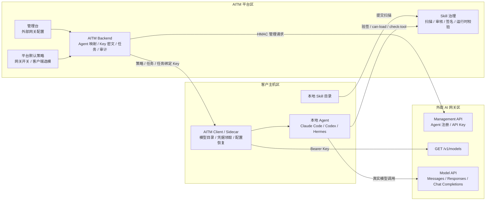
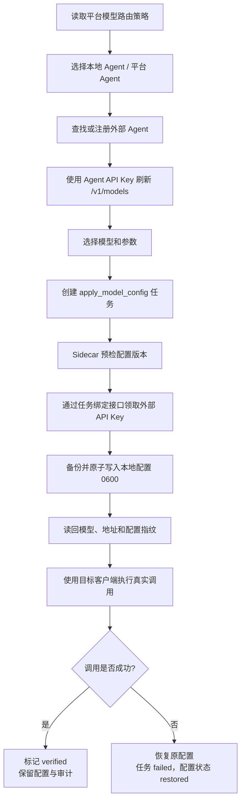
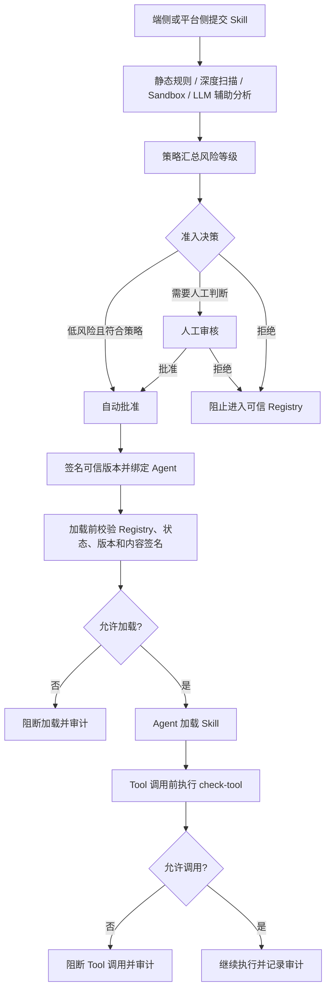

# 外部 AI 网关接入与 Skill 治理

> 实现状态：已实现，待部署环境联调验收
> 更新时间：2026-09-20

## 1. 职责边界

AITM 的外部模型接入不经过内置模型网关数据面：

- 外部 AI 网关负责 Agent 注册、API Key 签发、模型目录和模型调用。
- AITM Backend 负责连接配置、平台策略、Agent 映射、密钥密文保存、平台 Agent 运行时凭据解析、任务下发和审计。
- AITM Client/Sidecar 负责动态获取模型目录、备份并修改本地 Agent 配置、真实调用验证和失败恢复。
- AITM 继续独立负责 Skill 扫描、审核、签名、加载校验和 Tool 调用治理。

外部模型 API Key 不能替代 AITM Agent 运行凭证；模型调用成功也不能绕过 Skill 准入。

### 总体架构图



## 2. 已验证的外部接口

管理面使用 HMAC-SHA256 七行待签串，当前测试环境管理接口和模型接口使用不同端口。

| 能力 | 接口 | 已验证行为 |
|---|---|---|
| 注册 Agent | `POST /api/v1/agents/register` | 返回 `id`、一次性明文 `key`、`keyId` |
| 查询 Agent | `GET /api/v1/agents/{agentId}` | 返回状态和 `apiKeys` 标识 |
| 更新 Agent | `PUT /api/v1/agents/{agentId}` | 全量替换，更新时必须保留原 `apiKeys` |
| 删除 Agent | `DELETE /api/v1/agents/{agentId}` | 删除后查询为 404，原 API Key 失效 |
| 模型目录 | `GET /v1/models` | 使用 `Authorization: Bearer <Agent API Key>` |
| Chat Completions | `POST /v1/chat/completions` | Bearer 鉴权，可用 |
| Responses | `POST /v1/responses` | Bearer 鉴权，可用 |
| Messages | `POST /v1/messages` | Bearer 鉴权，可用 |

`inactive` 状态不会使已签发 API Key 失效。需要吊销模型凭据时，AITM 调用删除 Agent，不使用停用状态代替吊销。

## 3. 管理台配置

“外部 AI 网关”页面提供：

- 新增、查看、编辑和删除连接。
- 配置名称、管理面 Base URL、模型面 Base URL、Token ID、Token Value 和启用状态。
- 连接测试及最近测试状态。
- Token Value 掩码显示；编辑时留空保留原值。
- 每行提供“API Key”入口，侧边抽屉展示该网关创建的 Key、Key ID、外部 Agent 身份以及使用它的平台智能体。
- API Key 默认掩码展示；具备 `external_gateways:reveal` 敏感权限的用户输入当前密码后才能查看明文，查看成功或失败均写入安全审计。

Token Value 加密保存，仅 Backend 解密使用。浏览器接口、客户端任务、普通日志和诊断包不返回管理 Token。

对应接口：

```text
GET    /api/v1/external-ai-gateways
POST   /api/v1/external-ai-gateways
GET    /api/v1/external-ai-gateways/{gatewayId}
PUT    /api/v1/external-ai-gateways/{gatewayId}
DELETE /api/v1/external-ai-gateways/{gatewayId}
POST   /api/v1/external-ai-gateways/{gatewayId}/test
GET    /api/v1/external-ai-gateways/{gatewayId}/agent-keys
POST   /api/v1/external-ai-gateways/{gatewayId}/agent-keys/{bindingId}/reveal
```

连接被客户端策略或平台智能体引用时不能删除。删除连接时会先删除其外部 Agent，使已下发 Key 失效；外部删除失败时本地删除不继续提交。

## 4. 平台默认策略

“客户端管理 → 平台默认策略”中的模型路由字段为：

```json
{
  "external_gateway_enabled": true,
  "external_gateway_id": 1,
  "auto_register_agent": true,
  "client_select_model": true
}
```

规则如下：

- `external_gateway_enabled`：平台是否允许该客户端使用外部网关。
- `external_gateway_id`：平台批准的唯一外部网关连接。
- `auto_register_agent`：无外部映射时是否自动注册 Agent。
- `client_select_model`：客户端用户是否可以刷新目录并自主选择外部模型。
- 单客户端策略只能继承或收紧，不能改用平台未批准的连接，也不能重新开启平台关闭的能力。
- 仅修改模型路由会下发 `model_routing_policy_changed` 同步任务，不触发无关的全量 Skill 扫描。

当 `client_select_model=false` 时，客户端状态不下发外部模型目录，模型目录刷新和客户端模型切换接口均拒绝；管理员仍可在管理台为客户端创建模型配置任务。

## 5. Agent 注册与动态模型目录

AITM 以“外部网关 + 平台受管 Agent”为唯一映射维度：

1. 查找当前网关下的 Agent 映射。
2. 映射不存在且策略允许自动注册时，调用外部注册接口。
3. 立即加密保存一次性 `key`；业务流程和状态接口仅展示 `keyId`，网关 Key 抽屉默认展示掩码，只有敏感权限加密码复核才能查看明文。
4. 使用该 Key 以 Bearer 鉴权调用 `/v1/models`。
5. 返回实时模型目录并保存最近一次缓存和刷新时间。

AITM 不维护手工模型目录。缓存只用于界面状态展示和保存时校验；刷新目录及保存外部模型时都会确认所选模型来自该 Agent API Key 的可用目录。

### 5.1 平台智能体直接接入

“智能体管理 → 新增智能体”不依赖客户端，流程为：

1. 选择“外部 AI 网关”和目标连接。
2. 点击“准备并刷新模型”，平台先保存草稿智能体。
3. Backend 使用管理 Token 向外部网关注册独立 Agent，密文保存一次性 API Key。
4. Backend 使用该 Key 请求 `/v1/models`，页面只得到模型目录、外部 Agent ID 和 Key ID。
5. 用户选择默认模型并保存，智能体转为所选状态。
6. 取消新建时，平台删除草稿及刚注册的外部 Agent，令对应 Key 失效。

对应接口：

```text
POST /api/agents/{agentPk}/external-model-catalog
```

平台 Agent 的外部绑定以“外部网关 + 平台智能体”为唯一键，不需要 `client_id`。平台智能体从外部模型切回内置模型，或改用另一外部连接时，会删除不再使用的外部绑定。

### 5.2 Agent 运行时领取

智能体创建完成后，在统一凭证中心签发绑定该智能体、包含 `model:chat` 的 Agent 运行凭证。对于外部模型智能体，创建入口会自动选择“治理 + 模型”并将默认外部模型加入凭证模型范围。

Agent 进程以该运行凭证调用：

```text
GET /api/v1/runtime/external-model/credential
Authorization: Bearer <AITM Agent Runtime Token>
```

Backend 校验运行凭证状态、`model:chat`、绑定智能体、智能体状态、模型范围、外部网关和绑定状态后，返回当前 `model_base_url`、默认模型和外部 API Key。响应设置 `Cache-Control: no-store`。Agent 使用返回的 Bearer Key 直接调用外部网关模型接口，不经过内置模型网关，也不需要客户端参与。

模型目录接口：

```text
# Client Token
POST /api/v1/clients/{clientId}/model-catalog/refresh

# 管理员登录态
POST /api/v1/clients/{clientId}/external-model-catalog

# 平台智能体管理员登录态
POST /api/agents/{agentPk}/external-model-catalog
```

请求必须指定本地 Agent 类型，并使用已绑定的平台 Agent；客户端具备自动创建运行身份权限时，可以在首次刷新时建立平台 Agent 绑定。

同一个平台 Agent 可以被多台客户端引用。只有最后一个客户端解除关联，或平台 Agent 被删除时，AITM 才删除对应外部 Agent 并清除本地密钥。

## 6. 客户端模型切换

流程如下：



```text
读取平台策略
  → 选择本地 Agent / 平台 Agent
  → 动态刷新外部模型目录
  → 选择模型和参数
  → 创建 apply_model_config 任务
  → Sidecar 预检当前配置版本
  → 通过任务绑定接口领取外部 API Key
  → 备份并原子写入本地配置（0600）
  → 读回配置
  → 使用目标客户端执行一次真实调用
  → 成功后标记 verified；失败则自动恢复原配置
```

外部任务只包含路由元数据：

```json
{
  "source": "external_gateway",
  "model_base_url": "http://gateway.example:8080",
  "gateway_source": "external",
  "credential_source": "external_gateway",
  "credential_type": "external_gateway_api_key",
  "verification_mode": "client_call"
}
```

任务 Payload 禁止出现 `api_key`、`token`、`credential` 等明文字段。Sidecar 只能在任务为待执行或执行中时调用：

```text
POST /api/v1/clients/{clientId}/tasks/{taskId}/agent-credential
```

Backend 校验任务、客户端、平台 Agent、外部映射、网关状态和凭据来源后，才返回任务绑定的外部 Key；响应中的 `allowed_models` 固定为任务选择的模型。外部 Key 本身的模型权限范围仍由外部网关决定，AITM 不能把上游签发的 Agent 级 Key 收窄为单模型 Key。

当前支持的本地 Agent：

| 本地 Agent | 外部协议 | 配置行为 |
|---|---|---|
| Claude Code | Anthropic Messages | 写入外部 Base URL 与 Bearer/API Key 配置 |
| Codex | OpenAI Responses | 写入以 `/v1` 结尾的 Base URL 与 Bearer Key |
| Hermes | OpenAI Chat Completions | 写入以 `/v1` 结尾的 Base URL 与 Bearer Key |

真实调用验证由客户端执行，不依赖 AITM 内置模型网关的 `LlmRequestAudit`。验证失败但自动恢复成功时，任务保持失败，Agent 配置状态标记为 `restored`，避免平台误报为仍处于失败配置。

## 7. Skill 安全检测与运行时治理

端侧与平台侧统一为“提交 Skill 扫描”：



```text
端侧或平台侧提交 Skill
  → 静态规则 / 深度扫描 / Sandbox / LLM 辅助分析
  → 策略汇总风险等级
  → 自动批准、人工审核或拒绝
  → 批准版本签名并进入可信 Registry
  → Agent 加载前校验 Registry、状态、版本和内容签名
  → Tool 调用前执行权限与策略检查
  → 记录治理审计
```

凭据边界：

| 凭据 | 用途 | 禁止用途 |
|---|---|---|
| 外部管理 Token ID / Token Value | Backend 调用外部管理 API | 不下发客户端 |
| 外部 Agent API Key | 平台或本地 Agent 调用外部模型 | 不能调用 AITM Skill 治理接口 |
| AITM Client Token | 客户端拉取策略、任务和上报状态 | 不能直接调用模型 |
| AITM Agent 运行凭证 | `verify-signature`、`can-load`、`check-tool`；含 `model:chat` 时可领取本 Agent 的外部模型配置 | 不能调用外部管理 API，也不能领取其他 Agent 的 Key |

外部模型接入不会修改 Skill 扫描结论，也不会把模型调用成功当作 Skill 可加载依据。

## 8. 审计与错误处理

以下操作进入管理审计或客户端任务/事件记录：

- 外部网关连接的创建、修改、测试和删除。
- 平台模型路由策略及影响预览。
- 外部 Agent 注册、模型目录刷新和删除。
- API Key 明文查看的成功与失败结果；审计只记录网关、智能体和 Key ID，不记录明文。
- Agent 运行凭证领取外部模型配置的结果；审计记录 Agent、网关、Key ID 和模型，不记录明文。
- 模型配置任务、凭据领取、真实调用验证和失败恢复。
- Skill 扫描、审核、签名、加载检查和 Tool 调用检查。

审计记录保存稳定错误码、对象 ID、任务 ID、Key ID 和结果，不保存 Token Value、外部 API Key 或原始模型请求内容。

## 9. 部署验收

上线前逐项验证：

1. 管理台中英文页面、窄屏布局、权限和密钥掩码。
2. 管理面连接测试成功，错误凭据返回明确失败。
3. 在智能体管理中不经客户端完成注册、动态获取模型目录并保存默认模型，数据库中无明文 Key。
4. 平台关闭外部接入或客户端自主选择后，客户端接口不能绕过。
5. 外部模型切换任务和日志中没有明文 Key。
6. Claude Code、Codex、Hermes 各完成一次真实模型调用。
7. 故意配置不可用模型或地址，确认自动恢复和平台 `restored` 状态一致。
8. 网关 Key 抽屉默认不返回明文；无敏感权限不可查看，错误密码失败，正确密码查看后产生安全审计。
9. Agent 运行凭证只能领取自身绑定的外部 Key，模型范围不匹配时拒绝。
10. 删除最后一个绑定或平台 Agent 后，确认外部 Agent 删除且原 Key 返回 401。
11. 外部模型接入启用后，Skill 扫描、签名、加载校验和 Tool 治理仍按原策略执行。

当前外部接口没有独立 Key 轮换 API。若密钥泄露或丢失一次性明文 Key，需要删除并重新注册外部 Agent；后续如对方增加轮换/吊销接口，再扩展为无中断轮换流程。
