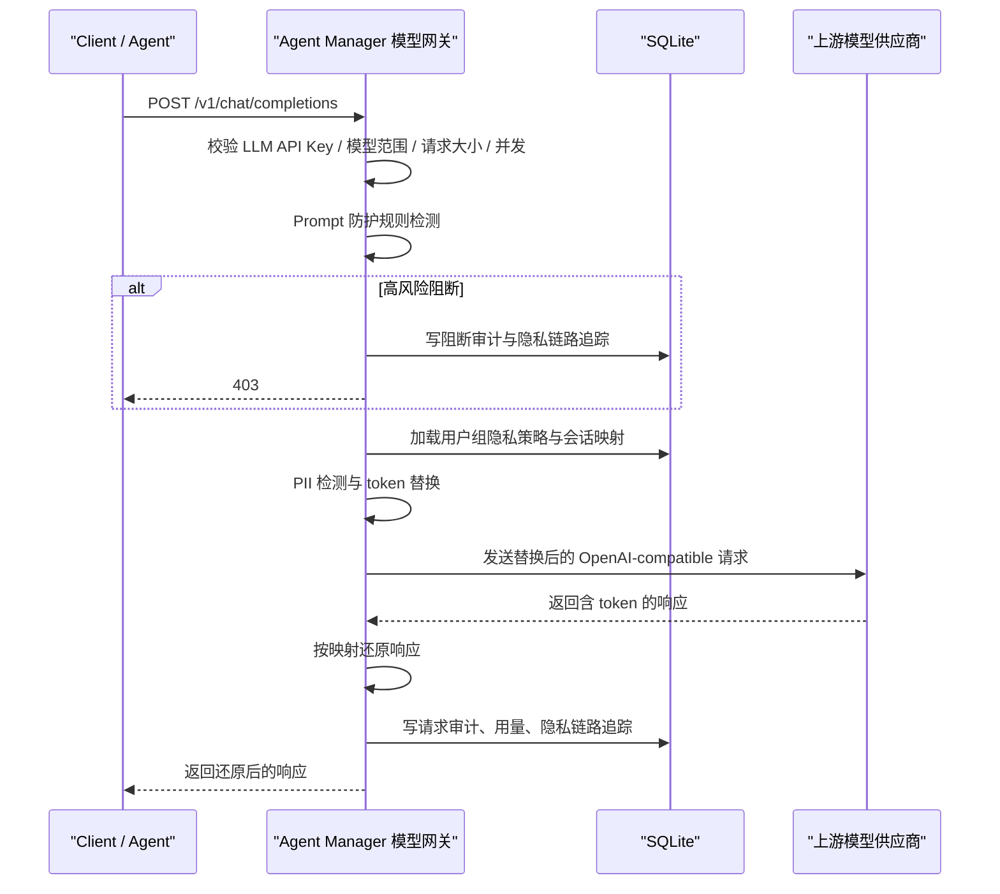

# 模型网关与隐私路由

模型网关把 `rs-router` 的隐私代理能力内置到 Agent Manager 后台中，用于统一代理 OpenAI-compatible Chat Completions 请求，并在请求进入外部模型供应商前做 PII 伪匿名化、Prompt 防护和智能上下文压缩。

它解决两类问题：

- 外部应用 / Agent 调用 LLM 时，不直接暴露真实隐私数据给模型供应商。
- Agent Manager 自己做 skill 的 LLM vetting 时，也可以走同一条隐私代理链路并留下审计。
- 真实调用时检测提示词注入、系统提示词泄露、凭据外传等 Prompt 风险，不要求用户额外上传 Prompt 模板。

---

## 1. 管理台入口

管理台入口：

- `模型网关`：管理模型供应商、模型端点、用户组策略绑定、隐私策略和 Prompt 防护配置。
- `统一凭证中心`：创建模型调用凭证，并在凭证上开启 Prompt 防护和智能压缩。
- `隐私链路追踪`：查看一次请求的 Prompt 防护、脱敏、压缩、响应和还原过程。

Trace 会保存原始 PII，仅 `admin`、`super_admin`、`privacy_auditor` 角色应该访问。

---

## 2. 核心流程



Trace 阶段：

| 阶段 | 含义 |
|---|---|
| `prompt_security` | Prompt 防护结果、风险等级、处理动作和命中规则 |
| `original` | 客户端原始请求 messages，可能含 PII |
| `masked` | 发送给上游模型前的替换后 messages |
| `compressed` | 智能上下文压缩后的上游 messages |
| `masked_response` | 上游模型返回的 token 响应 |
| `final_response` | 反替换后的最终响应 |

网关会处理 OpenAI-compatible `message.content`，也会处理部分客户端或模型返回的 `reasoning_content`。因此历史 assistant 推理字段里重复出现的姓名、邮箱、手机号等敏感信息，也会进入伪匿名和响应还原流程。

---

## 3. 运行时接口

模型网关同时提供 OpenAI-compatible 和 Anthropic-compatible 入口：

| 路径 | 用途 |
|---|---|
| `POST /` | 兼容把 `base_url` 当作完整请求地址直接 POST 的客户端，例如部分自定义 provider |
| `POST /v1/chat/completions` | OpenAI SDK 兼容路径，适合把 `base_url` 指到 Agent Manager |
| `POST /chat/completions` | 兼容部分客户端把 `base_url` 配成不含 `/v1` 时直接拼接的路径 |
| `POST /api/v1/llm/chat/completions` | Agent Manager 命名空间路径，适合内部系统显式调用 |
| `POST /v1/messages` | Anthropic Messages 兼容路径，适合 Claude Code 和 Anthropic SDK |
| `GET /v1/models` | OpenAI-compatible 模型列表，只返回当前 LLM API Key 允许访问的启用模型 |
| `GET /models` | 兼容不含 `/v1` 的模型列表路径 |

客户端配置建议：

- OpenAI SDK / Cherry Studio：优先把 Base URL 配成 `http://127.0.0.1:8000/v1`。
- Hermes 或其他只接受根地址的客户端：可配 `http://127.0.0.1:8000`；如果客户端直接 POST 根地址，网关会兼容 `POST /`，如果客户端自动拼接路径，网关也会兼容 `/chat/completions` 和 `/models`。
- Claude Code：设置 `ANTHROPIC_BASE_URL=http://127.0.0.1:8000`、`ANTHROPIC_AUTH_TOKEN=amk_xxx`，并把 Claude Code 使用的模型名设置为管理台登记的模型名。

请求必须携带模型调用凭证。凭证统一在管理台 `智能体管理 / 统一凭证中心` 创建，类型选择 `模型调用凭证`：

```http
Authorization: Bearer amk_xxx
```

最小请求示例：

```json
{
  "model": "gpt-4o-mini",
  "conversation_id": "conv-001",
  "metadata": {
    "tenant_id": "customer-a",
    "user_id": "alice"
  },
  "messages": [
    {"role": "user", "content": "张三的邮箱是 zhangsan@example.com"}
  ]
}
```

当前允许透传的 OpenAI 参数包括：

- `temperature`
- `top_p`
- `max_tokens`
- `max_completion_tokens`
- `stop`
- `n`
- `presence_penalty`
- `frequency_penalty`
- `logit_bias`
- `tools`
- `tool_choice`
- `response_format`
- `stream_options`
- `seed`
- `user`
- `reasoning_effort`
- `serviceTier`
- `verbosity`

未知字段会被拒绝，避免把高成本或未审计参数无意透传给上游供应商。

为了兼容部分客户端的占位空值，网关会把请求字段或消息扩展字段中的 `"[undefined]"` / `"undefined"` 清理掉，不会继续透传给上游模型供应商。

`stream=true` 已支持。网关会以 OpenAI-compatible SSE 格式返回：

- 请求入站时仍先完成 API Key 校验、模型范围校验、PII 伪匿名和上游路由。
- 上游每个 `delta.content` chunk 返回时，网关会把占位符实时还原后再下发给客户端。
- 流结束后保存 audit、usage metric 和隐私链路追踪；Trace 中的 `prompt_security`、`masked_response`、`final_response` 等阶段会保存聚合后的文本片段。

---

## 4. Prompt 防护

Prompt 不再作为主流程里的独立上传资产。平台默认在模型网关运行时处理真实请求，因为这里能看到最终发给模型的 `system` / `user` / `tool` messages。

历史的独立 Prompt Registry 仅作为兼容能力保留，不再作为管理台主流程入口。新接入方应优先使用模型网关运行时 Prompt 防护。

### 开启方式

在管理台 `凭证管理` 创建或编辑模型调用凭证，勾选 `model:chat` 后选择 `Prompt 防护`：

| 模式 | 行为 |
|---|---|
| 关闭 | 不检测 Prompt 风险 |
| 仅记录 | 命中规则时写入链路追踪和统计，但不影响请求 |
| 告警放行 | 命中规则时标记告警并放行 |
| 高风险阻断 | 命中高风险规则时返回 `403`，并写入审计和链路追踪 |

旧的 `模型网关 / API Key 管理` 页面也保留同样配置，但新接入方建议统一使用 `凭证管理`。

### 测试方式

管理台 `模型网关 / Prompt 防护测试` 提供轻量测试台。输入一段测试 Prompt 并选择检测模式后，平台只执行同步规则检测，不调用上游大模型，也不会消耗模型 token。

测试结果会展示：

- 最终风险等级。
- 本模式下会执行的动作：仅记录、告警放行或高风险阻断。
- 命中的规则、严重度、判断原因和命中片段。

### 当前检测内容

首版使用轻量规则同步检测，避免每次调用都增加一次 LLM 审查延迟。规则覆盖：

- 忽略、覆盖或绕过系统指令。
- 泄露 system prompt、隐藏指令或内部上下文。
- 输出 API Key、token、密码、私钥等敏感凭据。
- 绕过安全策略、审计、过滤或限制。
- 工具返回内容夹带新的执行指令。

`启用 LLM 复核` 目前作为策略配置项保留，默认不进入同步主链路。后续可以只在规则命中中高风险时触发 LLM 复核，避免成本和延迟不可控。

### 查看结果

- `隐私链路追踪` 列表显示 Prompt 防护风险和处理动作。
- Trace 详情展开 `Prompt 防护` 阶段，可查看命中规则、风险等级、命中片段和是否阻断。
- `平台总览` 的模型网关卡片展示 Prompt 风险事件数和阻断次数。

---

## 5. 模型调用凭证

模型调用凭证在 `智能体管理 / 统一凭证中心` 页面创建：

- 明文只展示一次。
- 服务端只保存 SHA-256 hash 和 key prefix。
- 创建时自动绑定当前登录用户；运行时按该用户所属用户组解析隐私策略。
- 可配置允许模型列表、过期时间、最大请求体大小 `max_body_kb`、最大并发请求数 `max_concurrent_requests`。
- 可编辑名称、模型范围、过期时间、状态和限额；明文 token 仍只在创建后展示一次。
- Agent 运行凭证默认不能调用模型；只有显式勾选 `model:chat` 后，才可以调用模型网关。

运行时会检查：

- key 是否存在且状态为 `active`
- key 是否过期
- 请求模型是否在 key 的允许模型范围内
- 请求体是否超过 `max_body_kb`
- 当前进程内该 key 的并发请求数是否超过限制

---

## 5. 模型供应商与模型

模型供应商保存 `base_url`、上游协议（OpenAI-compatible 或 Anthropic-compatible）、API Key、超时和启用状态。

- 上游支持 Anthropic 时，网关调用供应商的 `/v1/messages`。
- 上游仅支持 OpenAI 时，Anthropic 入站请求会在网关边界转换为 `/v1/chat/completions`，响应和 SSE 再转换回 Anthropic 格式。
- 当前核心兼容范围为文本、图片 base64、客户端工具调用、流式输出和基础 usage；Anthropic 专有的服务端工具、完整 prompt caching 语义及全部 beta 内容块不承诺兼容。

供应商 API Key 会加密落库：

- 加密密钥由后台 `SECRET_KEY` 派生。
- API 返回只展示掩码。
- 调用上游时才在内存中解密使用。

模型端点绑定到供应商，并配置：

- 模型名
- 显示名
- 是否启用
- 是否默认
- 上下文窗口
- 最大输出 token

如果请求未指定 `model`，网关会优先使用默认模型。

---

## 6. 隐私策略

隐私策略可绑定到用户组；API Key 创建后自动关联当前用户，运行时会按用户所在的启用用户组查找策略；没有命中用户组策略时使用默认策略。

首版策略项：

- `entity_types`：启用的实体类型
- `entity_rules`：按实体类型配置正则规则，例如为企业自定义员工号配置专用识别模式
- `detect_system_messages`：是否扫描 system 消息
- `allow_bypass`：是否允许请求通过 `metadata.bypass_pii_check=true` 绕过 PII 检测
- `mapping_ttl_days`：伪匿名映射和 Trace 保留时间
- `dp_enabled`、`dp_epsilon`、`dp_min_count`：差分隐私统计参数

默认实体类型：

```text
PERSON,CN_ID_CARD,CN_MOBILE,CN_LANDLINE,CN_BANK_CARD,EMAIL_ADDRESS,IP_ADDRESS,CN_LICENSE_PLATE,CN_USCC,CN_ADDRESS,EMPLOYEE_ID,CUSTOMER_ID,ACCOUNT_ID
```

PII 检测默认按中国业务场景精准率优先：

- 中国居民身份证校验省级地区码、出生日期和校验位。
- 银行卡号使用 Luhn 校验，统一社会信用代码校验末位校验码，IP 地址使用标准地址解析。
- 中文姓名只在“姓名、联系人、负责人”等上下文或“先生、女士、老师”等称谓中识别，不做全文姓氏猜测。
- 座机号和中国地址需要明确中文字段上下文；日期、小数、数字区间不会作为手机号。
- 管理台可继续为员工号、客户号等企业字段配置自定义正则。

---

## 7. 二次替换与多轮会话

网关会为同一 `tenant_id + conversation_id` 复用历史 token 映射。

为了避免 assistant 历史消息中重新出现真实 PII，网关会对 `assistant` / `tool` 历史消息做一次已知值替换；不会对未启用扫描的 `system` 示例文本做全局替换，避免误伤系统提示中的演示内容。

管理台 `隐私审计` 页面默认展示当前有效映射列表，支持按 `Tenant ID`、`Conversation ID`、原始值搜索；列表会显示映射过期时间，并支持删除单条映射。保留会话级映射查询和批量删除接口，供管理员在需要清理某个 conversation 时使用。

---

## 8. 差分隐私统计

差分隐私只用于管理台统计，不扰动真实 prompt 或响应。

统计接口会：

- 在样本数低于 `dp_min_count` 时返回空值。
- 在启用 `dp_enabled` 时给计数加入 Laplace noise。

原始请求审计和隐私链路追踪仍保存真实内容，仅限管理员或隐私审计员查看。

---

## 9. 内部 LLM vetting 接入

`agent_manager/core/llm.py` 和 prompt vetting 支持通过环境变量走模型网关；sandbox probe 生成也会在配置了网关时优先走隐私代理：

```bash
export AGENT_MANAGER_LLM_GATEWAY_URL="http://127.0.0.1:8000/v1/chat/completions"
export AGENT_MANAGER_LLM_GATEWAY_API_KEY="amk_xxx"
```

可选 metadata：

```bash
export AGENT_MANAGER_LLM_GATEWAY_TENANT_ID="agent-manager-internal"
export AGENT_MANAGER_LLM_GATEWAY_USER_ID="agent-manager-vetting"
export AGENT_MANAGER_LLM_GATEWAY_CONVERSATION_ID="vetting-session"
```

如果未配置 `AGENT_MANAGER_LLM_GATEWAY_URL`，系统会保持原有 `LLMConfig` / 系统设置中的直连配置。

---

## 10. 安全边界

- `stream=true` 支持 SSE 透传和增量反替换；如果客户端中途断开，已完成的并发槽会释放，但未完成请求可能不会写完整 Trace。
- 未知 OpenAI 参数默认拒绝。
- LLM API Key 明文无法找回，只能吊销重建。
- Trace 含原始 PII，应按审计权限和 TTL 管控。
- 差分隐私仅保护统计视图，不等于删除原始审计数据。

---

## 11. 智能上下文压缩

> 详细实施文档见 [headroom-compression-integration.md](headroom-compression-integration.md)

模型网关集成 [Headroom](https://github.com/chopratejas/headroom) 智能压缩，自动压缩发送给 LLM 的消息内容（工具输出、日志、代码等），节省 60-95% Token。压缩在 PII 伪匿名化之后执行，按模型调用凭证粒度可选开启。

### 开启方式

在管理台 `智能体管理 / 统一凭证中心` 创建模型调用凭证时，打开“开启智能压缩”开关并选择压缩级别（均衡/保守/激进）。

### 如何看到效果

**方式 1 — HTTP 响应头（最快）**:

```bash
curl -s -D - http://127.0.0.1:8000/v1/chat/completions \
  -H "Authorization: Bearer amk_xxx" \
  -H "Content-Type: application/json" \
  -d '{"model":"gpt-4o","messages":[{"role":"user","content":"Hello"}]}' \
  | grep -i x-compression
```

开启压缩且生效时的响应头:
```
x-compression: on
x-compression-saved-tokens: 2094
x-compression-ratio: 92.4
x-compression-ms: 45
```

关闭或未生效时:
```
x-compression: off
```

**方式 2 — 管理台隐私链路追踪**:

进入 `隐私链路追踪` 页面，展开一次请求:

- 详情顶部显示绿色提示条：「智能压缩: 节省 2094 tokens (92.4%), 耗时 45ms」
- 展开第 3 阶段「智能压缩后」可对比压缩前后的 messages 差异

**方式 3 — 管理台 API Key 列表**:

API Key 表格中「压缩」列显示当前状态: 紫色标签 `auto` / `conservative` / `aggressive`，或灰色「关闭」。
