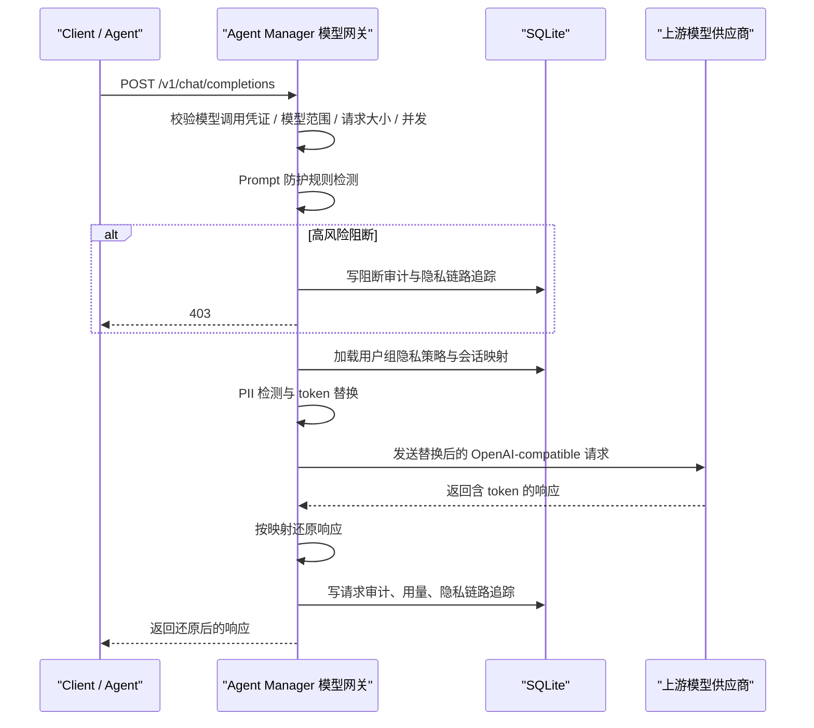
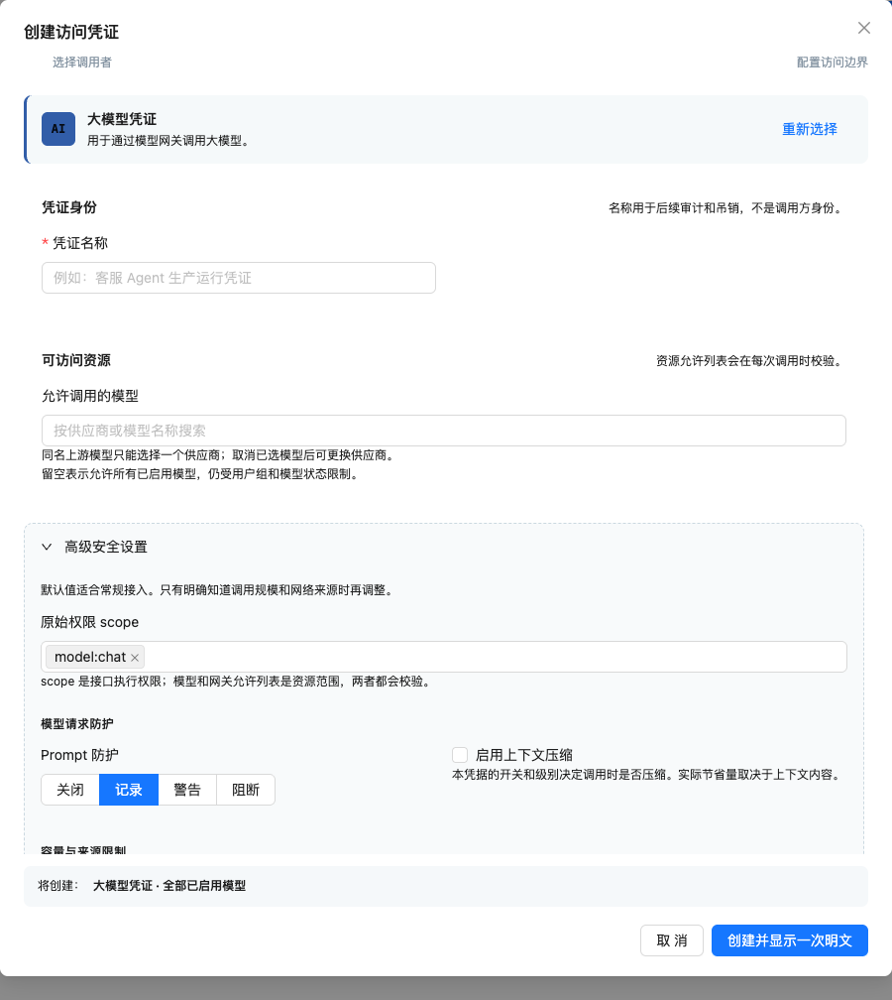
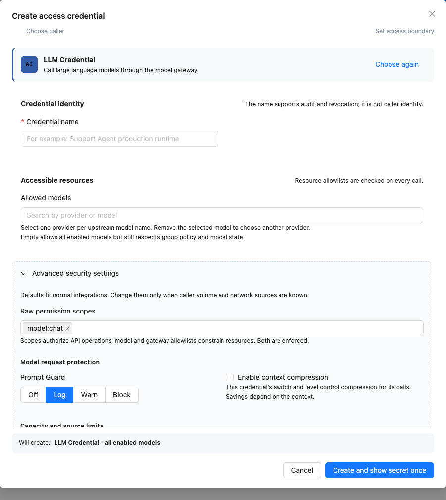

# 模型网关与隐私路由

离线 License 的 `model_gateway` 模块控制模型网关授权。到期后已有网关调用和既有隐私策略维护继续可用，新增供应商、模型、调用凭证与网关需有效授权，详见 [离线 License](license.md)。

**English:** The offline `model_gateway` entitlement controls model gateway access. Expiry preserves existing gateway calls and privacy policy maintenance; adding providers, models, credentials or gateways requires a valid license. See [Offline License](license.md).

Agent 的模型访问与 MCP 工具访问可使用同一张运行凭证组合授权。模型按允许模型范围校验；MCP 按 Agent 允许网关、凭证权限和网关策略共同校验。创建或编辑智能体时可配置 MCP 网关，再通过接入指引完成凭证授权与运行端连接。详见 [MCP 工具访问](agent-governance.md#mcp-工具访问--mcp-tool-access)。

**English:** One Agent runtime credential can combine model and MCP access. Models use model allowlists; MCP uses Agent gateway grants, credential scopes and gateway policies together. Configure MCP gateways on the Agent, then follow the integration guide to grant credentials and connect the runtime. See [MCP tool access](agent-governance.md#mcp-工具访问--mcp-tool-access).

模型网关把 `rs-router` 的隐私代理能力内置到 Agent Manager 后台中，用于统一代理 OpenAI-compatible Chat Completions 请求，并在请求进入外部模型供应商前做 PII 伪匿名化、Prompt 防护和智能上下文压缩。

客户已经部署独立 AI 网关时，可以让客户端模型流量直接进入客户网关，由 Agent Manager 只负责连接配置、Agent 注册、动态模型目录、策略和任务下发。该模式不经过本章的内置数据面，详见 [外部 AI 网关接入与 Skill 治理](external-ai-gateway-integration.md)。

它解决两类问题：

- 外部应用 / Agent 调用 LLM 时，不直接暴露真实隐私数据给模型供应商。
- Agent Manager 自己做 skill 的 LLM vetting 时，也可以走同一条隐私代理链路并留下审计。
- 真实调用时检测提示词注入、系统提示词泄露、凭据外传等 Prompt 风险，不要求用户额外上传 Prompt 模板。

---

## 从接入指引配置 / Configure through the integration guide

用户组页面仅加载用户组列表，成员数量和绑定策略名称直接使用列表字段。新建或编辑时才按权限读取用户和隐私策略选项，同次页面访问复用结果；选项失败保留草稿并支持重试。刷新列表或保存用户组后，选项缓存失效，下次打开弹窗重新读取。用户组页面不请求隐私统计。

The user group page loads only its group list, using the returned member IDs and policy names for display. User and privacy policy options load with the caller's permissions when creating or editing a group and are reused during the visit. Failed option requests preserve the draft and can be retried. Refreshing the list or saving a group invalidates the options for the next dialog opening. The group page does not request privacy statistics.

在“接入与运行”选择“现有应用接入模型网关”。按 Agent 身份治理时选择已登记身份，并创建含 `model:chat` 的运行凭证；普通应用选择模型调用凭证。创建时核对允许模型，保存一次性凭证后返回指引，将平台 `/v1` 地址、凭证和模型名配置到运行端，并按运行端选择 Chat Completions、Responses 或 Anthropic Messages。SDK 的 Base URL 规则可能不同，应按其协议要求使用所展示的完整请求路径。

**English:** In Integration & runtime, choose the model gateway scenario. For Agent governance, select a registered identity and issue an Agent runtime credential with `model:chat`; ordinary apps use model credentials. Confirm allowed models, save the one-time secret and return to configure the endpoint, credential and model. Choose Chat Completions, Responses or Anthropic Messages for the runtime. SDK base URL conventions vary; use the displayed full request path according to the SDK protocol.

内置模型调用在 Pipeline Trace 中核对。使用外部网关模型时，指引展示配置领取接口，运行端使用返回的外部地址和密钥直连；调用审计由外部网关提供。模型配置或调用成功不能证明 Skill 加载前校验已接入，后者需要独立安装文件、验签及授权检查。

**English:** Verify internal model requests in Pipeline Trace. For external gateway models, retrieve configuration through the guide’s endpoint and call the returned external URL with its key; verify calls in that gateway’s audit. Model configuration or successful calls do not establish Skill admission checks, which require file installation, signature verification and authorization at the loading boundary.

## 客户端模型切换 / Client model switching

模型切换自动创建的运行凭证，其 Prompt 防护默认仅记录，模式与 LLM 复核开关由平台默认客户端策略或单客户端覆盖配置。保存策略会更新已有有效自动凭证；新建和轮换凭证继承当前值。网关后续请求使用新配置，桌面端通过既有长轮询同步策略和版本。LLM 复核目前只保存开关，尚未执行模型复核。详见[客户端策略](agent-manager-client.md#prompt-防护--prompt-guard)。

Prompt Guard defaults to log only for automatically issued model-switching credentials; settings come from the default or per-client policy. Saving updates active automatic credentials; issuance and rotation inherit the current values. Subsequent gateway requests use the new settings, while desktop clients synchronize the policy and version through existing long polling. The LLM review flag is stored but does not currently execute a review. See [client policies](agent-manager-client.md#prompt-防护--prompt-guard).

客户端管理台与桌面客户端共用 `agent_manager/core/model_switch_contract.json` 的 Agent、协议和参数契约。管理台下发与桌面本地操作均创建客户端任务，任务绑定独立 Agent 运行凭证；模型授权、凭证有效期、隐私处理、Prompt Guard 和审计仍由网关执行。

The console and desktop share the Agent, protocol and parameter contract in `agent_manager/core/model_switch_contract.json`. Both paths create client tasks with separate Agent runtime credentials. Model authorization, credential validity, privacy, Prompt Guard and audit remain enforced by the gateway.

参数表单中的“未设置”表示保留原配置；选择值或输入数字才会显式修改。保存前展示模型、参数和文件位置的差异。客户端校验版本指纹、保存私有备份、安全写入并读回；现有会话需要重启。状态“待重启”不表示模型调用通过。“验证调用”使用独立配置目录和最小提示，只有 Agent 返回匹配结果且网关审计确认目标模型与显式请求参数时，才显示“隔离调用验证通过”。缺少验证命令的 Agent 不显示该入口。

“Unset” preserves the existing configuration; a selected or entered value explicitly changes it. The preview shows model, parameter and path changes. The client checks the revision, saves a private backup, writes and reads back the configuration. Existing sessions need restarting. “Restart required” is not a successful model call. Verification runs an isolated Agent with a minimal prompt and requires both the expected response and matching gateway audit evidence. Agents without a verification command do not offer that action.

| Agent | 结构化参数 / Structured option | 原生位置 / Native location | 请求映射与条件 / Mapping and conditions |
|---|---|---|---|
| Claude Code | `max_output_tokens` | `env.CLAUDE_CODE_MAX_OUTPUT_TOKENS` | Anthropic `max_tokens`；不得超过平台上限，上游须支持 / platform output limit and upstream support |
| Claude Code | `timeout_ms` | `env.API_TIMEOUT_MS` | Agent 本地超时；不作为上游参数 / local timeout, not forwarded |
| Codex | `request_max_retries` | `model_providers.agent_manager.request_max_retries` | 本地请求重试次数，整数 / local retry count, integer |
| Codex | `stream_idle_timeout_ms` | `model_providers.agent_manager.stream_idle_timeout_ms` | 本地流空闲超时，整数 / local stream idle timeout, integer |
| Hermes | `max_tokens` | `model.max_tokens` | Chat Completions `max_tokens`；平台输出上限 / platform output limit |

结构化参数目前只对已验证版本开放：Claude Code 2.1.220、Codex 0.132.0、Hermes 0.17.0。未知版本或其他版本保留原参数；两端展示原因，服务端拒绝显式参数修改，客户端执行任务与调用验证前再次检查本机版本。版本集合来自共享契约，不由前端单独维护。新增版本需补充原生参数验证后更新契约。

Structured parameters currently require a verified version: Claude Code 2.1.220, Codex 0.132.0 or Hermes 0.17.0. Unknown and other versions retain existing parameters. Both UIs explain the restriction, the server rejects explicit parameter changes, and the client rechecks the installed version before task execution and call verification. The version set lives in the shared contract. Add native parameter evidence before extending it.

平台输出上限同时约束新输入和继承值。例如原配置输出上限为 1024，目标模型上限为 512，留空保留原值会被预检拒绝；显式改为 256 可通过。客户端写入前通过任务预检接口重新核对模型状态、授权、配置指纹及当前参数，预检通过后才领取运行凭证并写入。预检不可用或失败时保留原配置；任务创建后的模型限制变化不会仅依赖旧的发现缓存。

Platform output limits apply to explicit and inherited values. If the existing limit is 1024 and the target model allows 512, leaving the field unset fails preflight; explicitly setting 256 can pass. Before writing, task preflight rechecks model availability, authorization, revision and effective parameters. Credential issuance and configuration writing follow successful preflight. Failed or unavailable preflight preserves the original configuration and avoids relying solely on cached model limits.

其他 Agent 当前仅提供模型与网关配置。默认流式行为由 Agent 决定；界面没有通用温度、top-p 或流式开关。原生配置中不相关字段按语义保留，备份恢复原始字节。备份包含原配置中的凭据，仅保存在本机私有目录，不上传到管理台。恢复前再次核对当前内容；有后续修改时报告冲突，避免覆盖。最近一次切换保留前一枚独立运行凭证以便恢复；父客户端凭证吊销仍会使关联运行凭证失效。

Other Agents currently expose model and gateway configuration only. Agents control their default streaming behavior. There is no universal temperature, top-p or streaming toggle. Unrelated fields retain their meaning; recovery restores the original bytes. Backups may contain original credentials and stay in a private local directory. Recovery checks current contents and reports later edits as conflicts. The previous runtime credential is retained for the latest recovery; revoking the parent client credential still invalidates its runtime credentials.

版本和上游能力并非仅凭配置读回就能确认。当前实测范围、已知限制与中英文界面截图见 [模型切换验证记录](acceptance/model-switching-2026-09-13/README.md)。

Configuration readback alone cannot establish version or upstream capability support. See the [model switching evidence](acceptance/model-switching-2026-09-13/README.md) for verified combinations, limitations and bilingual screenshots.

### 手动配置与凭证领取 / Manual configuration and credential retrieval

模型切换页展示已发现的 Agent。没有自动配置适配器时，可打开三步手动引导：确认 Agent 支持自定义地址、凭证和所选协议，复制接入字段并保存到 Agent，最后重启并核对网关调用记录。未知 Agent 的设置路径与协议能力需要用户按实际版本确认。

The model switcher shows discovered Agents. Agents without an automatic configuration adapter offer a three-step guide: confirm support for a custom endpoint, credential and protocol; copy connection fields into the Agent; then restart and inspect gateway call records. Users must confirm the settings location and protocol support for their installed Agent version.

在“统一凭证中心”为客户端凭证同时开启“允许创建 Agent 运行凭证”和“允许手动领取并复制 Agent 凭证”。手动领取权限默认关闭，与自动配置授权独立；已有客户端凭证可在列表操作中开启或关闭。关闭手动领取权限会阻止后续领取和复制，不自动撤销已保存到 Agent 的凭证。

In Credentials, enable both Agent credential issuance and manual retrieval/copying on the Client credential. Manual retrieval is off by default and is separate from automatic configuration authorization. Existing Client credentials expose an enable/disable action. Disabling retrieval prevents subsequent retrieval and copying; it does not revoke credentials already saved in an Agent.

内置网关在点击“申请凭证”后创建独立的 `agent_runtime` 凭证，只授予 `model:chat`，绑定本机目标 Agent 和所选已授权模型，继承客户端凭证的有效期、IP 与请求限额及当前客户端防护策略。服务端仅保存凭证 hash；同一次申请重试返回领取记录，不重复返回明文。客户端原生内存最多保留明文 5 分钟，关闭引导时清除；点击复制时重新校验授权，明文仅短暂经过前端写入系统剪贴板，不进入页面状态、任务或审计记录。关闭引导不会清空系统剪贴板或 Agent 中已保存的配置。

For the internal gateway, Request creates a separate `agent_runtime` credential with only `model:chat`, bound to the local Agent and selected authorized model. It inherits the Client credential’s expiry, IP/request limits and current Client protection policy. The server stores only its hash. Retrying the same request returns handoff metadata without returning the secret again. Native Client memory retains the secret for at most five minutes and clears it when the guide closes. Copying revalidates authorization; plaintext briefly passes through the renderer to the system clipboard without entering page state, tasks or audit records. Closing the guide does not clear the system clipboard or the Agent’s saved configuration.

临时副本清除后需要明确“重新领取”：内置网关撤销上一次手动申请的凭证并创建替代凭证，自动配置使用的凭证保持原有生命周期。外部网关沿用当前 Agent 的托管 Key，再次领取不轮换该 Key；实际模型范围和有效期由外部网关决定，所选模型只表示配置目标。关闭客户端权限或吊销父客户端凭证不能替代外部网关的 Key 吊销操作。

After the temporary copy clears, explicit retrieval is required. The internal gateway replaces the previous manually issued credential; automatic configuration credentials retain their lifecycle. External gateways reuse the Agent’s escrowed Key without rotating it. The external gateway determines its actual model scope and expiry; the selected model is the configuration target. Disabling Client permission or revoking the parent Client credential does not replace revocation of the external Key at its gateway.

领取成功、复制成功、用户确认保存与真实调用分别表示不同结果。引导完成后调用状态保持“未验证”；内置网关在 Pipeline Trace 核对 Agent、模型和请求结果，外部网关在其自身审计中核对。

Retrieval, copying, user-confirmed saving and an observed model call are distinct outcomes. Completing the guide leaves call verification as Unverified. Check the Agent, model and request result in Pipeline Trace for internal calls, or in the external gateway’s own audit.

## 1. 管理台入口

Agent 风险扫描和大模型红队扫描在发起时必须选择评估模型。列表读取网关中模型及供应商均已启用的模型，预览、创建和执行时再次校验。
Worker 使用任务租约调用 Backend 的任务专属 OpenAI-compatible 评估接口，只能调用该任务选择的模型；租约失效、任务取消或 Worker 停用后拒绝新调用。
评估接口复用模型网关隐私处理和审计，使用任务所有者及用户组作为策略上下文，并执行请求大小与任务并发限制。供应商密钥保留在 Backend。
定时扫描保存所选模型；历史计划需要补选评估模型后重新保存。

管理台入口：

- `模型网关`：管理模型供应商、模型端点、用户组策略绑定、隐私策略和 Prompt 防护配置。
- `统一凭证中心`：创建模型调用凭证，并在凭证上开启 Prompt 防护和智能压缩。
- `隐私链路追踪`：查看一次请求的 Prompt 防护、脱敏、压缩、响应和还原过程。

“供应商与模型”统一在 `/model-gateway/providers` 管理，原 `/model-gateway/models` 地址重定向到该页面。

### 供应商认证与自定义 Header / Provider authentication and custom headers

供应商认证方式默认 `bearer`，发送 `Authorization: Bearer <API Key>`；选择 `raw`（原始 Authorization）时发送 `Authorization: <API Key>`。API Key 为空时不自动添加认证头。旧库升级默认 Bearer，自定义 Header 为空；旧 API 调用修改供应商时省略新字段会保留已有配置。

自定义 Header 最多 32 项，名称最多 128 字符，值最多 4096 个可打印 ASCII 字符，不允许换行及首尾空白。名称不区分大小写且不得重复。请求先生成协议默认头和认证头，再应用自定义 Header，因此自定义 `Authorization` 优先于认证方式与 API Key。支持覆盖 `Host`；`Content-Length`、`Transfer-Encoding`、`Connection`、`Trailer`、`TE`、`Upgrade`、`Keep-Alive`、`Proxy-Authorization`、`Proxy-Connection` 由客户端管理，不允许配置。

Header 值加密存储，读取接口仅返回名称、配置状态和掩码。编辑时值留空保留同名已保存值，填写新值替换，删除行移除；新建或改名必须填写值。API 的 `custom_headers` 是完整行列表（`name`、`value`），空列表清除全部，省略字段保持原样。请勿把掩码当作新值提交。

例如客户要求不带 Bearer 且指定 Host：选择原始 Authorization，在 API Key 填写客户凭证，添加 `Host: model.internal.example`，Base URL 填写客户提供的版本基础路径（如 `http://model.internal.example:8080/service/v1`）。模型发现、连接测试、非流式与流式调用统一使用这些设置。Agent 扫描的评估、分析、攻击模型以及 Skill 扫描走平台网关的模型调用同样生效；独立直连 LLM 使用自身配置。修改供应商会影响其所有模型后续发起的请求，包括运行中扫描任务的后续调用。

连接测试仍发送非流式请求，模型发现仍需上游提供 `/models`；上游未提供模型列表时可手动添加。Header 兼容不代表客户的请求参数、响应格式或网络已经通过验收。

**English:** Providers default to `bearer` (`Authorization: Bearer <API Key>`). Select `raw` to send the API key directly as Authorization. An empty API key produces no automatic authentication header. Existing databases retain Bearer behavior; omitted fields in updates preserve saved settings.

Configure up to 32 custom headers with unique, case-insensitive HTTP names (128 characters maximum) and printable ASCII values (4096 characters maximum, without line breaks or surrounding whitespace). Custom headers override protocol defaults and generated authentication headers, including Authorization. Host overrides are supported. Framing, connection and proxy authentication headers listed above are managed by the client. Values are encrypted and returned only as configuration status and masks. Blank values preserve saved values under the same name; replacing a value updates it, removing a row deletes it, and new or renamed headers require a value. The API accepts a complete `custom_headers` list of `name`/`value` entries; an empty list clears all entries, omission preserves them. Never submit a mask as a replacement value.

Discovery, connection tests, streaming and non-streaming requests share these settings, including Agent scan evaluator/analysis/attack models and Skill scans using the platform gateway. Independent direct LLM connections use their own settings. Provider edits affect subsequent requests for every associated model, including subsequent calls in running scans. Tests remain non-streaming; discovery requires `/models`, otherwise add models manually. Customer network, request parameters and response compatibility still require integration acceptance.

页面按当前功能加载数据：“供应商与模型”只加载供应商和模型，统计卡片所在页面才请求隐私统计。隐私统计在线程池中执行同步数据库查询，按当前用户的凭证范围统计；映射计数使用数据库子查询，历史用量和审计按批次读取所需字段，保留差分隐私保护。

**English:** Each page loads the data its features need. Providers & models loads only providers and models; pages with statistics cards request privacy statistics. Synchronous statistics queries run in the thread pool and retain the current user's credential scope and differential privacy protection. Mapping counts use a database subquery, and historical usage and audit statistics read only the required fields in batches.
新建供应商保存后自动获取模型列表，也可点击“获取模型”重新读取。在获取结果中可多选并批量添加，也可逐个添加、测试模型；已添加的模型不可重复勾选，批量操作失败的条目保留勾选以便重试。
页面以供应商分组展示一个列表，头部提供凭据配置、获取模型和添加模型入口。模型列表默认收起，点击模型数量展开后显示模型名称、上下文大小、
默认标记、启用开关、编辑和逐模型测试操作。自定义添加可填写模型名称、上下文窗口、输出限制和默认模型。
默认模型及其所属供应商分别显示“默认模型”和“默认供应商”标识；列表收起时也展示默认模型名称。默认供应商由默认模型归属确定。
模型按“供应商 + 上游模型名”判重，不同供应商可以添加同名模型；发现列表中的“已添加”仅指当前供应商。每条配置另有全局唯一的网关调用名称：第一次添加时默认沿用上游模型名，重名时自动生成供应商前缀，也可以在创建时填写。创建后调用名称固定，编辑上游模型名或供应商不会改变凭证和配置中的调用绑定。

凭证可用模型、文档助手、Skill 扫描策略、智能体默认模型、客户端模型切换、MCP/Agent 安全扫描及 Dify 意图分析均使用网关调用名称；选择器同时显示供应商、上游模型和调用名称。网关 `/v1/models` 返回调用名称，转发到上游时改用上游模型名，响应、用量及审计保持网关调用名称。

统一凭证中心按供应商分组展示已添加到网关的模型，支持按供应商或模型名称搜索；同一张凭证对每个上游模型名只能选择一个供应商，不同名称的模型可跨供应商选择。列表加载 Agent 和模型名称；创建配置按所选场景补充所需选项，同页复用已加载结果，点击刷新重新读取。MCP 网关选项仅在配置包含 MCP 能力时加载。供应商下尚未添加的模型需先在“供应商与模型”中添加。

**English:** The Credential Center groups registered gateway models by provider and supports searching by provider or model and selecting one provider per upstream model name in each credential. Models with different upstream names may use different providers. The list loads Agent and model names. Configuration loads additional options for the selected scenario and reuses results within the page; Refresh retrieves them again. MCP gateway options load when configuring MCP access. Register models under their provider before selecting them in a credential.

旧数据迁移保留原调用名称、模型 ID、默认模型及权限引用，将原名称回填为上游模型名。无需批量修改历史凭证或客户端配置。

**English:** Models are unique by provider and upstream model name. Discovery marks only models registered with the current provider as added. Each configuration has a unique gateway model name, generated from the upstream name or a provider prefix, or entered at creation. This caller-facing name remains fixed to preserve bindings. Credentials, documentation settings, Skill policies, Agent defaults, client switching and security evaluators store gateway names. Selectors show the provider and model identity. Requests use the upstream name only at the provider boundary; responses and audits keep the gateway name. Migration preserves existing names, IDs and references.

管理员接口 `GET /api/v1/model-providers/{provider_id}/models` 使用服务端保存的供应商凭据读取上游 `/models`，
支持 OpenAI Chat Completions、Responses API 的模型列表及 Anthropic 游标分页。Base URL 保留配置的版本路径，若填写完整推理端点则替换其端点后缀。
供应商不支持列表接口、连接失败或返回格式错误时，页面提示重试或自定义添加。
每个模型的“测试”入口复用供应商真实推理测试接口，显示 HTTP 状态和耗时；测试会消耗少量模型额度。

隐私链路 Trace 会保存原始 PII。统一 Runtime Trace 默认返回脱敏投影；原始 Payload 仅
`admin`、`super_admin`、`privacy_auditor` 可以显式查看或导出原始内容，相关动作写入防篡改审计链；
`security_auditor` 只查看脱敏投影。

Pipeline Trace 按每条阶段记录的 `expires_at` 保留：到期记录立即从列表、详情及压缩诊断中排除，后台每批最多删除 500 条，保留独立的调用审计和用量统计。Backend 启动后由后台线程执行首轮清理；有积压时每批完成后等待 250 毫秒继续，没有积压或发生错误时等待 60 秒。清理错误仅记录异常类型，不记录正文。既有到期数据随后台批次逐步清除。

**English:** Pipeline Trace stages expire at their stored `expires_at`. Expired stages are excluded from lists, details and compression diagnostics immediately, while background cleanup deletes up to 500 rows per batch. Independent request audits and usage metrics remain available. Cleanup starts in a background thread after Backend startup, waits 250 ms between backlog passes, and checks again after 60 seconds when idle or after an error. Errors log only their exception type. Existing expired records drain through the same batches.

---

## 2. 核心流程



Trace 阶段：

| 阶段 | 含义 |
|---|---|
| `prompt_security` | Prompt 防护结果、风险等级、处理动作和命中规则 |
| `original` | 客户端原始请求 messages，可能含 PII |
| `masked` | 发送给上游模型前的替换后 messages |
| `compressed` | 智能上下文压缩后的上游 messages |
| `masked_response` | 上游模型返回的 token 响应 |
| `final_response` | 反替换后的最终响应 |

网关会处理 OpenAI-compatible `message.content`，也会处理部分客户端或模型返回的 `reasoning_content`。因此历史 assistant 推理字段里重复出现的姓名、邮箱、手机号等敏感信息，也会进入伪匿名和响应还原流程。

---

## 3. 运行时接口

模型网关同时提供 OpenAI-compatible 和 Anthropic-compatible 入口：

| 路径 | 用途 |
|---|---|
| `POST /v1/chat/completions` | OpenAI SDK 兼容路径，适合把 `base_url` 指到 Agent Manager |
| `POST /chat/completions` | 兼容部分客户端把 `base_url` 配成不含 `/v1` 时直接拼接的路径 |
| `POST /api/v1/llm/chat/completions` | Agent Manager 命名空间路径，适合内部系统显式调用 |
| `POST /v1/messages` | Anthropic Messages 兼容路径，适合 Claude Code 和 Anthropic SDK |
| `POST /v1/responses` | OpenAI Responses 兼容路径，适合 Codex 自定义 model provider；请求在网关内转换后复用同一模型校验、隐私与审计链路 |
| `GET /v1/models` | 模型列表：Bearer 默认返回 OpenAI 格式；携带 `anthropic-version` 或 `x-api-key` 时返回 Anthropic 格式及游标分页 |
| `GET /models` | 兼容不含 `/v1` 的模型列表路径 |
| `GET /v1/models/{model_id}` | 查询当前凭证可访问的模型详情，支持包含供应商前缀的调用名称 |
| `POST /v1/messages/count_tokens` | Anthropic 格式的本地 Token 估算，返回 `input_tokens`；`x-token-count-method: estimated-utf8` 表明并非供应商精确计数 |

模型列表和详情同时过滤凭证模型范围、模型启用状态和供应商启用状态。Anthropic 列表支持 `limit`（1–1000，默认 20）、`after_id`、`before_id`，返回 `has_more`、`first_id`、`last_id`；两个游标不能同时使用。Anthropic 接口支持 `x-api-key` 和 Bearer，错误使用 `type: error` 结构。计数接口在本地估算，不发送内容到供应商、不产生推理费用，仍校验凭证、模型范围及请求大小；图片和模型专有分词可能产生较大误差。

**English:** Model lists and retrieval enforce credential scope and enabled model/provider state. Bearer requests return OpenAI model objects; `anthropic-version` or `x-api-key` selects Anthropic objects and cursor pagination (`limit`, `after_id`, `before_id`). Anthropic accepts API-key or Bearer authentication. `/v1/messages/count_tokens` returns a local UTF-8 estimate, identified by `x-token-count-method: estimated-utf8`; it does not call the provider and is not an exact tokenizer count.

客户端配置建议：

- Agent Manager 桌面客户端：不单独填写模型网关地址，而是复用客户端接入时配置的 Agent Manager 地址。Claude Code 使用该根地址；Codex 和 Hermes 自动规范化为以 `/v1` 结尾的 Base URL。该地址指向 Agent Manager 网关，不是下面“供应商”页面配置的上游模型地址。
- OpenAI SDK / Cherry Studio：Docker Compose 默认把 Base URL 配成 `http://127.0.0.1/v1`。
- Hermes 或其他从根地址自动拼接路径的客户端：可配 `http://127.0.0.1`，网关对外提供 `/chat/completions` 和 `/models`。当前 Compose 的根路径由管理台前端使用，不适合会直接 POST 根地址的客户端。
- Claude Code：设置 `ANTHROPIC_BASE_URL=http://127.0.0.1`、`ANTHROPIC_AUTH_TOKEN=amat_xxx`，并把 Claude Code 使用的模型名设置为管理台登记的模型名。
- Codex：在 `~/.codex/config.toml` 配置自定义 `model_provider`，`base_url` 使用 `http://127.0.0.1/v1`，`wire_api = "responses"`。桌面客户端“模型切换”可以自动完成该配置。

Codex 的网关配置需要 `web_search = "disabled"` 和 `[features] image_generation = false`：当前网关提供本地 function/custom/namespace 工具调用转换，不执行供应商侧的网页搜索和图片生成。客户端模型切换会写入这些配置并保留其他配置及备份。Claude Code 使用 `ANTHROPIC_MODEL` 指定已授权的网关调用名称；若使用不同档位的辅助模型，也需要把相应 `ANTHROPIC_DEFAULT_*_MODEL` 指向已授权的网关名称。

**English:** For Codex, set `web_search = "disabled"` and `image_generation = false` under `[features]`; these server-side tools are not implemented by the gateway. Managed model switching writes these settings while preserving other settings and backing up the config. Local function/custom/namespace tools remain supported. Claude Code must use authorized gateway model names, including any configured auxiliary model tiers.

请求必须携带带有模型调用能力的凭证。在管理台 `智能体管理 / 统一凭证中心` 的路线图中，普通服务或脚本选择“给应用调用模型”；已登记 Agent 选择“给 Agent 使用”，再选择包含模型能力的方案：

```http
Authorization: Bearer amat_xxx
```

最小请求示例：

```json
{
  "model": "gpt-4o-mini",
  "conversation_id": "conv-001",
  "metadata": {
    "tenant_id": "customer-a",
    "user_id": "alice",
    "agent_manager_skill_id": "skill-family-id",
    "agent_manager_skill_version_id": "skill-version-id",
    "agent_manager_skill_name": "risk-screening"
  },
  "messages": [
    {"role": "user", "content": "张三的邮箱是 zhangsan@example.com"}
  ]
}
```

### 3.1 统一轨迹事件与关联契约

如果调用方已经通过 Runtime Trace SDK 创建会话，可在请求体 `metadata` 中增加关联字段：

```json
{
  "trace_id": "trc_xxx",
  "session_id": "session-001",
  "turn_id": "turn-001",
  "step_id": "step-001",
  "call_id": "call-001",
  "parent_call_id": "call-parent"
}
```

关联字段含义和信任边界：

| 字段 | 生成/传递方 | 用途与约束 |
|---|---|---|
| `trace_id` | Runtime Trace SDK 创建，调用方透传 | 绑定 Agent 的凭证可以关联已有轨迹；普通模型凭证由服务端分配或聚合 `model_only` 轨迹，不能指定已有轨迹 ID |
| `session_id` | Agent Runtime 或模型网关 | SDK 关联路径沿用业务会话；网关聚合路径使用独立生成的 `gws-` 标识，与隐私映射 ID 分开 |
| `turn_id`、`step_id` | Agent Runtime/SDK | 只描述真实存在的 Turn 和 Step；Gateway-only 接入应省略，不能为了界面完整而构造 |
| `call_id` | 发起模型调用的 Agent Step | 关联一次模型 Call；后续 Tool/MCP 调用应生成自己的 `call_id`，并把模型 Call 写入 `parent_call_id` |
| `parent_call_id` | Agent Runtime | 表示嵌套调用父节点，不参与权限判断 |
| `request_id` | 模型网关生成 | 每次模型请求唯一标识；调用方不能指定，响应通过 `x-request-id` 返回，并写入模型审计和 Runtime Trace |
| `agent_id` | 服务端凭证绑定 | 不接受 `metadata.agent_id` 作为身份；只信任 `agent_runtime` 凭证的 `bound_agent_id` |
| `tenant_id` | 服务端凭证归属优先 | 调用方 metadata 可用于隐私映射上下文，但 Runtime Trace 的租户/组归属由已验证凭证收敛，不能用 metadata 越权 |

当前模型入口不读取 `X-Trace-ID`、`X-Turn-ID`、`X-Step-ID`、`X-Call-ID` 等自定义入站关联头；
OpenAI-compatible 请求使用 `metadata`，MCP 请求使用 `params._meta`。`X-Agent-ID` 是部分 Agent
运行治理接口的绑定校验头，也不是模型网关的轨迹关联来源。接入方不能同时维护一套未实现的自定义头并
假设平台会自动关联。

模型网关向统一轨迹发布：

| 事件 | 触发时机 | 脱敏投影中的主要字段 |
|---|---|---|
| `model.request` | 调用完成或失败时，与结果一起发布；阻断时也保留请求 | 模型、脱敏请求、Prompt Security 结果、关联 ID、网关生成的 `request_id` |
| `model.response` | 非流式响应完成，或流式响应正常结束 | 脱敏响应、Token、总耗时、上游耗时、平台耗时；流式有真实首输出时才包含 TTFT |
| `model.error` | 上游或网关处理失败 | 脱敏错误、已测得耗时和关联 ID；不把失败包装成成功响应 |

模型网关同时把 Prompt Security 的风险等级作为事件 `severity` 传入统一轨迹，轨迹按明确严重性汇总，
与 `risk_codes` 的风险分类分别保存。

平台耗时是网关总耗时减去上游耗时。流式请求从进入网关起计算 TTFT，只在首个有效文本、推理文本
或工具参数块到达时记录；非流式请求和未产生有效输出的流式请求不伪造 TTFT。仅使用普通模型凭证时
仍会产生真实 `model_only` 轨迹，但没有 Agent SDK 事件时完整度不会显示为 `full`。

轨迹发布采用 best-effort 边界：发布失败会进入 `/api/v1/runtime-traces/metrics` 的失败计数和
服务端告警日志，但不会把已经成功的模型调用改成失败。

### 3.1.1 网关会话聚合

开启 `RUNTIME_TRACE_ENABLED` 后，新模型请求会在通过凭证、请求大小、并发和模型范围校验后建立调用记录。
调用轨迹页显示聚合方式、请求数量、每次调用的状态、开始时间、消息数量和匹配依据。
每次 HTTP 请求保留独立的 `request_id`；请求序号不代表用户对话轮次。进行中的调用先显示在请求列表，
模型事件在结果可用后追加。页面每三秒刷新选中聚合会话，事件按 `after_seq` 增量读取。

轨迹主区域按请求、用户输入、助手输出和工具调用显示连续记录，右侧详情可查看内容、结果、计时及关联证据。
会话信息、统计和请求关联依据位于可展开区域。搜索定位、事件顺序概览和折叠操作作用于已加载记录，
列表采用固定行高的可视窗口渲染；滚动到底部继续加载事件，也可开启跟随最新。
网关消息历史按相邻请求的共同前缀去重，保留新增消息；历史压缩或分支后的变化部分会重新展示。
工具调用和结果按调用 ID 配对，来自模型消息历史的记录单独标记，不推断工具执行耗时。
展示记录始终引用原始脱敏事件，关联安全发现和导出权限沿用服务端审计契约。
新写入的轨迹脱敏投影保留完整消息数组，结构深度上限为 16，仍执行敏感字段遮蔽、文本裁剪和轨迹存储配额。
历史记录中已裁剪的内容保持原样，页面不自动读取原始 Payload 补齐。

聚合范围由凭证类型和 ID、租户、用户、用户组及绑定 Agent 共同限定。
已绑定 Agent 且显式提供 `metadata.trace_id` 的 SDK 路径仍按原有关联契约处理。
其他请求按以下优先级处理显式会话标识：

1. `metadata.session_id`。
2. 入站请求头 `X-Hermes-Session-Id`。
3. 请求体 `conversation_id`。
4. `metadata.conversation_id`。

同一范围内标识一致的请求归入同一轨迹，即使消息历史已经压缩或变化。
会话标识仅用于关联，不能授予访问权限。`X-Hermes-Session-Key` 表达长期记忆范围，不作为单次会话标识。
聚合请求头不会自动透传上游；隐私映射、审计和响应中的 `conversation_id` 继续按原有规则生成。

缺少显式标识时，网关对进入隐私替换和压缩之前的规范化消息计算链式 SHA-256 前缀指纹。
内容、角色、工具调用和工具结果均参与计算，指纹索引不保存消息正文。每次请求只存一条完整历史指纹，
匹配时以 `(scope_id, history_digest)` 索引批量查找前缀，每批最多 400 个指纹，不逐条查询消息或扫描历史 Payload。
仅匹配包含用户消息的历史；多个会话可以同时作为候选：

| 匹配结果 | 行为 |
|---|---|
| 唯一最长历史前缀 | 续写对应轨迹，记录匹配请求及消息数量 |
| 完全相同的历史 | 关联为重复候选，但保留独立调用，不认定为 HTTP 重试 |
| 最长前缀对应多个轨迹 | 独立建组并标记歧义 |
| 无匹配或历史已压缩、编辑 | 新建推测会话 |

新增的 v1 关联证据在原历史匹配没有唯一结果时使用：

- **连续对话**：忽略 system/developer 消息变化，但要求其余历史连续包含网关已实际返回的助手回答。只重复用户首句不足以触发这项匹配。角色、工具调用和结果仍参与匹配。
- **标题生成**：识别 Hermes 的标题任务结构，同时精确匹配此前用户输入及助手回答各前 500 个字符；只有唯一候选会话时归入，显示“推测关联：标题生成（v1）”。不按时间接近或 Agent 名称猜测。
- **连接验证**：以平台记录的 `model_probe` 事件识别，列表及详情显示“独立连接验证”，每次独立建组，不作为聊天关联候选。

新增索引只保存版本化摘要，随原轨迹过期清理；不会读取历史原始 Payload 做在线扫描。歧义仍独立建组，原始请求、权限范围、隐私映射与审计 `conversation_id` 不变。新证据只覆盖启用后的调用，不自动改写既有轨迹。任意摘要压缩、被改写的回答和不符合已支持结构的辅助任务仍可能拆分。

The additional v1 evidence is used when the original history lookup finds no unique match. Continuous-dialogue matching ignores system/developer changes but requires a contiguous history containing an assistant response actually returned by the gateway. A shared first user message alone is insufficient. Hermes title tasks require an exact match of both previously observed user and assistant snippets (up to 500 characters each), with one candidate session. Platform-recorded model probes remain independent and are labelled as connection checks. Ambiguous candidates remain separate.

The new index contains versioned digests only and expires with its trace. Online matching does not scan raw historical payloads. Original requests, access boundaries, privacy mappings and audit conversation IDs are preserved. Existing traces are not automatically regrouped; arbitrary history compression and unsupported auxiliary-task formats can still split sessions.

这类会话在界面标为“推测聚合”：复制相同历史的新聊天仍可能被合并，压缩可能导致同一聊天被拆分。
`/new` 只有实际改变传入历史或显式会话标识时才能被网关观察到。

聚合分配使用持久化 SQLite 事务，支持多进程间的一致归组。哈希计算在写事务前完成；SQLite 仍只有一个写入者，
高并发下需要关注锁等待。匹配索引随轨迹保留期清理，旧轨迹不自动回填。

读取接口：`GET /api/v1/runtime-traces/{trace_id}/requests?after_index=0&limit=100`，
返回请求状态、关联依据及分页标记，沿用轨迹的访问权限。列表和详情接口的 `aggregation` 字段提供方式、来源、
请求总数和汇总状态。请求失败、流式断开会更新调用记录；进程被强制终止时，尚未完成的记录可能保留进行中状态。

### 3.2 响应关联与诊断头

这些响应头是诊断信号，不是授权凭证，也不能替代 Runtime Trace 事件：

| 响应头 | 含义 |
|---|---|
| `x-request-id` | 网关生成的请求 ID，可用于模型审计、隐私链路和统一轨迹检索 |
| `x-tenant-id` | 本次隐私路由上下文；不得作为客户端授权判断依据 |
| `x-conversation-id` | 本次会话映射 ID |
| `x-traffic-type` | `pii_checked` 或 `pii_bypass` |
| `x-privacy-policy` | 隐私策略是否启用 |
| `x-prompt-guard` | `off`、检测动作或 `block` |
| `x-compression` | `off`、`enabled-noop` 或 `on` |
| `x-compression-transforms` | 实际应用的压缩变换；没有变化时为 `no-op` |
| `x-compression-saved-tokens`、`x-compression-ratio`、`x-compression-ms` | 只有产生对应测量值时返回的压缩诊断 |

非流式成功响应返回完整诊断头；流式响应在 SSE 建立时返回可确定的头。上游失败时部分头可能不存在，
调用方应优先使用 `x-request-id` 和服务端审计定位，不能把缺少某个诊断头解释为安全控制未执行。

当调用方使用绑定 Agent 的运行凭证时，建议同时提交以上三个 `agent_manager_skill_*` 字段。网关会用凭证绑定关系确定 Agent，再核对 Skill Registry 状态和 Agent 的 Skill 授权范围。第一期仅记录告警，不阻断模型调用：

- `missing`：Agent 请求没有声明 Skill。
- `declared_trusted`：名称、版本、Registry 状态和 Agent 授权匹配，但未验证调用方本地内容。
- `suspicious`：Skill 未登记、名称与 ID 不一致、状态不可加载或未授权给当前 Agent。

这些结果会写入模型调用审计，并在管理台 `模型网关 / Skill 告警`（`/model-gateway/skill-alerts`）集中展示。页面默认只显示 `suspicious`，`missing` 和 `declared_trusted` 分别归入“未声明”和“观察事件”；请求 ID 可以跳转到隐私链路追踪查看上下文。`declared_trusted` 不能等同于签名验证通过。

管理接口 `GET /api/v1/model-gateway/skill-alerts` 支持按时间范围、分类、级别、告警编码、Agent、Skill 名称和模型分页筛选。接口只返回审计元数据，不返回原始 Prompt 或模型响应。

当前允许透传的 OpenAI 参数包括：

- `temperature`
- `top_p`
- `max_tokens`
- `max_completion_tokens`
- `stop`
- `n`
- `presence_penalty`
- `frequency_penalty`
- `logit_bias`
- `tools`
- `tool_choice`
- `response_format`
- `stream_options`
- `seed`
- `user`
- `reasoning_effort`
- `serviceTier`
- `verbosity`

未知字段会被拒绝，避免把高成本或未审计参数无意透传给上游供应商。

`/v1/responses` 当前兼容文本与图片输入、function/custom/namespace 工具、工具结果、`client_metadata`、并行工具开关、常用采样与 reasoning/text 参数，以及文本和工具调用 SSE。流式事件带递增 `sequence_number`，输出达到上限时返回 `response.incomplete`。请求采用无状态模式，客户端每轮携带完整历史并使用 `store: false`；`previous_response_id`、`conversation`、服务端提示模板、引用历史 item、持久化和后台任务会明确返回错误。服务端内置工具、文件输入及 WebSocket 尚未实现。

**English:** Responses supports common Codex metadata, text/image input, function/custom/namespace tools and results, parallel-tool controls, JSON output and SSE lifecycle events. Truncation produces `response.incomplete`. Send full history with `store: false`; state references, stored/background responses, server-side tools, files and WebSocket transport are not implemented. See [Codex provider configuration](https://learn.chatgpt.com/docs/config-file/config-advanced), [DeepSeek Responses compatibility](https://api-docs.deepseek.com/guides/responses_api/) and [Anthropic model pagination](https://platform.claude.com/docs/en/api/models/list).

为了兼容部分客户端的占位空值，网关会把请求字段或消息扩展字段中的 `"[undefined]"` / `"undefined"` 清理掉，不会继续透传给上游模型供应商。

`stream=true` 已支持。网关会以 OpenAI-compatible SSE 格式返回：

- 请求入站时仍先完成 API Key 校验、模型范围校验、PII 伪匿名和上游路由。
- 上游每个 `delta.content` chunk 返回时，网关会把占位符实时还原后再下发给客户端。
- 流结束后保存 audit、usage metric 和隐私链路追踪；Trace 中的 `prompt_security`、`masked_response`、`final_response` 等阶段会保存聚合后的文本片段。

---

## 4. Prompt 防护

工具滥用检测中的“终端＋执行动作”匹配限制在同一句、同一行内，不跨 JSON 转义换行拼接指令，并识别紧邻动作的明确否定表达（如 `terminal cannot be run`）。因此，非交互终端错误说明不会仅因包含 `terminal` 和 `run` 被阻断。检测仍继续检查同一输出中的其他执行指令、敏感文件及凭据访问，不豁免整个工具结果。这是规则匹配，不是完整的自然语言意图判断。

The terminal/action rule stays within a sentence and line, including JSON-escaped line boundaries, and recognizes explicit negation immediately before the action, such as `terminal cannot be run`. Non-interactive terminal diagnostics therefore do not trigger solely through these words. Other execution instructions, sensitive-file access and credential access in the same output are still checked; tool results are not exempted as a whole. This remains rule-based matching, not full natural-language intent analysis.

编码指令检测不会仅因路径、哈希或数据包含长串 Base64 字符就阻断。明确的“解码并执行”指令仍直接命中；对于独立的 Base64/Base64URL 候选，检测器仅对长度不超过 8192 字符的完整候选进行格式校验和单层 UTF-8 解码，解码文本命中既有攻击规则时才报告编码指令。此过程不执行解码内容，不递归解码，也不保证发现所有编码变体。工具输出中的其他风险仍按原有规则检测。

Encoded-instruction detection does not block paths, hashes or data solely because they contain long Base64-like strings. Explicit decode-and-execute instructions still match directly. Complete Base64/Base64URL candidates up to 8192 characters undergo format validation and one UTF-8 decoding pass; an encoded-instruction finding requires the decoded text to match an existing attack rule. Decoded content is never executed or recursively decoded. This does not guarantee detection of every encoding variant, and other tool-output protections remain active.

Prompt 不再作为主流程里的独立上传资产。平台默认在模型网关运行时处理真实请求，因为这里能看到最终发给模型的 `system` / `user` / `tool` messages。

历史的独立 Prompt Registry 仅作为兼容能力保留，不再作为管理台主流程入口。新接入方应优先使用模型网关运行时 Prompt 防护。

### 开启方式

在管理台 `智能体管理 / 统一凭证中心` 选择“大模型凭证”，或为 Agent 选择包含模型能力的方案，然后在“高级安全设置”中配置 `Prompt 防护`。新建凭据默认“仅记录”，Token 压缩默认关闭。仅记录模式检测风险并记录结果，不因 Prompt 规则命中阻断请求。

普通凭据在此页面创建时配置防护模式；客户端模型切换自动创建的凭据通过“客户端策略”管理，保存策略会更新已有自动凭据，并应用于新建、轮换凭据。客户端通过长轮询同步配置及版本。

In the Credential Center, choose **LLM Credential** or an Agent option with model access, then open **Advanced security settings**. New credentials default to **Log** for Prompt Guard and have Token compression turned off. Log mode detects and records risks without blocking requests because of Prompt rule matches.

Client-issued model-switching credentials are managed through **Client policies**. Saving updates existing automatic credentials and future issuance or rotation; clients synchronize settings and versions through long polling.





| 模式 | 行为 |
|---|---|
| 关闭 | 不检测 Prompt 风险 |
| 仅记录 | 命中规则时写入链路追踪和统计，但不影响请求 |
| 告警放行 | 命中规则时标记告警并放行 |
| 阻断风险请求 | 命中高风险规则或不可信来源的中风险规则时返回 `403`，并写入审计和链路追踪 |

新接入方统一从 `智能体管理 / 统一凭证中心` 的对应调用路线创建和管理凭证。

### 测试方式

管理台 `模型网关 / Prompt 防护测试` 提供轻量测试台。输入一段测试 Prompt 并选择检测模式后，平台只执行同步规则检测，不调用上游大模型，也不会消耗模型 token。

测试结果会展示：

- 最终风险等级。
- 本模式下会执行的动作：仅记录、告警放行或高风险阻断。
- 命中的规则、严重度、判断原因和命中片段。

### 当前检测内容

首版使用轻量规则同步检测，避免每次调用都增加一次 LLM 审查延迟。规则覆盖：

- 忽略、覆盖或绕过系统指令。
- 泄露 system prompt、隐藏指令或内部上下文。
- 输出 API Key、token、密码、私钥等敏感凭据。
- 绕过安全策略、审计、过滤或限制。
- 工具返回内容夹带新的执行指令。

`启用 LLM 复核` 目前作为策略配置项保留，默认不进入同步主链路。后续可以只在规则命中中高风险时触发 LLM 复核，避免成本和延迟不可控。

### 查看结果

- `隐私链路追踪` 列表显示 Prompt 防护风险和处理动作。
- Trace 详情展开 `Prompt 防护` 阶段，可查看命中规则、风险等级、命中片段和是否阻断。
- `平台总览` 的模型网关卡片展示 Prompt 风险事件数和阻断次数。

---

## 5. 模型调用凭证

模型调用凭证在 `智能体管理 / 统一凭证中心` 页面创建。非 Agent 应用选择“给应用调用模型”；Agent 选择“给 Agent 使用”并按需增加模型能力：

- 明文只展示一次。
- 服务端只保存 SHA-256 hash 和 key prefix。
- 创建时自动绑定当前登录用户；运行时按该用户所属用户组解析隐私策略。
- 可配置允许模型列表、最大请求体大小 `max_body_kb`、最大并发请求数 `max_concurrent_requests`、Prompt 防护和可选压缩。
- 管理台提供创建、编辑权限、吊销和删除。具有 `credentials:update` 权限的用户可编辑未吊销凭证的能力范围、允许模型、MCP 网关，以及客户端自动签发与手动领取权限；外部接口凭证从编辑入口进入专用页面，调整接口权限和部门范围。
- 模型、Agent、MCP、Scanner 和客户端凭证的权限编辑沿用原凭证，只提交实际变更的权限字段，后续请求按新范围校验。名称、类型、身份绑定、到期时间、来源 IP、限额及防护设置保持原值；明文无法找回。权限至少保留一项，模型列表留空表示允许全部模型，Agent 的 MCP 网关范围仍受绑定 Agent 的授权限制。
- 客户端自动签发权限与模型范围作用于后续申请，关闭手动领取会阻止后续领取和复制。已签发凭证的权限需要单独编辑或吊销；吊销父客户端凭证仍会级联吊销其有效子凭证。收紧权限可能使后续调用被拒绝，不会中断已经通过授权的在途请求。
- Agent 的“只做运行校验”和“完整运行治理”方案默认不能调用模型；只有选择包含模型能力的方案，或在自定义方案中加入 `model:chat` 后，才可以调用模型网关。

运行时会检查：

- key 是否存在且状态为 `active`
- key 是否过期（仅对通过 API 设置了 `expires_at` 的兼容凭证生效；当前统一凭证中心不展示有效期字段）
- 请求模型是否在 key 的允许模型范围内
- 请求体是否超过 `max_body_kb`
- SQLite 原子租约中该 key 的活动请求数是否超过限制；多个 Worker 共享同一数据库文件时使用同一上限，异常退出后的租约会自动过期

---

## 6. 模型供应商与模型

模型供应商保存 `base_url`、上游协议（OpenAI Chat Completions、OpenAI Responses API 或 Anthropic Messages 兼容）、API Key、超时和启用状态。

- `base_url` 必须包含供应商要求的 API 版本路径；网关不会自动插入 `/v1`。
- `openai` 上游追加 `/chat/completions`，`responses_api` 上游追加 `/responses`，`anthropic` 上游追加 `/messages`；如果填写的是完整协议端点则不重复追加。
- 供应商测试要求输入真实模型名称，并向相同协议端点发送一条最多输出 128 Token 的非流式推理请求；只有 `2xx`、响应符合所选协议且包含实际输出时才判定成功，空响应或仅思考内容不算成功。该操作可能消耗少量供应商额度。
- 上游仅支持 OpenAI 时，Anthropic 入站请求会在网关边界转换为 Chat Completions，响应和 SSE 再转换回 Anthropic 格式。
- 当前核心兼容范围为文本、图片 base64、客户端工具调用、流式输出和基础 usage；Anthropic 专有的服务端工具、完整 prompt caching 语义及全部 beta 内容块不承诺兼容。

Responses 上游支持文本与图片输入、function 工具及工具结果、结构化输出、reasoning effort、文本详细程度、普通响应和 SSE。三种客户端入口都先经过网关模型权限与隐私处理，再转换成所选上游格式；Responses 请求使用 `store: false`，输入、输出、缓存和推理 Token 会转换为 Chat Completions usage 字段。`stop`、惩罚参数、`logit_bias`、`seed` 及 `n > 1` 等无法映射的 Chat Completions 参数会返回稳定错误编码。

Claude Code 使用 Responses 上游时，`output_config.effort` 转换为 `reasoning.effort`；开启或自适应 thinking 且未指定强度时使用 `high`，关闭时使用 `none`，实际支持的强度取决于供应商。Anthropic 的精确思考预算、思考展示和签名不跨协议保留；客户端的 keep-all thinking 编辑保留完整输入历史，其他上下文编辑返回不支持错误。

**English:** With a Responses upstream, Claude Code's `output_config.effort` maps to `reasoning.effort`. Enabled/adaptive thinking defaults to `high` when no effort is supplied; disabled thinking maps to `none`. Accepted effort levels depend on the provider. Exact Anthropic thinking budgets, display settings, and signatures are not preserved across protocols. The client's keep-all thinking edit retains the full input history; other context edits are rejected.

| 上游协议 | 推理 API | 模型列表 API |
| --- | --- | --- |
| OpenAI Chat Completions | `POST {base_url}/chat/completions` | `GET {base_url}/models` |
| OpenAI Responses API | `POST {base_url}/responses` | `GET {base_url}/models` |
| Anthropic Messages | `POST {base_url}/messages` | `GET {base_url}/models`，支持 `after_id` 分页 |

模型列表是独立接口，不是 `/responses/models`。兼容服务可能只实现推理接口；能列出模型也不代表当前凭据有调用权限，需要逐个测试。Responses 的响应存取、删除、后台任务、服务端内置工具和会话持久化不在此上游适配范围。

**English:** Select `openai`, `responses_api`, or `anthropic` in the provider settings. Include the API version path in the Base URL; the gateway appends `/chat/completions`, `/responses`, or `/messages`. A full inference endpoint is also accepted. All three formats discover models through the sibling `/models` endpoint; Anthropic pagination uses `after_id`. Model listing and inference are tested independently because listing does not prove permission to invoke a model.

Responses providers support text and image input, function calls and results, structured output, reasoning effort, verbosity, non-streaming responses, SSE, and token usage. Requests pass through the same gateway authorization, privacy and audit pipeline with `store: false`. Unsupported Chat Completions options return a stable error code. Stateful response retrieval/deletion, background jobs, built-in server tools and persistent conversations are outside this adapter's scope.

Provider tests request up to 128 output tokens and require a successful HTTP response with actual output. Empty results or reasoning-only results do not count as success.

协议参考：[OpenAI Responses](https://developers.openai.com/api/reference/resources/responses)、[OpenAI Models](https://developers.openai.com/api/reference/resources/models)、[Anthropic Models](https://platform.claude.com/docs/en/api/models/list)。

供应商 API Key 会加密落库：

- 加密密钥由后台 `SECRET_KEY` 派生。
- API 返回只展示掩码。
- 调用上游时才在内存中解密使用。

模型端点绑定到供应商，并配置：

- 模型名
- 显示名
- 是否启用
- 是否默认
- 上下文窗口
- 最大输出 token

如果请求未指定 `model`，网关会优先使用默认模型。

---

## 7. 隐私策略

隐私策略可绑定到用户组；API Key 创建后自动关联当前用户，运行时会按用户所在的启用用户组查找策略；没有命中用户组策略时使用默认策略。

首版策略项：

- `entity_types`：启用的实体类型
- `entity_rules`：按实体类型配置正则规则，例如为企业自定义员工号配置专用识别模式
- `detect_system_messages`：是否扫描 system 消息
- `allow_bypass`：是否允许请求通过 `metadata.bypass_pii_check=true` 绕过 PII 检测
- `mapping_ttl_days`：伪匿名映射和 Trace 保留时间
- `dp_enabled`、`dp_epsilon`、`dp_min_count`：差分隐私统计参数

默认实体类型：

```text
PERSON,CN_ID_CARD,CN_MOBILE,CN_LANDLINE,CN_BANK_CARD,EMAIL_ADDRESS,IP_ADDRESS,CN_LICENSE_PLATE,CN_USCC,CN_ADDRESS,EMPLOYEE_ID,CUSTOMER_ID,ACCOUNT_ID
```

PII 检测默认按中国业务场景精准率优先：

- 中国居民身份证校验省级地区码、出生日期和校验位。
- 银行卡号使用 Luhn 校验，统一社会信用代码校验末位校验码，IP 地址使用标准地址解析。
- 中文姓名只在“姓名、联系人、负责人”等上下文或“先生、女士、老师”等称谓中识别，不做全文姓氏猜测。
- 座机号和中国地址需要明确中文字段上下文；日期、小数、数字区间不会作为手机号。
- 管理台可继续为员工号、客户号等企业字段配置自定义正则。

---

## 8. 二次替换与多轮会话

网关会为同一 `tenant_id + conversation_id` 复用历史 token 映射。

为了避免 assistant 历史消息中重新出现真实 PII，网关会对 `assistant` / `tool` 历史消息做一次已知值替换；不会对未启用扫描的 `system` 示例文本做全局替换，避免误伤系统提示中的演示内容。

管理台 `隐私审计` 页面默认展示当前有效映射列表，支持按 `Tenant ID`、`Conversation ID`、原始值搜索；列表会显示映射过期时间，并支持删除单条映射。保留会话级映射查询和批量删除接口，供管理员在需要清理某个 conversation 时使用。

---

## 9. 差分隐私统计

差分隐私只用于管理台统计，不扰动真实 prompt 或响应。

统计接口会：

- 在样本数低于 `dp_min_count` 时返回空值。
- 在启用 `dp_enabled` 时给计数加入 Laplace noise。

原始请求审计和隐私链路追踪仍保存真实内容，仅限管理员或隐私审计员查看。

---

## 10. 内部 LLM vetting 接入

`agent_manager/core/llm.py` 和 prompt vetting 支持通过环境变量走模型网关；sandbox probe 生成也会在配置了网关时优先走隐私代理：

```bash
export AGENT_MANAGER_LLM_GATEWAY_URL="http://127.0.0.1/v1/chat/completions"
export AGENT_MANAGER_LLM_GATEWAY_API_KEY="amat_xxx"
```

可选 metadata：

```bash
export AGENT_MANAGER_LLM_GATEWAY_TENANT_ID="agent-manager-internal"
export AGENT_MANAGER_LLM_GATEWAY_USER_ID="agent-manager-vetting"
export AGENT_MANAGER_LLM_GATEWAY_CONVERSATION_ID="vetting-session"
```

Skill AI 分析共用策略配置中的总超时预算：输入准备、模型请求与结果处理计入本次预算，内部网关的单次上游等待取供应商超时和剩余预算较小值。总预算到期取消请求并释放连接；供应商超时更短时可先失败。普通网关调用沿用供应商超时。配置字段和数据库结构不变，Docker 部署沿用现有配置；保存后需重新检测，既有报告不重算。

Skill AI analysis shares a total timeout budget across preparation, the request and result processing. An internal gateway request uses the smaller of the provider timeout and the remaining budget. Budget expiry cancels the request and releases its connection; a shorter provider timeout may fail first. Ordinary gateway calls retain the provider timeout. Existing configuration fields, database structure and Docker deployment remain compatible; rescan after saving to apply the new budget.

如果未配置 `AGENT_MANAGER_LLM_GATEWAY_URL`，系统会保持原有 `LLMConfig` / 系统设置中的直连配置。

---

## 11. 安全边界

模型和 MCP 运行时将鉴权/策略读取、审计写入与网络转发拆为独立阶段。同步数据库操作和 SQLite 并发租约在线程中执行；每个数据库阶段结束即归还连接，网络阶段只使用已加载的配置快照。流式输出期间保留并发租约，结束、异常或断开时释放；取消发生在数据库操作途中时，先等待该操作退出，再执行清理。并发限额仍由同一数据库中的原子租约保证。

MCP 凭证与 Tool 的两级并发租约在一个 `BEGIN IMMEDIATE` 事务中检查并获取；任一级达到上限即整组回滚。成功获取后，释放两级租约与完成 MCP 审计共用一次提交，审计失败时另行释放。活动计数只包含尚未过期的租约；请求路径不再扫描删除全局过期租约。Backend 生命周期中的后台任务每次至多删除 500 条过期租约，有积压间隔 250 ms、空闲间隔 60 秒。过期行尚未物理删除也不占用并发额度。

模型网关先提交调用审计、用量与 Pipeline Trace，再在同一事务中保存 Runtime Trace、完成会话状态和释放非流式请求的并发租约。可选运行轨迹失败时整段回滚，已提交的调用审计保留；异常路径独立提交会话完成状态及会话关联指纹，并由请求收尾独立释放租约。只有提交成功才清除内存中的租约标记。流式请求的轨迹与会话状态合并提交，并发租约仍保留到流结束或关闭。运行轨迹锁在 SQLite 写入前获取，避免持有数据库写锁等待轨迹锁。

MCP 动态扫描调用网关后，在扫描收尾阶段重新关联调用记录，再读取或保存最终状态。网关准备阶段拒绝调用时，保留原始 HTTP 错误并将扫描调用记为失败；重复调用标识仍拒绝再次执行。

**English:** Required request audits, usage and Pipeline Trace commit first. Runtime Trace, session completion and non-streaming lease release then share one transaction. Optional trace failures roll back that phase, preserve the committed audit, separately commit session completion and association fingerprints, and leave lease release to request cleanup. Streaming leases remain held until the stream finishes or closes. The trace lock is acquired before SQLite writes. MCP dynamic scans reattach their call record during finalization; early gateway rejection preserves the original HTTP error and records a failed call, while duplicate call IDs remain rejected.

Runtime Trace 发布先取得进程内轨迹锁，再创建轨迹及写入事件，使模型和 MCP 发布采用一致的锁顺序。

日志和 Hook 批量上传也在鉴权结束后归还连接，读取完受限请求体后再执行入库事务并返回 durable ACK。连接池等待不再占用网关事件循环，但数据库写入、线程排队和 CPU 竞争仍可能增加尾延迟，容量判断应结合混合负载实测。

日志与 Hook 入库共用每个服务事件循环两个异步名额。等待阶段不占数据库连接或工作线程；活动请求取消时先等待工作线程完成。每批仍独立提交，客户端超时按原批次字节重试，未收到有效 durable ACK 的本地数据继续保留。跨进程一致性由数据库事务保证。

**English:** Log and Hook persistence share two asynchronous admission slots per server event loop. Waiting requests hold no DB connection or worker; active cancellation waits for worker cleanup. Each batch commits independently. Clients retain frozen bytes until a matching durable ACK, and database transactions enforce cross-process consistency.

采集批次在取得写锁前完成正文序列化及身份摘要计算。取得写锁后按批加载服务器策略凭据、查重并批量插入新证据；策略凭据只在本次事务内复用，每条记录仍校验所属客户端、stream、版本及有效序列区间。日志操作投影先按原到达顺序合并，再按操作批量 upsert；Skill 投影批量读取已有身份并保留原证据处理顺序。Coverage 仍在原位置应用，不跨 Coverage 合并事件组。身份或序号冲突使整个新批次回滚，重复批次保留幂等行为；只有证据、投影和批次回执一起提交成功后才返回 durable ACK。

AIDR 后台正文清理每表每次处理至多 500 条，每张有待清理数据的表提交并归还连接后让出执行机会，让其他任务可以在表与表之间执行；一轮有积压时间隔 250 ms。操作视图按已选主键定位后再次检查过期条件，选取后已被晚到结果更新的操作视图保留；完整条件封装在 CASE 中，避免 UPDATE 改走过期范围索引而重复扫描批次以外的记录。清理计数按实际更新行数计算，候选批次满额时继续短间隔追赶，即使其中记录已被补传刷新。概览投影每来源每次处理至多 250 条，有积压时间隔 200 ms。保留期、证据身份、幂等摘要和 durable ACK 语义不变。

概览清理对已无剩余证据的操作批量扣减调用、失败和命令计数并删除投影；仍有部分证据的操作继续按剩余证据重新核对，保留晚到结果、失败状态和歧义处理语义。

AIDR 正文和行为摘要复用预编译的控制字符扫描，避免逐字符执行 Python 校验；U+0000–U+001F 范围中允许制表符和换行，其余字符仍按原规则拒绝。UTF-8 字节上限、采集范围与敏感信息检查保持原样。

**English:** Audit content and behavior summaries share a compiled control-character scan. Tab and LF remain accepted within U+0000–U+001F; other characters in that range retain their existing rejection rules. UTF-8 byte limits, capture scopes and secret checks are unchanged.

采集批次回执、日志与 Hook 证据插入、日志操作批量 UPSERT 复用固定 SQL 结构的构造与编译结果，减少持锁阶段重复编译的 CPU 开销。每批参数独立绑定，默认接收时间按次生成；策略凭据仍在本次事务内读取并逐条校验，唯一约束、冲突回滚、事务边界和提交后 ACK 保持原样。

**English:** Batch receipts, log/Hook evidence inserts and bulk log-operation upserts reuse fixed SQL construction and compilation. Each execution binds its own batch values and generates fresh default receipt times. Policy receipts are still read and validated within the current transaction; uniqueness checks, conflict rollback, transaction boundaries and commit-before-ACK remain intact.

一次 MCP 调用的初始化、初始化通知和实际请求共用一个 HTTP 客户端及连接池，结束或异常时关闭。MCP 会话和凭据仍限定在本次调用内，每个步骤继续执行目标地址及响应大小检查；DNS 校验在线程中执行。

- Prompt Guard 支持在请求 `metadata.content_sources` 中按消息顺序传入来源数组，或按消息索引传入对象；可选值为 `system`、`user`、`assistant`、`tool`、`rag`、`file`、`web`。未声明时回退到消息 `role`，其中 `tool`、`rag`、`file`、`web` 按不可信内容处理。
- `stream=true` 支持 SSE 透传和增量反替换；如果客户端中途断开，已完成的并发槽会释放，但未完成请求可能不会写完整 Trace。
- 未知 OpenAI 参数默认拒绝。
- 模型调用凭证明文无法找回，只能吊销重建。旧 LLM API Key 仅保留查询和吊销，不再签发。
- Trace 含原始 PII，应按审计权限和 TTL 管控。
- 差分隐私仅保护统计视图，不等于删除原始审计数据。

### 11.1 隐私链路与统一轨迹不是同一份数据

| 数据面 | 默认查询内容 | 原始数据边界 | 主要用途 |
|---|---|---|---|
| 隐私链路追踪 | `prompt_security`、`original`、`masked`、`compressed`、`masked_response`、`final_response` 各阶段 | 会保存原始 Prompt、响应和 PII；仅 `admin`、`super_admin`、`privacy_auditor` 可查看，必须按高敏数据管理 | 复核 PII 替换、Prompt 防护、压缩和响应还原 |
| 统一 Runtime Trace | 列表和事件接口只返回服务端脱敏投影 | 原始 Payload 与事件索引分离并加密保存；原始查看或导出只允许 `admin`、`super_admin`、`privacy_auditor`，并写安全审计 | 跨 Agent SDK、模型、MCP、知识和治理事件关联 |
| 模型请求审计/用量 | 请求 ID、身份、模型、状态、Token、耗时和风险摘要 | 不向普通审计列表返回 Prompt、响应或 Tool 参数正文 | 运营审计、计量、故障定位和风险统计 |

`security_auditor` 可以读取授权范围内的脱敏 Runtime Trace，但不能读取原始 Payload。普通业务用户只能
读取本人或所属用户组有权访问的轨迹。原始 Runtime Trace JSON 导出还要求重新输入当前密码、确认高敏
数据责任，并使用绑定当前用户和轨迹、5 分钟有效、只能消费一次的授权令牌；PDF 只支持脱敏级别。

调用方已经在请求中拿到明文并不意味着平台可以把它写入普通日志。应用日志、Worker 日志、错误提示和
告警列表只能记录请求 ID、稳定错误码和脱敏摘要。`x-request-id` 是跨模型审计、隐私链路和 Runtime Trace
定位的首选键；它不是访问原始数据的通行证，所有读取仍重新执行角色和归属校验。

---

## 12. 智能上下文压缩

> 历史实施记录见 [headroom-compression-integration.md](headroom-compression-integration.md)，当前行为以本节和实际链路追踪为准。

模型网关集成 [Headroom](https://github.com/chopratejas/headroom) 上下文压缩，在 PII 伪匿名化之后、请求发送给上游模型之前处理 messages。实际节省量取决于内容类型和长度，短上下文可能完全不变；压缩失败时会使用原始 messages 继续调用，因此不能承诺固定节省比例或答案质量不变。

### 开启方式

在 `智能体管理 / 统一凭证中心` 创建带 `model:chat` 能力的凭据时，展开“高级安全设置”，设置上下文压缩开关及均衡（auto）、保守（conservative）或激进（aggressive）级别。网关按本次调用凭据的配置执行压缩。

客户端模型切换自动创建的运行凭据通过“客户端管理 → 客户端策略 → Token 压缩”配置，支持平台默认与单客户端覆盖。保存后更新已有自动凭据；新建和轮换凭据继承当前配置。策略通过现有长轮询同步到桌面端，网关在后续请求中读取已保存的凭据配置。

In the Credential Center, create a credential with `model:chat`, expand Advanced Security Settings, and configure context compression and its balanced (`auto`), conservative, or aggressive level. The gateway uses the calling credential's settings.

For credentials automatically created by client model switching, configure **Client Management → Client policies → Token compression**. Default settings and per-client overrides apply to existing automatic credentials and future issuance or rotation. Long polling synchronizes desktop policy state; subsequent gateway requests use the saved credential settings.

### 如何看到效果

**方式 1 — HTTP 响应头（最快）**:

```bash
curl -s -D - http://127.0.0.1/v1/chat/completions \
  -H "Authorization: Bearer amat_xxx" \
  -H "Content-Type: application/json" \
  -d '{"model":"gpt-4o","messages":[{"role":"user","content":"Hello"}]}' \
  | grep -i x-compression
```

开启压缩且生效时的响应头:
```
x-compression: on
x-compression-saved-tokens: 2094
x-compression-ratio: 92.4
x-compression-ms: 45
```

启用但本次没有产生变换时：
```
x-compression: enabled-noop
```

未启用时返回 `x-compression: off`。

不要只根据统计页或“已启用”判断单次调用。生产验收应按同一个 `x-request-id` 交叉核对
响应头、`original`、`masked`、`compressed`、`masked_response` 和
`final_response`：PII 替换先于压缩；`masked` 和 `compressed` 不应包含原始隐私值；
只有 `x-compression: on` 才表示本次产生了压缩变换。`enabled-noop` 是有效结果，不应
填充虚假的节省量。压缩效果还需要同时验证事实保留、延迟和错误率，不能把单一样本的
压缩比例作为服务承诺。

帮助中心“场景实践 → 模型隐私与压缩”提供使用虚构客户编号、保留域名邮箱和重复客服
记录的请求样本。原始 Trace 仍会保留演练输入，因此示例也不应替换成真实客户数据。

**方式 2 — 管理台隐私链路追踪**:

最近请求默认展示时间、用户、智能体、模型、总耗时、Prompt 防护、隐私数据检测结果、输入和输出。“已检出/未检出”依据本次请求审计中的 PII 检测命中数；绕过检测显示“未检测”，缺少可用检测结果显示“无结果”。“未检出”仅表示当前策略没有命中，不保证原文不含隐私数据。通过右上角“显示列”可开关调用凭证、用户组、分项耗时、类型和 Request ID 等列，也可恢复默认；选择按账号保存在当前浏览器。调用凭证和智能体长文本以省略号显示，悬停可查看完整内容（智能体包含 ID）。

The recent requests table shows time, user, agent, model, total duration, Prompt protection, privacy detection result, input, and output by default. Detected and Not detected reflect PII hits in the request audit; bypassed checks show Not checked, and missing results show No result. Not detected only means the current policy found no match; it does not prove the original text contains no private data. Use **Columns** to toggle fields or restore defaults. Choices are saved per account in the current browser. Long credential and agent text is truncated; hover to view the full value, including the agent ID.

进入 `隐私链路追踪` 页面，展开一次请求:

- 详情顶部显示本次是否压缩、节省 Token 和耗时；具体数值取决于请求内容
- 展开第 3 阶段「智能压缩后」可对比压缩前后的 messages 差异
- 各阶段文本高亮可定位的 PII，并显示当前位置和总命中数。点击“上一处 / 下一处”可循环跳转，自动滚动到对应文本；查看原始阶段时先点击显示原文。定位依据为脱敏占位符及当前链路同租户、同会话内仍有效的原值映射。映射缺失或过期时只能定位占位符，零命中不代表没有 PII。

Stage text highlights available PII matches and provides **Previous match / Next match** controls with a position counter. Navigation wraps and scrolls to the match. Reveal the original stage before navigating its text. Highlights use masking placeholders and active mappings from the trace's tenant and conversation. Missing or expired mappings allow placeholder-only navigation; zero matches does not establish that text is PII-free.

## MCP 扫描模型

MCP 源码、动态和多轮红队任务从已启用的网关模型中选择评估模型，并可分别指定分析模型和攻击模型。
元数据检查不需要模型。任务冻结模型名称，Worker 使用任务租约访问
`/api/v1/agent-security/worker/tasks/{task_id}/evaluator/v1/chat/completions`；
Backend 校验任务所有者、租约、所选模型、预算和并发后复用模型网关隐私链路。供应商密钥不下发给 Worker。
MCP 服务调用证据与模型推断分开保存，真实工具响应并不自动证明模型给出的漏洞判断成立。
