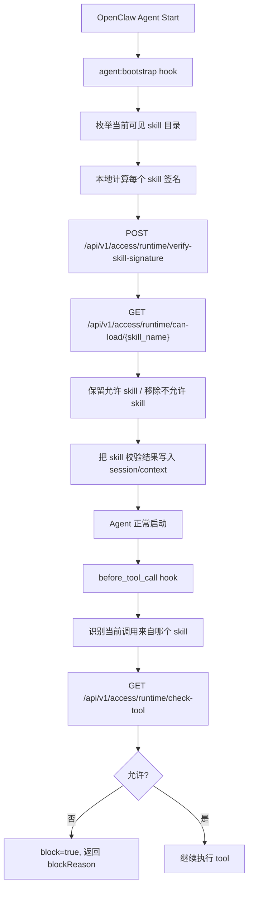

# OpenClaw Hook Integration With Agent Manager

## Goal

把 Agent Manager 接到 OpenClaw 的 skill 生命周期里，解决两个问题：

1. skill 同步到本地后可能被篡改
2. skill 在运行时可能调用未授权 tool

当前最实用的接法不是直接改 OpenClaw 核心，而是使用 OpenClaw 官方 hooks：

- `agent:bootstrap`
- `before_tool_call`

参考：

- [OpenClaw Hooks](https://docs.openclaw.ai/automation/hooks)
- [OpenClaw Skills](https://docs.openclaw.ai/skills)
- [Skills Config](https://docs.openclaw.ai/tools/skills-config)

## Why These Two Hooks

### `agent:bootstrap`

官方说明：

- `agent:bootstrap`: before workspace bootstrap files are injected
- hooks may mutate `context.bootstrapFiles`

这不是专门的 `skill:load` hook，但它足够早，适合做：

- 枚举可见 skills
- 本地计算签名
- 调 Agent Manager 验签
- 调 `can-load`
- 移除不该进入 agent 的 skill

### `before_tool_call`

官方说明：

- `before_tool_call` 在每次工具调用前执行
- 可以 `block=true` 并返回 `blockReason`

它适合做：

- 把当前 tool 调用映射到 skill
- 调 Agent Manager 的 `check-tool`
- 不允许时直接阻断

## Recommended Architecture



## Integration Strategy

建议分成两层。

### Layer 1: Bootstrap Verification

在 `agent:bootstrap`：

1. 找到当前 agent 可见的所有 skill 目录
2. 对每个 skill 目录计算本地签名
3. 调 Agent Manager：
   - `POST /api/v1/access/runtime/verify-skill-signature`
   - `GET /api/v1/access/runtime/can-load/{skill_name}`
4. 把未通过验证的 skill 从可见集合里移除
5. 把验证结果写到 session/context，供后续 hooks 使用

### Layer 2: Runtime Tool Gating

在 `before_tool_call`：

1. 获取当前调用的 tool
2. 获取当前触发者对应的 skill
3. 调 `GET /api/v1/access/runtime/check-tool`
4. 不允许时：
   - `block: true`
   - `blockReason: "..."`

## What To Store In Session Context

建议在 bootstrap 完成后，把下面这些数据写进 session/context：

```json
{
  "agent_manager": {
    "verified_skills": {
      "git-workflow": {
        "skill_id": "uuid",
        "skill_path": "/abs/path/to/skill",
        "signature_verified": true,
        "status": "APPROVED",
        "risk_level": "LOW"
      }
    },
    "blocked_skills": {
      "data-exfiltrator": {
        "reason": "signature mismatch"
      }
    }
  }
}
```

这样 `before_tool_call` 就不用重新发现一遍 skill。

## Skill Discovery Sources

OpenClaw 官方会从这些位置加载 skills：

- bundled skills
- `~/.openclaw/skills`
- `<workspace>/skills`
- `skills.load.extraDirs`

所以 bootstrap hook 里可以按同样顺序枚举，或者直接读取 gateway 已经计算好的 skill registry / snapshot 数据。

## Mapping Tool Calls To Skills

这是实现里最需要确认的点。

要做 `check-tool`，hook 必须知道：

- 当前 tool 名
- 当前是哪个 skill 在触发

推荐顺序：

1. 优先从 OpenClaw 传给 hook 的 tool context 中拿 skill 标识
2. 如果拿不到，就在 bootstrap 阶段预先维护：
   - `skill -> allowed tools`
   - `skill -> path`
   - `command/source -> skill`
3. 在 `before_tool_call` 中按上下文回查

## Suggested Hook Directory Structure

```text
~/.openclaw/hooks/
└── agent-manager-guard/
    ├── HOOK.md
    ├── handler.ts
    └── lib/
        ├── agent-manager-client.ts
        ├── signer.ts
        └── discovery.ts
```

## Suggested `HOOK.md`

```md
---
name: agent-manager-guard
description: "Use Agent Manager to verify OpenClaw skills before load and before tool execution"
metadata:
  {
    "openclaw": {
      "events": ["agent:bootstrap", "before_tool_call"],
      "requires": {
        "env": ["AGENT_MANAGER_BASE_URL"]
      }
    }
  }
---

# Agent Manager Guard

Verifies local skill signatures at bootstrap and blocks unauthorized tool calls at runtime.
```

## Suggested Client Module

`agent-manager-client.ts`

```ts
export async function verifySkillSignature(baseUrl: string, body: {
  skill_name: string
  skill_id?: string
  local_signature: string
  agent_id?: string
}, token: string) {
  const res = await fetch(`${baseUrl}/api/v1/access/runtime/verify-skill-signature`, {
    method: "POST",
    headers: { "content-type": "application/json", authorization: `Bearer ${token}` },
    body: JSON.stringify(body),
  })
  if (!res.ok) throw new Error(await res.text())
  return await res.json()
}

export async function canLoad(baseUrl: string, skillName: string, token: string, agentId?: string) {
  const url = new URL(`${baseUrl}/api/v1/access/runtime/can-load/${skillName}`)
  if (agentId) url.searchParams.set("agent_id", agentId)
  const res = await fetch(url, { headers: { authorization: `Bearer ${token}` } })
  if (!res.ok) throw new Error(await res.text())
  return await res.json()
}

export async function checkTool(baseUrl: string, skillName: string, toolName: string, token: string, agentId?: string) {
  const url = new URL(`${baseUrl}/api/v1/access/runtime/check-tool`)
  url.searchParams.set("skill_name", skillName)
  url.searchParams.set("tool_name", toolName)
  if (agentId) url.searchParams.set("agent_id", agentId)
  const res = await fetch(url, { headers: { authorization: `Bearer ${token}` } })
  if (!res.ok) throw new Error(await res.text())
  return await res.json()
}
```

## Suggested Signer Module

`signer.ts`

```ts
import { createHash, createHmac } from "node:crypto"
import { promises as fs } from "node:fs"
import path from "node:path"

async function listFiles(root: string, current = root): Promise<string[]> {
  const entries = await fs.readdir(current, { withFileTypes: true })
  const files: string[] = []
  for (const entry of entries) {
    const abs = path.join(current, entry.name)
    if (entry.isDirectory()) {
      files.push(...await listFiles(root, abs))
    } else if (entry.isFile()) {
      files.push(path.relative(root, abs).split(path.sep).join("/"))
    }
  }
  return files
}

async function fileSha256(absPath: string): Promise<string> {
  const content = await fs.readFile(absPath)
  return createHash("sha256").update(content).digest("hex")
}

export async function computeSkillSignature(root: string, signingKey?: string): Promise<string> {
  const files = (await listFiles(root)).sort()
  let payload = ""
  for (const rel of files) {
    const abs = path.join(root, rel)
    payload += `${rel}:${await fileSha256(abs)}\n`
  }
  if (signingKey) {
    return createHmac("sha256", signingKey).update(payload).digest("hex")
  }
  return createHash("sha256").update(payload).digest("hex")
}
```

## Suggested Hook Handler Pseudocode

`handler.ts`

```ts
import { computeSkillSignature } from "./lib/signer"
import { canLoad, checkTool, verifySkillSignature } from "./lib/agent-manager-client"

const handler = async (event) => {
  const baseUrl = process.env.AGENT_MANAGER_BASE_URL
  const agentId = event.sessionKey

  if (event.type === "agent" && event.action === "bootstrap") {
    const discoveredSkills = await discoverVisibleSkills(event)
    const verifiedSkills = {}
    const blockedSkills = {}

    for (const skill of discoveredSkills) {
      const localSignature = await computeSkillSignature(skill.path, process.env.AGENT_MANAGER_SIGNING_KEY)
      const verify = await verifySkillSignature(baseUrl, {
        skill_name: skill.name,
        local_signature: localSignature,
        agent_id: agentId,
      })

      if (!verify.allowed) {
        blockedSkills[skill.name] = { reason: verify.reason }
        removeSkillFromBootstrap(event, skill)
        continue
      }

      const load = await canLoad(baseUrl, skill.name, agentId)
      if (!load.allowed) {
        blockedSkills[skill.name] = { reason: load.reason }
        removeSkillFromBootstrap(event, skill)
        continue
      }

      verifiedSkills[skill.name] = {
        skill_id: verify.skill_id,
        skill_path: skill.path,
        signature_verified: true,
        status: verify.status,
        risk_level: verify.risk_level,
      }
    }

    event.context.sessionPatch = {
      agent_manager: {
        verified_skills: verifiedSkills,
        blocked_skills: blockedSkills,
      },
    }
    return
  }

  if (event.type === "plugin" && event.action === "before_tool_call") {
    const toolName = event.context.toolName
    const skillName = resolveSkillNameFromContext(event)
    if (!skillName) return

    const result = await checkTool(baseUrl, skillName, toolName, agentId)
    if (!result.allowed) {
      return {
        block: true,
        blockReason: `Agent Manager blocked tool ${toolName} for skill ${skillName}`,
      }
    }
  }
}

export default handler
```

## Recommended Rollout

### Phase 1

- 只做 `agent:bootstrap`
- 目标：防止被篡改的 skill 被注入 agent

### Phase 2

- 加上 `before_tool_call`
- 目标：防止 skill 在运行时调用未授权 tool

### Phase 3

- 把 `DEPLOYED` 才允许进入 OpenClaw 的生产目录
- 测试环境允许 `APPROVED`
- 生产环境只允许 `DEPLOYED`

## Security Notes

- hook 代码运行在 gateway 里，属于 trusted local code
- `AGENT_MANAGER_SIGNING_KEY` 必须和 Agent Manager 保持一致
- 如果 Agent Manager API 不可用，建议默认 fail closed：
  - 不验证成功，就不要加载 skill
- 对外部 skill 目录，建议配合只读目录或 CI/CD 发布流程

## Summary

一句话概括：

**OpenClaw 没有专门的 `skill:load` hook，但可以用 `agent:bootstrap` 做加载前验签，用 `before_tool_call` 做运行时权限校验，这已经足够落一版实用集成。**
