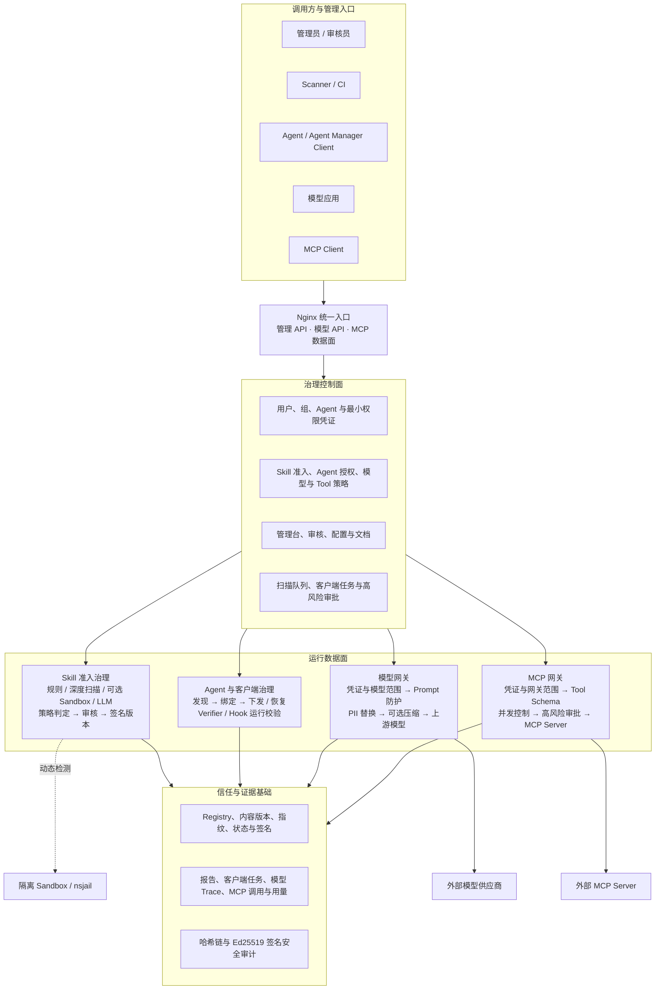
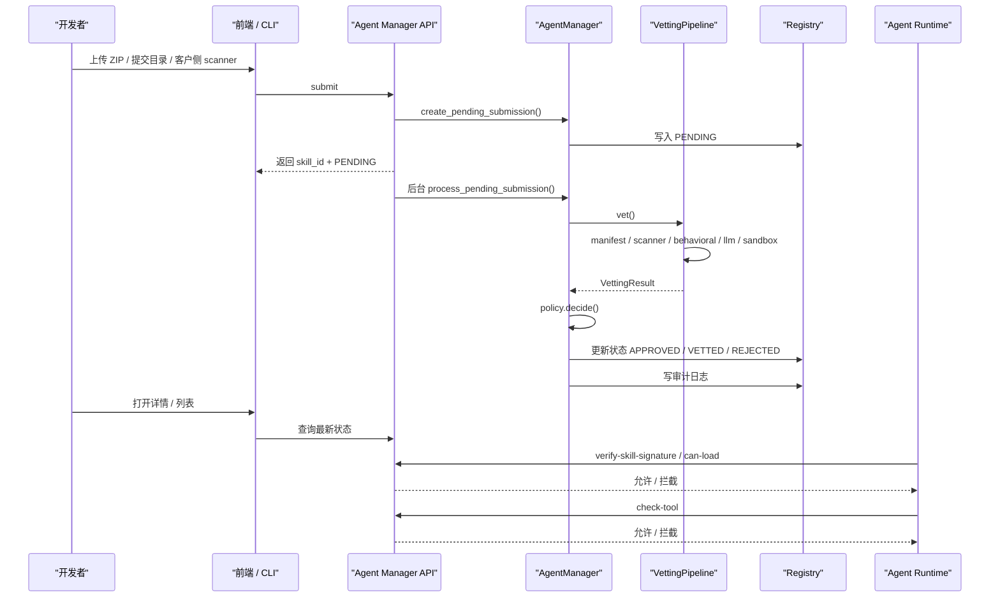
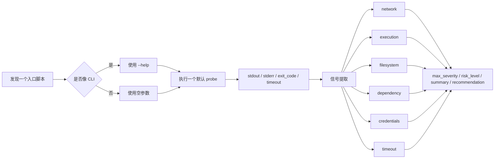
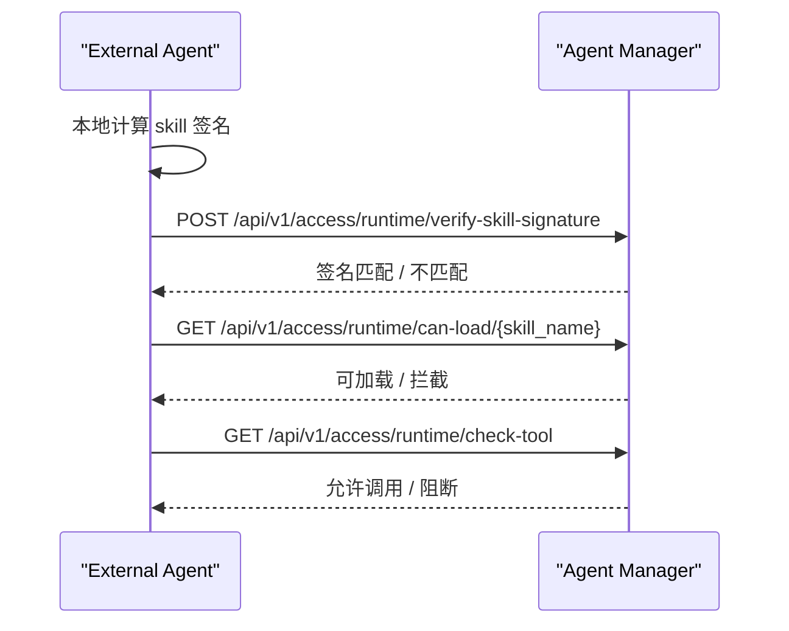

# Agent Manager Project Guide

这份文档是这个项目的主说明文档，目标是把下面几件事讲清楚：

- 这个项目解决什么问题
- 它的核心原理是什么
- 后端、前端、sandbox 分别做什么
- 一条 skill 从提交到运行时治理是怎么走的
- 模型网关如何代理 LLM 请求并保护隐私数据
- 本地怎么启动、怎么使用、怎么看效果
- 外部 Agent 怎么接入

如果你第一次接触这个项目，先看这份文档，再按需要跳转到更细的专题文档。

---

## 1. 项目定位

Agent Manager 不是一个“帮你写 skill 的平台”，而是一个：

- `skill 准入中心`
- `skill 风险治理中心`
- `skill 运行时验票中心`

它服务的对象不是普通软件包，而是 AI Agent 的技能包，也就是一组本地文件：

- `SKILL.md`
- `scripts/`
- `references/`
- 其他资源文件

项目的核心目标是：

1. skill 先审查再使用
2. skill 内容批准后不能被偷偷改
3. skill 在运行时只能调用被允许的 tool
4. 风险和审计过程可追踪、可撤销

---

## 2. 解决什么问题

如果没有这层系统，一个 agent 只要能加载本地 skill，就可能：

- 读取敏感文件
- 访问环境变量里的密钥
- 调用危险工具
- 从外部下载并执行代码
- 把数据发到外部服务器
- 在事后无法快速停用

Agent Manager 用一套“提交、扫描、审批、签名、运行时校验、审计”的链路，把这些风险纳入治理。

对于 LLM 调用，Agent Manager 还内置了一个模型网关：

- 外部应用可以用 OpenAI-compatible `POST /v1/chat/completions` 访问模型。
- 网关会先校验模型调用凭证、模型范围、请求大小和并发限制。
- 请求进入上游模型前会做 PII 检测和伪匿名 token 替换。
- 模型响应会按会话映射还原后再返回给调用方。
- 管理台可以通过“隐私链路追踪”查看 Prompt 防护、脱敏、压缩、模型响应和最终还原结果。
- Prompt 不再作为独立上传资产进入主流程；提示词注入、系统提示词泄露、凭据外传等风险在模型网关运行时检测。

---

## 3. 核心原则

### 3.1 Agent 最终加载的 Skill 永远是本地文件

Agent Manager 管理 Skill 的准入状态、签名和授权，也可以通过 Agent Manager Client 把批准版本安全安装到客户侧客户端。无论通过哪种方式接入，Agent 最终加载的仍是本地目录，不会直接执行平台数据库中的内容。

平台管理的是：

- skill 元数据
- 风险结果
- 状态
- 签名
- 审计

真正被 agent 加载的 skill，仍然是本地目录。

### 3.2 审批时签名，运行时验签

skill 通过后会对完整目录生成签名。  
后续 agent 加载 skill 时，可以用：

- `skill_name + skill_path`
- 或 `skill_name + local_signature`

来验证本地内容是否还是批准时的那份。

### 3.3 风险来自多分析器，不看单点结果

scanner、behavioral、sandbox 分析完成后的分析结果和完整的skill内容一起输入 LLM 做最后的风险判断：

- scanner
- behavioral
- sandbox
- LLM


LLM 分析生成详细的安全报告，如果是恶意skill，还会生成攻击链，并映射到 MITRE ATT&CK（传统网络安全）和 MITRE ATLAS（AI 安全）框架，帮助用户更好地理解和缓解风险。

### 3.4 扫描缓存与强制重扫

为了提升效率，Skill 按“名称族 + 内容版本”管理：

- 同名且内容指纹相同的提交复用已有版本，不重复创建记录。
- 检测配置也一致且全局启用了“复用检测结果”时，不再重复执行扫描。
- 同名但内容不同会创建递增版本，历史版本内容使用服务端快照保存。
- 是否复用只在“策略配置”全局控制，提交页和客户端不再提供单次“禁用缓存”。
- 如需重新检测，在 Skill 详情的版本列表中点击“重新检测”。重扫会新增 Scan Run，不会创建内容版本；重扫完成前或重扫失败时，上一份可信结果继续有效。
- 升级旧数据库时，Registry 会在首次启动时把旧 Skill 按名称归入版本族；同名同内容只保留提交时间最新的一条，同名不同内容按提交时间生成版本号。迁移记录写入 `registry_migrations`，后续启动不会重复迁移，也不会重新扫描。

### 3.5 Sandbox 是补充验证，不是唯一裁判

sandbox 的作用是看：

- “这段脚本在受限环境里跑起来会发生什么”

但它不一定能触发所有恶意分支，所以：

- `sandbox benign`

不等于：

- `skill 安全`

### 3.6 模型网关保护 LLM 数据面

LLM 模型网关负责保护发送给外部模型供应商的数据：

- 模型调用凭证明文只展示一次，服务端只保存 hash。
- 模型供应商 API Key 加密落库，接口只返回掩码。
- 用户组可绑定隐私策略，控制实体类型、是否扫描 system 消息、是否允许 bypass、映射 TTL 和差分隐私统计参数。
- `stream=true` 支持 OpenAI-compatible SSE；网关会对流式 `delta.content` 做增量反替换，并在流结束后写入 audit、usage metric 和隐私链路追踪。
- 未知 OpenAI 参数默认拒绝，避免无审计透传造成资源滥用。

详细说明见：

- [model-gateway.md](../docs/model-gateway.md)

### 3.7 MCP 能力总线

MCP 能力总线集中配置远程 Streamable HTTP MCP Server，并通过虚拟网关发布选定 Tool：

- 管理台在 `能力治理 / MCP 服务` 中登记 Endpoint，连接后保存 `tools/list` Schema 快照。
- `能力治理 / MCP 网关` 把多个 Server 的部分 Tool 组合为 `/mcp/{gateway_slug}`。
- `能力治理 / MCP 调用审批` 接收真实高风险调用产生的待办；管理员查看脱敏参数后批准或拒绝该 Token 对指定网关、Tool 和 Schema 的限时调用权限，查看原始参数会写入安全审计。
- `能力治理 / MCP 调试` 可以在保存前使用临时 Endpoint 直连服务，也可以使用真实网关凭证执行 Tool 发现和调用，并展示原始 JSON 请求历史。
- 调用方使用 `MCP 网关凭证`，凭证限制可访问网关、IP、请求大小和并发数，不要求绑定 `ManagedAgent`。
- 上游连接默认强制 HTTPS，并在每次调用前校验 DNS 解析结果和出站白名单；Tool 还可以配置速率、并发、响应大小和限时审批。
- 高风险调用首次被网关阻断时会返回 `approval_request_id`；批准后，网关自动按 MCP 凭证、Gateway、Tool 和 Schema 匹配有效授权，不要求调用方回传申请 ID。有效期内允许使用不同参数重复调用，参数仅保留为审批和审计上下文。
- Tool 对外名称为 `{server_slug}__{tool_name}`；Schema 变化后暂停暴露，重新保存网关配置才会批准新 Hash。
- 当前数据面实现 `initialize`、`ping`、`tools/list` 和 `tools/call`，不托管 stdio MCP。

### 3.8 可验证安全审计

管理面的 Token、Agent、MCP、模型和策略写操作会进入统一安全审计链。每条事件包含前一条事件哈希，并使用独立 Ed25519 审计密钥签名。管理员可调用 `GET /api/v1/security-audit/verify`，或在 Backend 环境执行 `python -m backend.security_audit verify` 检查完整性。配置 `SECURITY_AUDIT_EXPORT_PATH` 后，同一事件还会追加写入 JSONL，供外部日志平台采集。

---

## 4. 总体架构



帮助中心首页使用同一架构边界绘制可响应的中英文架构图。图中的控制面负责准入、授权、
路由与证据记录；Agent 仍从本地目录加载 Skill，Sandbox、外部模型供应商和 MCP Server
分别保持隔离或外部执行边界。

---

## 5. 代码结构

### 5.1 核心治理后端

- [agent_manager/core/manager.py](../agent_manager/core/manager.py)
  生命周期总控
- [agent_manager/core/vetting.py](../agent_manager/core/vetting.py)
  扫描与风险判定
- [agent_manager/core/policy.py](../agent_manager/core/policy.py)
  策略配置
- [agent_manager/core/registry.py](../agent_manager/core/registry.py)
  SQLite 持久化，启动时可从旧 `registry.json`、`review.json`、`audit.jsonl` 自动迁移，并一次性把旧 Skill 记录迁移到名称族和内容版本模型
- [agent_manager/core/runtime.py](../agent_manager/core/runtime.py)
  运行时治理
- [agent_manager/core/prompt_manager.py](../agent_manager/core/prompt_manager.py)
  历史 Prompt Registry 兼容能力；新主流程使用模型网关运行时 Prompt 防护
- [agent_manager/core/prompt_registry.py](../agent_manager/core/prompt_registry.py)
  历史 Prompt Registry 持久化存储
- [agent_manager/core/signer.py](../agent_manager/core/signer.py)
  目录签名
- [agent_manager/core/llm.py](../agent_manager/core/llm.py)
  OpenAI-compatible LLM 分析；可直连模型供应商，也可通过内置模型网关隐私路由
- [agent_manager/core/sandbox.py](../agent_manager/core/sandbox.py)
  Docker / remote sandbox

### 5.2 API 层

- [agent_manager/api/router.py](../agent_manager/api/router.py)
  Agent Manager API
- [backend/main.py](../backend/main.py)
  管理后台 + Agent Manager API 集成入口
- [backend/routers/llm_gateway.py](../backend/routers/llm_gateway.py)
  内置模型网关、OpenAI-compatible 代理、PII 伪匿名、Trace 与管理 API
- [backend/routers/mcp_gateway.py](../backend/routers/mcp_gateway.py)
  MCP Server 发现、虚拟网关、Tool 路由、凭证校验与调用审计

### 5.3 管理台前端

- [web/src/views/Skills.vue](../web/src/views/Skills.vue)
- [web/src/views/SkillDetail.vue](../web/src/views/SkillDetail.vue)
- [web/src/views/SubmitSkill.vue](../web/src/views/SubmitSkill.vue)
- [web/src/views/ReviewQueue.vue](../web/src/views/ReviewQueue.vue)
- [web/src/views/SystemSettings.vue](../web/src/views/SystemSettings.vue)
- [web/src/views/ScannerAccess.vue](../web/src/views/ScannerAccess.vue)
  客户侧扫描器接入、Token、CLI/GUI 下载
- [web/src/views/ModelGateway.vue](../web/src/views/ModelGateway.vue)
  模型供应商、模型端点、旧模型凭证查询与吊销、用户组和隐私策略管理
- [web/src/views/PipelineTrace.vue](../web/src/views/PipelineTrace.vue)
  查看隐私路由四阶段报文
- [web/src/views/McpGateway.vue](../web/src/views/McpGateway.vue)
  MCP Server、虚拟网关和调用审计管理

### 5.4 独立执行服务

- [services/isolated-sandbox-service/app.py](../services/isolated-sandbox-service/app.py)
  生产版远程 sandbox 服务基线

### 5.5 客户侧扫描器

- [scanner/cmd/skill-scanner/main.go](../scanner/cmd/skill-scanner/main.go)
  Go CLI 扫描器入口
- [scanner/cmd/skill-scanner-gui/main.go](../scanner/cmd/skill-scanner-gui/main.go)
  原生桌面 GUI 扫描器入口
- [agent_manager/api/scanner_router.py](../agent_manager/api/scanner_router.py)
  Scanner 专用 API 与下载接口
- [agent_manager/core/scanner_tokens.py](../agent_manager/core/scanner_tokens.py)
  旧 Scanner Token 的兼容校验和吊销
- [agent_manager/core/scan_cache.py](../agent_manager/core/scan_cache.py)
  重复扫描复用缓存

---

## 6. 一条 Skill 的生命周期



# 6.1 提交

当前主要提交入口：

- 管理台上传 ZIP
- 客户侧 Go Scanner CLI

上传后不会再阻塞前端等待全部分析跑完，而是：

1. 先写一条 `PENDING`
2. 后台继续分析
3. 列表和详情页看到状态变化

客户侧扫描器使用统一凭证中心签发的 Scanner 接入凭证，不使用管理员登录态。
详细说明见：

- [skill-scanner.md](../docs/skill-scanner.md)

### 6.2 Vetting

`vet()` 会按以下阶段执行：

1. `SKILL.md` frontmatter 解析
2. 并行启动已勾选且相互独立的分析器：`cisco-ai-skill-scanner`、behavioral 本地规则、静态深度扫描，以及用户明确勾选的 Sandbox
3. 汇总静态、行为和 Sandbox 证据；如果策略根据中间风险强制 Sandbox，则在这一阶段补跑 Sandbox
4. 勾选 LLM 时，等待前面所有分析完成后只调用一次 OpenAI-compatible LLM 做最终语义判定和报告汇总；未勾选时直接使用确定性策略汇总

基础 Scanner 在 Backend 启动时预热，并在后续任务中复用已初始化实例。并行度可通过以下环境变量调整：

- `AGENT_MANAGER_SCAN_WORKERS`：同时处理的后台提交数，默认 `2`
- `AGENT_MANAGER_ANALYZER_WORKERS`：单次/多次提交共享的分析器线程数，默认 `8`

### 6.3 Policy Gate

policy 决定 skill 最终落到：

- `APPROVED`
- `VETTED`
- `REJECTED`

高风险 skill 还可以被策略强制：

- 必须 sandbox
- 必须人工审核

### 6.4 审批 / 部署

- `VETTED` 进入审核队列
- `APPROVED` 可以部署
- `REJECTED` 不进入审核队列

### 6.5 导出 PDF 扫描报告

检测完成后，可以在 Skill 详情页右上角点击“导出 PDF 报告”。系统按当前界面语言生成中文或英文 `.pdf`，报告包含：

- 瑞数品牌 Logo、报告编号、Skill 版本和密级标识
- 管理摘要、风险等级、准入状态、发现项和阻断项统计
- Skill 来源、内容指纹、扫描范围、分析器状态和耗时
- 确定性风险、LLM 研判和最终风险的综合判定链路
- 规则、深度扫描、Sandbox、LLM 的证据与建议；风险发现项按卡片展示等级、来源、位置、说明、证据和修复建议
- 准入策略、审批结果、签名状态、扫描历史和审计事件
- 扫描覆盖范围、Sandbox 和 LLM 的评估局限

报告只对应指定 Version ID、内容指纹和扫描上下文。导出时会遮盖常见 Token、Bearer、API Key、密码和敏感 URL 参数，并限制日志与证据长度；完整原始结果仍应在受控管理台查看。安全风险和准入状态是两类结论：低风险 Skill 仍可能因公司策略不允许的权限而被拒绝。

接口为：

```http
GET /api/v1/skills/{version_id}/scan-report.pdf?language=zh-CN
```

仅支持 `zh-CN` 和 `en-US`。扫描尚未形成结果时返回 `409`，避免导出一份看似完整但没有有效结论的报告。

### 6.6 运行时治理

agent 接入时一般用：

- `verify-skill-signature`
- `can-load`
- `check-tool`

---

## 7. 风险分析原理

### 7.1 Scanner

Cisco skill-scanner 负责做更系统的静态规则扫描。  
它不是只看 `SKILL.md`，而是扫整个 skill 目录。

### 7.2 Behavioral

behavioral 分析主要扫文本代码文件，优先：

- `scripts/`
- `references/`
- `prompts/`

典型规则包括：

- `eval` / `exec`
- `os.system`
- `subprocess(..., shell=True)`
- 下载后执行
- 敏感文件访问

### 7.3 LLM

LLM 现在做这些事：

1. scanner、behavioral、深度扫描、sandbox 分析完成后的结果和完整 skill 内容一起输入 LLM，做最后的 benign/suspicious/malicious 风险判断
2. 生成一篇专业的安全分析报告
3. **生成详细的攻击链分析**，如果是恶意skill, 会生成攻击链并映射到 MITRE ATT&CK（传统网络安全）和 MITRE ATLAS（AI 安全）框架

深度扫描和 Sandbox 不再各自发起前置 LLM 请求。Sandbox 使用确定性的 probe 计划执行；LLM 只在所有已选分析器结束后调用一次。

所以 LLM 结果里你会看到：

- `risk_level`
- `report`
- `attack_chain`

如果配置了模型网关环境变量，LLM vetting 会优先走隐私路由：

```bash
export AGENT_MANAGER_LLM_GATEWAY_URL="http://127.0.0.1/v1/chat/completions"
export AGENT_MANAGER_LLM_GATEWAY_API_KEY="amat_xxx"
```

可选 metadata：

```bash
export AGENT_MANAGER_LLM_GATEWAY_TENANT_ID="agent-manager-internal"
export AGENT_MANAGER_LLM_GATEWAY_USER_ID="agent-manager-vetting"
export AGENT_MANAGER_LLM_GATEWAY_CONVERSATION_ID="vetting-session"
```

未配置时保持原来的系统设置 / YAML 直连方式。

### 7.4 Sandbox

Sandbox 负责“受限环境试跑”。  
当前执行顺序是：

1. 从 `scripts/` 和 Skill 根目录中发现一个真实存在的 `.py`、`.sh` 或 `.js` 入口
2. 生成一个默认 probe；如果脚本像 CLI，会使用 `--help`，否则使用空参数
3. 在本地 Docker runtime 或远程隔离服务中执行
4. 汇总输出、退出码、超时、网络尝试和风险信号

当前 Vetting 流程不会执行 `SKILL.md` 中的命令块，也不会让 LLM 生成额外 probe。LLM 分析是所有已选确定性分析器结束后的单次最终研判，与 Sandbox probe 生成分开。

它现在会给出两层结果：

1. 执行层
   - 是否执行
   - 后端
   - 镜像 / 远程服务
   - 入口脚本
   - probe 参数
   - stdout / stderr / exit code

2. 风险层
   - `risk_level`
   - `max_severity`
   - `summary`
   - `recommendation`
   - `signals`



---

## 8. 为什么不同分析器的风险可能不一致

这在项目里是正常现象。

例如：

- `LLM = malicious`
- `sandbox = LOW`

常见原因是：

1. 代码里静态上已经明显恶意
2. 但 sandbox 这次 probe 没有触发到真正的恶意分支
3. 或 sandbox 禁网 / 参数仍然不够覆盖真实输入条件
4. 当前只执行一个默认 probe，不能保证覆盖所有恶意分支

所以最终风险看的是“合并后的最高风险”，不是只信某一个分析器。

如果要验证 sandbox 展示链路，可以上传这个测试样本：

- [tests/skills/sandbox-runtime-signal.zip](../tests/skills/sandbox-runtime-signal.zip)

它会在默认 probe 中主动暴露网络、文件系统、动态执行、凭证关键词和非零退出码等信号。

---

## 9. 验签原理

这个项目的验签不是签 `SKILL.md` 单文件，而是签整个目录树。

算法大意：

1. 遍历所有文件
2. 按相对路径排序
3. 每个文件算 `SHA256`
4. 汇总成一个稳定文本
5. 最终做：
   - 服务端 `Ed25519` 签名信封
   - 或 `SHA256`（开发模式）

用途是：

- 审批后固定内容
- 运行时检测本地 skill 是否被篡改

更详细的 agent 侧签名对接，见：
- [agent-signature-verification.md](../docs/agent-signature-verification.md)

---

## 10. Sandbox 架构

当前支持两个后端：

- `docker`
- `remote`


### 10.1 Docker backend

适合：

- 本地开发
- 单机演示

现在默认镜像是：

- `agent-manager-sandbox-runtime:latest`

它内置常见 Python 依赖，避免很多 skill 因为 `requests` 之类库缺失直接失败。

### 10.2 Remote backend

适合：

- 独立执行服务
- 生产环境隔离执行

当前服务基线在：

- [services/isolated-sandbox-service/README.md](../services/isolated-sandbox-service/README.md)

更详细架构说明：

- [sandbox-service-architecture.md](../docs/sandbox-service-architecture.md)

---

## 11. 前后端怎么启动

### 11.1 本地开发

后端：

```bash
cd /path/to/agent-manager
uv sync --project backend
uv run --project backend python -m backend.dev_server --host 0.0.0.0 --port 8000
```

前端：

```bash
cd /path/to/agent-manager/web
npm install
npm run dev
```

默认登录：

- 用户名：默认 `admin`，可通过 `INITIAL_ADMIN_USERNAME` 修改
- 密码：首次部署必须通过 `INITIAL_ADMIN_PASSWORD` 设置；系统不提供固定默认密码

### 11.2 本地使用 docker sandbox

如果系统设置里选的是 `docker`，先构建项目自带镜像：

```bash
cd /path/to/agent-manager
make sandbox-runtime-build
```

### 11.3 Docker Compose

完整容器化启动见：

- [docker-deployment.md](../docs/docker-deployment.md)
- [performance-benchmark.md](../docs/performance-benchmark.md)：单节点并发、Skill 数量和客户端 Inventory 实测

配置允许的最大并发不等于稳定处理能力。容量评估应同时检查 P95、错误率、SQLite 写等待、上游延迟和审计增长。

---

## 12. 管理台怎么使用

### 12.1 总览

看：

- 状态分布
- 风险分布
- 最近阻断事件
- 待处理 skill

### 12.2 Skill 列表

看：

- 每个同名 Skill 只显示一条，状态取最新内容版本
- 最新版本号与最新可信版本号
- 风险等级
- Sandbox 是否触发
- 是否策略强制

### 12.3 技能详情

能看到：

- 基础信息
- 专业的安全分析报告
- **攻击链可视化**（展示 LLM 分析出的完整攻击路径）
- **MITRE ATT&CK / ATLAS 框架映射**（帮助理解风险对应的安全框架分类）
- LLM 对技能主要功能的概括
- behavioral 结果
- sandbox 风险摘要
- 原始报告 JSON
- 文件列表与文件内容
- 同名 Skill 的完整版本历史、来源版本和可信状态
- 任意两个版本之间的文件级 Diff
- 指定内容版本的检测执行记录（Scan Run）

### 12.4 提交技能

上传 ZIP 后：

1. 先返回 `PENDING`
2. 后端后台分析
3. 列表 / 详情自动显示最终状态

### 12.5 审核队列

处理：

- `VETTED`
- 批准
- 拒绝

### 12.6 策略配置

管理台按实际检测顺序集中配置四类内容：

- 风险判定：扫描结果复用、严格 / 平衡 / 宽松模式、人工审核风险、自动拒绝风险、强制 Sandbox 风险和发现项归类。
- 准入约束：Skill 声明工具数量、工具允许列表、禁止权限、许可证要求和接受列表。
- LLM：是否允许 Skill LLM 分析、模型网关模型、超时和内容快照上限。
- Sandbox：远程服务或本地 Docker runtime、镜像、超时、网络、内存、CPU、进程和只读根文件系统。

发现项先按策略归入三类，再形成最终风险：

- `blocking`：阻断项。默认包含数据外传和供应链风险；任意阻断项都会形成 `malicious` 确定性风险，LLM 不能降级。
- `risk`：可疑项。默认包含提示词注入、工具滥用、网络、凭据访问、动态执行和过度权限；结合严重度和判定模式形成风险。
- `noise`：噪声。默认包含文档中的外部 API 示例、依赖和运行环境问题；证据仍保留在报告中，但不直接提高确定性风险。

最终准入顺序为：阻断型声明违规直接拒绝；命中自动拒绝风险进入 `REJECTED`；命中人工审核风险进入 `VETTED`；安全兜底仍保证 `malicious` 拒绝、`suspicious` 审核、`benign` 批准。自动拒绝与人工审核冲突时，自动拒绝优先。

当前实现边界：`auto_approve_max_risk` 只参与 Prompt 自动批准，不参与 Skill 状态判定；`trusted_authors` 会保存但尚未用于 Skill 免检或自动放行。许可证缺失或不被接受、工具数量超限、工具不在允许列表目前为非阻断告警，只有命中明确禁止权限会生成阻断型违规。

### 12.7 扫描器接入

用于客户侧批量扫描本地 skills：

- 在统一凭证中心创建和吊销 Scanner 接入凭证
- 从“能力治理 -> Skill 治理 -> 提交 Skill”的 Scanner 接入区域下载 CLI 扫描器
- 下载 Agent Skill Verifier
- 查看安装命令和参数说明
- 获取配置模板
- 跳转查看服务端扫描结果

CLI 适合服务器和 CI。Agent Skill Verifier 适合安装到 Codex、Claude Code 等通用 Agent 的 skills 目录，用来指导 Agent 在使用第三方 skill 前先提交扫描，并检查内容完整性、审批状态和 Agent 授权范围。

Skill Verifier 下载位置：

- `智能体管理`
- `接入与运行`
- `下载 Skill Verifier`

提交和查询扫描结果时使用 Scanner 接入凭证；加载前验签时使用绑定当前 Agent 的运行凭证。两类权限不能合并到同一凭证。脚本分别读取 `AGENT_MANAGER_SCANNER_TOKEN` 和 `AGENT_MANAGER_AGENT_RUNTIME_TOKEN`，也可在对应子命令上传入 `--token`。

详细说明见：

- [skill-scanner.md](../docs/skill-scanner.md)

### 12.8 模型网关

用于统一管理 LLM 供应商和隐私路由：

- 模型供应商：OpenAI-compatible `base_url`、供应商 API Key、超时、启用状态
- 模型端点：模型名、默认模型、上下文窗口、最大输出 token
- 模型调用凭证：在统一凭证中心配置允许模型、请求体大小、并发、Prompt 防护和可选 Token 压缩
- 用户与用户组：用于分配模型访问权限和隐私策略
- 隐私策略：按用户组绑定，配置实体类型、每类实体正则规则、system 消息检测、bypass 权限、映射 TTL、差分隐私统计参数
- 隐私审计：DP 统计、PII 命中、token 创建/复用、会话映射查询和删除

管理台菜单已拆成 `模型网关` 子菜单：供应商管理、模型管理、组策略绑定、隐私策略、Prompt 防护测试、Skill 告警、隐私审计、Token 压缩统计、用户 Token 分析和隐私链路追踪。模型调用凭证统一在“智能体管理 -> 统一凭证中心”创建。

运行时接口：

- `POST /v1/chat/completions`：OpenAI SDK 兼容路径
- `POST /chat/completions`：兼容 base URL 不带 `/v1` 的客户端
- `GET /v1/models` / `GET /models`：OpenAI-compatible 模型列表
- `POST /api/v1/llm/chat/completions`：Agent Manager 命名空间路径

Docker Compose 的根路径 `/` 由管理台前端使用；外部模型客户端应使用 `/v1`，或使用会自动拼接 `/chat/completions` 的根地址配置，不要直接 POST `/`。

详细说明见：

- [model-gateway.md](../docs/model-gateway.md)

### 12.9 隐私链路追踪

用于查看一次 LLM 请求的隐私处理链路：

- `prompt_security`：Prompt 防护检测结果
- `original`：原始请求
- `masked`：发送给上游模型前的替换后请求
- `compressed`：智能上下文压缩后的请求
- `masked_response`：上游模型返回的 token 响应
- `final_response`：最终还原响应

Trace 保存原始 PII，默认只应开放给 `admin`、`super_admin`、`privacy_auditor`。

### 12.10 帮助文档与文档助手

帮助文档使用独立根路由 `/docs`，不是嵌入管理台内容区。文档配置使用独立的 `/docs-settings` 页面，入口位于“系统管理 -> 文档设置”，不与系统总览混排。管理员可以配置：

- 是否在帮助文档顶部显示“问问 AI”入口，默认关闭。
- 使用模型网关中哪个已启用模型回答。
- 每次最多提供给模型的文档小节数量，范围为 2 到 6。
- 中英文欢迎语和附加回答要求。
- 最多 8 个中英文常见问题。

文档设置页会跟踪尚未保存的修改；切换到其他页面时显示确认提示，刷新或关闭标签页时使用浏览器原生离开提示。保存成功后提示状态会清除。

文档助手的工作边界：

1. 浏览器在当前语言的内置帮助文档中检索相关小节，并把有限片段作为上下文提交。
2. 服务端要求模型只能依据这些片段回答；上下文不足时应明确说明，不能补写未确认能力。
3. 回答下方的相关文档链接由前端文档索引生成，不使用模型自行生成的 URL。
4. AI 回答使用 GitHub Flavored Markdown 渲染，支持标题、列表、引用、代码块、表格和安全链接；渲染前执行 HTML 标签与属性白名单清洗。
5. 普通已登录用户可以读取启用状态并问答；只有管理员能保存配置。
6. 问题和回答不会写入普通操作日志；配置变更会记录管理员操作。

这项功能用于缩短查找路径，不替代正式文档。涉及部署、权限、安全边界和当前启用状态时，以文档正文、系统设置和实际运行结果为准。

---

## 13. 客户端 Skill 怎么统一接管

当客户同时使用 Claude Code、Codex、Gemini CLI、OpenCode、OpenClaw、Hermes 或其他支持 Skill 目录的 Agent 时，推荐安装 Agent Manager Client：

1. 在“智能体管理 -> 统一凭证中心”选择“给客户端使用”创建客户端接入凭证；需要自动配置 Agent 模型时，显式开启“允许客户端为本机 Agent 自动创建运行凭证”。
2. 安装客户端并输入 Agent Manager 地址和凭证。
3. 默认使用“客户端安全治理”；需要限制每个 Agent 的 Skill 范围时，再切换到“Agent 强授权”并绑定平台智能体。
4. 客户端自动发现内置 Agent 和共用 Skills 目录；其他 Agent 可填写名称并选择或输入 Skill 根目录，随后同样可逐项选择接管。
5. 用户确认后，符合当前治理方式的已批准 Skill 进入安全仓库，其余内容备份后移入待处理目录。
6. 后台服务持续执行平台任务、完整性巡检和异常隔离；离线事件在恢复连接后补报。

平台入口为“智能体管理 -> 客户端管理”，可以查看 Agent 映射、已安装 Skill、任务和异常，也可以从 Skill 详情直接创建“安装到客户端”任务。

桌面客户端还提供“模型切换”页。它按本机 Claude Code、Codex、Hermes 展示从实际配置文件读取的当前模型，并只列出客户端凭证允许配置的启用网关模型。客户端不提供单独的网关地址输入框，而是复用接入时填写的 Agent Manager 地址：Claude Code 使用该根地址，Codex 和 Hermes 自动规范化为以 `/v1` 结尾的 Base URL。该地址指向 Agent Manager 网关，不是管理员在供应商页面配置的上游模型地址。首次切换且尚无运行身份时，平台自动创建归属当前客户端的托管 Agent 并完成绑定，不要求用户预先创建或选择同类型 Agent；该身份用于凭证绑定和审计，不限制可选模型类型。任务载荷只携带非敏感标识和模型名，sidecar 在进程内一次性领取绑定目标 Agent 的独立运行凭证并备份、合并本机配置，桌面渲染进程不会拿到凭证明文。Claude Code 走 `/v1/messages`，Codex 走 `/v1/responses`，Hermes 走 `/v1/chat/completions`。客户端凭证本身不能调用模型或 MCP。

安装或恢复同名 Skill 时，客户端默认选择最新可信版本，也可以在桌面端或平台任务中指定其他可信版本。受管目录按版本保存内容，兼容入口只指向当前选中的版本；完整性巡检修复时会固定恢复已安装的 `version_id`，不会静默升级到另一个版本。

如果完整性巡检发现本地 Skill 内容被修改，客户端会先把它移入隔离区。操作员可以在隔离区选择“提交当前版本检测”：客户端把隔离内容复制到待处理区，并按名称和内容指纹作为新版本提交；原隔离副本在检测和审核期间保持不变。该提交版本成为可信版本（`APPROVED`）后，客户端后台服务会按提交返回的 `version_id` 自动安装并解除对应隔离；自动安装失败时保留待处理记录并稍后重试，操作员也可以手动安装。不能仅凭扫描任务完成或进入待审核状态就自动恢复运行。

### 13.1 界面语言

管理平台和桌面客户端支持简体中文与英文：

- 中文系统名为“智能体生命周期管理系统”。
- 英文系统名为“Agent Manager”。
- 首次使用时跟随浏览器或操作系统语言，其他语言默认使用简体中文。
- 用户手动选择后会保存在当前浏览器或客户端本地，重新打开后继续使用。
- 切换语言只改变界面和日期的显示格式，审计时间仍按北京时间展示。
- 文件内容、用户输入、命令输出和第三方原始分析详情保持原文；平台生成的错误、状态、检测结论和处置建议按界面语言显示。
- 登录用户选择的语言会同步到账号；未设置账号偏好时继续使用浏览器语言。
- 新版 API 错误逐步采用 `error_code`、`error_params` 与本地化 `detail`，调用方应依赖稳定错误码而不是提示文案。
- Skill 扫描器和 Agent Skill Verifier 会通过 `Accept-Language` 请求对应语言的服务端错误；分别可用 `AGENT_MANAGER_SCANNER_LANG`、`AGENT_MANAGER_VERIFIER_LANG` 覆盖系统语言。
- 开发约定、错误协议和验证命令见 [国际化与语言支持](i18n.md)。

详细说明：

- [agent-manager-client.md](../docs/agent-manager-client.md)
- [agent-manager-client-implementation-plan.md](../docs/agent-manager-client-implementation-plan.md)

## 14. 外部 Agent 怎么接

推荐调用顺序：



更详细说明：

- [external-agent-integration.md](../docs/external-agent-integration.md)
- [agent-signature-verification.md](../docs/agent-signature-verification.md)

如果外部 Agent 支持本地 skill 指令，也可以直接使用示例 `Agent Skill Verifier`：

- [demo/agent-manager-skill-verifier/README.md](../demo/agent-manager-skill-verifier/README.md)
- [demo/agent-manager-skill-verifier/skills/agent-manager-skill-verifier/SKILL.md](../demo/agent-manager-skill-verifier/skills/agent-manager-skill-verifier/SKILL.md)

它不做平台级 hook，适合 Codex、Claude Code 等 Agent 的通用接入；如果需要强制拦截，再按具体平台补 hook 或 adapter。

---

## 15. Agent 运行侧接入

当前管理台启用的是 Skill 运行校验、复合 Agent 运行凭证和客户端治理。统一凭证中心按真实调用者提供 Agent、普通模型应用、MCP Client、Skill Scanner 和客户端五条创建路线；原始 scope、IP 和容量参数收在高级安全设置中：

- Skill Verifier 在 Agent 使用 Skill 前执行签名、加载许可和 Tool 权限检查，并写入运行审计。
- 一张绑定 Agent 的运行凭证可以组合 `runtime:*`、`model:chat` 和 `mcp:*`；模型与 MCP 网关允许列表分别校验，客户端接入凭证不能替代它。
- Agent Manager Client 发现本地 Agent 与 Skill 目录，可下发平台批准版本，并按策略审计、恢复或隔离异常内容。
- 客户端页面中的任务用于安装、恢复、移除 Skill、应用已支持的模型配置和同步策略；执行后应在客户端详情中核对目标、状态和事件。

## 16. 常见问题

### 16.1 为什么 sandbox 是 LOW，但 LLM 是 malicious？

因为 sandbox 只观察“这次 probe 实际跑出来的行为”，
而 LLM 会从整体语义上判断恶意意图，并生成详细的攻击链分析。
二者不一致是正常的，最终看合并风险。

### 16.2 为什么系统设置里改了 sandbox，提交结果还是旧镜像？

说明实际生效的配置还没更新。  
现在系统设置和详情页都能显示：

- sandbox 后端
- sandbox 镜像

优先看“技能详情里的当前实际执行环境”。

### 16.3 为什么一个恶意 skill 不进入审核队列？

因为：

- `VETTED` 才进审核队列
- `REJECTED` 不进审核队列

例如 `malicious` 风险通常会被策略直接拒绝。

### 16.4 为什么重复提交没有复用？

扫描复用不是按 skill name 判断，而是按：

- skill 内容指纹
- 扫描上下文指纹

只有完整目录内容一致，并且规则分析、LLM、sandbox、策略和扫描器代码上下文一致，才会复用历史结果。

常见不复用原因：

- 两个目录内容实际不同
- 第二次打开了新的分析选项
- 策略或扫描器代码升级
- 第一条还在 `PENDING`
- 旧记录没有写入内容指纹

详情页会展示是否复用、来源 skill ID、内容指纹和扫描上下文指纹。

---

## 17. 相关专题文档

面向新用户的可复现场景案例统一维护在帮助中心“场景实践”分组，包括：

- 差旅报销 Skill 的提交、审核、Agent 授权与运行校验
- 合法但高影响的安全事件证据上传 Skill 审核
- 恶意数据外传 Skill 的准入拒绝
- 已批准 Skill 被本地篡改后的运行阻断与恢复
- MCP 客户查询与暂停服务的高风险调用审批
- 多 Agent 工作站的客户端模块化治理：按本机 Agent、Skill 根目录、平台 Agent 授权和
  处置策略分层管理，并验证单个 Skill 的异常不会跨目录影响其他 Agent
- 客服对话的模型网关隐私与上下文压缩：用虚构数据核对 PII 伪匿名化、压缩前后
  Token、响应还原和隐私链路访问边界

客户端与模型网关案例的演练数据位于 `web/public/examples/client-modular-governance-plan.json`、
`web/public/examples/approved-helper.zip` 和
`web/public/examples/model-privacy-compression-request.json`。客户端计划是配置与验收清单，
不会自动修改客户端；`approved-helper.zip` 是第二个 Agent 使用的只读演示 Skill；模型请求
必须把占位值替换为当前环境实际启用且凭证允许的模型，压缩结果以响应头和对应请求的
链路追踪为准，不承诺固定节省比例。

MCP 案例的确定性演示服务和调用脚本位于
`demo/mcp-customer-operations/`。示例只使用虚构客户数据，并通过 Docker Compose
`examples` profile 按需启动；默认生产部署不会启动该服务。

- 客户演示 Runbook：
  [customer-demo-runbook.md](../docs/customer-demo-runbook.md)
- 客户侧扫描器：
  [skill-scanner.md](../docs/skill-scanner.md)
- 客户端 Skill 统一接管：
  [agent-manager-client.md](../docs/agent-manager-client.md)
- 管理台与容器化部署：
  [docker-deployment.md](../docs/docker-deployment.md)
- 外部 Agent 接入：
  [external-agent-integration.md](../docs/external-agent-integration.md)
- Claude Code、Codex 与 OpenClaw Hook 接入：
  [hook-integration.md](../docs/hook-integration.md)
- Agent 验签：
  [agent-signature-verification.md](../docs/agent-signature-verification.md)
- Sandbox 架构：
  [sandbox-service-architecture.md](../docs/sandbox-service-architecture.md)
- Remote mock 联调：
  [remote-sandbox-mock-quickstart.md](../docs/remote-sandbox-mock-quickstart.md)
- OpenClaw Hook 接入：
  [openclaw-agent-manager-hooks.md](../docs/openclaw-agent-manager-hooks.md)
- 模型网关、Prompt 防护与隐私链路：
  [model-gateway.md](../docs/model-gateway.md)
