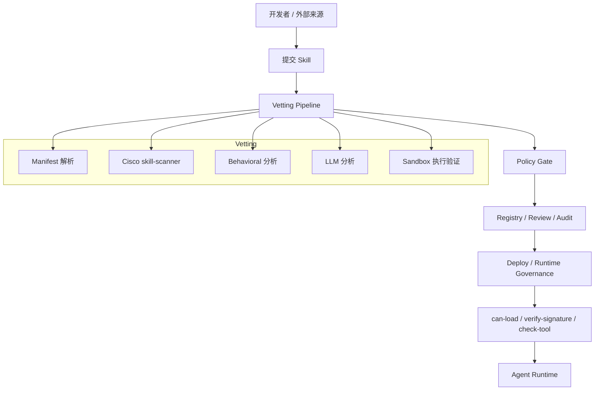
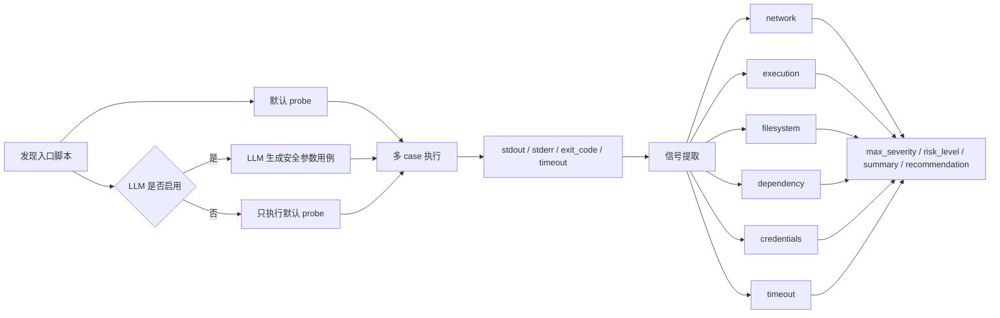
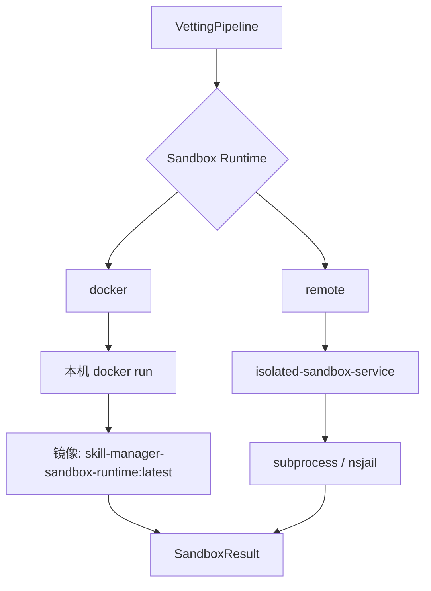
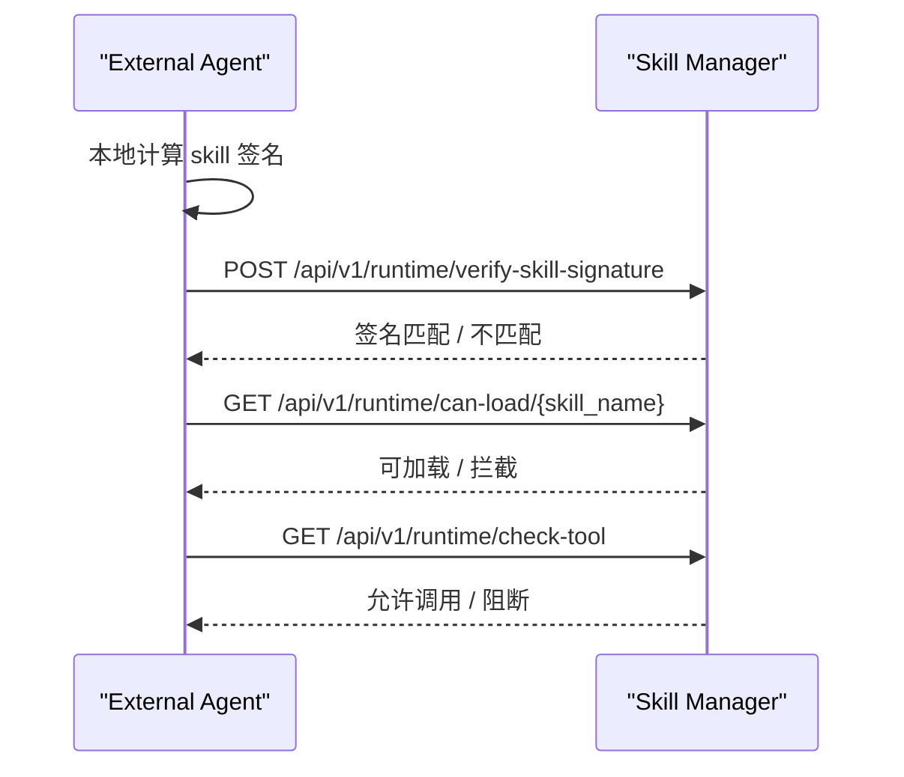

# Skill Manager Project Guide

这份文档是这个项目的主说明文档，目标是把下面几件事讲清楚：

- 这个项目解决什么问题
- 它的核心原理是什么
- 后端、前端、sandbox 分别做什么
- 一条 skill 从提交到运行时治理是怎么走的
- 本地怎么启动、怎么使用、怎么看效果
- 外部 Agent 怎么接入

如果你第一次接触这个项目，先看这份文档，再按需要跳转到更细的专题文档。

---

## 1. 项目定位

Skill Manager 不是一个“帮你写 skill 的平台”，而是一个：

- `skill 准入中心`
- `skill 风险治理中心`
- `skill 运行时验票中心`

它服务的对象不是普通软件包，而是 AI Agent 的技能包，也就是一组本地文件：

- `SKILL.md`
- `scripts/`
- `references/`
- 其他资源文件

项目的核心目标是：

1. skill 先审查再使用
2. skill 内容批准后不能被偷偷改
3. skill 在运行时只能调用被允许的 tool
4. 风险和审计过程可追踪、可撤销

---

## 2. 解决什么问题

如果没有这层系统，一个 agent 只要能加载本地 skill，就可能：

- 读取敏感文件
- 访问环境变量里的密钥
- 调用危险工具
- 从外部下载并执行代码
- 把数据发到外部服务器
- 在事后无法快速停用

Skill Manager 用一套“提交、扫描、审批、签名、运行时校验、审计”的链路，把这些风险纳入治理。

---

## 3. 核心原则

### 3.1 Skill 永远是本地文件

Skill Manager 不负责“远程托管 skill 并下发给 agent”。  
它管理的是：

- skill 元数据
- 风险结果
- 状态
- 签名
- 审计

真正被 agent 加载的 skill，仍然是本地目录。

### 3.2 审批时签名，运行时验签

skill 通过后会对完整目录生成签名。  
后续 agent 加载 skill 时，可以用：

- `skill_name + skill_path`
- 或 `skill_name + local_signature`

来验证本地内容是否还是批准时的那份。

### 3.3 风险来自多分析器，不看单点结果

最终风险不是只看一个结果，而是综合：

- scanner
- behavioral
- LLM
- sandbox

其中任一分析器给出更高风险，都可能抬高最终结论。

### 3.4 Sandbox 是补充验证，不是唯一裁判

sandbox 的作用是看：

- “这段脚本在受限环境里跑起来会发生什么”

但它不一定能触发所有恶意分支，所以：

- `sandbox LOW`

不等于：

- `skill 安全`

---

## 4. 总体架构



---

## 5. 代码结构

### 5.1 核心治理后端

- [skill_manager/core/manager.py](/Users/huangluguang/Desktop/Project/skill-manager/skill_manager/core/manager.py)
  生命周期总控
- [skill_manager/core/vetting.py](/Users/huangluguang/Desktop/Project/skill-manager/skill_manager/core/vetting.py)
  扫描与风险判定
- [skill_manager/core/policy.py](/Users/huangluguang/Desktop/Project/skill-manager/skill_manager/core/policy.py)
  策略配置
- [skill_manager/core/registry.py](/Users/huangluguang/Desktop/Project/skill-manager/skill_manager/core/registry.py)
  SQLite 持久化，启动时可从旧 `registry.json`、`review.json`、`audit.jsonl` 自动迁移
- [skill_manager/core/runtime.py](/Users/huangluguang/Desktop/Project/skill-manager/skill_manager/core/runtime.py)
  运行时治理
- [skill_manager/core/signer.py](/Users/huangluguang/Desktop/Project/skill-manager/skill_manager/core/signer.py)
  目录签名
- [skill_manager/core/llm.py](/Users/huangluguang/Desktop/Project/skill-manager/skill_manager/core/llm.py)
  DeepSeek LLM 分析
- [skill_manager/core/sandbox.py](/Users/huangluguang/Desktop/Project/skill-manager/skill_manager/core/sandbox.py)
  Docker / remote sandbox

### 5.2 API 层

- [skill_manager/api/router.py](/Users/huangluguang/Desktop/Project/skill-manager/skill_manager/api/router.py)
  Skill Manager API
- [backend/main.py](/Users/huangluguang/Desktop/Project/skill-manager/backend/main.py)
  管理后台 + Skill Manager API 集成入口

### 5.3 管理台前端

- [web/src/views/Skills.vue](/Users/huangluguang/Desktop/Project/skill-manager/web/src/views/Skills.vue)
- [web/src/views/SkillDetail.vue](/Users/huangluguang/Desktop/Project/skill-manager/web/src/views/SkillDetail.vue)
- [web/src/views/SubmitSkill.vue](/Users/huangluguang/Desktop/Project/skill-manager/web/src/views/SubmitSkill.vue)
- [web/src/views/ReviewQueue.vue](/Users/huangluguang/Desktop/Project/skill-manager/web/src/views/ReviewQueue.vue)
- [web/src/views/SystemSettings.vue](/Users/huangluguang/Desktop/Project/skill-manager/web/src/views/SystemSettings.vue)
- [web/src/views/ScannerAccess.vue](/Users/huangluguang/Desktop/Project/skill-manager/web/src/views/ScannerAccess.vue)
  客户侧扫描器接入、Token、CLI/GUI 下载

### 5.4 独立执行服务

- [services/isolated-sandbox-service/app.py](/Users/huangluguang/Desktop/Project/skill-manager/services/isolated-sandbox-service/app.py)
  生产版远程 sandbox 服务基线

### 5.5 客户侧扫描器

- [scanner/cmd/skill-scanner/main.go](/Users/huangluguang/Desktop/Project/skill-manager/scanner/cmd/skill-scanner/main.go)
  Go CLI 扫描器入口
- [scanner/cmd/skill-scanner-gui/main.go](/Users/huangluguang/Desktop/Project/skill-manager/scanner/cmd/skill-scanner-gui/main.go)
  原生桌面 GUI 扫描器入口
- [skill_manager/api/scanner_router.py](/Users/huangluguang/Desktop/Project/skill-manager/skill_manager/api/scanner_router.py)
  Scanner 专用 API 与下载接口
- [skill_manager/core/scanner_tokens.py](/Users/huangluguang/Desktop/Project/skill-manager/skill_manager/core/scanner_tokens.py)
  Scanner Token 存储、校验和审计
- [skill_manager/core/scan_cache.py](/Users/huangluguang/Desktop/Project/skill-manager/skill_manager/core/scan_cache.py)
  重复扫描复用缓存

---

## 6. 一条 Skill 的生命周期


### 6.1 提交

当前提交支持多种入口：

- CLI
- 管理台上传 ZIP
- 管理台本地目录导入
- 管理台网络 / GitHub / ClawHub 导入
- 客户侧 Go Scanner CLI
- 客户侧原生 GUI Scanner

上传后不会再阻塞前端等待全部分析跑完，而是：

1. 先写一条 `PENDING`
2. 后台继续分析
3. 列表和详情页看到状态变化

客户侧扫描器使用专用 Scanner Token，不使用管理员登录态。
详细说明见：

- [skill-scanner.md](/Users/huangluguang/Desktop/Project/skill-manager/docs/skill-scanner.md)

### 6.2 Vetting

`vet()` 会依次做：

1. `SKILL.md` frontmatter 解析
2. `cisco-ai-skill-scanner` 静态扫描
3. behavioral 本地规则扫描
4. DeepSeek LLM 语义分析
5. sandbox 动态执行验证

### 6.3 Policy Gate

policy 决定 skill 最终落到：

- `APPROVED`
- `VETTED`
- `REJECTED`

高风险 skill 还可以被策略强制：

- 必须 sandbox
- 必须人工审核

### 6.4 审批 / 部署

- `VETTED` 进入审核队列
- `APPROVED` 可以部署
- `REJECTED` 不进入审核队列

### 6.5 运行时治理

agent 接入时一般用：

- `verify-skill-signature`
- `can-load`
- `check-tool`

---

## 7. 风险分析原理

### 7.1 Scanner

Cisco skill-scanner 负责做更系统的静态规则扫描。  
它不是只看 `SKILL.md`，而是扫整个 skill 目录。

### 7.2 Behavioral

behavioral 分析主要扫文本代码文件，优先：

- `scripts/`
- `references/`
- `prompts/`

典型规则包括：

- `eval` / `exec`
- `os.system`
- `subprocess(..., shell=True)`
- 下载后执行
- 敏感文件访问

### 7.3 LLM

LLM 现在做三件事：

1. 给一段简短的“技能主要功能”说明
2. 从语义上判断是否有恶意意图、数据外泄、凭证访问等风险
3. 当 sandbox 和 LLM 同时启用时，结合 `SKILL.md` 使用说明生成一组安全的 sandbox probe 用例

所以 LLM 结果里你会看到：

- `skill_function_summary`
- `summary`
- `findings`
- `policy_notes`
- `sandbox_analysis.llm_probe_plan`，仅在 LLM probe 生成成功时出现

### 7.4 Sandbox

Sandbox 负责“受限环境试跑”。  
它不再只依赖默认 `--help`。当前执行顺序是：

1. 先发现一个 probe 入口，例如 `scripts/*.py`、`scripts/*.sh`、`scripts/*.js`
2. 如果 `SKILL.md` 中存在 bash/sh fenced code block，会生成临时 `.sh` probe 脚本
3. 生成默认 probe，如果脚本像 CLI，会优先生成 `--help`
4. 如果提交时同时启用了 LLM，会让 LLM 阅读 `SKILL.md` 的用法示例，生成额外的安全 probe 用例
5. 对每个 probe case 分别执行 sandbox
6. 汇总所有 case 的输出和风险信号

LLM 可以从 `SKILL.md` 里识别“已有入口文件 + 参数”，但入口必须是 skill 目录中真实存在的 `.py`、`.sh` 或 `.js` 文件。
它不能生成代码、shell 管道、真实凭证、真实外部目标或破坏性命令。

`SKILL.md` 命令 probe 会写入 sandbox 临时拷贝，不会修改原始 skill 目录。

它现在会给出两层结果：

1. 执行层
   - 是否执行
   - 后端
   - 镜像 / 远程服务
   - 入口脚本
   - probe 参数
   - stdout / stderr / exit code

2. 风险层
   - `risk_level`
   - `max_severity`
   - `summary`
   - `recommendation`
   - `signals`



---

## 8. 为什么不同分析器的风险可能不一致

这在项目里是正常现象。

例如：

- `LLM = EXTREME`
- `sandbox = LOW`

常见原因是：

1. 代码里静态上已经明显恶意
2. 但 sandbox 这次 probe 没有触发到真正的恶意分支
3. 或 sandbox 禁网 / 参数仍然不够覆盖真实输入条件
4. 即使启用了 LLM probe，也不能保证覆盖所有恶意分支

所以最终风险看的是“合并后的最高风险”，不是只信某一个分析器。

如果要验证 sandbox 展示链路，可以上传这个测试样本：

- [tests/skills/sandbox-runtime-signal.zip](/Users/huangluguang/Desktop/Project/skill-manager/tests/skills/sandbox-runtime-signal.zip)

它会在默认 probe 中主动暴露网络、文件系统、动态执行、凭证关键词和非零退出码等信号。

---

## 9. 验签原理

这个项目的验签不是签 `SKILL.md` 单文件，而是签整个目录树。

算法大意：

1. 遍历所有文件
2. 按相对路径排序
3. 每个文件算 `SHA256`
4. 汇总成一个稳定文本
5. 最终做：
   - `HMAC-SHA256`（有 key）
   - 或 `SHA256`（开发模式）

用途是：

- 审批后固定内容
- 运行时检测本地 skill 是否被篡改

更详细的 agent 侧签名对接，见：
- [agent-signature-verification.md](/Users/huangluguang/Desktop/Project/skill-manager/docs/agent-signature-verification.md)

---

## 10. Sandbox 架构

当前支持两个后端：

- `docker`
- `remote`



### 10.1 Docker backend

适合：

- 本地开发
- 单机演示

现在默认镜像是：

- `skill-manager-sandbox-runtime:latest`

它内置常见 Python 依赖，避免很多 skill 因为 `requests` 之类库缺失直接失败。

### 10.2 Remote backend

适合：

- 独立执行服务
- 生产环境隔离执行

当前服务基线在：

- [services/isolated-sandbox-service/README.md](/Users/huangluguang/Desktop/Project/skill-manager/services/isolated-sandbox-service/README.md)

更详细架构说明：

- [sandbox-service-architecture.md](/Users/huangluguang/Desktop/Project/skill-manager/docs/sandbox-service-architecture.md)

---

## 11. 前后端怎么启动

### 11.1 本地开发

后端：

```bash
cd /Users/huangluguang/Desktop/Project/skill-manager
uv sync --project backend
uv run --project backend uvicorn backend.main:app --host 0.0.0.0 --port 8000 --reload
```

前端：

```bash
cd /Users/huangluguang/Desktop/Project/skill-manager/web
npm install
npm run dev
```

默认登录：

- 用户名：`admin`
- 密码：`Admin@123`

### 11.2 本地使用 docker sandbox

如果系统设置里选的是 `docker`，先构建项目自带镜像：

```bash
cd /Users/huangluguang/Desktop/Project/skill-manager
make sandbox-runtime-build
```

### 11.3 Docker Compose

完整容器化启动见：

- [docker-deployment.md](/Users/huangluguang/Desktop/Project/skill-manager/docs/docker-deployment.md)

---

## 12. 管理台怎么使用

### 12.1 总览

看：

- 状态分布
- 风险分布
- 最近阻断事件
- 待处理 skill

### 12.2 技能列表

看：

- 当前状态
- 风险等级
- Sandbox 是否触发
- 是否策略强制

### 12.3 技能详情

能看到：

- 基础信息
- LLM 对技能主要功能的概括
- behavioral 结果
- sandbox 风险摘要
- 原始报告 JSON
- 文件列表与文件内容

### 12.4 提交 Skill

上传 ZIP 后：

1. 先返回 `PENDING`
2. 后端后台分析
3. 列表 / 详情自动显示最终状态

### 12.5 审核队列

处理：

- `VETTED`
- 批准
- 拒绝

### 12.6 系统设置

配置：

- LLM
- sandbox
- 当前 sandbox 后端和镜像

### 12.7 扫描器接入

用于客户侧批量扫描本地 skills：

- 创建和吊销 Scanner Token
- 下载 CLI / GUI 扫描器
- 查看安装命令和参数说明
- 获取配置模板
- 跳转查看服务端扫描结果

CLI 适合服务器和 CI，GUI 是原生桌面程序，适合人工选择目录、勾选 skill、实时查看状态。

详细说明见：

- [skill-scanner.md](/Users/huangluguang/Desktop/Project/skill-manager/docs/skill-scanner.md)

---

## 13. 外部 Agent 怎么接

推荐调用顺序：



更详细说明：

- [external-agent-integration.md](/Users/huangluguang/Desktop/Project/skill-manager/docs/external-agent-integration.md)
- [agent-signature-verification.md](/Users/huangluguang/Desktop/Project/skill-manager/docs/agent-signature-verification.md)

---

## 14. 常见问题

### 14.1 为什么 sandbox 是 LOW，但 LLM 是 EXTREME？

因为 sandbox 只观察“这次 probe 实际跑出来的行为”，  
而 LLM 会从整体语义上判断恶意意图。  
二者不一致是正常的，最终看合并风险。

### 14.2 为什么系统设置里改了 sandbox，提交结果还是旧镜像？

说明实际生效的配置还没更新。  
现在系统设置和详情页都能显示：

- sandbox 后端
- sandbox 镜像

优先看“技能详情里的当前实际执行环境”。

### 14.3 为什么一个恶意 skill 不进入审核队列？

因为：

- `VETTED` 才进审核队列
- `REJECTED` 不进审核队列

例如 `EXTREME` 风险通常会被策略直接拒绝。

### 14.4 为什么重复提交没有复用？

扫描复用不是按 skill name 判断，而是按：

- skill 内容指纹
- 扫描上下文指纹

只有完整目录内容一致，并且规则分析、LLM、sandbox、策略和扫描器代码上下文一致，才会复用历史结果。

常见不复用原因：

- 两个目录内容实际不同
- 第二次打开了新的分析选项
- 策略或扫描器代码升级
- 第一条还在 `PENDING`
- 旧记录没有写入内容指纹

详情页会展示是否复用、来源 skill ID、内容指纹和扫描上下文指纹。

---

## 15. 相关专题文档

- 客户演示 Runbook：
  [customer-demo-runbook.md](/Users/huangluguang/Desktop/Project/skill-manager/docs/customer-demo-runbook.md)
- 客户侧扫描器：
  [skill-scanner.md](/Users/huangluguang/Desktop/Project/skill-manager/docs/skill-scanner.md)
- 管理台与容器化部署：
  [docker-deployment.md](/Users/huangluguang/Desktop/Project/skill-manager/docs/docker-deployment.md)
- 外部 Agent 接入：
  [external-agent-integration.md](/Users/huangluguang/Desktop/Project/skill-manager/docs/external-agent-integration.md)
- Agent 验签：
  [agent-signature-verification.md](/Users/huangluguang/Desktop/Project/skill-manager/docs/agent-signature-verification.md)
- Sandbox 架构：
  [sandbox-service-architecture.md](/Users/huangluguang/Desktop/Project/skill-manager/docs/sandbox-service-architecture.md)
- Remote mock 联调：
  [remote-sandbox-mock-quickstart.md](/Users/huangluguang/Desktop/Project/skill-manager/docs/remote-sandbox-mock-quickstart.md)
- OpenClaw Hook 接入：
  [openclaw-skill-manager-hooks.md](/Users/huangluguang/Desktop/Project/skill-manager/docs/openclaw-skill-manager-hooks.md)
