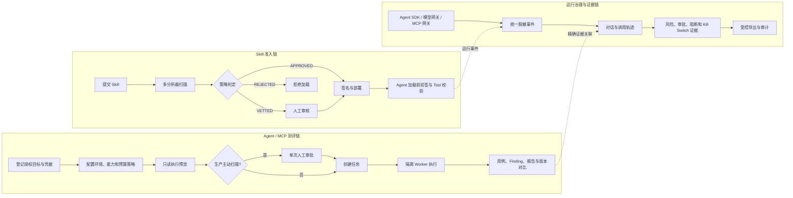
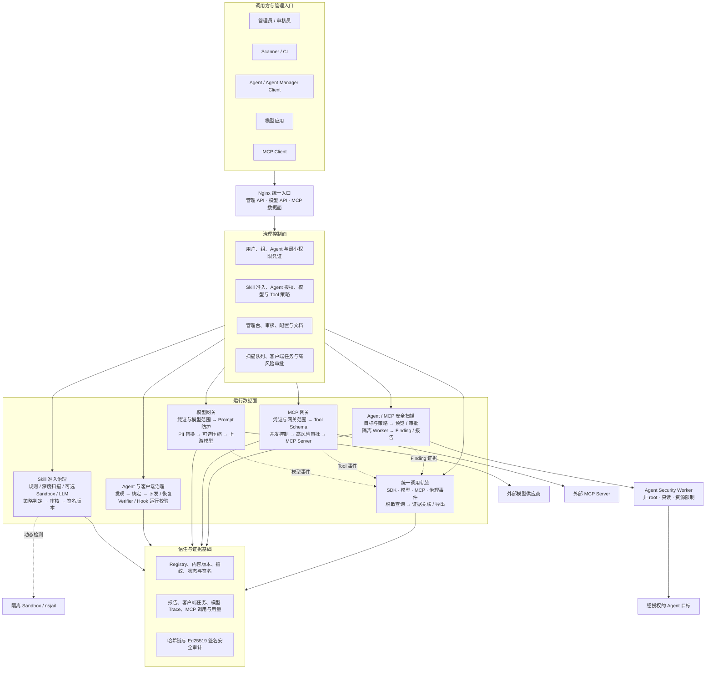
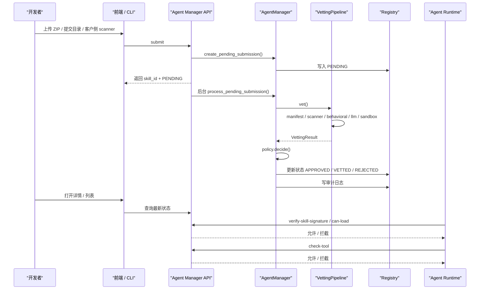
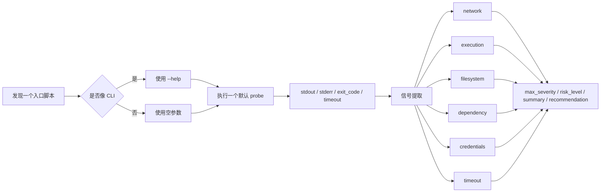
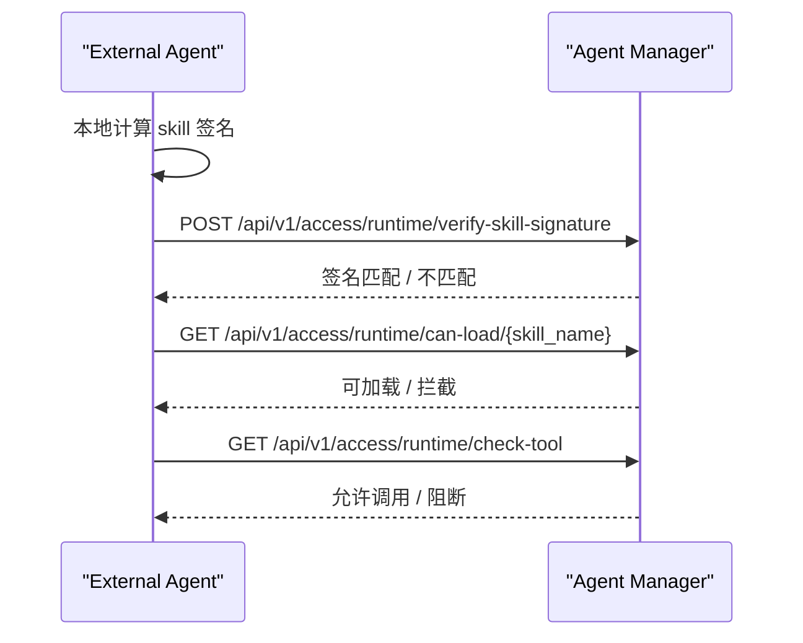

# Agent Manager Project Guide

这份文档是这个项目的主说明文档，目标是把下面几件事讲清楚：

- 这个项目解决什么问题
- 它的核心原理是什么
- 后端、前端、sandbox 分别做什么
- 一条 skill 从提交到运行时治理是怎么走的
- 模型网关如何代理 LLM 请求并保护隐私数据
- 本地怎么启动、怎么使用、怎么看效果
- 外部 Agent 怎么接入

如果你第一次接触这个项目，先看这份文档，再按需要跳转到更细的专题文档。

当前正在执行的下一版本建设清单见 [智能体安全平台下一版本实施计划](agent-security-vnext-implementation-plan.md)。该清单按实现和验收进度逐项勾选。

---

## 1. 项目定位

大模型红队扫描开放锁定的 Tencent AI-Infra-Guard v4.6.0 中 `data/eval` 的全部 17 个内置数据集，
支持多选或单条自定义 Prompt。数据集选择面板支持按名称、描述和标签搜索，展示语言、
实际样本数、上游推荐指数和描述；这些元数据与锁定版本保持一致，原始标签保留原文。
点击数据集名称打开详情，按每页 20 条查看带序号的完整 Prompt 原文。详情接口要求登录，支持服务端分页。
免鉴权的 Ollama 等目标可以留空目标凭据，扫描客户端不发送 Authorization；评估模型继续使用独立的网关凭据。
“每个数据集抽样条数”支持快捷选择 10 条、20 条或全部，也可手动输入 1–100 条。
“抽样随机种子”用于复现抽样，不代表测试次数。“全部”使用引擎的 `num_prompts=-1`，
预览按数据集汇总预计用例上限；实际用例数受有效样本数量和执行结果影响。评估模型可从模型网关的
已启用模型中选择，连接与凭证配置见 [模型网关](model-gateway.md)。

Agent Manager 不是一个“帮你写 Skill 的平台”，也不再只是 Skill 扫描器。它是面向 AI Agent
全生命周期的治理平台，当前包含：

- `Skill 准入、签名和运行时验票`
- `Agent、MCP、大模型与 AI 基础设施风险扫描`
- `模型网关和 MCP 能力治理`
- `统一调用轨迹、证据和运行时控制`
- `客户侧 Agent/Skill 接管和持续完整性巡检`

Skill 治理服务的对象不是普通软件包，而是 AI Agent 的技能目录，也就是一组本地文件：

- `SKILL.md`
- `scripts/`
- `references/`
- 其他资源文件

平台的核心目标是：

1. Skill 先审查再使用，批准内容被修改后不能继续冒充可信版本。
2. Agent、MCP、大模型和 AI 基础设施扫描只能针对已授权目标，并受环境、能力、预算、审批和 Kill Switch 约束。
3. 模型和 Tool 调用经过最小权限凭证、隐私保护、Schema 与高风险审批治理。
4. 调用链、Finding、证据、报告规则和审计事件可关联、可复核；没有证据时明确显示“未验证”。

---

## 2. 解决什么问题

如果没有这层系统，一个 agent 只要能加载本地 skill，就可能：

- 读取敏感文件
- 访问环境变量里的密钥
- 调用危险工具
- 从外部下载并执行代码
- 把数据发到外部服务器
- 在事后无法快速停用

Agent Manager 用一套“提交、扫描、审批、签名、运行时校验、审计”的链路，把这些风险纳入治理。

对于 LLM 调用，Agent Manager 还内置了一个模型网关：

- 外部应用可以用 OpenAI-compatible `POST /v1/chat/completions` 访问模型。
- 网关会先校验模型调用凭证、模型范围、请求大小和并发限制。
- 请求进入上游模型前会做 PII 检测和伪匿名 token 替换。
- 模型响应会按会话映射还原后再返回给调用方。
- 管理台可以通过“隐私链路追踪”查看 Prompt 防护、脱敏、压缩、模型响应和最终还原结果。
- Prompt 不再作为独立上传资产进入主流程；提示词注入、系统提示词泄露、凭据外传等风险在模型网关运行时检测。

### 2.1 当前产品能力地图

| 能力域 | 管理台入口 | 当前已启用能力 | 明确边界 |
|---|---|---|---|
| Skill 治理 | 能力治理 → Skill 治理 | 提交、扫描、版本、审核、签名、部署、运行验签、PDF 报告 | Sandbox 和 LLM 是辅助信号，不能单独证明安全 |
| AI 安全扫描 | 安全扫描 | Agent 动态风险扫描、MCP 元数据扫描、大模型红队、AI 基础设施指纹/CVE 扫描、预览、审批、Kill Switch、Finding、对比和报告 | MCP 扫描不执行 `tools/call`；动态扫描只覆盖真实执行并留有证据的输入与目标 |
| 统一调用轨迹 | 调用轨迹 | 对话/轨迹双视图、Turn/Step/Call 层级、证据搜索、Finding 跳转、脱敏和受控原始导出 | 缺少 SDK 事件时保持部分轨迹，不补造 Turn/Step |
| 模型治理 | 模型网关 | 供应商、模型、最小权限调用凭证、Prompt 防护、PII 伪匿名、可选压缩、用量与隐私链路 | 原始 PII 只允许受控角色查看，不进入普通日志 |
| MCP 治理 | 能力治理 → MCP 治理 | Server 发现、虚拟 Gateway、Tool Schema、读写属性、审批、限流、生产禁用清单和审计 | 不托管 stdio MCP；生产环境禁止 `active_full` |
| 客户端治理 | 智能体管理 → 客户端管理 | Agent/Skill 发现、接管、版本安装、巡检、隔离、恢复和模型切换 | Agent 最终仍加载本地目录；客户端凭证不能直接调用模型或 MCP |
| 证据与审计 | 安全审计、扫描报告、调用轨迹 | 哈希链、Ed25519 签名、版本化规则和脱敏证据 | 评估结论以实际执行的用例及证据为依据 |

页面功能默认开启，不需要在 `.env` 增加启用开关。运行 Worker、访问模型或调用目标所需的 Token、
API Key 和授权仍必须单独配置；“页面可见”不等于“外部目标已经验收”。

### 2.2 三条核心业务流程

三条流程可以独立使用，也可以通过 `trace_id`、`event_id`、任务 ID、用例 ID 和 Finding ID 形成证据闭环：



实际操作顺序：

1. 平台管理员先配置用户组、最小权限凭证、模型/MCP 资源和审计密钥。
2. Skill 管理员完成 Skill 准入；Agent 管理员完成客户端或外部 Agent 的运行身份绑定。
3. 安全管理员在“安全扫描”登记目标和加密凭据，选择与目标环境及授权能力匹配的策略，先预览再创建任务。
4. 生产环境的 `active_safe` 扫描必须在维护窗口内使用绑定目标、策略和当前凭据版本的单次审批；`active_full` 被拒绝。
5. Worker 领取不可变任务快照并执行；操作员可以取消任务，管理员可在紧急情况下启用不可撤销的任务级 Kill Switch。
6. 安全审计人员在 Finding、版本对比和调用轨迹中复核证据。任务成功或零 Finding 都不自动等于“安全”。
7. 修复后使用同目标、同类型、同覆盖和同引擎的较新任务复测；条件不一致时结果显示“无法复测”，不冒充“已修复”。

---

## 3. 核心原则

### 3.1 Agent 最终加载的 Skill 永远是本地文件

Agent Manager 管理 Skill 的准入状态、签名和授权，也可以通过 Agent Manager Client 把批准版本安全安装到客户侧客户端。无论通过哪种方式接入，Agent 最终加载的仍是本地目录，不会直接执行平台数据库中的内容。

平台管理的是：

- skill 元数据
- 风险结果
- 状态
- 签名
- 审计

真正被 agent 加载的 skill，仍然是本地目录。

### 3.2 审批时签名，运行时验签

skill 通过后会对完整目录生成签名。  
后续 agent 加载 skill 时，可以用：

- `skill_name + skill_path`
- 或 `skill_name + local_signature`

来验证本地内容是否还是批准时的那份。

### 3.3 风险来自多分析器，不看单点结果

scanner、behavioral、sandbox 分析完成后的分析结果和完整的skill内容一起输入 LLM 做最后的风险判断：

- scanner
- behavioral
- sandbox
- LLM


LLM 分析生成详细的安全报告，如果是恶意skill，还会生成攻击链，并映射到 MITRE ATT&CK（传统网络安全）和 MITRE ATLAS（AI 安全）框架，帮助用户更好地理解和缓解风险。

### 3.4 扫描缓存与强制重扫

为了提升效率，Skill 按“名称族 + 内容版本”管理：

- 同名且内容指纹相同的提交复用已有版本，不重复创建记录。
- 检测配置也一致且全局启用了“复用检测结果”时，不再重复执行扫描。
- 同名但内容不同会创建递增版本，历史版本内容使用服务端快照保存。
- Skill 详情中的基础信息、检测报告、文件等内容分别加载，已返回的内容立即显示。“版本差异”在打开时加载比较结果，等待期间仍可切换其他标签；相同版本直接显示无文本文件差异，比较失败可点击“重新加载差异”。
- 版本差异默认以最新版本为目标、前一个版本为基准，支持选择版本、交换比较方向、切换差异文件及并排或单栏对比。在本次详情查看期间，版本选择未变时切换标签再返回会继续等待或显示已有比较结果。比较范围为可读取的 UTF-8 文本文件，单文件不超过 1 MiB；跳过软链接及 `.git`、`.venv`、`node_modules`、`__pycache__`、`dist`、`build` 目录。
- Skill 列表默认展示 LLM 判定结果，与最终风险独立显示；“显示列”可设置全部列的显示或隐藏，默认展示现有基础列与 LLM 判定结果，规则扫描、深度扫描和 Sandbox 默认隐藏；支持恢复默认，选择保存在当前浏览器。检测中、调用失败、已跳过、未启用和未记录分别显示。
- 是否复用只在“策略配置”全局控制，提交页和客户端不再提供单次“禁用缓存”。
- 如需重新检测，在 Skill 详情的版本列表中点击“重新检测”。重扫会新增 Scan Run，不会创建内容版本；重扫完成前或重扫失败时，上一份可信结果继续有效。
- Skill 列表支持当前页多选，批量重新检测、取消任务和删除。重新检测跳过正在检测的项；取消任务适用于初次检测和重新检测，取消重扫后保留上一份有效审批结果。删除会移除所选 Skill 的全部版本及关联记录，执行前需确认。操作结束分别展示重新检测提交、取消任务或删除 Skill 的成功和失败数量，列出对应 Skill；跳过项按状态和原因分组展示，失败项保留选中便于重试。列表在检测期间自动刷新状态。
- 提交 Skill 与批量重新检测使用相同的横向检测选项及悬停说明，规则分析默认勾选且不可取消。批量重新检测可沿用各 Skill 上次提交的深度扫描、Sandbox、LLM 分析配置，或统一选择这三项；未勾选的可选分析会关闭，当前全局策略要求的检测仍会执行。不可用的检测能力会禁用。LLM 分析先在“模型网关 > 模型管理”添加模型，再在“Skill 治理 > 策略配置 > 高级配置 > AI 分析服务”选择模型，并在“检测设置”启用 AI 分析；已启用且已选择模型时即可勾选。
- Skill 详情“基础信息”标题右侧只读展示当前版本最近一次提交的深度扫描、Sandbox、LLM 分析勾选状态，任务排队时即可查看。历史记录未保存提交选项时按检测报告展示并标明来源；没有选项或报告的记录显示未知状态。
- 升级旧数据库时，Registry 会在首次启动时把旧 Skill 按名称归入版本族；同名同内容只保留提交时间最新的一条，同名不同内容按提交时间生成版本号。迁移记录写入 `registry_migrations`，后续启动不会重复迁移，也不会重新扫描。

### 3.5 Sandbox 是补充验证，不是唯一裁判

sandbox 的作用是看：

- “这段脚本在受限环境里跑起来会发生什么”

但它不一定能触发所有恶意分支，所以：

- `sandbox benign`

不等于：

- `skill 安全`

### 3.6 模型网关保护 LLM 数据面

LLM 模型网关负责保护发送给外部模型供应商的数据：

- 模型调用凭证明文只展示一次，服务端只保存 hash。
- 模型供应商 API Key 加密落库，接口只返回掩码。
- 用户组可绑定隐私策略，控制实体类型、是否扫描 system 消息、是否允许 bypass、映射 TTL 和差分隐私统计参数。
- `stream=true` 支持 OpenAI-compatible SSE；网关会对流式 `delta.content` 做增量反替换，并在流结束后写入 audit、usage metric 和隐私链路追踪。
- 未知 OpenAI 参数默认拒绝，避免无审计透传造成资源滥用。

详细说明见：

- [model-gateway.md](../docs/model-gateway.md)

### 3.7 MCP 能力总线

MCP 能力总线集中配置远程 Streamable HTTP MCP Server，并通过虚拟网关发布选定 Tool：

- 管理台在 `能力治理 / MCP 服务` 中登记 Endpoint，连接后保存 `tools/list` Schema 快照。
- `能力治理 / MCP 网关` 把多个 Server 的部分 Tool 组合为 `/mcp/{gateway_slug}`。
- `能力治理 / MCP 调用审批` 接收真实高风险调用产生的待办；管理员查看脱敏参数后批准或拒绝该 Token 对指定网关、Tool 和 Schema 的限时调用权限，查看原始参数会写入安全审计。
- `能力治理 / MCP 调试` 可以在保存前使用临时 Endpoint 直连服务，也可以使用真实网关凭证执行 Tool 发现和调用，并展示原始 JSON 请求历史。
- 调用方使用 `MCP 网关凭证`，凭证限制可访问网关、IP、请求大小和并发数，不要求绑定 `ManagedAgent`。
- 上游连接默认强制 HTTPS，并在每次调用前校验 DNS 解析结果和出站白名单；Tool 还可以配置速率、并发、响应大小和限时审批。
- 高风险调用首次被网关阻断时会返回 `approval_request_id`；批准后，网关自动按 MCP 凭证、Gateway、Tool 和 Schema 匹配有效授权，不要求调用方回传申请 ID。有效期内允许使用不同参数重复调用，参数仅保留为审批和审计上下文。
- Tool 对外名称为 `{server_slug}__{tool_name}`；Schema 变化后暂停暴露，重新保存网关配置才会批准新 Hash。
- 当前数据面实现 `initialize`、`ping`、`tools/list` 和 `tools/call`，不托管 stdio MCP。

### 3.8 可验证安全审计

管理面的 Token、Agent、MCP、模型和策略写操作会进入统一安全审计链。每条事件包含前一条事件哈希，并使用独立 Ed25519 审计密钥签名。管理员可调用 `GET /api/v1/security-audit/verify`，或在 Backend 环境执行 `python -m backend.security_audit verify` 检查完整性。配置 `SECURITY_AUDIT_EXPORT_PATH` 后，同一事件还会追加写入 JSONL，供外部日志平台采集。

---

## 4. 总体架构



帮助中心首页使用同一架构边界绘制可响应的中英文架构图。图中的控制面负责准入、授权、
路由与证据记录；Agent 仍从本地目录加载 Skill，Sandbox、外部模型供应商和 MCP Server
分别保持隔离或外部执行边界。

---

## 5. 代码结构

### 5.1 核心治理后端

- [agent_manager/core/manager.py](../agent_manager/core/manager.py)
  生命周期总控
- [agent_manager/core/vetting.py](../agent_manager/core/vetting.py)
  扫描与风险判定
- [agent_manager/core/policy.py](../agent_manager/core/policy.py)
  策略配置
- [agent_manager/core/registry.py](../agent_manager/core/registry.py)
  SQLite 持久化，启动时可从旧 `registry.json`、`review.json`、`audit.jsonl` 自动迁移，并一次性把旧 Skill 记录迁移到名称族和内容版本模型
- [agent_manager/core/runtime.py](../agent_manager/core/runtime.py)
  运行时治理
- [agent_manager/core/prompt_manager.py](../agent_manager/core/prompt_manager.py)
  历史 Prompt Registry 兼容能力；新主流程使用模型网关运行时 Prompt 防护
- [agent_manager/core/prompt_registry.py](../agent_manager/core/prompt_registry.py)
  历史 Prompt Registry 持久化存储
- [agent_manager/core/signer.py](../agent_manager/core/signer.py)
  目录签名
- [agent_manager/core/llm.py](../agent_manager/core/llm.py)
  OpenAI-compatible LLM 分析；可直连模型供应商，也可通过内置模型网关隐私路由
- [agent_manager/core/sandbox.py](../agent_manager/core/sandbox.py)
  Docker / remote sandbox

### 5.2 API 层

- [agent_manager/api/router.py](../agent_manager/api/router.py)
  Agent Manager API
- [backend/main.py](../backend/main.py)
  管理后台 + Agent Manager API 集成入口
- [backend/routers/llm_gateway.py](../backend/routers/llm_gateway.py)
  内置模型网关、OpenAI-compatible 代理、PII 伪匿名、Trace 与管理 API
- [backend/routers/mcp_gateway.py](../backend/routers/mcp_gateway.py)
  MCP Server 发现、虚拟网关、Tool 路由、凭证校验与调用审计
- [backend/routers/security_scans.py](../backend/routers/security_scans.py)
  Agent/MCP 安全目标、策略、审批、任务、Worker 协议、Finding、报告和 Kill Switch
- [backend/routers/runtime_traces.py](../backend/routers/runtime_traces.py)
  统一调用轨迹、事件查询、证据导出、留存清理和指标

### 5.3 管理台前端

- [web/src/views/Skills.vue](../web/src/views/Skills.vue)
- [web/src/views/SkillDetail.vue](../web/src/views/SkillDetail.vue)
- [web/src/views/SubmitSkill.vue](../web/src/views/SubmitSkill.vue)
- [web/src/views/ReviewQueue.vue](../web/src/views/ReviewQueue.vue)
- [web/src/views/SystemSettings.vue](../web/src/views/SystemSettings.vue)
- [web/src/views/ScannerAccess.vue](../web/src/views/ScannerAccess.vue)
  客户侧扫描器接入、Token、CLI/GUI 下载
- [web/src/views/ModelGateway.vue](../web/src/views/ModelGateway.vue)
  模型供应商、模型端点、旧模型凭证查询与吊销、用户组和隐私策略管理
- [web/src/views/PipelineTrace.vue](../web/src/views/PipelineTrace.vue)
  查看隐私路由四阶段报文
- [web/src/views/McpGateway.vue](../web/src/views/McpGateway.vue)
  MCP Server、虚拟网关和调用审计管理
- [web/src/views/AgentSecurityScans.vue](../web/src/views/AgentSecurityScans.vue)
  Agent/MCP 扫描目标、策略、任务、Finding 和报告工作台
  Agent Security 与 Runtime Trace 锁定版本和能力边界
- [web/src/views/RuntimeTraceExplorer.vue](../web/src/views/RuntimeTraceExplorer.vue)
  对话/轨迹双视图、证据搜索、Finding 关联和受控导出

### 5.4 独立执行服务

- [services/isolated-sandbox-service/app.py](../services/isolated-sandbox-service/app.py)
  生产版远程 sandbox 服务基线
- [services/agent-security-worker/worker.py](../services/agent-security-worker/worker.py)
  独立安全扫描 Worker，负责租约、心跳、Agent Scan/MCP 元数据 Adapter 和结果回传

### 5.5 客户侧扫描器

- [scanner/cmd/skill-scanner/main.go](../scanner/cmd/skill-scanner/main.go)
  Go CLI 扫描器入口
- [scanner/cmd/skill-scanner-gui/main.go](../scanner/cmd/skill-scanner-gui/main.go)
  原生桌面 GUI 扫描器入口
- [agent_manager/api/scanner_router.py](../agent_manager/api/scanner_router.py)
  Scanner 专用 API 与下载接口
- [agent_manager/core/scanner_tokens.py](../agent_manager/core/scanner_tokens.py)
  旧 Scanner Token 的兼容校验和吊销
- [agent_manager/core/scan_cache.py](../agent_manager/core/scan_cache.py)
  重复扫描复用缓存

---

## 6. 核心业务流程



### 6.1 Skill 提交

当前主要提交入口：

- 管理台上传 ZIP
- 客户侧 Go Scanner CLI

上传后不会再阻塞前端等待全部分析跑完，而是：

1. 先写一条 `PENDING`
2. 后台继续分析
3. 列表和详情页看到状态变化

客户侧扫描器使用统一凭证中心签发的 Scanner 接入凭证，不使用管理员登录态。
详细说明见：

- [skill-scanner.md](../docs/skill-scanner.md)

### 6.2 Vetting

`vet()` 会按以下阶段执行：

1. `SKILL.md` frontmatter 解析
2. 并行启动已勾选且相互独立的分析器：`cisco-ai-skill-scanner`、behavioral 本地规则、静态深度扫描，以及用户明确勾选的 Sandbox
3. 汇总静态、行为和 Sandbox 证据；如果策略根据中间风险强制 Sandbox，则在这一阶段补跑 Sandbox
4. 勾选 LLM 时，等待前面所有分析完成后只调用一次 OpenAI-compatible LLM 做最终语义判定和报告汇总；未勾选时直接使用确定性策略汇总

基础 Scanner 在 Backend 启动时预热，并在后续任务中复用已初始化实例。并行度可通过以下环境变量调整：

- `AGENT_MANAGER_SCAN_WORKERS`：同时处理的后台提交数，默认 `2`
- `AGENT_MANAGER_ANALYZER_WORKERS`：单次/多次提交共享的分析器线程数，默认 `8`

### 6.3 Policy Gate

policy 决定 skill 最终落到：

- `APPROVED`
- `VETTED`
- `REJECTED`

高风险 skill 还可以被策略强制：

- 必须 sandbox
- 必须人工审核

### 6.4 审批 / 部署

- `VETTED` 进入审核队列
- `APPROVED` 可以部署
- `REJECTED` 不进入审核队列

Skill 详情页的“实际判定过程”通过一张判定图展示本次检测结果、发现项分类、工具风险汇总、LLM 结论合并与当前准入状态；拒绝原因与审批异常以提示展示在图下方。展开“LLM 复核意见”可查看差异解释和LLM 建议排除的风险提示。发现项支持按规则、深度扫描、Sandbox 切换并分页查看原始证据。点击分析节点进入对应报告；“扫描结果”底部的执行信息折叠区提供耗时、分析器列表、复用情况及缓存 Key。配置链接在新标签页打开当前策略。新检测保存判定模式与风险分类快照；历史报告没有完整快照时明确提示，当前配置改变后需重新检测才能应用。

### 6.5 导出 PDF 扫描报告

检测完成后，可以在 Skill 详情页右上角点击“导出 PDF 报告”。系统按当前界面语言生成中文或英文 `.pdf`，报告包含：

- 瑞数品牌 Logo、报告编号、Skill 版本和密级标识
- 管理摘要、风险等级、准入状态、发现项总数及判为恶意的发现数量
- Skill 来源、内容指纹、扫描范围、分析器状态和耗时
- 确定性风险、LLM 研判和最终风险的综合判定链路
- 规则、深度扫描、Sandbox、LLM 的证据与建议；风险发现项按卡片展示等级、来源、位置、说明、证据和修复建议
- 准入策略、审批结果、签名状态、扫描历史和审计事件
- 扫描覆盖范围、Sandbox 和 LLM 的评估局限

报告只对应指定 Version ID、内容指纹和扫描上下文。导出时会遮盖常见 Token、Bearer、API Key、密码和敏感 URL 参数，并限制日志与证据长度；完整原始结果仍应在受控管理台查看。安全风险和准入状态是两类结论：低风险 Skill 仍可能因公司策略不允许的权限而被拒绝。

接口为：

```http
GET /api/v1/skills/{version_id}/scan-report.pdf?language=zh-CN
```

仅支持 `zh-CN` 和 `en-US`。扫描尚未形成结果时返回 `409`，避免导出一份看似完整但没有有效结论的报告。

### 6.6 运行时治理

agent 接入时一般用：

- `verify-skill-signature`
- `can-load`
- `check-tool`

### 6.7 四类安全扫描目标与执行引擎

平台在 P1 控制面之上支持 `agent`、`mcp`、`llm` 和 `ai_infrastructure` 四类资产。Agent 与 MCP
使用 Worker 内置的锁定适配器；大模型红队和 AI 基础设施扫描通过仅在内部网络开放、需要服务 Token
认证的固定 AI-Infra-Guard `v4.6.0` 服务执行。当前可用能力包括：

- Agent 可选择 Dify、Coze、OpenAI-compatible、通用 HTTP 或 WebSocket 连接器；MCP 关联现有 Gateway；
  LLM 使用 OpenAI-compatible 模型端点；AI 基础设施使用一个或多个经过显式授权的网络端点。资产类型和
  连接器类型是独立稳定字段，旧 `target_type` 只作为兼容投影返回。
- 大模型红队支持锁定数据集或单条自定义 Prompt、固定随机种子、限制后的攻击技术和独立评估模型。每个
  实际执行并完成评估的 Prompt 生成一个 Case；`passed` 只表示该次攻击未观察到越狱，`failed` 表示评估器
  检出越狱信号，异常或缺少评估证据保持 `error/unverified`。原始 Prompt/Response 不进入普通日志或列表。
- AI 基础设施扫描会主动访问用户明确授权的 URL，并在任务创建和实际下发前重复校验 HTTP 授权、DNS
  解析结果、目标 CIDR 与策略 CIDR。只有同时具备组件、具体版本和版本规则命中的 CVE 才生成 Finding；
  只有端口或无法确认版本的指纹必须显示 `unverified`，不能推断为漏洞或安全。

- 安全目标、加密凭据、扫描策略、扫描任务、用例、Finding 和产物模型。
- 新扫描按所选 detection skill 生成独立用例，而不是把完整对话轨迹作为唯一“通过”用例。每条规则保存稳定
  `aig-rule:<skill-name>`、Worker 阶段、实际目标调用数、确认 Finding 数和脱敏错误。`passed` 仅表示该规则
  正常完成、至少发生一次目标调用且本次未观察到关联风险；`unverified` 表示没有目标调用或缺少逐规则执行证据。
  对话 transcript 只保存在受控的 `aig-agent-scan-report` 产物中，不计入规则通过数。
- Finding 只通过 Worker 上下文生成的 opaque source reference 关联 detection skill；Reviewer 返回的引用必须能在
  Worker 持有的映射中解析，否则关联到独立的 `unmapped` 证据不足用例，不按标题或描述猜测来源。
- 本行为只适用于新扫描。历史数据库记录和缺少 `detection_executions` 的旧报告不会自动重算，也不会展开成虚假
  passed 用例；查看这类结果时统一保持 `unverified` 语义。
- 任务幂等创建、查询、取消、超时、租约、心跳、失败重试和僵尸任务回收。
- 独立 `agent-manager-security-worker` 镜像，以及 `control_plane_validation` 和
  `agent_risk_scan` 两类任务。
- Dify、Coze、OpenAI-compatible、Anthropic、Google、Cohere、Hugging Face、Replicate、
  通用 HTTP/WebSocket 等锁定版本声明的 21 类 Provider。
- 单轮、多轮、前序任务会话延续和显式会话重置；请求和响应证据按用例、轮次归一化保存。
- 扫描目标和策略均保存稳定环境编码 `sandbox`、`test`、`staging` 或 `production`；目标声明授权能力，
  策略声明本次允许能力。创建任务时服务端要求环境一致，并拒绝策略能力超出目标授权范围。
- 当前允许能力编码为 `conversation`、`multi_turn`、`tool_read`、`tool_write`、`network_egress`、
  `file_read`、`file_write`、`code_execution` 和 `persistent_memory`。任务创建后会把目标、策略和
  两者交集形成不可变快照并下发给 Worker，同时写入安全审计。
- 生产环境禁止 `active_full`。策略创建、策略更新和任务创建入口都会返回稳定错误码
  `agent_security.production_active_full_forbidden`；因此历史数据库中遗留的非法策略也不能用于新任务。
- 生产环境使用 `active_safe` 时，策略必须同时配置精确目标 ID 白名单、开始和结束时间明确且最长 24 小时的
  UTC 维护窗口，以及不包含凭据明文的专用身份引用。服务端在策略创建、更新、审批和任务创建入口重复校验。
- 每次生产 `active_safe` 任务必须携带管理员签发的单次人工审批。审批绑定目标、策略、维护窗口、专用身份、
  当前活动凭据 ID 和版本；只能在维护窗口内使用，成功创建一个任务后即标记为已使用。相同幂等键的请求
  可以安全重试，但审批不能用于其他任务、目标或凭据版本。任务超时不会超过维护窗口结束时间；任务创建后
  如果目标凭据发生轮换，Worker 领取时会以 `agent_security.production_dedicated_credential_changed` 阻断。
  Worker 租约续期以任务截止时间为上限；达到截止时间后，心跳、完成回调和意图推断入口将任务收敛为
  `timed_out`，停止原因为 `task_timeout`。
  这里的“专用身份”是可审计引用，真正认证仍使用目标单独加密保存的活动凭据；Tool denylist 属于 P6-04。
- 轮次、Token、费用、并发、持续时间和响应字节六类预算；超过任一预算后不再允许新工作。
- URL/CIDR、云元数据、DNS Pin 和出站策略双重校验。公网默认允许；内网目标必须同时在
  目标和扫描策略中显式允许，云元数据地址不能通过白名单绕过。
- 管理员可管理目标、凭据、策略和 Worker；`security_auditor` 可只读查看；普通用户只能读取
  或提交其本人/用户组被授权目标的任务。
- 目标凭据使用 Fernet 加密，创建响应只展示一次明文，其余接口只返回掩码。领取 Agent 任务时，
  Backend 生成与 Worker、任务、凭据和租约绑定的 X25519/AES-GCM 短期密封信封。
- 上游风险映射为平台稳定风险编码；未知类型进入 `unmapped` 且最低按中风险处理。上游总分只作为
  原始信号，不直接作为银行正式风险评级。
- 原始 AIG 产物加密保存；普通任务详情只返回脱敏证据。原始内容只允许管理员或安全审计角色
  显式读取，读取动作进入审计链。
- 创建、更新、凭据轮换/吊销、任务创建/取消/导出和 Worker 操作进入防篡改安全审计链。

主要管理 API 位于 `/api/v1/agent-security`：

- `POST/GET/PATCH /targets`
- `POST /targets/{target_id}/credentials`
- `PATCH/POST /credentials/{credential_id}`
- `POST/GET/PATCH /policies`
- `POST/GET /scan-approvals`
- `POST/GET /tasks`、`POST /tasks/{task_id}/cancel|export`、
  `GET /tasks/{task_id}/compare/{baseline_task_id}`
- `PATCH /findings/{finding_id}`、`GET /tasks/{task_id}/artifacts/{artifact_id}/content`
- `POST/GET /workers`、`POST /workers/{worker_id}/revoke`

Worker 数据面为 `/worker/key`、`/worker/heartbeat`、`/worker/claim`、
`/worker/tasks/{task_id}/heartbeat|complete`，只接受创建 Worker 时生成的 `amsw_` Token。
内置 Worker 可在项目根 `.env` 配置一次 `AGENT_SECURITY_WORKER_TOKEN`，Backend 建表后自动幂等注册，
Compose 把同一个值注入 Worker；外部 Worker 仍可由管理 API 创建且只返回一次 `token_once`。
数据库只保存 Worker Token 的 SHA-256。内置 Token 变化时保留 Worker ID 并清空旧公钥/心跳；
已吊销身份不会被相同 Token 自动恢复。实际 Agent 扫描还需要配置评估模型，并且只能对经授权的
目标执行；`control_plane_validation` 仍只证明控制面协议。完成接口在进入 Pydantic 解析前限制为
16 MiB，成功结果还必须匹配任务类型对应的锁定引擎、版本、用例和产物契约，不能用任意成功 JSON
绕过真实扫描结果校验。
完成请求最多接收 2,000 条 Finding；自动关联的轨迹按每批最多 1,000 个事件写入。任务结果、Finding
和所有轨迹批次在同一事务中提交，任何批次失败时整体回滚。

Worker 镜像内置健康检查和 SIGTERM 停止语义，Compose 默认使用非 root、
只读根文件系统、`/tmp` tmpfs、无额外 capability、`no-new-privileges`、进程/内存/CPU 上限以及
有界日志轮转。空闲控制面心跳和长任务成功续租都会刷新健康标记；控制面持续不可达时健康检查失败。
同一任务重试时，轮次、Token、费用、最大并发和响应字节按任务累计；Worker 从领取响应中的已有用量
继续计数，Backend 仍拒绝任何用量倒退。后台续租会容忍单次受控网络/解析错误并继续尝试，明确收到
租约失效后阻止后续模型/目标请求；已经发出的请求仍由客户端超时边界结束。租约重试耗尽时保留已有原始错误码，仅在没有原错误时使用
`agent_security.worker_lease_lost`。
当前交付门禁已在 ARM64 构建机上原生构建 ARM64、通过容器模拟构建 x86_64，并分别执行压缩归档导出、
移除标签、离线重新导入及 `--network none` 受限运行。正式离线发布流水线也会在加载两种架构归档后
执行同一 Worker 门禁。该验证只覆盖安全 Worker 镜像；完整平台离线安装、真实 Compose 服务的中断、
恢复和升级仍需要在目标部署环境单独验收，不能由镜像自检替代。

P2 不包含 DeepSeek Harness 风格的完整调用轨迹；统一调用轨迹后端已在 P4 实现，P5-02 已提供
“对话 / 轨迹”基础双视图，P5-03 已补充 Turn/Step 分组、调用树和状态，P5-04 已提供六页签脱敏事件
详情，P5-05 已提供 Token 与真实采集的耗时信号，P5-06 已提供风险与治理标记，P5-07 已提供事件与 Finding 的显式双向跳转，P5-08 已提供五维证据搜索，P5-09 已提供大轨迹按需加载和虚拟滚动，P5-10 已提供受控证据导出，P5-11 已完成新增页面语义化中英文门禁，P5-12 已完成桌面与移动端布局总验收。当前事件轨仍不能表述成完整 Harness 前端能力。

### 6.8 统一调用轨迹后端（P4）

P4 提供 `runtime-trace@1` 统一事件模型，以及 Trace Session、Event、加密 Payload、幂等批次和
导出记录。Agent SDK 上报 Turn、Step、Message、Tool 与知识检索事件；模型网关发布请求、响应、
错误、Token、耗时和 Prompt Security；MCP 网关发布调用、结果、错误、Schema 和审批；Runtime
Governance 发布策略决定、预算、阻断和终止事件。

主要接口：

- `POST /api/v1/runtime-traces`
- `POST /api/v1/runtime-traces/{trace_id}/events:batch`
- `GET /api/v1/runtime-traces`，支持 Session、Agent、时间、风险、Tool、request ID 查询
- `GET /api/v1/runtime-traces/{trace_id}/events`
- `GET /api/v1/runtime-traces/{trace_id}/events/{event_id}/raw-payload`
- `POST /api/v1/runtime-traces/{trace_id}/exports`
- `GET /api/v1/runtime-traces/metrics`
- `POST /api/v1/runtime-traces/maintenance/cleanup`

服务端 `seq` 只按接收顺序分配，客户端时钟只保留为 `event_time`。原始 Payload 使用平台密钥加密，
普通查询只返回脱敏投影；原始查看和导出限管理员、隐私审计角色并写安全审计，安全审计角色只读取
脱敏投影。过期轨迹在 Backend 启动时清理，并由运行期每小时留存任务继续清理；管理员接口用于手动
补偿执行。网关事件发布失败不会阻塞主请求，但会计入失败指标。完整度只根据真实事件源计算为
`full`、`gateway_partial`、`model_only` 或 `mcp_only`，不会为了展示效果伪造 Agent Step。

事件可选上报 `severity`（`info`、`low`、`medium`、`high`、`critical`）；轨迹按事件的明确严重性取最高值。
安全扫描透传 Finding 严重性，模型网关透传 Prompt Security 判定，运行治理透传动作风险等级。
未上报严重性的事件有风险编码时保留 `low` 基线，无风险编码时为 `info`。已有 SDK 可继续省略该字段，
省略字段的历史批次和事件仍可按原幂等指纹重放。

外部 SDK 创建轨迹时留存期最多 30 天；单条轨迹最多接收 100,000 个事件和 256 MiB 原始 Payload。
同步 JSON 导出最多包含 20,000 个事件或 64 MiB 原始 Payload，PDF 额外限制为 5,000 个事件；超过上限返回稳定错误，后续应由异步导出
任务承接。上述是单轨迹保护，不等同于租户级磁盘配额；租户总量、速率和磁盘高水位属于后续生产
加固范围。

P7-04 增加了隔离数据库的有界负载回归：扫描领取会在并发请求下原子遵守 Worker `max_concurrency`；长会话结果覆盖 120 个用例、
120 个 Finding、1200 轮计数和 2 MiB 加密产物；轨迹覆盖单请求最大 1000 事件批次、100 个 Turn 和 4 MiB 原始 Payload。每个 Agent 运行凭证
仍先受 `max_body_kb` 约束，默认为 1024 KiB，管理端可配置范围为 1～10240 KiB；4 MiB 回归显式把隔离测试凭证设为 10240 KiB，没有绕过凭证边界。

这些测试的 30 秒门槛只是用于发现明显的性能退化和死锁，不是 SLA、建议 P95 或生产容量。多实例、真实 Provider/工具、持续 30～60 分钟的稳态压测、
CPU/内存/磁盘/SQLite 锁等指标，仍必须在银行验收环境记录，不能由单机 TestClient 结果推导。

P4 的后端验收入口是 API、`demo/runtime-trace-sdk/` 和 `tests/test_runtime_traces.py`；P5-02 已在
`/runtime-traces` 增加“对话 / 轨迹”双视图，P5-09 进一步使用事件游标分页；这些界面能力仍不属于 P4 后端范围。

P7-01 新增 `demo/agent-security-full-integration/` 完整关联示例：Agent SDK 先创建 Trace 和 Turn/Step，知识检索只
上报脱敏摘要；模型请求把关联字段放入 OpenAI-compatible `metadata`；本地 Tool 仅由 SDK 记录；MCP Tool 同时由
SDK 和 MCP Gateway 使用相同 `call_id` 关联。高风险 Tool 返回待审批时示例立即停止，管理员批准后必须显式携带
`approval_request_id` 再次运行，不会绕过审批。示例只输出关联 ID、状态和接收数量，不输出 Token、模型正文或
Tool 结果。该 Demo 已通过确定性契约测试和真实网关模块回归，但没有使用客户的真实模型/MCP 凭证，不能替代
客户环境实测。P7-03 已另行完成 Worker Finding 到轨迹证据的内部端到端验收。

P7-02 新增 `demo/agent-security-gateway-only/` 部分轨迹示例，提供 `model`、`mcp` 和 `combined` 三种模式。
它不调用 Runtime Trace SDK，也不发送 `turn_id` 或 `step_id`：只有模型事件时完整度为 `model_only`，只有 MCP
事件时为 `mcp_only`，两类网关事件使用同一可信 Trace 但仍缺少 Agent SDK 时为 `gateway_partial`。可选的登录
只读令牌只用于回查服务端完整度、事件来源和空层级；没有回查令牌时脚本返回 `submitted_unverified`，不会把网关
请求成功冒充为完整度已经验证。自动化已覆盖真实持久化计算，但尚未在登录后的客户页面运行，因此不提前完成
E2E-05。

### 6.9 MCP Server 和 Tool 风险扫描（P3）

P3 在同一 Worker 中新增 `mcp_risk_scan`，扫描对象直接绑定现有 MCP Gateway，不绑定 Agent。
创建 `mcp_gateway` 类型安全目标时，`endpoint_url` 使用 `mcp-gateway://{gateway_slug}`，`config`
只保存 `gateway_id`。创建任务时 Backend 冻结 Gateway、Server、允许暴露的 Tool、当前 Schema
Hash、已批准 Schema Hash、风险等级和审批状态；Worker 不持有 MCP Server 凭据，也不重新连接
Server。冻结前会删除描述和 Schema 中常见凭据/PII 值，生成限深、限长投影并保留原始内容
SHA-256；已知危险信号在完整原文上先提取为无原文摘要。发生截断、丢项、限深或完整分析达到上限时，
任务会生成 `mcp_metadata_projection_incomplete` 高风险 Finding，不能静默判定安全。Gateway 没有任何
已绑定 Tool 时任务创建会失败，也不会形成“零 Finding 即安全”的假阴性。

检测项包括：

- Tool 描述中的模型指令、Prompt Injection 和工具投毒信号。
- 命令、文件路径、外部地址、凭据、SQL 和金融账户/金额等危险参数。普通 `query` 只有同时存在
  SQL、数据库、语句执行等上下文时才归类为查询执行信号；搜索关键词、`search query`、无数据库
  上下文的 `filter query` 和仅凭字段名出现的 GraphQL query 不作该判定。
- 写入、删除、执行、转账、支付、上传、发送和导出等副作用操作是否缺少高风险标记或审批。
- 当前 Schema Hash 与 Gateway Binding 中已批准 Schema Hash 的漂移，以及绑定 Tool 丢失。

锁定版 AI-Infra-Guard MCP Scan 的动态模式会真实调用远程 Tool。为满足生产默认安全边界，P3
使用本平台元数据 Adapter，只引用上游分类体系中与元数据检查相关的标签及描述净化契约，不执行
完整上游 MCP Scan。Adapter 强制使用 `metadata_snapshot_only`，不暴露 `tools/call`；报告固定记录
`tool_calls_performed=0`，机器可读 `source` 也明确标识为平台元数据检查器。Finding 可生成 `require_approval`、
`disable_tool`、`restrict_call_policy`、`review_schema` 等 `suggestion_only` 建议，但没有自动执行
策略变更的接口。

MCP Tool 用例保留旧版 `status=passed/failed` 字段供既有客户端兼容，但管理台和新版详情响应把
语义拆为两层：`execution_status` 表示元数据分析是否完成、异常、阻断或证据不足；
`assessment_status` 表示未观察到风险信号、发现待确认信号、误报、接受风险、已解决或证据不足。
`failed` 兼容值在这里表示扫描规则命中，不表示 Tool 调用失败，也不表示漏洞已可利用。详情接口按
当前关联 Finding 的 `open`、`false_positive`、`accepted`、`resolved` 状态实时计算评估摘要，人工
处置不会修改原始加密扫描产物。即使任务成功且没有 Finding，也只能解释为“本次元数据快照未观察到
风险信号”，不能解释为目标绝对安全。

外部 URL 参数只说明存在外部地址输入面；报告会明确记录未执行 Tool、未确认 SSRF，并提示验证协议
限制、DNS 重解析、私网地址拦截及 URL/UUID 绑定。扫描器同时记录已存在的审批、风险等级、访问模式、
限流和并发限制等补偿控制；已经启用审批时不会重复建议 `require_approval`，但不会因此隐藏底层攻击面。
`access_mode=unknown` 作为“访问模式尚未分类”的治理信号单独展示，不推断 Tool 具有破坏性。

在现有任务、Finding 和加密产物 API 之外，可用：

```http
GET /api/v1/agent-security/tasks/{task_id}/mcp-assessment
```

该接口返回 Gateway/Server/Tool/Schema Hash 定位、检测结果和去重后的处置建议。它是扫描时快照，
不等同于当前生产配置；是否审批、禁用或调整调用策略仍由管理员在现有 MCP 管理流程中决定。

#### MCP Tool 读写边界和生产禁用清单（P6-04）

MCP Server 完成 Tool 发现后，管理员需要在“能力治理 / MCP Server”中为每个 Tool 设置稳定的
`access_mode`：`read`（只读）、`write`（写入）、`destructive`（破坏性）或 `unknown`（未分类）。
平台不会仅凭 Tool 名称自动修改该属性；元数据扫描给出的副作用信号仍是处置建议。历史 Tool 默认迁移为
`unknown`，因此只读网关按失败关闭原则拒绝它，而不是把未知能力当成只读。

每个虚拟 MCP Gateway 同时保存可信的环境和执行模式：

- `passive`：不发布、也不执行任何 Tool。
- `read_only`：只发布和执行明确标记为 `read` 的 Tool；`unknown`、`write` 和 `destructive` 均被阻断。
- `active_safe`：允许已发布 Tool 进入原有风险、审批、限流和并发控制；`destructive` 强制开启执行前审批。
- `active_full`：保留给非生产受控环境，生产 Gateway 在创建和更新时均拒绝该模式；历史数据库中即使遗留
  非法组合，运行入口也会隐藏并阻断全部 Tool。

生产 Gateway 还可以配置按当前 `exposed_name` 精确匹配的 `production_tool_denylist`。配置项必须来自该
Gateway 的实际绑定，删除绑定时也不能遗留无效项。命中的 Tool 会从 `tools/list` 隐藏，并在
`tools/call` 的审批、限流和上游转发之前由服务端拒绝；拒绝结果写入 MCP 调用审计和 Runtime Trace，
稳定错误码分别为 `mcp.tool_blocked_by_passive_mode`、`mcp.write_tool_blocked_by_read_only_mode` 和
`mcp.tool_blocked_by_production_denylist`。调用方 `_meta` 中自报的环境或模式不参与判定。

已有 Gateway 默认迁移为 `test + active_safe + 空 denylist`，避免升级后意外中断现有调用；管理员应按
真实部署环境完成重新分类。创建 MCP 安全扫描目标时，目标环境必须与 Gateway 环境一致，扫描快照会冻结
Gateway 环境、执行模式、生产 denylist 和各 Tool 的读写属性，防止用测试目标伪装生产 Gateway。

#### 扫描任务执行预览（P6-05）

管理台在创建任务前先调用：

```http
POST /api/v1/agent-security/tasks/preview
```

预览和正式创建复用同一套目标权限、目标/策略状态、环境、能力、扫描类型、会话继续、生产审批、DNS Pin
和 MCP 快照校验。响应使用 `scan-preview@1`，展示目标与策略、计划用例、Tool 计划、六类主要预算、重试和
任务超时、安全限制及预览边界。该调用只读：不会创建任务、不会消费生产单次审批、不会调用目标或 MCP Tool，
附加测试 Prompt 进入指纹计算，预览接口不回传原文；大模型自定义 Prompt 模式直接展示当前表单输入。
大模型预览按数据集汇总抽样数量，展示攻击方法、评估模型、抽样种子和预计用例总量（样本数量乘以攻击方法数量），
执行限制保留预算上限。数据集样本由引擎清理、去重后抽选，实际内容在“测试用例”中随运行进度更新。

不同扫描类型的预览精度不同：

- 控制面验证是确定的单用例，不执行真实攻击或目标 Tool。
- Agent 风险扫描可以确定信息收集、选中的检测 Skill 和风险复核三阶段，但具体攻击 Prompt、每个 Skill
  的实际对话轮次以及目标 Agent 的本地 Tool 清单由 AI-Infra-Guard 在运行时生成。页面必须明确显示
  “运行时动态”，不能把策略 `max_rounds` 冒充预计轮数。
- MCP 风险扫描按冻结快照为每个绑定 Tool 生成确定的元数据检查用例，展示 Tool 读写属性和风险等级，
  同时明确 `will_call=false` 和 `side_effect_tool_calls=forbidden`。

服务端为预览返回 `preview_fingerprint`。管理台正式创建时回传该值；如果目标、策略、审批、扫描参数、MCP
Tool 快照或预算已变化，创建入口以 `agent_security.scan_preview_stale` 拒绝并要求重新预览。为保持已有 API
客户端兼容，未传指纹的直接创建请求仍按原有完整服务端校验执行；管理台则强制先生成有效预览才启用创建按钮。

#### 扫描任务 Kill Switch（P6-06）

任务级 Kill Switch 与普通“取消”是两种独立控制。只有管理员和超级管理员可以调用：

```http
POST /api/v1/agent-security/tasks/{task_id}/kill-switch
Content-Type: application/json

{"reason":"发现目标返回敏感数据"}
```

原因必填并进入安全审计。服务端保存启用状态、操作人、时间和原因，重复提交保持幂等；终止状态任务不能再启用。
排队任务会立即进入 `cancelled`，停止原因为 `kill_switch.activated_before_start`，Worker 领取查询及原子更新均会
排除该任务。运行任务先保留当前租约并标记 `kill_switch.activated`，Worker 在下一次心跳得到
`continue_allowed=false` 后停止；即使 Worker 随后上报成功，服务端也不会覆盖 Kill Switch 的取消结果。Worker
失联时，租约回收会把任务收敛为取消，而不会重新排队。

普通取消的运行任务在心跳、完成回调或租约回收时进入 `cancelled`，停止原因为 `cancel_requested`。
任务同时启用 Kill Switch 时保留 Kill Switch 的停止原因及审计记录。

Kill Switch 的真实中断边界是协作式停止：扫描运行时会在每次目标请求和评估请求前后执行心跳，因此启用后不会
发起下一次请求。已经发出的远端请求无法由控制面安全地强制断开，它会按目标配置中的 `timeout_ms`（默认 30 秒）
或评估器客户端自身的请求超时结束；请求返回后，任务时长和总超时校验继续阻止后续请求。管理台弹窗明确展示
该限制，不能把“停止新请求”描述为“立即终止所有网络连接”。
任务详情会显示操作人、启用时间和原因；审计事件使用稳定类型
`security_scan_task.kill_switch_activated`，Worker 通过完成入口收敛时记录
`security_scan_task.kill_switch_stopped`。

#### OWASP ASI 风险编码映射（P6-07）

平台将扫描 Finding 和运行事件的稳定内部风险码映射到 OWASP Agentic Security Initiative 的
“Top Ten for Agentic Applications – 1st Public Draft”。当前基线固定到官方仓库 Commit
`e1deaca619dd35608645c0ca8ffce1cc4a019193`，框架版本保存为 `first-public-draft`，平台映射规则版本保存为
`agent-manager-asi-map@1`。这里不能简称为已经正式定稿的“OWASP ASI 2026”：上游当前公开材料仍明确标记为
第一版公开草案，固定 Commit 和映射版本是为了让历史报告在上游调整编号或名称后仍可复核。

映射只接受两类输入：合法的 `ASI01`～`ASI10` 编码，以及平台代码中逐项审核过的稳定风险码。平台不会从标题、
描述、证据或任意上游字符串中做模糊猜测。未知风险码保持 `unmapped`；一组风险码中只有部分可映射时保存
`partial`，不能因为其中一项命中就把整组描述为已覆盖。完整映射快照包含框架、上游 Commit、映射规则版本、
源风险码、ASI 编码、双语分类名称和映射状态。

- 扫描 Finding 保留原始 `finding_code`，并新增 `risk_codes`（只含已确认的 ASI 编码）和 `risk_mapping` 快照。
- Runtime Trace 事件保留调用方提交的原始风险码，同时追加已确认的 ASI 编码；事件保存各自的
  `risk_mapping` 快照，会话保存聚合后的风险码和 `risk_mapping_version`。
- 管理台安全发现、扫描报告和调用轨迹以 `ASIxx · 分类名称` 展示中英文标签；无映射和历史无版本记录会明确提示，
  不会用 ASI10 或其他类别兜底。

P6-07 只建立版本化风险分类与展示追溯。它还不等于完整的报告判定口径快照：用例、证据和规则版本的逐项闭环
仍由 P6-09/A6-04 验收，因此不能提前宣称每个报告风险已经满足完整审计追溯。

#### 扫描版本对比报告（P6-08）

扫描报告的版本对比按任务创建时间选择较早的成功扫描作为基线，并展示两次扫描的配置、评估用例数及风险数。打开弹窗或切换基线后自动更新对比，快速切换时仅显示最后一次选择的结果。模型红队风险按实际测试输入指纹、变换方式和风险类别匹配；测试集、抽样配置、评估模型及实际输入集合纳入覆盖判断。只有完整评估且覆盖范围、引擎一致时，历史风险未再次出现才列为“本次未复现”；配置变化或证据不足时明确显示无法确认的原因。

同一目标、同一扫描类型的较新任务可以通过
`GET /api/v1/agent-security/tasks/{task_id}/compare/{baseline_task_id}` 与更早任务比较。响应固定为
`security-scan-comparison@1`，模型红队按实际输入指纹、变换方式、风险类别及风险编码匹配，其他扫描按 Finding 指纹和外部用例范围进行多重匹配，避免重复指纹被字典覆盖，
并返回四组结果：

- `new`：当前任务检出、基线中没有匹配项的风险；界面表述为“仅本次检出”。
- `unchanged`：当前与基线的风险匹配，界面表述为“两次均检出”。
- `resolved`：基线风险本次未出现，并且当前任务成功、扫描覆盖配置一致、引擎名称和版本一致；界面表述为
  “本次未复现”，不等同于已经证明彻底修复。
- `unable_to_retest`：基线风险本次未出现，但基线或当前任务未成功、覆盖不完整、测试配置或输入变化、扫描引擎变化，因此没有足够
  证据判定已修复。每一项携带稳定 `reason_code`。

覆盖指纹只对服务端保存的扫描类型、检测 Skill、会话模式、重置方式、附加目标 Prompt 的不可逆摘要、元数据模式
和关键策略边界计算，API 不返回原始 Prompt。当前任务与基线必须属于同一目标、同一扫描类型，基线必须更早，
也不能把任务与自身比较。管理台扫描报告页只提供符合这些条件的较早成功任务作为基线候选，并展示覆盖配置和
引擎是否一致。

Agent 风险扫描的具体 Prompt 和运行路径可能动态生成。因此，即使进入 `resolved`，其准确含义也只是“在本次同覆盖、
同引擎扫描中未再观察到”。P6-08 不替代人工复核，也不提前实现 P6-09 的报告规则版本快照。

#### 报告模板与判定口径快照（P6-09）

平台在创建扫描任务时冻结 `security-report-contract@1`，而不是在查看或导出报告时临时套用最新规则。当前首版包含：

- 报告模板版本 `agent-security-report-template@4`，固定摘要、覆盖范围、判定口径、用例、Finding、产物和限制的章节顺序，
  以及 Finding 字段和版本对比分组。
- 判定口径版本 `agent-security-decision-criteria@2`。任务 `succeeded` 只表示 Worker 结果契约完成；空 Finding 列表只表示
  本次未观察到风险；用例 `blocked` 或 `error`、以及缺少证据的 Finding 均保持“未验证”语义。
- 每种扫描类型单独冻结范围限制：控制面验证不验证动态风险；Agent 动态扫描只覆盖实际执行的用例和轮次；MCP 扫描
  只检查冻结的元数据快照，不执行有副作用的 `tools/call`。
- 每个新 Finding 保存所属任务的判定口径版本。任务详情和审计型 JSON 导出返回同一份持久化快照，平台升级不会改变
  历史报告的解释规则。

报告在任务创建时冻结模板和判定口径，当前版本为
`agent-security-report-template@4` / `security-report-contract@4` / `agent-security-decision-criteria@2`。
任务详情与审计型 JSON 导出使用同一快照；历史快照和数据库用例保持原有记录。

报告按实际执行的测试用例、模型响应、评估理由、Finding 和产物复核结果。选择 `cnsafe` 等数据集后，
测评结论以本次执行及评估证据为依据。Finding 通过用例、证据、轨迹事件和冻结的判定口径版本追溯。

### 6.10 安全扫描管理界面（P5-01）

大模型红队任务创建后显示计划用例数（抽样条数乘以攻击方法数）。运行期间 Worker 每约 2 秒读取引擎结构化用例事件，
心跳保存变化的进度快照；页面每 3 秒刷新运行任务。详情的“测试用例”在运行中展示最近更新的最多 50 条用例，可展开查看脱敏后的
Prompt、模型回复和评估理由。完成数量包含执行错误和未评估用例，错误数量单独显示；该单位是测试用例，不是多轮攻击内部的模型调用次数。
进度快照加密保存并复用任务访问权限，任务列表只返回计数。攻击方法预检查可能减少实际执行量，计划数不等同于实际评估数。
任务完成后同一列表展示最终用例；有原始产物读取权限的用户展开用例时按需加载报告正文。失败或取消且没有最终用例时保留过程记录。
总进度与当前展示条数分别统计；刷新保留分页和已有用例的展开状态。没有实时数据的历史任务显示“无进度记录”。
此能力需要同时更新后端、Worker 和扫描服务镜像；旧扫描服务不会产生结构化实时用例事件。

管理台“安全扫描”提供 `/agent-security/scans` 工作台，按真实扫描生命周期组织为：

1. 扫描目标：查询、新建、编辑、启停四类目标，配置连接器、环境和授权能力，并单独轮换加密凭据；MCP 目标从现有 Gateway 选择。
2. 执行策略：配置适用环境、执行模式、允许能力、出站 CIDR、轮次、Token、费用、并发、时长、响应大小、重试和租约；
   生产 `active_safe` 还必须配置目标白名单、UTC 维护窗口和专用身份引用。
3. 扫描任务：按状态、目标和类型筛选，发起控制面验证、Agent 风险扫描、MCP 元数据扫描、大模型红队或 AI 基础设施扫描，并查看、取消任务；
   管理员可以填写原因并启用不可撤销的任务级 Kill Switch，详情展示操作人、时间和原因；
   生产 `active_safe` 任务必须选择尚未使用的有效审批，管理员也可在任务弹窗中为当前目标和策略批准本次扫描。
4. 安全发现：分页汇总全部有权访问的扫描发现，统计全量严重度分布；“所属扫描”列显示目标、扫描类型、时间和任务编号，
   点击目标可查看对应扫描报告。发现详情按实际字段展示命中依据、评估理由、记录的输入与响应及处理建议，并提供关联用例和轨迹入口。
   缺少具体触发证据时明确提示；原始 JSON、证据哈希和版本信息放在“技术证据”中，支持复制。证据继续使用服务端脱敏投影和现有权限，只有管理员可以更新处置。
5. 扫描报告：查看终止任务的摘要、冻结的报告模板/判定口径版本、用例、Finding、
   OWASP ASI 映射和产物，并与历史扫描比较；旧任务明确显示为历史无版本记录。

页面按后端权限保持相同边界：管理员可以管理配置和处置，安全审计角色只读；普通用户只能看到其本人
或用户组有权访问的目标和任务。原始扫描产物不会在列表中显示，只在后端判定具备安全读取角色时提供
显式入口，读取动作仍由后端记录安全审计。所有页面文案使用语义化 i18n Key，支持简体中文和英文。

失败原因在任务详情顶部展示，任务表格只显示状态。大模型红队报告按实际用例统计未发现风险、风险信号、
执行错误、阻断和证据不足；任务执行成功不等于测试未发现风险。用例按序号展示测试背景和评估理由，
安全发现的固定标题及说明按界面语言显示，模型生成内容与证据保留原文。授权用户打开扫描产物时默认查看
结构化测试结果，可展开测试输入、模型响应；原始 JSON 保留在独立页签中。

发起任务时，页面只列出与所选目标环境一致且能力不越界的已启用策略；这只是提前减少误选，服务端仍会独立校验
环境一致性和能力子集关系。已有数据库升级后按 `test` 环境和兼容能力集迁移，新建目标和策略也使用
相同默认值，管理员应按实际环境收紧能力，而不是长期保留兼容默认值。
策略编辑器在生产环境禁用“完整主动”选项；从其他环境切换为生产时，如果当前模式是 `active_full`，
页面会回退到 `read_only` 并展示生产边界提示。该交互不能替代上述服务端三层校验。
生产 `active_safe` 策略会在列表中显示白名单数量、维护窗口和专用身份；任务弹窗只显示与当前目标、策略、
维护窗口和凭据版本匹配的未使用审批。页面将 `datetime-local` 输入按 UTC 提交，并明确标注时区，避免浏览器
本地时区与服务端窗口语义不一致。

扫描任务详情提供“导出 PDF 报告”，按当前界面语言导出中文或英文报告，复用 Skill 详情报告的公司
Logo、字体和页眉页脚。首页直接呈现扫描时的目标地址、时间、关键指标与结论。
红队报告按测试集汇总已评估、风险及未评估用例，并将每个用例与评估理由合并展示；样本风险率不代表模型总体安全性。
基础设施报告按资产与规则组织，版本公告匹配明确标记为适用性待复核，不代表已完成漏洞利用验证。
原始对话不在导出快照中时明确说明，内部 ID 和文件校验信息集中于追溯附录；
执行中的任务导出的是当前快照。下载接口校验任务访问权限并记录导出审计，原始加密报告仍通过独立权限入口查看。
调用上下文通过 Finding 精确跳转到“调用轨迹”。

#### Dify 智能体资产清单

`dify_asset_inventory` 是独立的只读扫描类型，不复用仅用于 Worker 租约和控制面协议检查的
`control_plane_validation`。Dify 目标配置显式保存 Console Base URL、Workspace ID、App ID、可选
Workflow ID、责任人、责任组、管理员声明意图、Dify Provider 到 MCP Server 的绑定，以及可选的 DSL
知识库引用到 Dataset UUID 的精确绑定；认证信息不进入
目标配置。默认由 Worker 使用 `dify_console_api` 凭据调用应用详情和
`GET /console/api/apps/{app_id}/export?include_secret=false`，手动上传 DSL 只作为回退方式，不使用浏览器
Cookie 自动登录。

凭据按 `target_id + purpose` 选择活动版本，支持 `agent_runtime`、`dify_app_api`、
`dify_console_api`、`dify_knowledge_api` 和 `mcp_discovery`。历史 Dify 目标凭据迁移为
`dify_app_api`，不影响原有 Agent 风险扫描。Console 和 Knowledge API Key 加密保存且创建响应不回显，
只在对应任务领取时通过现有密封信封交给 Worker；列表只返回用途、状态、版本和掩码。管理台可按用途轮换、
停用或重新启用最新凭据，轮换、停用、启用与吊销均写审计；Worker 始终只领取活动凭据。

每次成功采集持久化一个不可变快照及其资产和证据：

- `security_asset_inventory_snapshots`：智能体档案、汇总、五类来源覆盖状态和局限。
- `security_asset_inventory_items`：节点、Prompt、MCP、其他 Tool 和知识库引用；分别保存
  `configured`、`discovered`、`executed` 与 `verification_status`，不使用单一状态替代四类事实。
- `security_asset_inventory_evidence`：DSL 路径、Console/Knowledge API、MCP `tools/list` 和 Runtime Trace
  等多条来源证据。

稳定资产 ID 使用 `agent:{app_id}`、`node:{node_id}`、`prompt:{node_id}:{role}:{location_hash}`、
`tool:{node_id}:{provider_id}:{tool_name}` 和 `knowledge:{dsl_reference_hash}:{node_id}`。Finding 通过 `asset_id`
关联资产，表示待研判风险信号，不直接表述为已确认漏洞。MCP 的完整工具清单只接受平台已有 MCP Server
真实发现的 `tools/list` 快照，必须通过 Provider ID 显式绑定；不按名称相似度猜测。`executed` 只接受
Runtime Trace 的明确节点 ID，或在工具名全局唯一且事件没有节点 ID 时补充，运行事实不能覆盖 DSL 配置事实。

Dify 目标编辑器中的 MCP 绑定采用结构化配置：Provider ID 和配置的 Tool 名称来自该目标最近一次
`dify_asset_inventory` 快照，MCP Server 候选来自平台现存 Server 及其最近一次 `tools/list` 状态。系统不会
自动选择 Server，也不会按名称相似度建立绑定；管理员必须逐项明确选择。保存时服务端再次校验 `server_id`
真实存在，不存在时返回稳定错误码 `dify_inventory.mcp_server_not_found`。如果所选 Server 的当前工具快照中
没有 DSL 配置的 Tool，绑定仍可保存，但标记为 `configured_tool_not_discovered`，后续扫描预览分别显示已验证、
未绑定和 Tool 未发现数量；“已验证”仅表示配置 Tool 存在于该 Server 当前发现结果，不表示 Tool 安全。
现有 `mcp_bindings` JSON 请求字段及其数组结构保持兼容，结构化编辑器只是该字段的管理台交互方式。

智能体档案的每个字段都返回 `value/source/status/collected_at/missing_reason`。管理员填写的意图为
`declared`，Dify 或 DSL 明确字段为 `verified`；没有可靠来源时为 `unverified`。管理员可以在创建
`dify_asset_inventory` 任务时选择“允许系统推断智能体意图”，该选项默认关闭且只有管理员可启用。
启用后，Worker 只在内存中从应用名称、简介、Prompt、节点连接、Tool/MCP、知识库引用、输入变量和能力标签
构造最小摘要，先删除凭据、连接串和个人信息，再通过 Worker 身份和任务租约保护的内部接口调用平台已有模型
配置。知识库原文、完整 DSL、模型完整输入、模型原始响应和 Prompt 副本都不会写入日志、任务参数或 Artifact。
后端按任务所属用户或用户组解析现有隐私策略，对启用的实体类型和自定义规则执行不可逆替换；该调用不会创建
`PseudonymMapping`，因此既不会保存脱敏前原文，也不提供反向还原能力。
Prompt 在模型提示中始终标记为不可信待分析数据，模型输出必须严格符合 `intent/confidence/evidence_summary`
结构和大小边界。首次调用在模型支持时优先使用严格 JSON Schema，明确不支持时回退 `json_object`。解析层只兼容单层
JSON Markdown 代码块、结构化对象、OpenAI 兼容的文本 content 数组和合法数字字符串置信度，不接受额外字段、
缺失字段、越界置信度或超长内容。首次输出不合格时最多执行一次格式修复请求；修复调用改用严格的
`INTENT / CONFIDENCE / EVIDENCE` 纯文本协议，服务端解析后仍执行同一结构校验，不接受任意自然语言。
第一次输出按不可信数据处理且不会再次发送给模型，
不会写入数据库、日志、审计或 Artifact。两次调用的轮次、Token、费用和响应大小全部累计。最终仍无效时仅保存
`empty_content/json_decode_failed/unexpected_fields/confidence_invalid/evidence_invalid/output_too_large` 等无原文诊断。

意图有效值按 `verified > declared > inferred > unverified` 选择，同时始终保留 `verified_intent`、
`declared_intent` 和 `inferred_intent`。推断结果保存 `source=system_inference`、模型、供应商、
`intent-inference@1` 规则版本、置信度和依据摘要；声明与推断不一致时只标记“可能不一致”，不会覆盖声明或
自动形成 Finding。模型不可用、超时、策略阻止或输出无效只会形成稳定错误码和覆盖局限，不会让资产清单任务
失败；但模型轮次、Token、费用和响应大小仍计入任务累计预算，预算、租约、取消和 Kill Switch 继续生效。
DSL 没有创建时间时不会用扫描时间代替，而是保存
`not_exposed_by_source`。Workspace ID 在普通详情响应中默认脱敏。

Prompt 默认只保存角色、长度、SHA-256 和变量引用。管理员明确启用原文采集后，原文仍与普通资产 JSON
分离加密保存；查看需要管理员权限、再次确认并产生审计事件。知识库内容检查默认关闭，启用时要求明确授权和
独立 `dify_knowledge_api` 凭据，通过 `/v1/datasets`、文档和分段分页接口采集，并受文档数、分段数、字节数、
任务并发和超时边界限制；首版在单个任务内串行读取分页，按响应中的 `has_more` 继续读取，直到达到配置上限或分页结束。
Console 和 Knowledge API 的连接只使用已验证的 IP 集合；HTTPS 保留原域名的 Host、SNI 和证书校验，
重定向逐跳校验并绑定连接地址。该客户端直接连接目标，不使用环境代理，以确保实际连接遵守地址校验。
产物只保存内容哈希、大小、脱敏元数据和风险信号，
不保存知识库原文。DSL 中的知识库引用不一定是真实 Dataset ID：只有规范 UUID、管理员配置的精确引用绑定或
Dify 官方接口暴露的稳定原始 ID 才能标记为 `resolved`，禁止按名称相似度映射。Knowledge API 可访问但引用
无法可靠映射时标记 `unmapped`（多个可靠候选为 `ambiguous`），对应资产和 Case 保持 `unverified`，覆盖状态为
`partial`，任务继续成功；原 DSL 引用只作为证据保留，不作为知识库名称或真实 Dataset ID 展示。数据集的 403/404
分别使用 `dify_inventory.dataset_forbidden` 和 `dify_inventory.dataset_not_found`，不再解释为应用不存在。
对于导出 DSL 将 Dataset ID 替换为不透明引用的 Dify 版本，Worker 额外只读调用
`GET /console/api/apps/{app_id}/workflows/draft`。只有导出 DSL 与草稿中的节点 ID 相同、两侧节点类型均为
`knowledge-retrieval`，且草稿只提供可唯一确定的合法 Dataset UUID 时才建立映射；多个 UUID 无法唯一对应时保持
`ambiguous`，不按列表位置、知识库名称或字符串相似度猜测。完整草稿工作流只在内存中使用，不写入 Artifact 或
日志；导出 DSL 的不透明引用仅以 SHA-256 摘要保留。映射唯一后才使用真实 UUID 调用
`/v1/datasets/{dataset_id}`，稳定资产 ID 也改用该 UUID 与节点 ID。映射来源保存为
`dify_console_draft_workflow`，同时固定记录 `draft_may_differ_from_published_workflow`，因为草稿不能证明等同于
当前发布版本。草稿接口 404/405 或结构无效分别保存 `dify_inventory.draft_workflow_unavailable` 和
`dify_inventory.draft_workflow_invalid`，知识库保持未验证且资产清单主体继续完成。

Worker 生成加密的 `dify-asset-inventory` Artifact，Schema 为 `dify-asset-inventory@1`，引擎为
`agent-manager-dify-inventory`。任务详情“资产清单”页签展示智能体档案、覆盖状态、分类资产、来源筛选和
上次快照差异。`verified/declared/inferred/unverified/unavailable` 描述字段证据状态；即使任务成功，
MCP、Knowledge API 或 Runtime Trace 仍可能是 `partial/unavailable/error`，不能解释为资产全部验证完成或目标安全。
资产主表将 `configured/discovered/executed/verification_status/sources` 合并为紧凑的“验证摘要”，例如
“DSL 已确认 · 未发现执行证据”或“MCP tools/list 已确认”。`executed=false` 只表示当前没有执行证据，
不会显示为“从未执行”；完整资产事实和全部来源仍可在详情抽屉查看，来源和验证状态筛选保持不变。

### 6.11 统一调用轨迹界面（P5-02～P5-12）

管理台“智能体安全 → 调用轨迹”提供 `/runtime-traces` 页面。页面先分页读取当前角色有权查看的
Trace Session，再读取所选轨迹的元数据和首批脱敏事件投影，提供两个基础视图：

1. 对话视图：只从 `message.user`、`context.injected`、`model.response` 和 `model.error` 投影用户、
   上下文、模型响应和错误；缺少 Agent 事件时保持缺失，不根据模型网关内容补写 Turn 或消息。
2. 轨迹视图：按服务端 `seq` 展示事件，并稳定映射到 Input、Model、Tools、MCP、Knowledge、Policy
   六条泳道。客户端 `event_time` 只用于显示，不参与事件排序。

P5-03 在轨迹视图上增加 Turn、Step 和 Call 三层结构。只有事件实际带有 `turn_id` 或 `step_id` 时才
显示对应分组；Gateway-only 等缺少关联 ID 的事件明确显示为“未分组”或“直属事件”，不会构造假的
Turn/Step。分组采用连续事件片段，同一 ID 被其他片段打断时会形成新的显示段，因此展开状态下的
事件顺序始终和服务端 `seq` 一致，`turn.start`/`turn.end` 不会被错误搬到一起。

调用层级只根据 `call_id` 和 `parent_call_id` 计算。父调用可以折叠或展开全部子调用；父子调用即使
位于不同 Step，折叠关系仍在整条轨迹范围生效，子事件会提示父调用位于其他分组。事件状态按稳定
状态码显示成功、运行中、失败/阻断和中性样式；未知供应商状态原样展示，不依赖中文或英文文本判断。

P5-04 允许从对话消息或事件卡片打开右侧详情抽屉，以 Summary、Payload、Result、Schema、Timing、Security
六个页签组织当前事件。Summary 展示关联 ID 和协议字段；Payload 仅显示事件列表 API 已返回的脱敏投影；Result
按稳定事件类型提取结果、错误或策略决定；Schema 仅列出当前投影内已有的 Schema 字段；Timing 仅显示
`event_time`、`received_at`、已有 `duration_ms` 以及 P5-05 真实采集的 Token/分段耗时；Security 仅显示已脱敏状态、稳定风险编码和现有安全投影。

P5-05 在轨迹顶部增加五项性能信号：当前已加载 `model.response` 事件的总 Token 求和，以及 TTFT、上游模型耗时、
平台内耗时和 Tool/MCP 结果耗时的平均值。每项都显示实际样本数，只在有采集值时参与计算，缺失值显示“未采集”而不记为 0。
平台耗时是模型网关总耗时减去上游模型耗时；TTFT 从请求进入网关起算，仅在流式响应中首个有效文本、推理文本或工具参数块到达时记录，
不把角色、usage 或结束控制块误当首字，也不为非流式请求伪造 TTFT。详情抽屉 Timing 页签同步显示单事件的 Token 与耗时字段。

P5-06 在会话列表和详情中同时显示轨迹完整度与聚合风险等级。完整度直接使用服务端的 `full`、
`gateway_partial`、`model_only` 或 `mcp_only`，不根据页面是否出现某类卡片推测；风险等级和风险编码同样来自
轨迹元数据及事件稳定字段。详情治理信号带汇总审批请求/处理/批准/拒绝、`runtime.blocked`、Kill Switch 生效观察和
`runtime.killed`。审批待处理数只通过 `approval_request_id` 等稳定审批 ID 配对请求与解决事件；Kill Switch 只识别
`kill_switch_active` 状态或 `runtime.kill_switch_active` 风险编码，不读取中英文提示文本。该区域是只读轨迹标记，
不新增审批执行或 Kill Switch 控制入口。

P5-07 为安全扫描 Finding 增加可选的 `trace_id` 和 `event_id` 精确关联。两个字段必须同时存在；Worker
回传结果时，服务端校验轨迹和事件确实存在，并要求它们与扫描任务的用户及用户组归属完全一致，否则以
稳定错误码拒绝结果。Finding 详情通过受保护的单项接口读取；按事件反查 Finding 时，服务端只返回当前角色
有权访问的扫描任务结果。管理台可从 Finding 弹窗打开对应轨迹的 Security 页签，也可从事件 Security 页签
打开关联 Finding。历史 Finding 或缺少关联字段的结果明确显示未绑定，不根据标题、严重度、风险码或证据文本猜测。

P7-03 在此基础上收紧新 Finding 契约：Worker 回传的每个风险必须引用本次回传中存在的用例，包含非空的
可审计证据，并继承任务创建时冻结的判定口径版本；任一项缺失均以稳定错误码拒绝整次完成结果。Worker 如果已回传同归属的
`trace_id` / `event_id`，服务端继续使用该精确目标事件；如果实际扫描引擎未产生目标 Agent 运行事件，服务端创建来源为 `security_worker`、类型为
`security.finding` 的扫描证据事件，只记录任务/Finding/用例 ID、证据摘要和版本，不伪造 Agent Turn 或 Step。

Finding API 和审计型 JSON 导出统一返回 `traceability`，包含 `complete|incomplete`、用例、轨迹/事件、证据 SHA-256、判定口径版本和
缺失项列表。管理台在一处展示这些信息。新任务必须完整；升级前的历史记录按实际缺项显示 `incomplete`，不倒填事件或证据。

P5-08 在轨迹工作台增加五维证据检索带。Turn ID、Tool 名称和 Request ID 使用协议字段精确匹配；风险等级
使用 Trace Session 的稳定枚举；“仅含错误”只匹配事件类型后缀 `*.error` 或稳定状态 `error`、`failed`、
`timed_out`。会话列表的多个条件按轨迹范围取交集：一条轨迹必须分别包含所有事件条件；选择轨迹后，事件
列表继续在单事件范围对 Turn、Tool、Request ID 和错误条件取交集，风险等级仍只约束会话。搜索条件同步到
URL，可逐项移除或整体清除。搜索不读取 Prompt、响应、工具参数、Payload 文本或中英文显示文案。

P5-09 将事件首批大小从 1,000 条收紧为 200 条，并为事件接口增加基于服务端唯一 `seq` 的
`after_seq` 前向游标。响应同时返回 `has_more` 和 `next_after_seq`；前端仅在用户接近当前窗口底部或
点击“加载下一批”时继续读取，合并时按 `event_id` 去重并保持 `seq` 顺序。筛选条件在每一批继续生效，
因此总数表示全部匹配事件，游标只推进当前匹配集合。对话和六泳道轨迹都只物化当前可视窗口及少量
overscan 项，滚动空间以占位高度维持；性能和治理汇总仍明确只基于已经加载的脱敏事件，不伪装成全量统计。

P5-10 增加“导出证据”闸门。脱敏 JSON 保存完整机器可读脱敏投影；脱敏 PDF 使用随包字体生成横向
A4 报告，包含数据分级、轨迹概览、顺序事件表、重复表头和页码，事件超过 5,000 条时拒绝同步生成。
PDF 不支持原始级别。原始 JSON 只允许 `admin`、`super_admin` 或 `privacy_auditor`：用户必须确认高敏
数据责任并重新输入当前密码，服务端才签发绑定当前用户和当前轨迹、5 分钟有效、只能消费一次的随机
授权令牌。密码失败、授权成功和实际导出都进入安全审计；前端不保存密码或授权令牌，也没有原始内容
查看开关。脱敏导出、原始导出和下载仍由服务端重复校验轨迹读取权限。

页面使用 `/api/v1/runtime-traces`、`/api/v1/runtime-traces/{trace_id}`、
`/api/v1/runtime-traces/{trace_id}/events`、`/api/v1/agent-security/findings/{finding_id}` 和
`/api/v1/agent-security/findings/links` 以及受控导出接口。日常页面不调用原始 Payload 接口；事件卡片内容来自服务端
脱敏投影；原始 Prompt、响应、工具参数和结果不会因打开此页而读取。页面路由和菜单受
`runtime_trace` 能力控制，能力默认开启，无需新增 `.env` 页面开关。

P5-09 的自动化验收直接构造 10,000 事件会话，在 Tool 条件下得到
5,000 条匹配事件，并验证两批各 200 条的游标连续性、无重复、稳定排序和 Payload 未加载；前端
10,000 项窗口计算只返回少于 32 个物化项。该结果证明数据和渲染路径具备大轨迹边界，但不替代真实
浏览器、目标部署和客户数据下的交互性能验证。

P5-10 自动化验收覆盖无授权拒绝、错误密码拒绝、一次性授权成功、令牌重放拒绝、原始 JSON 内容、
脱敏 PDF 下载和敏感值排除。代表性中文 PDF 经过 Poppler 四页渲染检查，未发现字体缺失、裁切、重叠、
表格越界或页码异常。真实部署仍应使用具备对应角色的测试账号复验浏览器下载、审计记录和组织侧文件管控。

P5-11 将安全基线、扫描管理和调用轨迹页面残留的展示常量迁移到语义化 i18n Key，并把专项检查接入
`npm run test:i18n`。门禁要求四个新增安全命名空间的简体中文和英文叶子键完全一致，新增页面不得使用
`legacy.*`，也不得把 `t(...)` 的显示结果用于条件、相等比较或 `includes` 等文本匹配。协议状态、风险、
轨迹层级和权限判断继续只使用稳定编码。

P5-12 在 1440×900 桌面和 390×844 移动视口完成真实中英文页面总验收。全局侧栏在 `md` 以下折叠为
可恢复的零宽导航，主内容不再被固定 240px 侧栏压缩；移动端页头、操作区和筛选器纵向排列，宽表与六泳道
仍只在各自容器内横向滚动。扫描生命周期的英文说明允许自然换行，长 Trace Session ID 和日期可换行，
不会撑宽页面。目标弹窗、普通/原始导出弹窗可纵向滚动到操作区，事件抽屉的六个页签保留溢出导航。
中英文五类扫描空状态均给出明确下一步，真实轨迹数据、弹窗、抽屉和浏览器控制台通过验收。

---

## 7. 风险分析原理

### 7.1 Scanner

Cisco skill-scanner 负责做更系统的静态规则扫描。  
它不是只看 `SKILL.md`，而是扫整个 skill 目录。

### 7.2 Behavioral

behavioral 分析主要扫文本代码文件，优先：

- `scripts/`
- `references/`
- `prompts/`

典型规则包括：

- `eval` / `exec`
- `os.system`
- `subprocess(..., shell=True)`
- 下载后执行
- 敏感文件访问

### 7.3 LLM

LLM 现在做这些事：

1. scanner、behavioral、深度扫描、sandbox 分析完成后的结果和完整 skill 内容一起输入 LLM，做最后的 benign/suspicious/malicious 风险判断
2. 生成一篇专业的安全分析报告
3. **生成详细的攻击链分析**，如果是恶意skill, 会生成攻击链并映射到 MITRE ATT&CK（传统网络安全）和 MITRE ATLAS（AI 安全）框架

深度扫描和 Sandbox 不再各自发起前置 LLM 请求。Sandbox 使用确定性的 probe 计划执行；LLM 只在所有已选分析器结束后调用一次。

所以 LLM 结果里你会看到：

- `risk_level`
- `report`
- `attack_chain`

如果配置了模型网关环境变量，LLM vetting 会优先走隐私路由：

```bash
export AGENT_MANAGER_LLM_GATEWAY_URL="http://127.0.0.1/v1/chat/completions"
export AGENT_MANAGER_LLM_GATEWAY_API_KEY="amat_xxx"
```

可选 metadata：

```bash
export AGENT_MANAGER_LLM_GATEWAY_TENANT_ID="agent-manager-internal"
export AGENT_MANAGER_LLM_GATEWAY_USER_ID="agent-manager-vetting"
export AGENT_MANAGER_LLM_GATEWAY_CONVERSATION_ID="vetting-session"
```

未配置时保持原来的系统设置 / YAML 直连方式。

### 7.4 Sandbox

Sandbox 负责“受限环境试跑”。  
当前执行顺序是：

1. 从 `scripts/` 和 Skill 根目录中发现一个真实存在的 `.py`、`.sh` 或 `.js` 入口
2. 生成一个默认 probe；如果脚本像 CLI，会使用 `--help`，否则使用空参数
3. 在本地 Docker runtime 或远程隔离服务中执行
4. 汇总输出、退出码、超时、网络尝试和风险信号

当前 Vetting 流程不会执行 `SKILL.md` 中的命令块，也不会让 LLM 生成额外 probe。LLM 分析是所有已选确定性分析器结束后的单次最终研判，与 Sandbox probe 生成分开。

它现在会给出两层结果：

1. 执行层
   - 是否执行
   - 后端
   - 镜像 / 远程服务
   - 入口脚本
   - probe 参数
   - stdout / stderr / exit code

2. 风险层
   - `risk_level`
   - `max_severity`
   - `summary`
   - `recommendation`
   - `signals`



---

## 8. 为什么不同分析器的风险可能不一致

这在项目里是正常现象。

例如：

- `LLM = malicious`
- `sandbox = LOW`

常见原因是：

1. 代码里静态上已经明显恶意
2. 但 sandbox 这次 probe 没有触发到真正的恶意分支
3. 或 sandbox 禁网 / 参数仍然不够覆盖真实输入条件
4. 当前只执行一个默认 probe，不能保证覆盖所有恶意分支

所以最终风险看的是“合并后的最高风险”，不是只信某一个分析器。

如果要验证 sandbox 展示链路，可以上传这个测试样本：

- [tests/skills/sandbox-runtime-signal.zip](../tests/skills/sandbox-runtime-signal.zip)

它会在默认 probe 中主动暴露网络、文件系统、动态执行、凭证关键词和非零退出码等信号。

---

## 9. 验签原理

这个项目的验签不是签 `SKILL.md` 单文件，而是签整个目录树。

算法大意：

1. 遍历所有文件
2. 按相对路径排序
3. 每个文件算 `SHA256`
4. 汇总成一个稳定文本
5. 最终做：
   - 服务端 `Ed25519` 签名信封
   - 或 `SHA256`（开发模式）

用途是：

- 审批后固定内容
- 运行时检测本地 skill 是否被篡改

更详细的 agent 侧签名对接，见：
- [agent-signature-verification.md](../docs/agent-signature-verification.md)

---

## 10. Sandbox 架构

当前支持两个后端：

- `docker`
- `remote`


### 10.1 Docker backend

适合：

- 本地开发
- 单机演示

现在默认镜像是：

- `agent-manager-sandbox-runtime:latest`

它内置常见 Python 依赖，避免很多 skill 因为 `requests` 之类库缺失直接失败。

### 10.2 Remote backend

适合：

- 独立执行服务
- 生产环境隔离执行

当前服务基线在：

- [services/isolated-sandbox-service/README.md](../services/isolated-sandbox-service/README.md)

更详细架构说明：

- [sandbox-service-architecture.md](../docs/sandbox-service-architecture.md)

---

## 11. 前后端怎么启动

### 11.1 本地开发

后端：

```bash
cd /path/to/agent-manager
uv sync --project backend
uv run --project backend python -m backend.dev_server --host 0.0.0.0 --port 8000
```

前端：

```bash
cd /path/to/agent-manager/web
npm install
npm run dev
```

默认登录：

- 用户名：默认 `admin`，可通过 `INITIAL_ADMIN_USERNAME` 修改
- 密码：首次部署必须通过 `INITIAL_ADMIN_PASSWORD` 设置；系统不提供固定默认密码

### 11.2 本地使用 docker sandbox

如果系统设置里选的是 `docker`，先构建项目自带镜像：

```bash
cd /path/to/agent-manager
make sandbox-runtime-build
```

### 11.3 Docker Compose

完整容器化启动见：

- [docker-deployment.md](../docs/docker-deployment.md)
- [performance-benchmark.md](../docs/performance-benchmark.md)：单节点并发、Skill 数量和客户端 Inventory 实测

配置允许的最大并发不等于稳定处理能力。容量评估应同时检查 P95、错误率、SQLite 写等待、上游延迟和审计增长。

---

## 12. 管理台怎么使用

### 12.1 总览

看：

- 状态分布
- 风险分布
- 最近阻断事件
- 待处理 skill

### 12.2 Skill 列表

列表统一使用 `SCANNING（检测中）` 表示初次检测或重新检测尚未完成。它是页面展示状态，后台状态编码仍为 `PENDING`：首次检测时 Skill 为 `PENDING`；重新检测时保留此前准入状态，并通过 `PENDING` 检测任务标记进度。接口、数据库及检测记录中的 `PENDING` 与列表的 `SCANNING` 属于不同层次，不应把后台编码改写为 `SCANNING`。

看：

- 每个同名 Skill 只显示一条，状态取最新内容版本
- 最新版本号与最新可信版本号
- 最终风险等级与独立的 LLM 判定结果，二者可能不同
- 分开的 SCANNING（检测中）、VETTED（待审核）筛选；APPROVED 表示已批准
- 勾选当前页项目后批量重新检测、取消任务或删除；结果按具体动作统计成功数量，并按状态或原因列出跳过、失败项目

“显示列”可配置全部 13 列，默认显示名称、最新版本、最新可信、状态、风险等级、LLM 判定结果、审批人、扫描时间和操作。Skill ID、规则扫描、深度扫描、Sandbox 默认隐藏。设置按账号保存在本浏览器中，可点击“恢复默认”。

单条“更多 > 重新检测”和“批量重新检测”使用同一策略弹窗：可以沿用原有检测选项，也可以统一选择深度扫描、Sandbox 和 LLM 分析。规则分析强制开启、不可取消，悬停选项可查看说明。正在检测的项目会跳过重新提交；取消任务支持初次扫描和重新检测，取消重新检测保留此前有效判定。失败项保留选中，便于重试。

以下为当前页面的示例数据截图：


### 12.3 技能详情

能看到：

- 基础信息，以及深度扫描、Sandbox、LLM 的勾选状态及配置来源；勾选不等于执行成功
- 检测报告：“实际判定过程”和“扫描结果”分别展示决策逻辑与分析器证据
- **攻击链可视化**（展示 LLM 分析出的完整攻击路径）
- **MITRE ATT&CK / ATLAS 框架映射**（帮助理解风险对应的安全框架分类）
- LLM 对技能主要功能的概括
- behavioral 结果
- sandbox 风险摘要
- 原始报告 JSON
- 文件列表与文件内容
- 同名 Skill 的完整版本历史、来源版本和可信状态
- 任意两个版本之间的文件级 Diff
- 指定内容版本的检测执行记录（Scan Run）

基础信息中的版本号与最新版本标识保持完整，使用选择框切换版本。“安全判定”旁的“查看判定过程”会切换到实际判定过程并定位标题。

基础信息顶部集中展示当前版本、准入状态与安全判定，下方以紧凑信息项展示名称、作者、Skill ID、来源、工具声明及 Sandbox 运行信息，并随可用宽度换行。工具声明校验表示声明是否符合工具白名单与权限策略；结果复用标明历史结果来源。Sandbox 执行状态来自检测报告，策略要求单独说明是否必须执行；远程模式展示服务地址，Docker 模式展示容器镜像，缺失的运行信息显示“未记录”。生命周期中的策略自动批准会显示中文说明，人工审批保留审批人名称。

“实际判定过程”为默认标签：顶部按分析器展示本次检测结果，下方并列显示本次最终风险与该 Skill 版本当前准入状态，再按编号展示发现项分类、工具风险汇总、LLM 结论合并、准入状态。点击分析器可进入对应结果；展开发现项可查看来源、严重度、文件、行号、风险分类和原始证据。风险结论使用本次报告记录，当前准入状态可能包含检测后的审批或部署变化；报告没有保存当时的准入动作快照。

策略入口在新页面定位当前风险归类或判定模式。新报告保存当次风险配置快照，历史报告缺少快照或判定字段时明确提示未记录；不会用当前策略重算历史结果。当前风险配置发生变化时提示重新检测以应用新配置。

查看判定过程时按以下顺序操作：

1. 打开目标 Skill 版本的“检测报告 > 实际判定过程”，先区分“本次最终风险”和“当前准入状态”。当 LLM 风险低于最终风险时，结果下方直接解释是否因“判为恶意”的发现项或严格模式而未采纳，并提供保留发现项与 LLM 原始分析的入口；缺少合并依据时明确标注。
2. 沿“发现项分类 → 工具风险汇总 → LLM 结论合并 → 准入状态”阅读依据，确认哪些发现影响风险，以及 LLM 结论是否被采纳。展开“LLM 复核意见”可查看差异解释及LLM 建议排除的风险提示。拒绝原因与审批异常以提示展示在图下方。
3. 展开“查看发现项与原始证据”，按规则分析、深度扫描、Sandbox 切换来源。标签显示各类发现项数量，每页展示 5 项，用底部分页浏览其余证据；切换来源后回到第一页。每项左侧显示严重度、文件位置和原始证据，右侧显示本次策略分类及其对风险的影响；窄屏改为上下排列。存在匹配的策略快照时显示对应配置项，否则展示报告已记录的分类；缺失分类时明确标注。点击文件位置或顶部分析器卡片进入对应扫描结果。无发现项记录时需结合分析器执行状态判断。
4. 查看图上方的风险配置快照说明。配置链接打开当前策略，修改后可先测算，再保存并重新检测目标版本。

截图中 LLM 给出无明显风险，但数据外传发现项根据本次配置被归为判为恶意，最终仍为恶意风险。Sandbox 在此例中跳过，不能据此认为它已观察到恶意执行；应结合原始代码上下文复核。

“扫描结果”内可切换规则扫描、深度扫描、Sandbox 和 LLM 分析。skipped、unavailable、failed 不能解释为安全；例如勾选 Sandbox 后，没有可执行入口仍会跳过。


“扫描结果”底部的“执行信息”默认折叠，展开后查看发现项总数、检测耗时、分析器列表、结果复用情况与缓存 Key。耗时最多显示两位小数，未记录的字段明确标注。

规则和深度扫描的发现项使用与策略配置一致的分组名称：“判为恶意”“结合上下文判断”“仅保留提示”。分组依据本次报告记录的分类；修改策略后需重新检测，才能得到新策略下的结果。


### 12.4 提交技能

提交时规则分析强制开启，深度扫描、Sandbox、LLM 按需选择。LLM 不可用时，先到“模型网关 > 模型管理”添加可用模型，再到“Skill 治理 > 策略配置 > 高级配置 > AI 分析服务”选择模型，并在“检测设置”启用 AI 分析；提交页和重新检测弹窗使用相同的能力可用性判断。

管理台上传 ZIP 的压缩包大小上限为 100 MiB（104,857,600 字节）。部署网关请求体上限为 101 MiB，为 multipart 表单预留开销。

前端选择 ZIP 时在本地自动移除以 `__MACOSX/` 开头的条目，按清理后压缩包的大小校验上传上限。清理时复用原 ZIP 的连续数据片段，只重建目录索引和偏移，保留文件属性，避免逐文件读取和重新打包的开销。超过上限的文件不会上传，而是在浏览器本地读取 ZIP 目录元数据，仅汇总 ZIP 内第一、第二级目录，按压缩后大小展示前 10 项及其原始大小，帮助清理后重新打包。深层文件计入所属目录，父子目录行间可能重叠；根目录直属文件单独汇总。分析不解压文件内容，重新打包可减少的体积为估算值。无法解析时可使用本地解压工具检查。

ZIP 中存在软链接时，页面展示路径清单，可选择“跳过软链接并继续”或“取消上传”。首次上传只解压普通文件并保留临时会话，不读取软链接目标；确认后复用已解析数据，取消则删除临时会话，整个流程只上传一次。等待确认的会话不能提交。跳过清单保留在导入会话元数据、提交响应和当前页面。嵌套 ZIP 内的路径使用 `归档.zip!/路径` 表示。缺少 `SKILL.md` 的目录不能提交，跳过运行依赖可能影响 Skill 运行。

处理 ZIP 时页面按阶段显示进度：本地读取、清理和目录统计按条目数量计算百分比，上传按已发送字节计算百分比。后端通过流式响应上报当前 ZIP 的解压条目数、Skill 清单的识别数量及百分比；查找清单和保存结果时显示阶段状态。候选列表返回后结束，软链接确认后继续识别，无需重新上传。单次流式响应包含进度事件和最终结果，失败返回稳定编码 `upload.parse_failed`。

选择 Skill 并提交后，服务端仅校验会话与路径、持久化后台导入任务，返回 HTTP `202` 和任务编号。内容指纹、版本查重、独立快照和扫描入队由后台执行，前台显示“后台任务已创建”。

“提交所选技能”右侧的“历史提交记录”打开弹窗，展示最近 50 个任务的编号、ZIP 包名称、导入时间、状态及处理数量；点击“查看结果”在弹窗中查看处理进度、成功项目和失败信息，可通过“返回历史提交记录”回到记录列表，刷新页面仍可查询。相同会话、选择项和检测配置的重复提交复用同一任务。任务状态为 `QUEUED`、`RUNNING`、`COMPLETED`、`PARTIAL` 或 `FAILED`；单项失败返回 `upload.import_failed` 并保留路径，其余项继续处理。导入成功的 Skill 进入既有扫描流程，列表和详情显示最终检测状态。

帮助中心“快速上手”同步提供操作步骤和中英文截图。以下截图使用当前页面及示例数据：


任务保存在数据目录的 `upload_import_jobs.db`。后台使用租约领取任务并续期，服务启动后恢复排队任务，失去租约的中断任务从已记录的处理位置继续执行。执行中的上传会话不可删除。

### 12.5 审核队列

处理：

- `VETTED`
- 批准
- 拒绝

### 12.6 策略配置

管理台按用户目的分为三个页签：

- **准入策略**：“准入策略摘要”实时展示表单中的处理结果。“风险处置规则”为无明显风险、可疑风险、恶意风险各指定一个动作；推荐为自动批准、人工审核、自动拒绝。无明显风险与可疑风险可选择自动批准、人工审核或自动拒绝，恶意风险可选择人工审核或自动拒绝。选择可疑风险自动批准后，风险等级仍为 `suspicious`，准入状态为 `APPROVED` 并生成签名。公司禁止权限始终直接拒绝，优先于风险处置表。
- **检测设置**：启用 AI 分析与 Sandbox，选择哪些中间风险要求补跑 Sandbox。提交和重新检测时仍可选择可选分析；规则分析始终执行。配置状态不等同于服务连通性，远程 Sandbox 可在高级配置中测试连接。
- **高级配置**：配置检测结果复用、AI 分析模型、超时和内容上限，以及 Sandbox 服务地址、凭据、镜像、网络与资源参数。

准入页默认展示风险识别规则摘要，展开“自定义风险识别规则”后，可按行为逐项选择风险分类，并查看严格 / 平衡 / 宽松模式对严重度和 AI 复核的具体影响。“使用推荐动作”只恢复风险处置；“使用推荐风险规则”恢复发现项分类与平衡模式。公司权限与许可证要求集中在独立折叠区。


使用“当前策略判定测算”验证配置：

1. 在“准入策略”修改风险处置动作；需要改变发现项的风险分类时，展开“自定义风险识别规则”。
2. 点击准入策略摘要右上角的“测算当前策略”。弹窗按本页当前配置测算，包含未保存修改。可点击“动态执行 + LLM 无明显风险”或“数据外传 + LLM 无明显风险”填入示例。
3. 为规则分析、深度扫描、Sandbox 选择执行状态，按需添加发现类型和严重度，再选择 LLM 风险结论。执行完成且无发现项与未启用、跳过、不可用、失败含义不同；缺少结论不代表安全。配置了禁止权限时，还可模拟命中的权限声明。
4. 输入变化后自动重新测算。先看最终风险与准入动作，再沿“发现项分类 → 工具风险汇总 → LLM 结论合并 → 准入规则匹配”理解原因。命中禁止权限声明时，即使风险处置允许批准，也会拒绝。
5. 如需比较不同配置，可切换弹窗内的判定模式，这会更新本页策略草稿；也可点击“返回策略配置”修改分类和处置动作，再次打开时保留本页模拟输入。
6. 确认预期结果后返回策略配置，核对摘要和“当前修改未保存”提示，点击“保存修改”。在 Skill 列表对目标版本重新检测，并在详情的“实际判定过程”核对实际检测结果。


模拟器使用当前页面配置（包括未保存修改），复用后端发现项分类、风险计算、LLM 合并与准入决策逻辑，分别展示最终风险和准入动作，并逐步解释判定依据。切换模拟器内的判定模式会更新本页策略草稿；修改风险分类、风险处置或禁止权限也会重新计算。中间风险用于解释 Sandbox 必检触发条件，缺少检测结论会单独提示。模拟输入用于演示策略计算，不代表真实检测覆盖或 Skill 安全结论；模拟不会执行扫描、调用模型、保存策略、创建 Skill 或生成签名。

保存只提交有变更的配置域；部分保存失败时保留未成功的修改供重试。旧策略中同一风险同时要求拒绝和审核时，页面按后端优先级展示为自动拒绝，保存后每个风险只对应一个动作。保存后的策略用于后续检测，已有 Skill 需重新检测才能应用。

配置检测服务时，先在“检测设置”选择可用能力和 Sandbox 补跑条件，再通过“配置服务”进入高级参数。AI 模型先在“模型网关 > 模型管理”添加，再在“高级配置 > AI 分析服务”选择；提交或重新检测时仍需勾选 LLM 分析。远程 Sandbox 可在高级配置中测试连接，实际执行情况以检测报告为准。


发现项先按策略归入三类，再形成最终风险：

- `blocking`（判为恶意）：默认包含数据外传和供应链风险；任意此类发现都会形成 `malicious` 确定性风险，LLM 不能降级。最终准入动作由恶意风险处置决定。
- `risk`（结合上下文判断）：默认包含提示词注入、工具滥用、网络、凭据访问、动态执行和过度权限；结合严重度和判定模式形成风险。
- `noise`（仅保留提示）：默认包含文档中的外部 API 示例、依赖和运行环境问题；证据仍保留在报告中，但不直接提高确定性风险。

最终准入顺序为：阻断型声明违规直接拒绝；命中自动拒绝风险进入 `REJECTED`；命中人工审核风险进入 `VETTED`；无明显风险或可疑风险命中 `auto_approve_risk` 时进入 `APPROVED`。未命中配置的风险保持默认处置：`malicious` 拒绝、`suspicious` 审核、`benign` 批准。界面为每种风险保存唯一动作；旧策略未配置 `auto_approve_risk` 时默认仅包含 `benign`。

许可证缺失或不被接受、工具数量超限、工具不在允许列表为非阻断告警；页面明确展示其提示作用。明确禁止权限检查的是 Skill 声明，不是运行时权限隔离。`auto_approve_max_risk` 仅参与 Prompt 自动批准，`trusted_authors` 尚未用于 Skill 自动放行，两者不在 Skill 策略页提供编辑控件，兼容字段与其他未展示字段在保存时保留。

### 12.7 扫描器接入

用于客户侧批量扫描本地 skills：

- 在统一凭证中心创建和吊销 Scanner 接入凭证
- 从“能力治理 -> Skill 治理 -> 提交 Skill”的 Scanner 接入区域下载 CLI 扫描器
- 下载 Agent Skill Verifier
- 查看安装命令和参数说明
- 获取配置模板
- 跳转查看服务端扫描结果

CLI 适合服务器和 CI。Agent Skill Verifier 适合安装到 Codex、Claude Code 等通用 Agent 的 skills 目录，用来指导 Agent 在使用第三方 skill 前先提交扫描，并检查内容完整性、审批状态和 Agent 授权范围。

Skill Verifier 下载位置：

- `智能体管理`
- `接入与运行`
- `下载 Skill Verifier`

提交和查询扫描结果时使用 Scanner 接入凭证；加载前验签时使用绑定当前 Agent 的运行凭证。两类权限不能合并到同一凭证。脚本分别读取 `AGENT_MANAGER_SCANNER_TOKEN` 和 `AGENT_MANAGER_AGENT_RUNTIME_TOKEN`，也可在对应子命令上传入 `--token`。

详细说明见：

- [skill-scanner.md](../docs/skill-scanner.md)

### 12.8 安全扫描与调用轨迹

帮助中心保留 `/docs/agent-security-runtime` 总览，并提供四份中英文操作指南：

- `/docs/security-scan-guide`：六个工作区、目标字段、策略预算、六种扫描、任务详情、Finding 与报告。
- `/docs/dify-security-access`：App API、Console Admin API、Knowledge API 获取步骤，地址与 ID、资产清单及排错。
- `/docs/security-operations`：定时计划、Dify 来源同步、两类风险分、人工处置、修复验证及 Worker 排错。
- `/docs/runtime-trace-guide`：会话查询、事件字段、聚合与完整度、性能和脱敏/原始导出。

指南中的页面截图使用当前组件和明确标识的示例数据，凭据均为掩码。
Dify 部署端 Admin API Key 的版本条件和配置步骤见
[Dify 凭据获取说明](external-agent-integration.md#三种凭据的获取与配置)。

侧边栏在“模型网关”之后、“系统管理”之前提供两个已启用的入口：

- “安全扫描”：目标、凭据、策略、生产审批、任务预览/执行、定时计划、Dify 来源管理、风险评分、Kill Switch、Finding、报告和版本对比。
- “调用轨迹”：查看当前角色有权访问的脱敏对话与执行轨迹，搜索证据并在 Finding 与事件间跳转。

上游组件的锁定版本、Commit、许可证、归属和能力边界见
[上游集成基线说明](agent-security-p0-baseline.md)。

任务详情分别展示错误码、错误说明、停止原因、attempt、累计用量、最后心跳和租约时间。失败任务若
没有 Case、Finding 和 Artifact，会明确标记为“未形成最终扫描报告”，其中的 0 不表示未发现风险；
成功任务有 Case 和 Artifact 但 Finding 为 0 时，则说明本次未产生安全发现，同时保留覆盖范围有限、
不能解释为绝对安全的提示。

首次使用建议按以下顺序：

1. 内置部署复制 `.env.example` 后执行 `docker compose up -d`，默认启动 Worker 和内部引擎；生产部署需替换开发凭据并启用安全启动校验。外部 Worker 需要管理员创建并保存只展示一次的 Token。
2. 在“安全扫描 → 扫描目标”登记经授权的 Agent，或选择已经存在的 MCP Gateway；目标凭据单独加密保存。
3. 创建与目标环境一致、能力不越界的执行策略。生产环境优先 `read_only`；确需 `active_safe` 时配置目标白名单、UTC 维护窗口和专用身份。
4. 发起任务前检查只读预览。生产主动扫描还要创建并选择绑定当前目标、策略、窗口和凭据版本的单次审批。
5. 创建任务后观察排队、运行、重试和终止状态。普通取消用于正常停止；发现敏感数据外发等紧急情况时，由管理员填写原因启用 Kill Switch。
6. 在“安全发现”处理 Finding，在“扫描报告”复核用例、评估理由、证据和版本对比；“运行与审计信息”展示报告模板与判定口径版本，需要调用上下文时跳转“调用轨迹”。

Dify 资产清单另按以下顺序配置：创建 Dify 目标并填写 Console Base URL、Workspace ID 和 App ID，
以 `dify_console_api` 用途保存 Admin API Key，选择只读策略后发起 `dify_asset_inventory`。仅在 Console
导出不可用时选择手动 DSL；需要知识库内容检查时，再取得明确授权、配置独立 `dify_knowledge_api` 凭据并
设置采集上限。需要补充意图时可由管理员显式启用系统推断并选择模型；未选择模型时使用平台默认启用模型。
扫描完成后在任务详情“资产清单”核对已验证意图、管理员声明、系统推断、字段来源、验证摘要和覆盖缺口，
而不是只看任务状态。

只有控制面验证成功不能证明目标安全；MCP 元数据扫描不会调用 Tool；Agent 动态扫描也只对实际执行的
用例和轮次负责。外部 Provider、生产网络和客户账号必须在验收环境单独实测。

#### 定时扫描、资产来源与风险评分

“发起扫描 → 执行安排”提供立即执行和定时执行。管理员可创建固定间隔、每日、每周或五字段 Cron
计划，指定 IANA 时区并预览后续执行时间；可勾选保存后立即执行一次。定时任务使用独立会话；
Dify 定时采集使用在线 Console 配置。扫描目标、规则和策略与即时扫描共用同一套表单。

“定时计划”展示启停状态、下次执行和最近执行结果。支持编辑、暂停／恢复、立即执行一次、查看执行
记录及删除。最近执行可直接打开扫描报告；从执行记录进入报告时先关闭记录抽屉。安全发现的所属扫描列和扫描报告的目标列显示“定时任务”标识，悬停可查看计划名称。编辑影响之后的执行，已派发任务保留原配置。删除计划保留历史任务和报告及其触发来源。
同一计划上一轮排队或运行中时，本轮记录为跳过；服务停机错过多轮时最多补一次。手动执行不改变
原有周期。每次执行重新验证执行账号、目标权限、凭据、策略和生产审批，失败形成明确执行记录。
生产审批失效时显示待审批；管理员在发起扫描中完成对应审批后，从计划立即执行一次。
同目标、同配置的自动触发会复用正在排队或执行中的任务，触发来源保留在任务详情。

模型红队扫描的计划用例数为各测试集实际抽样数之和乘以所选问题变换方式数；每种选定方式均进入正式测试。已结束任务的完成数以保存的用例为准，错误和未验证用例保留各自状态。引擎返回用例少于计划数时，任务标记失败并提示“测试覆盖不完整”，已返回的用例和报告仍保留。

扫描任务和报告摘要展示用例进度及执行轮数。当前模型红队引擎未采集模型接口的 Token 用量，历史报告中的用量为缺失值，无法据此还原实际消耗。最终报告按原文导出测试输入和模型回答。任务终止后保留实时完成用例数，并展示终止原因；实时用例完成与最终报告提交分别展示。


报告顶部及 PDF 展示“本次扫描风险分”、完成检查数和计分范围；评分依据可跳转发现证据。
任务终止时保存评分快照，之后的处置不改写本次评分。已有历史任务在首次读取报告时补齐快照。
“扫描目标”列表和风险详情展示“当前综合风险分”，汇总该目标仍有效、未关闭的风险及明确关联的 MCP
风险；详情提供覆盖状态、评分历史、风险处置、来源及最近同步时间。两个分数分别服务本次报告和长期治理。


管理员先在安全扫描中登记 Dify 目标，配置 Console Base URL、Workspace ID、App ID 和
`dify_console_api` 凭据，再到“安全扫描 → 扫描目标 → Dify 来源管理”选择该目标及同环境的采集策略。
来源复用该目标的加密 Console／Knowledge 凭据；轮换立即应用到后续任务，新发现的 App 不继承
模板 App 的运行调用凭据、声明意图、Workflow ID 或资产绑定。

范围可以是指定 App ID 列表或整个工作空间。工作空间发现使用 Console 应用分页接口，最多 1000 个
App；超限、重复页、权限失败均形成明确失败，不能当作完整枚举。指定范围会逐个重新采集配置。
支持固定间隔（至少 5 分钟）、每日时间、五字段 Cron 和 IANA 时区。后台每 10 秒检查到期计划，
时间以 UTC 保存；同一来源仅允许一个活动批次，漏过的周期合并为一次同步。关闭定时同步后仍可手动同步。

批次由数据库唯一键和租约协调，采集交给既有安全扫描 Worker。服务重启后从已持久化的发现清单和
子任务继续，重复请求返回原批次，子任务不重复创建。取消会停止继续派发，并向活动子任务请求取消。
批次区分成功、部分完成、失败和取消，可查看每个 App 的任务、错误及新增／修改／未变化状态。
有批次运行时先取消并等待结束，再修改来源配置。模板连接、工作空间、环境或归属变更后，重新保存来源以确认新配置。

来源 App ID 与来源实例共同确定资产身份，名称变化保留历史。所有采集结果保留不可变快照；较早开始的
采集晚到时不覆盖较新的有效配置。配置指纹包含 DSL 执行配置、代码、模型设置、资产配置和连接关系，
排除采集时间和运行调用次数。完整枚举中未出现的 App 标记“来源未观察到”，缩小范围标记“已排除同步”；
权限失败不移除资产。Console API 不能证明上游账号的可见范围始终不变，因此“未观察到”不等同于删除。

变更后扫描策略是可选项，可分别启用新应用扫描和配置变化后扫描。启用后按资产版本幂等创建多轮 Agent 扫描，继续执行既有目标权限、凭据、
环境、预算和生产审批校验；授权或配置不足时在风险详情显示待处理原因。新应用的运行凭据应分别配置。
自动同步读取配置，不授予主动扫描权限。

风险评分使用固定版本 `agent-risk-score@1`，分数用于处置排序，不代表漏洞利用概率或合规通过率。
计算方式为最高风险基础分，加其他去重风险的附加分；附加最多 20 分，总分最多 100 分：

| 等级 | 基础分 | 其他风险附加分 |
|---|---:|---:|
| 提示 | 0 | 0 |
| 低 | 10 | 1 |
| 中 | 35 | 3 |
| 高 | 65 | 5 |
| 严重 | 90 | 8 |

1～34 为低，35～64 为中，65～89 为高，90～100 为严重。重复扫描的相同资产、规则、来源和问题位置
归并为一个风险项；模型生成标题不参与归并。不同工具保持各自身份。风险详情展示贡献分、原始 Finding
引用、覆盖检查、资产版本、评分版本和历史 JSON，并能跳转扫描证据。

Agent 扫描和同一目标的 Dify 配置风险自动进入评分。管理员可显式关联相同用户和用户组归属的 MCP
扫描目标，其风险计入关联智能体；MCP 仍只表示现有元数据扫描的覆盖。Skill 与智能体的运行装载关系
应由接入方提供明确证据，聚合 Skill 报告仍需接入方提供可验证的装载关系。

没有评估时分数为空；部分完成但未发现计分风险时仍为空。只有配置范围内检查完成且无计分风险时显示
0，并展示检查范围。资产变化或结果过期会标记待复扫，未关闭风险继续保留分数。评估有效期默认 168 小时，
可在来源配置修改；执行失败、取消或缺少相应检查用例均不能清除旧风险。
风险接受继续计分；审核为误报后排除；修复声明先进入“修复待验证”。验证关闭需引用可比复扫任务，
校验目标、资产版本、引擎版本、检查范围、完成时间和对应通过用例，并保留关闭审计。

新增 API 均位于 `/api/v1/agent-security`，沿用登录及目标访问权限，管理员负责配置和处置：

| API | 用途 |
|---|---|
| `GET/POST /scan-schedules` | 定时计划列表／创建 |
| `PUT/DELETE /scan-schedules/{id}` | 编辑／删除计划 |
| `GET/POST /scan-schedules/{id}/runs` | 执行记录／立即执行一次 |
| `POST /scan-schedules/preview` | 时区及执行时间预览 |
| `GET /targets/{id}/risk-profile` | 目标综合风险与来源 |
| `GET/POST /asset-sources` | 列表／创建来源 |
| `PUT /asset-sources/{id}` | 按 version 更新配置 |
| `POST /asset-sources/{id}/connection-tests` | 检查来源连接 |
| `GET/POST /asset-sources/{id}/sync-runs` | 批次历史／幂等触发 |
| `GET /asset-sync-runs/{id}` | 子任务及结果 |
| `POST /asset-sync-runs/{id}/cancel` | 请求取消 |
| `GET /managed-agents` | 分页智能体及风险摘要 |
| `GET /managed-agents/{id}/risk` | 当前评分及覆盖 |
| `GET /managed-agents/{id}/risk-history` | 评分历史 |
| `GET /managed-agents/{id}/risk-issues` | 归并风险及证据引用 |
| `PATCH /managed-agents/{id}/risk-issues/{issue_id}` | 审核与验证关闭 |
| `PUT /managed-agents/{id}/related-targets` | 显式关联 MCP 扫描目标 |

同步、扫描完成和风险处置通过数据库事件触发重算；事件与来源结果同事务保存。读取当前评分会检查
有效期，历史评分保存当时的输入和计算版本。新增生命周期表由后台启动建表流程创建。

### 12.9 模型网关

用于统一管理 LLM 供应商和隐私路由：

- 模型供应商：OpenAI-compatible `base_url`、供应商 API Key、超时、启用状态
- 模型端点：模型名、默认模型、上下文窗口、最大输出 token
- 模型调用凭证：在统一凭证中心配置允许模型、请求体大小、并发、Prompt 防护和可选 Token 压缩
- 用户与用户组：用于分配模型访问权限和隐私策略
- 隐私策略：按用户组绑定，配置实体类型、每类实体正则规则、system 消息检测、bypass 权限、映射 TTL、差分隐私统计参数
- 隐私审计：DP 统计、PII 命中、token 创建/复用、会话映射查询和删除

管理台菜单已拆成 `模型网关` 子菜单：供应商管理、模型管理、组策略绑定、隐私策略、Prompt 防护测试、Skill 告警、隐私审计、Token 压缩统计、用户 Token 分析和隐私链路追踪。模型调用凭证统一在“智能体管理 -> 统一凭证中心”创建。

运行时接口：

- `POST /v1/chat/completions`：OpenAI SDK 兼容路径
- `POST /chat/completions`：兼容 base URL 不带 `/v1` 的客户端
- `GET /v1/models` / `GET /models`：OpenAI-compatible 模型列表
- `POST /api/v1/llm/chat/completions`：Agent Manager 命名空间路径

Docker Compose 的根路径 `/` 由管理台前端使用；外部模型客户端应使用 `/v1`，或使用会自动拼接 `/chat/completions` 的根地址配置，不要直接 POST `/`。

详细说明见：

- [model-gateway.md](../docs/model-gateway.md)

### 12.10 隐私链路追踪

用于查看一次 LLM 请求的隐私处理链路：

- `prompt_security`：Prompt 防护检测结果
- `original`：原始请求
- `masked`：发送给上游模型前的替换后请求
- `compressed`：智能上下文压缩后的请求
- `masked_response`：上游模型返回的 token 响应
- `final_response`：最终还原响应

Trace 保存原始 PII，默认只应开放给 `admin`、`super_admin`、`privacy_auditor`。

### 12.11 帮助文档与文档助手

帮助文档使用独立根路由 `/docs`，不是嵌入管理台内容区。文档配置使用独立的 `/docs-settings` 页面，入口位于“系统管理 -> 文档设置”，不与系统总览混排。管理员可以配置：

- 是否在帮助文档顶部显示“问问 AI”入口，默认关闭。
- 使用模型网关中哪个已启用模型回答。
- 每次最多提供给模型的文档小节数量，范围为 2 到 6。
- 中英文欢迎语和附加回答要求。
- 最多 8 个中英文常见问题。

文档设置页会跟踪尚未保存的修改；切换到其他页面时显示确认提示，刷新或关闭标签页时使用浏览器原生离开提示。保存成功后提示状态会清除。

文档助手的工作边界：

1. 浏览器在当前语言的内置帮助文档中检索相关小节，并把有限片段作为上下文提交。
2. 服务端要求模型只能依据这些片段回答；上下文不足时应明确说明，不能补写未确认能力。
3. 回答下方的相关文档链接由前端文档索引生成，不使用模型自行生成的 URL。
4. AI 回答使用 GitHub Flavored Markdown 渲染，支持标题、列表、引用、代码块、表格和安全链接；渲染前执行 HTML 标签与属性白名单清洗。
5. 普通已登录用户可以读取启用状态并问答；只有管理员能保存配置。
6. 问题和回答不会写入普通操作日志；配置变更会记录管理员操作。

这项功能用于缩短查找路径，不替代正式文档。涉及部署、权限、安全边界和当前启用状态时，以文档正文、系统设置和实际运行结果为准。

---

## 13. 客户端 Skill 怎么统一接管

当客户同时使用 Claude Code、Codex、Gemini CLI、OpenCode、OpenClaw、Hermes 或其他支持 Skill 目录的 Agent 时，推荐安装 Agent Manager Client：

1. 在“智能体管理 -> 统一凭证中心”选择“给客户端使用”创建客户端接入凭证；需要自动配置 Agent 模型时，显式开启“允许客户端为本机 Agent 自动创建运行凭证”。
2. 安装客户端并输入 Agent Manager 地址和凭证。
3. 默认使用“客户端安全治理”；需要限制每个 Agent 的 Skill 范围时，再切换到“Agent 强授权”并绑定平台智能体。
4. 客户端自动发现内置 Agent 和共用 Skills 目录；其他 Agent 可填写名称并选择或输入 Skill 根目录，随后同样可逐项选择接管。
5. 用户确认后，符合当前治理方式的已批准 Skill 进入安全仓库，其余内容备份后移入待处理目录。
6. 后台服务持续执行平台任务、完整性巡检和异常隔离；离线事件在恢复连接后补报。

平台入口为“智能体管理 -> 客户端管理”，可以查看 Agent 映射、已安装 Skill、任务和异常，也可以从 Skill 详情直接创建“安装到客户端”任务。

桌面客户端还提供“模型切换”页。它按本机 Claude Code、Codex、Hermes 展示从实际配置文件读取的当前模型，并只列出客户端凭证允许配置的启用网关模型。客户端不提供单独的网关地址输入框，而是复用接入时填写的 Agent Manager 地址：Claude Code 使用该根地址，Codex 和 Hermes 自动规范化为以 `/v1` 结尾的 Base URL。该地址指向 Agent Manager 网关，不是管理员在供应商页面配置的上游模型地址。首次切换且尚无运行身份时，平台自动创建归属当前客户端的托管 Agent 并完成绑定，不要求用户预先创建或选择同类型 Agent；该身份用于凭证绑定和审计，不限制可选模型类型。任务载荷只携带非敏感标识和模型名，sidecar 在进程内一次性领取绑定目标 Agent 的独立运行凭证并备份、合并本机配置，桌面渲染进程不会拿到凭证明文。Claude Code 走 `/v1/messages`，Codex 走 `/v1/responses`，Hermes 走 `/v1/chat/completions`。客户端凭证本身不能调用模型或 MCP。

安装或恢复同名 Skill 时，客户端默认选择最新可信版本，也可以在桌面端或平台任务中指定其他可信版本。受管目录按版本保存内容，兼容入口只指向当前选中的版本；完整性巡检修复时会固定恢复已安装的 `version_id`，不会静默升级到另一个版本。

如果完整性巡检发现本地 Skill 内容被修改，客户端会先把它移入隔离区。操作员可以在隔离区选择“提交当前版本检测”：客户端把隔离内容复制到待处理区，并按名称和内容指纹作为新版本提交；原隔离副本在检测和审核期间保持不变。该提交版本成为可信版本（`APPROVED`）后，客户端后台服务会按提交返回的 `version_id` 自动安装并解除对应隔离；自动安装失败时保留待处理记录并稍后重试，操作员也可以手动安装。不能仅凭扫描任务完成或进入待审核状态就自动恢复运行。

### 13.1 界面语言

管理平台和桌面客户端支持简体中文与英文：

- 中文系统名为“智能体生命周期管理系统”。
- 英文系统名为“Agent Manager”。
- 首次使用时跟随浏览器或操作系统语言，其他语言默认使用简体中文。
- 用户手动选择后会保存在当前浏览器或客户端本地，重新打开后继续使用。
- 切换语言只改变界面和日期的显示格式，审计时间仍按北京时间展示。
- 文件内容、用户输入、命令输出和第三方原始分析详情保持原文；平台生成的错误、状态、检测结论和处置建议按界面语言显示。
- 登录用户选择的语言会同步到账号；未设置账号偏好时继续使用浏览器语言。
- 新版 API 错误逐步采用 `error_code`、`error_params` 与本地化 `detail`，调用方应依赖稳定错误码而不是提示文案。
- Skill 扫描器和 Agent Skill Verifier 会通过 `Accept-Language` 请求对应语言的服务端错误；分别可用 `AGENT_MANAGER_SCANNER_LANG`、`AGENT_MANAGER_VERIFIER_LANG` 覆盖系统语言。
- 开发约定、错误协议和验证命令见 [国际化与语言支持](i18n.md)。

详细说明：

- [agent-manager-client.md](../docs/agent-manager-client.md)
- [agent-manager-client-implementation-plan.md](../docs/agent-manager-client-implementation-plan.md)

## 14. 外部 Agent 怎么接

推荐调用顺序：



更详细说明：

- [external-agent-integration.md](../docs/external-agent-integration.md)
- [agent-signature-verification.md](../docs/agent-signature-verification.md)

如果外部 Agent 支持本地 skill 指令，也可以直接使用示例 `Agent Skill Verifier`：

- [demo/agent-manager-skill-verifier/README.md](../demo/agent-manager-skill-verifier/README.md)
- [demo/agent-manager-skill-verifier/skills/agent-manager-skill-verifier/SKILL.md](../demo/agent-manager-skill-verifier/skills/agent-manager-skill-verifier/SKILL.md)

它不做平台级 hook，适合 Codex、Claude Code 等 Agent 的通用接入；如果需要强制拦截，再按具体平台补 hook 或 adapter。

---

## 15. Agent 运行侧接入

当前管理台启用的是 Skill 运行校验、复合 Agent 运行凭证和客户端治理。统一凭证中心按真实调用者提供 Agent、普通模型应用、MCP Client、Skill Scanner 和客户端五条创建路线；原始 scope、IP 和容量参数收在高级安全设置中：

- Skill Verifier 在 Agent 使用 Skill 前执行签名、加载许可和 Tool 权限检查，并写入运行审计。
- 一张绑定 Agent 的运行凭证可以组合 `runtime:*`、`model:chat` 和 `mcp:*`；模型与 MCP 网关允许列表分别校验，客户端接入凭证不能替代它。
- Agent Manager Client 发现本地 Agent 与 Skill 目录，可下发平台批准版本，并按策略审计、恢复或隔离异常内容。
- 客户端页面中的任务用于安装、恢复、移除 Skill、应用已支持的模型配置和同步策略；执行后应在客户端详情中核对目标、状态和事件。

## 16. 常见问题

### 16.1 为什么 sandbox 是 LOW，但 LLM 是 malicious？

因为 sandbox 只观察“这次 probe 实际跑出来的行为”，
而 LLM 会从整体语义上判断恶意意图，并生成详细的攻击链分析。
二者不一致是正常的，最终看合并风险。

### 16.2 为什么系统设置里改了 sandbox，提交结果还是旧镜像？

说明实际生效的配置还没更新。  
现在系统设置和详情页都能显示：

- sandbox 后端
- sandbox 镜像

优先看“技能详情里的当前实际执行环境”。

### 16.3 为什么一个恶意 skill 不进入审核队列？

因为：

- `VETTED` 才进审核队列
- `REJECTED` 不进审核队列

例如 `malicious` 风险通常会被策略直接拒绝。

### 16.4 为什么重复提交没有复用？

扫描复用不是按 skill name 判断，而是按：

- skill 内容指纹
- 扫描上下文指纹

只有完整目录内容一致，并且规则分析、LLM、sandbox、策略和扫描器代码上下文一致，才会复用历史结果。

常见不复用原因：

- 两个目录内容实际不同
- 第二次打开了新的分析选项
- 策略或扫描器代码升级
- 第一条还在 `PENDING`
- 旧记录没有写入内容指纹

详情页会展示是否复用、来源 skill ID、内容指纹和扫描上下文指纹。

### 16.5 为什么 LLM 判定安全，最终判定却是恶意？

LLM 的“无明显风险”是模型分析结论，最终风险由本次扫描的策略合并工具初判和 LLM 结论后确定。以下情况会保留恶意风险：

- 规则、深度扫描或 Sandbox 的发现按本次策略归入“判为恶意”，形成的恶意风险不能被 LLM 降低。例如，数据外传发现被归入此类，即使 LLM 认为是正常上传，最终仍保留恶意风险。
- 本次采用严格模式，且工具初判为恶意。严格模式不允许 LLM 降低工具初判。

在“Skill 详情 > 检测报告 > 实际判定过程”查看“LLM 结论与最终风险不同”的说明；有对应记录时，可跳转到保留恶意风险的发现项和 LLM 原始分析。历史报告缺少合并依据时，页面会提示无法确认具体原因。

怀疑误报时，先核对证据和本次扫描配置；需要修改风险识别规则或判定模式时，保存后重新检测。已有报告保留原结论。恶意风险的准入动作由配置决定，可以进入人工审核或自动拒绝。

---

## 17. 相关专题文档

面向新用户的可复现场景案例统一维护在帮助中心“场景实践”分组，包括：

- 差旅报销 Skill 的提交、审核、Agent 授权与运行校验
- 合法但高影响的安全事件证据上传 Skill 审核
- 恶意数据外传 Skill 的准入拒绝
- 已批准 Skill 被本地篡改后的运行阻断与恢复
- MCP 客户查询与暂停服务的高风险调用审批
- 多 Agent 工作站的客户端模块化治理：按本机 Agent、Skill 根目录、平台 Agent 授权和
  处置策略分层管理，并验证单个 Skill 的异常不会跨目录影响其他 Agent
- 客服对话的模型网关隐私与上下文压缩：用虚构数据核对 PII 伪匿名化、压缩前后
  Token、响应还原和隐私链路访问边界

客户端与模型网关案例的演练数据位于 `web/public/examples/client-modular-governance-plan.json`、
`web/public/examples/approved-helper.zip` 和
`web/public/examples/model-privacy-compression-request.json`。客户端计划是配置与验收清单，
不会自动修改客户端；`approved-helper.zip` 是第二个 Agent 使用的只读演示 Skill；模型请求
必须把占位值替换为当前环境实际启用且凭证允许的模型，压缩结果以响应头和对应请求的
链路追踪为准，不承诺固定节省比例。

MCP 案例的确定性演示服务和调用脚本位于
`demo/mcp-customer-operations/`。示例只使用虚构客户数据，并通过 Docker Compose
`examples` profile 按需启动；默认生产部署不会启动该服务。

- 客户演示 Runbook：
  [customer-demo-runbook.md](../docs/customer-demo-runbook.md)
- 客户侧扫描器：
  [skill-scanner.md](../docs/skill-scanner.md)
- 客户端 Skill 统一接管：
  [agent-manager-client.md](../docs/agent-manager-client.md)
- 管理台与容器化部署：
  [docker-deployment.md](../docs/docker-deployment.md)
- 外部 Agent 接入：
  [external-agent-integration.md](../docs/external-agent-integration.md)
- Claude Code、Codex 与 OpenClaw Hook 接入：
  [hook-integration.md](../docs/hook-integration.md)
- Agent 验签：
  [agent-signature-verification.md](../docs/agent-signature-verification.md)
- Sandbox 架构：
  [sandbox-service-architecture.md](../docs/sandbox-service-architecture.md)
- Remote mock 联调：
  [remote-sandbox-mock-quickstart.md](../docs/remote-sandbox-mock-quickstart.md)
- OpenClaw Hook 接入：
  [openclaw-agent-manager-hooks.md](../docs/openclaw-agent-manager-hooks.md)
- 模型网关、Prompt 防护与隐私链路：
  [model-gateway.md](../docs/model-gateway.md)
