# Agent Manager Project Guide

系统管理新增 [离线 License 授权](license.md)：导出部署申请、导入厂商签名授权、自动激活续期，
按有效期、模块与注册客户端额度执行服务端限制。到期保留查看、导出及既有网关与防护；停止新增和扫描。
页面支持中英文，具体配置、运行边界及人工验收清单见链接。

**English:** [Offline licensing](license.md) supports deployment requests, signed imports, scheduled renewals,
module entitlements and registered-client limits. Expiry preserves viewing, exports and existing runtime protection while stopping additions and scans.

平台智能体的创建和编辑支持可选的 MCP 网关多选及当前工具预览。Agent 范围约束运行凭证授权，后续 MCP 请求重新核对 Agent 状态和网关范围；接入指引提供逐网关连接配置，详情页分别展示配置、凭证权限覆盖和实际调用。旧 Agent 从有效运行凭证一次性迁移 MCP 范围。操作步骤与记录归属边界见 [MCP 工具访问](agent-governance.md#mcp-工具访问--mcp-tool-access)。

**English:** Platform Agent creation and editing support optional MCP gateway selection and current tool previews. Agent grants bound runtime credential authorization and subsequent MCP requests recheck Agent state and scope. The integration guide provides per-gateway connection settings; details separates configuration, credential coverage and actual calls. Existing Agent scopes are migrated once from valid runtime credentials. See [MCP tool access](agent-governance.md#mcp-工具访问--mcp-tool-access) for the workflow and attribution limits.

macOS TeleAgent 代理支持后台自动安全升级：候选程序先自检，等待在途模型/工具审核请求完成，再保留监听端口并原 PID 切换；持续忙碌时延后升级。主守护服务内的 Hook 接收器和独立代理均不随桌面退出。设置页按实际进程显示版本、摘要、健康与待升级状态；本地健康不等同于供应商连通。普通事件在发送完成后间隔至少 300 毫秒，单轮预算在等待期间耗尽则保留记录到下一轮。实现边界和实机证据见[客户端后台可靠性说明](agent-manager-client.md#后台可靠性与更新--background-reliability-and-updates)。

**English:** The macOS TeleAgent proxy preflights staged upgrades, waits for in-flight model/review requests, and switches with its listener and PID preserved. Persistent traffic postpones activation. Both the daemon's Hook receiver and the independent proxy survive desktop exit. Settings displays observed process identity, readiness and pending upgrades; local readiness does not prove vendor connectivity. Ordinary events wait at least 300 ms after delivery completion; records waiting past the round budget remain queued. See the linked client reliability guide for limits and live evidence.

## 客户端后台可靠性 / Client background reliability

主用户守护服务负责 Hook、日志和治理任务；Skill 文件监听独立恢复，状态展示文件故障不停止 Hook。运行、修改及服务协调采用操作系统锁。自动更新先下载验签，将后台程序保存在独立版本目录，安装桌面期间保持服务运行，后台版本切换检查进程与 Hook 就绪并支持失败回滚。切换前更新命令桥并建立有期限的升级窗口；未连上的工具请求最多等待 8 秒，已接收请求在原有期限内完成，仍按有效策略审核。TeleAgent 模型代理保持独立。本机真实升级期间 20 次连续工具调用及对应 40 条 Hook ACK 已通过；超时边界、首次代理程序加载要求和详细结果见 [客户端后台可靠性与更新](agent-manager-client.md#后台可靠性与更新--background-reliability-and-updates)。

**English:** The user daemon hosts Hooks, logs and governance. File watching recovers independently, telemetry failure does not stop intake, and OS locks govern ownership. Updates verify downloads before preserving versioned workers outside the desktop bundle; installation keeps the worker running, while worker switching verifies readiness and attempts rollback on failure. Before switching, the command bridge is updated and an expiring upgrade window permits failed connections to wait up to eight seconds. Accepted requests drain within existing deadlines and policy still governs decisions. TeleAgent forwarding remains independent. A real local upgrade passed 20 consecutive tool calls and 40 Hook ACKs. See the client guide for timeout boundaries, initial proxy activation and detailed acceptance results.

## AIDR 产品适配边界 / AIDR product adapters

日志与审核协议由各产品适配器解释；公共链路处理标准事件、签名策略、脱敏、队列和上传。
后端通过产品身份定义处理会话、工具、模型与 Skill 来源，保留既有产品 ID 和检查点兼容性。
TeleAgent 支持只读 SQLite 采集和原生审核 HTTP 桥；桌面“启用日志与审核”配置接入并申请平台策略。启用或移除接入后须完全重启 TeleAgent；模型代理与主守护服务独立于桌面运行，完全退出客户端界面后仍可访问模型和调用工具。适配器保留原服务地址并支持恢复，公共工具策略负责审核决定。
桌面桥保留供应商签名路径，通过私有 localhost 主机名校验本地接入。本机 TeleAgent 2.7.0 实际账号已验证原供应商流式响应、日志上报、指定工具拒绝及撤回后执行；移除接入并重启后，直连模型与原生工具恢复。
TeleAgent 以用户消息 ID 为轮次，助手消息与工具沿同会话的明确父消息关联；历史补传仅发送关联元数据，原始日志与逻辑事件 ID 不变。Hook 按工具调用 ID 及设备、用户、会话、工具身份唯一匹配轮次，无法确认时保留未归属。日志与 Hook 页面采用同一会话编号。
Hook 数量表示原始事件数；同一次工具调用的执行前后事件合成一张卡片，详情分别保留。TeleAgent 的原生 `worktree` 不作为工作目录；页面从同一次工具调用的可靠日志补充目录并标注来源，缺少证据时保持未知，历史原文不改写。
2026-10-12 本机实际账号完成 5 轮验收（10 条消息、4 次工具操作、8 条 Hook），验证平台拒绝及撤回后恢复执行；103 条历史日志已补归属且无逻辑事件重复。原有 43,503 条各产品事件原文哈希保持一致。生产部署仍需独立验收。
接入命令、原生超时放行边界、测试范围和 UI 人工验收见
[外部 Agent 集成](external-agent-integration.md#aidr-产品适配器与-teleagent--product-adapters-and-teleagent)。

Product adapters interpret native evidence and decisions; shared services project events, evaluate signed policies and
deliver durable audit records. TeleAgent adds bounded SQLite collection and a desktop-managed native-review bridge. Enable logs and review in the client, then quit and reopen TeleAgent; removal restores the original address and also requires a restart. The proxy and main daemon run independently of the GUI, preserving model access and tool review after the client window or application exits.
The desktop bridge preserves signed provider paths and authenticates a private localhost hostname. Real-account testing with TeleAgent 2.7.0 confirmed streaming, uploaded logs, tool denial, rule removal and recovery after disconnecting and restarting.
TeleAgent turns follow native user message IDs and same-session parent references. Metadata-only history repair preserves raw events; exact tool-call identity links Hooks. The five-turn local acceptance produced ten messages, four operations and eight Hooks, repaired 103 historical events without duplication, and preserved 43,503 existing event payloads. Log and Hook views use consistent turn numbers.
Hook counts include raw events; a card groups the before/after pair of one tool call. TeleAgent working directories come from exact matching tool logs, with explicit provenance, rather than the native project worktree. Missing evidence remains unknown and raw historical records stay unchanged.
Host-side fail-open behavior and deployment acceptance remain separate from local adapter tests.

### 客户端启用反馈 / Desktop enrollment feedback

普通模式下一键启用先保存本机申请，再立即通过设备认证心跳提交；单次提交最多等待 3 秒，失败后保留申请并随正常心跳重试。有效采集范围仍由平台任务下发后应用。页面在等待期间自动刷新策略状态，TeleAgent 启用后还会在 30 秒内复查本地审核桥是否启动。
共享接收器的历史采集问题在产品列表上方折叠展示，标明来源产品、时间、原因和影响；技术编码收在详情中，当前操作错误单独显示。历史缺失记录不会因接收器恢复而自动补齐，也不能据此判断当前所选产品故障。

Ordinary-mode enrollment persists the local request and immediately submits an authenticated device heartbeat with a three-second timeout. Failed submissions retry through regular heartbeats; platform tasks still apply the effective collection scope. The UI refreshes pending policy state and rechecks the TeleAgent bridge during its first 30 seconds after enrollment. Shared historical collection issues appear separately above the product list, with their source, time, cause and impact; current action errors remain separate.

## 插件后台巡检 / Background plugin inspection

接收器和策略协调器的周期巡检读取本地插件配置、安装记录及产品文件，不启动 Codex / Claude。安装、升级、策略应用所需校验和手动诊断保留原生查询。本地配置启用、宿主授权、Hook 事件到达与日志采集进度分别核验；配置不可读保持未知。更新 Go 组件并重启客户端后生效，既有源码暂存副本不会自动删除。实现边界及双语人工验收清单见 [客户端说明](agent-manager-client.md#agent-小版本兼容与接入检查)。

Periodic receiver and policy checks read local plugin settings, installation records and product files without launching Codex or Claude. Native queries remain for installation, upgrades, policy application and manual diagnostics. Configuration, authorization, Hook delivery and log collection progress remain separate evidence. Restart the client with the updated Go component to apply this change; existing staging copies are retained.

## AIDR 在线帮助 / Online AIDR help

文档首页的“系统总体架构”展示 AIDR 与客户端、治理控制面和证据层的关系，并链接到 `/docs/aidr-overview#architecture` 的详细架构。详细图分开展示三通道采集、客户端持久化与批次上报、平台关联审计、ACK / 策略 / 审批返回，以及执行前决策路径。日志与 Skill 使用认证属于审计核对；阻断须由支持的 Hook、原生系统组件或加载前 Verifier 在对应执行点完成。当前系统采集图按 macOS ES 实现标注，其他产品与系统以支持范围及实际权限为准。

The homepage system architecture places AIDR alongside runtime governance and links to the detailed diagram at `/docs/aidr-overview#architecture`. It separates three collection channels, client persistence and upload, platform correlation and audit, ACK / policy / approval return, and pre-execution decisions. Logs and Skill-use certification provide audit checks; blocking requires a supported Hook, native system component or pre-load Verifier at its enforcement point. System collection is labeled for the current macOS ES implementation; coverage depends on the product, OS and actual permissions. Both online diagrams and PDF summaries include AIDR, with detailed control paths retained in the section text.

平台帮助中心 `/docs` 的“运行审计与防护 · AIDR”提供六个双语专题：三种采集方式对比、平台操作、客户端接入、策略与审批、Skill 使用认证、诊断与性能。入口为 `/docs/aidr-overview`；可按章节搜索、向文档助手提问或导出 PDF，功能清单导出也包含 AIDR。

在线正文维护在 [AIDR 帮助资源](../web/src/docs/aidr-guides.js)，截图位于 `web/public/docs/screenshots/{zh-CN,en-US}/aidr-*.png`。截图于 2026-10-10 直接取自已登录的本地平台完整页面及原生 macOS Dev 客户端，保留当时实际状态。截图中的停止、未知、待确认及历史事件按原样展示，不能推导正式发行或全部宿主控制已验收。采集来源、入口和文件摘要见 `web/public/docs/screenshots/aidr-captures.json`。

The platform Help Center at `/docs/aidr-overview` contains six bilingual AIDR guides covering channel comparison, platform operations, desktop setup, policies and approvals, Skill-use certification, and diagnostics/performance. Navigation, search, assistant context, PDF chapters and the capability workbook share this content. Screenshots were captured on 2026-10-10 from authenticated local platform pages and the native macOS Dev client. They retain observed states, including stopped or unconfirmed states, rather than establishing production readiness or all-host enforcement. Capture provenance and asset hashes are recorded in `web/public/docs/screenshots/aidr-captures.json`.

客户端接入后默认按策略自动启用 Agent 日志和普通插件 Hook，平台直接显示安装、授权、接收器及最近事件状态；已有全局/单机覆盖保持优先。系统采集仍单独启用。完整行为、授权边界和人工验收见[客户端说明](agent-manager-client.md#接入后自动采集与-hook-状态)。

Client enrollment uses default policy-driven log and ordinary Hook collection, with separate installation, authorization, receiver and delivery status. Existing overrides take precedence; system collection remains separate.

Hook 接收器重试按连续故障计数，收到一分钟有效健康报告后恢复额度；平台客户端概览显示含成功记录的最近任务，并注明动作、产品、时间及策略版本。详见[接收器重试与任务记录](agent-manager-client.md#接收器重试与任务记录)。

Hook retry budgets recover after one minute of valid health reports. Client overview task history includes successes and identifies the action, products, time and policy revision independently of live collection health.

Hook 和日志上传将网络失败、HTTP 404/408/429 与 5xx 保留在采集循环内退避重试（最长间隔 60 秒），不会耗尽接收器重启额度；本地队列在匹配的 durable ACK 后出队。后台诊断补充接口、HTTP 状态和稳定错误码。旧版已暂停的两条通道需分别手动重试，具体恢复步骤和双语验收见[接收器重试与任务记录](agent-manager-client.md#接收器重试与任务记录)。

Hook/log uploads retry network failures and HTTP 404/408/429/5xx within the collection loop, with up to 60 seconds of backoff and no receiver restart-budget consumption. Exact durable ACKs confirm queued records; HTTP diagnostics identify the failing endpoint and status. Previously paused channels require separate manual retries after upgrade.

这份文档是这个项目的主说明文档，目标是把下面几件事讲清楚：

- 这个项目解决什么问题
- 它的核心原理是什么
- 后端、前端、sandbox 分别做什么
- 一条 skill 从提交到运行时治理是怎么走的
- 模型网关如何代理 LLM 请求并保护隐私数据
- 本地怎么启动、怎么使用、怎么看效果
- 外部 Agent 怎么接入

如果你第一次接触这个项目，先看这份文档，再按需要跳转到更细的专题文档。

客户端发现视图按本机身份汇总 Skill，已有平台运行绑定也保留独立发现记录；历史记录未在当前清单出现时标记“当前未发现”，而非将缺少清单解释成零个 Skill。身份与计数口径见 [客户端使用说明](agent-manager-client.md)。Client discovery maintains local inventory independently of existing runtime bindings and explicitly marks historical entries absent from current inventory.

普通治理事件采用本地有界聚合与持久化投递身份，按 300 毫秒发送间隔补传，保留观察计数、状态变化和原平台绑定。旧服务端能力、计数口径、迁移与回退边界见 [普通治理事件说明](agent-manager-client.md#普通治理事件队列与补传)。Ordinary client events use bounded observation coalescing and paced, idempotent delivery.

客户端模型切换支持按 Agent 编辑配置、参数预览、备份恢复和独立调用验证。各适配器的实际验证范围见 [模型切换记录](acceptance/model-switching-2026-09-13/README.md)，内置代理方式见 [模型网关](model-gateway.md#客户端模型切换--client-model-switching)。客户已有网关时，平台智能体可不经客户端直接注册外部身份、选择动态模型并通过 Agent 运行凭证领取绑定 Key；客户端模型切换仍沿用任务绑定凭据流程，详见 [外部 AI 网关接入与 Skill 治理](external-ai-gateway-integration.md)。

模型切换自动签发的运行凭证默认仅记录 Prompt 风险，支持在管理台客户端策略中配置 Prompt 防护，继承平台默认或单台覆盖；保存更新已有凭证，新建凭证继承当前策略。客户端通过长轮询同步显示状态，网关在后续请求中执行保存后的配置。LLM 复核开关当前仅保存，尚未执行复核。

Prompt Guard for runtime credentials issued by model switching defaults to log only and is configured in client policies, with platform defaults and per-client overrides. Saving updates existing credentials; new credentials inherit the current policy. Long polling synchronizes the desktop display, while subsequent gateway requests enforce the saved settings. The LLM review flag is currently stored without executing a review.

Client model switching provides Agent-specific configuration, parameter previews, backup recovery and isolated call verification. See the [evidence matrix](acceptance/model-switching-2026-09-13/README.md) for the actual validation scope and the [gateway guide](model-gateway.md#客户端模型切换--client-model-switching) for usage.

当前正在执行的下一版本建设清单见 [智能体安全平台下一版本实施计划](agent-security-vnext-implementation-plan.md)。该清单按实现和验收进度逐项勾选。

---

## 1. 项目定位

大模型红队扫描开放锁定的 Tencent AI-Infra-Guard v4.6.0 中 `data/eval` 的全部 17 个内置数据集，
支持多选或单条自定义 Prompt。数据集选择面板支持按名称、描述和标签搜索，展示语言、
实际样本数、上游推荐指数和描述；这些元数据与锁定版本保持一致，原始标签保留原文。
点击数据集名称打开详情，按每页 20 条查看带序号的完整 Prompt 原文。详情接口要求登录，支持服务端分页。
免鉴权的 Ollama 等目标可以留空目标凭据，扫描客户端不发送 Authorization；评估模型继续使用独立的网关凭据。
“每个数据集抽样条数”支持快捷选择 10 条、20 条或全部，也可手动输入 1–100 条。
“抽样随机种子”用于复现抽样，不代表测试次数。“全部”使用引擎的 `num_prompts=-1`，
预览按数据集汇总预计用例上限；实际用例数受有效样本数量和执行结果影响。评估模型可从模型网关的
已启用模型中选择，连接与凭证配置见 [模型网关](model-gateway.md)。

Agent Manager 不是一个“帮你写 Skill 的平台”，也不再只是 Skill 扫描器。它是面向 AI Agent
全生命周期的治理平台，当前包含：

- `Skill 准入、签名和运行时验票`
- `Agent、MCP、大模型与 AI 基础设施风险扫描`
- `模型网关和 MCP 能力治理`
- `统一调用轨迹、证据和运行时控制`
- `客户侧 Agent/Skill 接管和持续完整性巡检`

Skill 治理服务的对象不是普通软件包，而是 AI Agent 的技能目录，也就是一组本地文件：

- `SKILL.md`
- `scripts/`
- `references/`
- 其他资源文件

平台的核心目标是：

1. Skill 先审查再使用，批准内容被修改后不能继续冒充可信版本。
2. Agent、MCP、大模型和 AI 基础设施扫描只能针对已授权目标，并受环境、能力、预算、审批和 Kill Switch 约束。
3. 模型和 Tool 调用经过最小权限凭证、隐私保护、Schema 与高风险审批治理。
4. 调用链、Finding、证据、报告规则和审计事件可关联、可复核；没有证据时明确显示“未验证”。

---

## 2. 解决什么问题

如果没有这层系统，一个 agent 只要能加载本地 skill，就可能：

- 读取敏感文件
- 访问环境变量里的密钥
- 调用危险工具
- 从外部下载并执行代码
- 把数据发到外部服务器
- 在事后无法快速停用

Agent Manager 用一套“提交、扫描、审批、签名、运行时校验、审计”的链路，把这些风险纳入治理。

对于 LLM 调用，Agent Manager 还内置了一个模型网关：

- 外部应用可以用 OpenAI-compatible `POST /v1/chat/completions` 访问模型。
- 网关会先校验模型调用凭证、模型范围、请求大小和并发限制。
- 请求进入上游模型前会做 PII 检测和伪匿名 token 替换。
- 模型响应会按会话映射还原后再返回给调用方。
- 管理台可以通过“隐私链路追踪”查看 Prompt 防护、脱敏、压缩、模型响应和最终还原结果。
- Prompt 不再作为独立上传资产进入主流程；提示词注入、系统提示词泄露、凭据外传等风险在模型网关运行时检测。

### 2.1 当前产品能力地图

| 能力域 | 管理台入口 | 当前已启用能力 | 明确边界 |
|---|---|---|---|
| Skill 治理 | 能力治理 → Skill 治理 | 提交、扫描、版本、审核、签名、部署、运行验签、PDF 报告 | Sandbox 和 LLM 是辅助信号，不能单独证明安全 |
| AI 安全扫描 | 安全扫描 | Agent 动态风险扫描、MCP 元数据/源码/动态/红队扫描、大模型红队、AI 基础设施指纹/CVE 扫描、预览、审批、Kill Switch、Finding、对比和报告 | 动态扫描只覆盖真实执行并留有证据的输入与目标 |
| 统一调用轨迹 | 调用轨迹 | 对话/轨迹双视图、Turn/Step/Call 层级、证据搜索、Finding 跳转、脱敏和受控原始导出 | 缺少 SDK 事件时保持部分轨迹，不补造 Turn/Step |
| 模型治理 | 模型网关 | 供应商、模型、最小权限调用凭证、Prompt 防护、PII 伪匿名、可选压缩、用量与隐私链路 | 原始 PII 只允许受控角色查看，不进入普通日志 |
| MCP 治理 | 能力治理 → MCP 治理 | Server 发现、虚拟 Gateway、Tool Schema、读写属性、审批、限流、生产禁用清单和审计 | 不托管 stdio MCP；生产环境禁止 `active_full` |
| 客户端治理 | 智能体管理 → 客户端管理 | Agent/Skill 发现、接管、版本安装、巡检、隔离、恢复和模型切换 | Agent 最终仍加载本地目录；客户端凭证不能直接调用模型或 MCP |
| 证据与审计 | 安全审计、扫描报告、调用轨迹 | 哈希链、Ed25519 签名、版本化规则和脱敏证据 | 评估结论以实际执行的用例及证据为依据 |

页面功能默认开启，不需要在 `.env` 增加启用开关。运行 Worker、访问模型或调用目标所需的 Token、
API Key 和授权仍必须单独配置；“页面可见”不等于“外部目标已经验收”。

### 2.2 三条核心业务流程

三条流程可以独立使用，也可以通过 `trace_id`、`event_id`、任务 ID、用例 ID 和 Finding ID 形成证据闭环：

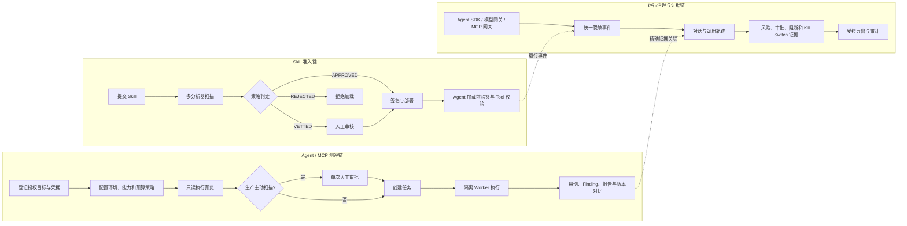

实际操作顺序：

1. 平台管理员先配置用户组、最小权限凭证、模型/MCP 资源和审计密钥。
2. Skill 管理员完成 Skill 准入；Agent 管理员完成客户端或外部 Agent 的运行身份绑定。
3. 安全管理员在“安全扫描”登记目标和加密凭据，选择与目标环境及授权能力匹配的策略，先预览再创建任务。
4. 生产环境的 `active_safe` 扫描必须在维护窗口内使用绑定目标、策略和当前凭据版本的单次审批；`active_full` 被拒绝。
5. Worker 领取不可变任务快照并执行；操作员可以取消任务，管理员可在紧急情况下启用不可撤销的任务级 Kill Switch。
6. 安全审计人员在 Finding、版本对比和调用轨迹中复核证据。任务成功或零 Finding 都不自动等于“安全”。
7. 修复后使用同目标、同类型、同覆盖和同引擎的较新任务复测；条件不一致时结果显示“无法复测”，不冒充“已修复”。

---

## 3. 核心原则

### 3.1 Agent 最终加载的 Skill 永远是本地文件

Agent Manager 管理 Skill 的准入状态、签名和授权，也可以通过 Agent Manager Client 把批准版本安全安装到客户侧客户端。无论通过哪种方式接入，Agent 最终加载的仍是本地目录，不会直接执行平台数据库中的内容。

平台管理的是：

- skill 元数据
- 风险结果
- 状态
- 签名
- 审计

真正被 agent 加载的 skill，仍然是本地目录。

### 3.2 审批时签名，运行时验签

skill 通过后会对完整目录生成签名。  
后续 agent 加载 skill 时，可以用：

- `skill_name + skill_path`
- 或 `skill_name + local_signature`

来验证本地内容是否还是批准时的那份。

### 3.3 风险来自多分析器，不看单点结果

scanner、behavioral、sandbox 分析完成后的分析结果和完整的skill内容一起输入 LLM 做最后的风险判断：

- scanner
- behavioral
- sandbox
- LLM


LLM 分析生成详细的安全报告，如果是恶意skill，还会生成攻击链，并映射到 MITRE ATT&CK（传统网络安全）和 MITRE ATLAS（AI 安全）框架，帮助用户更好地理解和缓解风险。

### 3.4 扫描缓存与强制重扫

为了提升效率，Skill 按“名称族 + 内容版本”管理：

- 同名且内容指纹相同的提交复用已有版本，不重复创建记录。
- 检测配置也一致且全局启用了“复用检测结果”时，不再重复执行扫描。
- 同名但内容不同会创建递增版本，历史版本内容使用服务端快照保存。
- Skill 详情中的基础信息、检测报告、文件等内容分别加载，已返回的内容立即显示。“版本差异”在打开时加载比较结果，等待期间仍可切换其他标签；相同版本直接显示无文本文件差异，比较失败可点击“重新加载差异”。
- 版本差异默认以最新版本为目标、前一个版本为基准，支持选择版本、交换比较方向、切换差异文件及并排或单栏对比。在本次详情查看期间，版本选择未变时切换标签再返回会继续等待或显示已有比较结果。比较范围为可读取的 UTF-8 文本文件，单文件不超过 1 MiB；跳过软链接及 `.git`、`.venv`、`node_modules`、`__pycache__`、`dist`、`build` 目录。
- Skill 列表默认展示 LLM 判定结果，与最终风险独立显示；检测中、调用失败、已跳过、未启用和未记录分别显示。显示列、偏好保存及排序规则见“12.2 技能列表”。
- Scanner 的 `--llm` 是请求开关；系统关闭 AI 分析时，上传和其他检测继续，报告以 `analyzer_timings.llm.status=disabled`、`reason=llm_analysis_disabled` 记录本次未调用模型。列表及版本摘要显示“未启用”，详情显示原因说明；系统开启后的缺配置或真实调用异常仍为失败。既有报告保留本次记录，不随当前开关改变；重新检测生成新的实际状态。
- The Scanner `--llm` flag requests analysis. If AI analysis is disabled on the server, uploads and other checks continue, and the report records `disabled` with reason `llm_analysis_disabled`. The list, detail and version summary show the recorded state. Configuration or model request errors while enabled remain failures. Existing reports retain their historical state; rescan to apply new settings.

- Skill 列表搜索与审核队列一致：输入或清空关键词后停止操作 300 毫秒自动查询全部分页数据，回到第一页并清除当前页勾选，保留状态、风险及 Sandbox 筛选条件。连续输入合并查询，点击“查询”或按 Enter 可立即查询；刷新、重置或切换筛选条件会取消待执行的延迟查询，离开页面时清理定时器。
- 是否复用只在“策略配置”全局控制，提交页和客户端不再提供单次“禁用缓存”。
- 如需重新检测，在 Skill 详情的版本列表中点击“重新检测”。重扫会新增 Scan Run，不会创建内容版本；重扫完成前或重扫失败时，上一份可信结果继续有效。
- Skill 列表支持当前页多选，批量重新检测、取消任务和删除。重新检测跳过正在检测的项；取消任务适用于初次检测和重新检测，取消重扫后保留上一份有效审批结果。删除会移除所选 Skill 的全部版本及关联记录，执行前需确认。操作结束分别展示重新检测提交、取消任务或删除 Skill 的成功和失败数量，列出对应 Skill；跳过项按状态和原因分组展示，失败项保留选中便于重试。列表在检测期间自动刷新状态。
- 提交 Skill 与批量重新检测使用相同的横向检测选项及悬停说明，规则分析默认勾选且不可取消。批量重新检测可沿用各 Skill 上次提交的深度扫描、Sandbox、LLM 分析配置，或统一选择这三项；未勾选的可选分析会关闭，当前全局策略要求的检测仍会执行。不可用的检测能力会禁用。LLM 分析先在“模型网关 > 模型管理”添加模型，再在“Skill 治理 > 策略配置 > 高级配置 > AI 分析服务”选择模型，并在“检测设置”启用 AI 分析；已启用且已选择模型时即可勾选。
- Skill 详情“基础信息”标题右侧只读展示当前版本最近一次提交的深度扫描、Sandbox、LLM 分析勾选状态，任务排队时即可查看。历史记录未保存提交选项时按检测报告展示并标明来源；没有选项或报告的记录显示未知状态。
- 升级旧数据库时，Registry 会在首次启动时把旧 Skill 按名称归入版本族；同名同内容只保留提交时间最新的一条，同名不同内容按提交时间生成版本号。迁移记录写入 `registry_migrations`，后续启动不会重复迁移，也不会重新扫描。

### 3.5 Sandbox 是补充验证，不是唯一裁判

sandbox 的作用是看：

- “这段脚本在受限环境里跑起来会发生什么”

但它不一定能触发所有恶意分支，所以：

- `sandbox benign`

不等于：

- `skill 安全`

### 3.6 模型网关保护 LLM 数据面

LLM 模型网关负责保护发送给外部模型供应商的数据：

- 模型调用凭证明文只展示一次，服务端只保存 hash。
- 模型供应商 API Key 加密落库，接口只返回掩码。
- 用户组可绑定隐私策略，控制实体类型、是否扫描 system 消息、是否允许 bypass、映射 TTL 和差分隐私统计参数。
- `stream=true` 支持 OpenAI-compatible SSE；网关会对流式 `delta.content` 做增量反替换，并在流结束后写入 audit、usage metric 和隐私链路追踪。
- 未知 OpenAI 参数默认拒绝，避免无审计透传造成资源滥用。

详细说明见：

- [model-gateway.md](../docs/model-gateway.md)

### 3.7 MCP 能力总线

MCP 能力总线集中配置远程 Streamable HTTP MCP Server，并通过虚拟网关发布选定 Tool：

- 管理台在 `能力治理 / MCP 服务` 中登记 Endpoint，连接后保存 `tools/list` Schema 快照。
- MCP 服务表单通过受管理面权限保护的 `GET /api/v1/mcp/servers/options` 读取当前 `allow_http`。Endpoint悬浮说明及即时协议校验按该值展示HTTPS或HTTP/HTTPS要求，与后端 `MCP_ALLOW_HTTP` 一致；配置加载时显示读取中提示。
- MCP 服务表单按字段展示中英文错误及悬浮要求（状态不增加说明）。名称、唯一标识及鉴权 Header 最多128字符，Endpoint 最多1024字符，鉴权值最多4096字符，描述最多2000个Unicode字符（含空格和换行）；超时1–300秒，最大响应1–10240 KB，默认值保持30秒及1024 KB。鉴权值须为可打印ASCII字符；Bearer格式为 `Bearer + 空格 + Token`。名称、标识、Endpoint和Header名称保存时去除首尾空白。
- 字段校验由 `backend/mcp_validation.py`、MCP请求schema及前端 `web/src/utils/mcpServerForm.js` 完成；稳定错误码 `mcp.server.invalid_fields` 的 `error_params.errors` 仅包含字段、原因编码及限制参数，鉴权值不进入错误响应。新增、编辑与保存前测试使用相应规则；测试仅检查实际参与请求的字段。首次输入某字段后即实时展示该字段错误，修正后即时清除；新打开的空表单不提前显示必填错误。数值使用原有数字输入框及上下箭头样式，步长为1。超长与非法数值草稿保留并显示错误，可修正后重试。编辑按原始草稿识别变更字段并校验，通过后再转换请求数值，鉴权值留空保留原值；混合校验错误使用通用错误码，仅返回错误位置和类型，不包含原始输入。未修改的历史字段保持兼容，不修改历史数据，无需数据库迁移。
- 连接发现与保存前测试的 HTTP 错误使用稳定 `mcp.connection_failed.http_status` / `mcp.debug_failed.http_status` 编码，后端提供双语消息，前端通过 `web/src/i18n/errors.js` 按界面语言展示固定说明（中文为“更多信息请参阅”）；状态码、URL 和上游原始原因保持原文，无需数据库迁移。遇到 405 时检查 Endpoint 是否为支持 POST 的 MCP 地址。
- `能力治理 / MCP 网关` 把多个 Server 的部分 Tool 组合为 `/mcp/{gateway_slug}`。网关环境与执行模式标签旁提供中英文悬浮说明，逐项解释用途、调用限制和生产边界；环境不自动准备隔离资源或切换上游凭据，需事先准备并绑定对应服务。
- `能力治理 / MCP 调用审批` 接收真实高风险调用产生的待办；管理员查看脱敏参数后批准或拒绝该 Token 对指定网关、Tool 和 Schema 的限时调用权限，查看原始参数会写入安全审计。
- 审批列表的日期范围筛选完整显示开始和结束日期时间（含秒）；筛选栏空间不足时换行，窄屏分行展示时间输入，日期范围按申请时间（created_at）筛选，包含起止边界；本页列表及详情时间、日期框钟面输入统一为北京时间（UTC+8）。后端把带偏移的查询边界转换为UTC后比较，历史无时区查询仍按UTC处理；不修改历史数据，无需数据库迁移。
- 审批列表的搜索关键词、MCP Tool、调用凭证在停止输入300毫秒后自动过滤；网关选择及日期范围确认或清空立即过滤，筛选后回到第一页。列表在首次打开、筛选或分页变化、手动刷新及审批操作后查询；刷新按钮仅在手动点击时显示加载状态，其他查询使用列表加载状态。回车、搜索及刷新按钮可立即查询；防抖等待期间翻页或调整每页数量会立即应用新筛选并回到第一页，保留所选每页数量；连续筛选仅采用最新请求结果，离开页面清理待执行查询。
- `能力治理 / MCP 调试` 可以在保存前使用临时 Endpoint 直连服务，也可以使用真实网关凭证执行 Tool 发现和调用，并展示原始 JSON 请求历史。平台网关凭证旁提供格式悬浮说明；输入后及连接前校验必填和无空白可打印ASCII字符，错误按界面语言显示在字段下，保留草稿，不发送非法请求或回显凭证。凭证是否有效及权限范围仍由服务端校验。
- 调用方使用 `MCP 网关凭证`，凭证限制可访问网关、IP、请求大小和并发数，不要求绑定 `ManagedAgent`。
- 上游连接默认强制 HTTPS，并在每次调用前校验 DNS 解析结果和出站白名单；Tool 还可以配置速率、并发、响应大小和限时审批。
- 高风险调用首次被网关阻断时会返回 `approval_request_id`；批准后，网关自动按 MCP 凭证、Gateway、Tool 和 Schema 匹配有效授权，不要求调用方回传申请 ID。有效期内允许使用不同参数重复调用，参数仅保留为审批和审计上下文。
- Tool 对外名称为 `{server_slug}__{tool_name}`；Schema 变化后暂停暴露，重新保存网关配置才会批准新 Hash。
- 当前数据面实现 `initialize`、`ping`、`tools/list` 和 `tools/call`，不托管 stdio MCP。

### 3.8 可验证安全审计

“智能体管理 → 审计追踪”以智能体与客户端为入口，覆盖身份与接入、凭证与授权、配置变更、任务与执行、能力使用与处置。列表展示身份、事件与对象、结果和时间，支持关键词、平台智能体或本地 Agent 类型、客户端、类别、结果及最近 24 小时 / 7 天 / 30 天 / 全部时间筛选。关键词输入采用 300 毫秒防抖，筛选回到第一页，时间支持升降序；所有展示时间为北京时间（UTC+8）。

点击事件打开右侧宽详情区；窄屏切换为详情单列，可返回原列表。客户端 Skill 事件复用客户端事件详情、证据时间线和 Skill 使用详情，继续提供已有关联证据与重新采集入口。其他类型按记录展示身份、关联对象、操作主体、原因和来源标识；运行治理事件可打开现有运行任务详情接口返回的任务与动作记录。平台授权决定、任务状态、认证状态与宿主执行证据分别呈现，缺少明确身份时显示未关联。原始路径、备注、错误和证据内容保持原文，固定字段、事件及状态支持简体中文和英文。

联合接口 `GET /api/v1/audit-trail` 在各来源内先筛选、计数，再合并分页，沿用页面的 `skills:view` 入口权限。客户端事件与任务还需 `clients:view` 并按设备注册人限制可见范围；运行决策需 `audit:security`，管理操作及历史操作需 `audit:operation`；智能体名称和跳转只在有 `agents:view` 且可查看该资产时提供。复用客户端原始事件时排除 Registry 中的客户端投影，避免重复计数和绕过设备权限。来源包括客户端事件、客户端任务、运行任务安全审计、智能体/客户端/凭证/运行治理管理操作、已有客户端治理操作记录，以及原有 Skill Registry 审计。客户端任务展示当前状态，时间取完成、开始或创建时间；巡检聚合次数表示发现次数。列表总量表示来源记录数，不等同于独立调用次数。

In **Agent management → Audit Trail**, trace identity, authorization, configuration, tasks and capability activity by Agent and client. Filter by keyword, platform Agent or local Agent type, client, category, outcome, and the last 24 hours / 7 days / 30 days / all time. Search is debounced by 300 ms; filters return to page one. Event time supports ascending and descending order and is displayed in Beijing time (UTC+8).

Select an event to open the wide detail panel, or a single detail view on narrow screens. Client Skill events reuse the existing event details, evidence timeline and Skill-use detail, including associated evidence and content recollection. Other events show their recorded identity, objects, actor, reasons and source identifiers. Runtime governance events can open task and action records through the existing task detail API. Platform decisions, task states, certification and host execution evidence retain separate meanings. Missing identities remain unlinked. Field labels, events and states are bilingual; paths, notes, errors and evidence retain their original content.

`GET /api/v1/audit-trail` filters and counts each source before merging paginated results. The page retains `skills:view`; client events and tasks additionally require `clients:view` and device ownership, runtime decisions require `audit:security`, and management records require `audit:operation`. Agent names and links also require `agents:view` and asset visibility. Registry projections of client events are excluded in favor of device-scoped originals. Sources comprise client events/tasks, runtime task security audits, Agent/client/credential/runtime management operations, existing client governance operations and Skill Registry audits. Client tasks show their current state, timed by completion, start or creation; inspection counts represent discoveries. The total counts source records, not independent invocations.

管理面的 Token、Agent、MCP、模型和策略写操作会进入统一安全审计链。每条事件包含前一条事件哈希，并使用独立 Ed25519 审计密钥签名。管理员可调用 `GET /api/v1/security-audit/verify`，或在 Backend 环境执行 `python -m backend.security_audit verify` 检查完整性。配置 `SECURITY_AUDIT_EXPORT_PATH` 后，同一事件还会追加写入 JSONL，供外部日志平台采集。

---

## 4. 总体架构

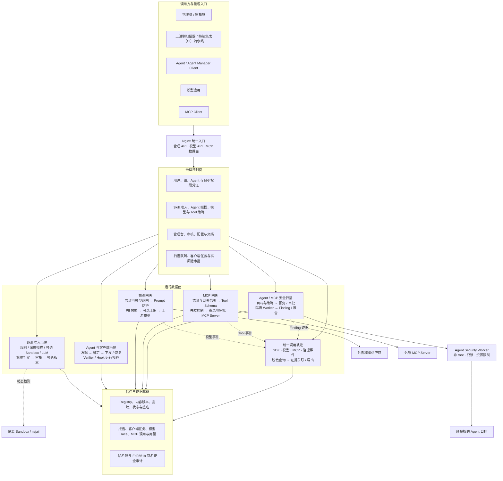

帮助中心首页使用同一架构边界绘制可响应的中英文架构图。图中的控制面负责准入、授权、
路由与证据记录；Agent 仍从本地目录加载 Skill，Sandbox、外部模型供应商和 MCP Server
分别保持隔离或外部执行边界。

---

## 5. 代码结构

### 5.1 核心治理后端

- [agent_manager/core/manager.py](../agent_manager/core/manager.py)
  生命周期总控
- [agent_manager/core/vetting.py](../agent_manager/core/vetting.py)
  扫描与风险判定
- [agent_manager/core/policy.py](../agent_manager/core/policy.py)
  策略配置
- [agent_manager/core/registry.py](../agent_manager/core/registry.py)
  SQLite 持久化，启动时可从旧 `registry.json`、`review.json`、`audit.jsonl` 自动迁移，并一次性把旧 Skill 记录迁移到名称族和内容版本模型
- [agent_manager/core/runtime.py](../agent_manager/core/runtime.py)
  运行时治理
- [agent_manager/core/prompt_manager.py](../agent_manager/core/prompt_manager.py)
  历史 Prompt Registry 兼容能力；新主流程使用模型网关运行时 Prompt 防护
- [agent_manager/core/prompt_registry.py](../agent_manager/core/prompt_registry.py)
  历史 Prompt Registry 持久化存储
- [agent_manager/core/signer.py](../agent_manager/core/signer.py)
  目录签名
- [agent_manager/core/llm.py](../agent_manager/core/llm.py)
  OpenAI-compatible LLM 分析；可直连模型供应商，也可通过内置模型网关隐私路由
- [agent_manager/core/sandbox.py](../agent_manager/core/sandbox.py)
  Docker / remote sandbox

### 5.2 API 层

- [agent_manager/api/router.py](../agent_manager/api/router.py)
  Agent Manager API
- [backend/main.py](../backend/main.py)
  管理后台 + Agent Manager API 集成入口
- [backend/routers/llm_gateway.py](../backend/routers/llm_gateway.py)
  内置模型网关、OpenAI-compatible 代理、PII 伪匿名、Trace 与管理 API
- [backend/routers/mcp_gateway.py](../backend/routers/mcp_gateway.py)
  MCP Server 发现、虚拟网关、Tool 路由、凭证校验与调用审计
- [backend/routers/security_scans.py](../backend/routers/security_scans.py)
  Agent/MCP 安全目标、策略、审批、任务、Worker 协议、Finding、报告和 Kill Switch
- [backend/routers/runtime_traces.py](../backend/routers/runtime_traces.py)
  统一调用轨迹、事件查询、证据导出、留存清理和指标

### 5.3 管理台前端

- [web/src/views/Skills.vue](../web/src/views/Skills.vue)
- [web/src/views/SkillDetail.vue](../web/src/views/SkillDetail.vue)
- [web/src/views/SubmitSkill.vue](../web/src/views/SubmitSkill.vue)
- [web/src/views/ReviewQueue.vue](../web/src/views/ReviewQueue.vue)
- [web/src/views/SystemSettings.vue](../web/src/views/SystemSettings.vue)
- [web/src/views/ScannerAccess.vue](../web/src/views/ScannerAccess.vue)
  客户侧扫描器接入、Token、CLI/GUI 下载
- [web/src/views/ModelGateway.vue](../web/src/views/ModelGateway.vue)
  模型供应商、模型端点、旧模型凭证查询与吊销、用户组和隐私策略管理
- [web/src/views/PipelineTrace.vue](../web/src/views/PipelineTrace.vue)
  查看隐私路由四阶段报文
- [web/src/views/McpGateway.vue](../web/src/views/McpGateway.vue)
  MCP Server、虚拟网关和调用审计管理
- [web/src/views/AgentSecurityScans.vue](../web/src/views/AgentSecurityScans.vue)
  Agent/MCP 扫描目标、策略、任务、Finding 和报告工作台
  Agent Security 与 Runtime Trace 锁定版本和能力边界
- [web/src/views/RuntimeTraceExplorer.vue](../web/src/views/RuntimeTraceExplorer.vue)
  对话/轨迹双视图、证据搜索、Finding 关联和受控导出

### 5.4 独立执行服务

- [services/isolated-sandbox-service/app.py](../services/isolated-sandbox-service/app.py)
  生产版远程 sandbox 服务基线
- [services/agent-security-worker/worker.py](../services/agent-security-worker/worker.py)
  独立安全扫描 Worker，负责租约、心跳、Agent Scan/MCP 扫描执行器和结果回传

### 5.5 客户侧扫描器

- [scanner/cmd/skill-scanner/main.go](../scanner/cmd/skill-scanner/main.go)
  Go CLI 扫描器入口
- [scanner/cmd/skill-scanner-gui/main.go](../scanner/cmd/skill-scanner-gui/main.go)
  原生桌面 GUI 扫描器入口
- [agent_manager/api/scanner_router.py](../agent_manager/api/scanner_router.py)
  Scanner 专用 API 与下载接口
- [agent_manager/core/scanner_tokens.py](../agent_manager/core/scanner_tokens.py)
  旧 Scanner Token 的兼容校验和吊销
- [agent_manager/core/scan_cache.py](../agent_manager/core/scan_cache.py)
  重复扫描复用缓存

客户端通过 Scanner API 提交相同内容时，提交读取权按绑定的客户端 ID 持久化，因此同一客户端轮换凭证不会丢失检测结果关联；普通 Scanner 凭证仍按凭证主体隔离，不同客户端不能读取彼此的提交。

客户端的 `agent-manager-client agent-log-read --agent claude|codex` 提供带覆盖状态和可续读游标的调用/结果元数据；`agent-log-collect` 将读取与游标原子保存至专用本地 SQLite，`agent-log-state` 查询状态、事件和待发批次。`aidr-sync` 显式运行读取、上报和心跳；管理台设备详情的“Agent 日志观察”优先展示合并后的操作意图、脱敏命令/明确目标与日志结果依据，支持会话等条件筛选；能力和覆盖诊断可展开，缺口醒目提示。进程关联保持未知。凭证绑定设备并具有 AIDR scopes，管理查询及启停沿用现有设备访问权限。接入步骤、macOS 实测范围和未完成验收见 [客户端日志说明](agent-manager-client.md#agent-日志平台接入p1-0305) 与 [P1 平台验收记录](../experiments/aidr-agentlog/PLATFORM_ACCEPTANCE.md)。

平台 **设备详情 → 策略与审批 → 系统采集策略** 设置允许采集的 Agent 和对象选择方式，并展示设备发现结果；**行为审计 → 系统事件** 查看实际执行器版本和系统证据。桌面 **运行治理 → 系统采集** 自动发现程序，勾选安装入口后开始采集，无需终端：复用设备连接和平台目标，通过 macOS 管理员授权安装/更新组件并启动独立 root 采集进程，桌面保持普通用户权限。默认采集进程执行及文件变化通知，真实订阅成功才显示运行；完整磁盘访问权限独立授权。停止关闭订阅、回收进程、限时补传，剩余记录保留到下次开始。开发包仅在 SIP 已关闭时安装 ad-hoc ES 签名组件，未更新组件不重复签名；正式发布需要 Developer ID、Apple ES 授权和公证。客户端不修改 SIP。流程、故障说明和人工验收见 [macOS 执行器说明](../client/macos-enforcer/README.md) 与 [客户端说明](agent-manager-client.md#系统采集对象选择)。

“客户端选择”允许终端用户从平台允许的 Codex、Claude Code、WorkBuddy 或自定义程序中勾选实际安装入口；“平台指定”要求每个指定产品至少选择一个可用入口。发现结果来自客户端的常见安装目录、运行中程序及手动添加路径；客户端核对原生可执行文件和代码签名，平台按设备凭据、配置版本、发现时效和允许范围校验选择，再签发原有格式的进程归属策略。程序路径收在详情中；原有签名规则、租约和历史入口保留在高级区域。平台保存要求与客户端开始采集是独立动作，发现可用、配置签发、执行器应用和真实事件分别核对。

平台“刷新发现”发送发现请求，由运行中的新版桌面客户端轮询处理；页面保留上次报告时间。运行中的采集对象修改通过“应用修改”签发新版本，并等待执行器报告。范围收窄会从签名目标中移除不再允许的程序；关闭系统采集后执行器在下一次配置检查时停止。已有路径策略首次切换到选择配置前，应先完成设备发现。上线顺序为平台、客户端；启动时创建 `aidr_system_selections` 表，不改写已有系统策略。

客户端另有开发阶段的 macOS 运行时只读入口 `agent-manager-client runtime-watch`：
普通用户通过本地 Unix socket 接收单独启动的特权 ES 采集器事件及健康状态。
桌面进程归属信息统一展示在“系统采集”的最近事件及事件诊断中。上述开发命令的协议见 [客户端使用说明](agent-manager-client.md#macos-运行时只读连接开发阶段)。

---

### 审批与采集配置

Hook 接收器与日志采集、策略同步合并运行在主后台服务中；关闭窗口、完全退出或重启桌面客户端均不停止工具审核和事件上传。TeleAgent 模型代理继续作为独立后台进程运行，接入 TeleAgent 时共 2 个常驻后台进程（不含桌面界面和按需系统采集器）。通过托盘或 macOS Dock 恢复窗口；后台服务实际重启时仍需重新建立接收器，队列和策略保留。操作边界与中英文验收清单见 [客户端使用说明](agent-manager-client.md)。

**English:** The main background service runs Hook reception, log collection and policy synchronization in one process. Closing, quitting or restarting the desktop leaves tool review and event upload running. With the independent TeleAgent proxy enabled, there are two persistent background processes, excluding the GUI and optional system collector. Restarting the background service itself recreates the receiver while retaining its queue and policy.

TeleAgent 模型转发使用独立 macOS 用户级代理服务，关闭、退出、重启或更新客户端时持续运行。模型代理和 Hook 审核接收器分别检查健康：接收器停止时模型转发继续，工具审核仍须有效决策。安装、迁移及程序更新方式见 [TeleAgent 接入](external-agent-integration.md#aidr-产品适配器与-teleagent--product-adapters-and-teleagent)。

客户端默认策略和单机覆盖分别配置 Hook、系统防护的“仅审计 / 拦截”模式，支持恢复继承。新配置默认仅审计；存量未选择模式的策略保留原行为，旧客户端需升级后才能确认新模式。Agent 日志保持采集设置。平台目标与客户端实际模式分别显示，保存成功不代表已应用。

“工具使用审批”配置 Agent 工具调用前的允许、拒绝和人工审批，Hook 拦截模式执行签名规则；规则持续有效直到发布新版本，仅具体调用的单次审批保留超时。“系统采集策略”配置 Agent 可执行文件及有效期，高级区域的文件访问规则在系统拦截模式执行。系统策略有效期作为设备认证租约：已认证设备由平台自动续签内容不变的新版本，管理员发布采集范围和规则，允许客户端选择时由设备在该范围内提交安装入口并由平台签发；自动续签进入操作审计，不混入管理员配置历史。运行中的系统采集器关闭旧订阅、补传后切换，实际 ES 心跳确认模式。仅审计保留采集、脱敏和上传，不执行阻断；采集故障不阻止正常工具操作。详见[客户端模式说明](agent-manager-client.md#仅审计与拦截模式)。系统事件默认展示命令与文件变化：有界原文 argv（8 KiB / 256 项）、执行目录、程序及 Agent 根路径、退出码/信号、进程存活时间、文件创建/修改/重命名/删除。详情按精确进程身份展示活动和可展开的归属链，原始 JSON 收在技术诊断。客户端自检单独标记筛选；历史缺失字段不补造。采集持续到停止或进程退出，续签独立于管理员配置版本，不影响正常编辑。已有根在下一次系统事件验证身份；页面明确显示策略覆盖范围。

工具操作是命令摘要：`[HEREDOC OMITTED]` 表示多行输入正文省略，`[BODY OMITTED]` 表示内联脚本或正文省略。摘要与正文分开保存。新平台的“命令正文（脚本 / HereDoc）”默认开启，已有策略保留原选择，可在“审计采集与脱敏”中修改。支持该能力的客户端采集日志或 Hook 已提供的 Shell 命令、内联脚本和包装代码，遵循现有脱敏与长度上限；详情直接展示正文，有正文时不重复展示带占位符的摘要。已省略的历史正文无法恢复。

**English:** New installations enable command body capture by default. Existing policy choices are preserved. Capable clients capture available scripts and HereDocs under the configured redaction and byte limits; previously omitted bodies cannot be recovered.

`aidr_enforcement_collection_only` 是系统采集器报告“仅采集、不执行控制”的诊断码，不代表故障。日常界面显示采集状态，原始代码收在“查看技术诊断”。工具审批列表只显示 Hook 拦截模式下需要人工决定的调用；一般工具操作记录在“行为审计”，不进入审批列表。

人工检查：中英文页签切换；工具审批空列表与规则展开；系统采集策略发布入口、文件控制高级区和历史区；系统事件筛选和技术诊断；桌面事件归属与诊断展开后轮询保持。此轮不更改真实设备策略。

Agent 日志本地数据库默认配额为 1 GiB（1024 MiB）。平台持久化 ACK 校验通过后，客户端在同一事务中释放已确认的事件、关联证据和覆盖快照正文；保留去重 ID／摘要、来源与观测时间、ACK 水位及解析游标。启动时同样处理旧库已确认正文，未确认数据及冻结批次保持不变。已上传历史从平台查看，本地释放不改变平台保留期限；本地去重元数据按原保留窗口回收。配额仍约束数据库页，WAL 和 SHM 另占空间。

**English:** The local Agent log database defaults to 1 GiB (1024 MiB). A validated durable platform ACK atomically releases confirmed event, evidence and coverage bodies while retaining deduplication IDs/digests, source and observation metadata, ACK watermarks and parser checkpoints. Startup also releases confirmed legacy bodies; pending records and frozen uploads remain intact. View uploaded history on the platform. Local release does not change platform retention; deduplication metadata follows its existing retention window. WAL and SHM consume space outside the database page quota.

UI 验收 Todo（简体中文 / English）：在“采集状态”核对“已释放本地正文”的数量及说明；在“审计采集与脱敏”核对平台保留期限与本地 ACK 后释放的区别；确认已上传会话正文仍可从平台打开。

规则编辑区按常用预设、当前规则和未命中处理组织；规则列表可直接调整 Agent 与处理方式。已发布信息以版本、发布人和时间展示，历史策略继续保存在后端。底栏“预览并发布”先核对草稿和默认处理，再提交签名策略。

客户端管理页顶部的“全局工具规则”统一配置预设、自定义规则和未命中处理。平台启动时，若没有已发布的全局规则，自动创建版本 1：规则为空，未命中时允许，发布者为 `system`。重复启动不会追加版本；已有全局规则保持不变。管理员可预览影响的继承客户端数量及保持单独配置的数量，再发布新全局版本。未配置过工具规则的客户端默认继承；升级前已有设备签名规则的客户端保留单独配置。在客户端“工具与命令规则”中开启“继承全局工具规则”，预览并发布后改为跟随全局；关闭继承后可在当前规则基础上编辑并单独发布。单独配置整体替换全局规则，不合并两套规则。

**English — initialization:** On startup, a platform without published global rules creates revision 1 with an empty rule list and an allow fallback, published by `system`. Subsequent restarts preserve existing revisions and client overrides. Administrators publish further changes as new revisions.

全局规则版本、设备签名版本和客户端实际报告分别展示。全局发布只追加配置版本，不逐台签名、不扫描事件；设备下次请求控制快照时按自己的身份和递增版本签发，重复同步不重复生成版本。全局命令规则可先保存；未报告命令匹配能力的接收器暂不获得新签名，保留原本地策略，升级并提交近期能力报告后继续同步。离线客户端同样继续使用本地已验证策略，恢复连接后同步；发布不会改变 Hook 的仅审计/拦截模式。新全局版本尚未签发期间，平台不批准旧版本的待处理调用；已在设备签发并缓存的规则及许可按其原有有效性执行，离线撤销不是即时的。全局规则持续有效，直到新版本替换。

**English:** Use **Clients → Global tool rules** for shared presets, custom rules and fallback handling. Clients without existing tool rules inherit by default; legacy device policies remain overrides. In a client's rule editor, review and publish the inheritance switch to follow global updates, or disable it to publish a complete local override. Global publication stores one revision; each device receives an individually signed, monotonic policy on its next control snapshot. Repeated synchronization is idempotent. Command rules wait for a recent capable receiver report; offline or incompatible receivers retain their verified local policy. Hook mode remains independent. Saved targets, issued device revisions and client-reported application are distinct. Pending calls under outdated global rules cannot receive new platform approval; offline cached authority is not instantly revoked.

UI 验收 Todo（简体中文 / English）：从客户端列表打开全局规则；编辑预设、自定义命令和未命中处理；核对发布预览的继承/覆盖数量；取消预览不保存；已有客户端保持单独规则；开启继承、关闭继承和恢复继承后核对来源及签名版本；等待实际客户端回执；两窗口并发修改提示刷新；390px 窄屏检查抽屉、继承开关、规则编辑弹窗及底栏。后端隔离测试覆盖签名、幂等、恢复继承、权限、冲突与能力门槛，不代表真实宿主拦截验收。

“测试规则命中”默认折叠，Hook 测试分为“命令”和“宿主工具名称”：命令框填写 `rm -rf ./example` 等内容，执行工具选择 Hook 实际报告的 `Bash`、`exec` 等名称；原生工具测试填写 `Read` 等工具名。模拟结果只显示本次最终处理，逐条命中原因在详情展开查看。系统测试填写进程归属和文件绝对路径。测试使用未保存的草稿，不发布策略、不创建审批、不执行工具；修改草稿或输入会清除旧结果。Hook 复用服务端真实匹配逻辑，拒绝优先于审批和允许。系统测试只做路径预匹配；实际设备还按文件身份匹配，因此硬链接等不同路径仍可能命中。预览假设策略有效且处于拦截模式，客户端实际模式及版本仍以回执为准。

**English:** The editor groups presets, current rules and fallback handling. Agent scope and handling can be edited inline. Published metadata shows revision, author and time; historical policies remain stored. Review and publish opens a draft summary before submission. The collapsed tester separates command input from native tool names. Command tests use the selected shell tool reported by Hooks, while native-tool tests accept names such as Read. One simulated outcome is prominent; per-rule reasons are expandable.

UI 验收 Todo（中英文）：检查预设/自定义编辑、行内修改、默认允许/拒绝说明；分别测试命令和宿主工具，展开未命中原因；修改输入后结果清除；预览发布后取消不保存；390px 窄屏检查表格卡片、编辑弹窗和底栏，确认所有操作可见。

“工具与命令规则”提供递归删除、Git reset --hard、curl 管道运行脚本三个可编辑预设，也可添加自定义规则：命令名或可执行文件路径、必须包含/至少包含一个参数、目标绝对路径前缀、管道目标、Agent 和允许/审批/拒绝。参数每行一个，按完整参数匹配，短选项组 `-fr` 可匹配 `-r`。宿主工具名称规则继续精确匹配 `Bash`、`exec` 等；已有工具名 `rm` 的规则保留原语义，需要编辑为“命令及参数”才能匹配 Bash 内的 rm。“未命中规则时”选择拒绝仍拒绝所有未匹配工具；明确选择默认决定，先测试草稿，再发布签名策略。测试不执行命令、不创建审批、不改变真实设备策略。

命令匹配支持有界的 Shell 字面量语法：引号、转义、多条命令和管道。`echo rm` 不匹配 rm；非允许规则匹配任一子命令，允许规则要求所有子命令及指定路径均匹配。目标路径按文本和 Hook 工作目录规范化，不证明文件身份或软链接目标。变量、替换、重定向、包装执行、缺失命令等无法可靠解析时，该条件不计为命中，继续判断其他规则；没有规则明确命中时，采用“未命中规则时”的允许、审批或拒绝设置，并保留解析不确定标记。因此默认允许也会放行无法解析的命令。仅审计继续执行。此功能不解释 Python/JavaScript 等任意脚本正文，也不等于完整 Shell 或 OS 行为控制。

新版本接收器在调用前事件中保存控制决定，Hook 时间线对拒绝决定显示红色“已拦截 · 客户端控制决定”、拒绝原因和命中规则。这是客户端返回给宿主的控制决定，不是操作系统执行结果；宿主自身权限拒绝和缺失执行后事件保持各自证据含义。历史事件未记录控制决定时不补推断为已拦截。人工验收 Todo（中英文、窄屏）：检查拒绝卡片及长规则名换行、未命中默认允许的预览、普通缺失执行后事件不误标、仅审计不误标。

命令规则采用签名策略 schema 3；原生工具规则继续使用 schema 2，旧安装标识和历史规则保留。发布新命令规则要求最近 90 秒的接收器报告声明 `command_rules_schema: 1`，否则提示升级且不发布。需先更新后端，再升级客户端/接收器。发布成功与设备已应用分别核对。审批沿用原始输入摘要、调用身份、策略版本和一次性授权；不为规则匹配增加原始命令上传。

**English:** Tool and command rules offer editable recursive-delete, Git reset --hard and curl-to-shell presets plus custom executable, required/alternative arguments, target path prefix, pipeline target, Agent scope and decision. Native tool rules retain exact-name semantics. Preview only analyzes the draft. The literal shell subset handles quoting, escapes and multiple commands. Unresolved conditions are not matches; confirmed matches retain their precedence, otherwise the configured default applies, including allowing unresolved commands when default is allow. Audit mode continues. Paths are textual, not filesystem identity. Interpreter source code is outside this matcher. Command policies use signed schema 3 and require a fresh receiver capability report; native-only policies remain schema 2. Upgrade the backend and receiver before publishing. Matching does not expand raw-command collection. New pre-tool events persist the client control decision; rejected calls show a red Blocked label, reason and matched rule. This is not an OS execution receipt. Historical missing decisions are not inferred. Check these states in both languages and at narrow widths.

人工验收清单 / Manual UI checklist（简体中文与英文均检查）：预设编辑、自定义参数与路径、重复 ID 提示、修改后旧预览清除、`echo rm` 不命中与 `rm -rf` 命中、未命中默认决定、只读权限、390px 窄屏弹窗/表格及底部操作。真实宿主验收需在隔离目录发布专用测试规则，核对接收器 schema 3 回执、原生 Hook、平台审批、一次性批准消费及恢复原策略；单元测试和网页预览不代替此验收。

客户端策略弹窗的正文使用单一滚动区域，底栏根据按钮换行自动预留空间。“接入与运行”的预览、返回和确认操作，以及“审计采集与脱敏”的保存操作均固定在底部。审计策略有有效修改后才能保存；点击保存仍需核对变更并按需确认采集风险，提交期间禁止重复保存、切换页签和关闭弹窗。人工检查全局与单机策略、预览返回、审计保存确认和取消及中英文窄屏，确认操作始终可见且不误保存。/ Client policy dialogs use one scrolling body and reserve the actual footer height when buttons wrap. Integration preview/back/confirmation and audit-policy saving stay in the footer. Audit saving requires valid changes and opens the existing change review and any required collection acknowledgement. Submission disables duplicate saves, tab switching and closing. Manually check global/device policies, preview/back, audit review/cancellation and narrow Chinese/English layouts.

**English:** Test rule matching evaluates the unsaved draft against an Agent/tool or attributed process/file path. Results show every rule's match, reason and simulated decision. Testing publishes nothing, creates no approval and executes no tool. Editing inputs clears previous results. Hook previews reuse the server's matcher; system previews compare paths only, while devices also match file identity. Previews assume an effective policy in Intercept mode; verify actual client mode and revision separately.

人工验收清单：两处编辑页分别测试命中、未命中、多规则冲突及默认决定；Hook 测试精确名称与 `*`；系统测试未知进程归属的处理；检查编辑后旧结果消失、无效规则报错、失败后重试；中英文及窄窗口检查；确认测试前后已发布版本和审批数量不变。未新增 UI 单元测试。

### 按会话查看行为审计

会话列表默认通过元数据索引汇总当前设备的日志、消息和 Hook 数量，分页后只查找当前页会话的首条有效提问，避免为展示 20 个会话读取全部历史工具正文。关键词搜索仍按原有正文权限查询，保留完整会话计数；分页快照上限、过期过滤及正文访问审计保持有效。升级时自动添加索引，首次建索引耗时随历史数据量增长，不重写事件或清空队列。

**English:** The default session list aggregates device metadata through indexes and resolves the first available question only for sessions on the selected page. Keyword searches retain content permissions and full-session counts. Snapshot ceilings, retention filters and content access auditing remain in effect. Upgrades add indexes once; index creation time depends on history size and does not rewrite events or clear queues.

性能人工验收 / Performance checks：首次打开行为审计、刷新会话、Agent 筛选、提问关键词搜索、更多会话；核对加载提示、标题与各来源数量，并确认翻页期间新收到的提问不会混入旧快照。Check initial loading, refresh, Agent filtering, question search and pagination, including loading feedback, titles, counts and snapshot isolation.

行为审计使用各子页面自己的刷新入口；会话左侧“刷新”更新会话列表、轮次及当前时间线。设备数据刷新在概览等设备信息页面使用。人工验收：切换会话活动、系统事件和采集状态，确认顶部不显示设备刷新按钮，且各自刷新正常；切回概览确认设备刷新仍可用。中英文均需检查。

**English:** Behavior audit uses each subpage's own refresh control. Refresh beside Sessions reloads the session list, turns and current timeline. Device refresh remains available in device information views such as Overview. Manual checks: switch between Session activity, System events and Collection status, verify no device refresh button appears in the header and each local refresh works; return to Overview and verify device refresh remains available. Check both languages.

会话日志的工具结果有明确退出码时显示“命令退出码 {code}”；没有退出码但日志明确标记失败时显示“工具调用失败（日志记录）”。该状态描述工具执行结果，采集和上传故障在采集状态中查看。缺少调用、缺少结果及结果未确认继续保留各自状态。

**English:** Session log tool results show “Command exit code {code}” when the recorded outcome has an explicit exit code, or “Tool call failed (log record)” for an explicit failure without one. These describe tool execution; collection and upload health is shown under Collection status. Missing calls, missing results and unconfirmed results retain their distinct labels.

人工验收 / Manual checks：在中英文会话日志中检查退出码 0、非零退出码、无退出码的明确失败、缺少调用和结果未确认；确认退出码不重复展示、Hook 结果仍按宿主报告显示，并检查窄屏标签换行。Check these cases in both languages, including narrow-screen wrapping and unchanged host-reported Hook results.

客户端详情的 **行为审计 → 会话活动** 按“客户端、Agent、会话 ID”汇总入口，分别显示消息数、工具操作数和 Hook 原始事件数。会话列表显示最近活动时间和短 ID；有审计正文权限且已采集提问时，使用首条有正文提问的前 160 个字符作为标题。未采集问题时显示 Agent、时间与短 ID。可按 Agent、会话 ID 筛选，有正文权限时也可搜索已采集的问题；没有会话 ID 的操作以独立记录展示。系统事件和采集状态保留独立入口。

会话内使用窄刻度导航轮次。悬停或键盘聚焦显示问题、时间及两种来源的数量；点击立即筛选本轮，选中轮次自动定位。可滚动时显示上下翻动按钮和边缘渐隐，底部显示当前位置与总轮次数。上下方向键移动刻度焦点，Enter 选择。窄屏使用轮次下拉列表。轮次超过一页时点击“更多轮次”。原生轮次 ID 相同的记录按轮次组织，日志与 Hook 保留各自来源；同 ID 下收到多条用户提交时保留全部 Hook 记录并提示数量，问题区显示首条提交。缺少轮次 ID 的用户提交独立展示，其余缺少轮次 ID 的记录进入“未归属轮次”，不按相邻时间推断归属。轮次显示序号仅用于当前会话导航，不是原生轮次 ID。

**English:** The turn rail reveals the selected turn, shows scroll arrows and edge fades when more turns are outside the viewport, and displays the current position and total. Narrow screens retain a turn selector.

人工验收 / Manual checks：少量及 50+ 轮次、选择首尾轮次、上下翻动与键盘导航、切换会话后定位、中英文及窄屏；检查新策略默认命令正文开启、显式关闭后保持关闭、新记录遵循脱敏与长度上限。

选择会话时清除上一会话的时间线搜索；若当前来源没有记录而另一来源有记录，自动展示有记录的来源。轮次已完整加载时，优先定位当前来源最近有记录且具有轮次 ID 的轮次；轮次尚有下一页或只有未归属记录时，显示全部轮次。手动切换来源保持当前轮次与搜索，刷新保留当前选择。本轮为空但会话其他轮次有记录时，明确提示并提供“全部轮次”入口。只有 Hook 的会话显示来源覆盖说明；采集器在线不代表每个会话都有本地日志。

在 **会话日志（输入 / 回复 / 工具）** 与 **宿主事件（Hook）** 之间切换查看各自记录。会话日志直接展示已采集的用户输入和模型回复，工具操作合并日志调用及结果；Hook 仅在同一接收流、用户、Agent、会话、轮次、调用、工具和子 Agent 身份下，恰好各有一条执行前/执行后记录时合并显示。配对在服务端分页前完成，展开后仍显示两条原始事件。生命周期事件使用简洁节点，失败突出结果和退出码。不同来源不合并计数，也不据此认定系统执行成功。

会话活动填满客户端详情的剩余高度。设备信息、各级 Tab、会话标题、搜索与轮次导航固定；只有时间线记录区随阅读滚动，会话列表可独立滚动。标题与来源工具栏使用两行紧凑布局，会话 ID 和来源说明通过信息按钮查看，搜索与来源 Tab 同行；窄屏换行并使用会话与轮次下拉选择，保留固定导航与独立时间线滚动。会话列表按最近活动排序，时间线固定从早到晚，文字搜索停止输入 250 毫秒后生效；支持搜索工具、脱敏命令摘要、目标及 Hook 名称。日志按调用时间（缺少调用时按结果时间）排序，Hook 按接收时间排序。加载更多保留本次查询的新增记录上限；点击刷新重读当前会话与来源。单一来源为空时提供另一来源和采集状态入口。会话和轮次接口默认仅返回元数据；页面为有 `clients:read-audit-content` 权限的用户显式请求 `include_questions=true`，服务端再次检查权限，返回已采集的问题并记录仅含记录 ID 的访问审计，响应禁止缓存。Codex 附带浏览器、文件或注释上下文且存在明确请求段时，问题区展示请求段，并提供原始提问与上下文的展开入口；采集记录保持原文。用户提交事件直接显示已采集的正文；工具卡片统一使用“查看详情”，展开后自动读取并展示已采集的输入、输出和文件正文。正文保留脱敏、截断状态及独立权限校验，读取失败时提供重试。未提供结果标记的 Hook 不显示空泛的结果标签，明确的成功、失败、取消及缺少后续事件状态继续展示。过期正文不参与标题、搜索或轮次问题展示。

**English:** Open **Client details → Behavior audit → Session activity**. Sessions show last activity and a short ID; authorized viewers also see the first captured question as a title and can search questions. The narrow turn rail previews question text, time and separate source counts on hover or keyboard focus. Select a tick to filter that turn, or select **All turns** in the turn navigation for the full timeline. Arrow keys move focus and Enter selects; small screens use a turn selector. Load more turns when needed. Native turn IDs group navigation only; log operations and Hook events remain separate. Repeated submissions within one native turn stay in Hook records, with the first question shown in the turn heading. Prompts without turn IDs stay independent; other missing-ID records are unassigned. APIs return metadata by default. Explicit question requests require audit-content permission, have identity-only access logs, and use no-store responses. Expired content is excluded. User submissions show collected text directly; expanding View details automatically loads captured input, output and file content, with permission checks and a retry action on failure. Hook entries omit unspecified-result labels while retaining explicit outcomes and missing-after-event states. The audit workspace fills the available drawer height. Device navigation, source tabs, search and turn navigation stay fixed while timeline records scroll; the session list scrolls independently. A compact two-row header puts search beside the source tabs and moves identity and source explanations into information popovers. Small screens use selectors and wrapped controls while retaining an independently scrolling timeline. Sessions are ordered by last activity; timeline records always run from oldest to newest. Source pairing, search and pagination remain available.

受影响 UI：客户端详情的行为审计入口、会话列表、日志/Hook 时间线、展开详情，以及日志/Hook 独立详情弹窗中的正文展示。

“仅收到 Hook”显示为会话标题旁的灰色状态标签。采集来源与覆盖范围说明统一放在标题的信息按钮内；下方工具栏展示来源切换和搜索。English: “Hooks only” is a neutral status badge beside the session title. Collection-source and coverage explanations are available from the title's information button; the toolbar contains source switching and search.

会话筛选将 Qoder 合并为一个选项，包含 CLI、共享 Hook、IDE 和 Work 入口；记录仍保留各入口身份，不合并同名会话。会话标题下显示主会话 Hook 最近明确报告的模型、工作目录及工作区；悬停可查看报告时间和事件 ID，事件详情保留各次报告。未报告的字段不展示，不从默认模型配置或工具工作目录推断；历史记录不会补造字段。元数据沿用脱敏策略。最近报告只代表该次宿主报告，不证明后续每次模型请求使用相同模型。

**English:** The Qoder session filter includes CLI, shared Hook, IDE and Work entries while preserving separate entry/session identities. The session header shows the latest explicitly reported main-session Hook model, working directory and workspace roots. Hover for the report time and event ID; event details retain each report. Missing fields remain absent, with no configuration-based inference or historical backfill. Metadata follows audit redaction. A host model report does not establish the model used by every subsequent request.

**English:** Selecting another session clears the timeline search and switches to the other source if only that source has records. When all turns are loaded, the latest turn with a native turn ID and records from the selected source is selected. With more turn pages or only unassigned records, all turns remain visible. Manual source changes and refresh retain the selection. An empty turn offers All turns when the session contains other records. Hook-only sessions explain that collector health does not establish session-log coverage.

轮次标题旁显示该轮主 Agent 的“Hook 模型”。仅关联同一设备、产品、会话和原生轮次 ID 的明确报告；无原生轮次 ID 的提问只使用自身报告，不关联相邻事件。同一轮重复模型去重，报告过多个模型则并列展示，悬停可查看最近对应事件时间和 ID。缺少报告时不显示，保留顶部“Hook 最近报告”的会话范围语义。

**English — turn models:** The turn heading shows explicit main-agent Hook model reports for that native turn. A prompt without a native turn ID uses only its own report. Duplicate model names are collapsed; multiple reported models are listed with their latest event provenance on hover. Missing reports remain absent, independently of the session-wide latest report.

**Agent 日志模型信息：** 会话标题下的“Agent 日志最近报告”展示最新采集记录中的模型、供应商标识和推理设置；有原生轮次 ID 时，同一轮的不同模型配置也展示在轮次标题旁。悬停可查看记录时间、字段来源及事件 ID。Codex 读取 `session_meta.model_provider` 与 `turn_context.model/effort/summary`；Claude Code、Qoder CLI 读取助手消息的 `message.model`；WorkBuddy 读取记录自身的 `providerData.model`；OpenCode 从同一消息 ID 的快照读取 `modelID/providerID`。供应商标识可能是用户配置的别名；日志未提供的字段不推断，设置不等同于最终上游请求参数。

只采集这些有界元数据，不读取 API Key、认证文件或完整模型配置。新增元数据通过协议协商接入原有队列和 ACK 链路；已有历史事件保持不变。升级时仅从原文件首条会话记录及游标前最多 1 MiB 的记录恢复身份匹配的上下文，不移动游标或重放事件；超出范围、尚未记录或无法可靠归属的模型继续留空。查询使用设备、产品、会话的局部索引，只返回模型元数据，不读取正文。

**English — Agent log models:** The session header shows the latest collected log's model, provider ID and available reasoning settings. Native turn IDs associate distinct model configurations with their own turns; hover reveals event provenance. Provider IDs may be local aliases. Missing fields stay absent and recorded settings do not establish the final upstream request. Credentials and full configuration files are not collected. Metadata uses negotiated protocol support and the existing durable queue/ACK path. Existing history is unchanged; bounded identity-matched context recovery does not move cursors or replay events.

模型信息 UI 人工验收：中英文分别检查会话元信息、轮次模型及悬停来源；切换模型后旧轮次保持原值；缺少日志模型的会话不借用 Hook 或本机默认配置；检查长模型名、供应商别名与窄屏换行。真实新会话应核对日志字段 → 本地队列 → 上传 ACK → 平台记录 → 页面，历史样本解析不替代新调用验收。

人工验收 Todo（未新增 UI 单元测试）：

- [ ] 切换轮次、来源和会话，核对模型仅属于当前轮；检查同轮多模型、无模型报告、长模型名及中英文窄屏换行。/ Verify turn-local models, multiple models, absent reports and long names in both languages and narrow layouts.

- [ ] 中英文检查仅有 Hook 的会话：标题状态标签与 Tab 明显区分，信息按钮能用键盘查看来源说明；切换到有日志的会话时标签消失。English: verify the header badge, keyboard-accessible source information and badge removal when selecting a session with logs.
- [ ] 中英文检查模型、工作目录、长路径和多工作区；核对悬停来源与事件详情一致，切换会话无旧值残留。English: check metadata, long paths, workspace roots and report provenance; switching sessions must clear previous values.
- [ ] Qoder 下拉选项只有一个，选择后包含各入口；翻页、搜索和时间线仍使用原始入口身份。English: one Qoder option includes all entries; pagination, search and timeline retain native entry identities.
- [ ] 在同一会话切换两种来源，核对各自数量、时间与记录内容；只存在单一来源时检查空状态和跳转。
- [ ] 打开仅有 Hook 的会话，确认自动显示 Hook 及日志覆盖说明；打开普通会话，确认定位最近有记录的轮次。手动选择空轮次时，提示本轮为空且能查看全部轮次，不误报整个会话为空。
- [ ] 搜索会话 ID、工具、命令、目标与 Hook 名称；快速修改搜索、切换会话及客户端，确认旧请求不覆盖新结果。
- [ ] 按时间正序浏览并加载更多，确认 Hook 前后事件在同一卡片，刷新后能看到新增记录。
- [ ] 核对用户提交正文直接显示；展开成功、失败及前后配对的工具详情，确认自动显示已采集的输入、输出，无二次查看按钮；未知 Hook 结果不显示“结果未提供”。
- [ ] 检查无正文权限账号、读取失败与重试；核对保留策略淘汰后的空状态。
- [ ] 核对会话问题摘要、最近活动及短 ID；搜索已采集问题，无正文权限账号只能搜索会话 ID。
- [ ] 悬停、键盘上下移动和 Enter 选择轮次，核对即时筛选、来源切换数量与“全部轮次”入口；刷新后保留全部轮次选择；超过 100 轮时加载更多。
- [ ] 核对多次用户提交、无问题正文、日志独有轮次、无轮次 ID 和过期记录；切换会话或客户端后旧问题不残留。
- [ ] 中英文、宽屏和窄窗口检查；滚动右侧长时间线时左侧会话位置不变，会话列表可独立滚动；窄屏选择器无溢出且只有时间线记录滚动，顶部所有 Tab、搜索、会话和轮次导航保持固定；信息按钮可用键盘打开；确认系统事件、采集状态和策略入口仍可使用。

### 会话活动加载与性能

会话活动首屏先读取会话与轮次，再按实际选中轮次请求一次时间线；等待轮次时显示加载状态。切换会话会忽略旧请求结果，轮次读取失败时仍可浏览全部轮次并重试。会话列表在一次数据汇总中完成数量统计及问题匹配，按整个会话筛选，保留最早有正文的问题标题、权限检查和快照分页。

首次进入、刷新和切换查询时显示居中的加载指示，依次提示正在读取会话、轮次或时间线；请求结束后自动消失。首次加载时不同时展示“没有会话”或采集故障引导；刷新按钮在三个读取阶段均防止重复触发。尊重系统减少动态效果设置，不人为延长加载时间。

平台升级自动创建有效会话消息的部分索引，读取输入与回复时不必扫描全部工具日志；已有事件、正文、队列和游标不变。首次建立索引需要读取现存日志表，耗时与数据量有关。

**English:** Session activity resolves the session and turn selection before loading its initial timeline, avoiding a redundant all-turns request. Loading stays visible while turns resolve. Stale responses are ignored when switching sessions; a failed turn request still permits browsing all turns and retrying. Session search aggregates counts and prompt matches together, preserving whole-session counts, the first available question title, content permissions and snapshot pagination.

Upgrade creates a partial index for non-expired session messages, avoiding scans of tool records when reading inputs and replies. Existing evidence, bodies, queues and cursors remain intact. Initial index creation scans the existing log table and depends on its size.

会话首屏性能人工验收：进入页面后确认只显示选中轮次；切换来源、快速切换会话、搜索及清空搜索、刷新和加载更多后确认记录未混入其他会话；轮次加载失败时确认重试及全部轮次仍可用。

### 采集状态与来源诊断

行为审计下的会话活动、系统事件、采集状态共用固定高度布局及相同的设备头部、抽屉内边距和页签间距。切换三页时页签位置保持一致；系统事件列表在自己的内容区滚动，顶部导航不跟随滚动。

系统事件采用紧凑活动列表：默认显示进程、文件与网络行为，点击类型立即筛选；授权、策略、响应和健康记录在“更多类型”中选择。每项优先展示操作、Agent、命令或目标、进程身份、时间及已采集结果，点击整项打开详情。工作目录、完整参数、进程归属链和关联活动在详情中查看，原始字段保留在折叠的技术诊断中。“采集详情”集中展示状态、报告时间、策略版本、配置范围、网络采样能力和启动说明。

“全部 Agent”下拉列表包含当前配置及有效历史记录中的归属程序，选项列出完整路径以区分不同安装位置。按事件上报的 `root_path` 在服务端精确筛选，子进程归入其 Agent 根程序；翻页、事件类型切换及自检开关继续保留该筛选。缺少归属路径的旧事件仍可在“全部 Agent”查看。Agent 筛选覆盖所有有效历史记录，而文本搜索仅筛选当前页。

macOS 事件的 Agent 名称优先取归属路径中的 `.app` 应用名，例如 `WorkBuddy.app/Contents/MacOS/Electron` 显示为 WorkBuddy；进程名和完整程序路径仍保留原始值。历史 Agent 列表通过路径索引查询；详情按客户端、采集器、启动标识及完整进程实例身份检索，以数值序号顺序返回最近 200 条有效事件。会话轮次使用会话范围索引，保留原有快照游标、轮次归属和正文权限。升级会为已有数据建立索引，首次建立耗时取决于历史数据量。

**English:** Agent names for macOS events use the application name from the attributed `.app` path, so `WorkBuddy.app/Contents/MacOS/Electron` appears as WorkBuddy. Original process names and executable paths remain available. Indexed historical roots populate the Agent selector. Details retrieve the latest 200 retained events by client, collector, boot and full process identity, ordered by numeric sequence. Session turns use session-scoped indexes with existing snapshot cursors, attribution and content permissions. Upgrade builds the indexes for existing data; initial build time depends on history size.

搜索只筛选本页已加载记录；页脚分别显示可见项目数和本页原始记录数。网络项目继续按同一进程实例和套接字观察标识汇总，本页多次观察可在详情追溯；显示的是采样时状态，不能据此判断 HTTP 请求成功。退出码使用单独的结果标签，网络或文件详情中的关联退出结果明确标为所属进程的结果。

**English:** System events uses a compact activity list with immediate type filters. Authorization, policy, response and health records are available under More types. Open a row for full arguments, working directory, process attribution, related activity and collapsible diagnostics. Collection details contains status, report time, revisions, configured coverage, network sampling limits and setup instructions. Navigation and filters stay fixed while the list scrolls. Search applies only to the loaded page; the footer distinguishes visible items from raw records. Network observations retain their exact process/socket grouping and traceability. Sampled TCP state does not confirm an HTTP outcome; related exit results are labelled as process results.

The Agent selector includes configured and historically observed root executables. Server-side exact `root_path` filtering preserves child-process attribution across pagination and event types. Legacy records without a root path remain visible under All Agents. Session activity shows an accessible loading indicator through the session, turn and timeline requests on entry and refresh, with reduced-motion support and no artificial delay.

采集状态的来源列表、详情标题及未启用产品使用对应品牌标识，标识文件随平台打包，不访问外部图片服务器。Codex、Qoder、WorkBuddy 图标取自已安装的官方应用资源，其余复用已有品牌 SVG；来源及许可见 `web/src/assets/agent-logos/NOTICE.md`。Qoder 在采集状态、插件接入和产品能力目录中统一为一个产品；CLI 日志、共享 Hook、IDE、Work 的能力及状态在产品内部按入口展示。平台和桌面保留各入口的适配 ID、策略及操作目标，历史事件无需迁移；平台未启用产品按产品去重，已部分启用的 Qoder 在同一产品内展示其余入口的未启用状态。**English:** Collection status uses locally bundled product marks. Qoder appears as one product, with entry-specific capabilities and states inside it. Adapter IDs, policy targets, actions and historical events remain unchanged; inactive entries of a partially enabled product stay within that product.

系统事件 UI 人工验收清单：

- 中英文及窄屏下检查长命令、长路径、IPv6 的换行，事件列表、筛选和详情没有横向溢出。
- 切换 Agent 后检查后续分页、子进程归属及类型筛选；恢复全部 Agent 后可查看无归属路径的旧事件。
- 核对 WorkBuddy 等 `.app` 根程序在列表、Agent 筛选和详情中的名称；子进程按根程序显示所属应用，原始 Electron 进程名和路径可追溯。中英文及窄屏下复查。
- 首次进入及刷新会话活动，确认加载指示出现、阶段更新并在成功或失败后结束；检查采集状态中各品牌 Logo 的加载、列表与详情一致性。
- 滚动事件列表、多次切换三个审计页签，确认顶部位置稳定；类型切换、搜索清空、自检开关及最近/更早记录即时生效。
- 打开进程、文件、网络事件，核对完整操作、结果、关联活动和原始记录；网络重复观察可逐条打开。
- 检查无记录、无匹配、读取失败及采集停止/报告过期状态；从采集详情可跳转采集状态。
- Qoder 人工验收：日志与 Hook 的未启用列表、插件卡片和能力目录中产品名称只出现一次；展开入口后核对 CLI、共享 Hook 与 Work 的支持范围和独立状态，安装操作仍指向所选入口。检查中文、英文、窄屏及单入口启用/部分启用情况。
- 拦截模式下，由有权限的管理员在受控进程上核对原有终止确认和回执流程；仅审计模式不出现可执行的终止操作。

**English:** Session activity, System events and Collection status share the same fixed-height audit layout, device header, drawer padding and tab spacing. Switching views keeps the tabs in place. System events scroll within their content area while navigation remains fixed.

客户端详情的 **插件接入** 使用产品列表与详情双栏。左侧按品牌选择 Claude Code、Codex、WorkBuddy、Qoder、Cursor；Qoder 优先选择本机已发现的入口，需要时在详情下拉框切换共享 Hook 或 Work，操作仍使用各入口的适配 ID。顶部页签及操作栏固定，左右内容区独立滚动；窄屏将产品列表变为横向选择条。

客户端详情的 **概览** 默认统计 Hook，可切换 Agent 日志、Agent 产品和最近 24 小时 / 7 天 / 30 天。Qoder 在筛选中统一为一个产品。终端工具调用次数、工具调用次数、命令出现次数、活跃会话、宿主报告失败支持下钻；趋势按小时聚合显示，长时间范围合并时间柱，命令 / 工具 Top 5 和 Agent 分布可点击查看对应操作。对应操作弹框使用标准分页，显示当前筛选范围内的总条数；默认每页 30 条，可选择 10、20、30、50、100 条并跳转页码。切换每页条数回到第一页，保留当前来源、Agent 与时间范围。点击“查看记录”直接展开详情，沿用审计正文权限；会话项跳转行为审计并带入来源、产品及会话 ID。

统计按所选来源独立计算，不跨 Hook / 日志相加。工具前后事件只按可靠原生调用身份合并；调用前事件表示尝试，未知结果不算成功。终端工具调用是包含已识别终端动作的宿主调用，一个包装调用包含多条命令仍只计一次。命令出现次数及排行按 Bash / POSIX 语法拆分后的确定程序名累计：一次调用含 sed、rg、rg 三行，调用为 1 次，命令出现为 3 次，排行为 rg 2 次、sed 1 次。详情保留原始命令，并按顺序展示子命令和行号；完整正文及其解析结果受审计正文权限保护。旧版动作中的命令摘要及包装工具提取的终端动作同样属于审计正文，列表与下钻只返回内容描述；需要 `clients:read-audit-content` 权限才能按记录读取命令与子命令文本。程序名和出现次数仍作为统计元数据展示。支持换行、复合连接、管道、重定向和命令替换，普通引号或 heredoc 正文不算命令，解释器参数内代码不递归解析。循环、分支、函数体只统计文本出现次数，不代表实际执行次数；动态程序名不计入排行，截断、不完整语法和超限文本显示原因并保留调用计数。宿主结果属于整个调用，不能分摊为各子命令的执行结果。缺少可靠身份、缺少调用起点或存在歧义的工具事件单列未计入数量。活跃会话按设备、来源、用户、原生产品及会话标识去重，无会话 ID 的记录不计入。Hook 使用本地接收时间，日志使用来源时间；当前小时未结束且存在后台处理延迟，界面展示更新时间。首次回填显示 loading，统计超过一分钟未更新时明确提示延迟。

资产和接入情况用紧凑入口展示，采集健康独立保留 Hook、日志、系统三通道的报告时间，不受统计筛选影响。“需要处理”展示当前来源问题、进行中任务和近 7 天尚未解决的失败；相同目标后续成功、明确被替代的任务移入“任务记录”。旧策略失败只有在新策略成功任务与新鲜的当前有效策略回执一致时才归为历史；模型检查等不同目标不据此恢复。任务记录按需分页，保留原始结果与错误码。审批数量仍仅指近期读取的申请。

新版日志采集器区分历史文件缺失、未读或进度未知文件缺失、目录缺失。已读至最后观察位置的历史缺失文件放在“日志来源详情”，不作为当前采集故障；不能据此保证文件消失前没有追加未观察内容。旧客户端未上报分类时保留“缺失范围未确认”，不擅自判定已恢复。

**统计实现与性能：** `backend/aidr_overview.py` 在后台每批最多处理两种来源各 250 条，持久化水位、轻量事件投影、调用投影与小时桶；积压时分批继续，无积压时每 5 秒检查。首次部署自动建表并回填，GET 请求不启动回填、不解析历史正文。结果迟到与多条调用起点会重新核对原调用，保留期清理同步移除对应投影并修正统计。多 worker 通过 SQLite 写事务串行推进水位；原始事件、ACK、客户端游标和队列保持现有机制。查询按设备 / 来源 / 时间索引读取小时摘要；会话去重读取轻量投影。设备权限先于缓存检查，进程内 128 项、5 秒缓存包含完整筛选范围。缓存命中不表示采集链路健康；状态接口与统计独立加载，任务详情、正文及更多记录按需读取。

Shell 解析由 `backend/aidr_commands.py` 使用 tree-sitter Bash 语法树完成，不执行客户命令。单份输入上限为 32 KiB、512 个命令节点、16384 个遍历节点；超限时整份输入不计入命令出现次数。优先解析已采集完整 Shell 正文，否则使用已有命令摘要；包装工具的 JavaScript 正文不会按 Shell 解析，只采用已提取的终端动作。升级时重建派生调用投影、水位和小时桶，后台分批回填；原始证据和 ACK 不变，回填期间显示准备中。

当前小时从有索引的调用投影按截止时间统计，已结束的小时读取汇总桶，避免客户端时钟偏快时提前计入未来记录，确保指标与明细采用相同时间范围。

**English — overview:** Hook is the default statistics source; select Agent logs, product (one Qoder option) and 24 hours / 7 days / 30 days. Metrics, time bars and Top 5 rankings open matching records. Sources are counted independently. Overview separates tool calls, terminal tool calls and command occurrences. One wrapper remains one host invocation; rankings count resolved program occurrences parsed with Bash / POSIX grammar. One call with sed, rg, rg has three occurrences (rg × 2, sed × 1). Details retain original text and ordered subcommands with line numbers under existing content permissions. Legacy command summaries and terminal actions extracted from wrappers are also protected audit content. Lists and drilldowns return descriptors only; command and subcommand text requires `clients:read-audit-content` through the record content endpoint. Program names and occurrence counts remain statistical metadata. Newlines, compound chains, pipes, redirections and substitutions are parsed; ordinary quoted/heredoc text and code inside interpreter arguments are not recursively interpreted. Loops, branches and function bodies count textual occurrences, not executions. Dynamic names are excluded from rankings; incomplete, truncated or over-limit source shows a reason and retains tool-call counts. Host outcomes describe the whole call, not individual subcommands. Pre-events show attempts, and only explicit results count as failures. Missing or ambiguous call identities are excluded and disclosed. Raw-record content retains existing access checks. Active sessions require a native session ID. Reports and statistics show independent timestamps; initial aggregation and delayed updates are visible. The open hour uses indexed operations up to the same cutoff as drilldown; completed hours use pre-aggregated buckets, so future-dated client records are not counted early.

The static tree-sitter Bash parser is bounded to 32 KiB, 512 command nodes and 16384 visited nodes per input; exceeding a limit excludes that input from occurrences. Captured complete Shell bodies take precedence over command summaries. Wrapper JavaScript is not parsed as Shell; only its extracted terminal actions are used. Upgrades rebuild derived projections, watermarks and hourly buckets in bounded background batches while preserving original evidence and ACKs; statistics show preparation during backfill.

Current issues are separated from task history. Exact-target later successes and current-policy success receipts can resolve older task failures; unrelated checks cannot. Historical missing files read to the last observed offset are informational; unread files and missing directories remain actionable. Older clients keep an unconfirmed missing-scope message. A bounded background worker maintains metadata projections and hourly buckets; page reads never backfill or parse historical bodies. Retention and late results reconcile counters. SQLite transactions serialize workers; a scoped, short-lived cache reduces repeated queries.

**Agent 与资产** 分为资产清单、任务记录、治理记录和待恢复副本。资产清单中的 Agent 与共享 Skill 目录分别选择；展开 Agent 后按标签查看 Skill、插件和 MCP，模型配置、验证和恢复操作位于“更多操作”。**插件接入** 顶部“刷新插件状态”读取平台已有报告；“重新检查接入”是单独的客户端任务，在报告缺失、延迟时突出显示，也可从技术诊断中执行。接入配置与最近事件分开显示。

**English:** Pending approval counts cover recently fetched requests only. Agents and Assets separates inventory, tasks, governance history and recovery copies; shared directories are a separate asset category. Model actions are under More actions. Plugin access reads reports through Refresh plugin status; Recheck integration runs a separate client task. Integration configuration and latest event arrival are shown separately.

人工验收 Todo / Manual checks（不新增 UI 单元测试）：

- 中文/英文检查概览：默认 Hook；切换来源、Agent、24 小时 / 7 天 / 30 天立即生效；快速切换不回写旧响应；首次加载、空数据、失败重试和更新延迟状态明确。/ Check defaults, immediate filtering, stale-response protection, loading, empty, error and delayed states.
- 点击四个指标、时间柱、三种排名；更多记录分页不重复；原记录正文权限与会话跳转正确。/ Check metric/bar/ranking drilldowns, pagination, content permissions and session navigation.
- 验证历史已读文件缺失仅出现在来源详情，未读 / 未知和目录缺失仍有处理入口；旧客户端报告不冒充分类结果。/ Check missing-source classification and old-client behavior.
- 核对相同目标重试成功后移出关注区、不同目标失败保留，任务记录仍有失败原文；7 天之前记录只在历史中查看。/ Check exact-target recovery and historical records.
- 检查窄屏、长工具名 / 路径及中英文图表标签；无 UI 单元测试，按真实页面人工验收。/ Check narrow layouts, long labels and both languages.
- 切换资产类别与四个子视图，验证 Skill 展开、分页、共享目录限制，以及“更多操作”中的权限和禁用状态。/ Check asset categories, all four views, pagination, Skill expansion and permitted actions.
- 插件页检查单一刷新入口、无事件/已收到事件/报告过期状态；390px 窄屏检查换行和表格内部横向滚动。真实下发、验证、恢复与安装操作须在授权测试设备上另行验收。/ Check refresh scope, delivery and stale states, and narrow layouts; accept mutating operations separately on an authorized test device.

详情紧凑展示安装、授权、启用、版本和最近检查时间。报告过期时明确标注“状态更新延迟”，以历史样式展示上次检查结果；最近事件取该设备该产品尚在保留期内的最新记录，不随 15 分钟静默窗口消失。“查看 Hook 事件”打开同一客户端的会话活动并按产品筛选，Qoder 覆盖所属入口。共享接收器旁只保留一个采集状态入口。技术诊断仅包含当前入口报告、检查与更新操作，客户端升级说明仅在报告表明需要升级时展示。实际授权由目标设备完成。

主页面只显示当前入口进行中的任务及最新失败任务（明确被替代的任务除外）。技术诊断的“操作记录”显示设备最近 20 条接入任务中属于当前入口的记录，历史成功记录保留可查。取消与重试沿用现有任务状态限制。

页面可见且没有待处理任务时每 15 秒只读刷新；任务期间沿用原有 5 秒轮询及 2 分钟自动轮询上限，保留手动刷新。离开页面后停止普通状态定时刷新。设备接收器状态单独展示，不据此认定某产品已经接入。安装、更新、自检和任务重试沿用现有幂等任务接口及权限校验。

**English:** Plugin access uses a product rail and an independently scrolling inspector. Qoder defaults to a locally detected entry, with a compact entry selector. Installation, authorization and enablement are separate observations; stale checks are explicitly historical. The latest retained event remains visible after inactivity. View Hook events opens session activity filtered to the product. Diagnostics show only the selected entry; upgrade guidance appears when required. Active tasks and the latest unresolved failure appear inline; operation history contains this entry’s records among the device’s latest 20 integration tasks. Local authorization stays on the target device. Visible idle pages refresh every 15 seconds; active tasks retain bounded polling and manual refresh.

插件接入人工验收清单（不新增 UI 单元测试）：

- 切换全部产品与 Qoder 两个入口，核对标题、状态、版本和操作对应当前入口。
- 展开诊断及操作记录，确认只有当前入口的数据；检查中文、英文、长版本号和 390px 窄屏。/ Verify entry-scoped diagnostics and history in both languages and at 390px.
- 分别用真实设备状态检查：未安装、宿主未发现、待授权、未启用、已收到事件、无新事件和过期报告；未知状态应保持未知。
- 在授权的测试设备验证安装、更新、自检及重试任务，确认按钮 loading、防重复点击、失败提示和最终回执；安装结果不能直接变成事件到达成功。
- 检查操作指引、采集状态、按产品查看 Hook 事件、策略入口、关闭后重新打开及刷新加载状态。验证读取失败时可重试，离开页面后停止定时请求。/ Verify navigation, product-filtered Hook events, refresh errors and polling cleanup.
- 静默超过 15 分钟仍显示最近保留事件；报告过期后显示延迟和上次检查时间，新报告中的停用或卸载应立即更新。/ Verify retained arrival times, explicitly stale observations and newly reported disable/uninstall states.

客户端详情的 **行为审计 → 采集状态** 分为 Agent 日志、Hook 事件、系统事件三个通道。顶部导航固定，下面的来源列表与详情区域滚动；窄屏改为上下布局，选择来源后定位详情，并提供返回来源列表的入口。页面可见时每 5 秒读取当前报告，也可点击“刷新状态”重新查询；报告超过有效期后显示“状态待更新”。

左侧只列出策略范围内的来源，未启用产品与技术诊断默认折叠。右侧展示所选来源的发现、安装、授权、平台到达记录及下一步操作；“查看采集策略”直接打开当前客户端配置，“查看插件接入”和活动入口保持在同一客户端。配置保存、共享接收器运行、设备在线均不等于某产品已采集数据。

日志到达统计仅包含当前设备近 15 分钟已入库且未过期的原始记录，不读取正文；按产品和记录类型汇总。到达时间包含离线补传，数量不是去重后的工具操作次数。旧平台未返回该统计时显示未报告。队列与 ACK 属于整个通道；系统进程/文件与网络快照分别显示自身报告，网络快照不能解释为完整连接事件。

**English:** Collection status has separate Agent logs, Hook events and System events channels. Navigation stays fixed while the source and detail area scrolls. On narrow screens, selecting a source moves to its details. Visible panels refresh every 5 seconds; expired evidence is marked as awaiting fresh status. In-scope sources show discovery, installation, authorization, arrivals and actionable guidance. Disabled products and diagnostics are collapsed. Log receipt statistics cover non-expired records received for this device during the last 15 minutes, including delayed uploads; they contain no conversation bodies and are not unique tool-operation counts. Queue and ACK reports are channel-wide. Process/file and network snapshot health remain independent.

人工验收 Todo：

- [ ] 在三个通道切换产品，确认右侧内容同步，未启用产品和技术诊断可展开。
- [ ] 对照真实报告核对等待事件、权限不足、未安装、过期报告和无 ACK；旧客户端缺少字段时应显示未报告。
- [ ] 检查策略、插件、会话活动和系统事件入口始终指向当前设备；操作指引只展示说明。
- [ ] 中英文及窄屏检查：顶部 Tab 不随内容滚动，长名称与错误码不撑宽页面，键盘可以选择来源及展开诊断。

### 会话日志中的输入与模型回复

在客户端策略的“审计采集与脱敏 → 扩展内容采集”中，分别选择“用户输入（Prompt）”与“模型回复（过程与最终）”。可使用全局默认或单台客户端覆盖。更新后的客户端读取新增日志并沿用设备认证、持久队列、上传确认与保留策略；不会自动回放已越过采集游标的历史记录。旧客户端需要更新才能采集会话消息。未开启正文采集时仅记录消息身份与阶段，不上传正文。

页面位于 **客户端详情 → 行为审计 → 会话活动 → 会话日志（输入 / 回复 / 工具）**，按日志时间展示用户输入、过程回复、最终回复及工具操作。Codex 使用 `message.phase=commentary/final_answer`；Claude Code 使用明确的 `stop_reason=tool_use/end_turn`。无明确标记的模型文本显示“模型回复（阶段未标注）”，API 错误生成的合成 assistant 文本不作为模型回复。正文直接展示，使用现有审计正文权限、脱敏、截断提示与访问审计。正文长度在同一策略页配置：默认单片段 1024、单事件合计 2048 UTF-8 字节，两项范围均为 256–32768 字节，单事件上限不得小于单片段上限。先脱敏再截断；每事件最多 4 个片段。截断的正文显示原始字节数、实际保存字节数及当时的策略上限。

会话日志是 Agent 保留的消息，不是完整模型 API 请求。开发者指令、推理记录、图片内容和协作 Agent 消息不纳入本次文本采集。消息与工具计数分别保留；没有可靠轮次标识的消息显示在“未归属轮次”，不根据相邻时间强行归属。

**English:** Enable **User input (Prompt)** and **Model replies (progress and final)** separately in the global or per-client audit policy. Updated clients collect newly read session messages through the existing authenticated outbox and upload path. Existing cursors are preserved; historical records are not automatically replayed. Disabled content scopes retain message metadata only. View messages in **Client details → Behavior audit → Session activity → Session logs (messages & tools)**. Codex uses explicit commentary/final_answer phases; Claude uses tool_use/end_turn stop reasons. Missing phases remain unspecified, and synthetic API-error messages are excluded. Content permissions, redaction, truncation and retention apply. Configure body limits in the same global or per-client policy: defaults are 1024 UTF-8 bytes per fragment and 2048 per event, with a range of 256–32768 bytes for each. The event limit must be at least the fragment limit. Redaction precedes truncation, with at most 4 fragments per event. Truncated content shows source/stored byte counts and the applied limits. Enable Command body (scripts / HereDoc) to retain shell commands, inline scripts and wrapper code already present in logs or Hooks; details display the protected body directly. Legacy clients retain their original limits until updated. Previously omitted source content cannot be restored. These are retained conversation messages, not complete model API requests.

人工验收 Todo（不新增 UI 单元测试）：

- [ ] 更新客户端，分别开启输入、回复及关闭两者；核对正文范围与实际应用策略。
- [ ] 在全局策略调整正文长度，在客户端覆盖并恢复继承；刷新页面核对保存结果，核对无效范围与单片段大于单事件时不能保存。
- [ ] 开启命令正文，分别产生 HereDoc、内联脚本和包装代码；在日志与 Hook 详情核对正文、脱敏及超限提示；关闭后新增记录不包含命令正文。
- [ ] 核对旧客户端的默认上限、待上传记录的原策略及历史记录保持一致；无正文权限账号不能读取命令正文。
- [ ] 执行一个含工具调用的新会话，查看用户输入、过程回复、最终回复；缺少阶段标记时显示“阶段未标注”。
- [ ] 切换日志与 Hook、轮次、全部轮次，核对消息与工具计数和分页；无 Hook 的纯文本会话也可检索和打开。
- [ ] 核对无正文权限账号、脱敏、长回复截断、上传重试去重及正文到期。
- [ ] 中英文及窄窗口检查；确认旧客户端仍可上传工具与 Hook 记录。

## 6. 核心业务流程

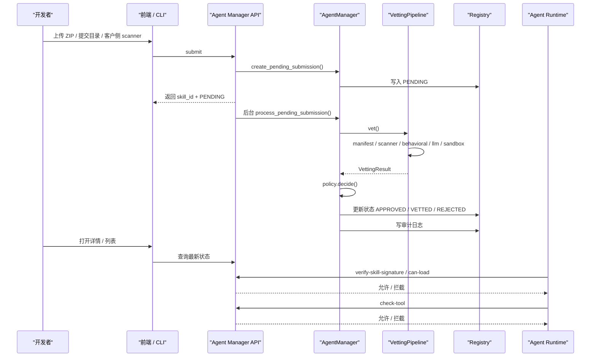

### 6.1 Skill 提交

当前主要提交入口：

- 管理台上传 ZIP
- 客户侧 Go Scanner CLI

上传后不会再阻塞前端等待全部分析跑完，而是：

1. 先写一条 `PENDING`
2. 后台继续分析
3. 列表和详情页看到状态变化

客户侧扫描器使用统一凭证中心签发的 Scanner 接入凭证，不使用管理员登录态。
详细说明见：

- [skill-scanner.md](../docs/skill-scanner.md)

### 6.2 Vetting

`vet()` 会按以下阶段执行：

1. `SKILL.md` frontmatter 解析
2. 并行启动已勾选且相互独立的分析器：`cisco-ai-skill-scanner`、behavioral 本地规则、静态深度扫描，以及用户明确勾选的 Sandbox
3. 汇总静态、行为和 Sandbox 证据；如果策略根据中间风险强制 Sandbox，则在这一阶段补跑 Sandbox
4. 勾选 LLM 时，等待前面所有分析完成后只调用一次 OpenAI-compatible LLM 做最终语义判定和报告汇总；未勾选时直接使用确定性策略汇总

基础 Scanner 在 Backend 启动时预热，并在后续任务中复用已初始化实例。并行度可通过以下环境变量调整：

- `AGENT_MANAGER_SCAN_WORKERS`：同时处理的后台提交数，默认 `2`
- `AGENT_MANAGER_ANALYZER_WORKERS`：单次/多次提交共享的分析器线程数，默认 `8`

### 6.3 Policy Gate

policy 决定 skill 最终落到：

- `APPROVED`
- `VETTED`
- `REJECTED`

高风险 skill 还可以被策略强制：

- 必须 sandbox
- 必须人工审核

### 6.4 审批 / 部署

- `VETTED` 进入审核队列
- `APPROVED` 可以部署
- `REJECTED` 不进入审核队列

Skill 详情页的“实际判定过程”通过一张判定图展示本次检测结果、发现项分类、工具风险汇总、LLM 结论合并与当前准入状态；拒绝原因与审批异常以提示展示在图下方。展开“LLM 复核意见”可查看差异解释和LLM 建议排除的风险提示。发现项支持按规则、深度扫描、Sandbox 切换并分页查看原始证据。点击分析节点进入对应报告；“扫描结果”底部的执行信息折叠区提供耗时、分析器列表、复用情况及缓存 Key。配置链接在新标签页打开当前策略。新检测保存判定模式与风险分类快照；历史报告没有完整快照时明确提示，当前配置改变后需重新检测才能应用。

### 6.5 导出 PDF 扫描报告

检测完成后，可以在 Skill 详情页右上角点击“导出 PDF 报告”。系统按当前界面语言生成中文或英文 `.pdf`，报告包含：

- 瑞数品牌 Logo、报告编号、Skill 版本和密级标识
- 管理摘要、风险等级、准入状态、发现项总数及判为恶意的发现数量
- Skill 来源、内容指纹、扫描范围、分析器状态和耗时
- 确定性风险、LLM 研判和最终风险的综合判定链路
- 规则、深度扫描、Sandbox、LLM 的证据与建议；风险发现项按卡片展示等级、来源、位置、说明、证据和修复建议
- 准入策略、审批结果、签名状态、扫描历史和审计事件
- 扫描覆盖范围、Sandbox 和 LLM 的评估局限

报告只对应指定 Version ID、内容指纹和扫描上下文。导出时会遮盖常见 Token、Bearer、API Key、密码和敏感 URL 参数，并限制日志与证据长度；完整原始结果仍应在受控管理台查看。安全风险和准入状态是两类结论：低风险 Skill 仍可能因公司策略不允许的权限而被拒绝。

接口为：

```http
GET /api/v1/skills/{version_id}/scan-report.pdf?language=zh-CN
```

仅支持 `zh-CN` 和 `en-US`。扫描尚未形成结果时返回 `409`，避免导出一份看似完整但没有有效结论的报告。

### 6.6 运行时治理

agent 接入时一般用：

- `verify-skill-signature`
- `can-load`
- `check-tool`

### 6.7 四类安全扫描目标与执行引擎

平台在 P1 控制面之上支持 `agent`、`mcp`、`llm` 和 `ai_infrastructure` 四类资产。Agent 与 MCP
使用 Worker 内置的锁定适配器；大模型红队和 AI 基础设施扫描通过仅在内部网络开放、需要服务 Token
认证的固定 AI-Infra-Guard `v4.6.0` 服务执行。当前可用能力包括：

- Agent 可选择 Dify、Coze、OpenAI-compatible、通用 HTTP 或 WebSocket 连接器；MCP 关联现有 Gateway；
  LLM 使用 OpenAI-compatible 模型端点；AI 基础设施使用一个或多个经过显式授权的网络端点。资产类型和
  连接器类型是独立稳定字段，旧 `target_type` 只作为兼容投影返回。
- 大模型红队支持锁定数据集或单条自定义 Prompt、固定随机种子、限制后的攻击技术和独立评估模型。每个
  实际执行并完成评估的 Prompt 生成一个 Case；`passed` 只表示该次攻击未观察到越狱，`failed` 表示评估器
  检出越狱信号，异常或缺少评估证据保持 `error/unverified`。原始 Prompt/Response 不进入普通日志或列表。
- AI 基础设施扫描会主动访问用户明确授权的 URL，并在任务创建和实际下发前重复校验 HTTP 授权、DNS
  解析结果、目标 CIDR 与策略 CIDR。只有同时具备组件、具体版本和版本规则命中的 CVE 才生成 Finding；
  只有端口或无法确认版本的指纹必须显示 `unverified`，不能推断为漏洞或安全。

- 安全目标、加密凭据、扫描策略、扫描任务、用例、Finding 和产物模型。
- 新扫描按所选 detection skill 生成独立用例，而不是把完整对话轨迹作为唯一“通过”用例。每条规则保存稳定
  `aig-rule:<skill-name>`、Worker 阶段、实际目标调用数、确认 Finding 数和脱敏错误。`passed` 仅表示该规则
  正常完成、至少发生一次目标调用且本次未观察到关联风险；`unverified` 表示没有目标调用或缺少逐规则执行证据。
  对话 transcript 只保存在受控的 `aig-agent-scan-report` 产物中，不计入规则通过数。
- Finding 只通过 Worker 上下文生成的 opaque source reference 关联 detection skill；Reviewer 返回的引用必须能在
  Worker 持有的映射中解析，否则关联到独立的 `unmapped` 证据不足用例，不按标题或描述猜测来源。
- 本行为只适用于新扫描。历史数据库记录和缺少 `detection_executions` 的旧报告不会自动重算，也不会展开成虚假
  passed 用例；查看这类结果时统一保持 `unverified` 语义。
- 任务幂等创建、查询、取消、超时、租约、心跳、失败重试和僵尸任务回收。
- 独立 `agent-manager-security-worker` 镜像，以及 `control_plane_validation` 和
  `agent_risk_scan` 两类任务。
- Dify、Coze、OpenAI-compatible、Anthropic、Google、Cohere、Hugging Face、Replicate、
  通用 HTTP/WebSocket 等锁定版本声明的 21 类 Provider。
- 单轮、多轮、前序任务会话延续和显式会话重置；请求和响应证据按用例、轮次归一化保存。
- 扫描目标和策略均保存稳定环境编码 `sandbox`、`test`、`staging` 或 `production`；目标声明授权能力，
  策略声明本次允许能力。创建任务时服务端要求环境一致，并拒绝策略能力超出目标授权范围。
- 当前允许能力编码为 `conversation`、`multi_turn`、`tool_read`、`tool_write`、`network_egress`、
  `file_read`、`file_write`、`code_execution` 和 `persistent_memory`。任务创建后会把目标、策略和
  两者交集形成不可变快照并下发给 Worker，同时写入安全审计。
- 生产环境禁止 `active_full`。策略创建、策略更新和任务创建入口都会返回稳定错误码
  `agent_security.production_active_full_forbidden`；因此历史数据库中遗留的非法策略也不能用于新任务。
- 生产环境使用 `active_safe` 时，策略必须同时配置精确目标 ID 白名单、开始和结束时间明确且最长 24 小时的
  UTC 维护窗口，以及不包含凭据明文的专用身份引用。服务端在策略创建、更新、审批和任务创建入口重复校验。
- 每次生产 `active_safe` 任务必须携带管理员签发的单次人工审批。审批绑定目标、策略、维护窗口、专用身份、
  当前活动凭据 ID 和版本；只能在维护窗口内使用，成功创建一个任务后即标记为已使用。相同幂等键的请求
  可以安全重试，但审批不能用于其他任务、目标或凭据版本。任务超时不会超过维护窗口结束时间；任务创建后
  如果目标凭据发生轮换，Worker 领取时会以 `agent_security.production_dedicated_credential_changed` 阻断。
  Worker 租约续期以任务截止时间为上限；达到截止时间后，心跳、完成回调和意图推断入口将任务收敛为
  `timed_out`，停止原因为 `task_timeout`。
  这里的“专用身份”是可审计引用，真正认证仍使用目标单独加密保存的活动凭据；Tool denylist 属于 P6-04。
- 轮次、Token、费用、并发、持续时间和响应字节六类预算；超过任一预算后不再允许新工作。
- URL/CIDR、云元数据、DNS Pin 和出站策略双重校验。公网默认允许；内网目标必须同时在
  目标和扫描策略中显式允许，云元数据地址不能通过白名单绕过。
- 管理员可管理目标、凭据、策略和 Worker；`security_auditor` 可只读查看；普通用户只能读取
  或提交其本人/用户组被授权目标的任务。
- 目标凭据使用 Fernet 加密，创建响应只展示一次明文，其余接口只返回掩码。领取 Agent 任务时，
  Backend 生成与 Worker、任务、凭据和租约绑定的 X25519/AES-GCM 短期密封信封。
- 上游风险映射为平台稳定风险编码；未知类型进入 `unmapped` 且最低按中风险处理。上游总分只作为
  原始信号，不直接作为银行正式风险评级。
- 原始 AIG 产物加密保存；普通任务详情只返回脱敏证据。原始内容只允许管理员或安全审计角色
  显式读取，读取动作进入审计链。
- 创建、更新、凭据轮换/吊销、任务创建/取消/导出和 Worker 操作进入防篡改安全审计链。

主要管理 API 位于 `/api/v1/agent-security`：

- `POST/GET/PATCH /targets`
- `POST /targets/{target_id}/credentials`
- `PATCH/POST /credentials/{credential_id}`
- `POST/GET/PATCH /policies`
- `POST/GET /scan-approvals`
- `POST/GET /tasks`、`POST /tasks/{task_id}/cancel|export`、
  `GET /tasks/{task_id}/compare/{baseline_task_id}`
- `PATCH /findings/{finding_id}`、`GET /tasks/{task_id}/artifacts/{artifact_id}/content`
- `POST/GET /workers`、`POST /workers/{worker_id}/revoke`

Worker 数据面为 `/worker/key`、`/worker/heartbeat`、`/worker/claim`、
`/worker/tasks/{task_id}/heartbeat|complete`，只接受创建 Worker 时生成的 `amsw_` Token。
内置 Worker 可在项目根 `.env` 配置一次 `AGENT_SECURITY_WORKER_TOKEN`，Backend 建表后自动幂等注册，
Compose 把同一个值注入 Worker；外部 Worker 仍可由管理 API 创建且只返回一次 `token_once`。
数据库只保存 Worker Token 的 SHA-256。内置 Token 变化时保留 Worker ID 并清空旧公钥/心跳；
已吊销身份不会被相同 Token 自动恢复。实际 Agent 扫描还需要配置评估模型，并且只能对经授权的
目标执行；`control_plane_validation` 仍只证明控制面协议。完成接口在进入 Pydantic 解析前限制为
16 MiB，成功结果还必须匹配任务类型对应的锁定引擎、版本、用例和产物契约，不能用任意成功 JSON
绕过真实扫描结果校验。
完成请求最多接收 2,000 条 Finding；自动关联的轨迹按每批最多 1,000 个事件写入。任务结果、Finding
和所有轨迹批次在同一事务中提交，任何批次失败时整体回滚。

Worker 镜像内置健康检查和 SIGTERM 停止语义，Compose 默认使用非 root、
只读根文件系统、`/tmp` tmpfs、无额外 capability、`no-new-privileges`、进程/内存/CPU 上限以及
有界日志轮转。空闲控制面心跳和长任务成功续租都会刷新健康标记；控制面持续不可达时健康检查失败。
同一任务重试时，轮次、Token、费用、最大并发和响应字节按任务累计；Worker 从领取响应中的已有用量
继续计数，Backend 仍拒绝任何用量倒退。后台续租会容忍单次受控网络/解析错误并继续尝试，明确收到
租约失效后阻止后续模型/目标请求；已经发出的请求仍由客户端超时边界结束。租约重试耗尽时保留已有原始错误码，仅在没有原错误时使用
`agent_security.worker_lease_lost`。
当前交付门禁已在 ARM64 构建机上原生构建 ARM64、通过容器模拟构建 x86_64，并分别执行压缩归档导出、
移除标签、离线重新导入及 `--network none` 受限运行。正式离线发布流水线也会在加载两种架构归档后
执行同一 Worker 门禁。该验证只覆盖安全 Worker 镜像；完整平台离线安装、真实 Compose 服务的中断、
恢复和升级仍需要在目标部署环境单独验收，不能由镜像自检替代。

P2 不包含 DeepSeek Harness 风格的完整调用轨迹；统一调用轨迹后端已在 P4 实现，P5-02 已提供
“对话 / 轨迹”基础双视图，P5-03 已补充 Turn/Step 分组、调用树和状态，P5-04 已提供六页签脱敏事件
详情，P5-05 已提供 Token 与真实采集的耗时信号，P5-06 已提供风险与治理标记，P5-07 已提供事件与 Finding 的显式双向跳转，P5-08 已提供五维证据搜索，P5-09 已提供大轨迹按需加载和虚拟滚动，P5-10 已提供受控证据导出，P5-11 已完成新增页面语义化中英文门禁，P5-12 已完成桌面与移动端布局总验收。当前事件轨仍不能表述成完整 Harness 前端能力。

### 6.8 统一调用轨迹后端（P4）

P4 提供 `runtime-trace@1` 统一事件模型，以及 Trace Session、Event、加密 Payload、幂等批次和
导出记录。Agent SDK 上报 Turn、Step、Message、Tool 与知识检索事件；模型网关发布请求、响应、
错误、Token、耗时和 Prompt Security；MCP 网关发布调用、结果、错误、Schema 和审批；Runtime
Governance 发布策略决定、预算、阻断和终止事件。

主要接口：

- `POST /api/v1/runtime-traces`
- `POST /api/v1/runtime-traces/{trace_id}/events:batch`
- `GET /api/v1/runtime-traces`，支持 Session、Agent、时间、风险、Tool、request ID 查询
- `GET /api/v1/runtime-traces/{trace_id}/events`
- `GET /api/v1/runtime-traces/{trace_id}/events/{event_id}/raw-payload`
- `POST /api/v1/runtime-traces/{trace_id}/exports`
- `GET /api/v1/runtime-traces/metrics`
- `POST /api/v1/runtime-traces/maintenance/cleanup`

服务端 `seq` 只按接收顺序分配，客户端时钟只保留为 `event_time`。原始 Payload 使用平台密钥加密，
普通查询只返回脱敏投影；原始查看和导出限管理员、隐私审计角色并写安全审计，安全审计角色只读取
脱敏投影。过期轨迹不再提供查询、导出或新增事件写入。Backend 启动后在后台线程分批清理；每轮最多选择
500 个到期会话，各关联表最多删除 500 条并分别提交，子记录清空后才删除会话。积压时每轮完成后等待
250 毫秒继续，空闲或失败后等待 60 秒。管理员清理接口执行一轮并返回 `more` 表示是否仍有积压。
网关事件发布失败不会阻塞主请求，但会计入失败指标。完整度只根据真实事件源计算为
`full`、`gateway_partial`、`model_only` 或 `mcp_only`，不会为了展示效果伪造 Agent Step。

**English:** Expired Runtime Traces are unavailable for reads, exports and new event ingestion. Background threads start cleanup after Backend startup, select at most 500 expired sessions per pass and delete at most 500 rows per related table, committing each table separately. Sessions are removed only after their children drain. Backlog passes wait 250 ms; idle or failed passes wait 60 seconds. The administrator cleanup endpoint performs one pass and returns `more` to indicate remaining work.

AIDR 使用全局或单设备的有效保留天数，按服务端接收时间清理正文；每张表每批最多处理 500 条并单独提交。
清理原始日志与 Hook 时在同一事务内移除对应统计投影。后台沿用上述积压追赶与空闲间隔，普通日志清理只读取所需身份字段，
避免加载完整正文。清理操作视图时在实际更新前重新校验过期条件，保留选取后已被补传结果更新的操作视图。事件身份、摘要和批次 ACK 保留，重复补传不能恢复已清理正文。该策略控制正文保留，
不代表总记录数或 SQLite 文件大小恒定；已释放页面可被后续写入复用。Pipeline Trace 独立按保存的到期时间
清除阶段正文，详见[模型网关说明](model-gateway.md)。

**English:** AIDR expires bodies by server receipt time and the effective global or device retention policy, processing at most 500 rows per table and committing separately. Log and Hook expiry removes their statistics projections in the same transaction. The same background catch-up and idle intervals apply; ordinary expiry reads identity fields rather than full bodies. Operation expiry updates recheck eligibility, preserving views refreshed by late results after selection. Event identities, digests and batch ACKs remain so retries cannot restore expired bodies. This bounds body retention, not total record count or SQLite file size; freed pages can be reused. Pipeline Trace stage expiry is maintained independently as described in the model gateway guide.

统计投影保持每轮日志与 Hook 各最多 250 条，将证据插入、操作写入和小时桶增减批量执行。原始正文读取与投影准备在取得写权限前完成；发布时重新检查水位，并按本批主键复核原始记录的到期状态。其他 worker 已推进时重新准备该来源，已到期证据不再发布。每 50 个操作合并一次核对查询，每个操作仍只读取最多 34 条证据；重复调用起点、过多证据及缺失身份继续按不确定处理。失败计数和命令次数按净变化更新，水位与统计共用一次提交。保留期清理在读取投影身份前取得 SQLite 写权限，与投影推进串行，避免并发补建的统计成为清理残留。

**English:** Overview projection batches evidence, operation writes and net bucket deltas while keeping the existing 250-row limit per source. Raw evidence is read and prepared before acquiring write access. Publication rechecks the watermark and the batch's raw-record expiry by primary key; concurrent progress causes that source to be prepared again, and expired evidence is not published. Reconciliation groups 50 indexed lookups, retaining the 34-evidence bound per operation and conservative ambiguity handling. Watermarks and counters commit together. Expiry acquires SQLite write access before reading projection identities, serializing it with projection advancement.

AIDR 正文和行为摘要的控制字符校验采用共享的预编译扫描，减少大批量采集时的 Python 循环开销，保留原字符范围、UTF-8 字节限制、敏感信息与采集策略校验。

**English:** Audit content and behavior summaries use a shared compiled control-character scan, reducing Python-loop overhead while preserving accepted characters, UTF-8 byte limits, secret checks and capture-policy validation.

采集批次回执、证据插入和日志操作批量 UPSERT 复用固定 SQL 结构与编译结果；每批参数和默认接收时间按次绑定或生成。策略凭据、身份及序列仍在本次事务内校验，冲突回滚和提交后 ACK 语义保持。

**English:** Collection receipts, evidence inserts and bulk log-operation upserts reuse fixed SQL structure and compilation. Batch parameters and default receipt times remain fresh for every execution. Policy receipts, identities and sequence bounds are validated in the current transaction, preserving rollback on conflict and commit-before-ACK.

AIDR 日志与 Hook 在批内合并策略凭据读取、查重和证据插入，日志操作投影按原到达顺序折叠后批量写入。Coverage 与 Skill 证据仍保留处理顺序。批次回执、证据和投影共用一次事务，冲突整批回滚，提交成功后才返回 durable ACK；策略版本与序列校验逐条执行。MCP 两级并发租约在同一事务获取，释放与最终审计合并提交，详情见[网关数据库阶段说明](model-gateway.md)。

日志与 Hook 入库、Skill 审计、概览投影和 AIDR 有界清理步骤，在工作线程和连接池之前共用每服务事件循环两个异步名额；等待不占连接，活动取消等待工作线程完成，每批采集提交后返回 durable ACK。共享准入可能延后清理完成时间，权限及有效策略继续实时读取。Pipeline Trace 和 Runtime Trace 的分批删除先选择到期身份，没有命中时不发起 DELETE；实际删除时再次校验到期条件。SQLite、保留期及清理批量保持一致。

**English:** Log and Hook persistence, Skill audit, overview projection and bounded AIDR cleanup steps share two asynchronous slots per server event loop before worker/pool usage. Waiting work holds no connection, active cancellation waits for worker cleanup, and each collection batch ACK follows its commit. Shared admission can delay cleanup completion; permissions and effective policies remain live reads. Trace cleanup skips empty deletes and rechecks expiry conditions. SQLite, retention policies and batch limits remain unchanged.

**English:** AIDR batches policy-receipt reads, deduplication and evidence inserts. Log operation projections fold evidence in arrival order before bulk writes; Coverage and Skill evidence retain their processing order. Batch receipts, evidence and projections commit together, conflicts roll back the entire batch, and durable ACKs follow successful commit. Policy versions and sequence bounds are checked for every record. MCP acquires both concurrency leases atomically and commits their release with the final audit.

事件可选上报 `severity`（`info`、`low`、`medium`、`high`、`critical`）；轨迹按事件的明确严重性取最高值。
安全扫描透传 Finding 严重性，模型网关透传 Prompt Security 判定，运行治理透传动作风险等级。
未上报严重性的事件有风险编码时保留 `low` 基线，无风险编码时为 `info`。已有 SDK 可继续省略该字段，
省略字段的历史批次和事件仍可按原幂等指纹重放。

外部 SDK 创建轨迹时留存期最多 30 天；单条轨迹最多接收 100,000 个事件和 256 MiB 原始 Payload。
同步 JSON 导出最多包含 20,000 个事件或 64 MiB 原始 Payload，PDF 额外限制为 5,000 个事件；超过上限返回稳定错误，后续应由异步导出
任务承接。上述是单轨迹保护，不等同于租户级磁盘配额；租户总量、速率和磁盘高水位属于后续生产
加固范围。

P7-04 增加了隔离数据库的有界负载回归：扫描领取会在并发请求下原子遵守 Worker `max_concurrency`；长会话结果覆盖 120 个用例、
120 个 Finding、1200 轮计数和 2 MiB 加密产物；轨迹覆盖单请求最大 1000 事件批次、100 个 Turn 和 4 MiB 原始 Payload。每个 Agent 运行凭证
仍先受 `max_body_kb` 约束，默认为 1024 KiB，管理端可配置范围为 1～10240 KiB；4 MiB 回归显式把隔离测试凭证设为 10240 KiB，没有绕过凭证边界。

这些测试的 30 秒门槛只是用于发现明显的性能退化和死锁，不是 SLA、建议 P95 或生产容量。多实例、真实 Provider/工具、持续 30～60 分钟的稳态压测、
CPU/内存/磁盘/SQLite 锁等指标，仍必须在银行验收环境记录，不能由单机 TestClient 结果推导。

P4 的后端验收入口是 API、`demo/runtime-trace-sdk/` 和 `tests/test_runtime_traces.py`；P5-02 已在
`/runtime-traces` 增加“对话 / 轨迹”双视图，P5-09 进一步使用事件游标分页；这些界面能力仍不属于 P4 后端范围。

P7-01 新增 `demo/agent-security-full-integration/` 完整关联示例：Agent SDK 先创建 Trace 和 Turn/Step，知识检索只
上报脱敏摘要；模型请求把关联字段放入 OpenAI-compatible `metadata`；本地 Tool 仅由 SDK 记录；MCP Tool 同时由
SDK 和 MCP Gateway 使用相同 `call_id` 关联。高风险 Tool 返回待审批时示例立即停止，管理员批准后必须显式携带
`approval_request_id` 再次运行，不会绕过审批。示例只输出关联 ID、状态和接收数量，不输出 Token、模型正文或
Tool 结果。该 Demo 已通过确定性契约测试和真实网关模块回归，但没有使用客户的真实模型/MCP 凭证，不能替代
客户环境实测。P7-03 已另行完成 Worker Finding 到轨迹证据的内部端到端验收。

P7-02 新增 `demo/agent-security-gateway-only/` 部分轨迹示例，提供 `model`、`mcp` 和 `combined` 三种模式。
它不调用 Runtime Trace SDK，也不发送 `turn_id` 或 `step_id`：只有模型事件时完整度为 `model_only`，只有 MCP
事件时为 `mcp_only`，两类网关事件使用同一可信 Trace 但仍缺少 Agent SDK 时为 `gateway_partial`。可选的登录
只读令牌只用于回查服务端完整度、事件来源和空层级；没有回查令牌时脚本返回 `submitted_unverified`，不会把网关
请求成功冒充为完整度已经验证。自动化已覆盖真实持久化计算，但尚未在登录后的客户页面运行，因此不提前完成
E2E-05。

### 6.9 MCP Server 和 Tool 风险扫描

`mcp_risk_scan` 支持元数据检查、源码审计、动态扫描和多轮红队，使用任务创建时冻结的扫描范围。
创建 `mcp_gateway` 类型安全目标时，`endpoint_url` 使用 `mcp-gateway://{gateway_slug}`，`config`
保存 `gateway_id` 和传输设置。创建任务时 Backend 冻结 Gateway、Server、允许暴露的 Tool、当前 Schema
Hash、已批准 Schema Hash、风险等级和审批状态；Worker 不持有 MCP Server 凭据，真实调用由 Backend
执行。冻结前会删除描述和 Schema 中常见凭据/PII 值，生成限深、限长投影并保留原始内容
SHA-256；已知危险信号在完整原文上先提取为无原文摘要。发生截断、丢项、限深或完整分析达到上限时，
任务会生成 `mcp_metadata_projection_incomplete` 高风险 Finding，不能静默判定安全。Gateway 没有任何
已绑定 Tool 时任务创建会失败，也不会形成“零 Finding 即安全”的假阴性。

元数据检查项包括：

- Tool 描述中的模型指令、Prompt Injection 和工具投毒信号。
- 命令、文件路径、外部地址、凭据、SQL 和金融账户/金额等危险参数。普通 `query` 只有同时存在
  SQL、数据库、语句执行等上下文时才归类为查询执行信号；搜索关键词、`search query`、无数据库
  上下文的 `filter query` 和仅凭字段名出现的 GraphQL query 不作该判定。
- 写入、删除、执行、转账、支付、上传、发送和导出等副作用操作是否缺少高风险标记或审批。
- 当前 Schema Hash 与 Gateway Binding 中已批准 Schema Hash 的漂移，以及绑定 Tool 丢失。

扫描引擎固定为 Tencent Zhuque Lab / AI-Infra-Guard `v4.6.0`，提交
`e8931cc68001b66ad024fd87ef07394e9e96524a`。各模式的执行范围如下：

| 模式 | 输入和模型 | 实际执行 |
| --- | --- | --- |
| 元数据检查 | 已登记网关快照，无需模型 | 平台规则分析描述、Schema 和治理配置，不调用 Tool |
| 源码审计 | ZIP 或公开 GitHub 仓库、网关评估模型，可另选分析模型 | 上游单阶段快速审计或三阶段完整审计；只允许读取/列举/搜索源码文件 |
| 动态扫描 | 已登记网关中的明确 Tool 范围、模型、调用次数和路径 | 上游信息收集、恶意行为检测、漏洞检测和复核四阶段；通过任务租约调用真实工具 |
| 多轮红队 | 动态范围、Crescendo/TAP、评估/分析/攻击模型 | 复用上游策略；分析模型把攻击转换为符合 Schema 的调用，评估模型分析真实工具返回 |

发起扫描时选择模型网关中已启用的模型，分析和攻击模型可默认使用评估模型。请求复用网关的隐私处理和审计，
Worker 只得到任务租约，不接收供应商密钥。上游默认红队目标是模型模拟器，本集成替换为实际工具调用目标执行器。
模型判断统一视为待复核风险信号，不等同于已确认漏洞。

源码通过管理台上传 ZIP（最大 20 MiB、1000 个文件、单文件 1 MiB），或导入公开 GitHub HTTPS 仓库；
GitHub 的分支/Tag 先解析为 Commit，再下载固定版本。其他 Git 服务或私有仓库可上传 ZIP。
可创建 `mcp_source` 源码目标，地址为 `mcp-source://{source_id}`；也可为已登记网关附加本次源码快照。
源码包禁止越界路径和软链接，二进制文件只保留路径及哈希，并在报告中列为未审计覆盖。
Worker 在独立临时进程中审计，不执行上传的代码、Shell 或模型生成的代码。源码快照位于数据目录
`mcp-scan-sources/`，应随平台数据备份。

动态路径可选“经网关测试”或“已登记服务测试”，工具范围均来自所选网关的绑定。
前者包含网关执行模式、生产禁用清单和绑定 Schema 审批；后者调用绑定服务的原生工具，用于评估服务本身。
两者均校验扫描能力范围、目标和策略网络白名单、冻结的地址/DNS/Schema、工具参数、敏感工具审批、限流和并发。
每次调用先持久化唯一调用 ID 并消耗调用预算，重复 ID 不会再次执行；取消、租约失效或达到预算时停止。
原始工具请求/响应加密保存，安全管理员可通过任务调用证据接口读取，读取操作写入审计。

源码/动态扫描输出阶段结果、平台 Finding、JSON 原始报告和 SARIF；任务对比包含模式、源码哈希、版本、工具范围、
路径和角色模型，范围变化时不把旧 Finding 的缺失认定为修复。修复建议由人工处理，不自动修改生产策略。

MCP Tool 用例保留旧版 `status=passed/failed` 字段供既有客户端兼容，但管理台和新版详情响应把
语义拆为两层：`execution_status` 表示元数据分析是否完成、异常、阻断或证据不足；
`assessment_status` 表示未观察到风险信号、发现待确认信号、误报、接受风险、已解决或证据不足。
`failed` 兼容值在这里表示扫描规则命中，不表示 Tool 调用失败，也不表示漏洞已可利用。详情接口按
当前关联 Finding 的 `open`、`false_positive`、`accepted`、`resolved` 状态实时计算评估摘要，人工
处置不会修改原始加密扫描产物。即使任务成功且没有 Finding，也只能解释为“本次元数据快照未观察到
风险信号”，不能解释为目标绝对安全。

外部 URL 参数只说明存在外部地址输入面；报告会明确记录未执行 Tool、未确认 SSRF，并提示验证协议
限制、DNS 重解析、私网地址拦截及 URL/UUID 绑定。扫描器同时记录已存在的审批、风险等级、访问模式、
限流和并发限制等补偿控制；已经启用审批时不会重复建议 `require_approval`，但不会因此隐藏底层攻击面。
`access_mode=unknown` 作为“访问模式尚未分类”的治理信号单独展示，不推断 Tool 具有破坏性。

在现有任务、Finding 和加密产物 API 之外，可用：

```http
GET /api/v1/agent-security/tasks/{task_id}/mcp-assessment
```

该接口返回 Gateway/Server/Tool/Schema Hash 定位、检测结果和去重后的处置建议。它是扫描时快照，
不等同于当前生产配置；是否审批、禁用或调整调用策略仍由管理员在现有 MCP 管理流程中决定。

#### MCP Tool 读写边界和生产禁用清单（P6-04）

MCP Server 完成 Tool 发现后，管理员需要在“能力治理 / MCP Server”中为每个 Tool 设置稳定的
`access_mode`：`read`（只读）、`write`（写入）、`destructive`（破坏性）或 `unknown`（未分类）。
平台不会仅凭 Tool 名称自动修改该属性；元数据扫描给出的副作用信号仍是处置建议。历史 Tool 默认迁移为
`unknown`，因此只读网关按失败关闭原则拒绝它，而不是把未知能力当成只读。

每个虚拟 MCP Gateway 同时保存可信的环境和执行模式：

- `passive`：不发布、也不执行任何 Tool。
- `read_only`：只发布和执行明确标记为 `read` 的 Tool；`unknown`、`write` 和 `destructive` 均被阻断。
- `active_safe`：允许已发布 Tool 进入原有风险、审批、限流和并发控制；`destructive` 强制开启执行前审批。
- `active_full`：保留给非生产受控环境，生产 Gateway 在创建和更新时均拒绝该模式；历史数据库中即使遗留
  非法组合，运行入口也会隐藏并阻断全部 Tool。

生产 Gateway 还可以配置按当前 `exposed_name` 精确匹配的 `production_tool_denylist`。配置项必须来自该
Gateway 的实际绑定，删除绑定时也不能遗留无效项。命中的 Tool 会从 `tools/list` 隐藏，并在
`tools/call` 的审批、限流和上游转发之前由服务端拒绝；拒绝结果写入 MCP 调用审计和 Runtime Trace，
稳定错误码分别为 `mcp.tool_blocked_by_passive_mode`、`mcp.write_tool_blocked_by_read_only_mode` 和
`mcp.tool_blocked_by_production_denylist`。调用方 `_meta` 中自报的环境或模式不参与判定。

已有 Gateway 默认迁移为 `test + active_safe + 空 denylist`，避免升级后意外中断现有调用；管理员应按
真实部署环境完成重新分类。创建 MCP 安全扫描目标时，目标环境必须与 Gateway 环境一致，扫描快照会冻结
Gateway 环境、执行模式、生产 denylist 和各 Tool 的读写属性，防止用测试目标伪装生产 Gateway。

#### 扫描任务执行预览（P6-05）

管理台在创建任务前先调用：

```http
POST /api/v1/agent-security/tasks/preview
```

预览和正式创建复用同一套目标权限、目标/策略状态、环境、能力、扫描类型、会话继续、生产审批、DNS Pin
和 MCP 快照校验。响应使用 `scan-preview@1`，展示目标与策略、计划用例、Tool 计划、六类主要预算、重试和
任务超时、安全限制及预览边界。该调用只读：不会创建任务、不会消费生产单次审批、不会调用目标或 MCP Tool，
附加测试 Prompt 进入指纹计算，预览接口不回传原文；大模型自定义 Prompt 模式直接展示当前表单输入。
大模型预览按数据集汇总抽样数量，展示攻击方法、评估模型、抽样种子和预计用例总量（样本数量乘以攻击方法数量），
执行限制保留预算上限。数据集样本由引擎清理、去重后抽选，实际内容在“测试用例”中随运行进度更新。

不同扫描类型的预览精度不同：

- 扫描链路自检是确定的单用例，不执行真实攻击或目标 Tool。
- Agent 风险扫描可以确定信息收集、选中的检测 Skill 和风险复核三阶段，但具体攻击 Prompt、每个 Skill
  的实际对话轮次以及目标 Agent 的本地 Tool 清单由 AI-Infra-Guard 在运行时生成。页面必须明确显示
  “运行时动态”，不能把策略 `max_rounds` 冒充预计轮数。
- MCP 风险扫描按模式展示源码审计或冻结 Tool 的检查范围，动态模式列出授权调用工具、读写属性和风险等级，
  并明确本次是否可能调用工具。源码审计和元数据检查的工具副作用权限为 `forbidden`，动态和红队为 `policy_bounded`。

服务端为预览返回 `preview_fingerprint`。管理台正式创建时回传该值；如果目标、策略、审批、扫描参数、MCP
Tool 快照或预算已变化，创建入口以 `agent_security.scan_preview_stale` 拒绝并要求重新预览。为保持已有 API
客户端兼容，未传指纹的直接创建请求仍按原有完整服务端校验执行；管理台则强制先生成有效预览才启用创建按钮。

#### 扫描任务 Kill Switch（P6-06）

任务级 Kill Switch 与普通“取消”是两种独立控制。只有管理员和超级管理员可以调用：

```http
POST /api/v1/agent-security/tasks/{task_id}/kill-switch
Content-Type: application/json

{"reason":"发现目标返回敏感数据"}
```

原因必填并进入安全审计。服务端保存启用状态、操作人、时间和原因，重复提交保持幂等；终止状态任务不能再启用。
排队任务会立即进入 `cancelled`，停止原因为 `kill_switch.activated_before_start`，Worker 领取查询及原子更新均会
排除该任务。运行任务先保留当前租约并标记 `kill_switch.activated`，Worker 在下一次心跳得到
`continue_allowed=false` 后停止；即使 Worker 随后上报成功，服务端也不会覆盖 Kill Switch 的取消结果。Worker
失联时，租约回收会把任务收敛为取消，而不会重新排队。

普通取消的运行任务在心跳、完成回调或租约回收时进入 `cancelled`，停止原因为 `cancel_requested`。
任务同时启用 Kill Switch 时保留 Kill Switch 的停止原因及审计记录。

Kill Switch 的真实中断边界是协作式停止：扫描运行时会在每次目标请求和评估请求前后执行心跳，因此启用后不会
发起下一次请求。已经发出的远端请求无法由控制面安全地强制断开，它会按目标配置中的 `timeout_ms`（默认 30 秒）
或评估器客户端自身的请求超时结束；请求返回后，任务时长和总超时校验继续阻止后续请求。管理台弹窗明确展示
该限制，不能把“停止新请求”描述为“立即终止所有网络连接”。
任务详情会显示操作人、启用时间和原因；审计事件使用稳定类型
`security_scan_task.kill_switch_activated`，Worker 通过完成入口收敛时记录
`security_scan_task.kill_switch_stopped`。

#### OWASP ASI 风险编码映射（P6-07）

平台将扫描 Finding 和运行事件的稳定内部风险码映射到 OWASP Agentic Security Initiative 的
“Top Ten for Agentic Applications – 1st Public Draft”。当前基线固定到官方仓库 Commit
`e1deaca619dd35608645c0ca8ffce1cc4a019193`，框架版本保存为 `first-public-draft`，平台映射规则版本保存为
`agent-manager-asi-map@1`。这里不能简称为已经正式定稿的“OWASP ASI 2026”：上游当前公开材料仍明确标记为
第一版公开草案，固定 Commit 和映射版本是为了让历史报告在上游调整编号或名称后仍可复核。

映射只接受两类输入：合法的 `ASI01`～`ASI10` 编码，以及平台代码中逐项审核过的稳定风险码。平台不会从标题、
描述、证据或任意上游字符串中做模糊猜测。未知风险码保持 `unmapped`；一组风险码中只有部分可映射时保存
`partial`，不能因为其中一项命中就把整组描述为已覆盖。完整映射快照包含框架、上游 Commit、映射规则版本、
源风险码、ASI 编码、双语分类名称和映射状态。

- 扫描 Finding 保留原始 `finding_code`，并新增 `risk_codes`（只含已确认的 ASI 编码）和 `risk_mapping` 快照。
- Runtime Trace 事件保留调用方提交的原始风险码，同时追加已确认的 ASI 编码；事件保存各自的
  `risk_mapping` 快照，会话保存聚合后的风险码和 `risk_mapping_version`。
- 管理台安全发现、扫描报告和调用轨迹以 `ASIxx · 分类名称` 展示中英文标签；无映射和历史无版本记录会明确提示，
  不会用 ASI10 或其他类别兜底。

P6-07 只建立版本化风险分类与展示追溯。它还不等于完整的报告判定口径快照：用例、证据和规则版本的逐项闭环
仍由 P6-09/A6-04 验收，因此不能提前宣称每个报告风险已经满足完整审计追溯。

#### 扫描版本对比报告（P6-08）

扫描报告的版本对比按任务创建时间选择较早的成功扫描作为基线，并展示两次扫描的配置、评估用例数及风险数。打开弹窗或切换基线后自动更新对比，快速切换时仅显示最后一次选择的结果。模型红队风险按实际测试输入指纹、变换方式和风险类别匹配；测试集、抽样配置、评估模型及实际输入集合纳入覆盖判断。只有完整评估且覆盖范围、引擎一致时，历史风险未再次出现才列为“本次未复现”；配置变化或证据不足时明确显示无法确认的原因。

同一目标、同一扫描类型的较新任务可以通过
`GET /api/v1/agent-security/tasks/{task_id}/compare/{baseline_task_id}` 与更早任务比较。响应固定为
`security-scan-comparison@1`，模型红队按实际输入指纹、变换方式、风险类别及风险编码匹配，其他扫描按 Finding 指纹和外部用例范围进行多重匹配，避免重复指纹被字典覆盖，
并返回四组结果：

- `new`：当前任务检出、基线中没有匹配项的风险；界面表述为“仅本次检出”。
- `unchanged`：当前与基线的风险匹配，界面表述为“两次均检出”。
- `resolved`：基线风险本次未出现，并且当前任务成功、扫描覆盖配置一致、引擎名称和版本一致；界面表述为
  “本次未复现”，不等同于已经证明彻底修复。
- `unable_to_retest`：基线风险本次未出现，但基线或当前任务未成功、覆盖不完整、测试配置或输入变化、扫描引擎变化，因此没有足够
  证据判定已修复。每一项携带稳定 `reason_code`。

覆盖指纹只对服务端保存的扫描类型、检测 Skill、会话模式、重置方式、附加目标 Prompt 的不可逆摘要、元数据模式
和关键策略边界计算，API 不返回原始 Prompt。当前任务与基线必须属于同一目标、同一扫描类型，基线必须更早，
也不能把任务与自身比较。管理台扫描报告页只提供符合这些条件的较早成功任务作为基线候选，并展示覆盖配置和
引擎是否一致。

Agent 风险扫描的具体 Prompt 和运行路径可能动态生成。因此，即使进入 `resolved`，其准确含义也只是“在本次同覆盖、
同引擎扫描中未再观察到”。P6-08 不替代人工复核，也不提前实现 P6-09 的报告规则版本快照。

#### 报告模板与判定口径快照（P6-09）

平台在创建扫描任务时冻结 `security-report-contract@1`，而不是在查看或导出报告时临时套用最新规则。当前首版包含：

- 报告模板版本 `agent-security-report-template@4`，固定摘要、覆盖范围、判定口径、用例、Finding、产物和限制的章节顺序，
  以及 Finding 字段和版本对比分组。
- 判定口径版本 `agent-security-decision-criteria@2`。任务 `succeeded` 只表示 Worker 结果契约完成；空 Finding 列表只表示
  本次未观察到风险；用例 `blocked` 或 `error`、以及缺少证据的 Finding 均保持“未验证”语义。
- 每种扫描类型单独冻结范围限制：扫描链路自检不验证动态风险；Agent 动态扫描只覆盖实际执行的用例和轮次；MCP 扫描
  只检查冻结的元数据快照，不执行有副作用的 `tools/call`。
- 每个新 Finding 保存所属任务的判定口径版本。任务详情和审计型 JSON 导出返回同一份持久化快照，平台升级不会改变
  历史报告的解释规则。

报告在任务创建时冻结模板和判定口径，当前版本为
`agent-security-report-template@4` / `security-report-contract@4` / `agent-security-decision-criteria@2`。
任务详情与审计型 JSON 导出使用同一快照；历史快照和数据库用例保持原有记录。

报告按实际执行的测试用例、模型响应、评估理由、Finding 和产物复核结果。选择 `cnsafe` 等数据集后，
测评结论以本次执行及评估证据为依据。Finding 通过用例、证据、轨迹事件和冻结的判定口径版本追溯。

### 6.10 安全扫描管理界面（P5-01）

大模型红队任务创建后显示计划用例数（抽样条数乘以攻击方法数）。运行期间 Worker 每约 2 秒读取引擎结构化用例事件，
心跳保存变化的进度快照；页面每 3 秒刷新运行任务。详情的“测试用例”在运行中展示最近更新的最多 50 条用例，可展开查看脱敏后的
Prompt、模型回复和评估理由。完成数量包含执行错误和未评估用例，错误数量单独显示；该单位是测试用例，不是多轮攻击内部的模型调用次数。
进度快照加密保存并复用任务访问权限，任务列表只返回计数。攻击方法预检查可能减少实际执行量，计划数不等同于实际评估数。
任务完成后同一列表展示最终用例；有原始产物读取权限的用户展开用例时按需加载报告正文。失败或取消且没有最终用例时保留过程记录。
总进度与当前展示条数分别统计；刷新保留分页和已有用例的展开状态。没有实时数据的历史任务显示“无进度记录”。
此能力需要同时更新后端、Worker 和扫描服务镜像；旧扫描服务不会产生结构化实时用例事件。

管理台“安全扫描”提供 `/agent-security/scans` 工作台，按真实扫描生命周期组织为：

1. 扫描目标：查询、新建、编辑、启停四类目标，配置连接器、环境和授权能力，并单独轮换加密凭据；MCP 目标从现有 Gateway 选择。
2. 执行策略：配置适用环境、执行模式、允许能力、出站 CIDR、轮次、Token、费用、并发、时长、响应大小、重试和租约；
   生产 `active_safe` 还必须配置目标白名单、UTC 维护窗口和专用身份引用。
3. 扫描任务：按状态、目标和类型筛选，发起扫描链路自检、Agent 风险扫描、MCP 风险扫描、大模型红队或 AI 基础设施扫描，并查看、取消任务；
   管理员可以填写原因并启用不可撤销的任务级 Kill Switch，详情展示操作人、时间和原因；
   生产 `active_safe` 任务必须选择尚未使用的有效审批，管理员也可在任务弹窗中为当前目标和策略批准本次扫描。
4. 安全发现：分页汇总全部有权访问的扫描发现，统计全量严重度分布；“所属扫描”列显示目标、扫描类型、时间和任务编号，
   点击目标可查看对应扫描报告。发现详情按实际字段展示命中依据、评估理由、记录的输入与响应及处理建议，并提供关联用例和轨迹入口。
   缺少具体触发证据时明确提示；原始 JSON、证据哈希和版本信息放在“技术证据”中，支持复制。证据继续使用服务端脱敏投影和现有权限，只有管理员可以更新处置。
5. 扫描报告：查看终止任务的摘要、冻结的报告模板/判定口径版本、用例、Finding、
   OWASP ASI 映射和产物，并与历史扫描比较；旧任务明确显示为历史无版本记录。

页面按后端权限保持相同边界：管理员可以管理配置和处置，安全审计角色只读；普通用户只能看到其本人
或用户组有权访问的目标和任务。原始扫描产物不会在列表中显示，只在后端判定具备安全读取角色时提供
显式入口，读取动作仍由后端记录安全审计。所有页面文案使用语义化 i18n Key，支持简体中文和英文。

失败原因在任务详情顶部展示，任务表格只显示状态。大模型红队报告按实际用例统计未发现风险、风险信号、
执行错误、阻断和证据不足；任务执行成功不等于测试未发现风险。用例按序号展示测试背景和评估理由，
安全发现的固定标题及说明按界面语言显示，模型生成内容与证据保留原文。授权用户打开扫描产物时默认查看
结构化测试结果，可展开测试输入、模型响应；原始 JSON 保留在独立页签中。

发起任务时，页面只列出与所选目标环境一致且能力不越界的已启用策略；这只是提前减少误选，服务端仍会独立校验
环境一致性和能力子集关系。已有数据库升级后按 `test` 环境和兼容能力集迁移，新建目标和策略也使用
相同默认值，管理员应按实际环境收紧能力，而不是长期保留兼容默认值。
策略编辑器在生产环境禁用“完整主动”选项；从其他环境切换为生产时，如果当前模式是 `active_full`，
页面会回退到 `read_only` 并展示生产边界提示。该交互不能替代上述服务端三层校验。
生产 `active_safe` 策略会在列表中显示白名单数量、维护窗口和专用身份；任务弹窗只显示与当前目标、策略、
维护窗口和凭据版本匹配的未使用审批。页面将 `datetime-local` 输入按 UTC 提交，并明确标注时区，避免浏览器
本地时区与服务端窗口语义不一致。

扫描任务详情提供“导出 PDF 报告”，按当前界面语言导出中文或英文报告，复用 Skill 详情报告的公司
Logo、字体和页眉页脚。首页直接呈现扫描时的目标地址、时间、关键指标与结论。
红队报告按测试集汇总已评估、风险及未评估用例，并将每个用例与评估理由合并展示；样本风险率不代表模型总体安全性。
基础设施报告按资产与规则组织，版本公告匹配明确标记为适用性待复核，不代表已完成漏洞利用验证。
原始对话不在导出快照中时明确说明，内部 ID 和文件校验信息集中于追溯附录；
执行中的任务导出的是当前快照。下载接口校验任务访问权限并记录导出审计，原始加密报告仍通过独立权限入口查看。
调用上下文通过 Finding 精确跳转到“调用轨迹”。

#### Dify 智能体资产清单

`dify_asset_inventory` 是独立的只读扫描类型，不复用仅用于 Worker 租约和控制面协议检查的
`control_plane_validation`。Dify 目标配置显式保存 Console Base URL、Workspace ID、App ID、可选
Workflow ID、责任人、责任组、管理员声明意图、Dify Provider 到 MCP Server 的绑定，以及可选的 DSL
知识库引用到 Dataset UUID 的精确绑定；认证信息不进入
目标配置。默认由 Worker 使用 `dify_console_api` 凭据调用应用详情和
`GET /console/api/apps/{app_id}/export?include_secret=false`，手动上传 DSL 只作为回退方式，不使用浏览器
Cookie 自动登录。

凭据按 `target_id + purpose` 选择活动版本，支持 `agent_runtime`、`dify_app_api`、
`dify_console_api`、`dify_knowledge_api` 和 `mcp_discovery`。历史 Dify 目标凭据迁移为
`dify_app_api`，不影响原有 Agent 风险扫描。Console 和 Knowledge API Key 加密保存且创建响应不回显，
只在对应任务领取时通过现有密封信封交给 Worker；列表只返回用途、状态、版本和掩码。管理台可按用途轮换、
停用或重新启用最新凭据，轮换、停用、启用与吊销均写审计；Worker 始终只领取活动凭据。

每次成功采集持久化一个不可变快照及其资产和证据：

- `security_asset_inventory_snapshots`：智能体档案、汇总、五类来源覆盖状态和局限。
- `security_asset_inventory_items`：节点、Prompt、MCP、其他 Tool 和知识库引用；分别保存
  `configured`、`discovered`、`executed` 与 `verification_status`，不使用单一状态替代四类事实。
- `security_asset_inventory_evidence`：DSL 路径、Console/Knowledge API、MCP `tools/list` 和 Runtime Trace
  等多条来源证据。

稳定资产 ID 使用 `agent:{app_id}`、`node:{node_id}`、`prompt:{node_id}:{role}:{location_hash}`、
`tool:{node_id}:{provider_id}:{tool_name}` 和 `knowledge:{dsl_reference_hash}:{node_id}`。Finding 通过 `asset_id`
关联资产，表示待研判风险信号，不直接表述为已确认漏洞。MCP 的完整工具清单只接受平台已有 MCP Server
真实发现的 `tools/list` 快照，必须通过 Provider ID 显式绑定；不按名称相似度猜测。`executed` 只接受
Runtime Trace 的明确节点 ID，或在工具名全局唯一且事件没有节点 ID 时补充，运行事实不能覆盖 DSL 配置事实。

Dify 目标编辑器中的 MCP 绑定采用结构化配置：Provider ID 和配置的 Tool 名称来自该目标最近一次
`dify_asset_inventory` 快照，MCP Server 候选来自平台现存 Server 及其最近一次 `tools/list` 状态。系统不会
自动选择 Server，也不会按名称相似度建立绑定；管理员必须逐项明确选择。保存时服务端再次校验 `server_id`
真实存在，不存在时返回稳定错误码 `dify_inventory.mcp_server_not_found`。如果所选 Server 的当前工具快照中
没有 DSL 配置的 Tool，绑定仍可保存，但标记为 `configured_tool_not_discovered`，后续扫描预览分别显示已验证、
未绑定和 Tool 未发现数量；“已验证”仅表示配置 Tool 存在于该 Server 当前发现结果，不表示 Tool 安全。
现有 `mcp_bindings` JSON 请求字段及其数组结构保持兼容，结构化编辑器只是该字段的管理台交互方式。

智能体档案的每个字段都返回 `value/source/status/collected_at/missing_reason`。管理员填写的意图为
`declared`，Dify 或 DSL 明确字段为 `verified`；没有可靠来源时为 `unverified`。管理员可以在创建
`dify_asset_inventory` 任务时选择“允许系统推断智能体意图”，该选项默认关闭且只有管理员可启用。
启用后，Worker 只在内存中从应用名称、简介、Prompt、节点连接、Tool/MCP、知识库引用、输入变量和能力标签
构造最小摘要，先删除凭据、连接串和个人信息，再通过 Worker 身份和任务租约保护的内部接口调用平台已有模型
配置。知识库原文、完整 DSL、模型完整输入、模型原始响应和 Prompt 副本都不会写入日志、任务参数或 Artifact。
后端按任务所属用户或用户组解析现有隐私策略，对启用的实体类型和自定义规则执行不可逆替换；该调用不会创建
`PseudonymMapping`，因此既不会保存脱敏前原文，也不提供反向还原能力。
Prompt 在模型提示中始终标记为不可信待分析数据，模型输出必须严格符合 `intent/confidence/evidence_summary`
结构和大小边界。首次调用在模型支持时优先使用严格 JSON Schema，明确不支持时回退 `json_object`。解析层只兼容单层
JSON Markdown 代码块、结构化对象、OpenAI 兼容的文本 content 数组和合法数字字符串置信度，不接受额外字段、
缺失字段、越界置信度或超长内容。首次输出不合格时最多执行一次格式修复请求；修复调用改用严格的
`INTENT / CONFIDENCE / EVIDENCE` 纯文本协议，服务端解析后仍执行同一结构校验，不接受任意自然语言。
第一次输出按不可信数据处理且不会再次发送给模型，
不会写入数据库、日志、审计或 Artifact。两次调用的轮次、Token、费用和响应大小全部累计。最终仍无效时仅保存
`empty_content/json_decode_failed/unexpected_fields/confidence_invalid/evidence_invalid/output_too_large` 等无原文诊断。

意图有效值按 `verified > declared > inferred > unverified` 选择，同时始终保留 `verified_intent`、
`declared_intent` 和 `inferred_intent`。推断结果保存 `source=system_inference`、模型、供应商、
`intent-inference@1` 规则版本、置信度和依据摘要；声明与推断不一致时只标记“可能不一致”，不会覆盖声明或
自动形成 Finding。模型不可用、超时、策略阻止或输出无效只会形成稳定错误码和覆盖局限，不会让资产清单任务
失败；但模型轮次、Token、费用和响应大小仍计入任务累计预算，预算、租约、取消和 Kill Switch 继续生效。
模型返回后重新加载任务和 Worker 状态，校验当前任务租约，再累计用量、更新 Worker 心跳并记录推断审计；
模型调用期间释放数据库连接，输出格式修复调用也遵循同一处理流程。
DSL 没有创建时间时不会用扫描时间代替，而是保存
`not_exposed_by_source`。Workspace ID 在普通详情响应中默认脱敏。

Prompt 默认只保存角色、长度、SHA-256 和变量引用。管理员明确启用原文采集后，原文仍与普通资产 JSON
分离加密保存；查看需要管理员权限、再次确认并产生审计事件。知识库内容检查默认关闭，启用时要求明确授权和
独立 `dify_knowledge_api` 凭据，通过 `/v1/datasets`、文档和分段分页接口采集，并受文档数、分段数、字节数、
任务并发和超时边界限制；首版在单个任务内串行读取分页，按响应中的 `has_more` 继续读取，直到达到配置上限或分页结束。
Console 和 Knowledge API 的连接只使用已验证的 IP 集合；HTTPS 保留原域名的 Host、SNI 和证书校验，
重定向逐跳校验并绑定连接地址。该客户端直接连接目标，不使用环境代理，以确保实际连接遵守地址校验。
产物只保存内容哈希、大小、脱敏元数据和风险信号，
不保存知识库原文。DSL 中的知识库引用不一定是真实 Dataset ID：只有规范 UUID、管理员配置的精确引用绑定或
Dify 官方接口暴露的稳定原始 ID 才能标记为 `resolved`，禁止按名称相似度映射。Knowledge API 可访问但引用
无法可靠映射时标记 `unmapped`（多个可靠候选为 `ambiguous`），对应资产和 Case 保持 `unverified`，覆盖状态为
`partial`，任务继续成功；原 DSL 引用只作为证据保留，不作为知识库名称或真实 Dataset ID 展示。数据集的 403/404
分别使用 `dify_inventory.dataset_forbidden` 和 `dify_inventory.dataset_not_found`，不再解释为应用不存在。
对于导出 DSL 将 Dataset ID 替换为不透明引用的 Dify 版本，Worker 额外只读调用
`GET /console/api/apps/{app_id}/workflows/draft`。只有导出 DSL 与草稿中的节点 ID 相同、两侧节点类型均为
`knowledge-retrieval`，且草稿只提供可唯一确定的合法 Dataset UUID 时才建立映射；多个 UUID 无法唯一对应时保持
`ambiguous`，不按列表位置、知识库名称或字符串相似度猜测。完整草稿工作流只在内存中使用，不写入 Artifact 或
日志；导出 DSL 的不透明引用仅以 SHA-256 摘要保留。映射唯一后才使用真实 UUID 调用
`/v1/datasets/{dataset_id}`，稳定资产 ID 也改用该 UUID 与节点 ID。映射来源保存为
`dify_console_draft_workflow`，同时固定记录 `draft_may_differ_from_published_workflow`，因为草稿不能证明等同于
当前发布版本。草稿接口 404/405 或结构无效分别保存 `dify_inventory.draft_workflow_unavailable` 和
`dify_inventory.draft_workflow_invalid`，知识库保持未验证且资产清单主体继续完成。

Worker 生成加密的 `dify-asset-inventory` Artifact，Schema 为 `dify-asset-inventory@1`，引擎为
`agent-manager-dify-inventory`。任务详情“资产清单”页签展示智能体档案、覆盖状态、分类资产、来源筛选和
上次快照差异。`verified/declared/inferred/unverified/unavailable` 描述字段证据状态；即使任务成功，
MCP、Knowledge API 或 Runtime Trace 仍可能是 `partial/unavailable/error`，不能解释为资产全部验证完成或目标安全。
资产主表将 `configured/discovered/executed/verification_status/sources` 合并为紧凑的“验证摘要”，例如
“DSL 已确认 · 未发现执行证据”或“MCP tools/list 已确认”。`executed=false` 只表示当前没有执行证据，
不会显示为“从未执行”；完整资产事实和全部来源仍可在详情抽屉查看，来源和验证状态筛选保持不变。

### 6.11 统一调用轨迹界面（P5-02～P5-12）

管理台“智能体安全 → 调用轨迹”提供 `/runtime-traces` 页面。页面先分页读取当前角色有权查看的
Trace Session，再读取所选轨迹的元数据和首批脱敏事件投影，提供两个基础视图：

1. 对话视图：只从 `message.user`、`context.injected`、`model.response` 和 `model.error` 投影用户、
   上下文、模型响应和错误；缺少 Agent 事件时保持缺失，不根据模型网关内容补写 Turn 或消息。
2. 轨迹视图：按服务端 `seq` 展示事件，并稳定映射到 Input、Model、Tools、MCP、Knowledge、Policy
   六条泳道。客户端 `event_time` 只用于显示，不参与事件排序。

P5-03 在轨迹视图上增加 Turn、Step 和 Call 三层结构。只有事件实际带有 `turn_id` 或 `step_id` 时才
显示对应分组；Gateway-only 等缺少关联 ID 的事件明确显示为“未分组”或“直属事件”，不会构造假的
Turn/Step。分组采用连续事件片段，同一 ID 被其他片段打断时会形成新的显示段，因此展开状态下的
事件顺序始终和服务端 `seq` 一致，`turn.start`/`turn.end` 不会被错误搬到一起。

调用层级只根据 `call_id` 和 `parent_call_id` 计算。父调用可以折叠或展开全部子调用；父子调用即使
位于不同 Step，折叠关系仍在整条轨迹范围生效，子事件会提示父调用位于其他分组。事件状态按稳定
状态码显示成功、运行中、失败/阻断和中性样式；未知供应商状态原样展示，不依赖中文或英文文本判断。

P5-04 允许从对话消息或事件卡片打开右侧详情抽屉，以 Summary、Payload、Result、Schema、Timing、Security
六个页签组织当前事件。Summary 展示关联 ID 和协议字段；Payload 仅显示事件列表 API 已返回的脱敏投影；Result
按稳定事件类型提取结果、错误或策略决定；Schema 仅列出当前投影内已有的 Schema 字段；Timing 仅显示
`event_time`、`received_at`、已有 `duration_ms` 以及 P5-05 真实采集的 Token/分段耗时；Security 仅显示已脱敏状态、稳定风险编码和现有安全投影。

P5-05 在轨迹顶部增加五项性能信号：当前已加载 `model.response` 事件的总 Token 求和，以及 TTFT、上游模型耗时、
平台内耗时和 Tool/MCP 结果耗时的平均值。每项都显示实际样本数，只在有采集值时参与计算，缺失值显示“未采集”而不记为 0。
平台耗时是模型网关总耗时减去上游模型耗时；TTFT 从请求进入网关起算，仅在流式响应中首个有效文本、推理文本或工具参数块到达时记录，
不把角色、usage 或结束控制块误当首字，也不为非流式请求伪造 TTFT。详情抽屉 Timing 页签同步显示单事件的 Token 与耗时字段。

P5-06 在会话列表和详情中同时显示轨迹完整度与聚合风险等级。完整度直接使用服务端的 `full`、
`gateway_partial`、`model_only` 或 `mcp_only`，不根据页面是否出现某类卡片推测；风险等级和风险编码同样来自
轨迹元数据及事件稳定字段。详情治理信号带汇总审批请求/处理/批准/拒绝、`runtime.blocked`、Kill Switch 生效观察和
`runtime.killed`。审批待处理数只通过 `approval_request_id` 等稳定审批 ID 配对请求与解决事件；Kill Switch 只识别
`kill_switch_active` 状态或 `runtime.kill_switch_active` 风险编码，不读取中英文提示文本。该区域是只读轨迹标记，
不新增审批执行或 Kill Switch 控制入口。

P5-07 为安全扫描 Finding 增加可选的 `trace_id` 和 `event_id` 精确关联。两个字段必须同时存在；Worker
回传结果时，服务端校验轨迹和事件确实存在，并要求它们与扫描任务的用户及用户组归属完全一致，否则以
稳定错误码拒绝结果。Finding 详情通过受保护的单项接口读取；按事件反查 Finding 时，服务端只返回当前角色
有权访问的扫描任务结果。管理台可从 Finding 弹窗打开对应轨迹的 Security 页签，也可从事件 Security 页签
打开关联 Finding。历史 Finding 或缺少关联字段的结果明确显示未绑定，不根据标题、严重度、风险码或证据文本猜测。

P7-03 在此基础上收紧新 Finding 契约：Worker 回传的每个风险必须引用本次回传中存在的用例，包含非空的
可审计证据，并继承任务创建时冻结的判定口径版本；任一项缺失均以稳定错误码拒绝整次完成结果。Worker 如果已回传同归属的
`trace_id` / `event_id`，服务端继续使用该精确目标事件；如果实际扫描引擎未产生目标 Agent 运行事件，服务端创建来源为 `security_worker`、类型为
`security.finding` 的扫描证据事件，只记录任务/Finding/用例 ID、证据摘要和版本，不伪造 Agent Turn 或 Step。

Finding API 和审计型 JSON 导出统一返回 `traceability`，包含 `complete|incomplete`、用例、轨迹/事件、证据 SHA-256、判定口径版本和
缺失项列表。管理台在一处展示这些信息。新任务必须完整；升级前的历史记录按实际缺项显示 `incomplete`，不倒填事件或证据。

P5-08 在轨迹工作台增加五维证据检索带。Turn ID、Tool 名称和 Request ID 使用协议字段精确匹配；风险等级
使用 Trace Session 的稳定枚举；“仅含错误”只匹配事件类型后缀 `*.error` 或稳定状态 `error`、`failed`、
`timed_out`。会话列表的多个条件按轨迹范围取交集：一条轨迹必须分别包含所有事件条件；选择轨迹后，事件
列表继续在单事件范围对 Turn、Tool、Request ID 和错误条件取交集，风险等级仍只约束会话。搜索条件同步到
URL，可逐项移除或整体清除。搜索不读取 Prompt、响应、工具参数、Payload 文本或中英文显示文案。

P5-09 将事件首批大小从 1,000 条收紧为 200 条，并为事件接口增加基于服务端唯一 `seq` 的
`after_seq` 前向游标。响应同时返回 `has_more` 和 `next_after_seq`；前端仅在用户接近当前窗口底部或
点击“加载下一批”时继续读取，合并时按 `event_id` 去重并保持 `seq` 顺序。筛选条件在每一批继续生效，
因此总数表示全部匹配事件，游标只推进当前匹配集合。对话和六泳道轨迹都只物化当前可视窗口及少量
overscan 项，滚动空间以占位高度维持；性能和治理汇总仍明确只基于已经加载的脱敏事件，不伪装成全量统计。

P5-10 增加“导出证据”闸门。脱敏 JSON 保存完整机器可读脱敏投影；脱敏 PDF 使用随包字体生成横向
A4 报告，包含数据分级、轨迹概览、顺序事件表、重复表头和页码，事件超过 5,000 条时拒绝同步生成。
PDF 不支持原始级别。原始 JSON 只允许 `admin`、`super_admin` 或 `privacy_auditor`：用户必须确认高敏
数据责任并重新输入当前密码，服务端才签发绑定当前用户和当前轨迹、5 分钟有效、只能消费一次的随机
授权令牌。密码失败、授权成功和实际导出都进入安全审计；前端不保存密码或授权令牌，也没有原始内容
查看开关。脱敏导出、原始导出和下载仍由服务端重复校验轨迹读取权限。

页面使用 `/api/v1/runtime-traces`、`/api/v1/runtime-traces/{trace_id}`、
`/api/v1/runtime-traces/{trace_id}/events`、`/api/v1/agent-security/findings/{finding_id}` 和
`/api/v1/agent-security/findings/links` 以及受控导出接口。日常页面不调用原始 Payload 接口；事件卡片内容来自服务端
脱敏投影；原始 Prompt、响应、工具参数和结果不会因打开此页而读取。页面路由和菜单受
`runtime_trace` 能力控制，能力默认开启，无需新增 `.env` 页面开关。

P5-09 的自动化验收直接构造 10,000 事件会话，在 Tool 条件下得到
5,000 条匹配事件，并验证两批各 200 条的游标连续性、无重复、稳定排序和 Payload 未加载；前端
10,000 项窗口计算只返回少于 32 个物化项。该结果证明数据和渲染路径具备大轨迹边界，但不替代真实
浏览器、目标部署和客户数据下的交互性能验证。

P5-10 自动化验收覆盖无授权拒绝、错误密码拒绝、一次性授权成功、令牌重放拒绝、原始 JSON 内容、
脱敏 PDF 下载和敏感值排除。代表性中文 PDF 经过 Poppler 四页渲染检查，未发现字体缺失、裁切、重叠、
表格越界或页码异常。真实部署仍应使用具备对应角色的测试账号复验浏览器下载、审计记录和组织侧文件管控。

P5-11 将安全基线、扫描管理和调用轨迹页面残留的展示常量迁移到语义化 i18n Key，并把专项检查接入
`npm run test:i18n`。门禁要求四个新增安全命名空间的简体中文和英文叶子键完全一致，新增页面不得使用
`legacy.*`，也不得把 `t(...)` 的显示结果用于条件、相等比较或 `includes` 等文本匹配。协议状态、风险、
轨迹层级和权限判断继续只使用稳定编码。

P5-12 在 1440×900 桌面和 390×844 移动视口完成真实中英文页面总验收。全局侧栏在 `md` 以下折叠为
可恢复的零宽导航，主内容不再被固定 240px 侧栏压缩；移动端页头、操作区和筛选器纵向排列，宽表与六泳道
仍只在各自容器内横向滚动。扫描生命周期的英文说明允许自然换行，长 Trace Session ID 和日期可换行，
不会撑宽页面。目标弹窗、普通/原始导出弹窗可纵向滚动到操作区，事件抽屉的六个页签保留溢出导航。
中英文五类扫描空状态均给出明确下一步，真实轨迹数据、弹窗、抽屉和浏览器控制台通过验收。

---

## 7. 风险分析原理

### 7.1 Scanner

Cisco skill-scanner 负责做更系统的静态规则扫描。  
它不是只看 `SKILL.md`，而是扫整个 skill 目录。

### 7.2 Behavioral

behavioral 分析主要扫文本代码文件，优先：

- `scripts/`
- `references/`
- `prompts/`

典型规则包括：

- `eval` / `exec`
- `os.system`
- `subprocess(..., shell=True)`
- 下载后执行
- 敏感文件访问

### 7.3 LLM

LLM 现在做这些事：

1. scanner、behavioral、深度扫描、sandbox 分析完成后的结果和完整 skill 内容一起输入 LLM，做最后的 benign/suspicious/malicious 风险判断
2. 生成一篇专业的安全分析报告
3. **生成详细的攻击链分析**，如果是恶意skill, 会生成攻击链并映射到 MITRE ATT&CK（传统网络安全）和 MITRE ATLAS（AI 安全）框架

策略配置的“AI 分析服务 → 超时（秒）”是本次 AI 分析的总预算，包含输入准备、模型调用和结果处理，不包含前序确定性分析器耗时。内部模型网关请求按供应商超时与本次剩余预算的较小值执行；直连及环境变量网关也受剩余预算约束。总时限到期后取消并清理请求，报告记录 `analyzer_timings.llm.reason=llm_analysis_timeout` 与本次秒数，详情 LLM 项展示双语说明；供应商先超时则保留其失败原因。可在高级配置中保存 5–180 秒后重新检测应用；历史报告继续使用当次记录。

The **AI analysis service → Timeout (seconds)** setting limits the full AI analysis, including input preparation, the model request and result processing, excluding earlier deterministic analyzers. Internal gateway requests use the smaller of the provider timeout and remaining analysis budget; direct and environment-configured gateway requests also obey the remaining budget. Expiry cancels and closes the request and records `llm_analysis_timeout` with the configured seconds for bilingual detail display. An earlier provider timeout retains its own reason. Save a value between 5 and 180 seconds and rescan to apply it; historical reports retain their recorded outcome.

深度扫描和 Sandbox 不再各自发起前置 LLM 请求。Sandbox 使用确定性的 probe 计划执行；LLM 只在所有已选分析器结束后调用一次。

所以 LLM 结果里你会看到：

- `risk_level`
- `report`
- `attack_chain`

如果配置了模型网关环境变量，LLM vetting 会优先走隐私路由：

```bash
export AGENT_MANAGER_LLM_GATEWAY_URL="http://127.0.0.1/v1/chat/completions"
export AGENT_MANAGER_LLM_GATEWAY_API_KEY="amat_xxx"
```

可选 metadata：

```bash
export AGENT_MANAGER_LLM_GATEWAY_TENANT_ID="agent-manager-internal"
export AGENT_MANAGER_LLM_GATEWAY_USER_ID="agent-manager-vetting"
export AGENT_MANAGER_LLM_GATEWAY_CONVERSATION_ID="vetting-session"
```

未配置时保持原来的系统设置 / YAML 直连方式。

### 7.4 Sandbox

Sandbox 负责“受限环境试跑”。  
当前执行顺序是：

1. 从 `scripts/` 和 Skill 根目录中发现一个真实存在的 `.py`、`.sh` 或 `.js` 入口
2. 生成一个默认 probe；如果脚本像 CLI，会使用 `--help`，否则使用空参数
3. 在本地 Docker runtime 或远程隔离服务中执行
4. 汇总输出、退出码、超时、网络尝试和风险信号

当前 Vetting 流程不会执行 `SKILL.md` 中的命令块，也不会让 LLM 生成额外 probe。LLM 分析是所有已选确定性分析器结束后的单次最终研判，与 Sandbox probe 生成分开。

它现在会给出两层结果：

1. 执行层
   - 是否执行
   - 后端
   - 镜像 / 远程服务
   - 入口脚本
   - probe 参数
   - stdout / stderr / exit code

2. 风险层
   - `risk_level`
   - `max_severity`
   - `summary`
   - `recommendation`
   - `signals`

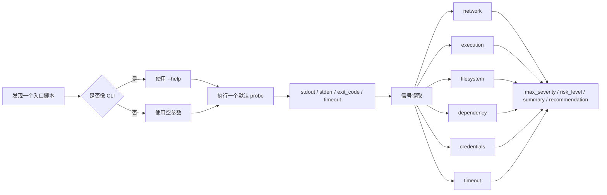

---

## 8. 为什么不同分析器的风险可能不一致

这在项目里是正常现象。

例如：

- `LLM = malicious`
- `sandbox = LOW`

常见原因是：

1. 代码里静态上已经明显恶意
2. 但 sandbox 这次 probe 没有触发到真正的恶意分支
3. 或 sandbox 禁网 / 参数仍然不够覆盖真实输入条件
4. 当前只执行一个默认 probe，不能保证覆盖所有恶意分支

所以最终风险看的是“合并后的最高风险”，不是只信某一个分析器。

如果要验证 sandbox 展示链路，可以上传这个测试样本：

- [tests/skills/sandbox-runtime-signal.zip](../tests/skills/sandbox-runtime-signal.zip)

它会在默认 probe 中主动暴露网络、文件系统、动态执行、凭证关键词和非零退出码等信号。

---

## 9. 验签原理

这个项目的验签不是签 `SKILL.md` 单文件，而是签整个目录树。

算法大意：

1. 遍历所有文件
2. 按相对路径排序
3. 每个文件算 `SHA256`
4. 汇总成一个稳定文本
5. 最终做：
   - 服务端 `Ed25519` 签名信封
   - 或 `SHA256`（开发模式）

用途是：

- 审批后固定内容
- 运行时检测本地 skill 是否被篡改

更详细的 agent 侧签名对接，见：
- [agent-signature-verification.md](../docs/agent-signature-verification.md)

---

## 10. Sandbox 架构

当前支持两个后端：

- `docker`
- `remote`


### 10.1 Docker backend

适合：

- 本地开发
- 单机演示

现在默认镜像是：

- `agent-manager-sandbox-runtime:latest`

它内置常见 Python 依赖，避免很多 skill 因为 `requests` 之类库缺失直接失败。

### 10.2 Remote backend

适合：

- 独立执行服务
- 生产环境隔离执行

当前服务基线在：

- [services/isolated-sandbox-service/README.md](../services/isolated-sandbox-service/README.md)

更详细架构说明：

- [sandbox-service-architecture.md](../docs/sandbox-service-architecture.md)

---

## 11. 前后端怎么启动

### 11.1 本地开发

后端：

```bash
cd /path/to/agent-manager
uv sync --project backend
uv run --project backend python -m backend.dev_server --host 0.0.0.0 --port 8000
```

前端：

```bash
cd /path/to/agent-manager/web
npm install
npm run dev
```

默认登录：

- 用户名：默认 `admin`，可通过 `INITIAL_ADMIN_USERNAME` 修改
- 密码：首次创建账号时使用 `INITIAL_ADMIN_PASSWORD`；生产安全模式要求至少 12 个字符。非安全模式下，数据库尚无该账号且变量留空时会生成随机密码；已有账号不会因后来修改该变量而改密。Docker 部署和升级步骤见[管理员初始密码与升级](docker-deployment.md#管理员初始密码与升级)

#### 源码回归 / Source regression

完整源码回归在仓库根目录运行。MCP SDK、Cisco Scanner 和 AIG 模型依赖为可选组件；AIG 的固定 `deepeval` 版本与 Cisco Scanner 的 `click` 约束不同，分开运行隔离环境：

```bash
uv run --with mcp==2.0.0 pytest
uv run --with cisco-ai-skill-scanner==2.0.6 python -m pytest tests/test_client_runtime_integration.py::test_real_scan_rejection_is_polled_and_quarantined_without_desktop
DEEPEVAL_TELEMETRY_OPT_OUT=YES uv run --with deepeval==3.7.5 pytest tests/test_aig_model_auth.py
```

第一组中因缺少扫描镜像依赖而跳过的两个组件用例由后两组补跑；检查三组输出，跳过不等于通过。测试环境应使用临时 `SQLITE_PATH`、`DATA_DIR` 与 `UPLOADS_DIR`。Go 客户端在 `scanner/` 执行 `go test ./...`，前端在 `web/` 执行 `npm run test:i18n`、`npm run test:docs-search`、`npm run test:docs-export` 和 `npm run build`。

Run the commands above from the repository root for the full source regression and the two optional component checks. The pinned AIG and Cisco Scanner dependencies require separate environments because their Click constraints differ. Review every result: a skipped component is covered only after its separate check passes. Use temporary database, data, and upload paths. Run the Go suite from `scanner/` and the frontend checks from `web/`. Deployed runtimes and external providers require separate acceptance testing.

### 11.2 本地使用 docker sandbox

如果系统设置里选的是 `docker`，先构建项目自带镜像：

```bash
cd /path/to/agent-manager
make sandbox-runtime-build
```

### 11.3 Docker Compose

完整容器化启动见：

- [docker-deployment.md](../docs/docker-deployment.md)
- [performance-benchmark.md](../docs/performance-benchmark.md)：单节点并发、Skill 数量和客户端 Inventory 实测

配置允许的最大并发不等于稳定处理能力。容量评估应同时检查 P95、错误率、SQLite 写等待、上游延迟和审计增长。

### 11.4 Skill 检测期间的 API 响应 / API responsiveness during Skill scans

ZIP、客户端 Scanner、本地目录和远程导入的解压、目录发现、摘要及版本准备通过独立的导入并发额度执行，
默认 `AGENT_MANAGER_IMPORT_WORKERS=2`；超过额度的请求异步等待，不占用普通同步 API 的线程额度。
URL 与 ClawHub 下载保留异步网络请求，下载文件写入及导入准备在线程执行；流式上传进度共用导入额度。
该额度按 API 进程/事件循环生效，后台检测仍使用 `AGENT_MANAGER_SCAN_WORKERS`。
同一进程的导入查重、版本准备与待检测任务登记使用独立准入锁，确保并发相同提交复用已有任务；
该锁不参与 Registry 查询和运行验签。已确认上传的持久化导入队列保留原有单线程准备方式。

Registry 只读查询使用独立 WAL 快照，不等待进程内扫描写锁；一次查询中的家族指针、总数和列表读取同一已提交快照，
查询结束关闭连接。运行时验签、加载检查、Scanner 结果轮询及客户端扫描状态轮询读取状态和签名等元数据，
不加载完整扫描报告；Skill 详情继续按需读取报告。每次运行检查仍读取数据库状态并保存审计。

这些措施减少事件循环阻塞、导入线程争用和大报告解析。扫描与 API 仍共享 CPU、磁盘和 SQLite，
验签审计与客户端写入仍可能等待写事务；生产 P95/P99 需在目标部署混合负载下确认。
复现与验证范围见 [性能基准](performance-benchmark.md#skill-导入与-api-隔离回归2026-10-14)。

**English:** Import preparation uses separate bounded thread capacity (`AGENT_MANAGER_IMPORT_WORKERS=2` per API
process/event loop). Queued imports leave ordinary API thread capacity available. Registry reads use committed WAL
snapshots; verification and client scan-status polling omit full reports. Each runtime check still reads database state
and persists its audit. CPU, disk and SQLite writers remain shared, so deployed mixed-load P95/P99 requires measurement.

受影响界面人工验收 Todo（简体中文 / English）：
- [ ] 批量 ZIP、目录、URL/GitHub、ClawHub 提交时切换总览、Skill 列表和客户端页面，确认可以继续访问。
- [ ] 上传解析进度、软链接确认、候选列表及失败提示正常，检测完成后详情报告可查看。
- [ ] 检测时执行客户端同步、任务轮询与 Verifier 验签；确认结果及审计，批准/撤销后重新验签读取新状态。

UI checklist: verify concurrent navigation, import progress/confirmation/errors, full reports, client synchronization,
task polling and fresh verification decisions after approval/revocation in both languages. No UI unit tests are added.

---

## 12. 管理台怎么使用

### 12.1 总览

看：

- 状态分布
- 风险分布
- 最近阻断事件
- 待处理 skill

### 12.2 Skill 列表

检测期间，状态列以紧凑图标步骤条展示排队、准备、规则扫描、深度扫描、Sandbox、LLM 和汇总；下方显示当前运行项目，悬停、键盘聚焦或点击可查看完整步骤名称与状态。每个检测项独立显示等待、运行、完成、失败、未启用或跳过；并行运行的项目同时高亮，已完成步骤显示勾选，等待项目灰显。阶段由后端检测流程实时写入当前扫描任务，列表每 3 秒自动刷新；分析器可并行执行，阶段表示当前流程位置，不代表耗时百分比。重新检测使用本次任务的进度，任务完成或取消后恢复显示准入状态。

列表的 `SCANNING（检测中）` 筛选包含尚未完成的初次检测和重新检测，状态单元格通过步骤条展示进度。后台状态编码为 `PENDING`：首次检测时 Skill 为 `PENDING`；重新检测时保留此前准入状态，并通过 `PENDING` 检测任务标记进度。

看：

- 每个同名 Skill 只显示一条，状态取最新内容版本
- 最新版本号与最新可信版本号
- 最终风险等级与独立的 LLM 判定结果，二者可能不同
- 分开的 SCANNING（检测中）、VETTED（待审核）筛选；APPROVED 表示已批准
- 勾选当前页项目后批量重新检测、取消任务或删除；结果按具体动作统计成功数量，并按状态或原因列出跳过、失败项目

“显示列”可配置全部 13 列，默认显示名称、最新版本、最新可信、状态、风险等级、LLM 判定结果、审批人、更新时间和操作；Skill ID、规则扫描、深度扫描、Sandbox 默认隐藏。设置按账号保存在本浏览器中，支持“恢复默认”。

至少保留一列：最后一个已选项保持勾选并禁用，勾选另一列后可取消原项。面板显示“至少保留一列 / Keep at least one column”。读取旧版空设置或全无效列键时恢复默认，保留合法单列及旧版分析列偏好。

“更新时间 / Updated Time”展示 Skill 的 `updated_at`，审批等记录更新也会改变此时间。名称、Skill ID、状态、风险、审批人、更新时间均仅在升序和降序之间切换，箭头与请求方向一致。默认及重置按更新时间降序；筛选、分页和刷新保留当前排序。各列升序规则如下，降序反向；分页列表同值时按更新时间降序。

| 列 | 升序规则 |
|---|---|
| 名称、审批人 | 文本顺序，英文字母忽略大小写；中文按数据库文本顺序 |
| Skill ID | 完整 `family_id` 文本顺序 |
| 状态 | 内部英文状态码顺序 |
| 风险 | 英文编码 `benign`（安全）、`malicious`（恶意）、`suspicious`（可疑）；未判定在最前，降序在最后；分页及非分页接口一致 |
| 更新时间 | 从旧到新 |

单条“更多 > 重新检测”和“批量重新检测”使用同一策略弹窗：可以沿用原有检测选项，也可以统一选择深度扫描、Sandbox 和 LLM 分析。规则分析强制开启、不可取消，悬停选项可查看说明。正在检测的项目会跳过重新提交；取消任务支持初次扫描和重新检测，取消重新检测保留此前有效判定。失败项保留选中，便于重试。

以下为当前页面的示例数据截图：

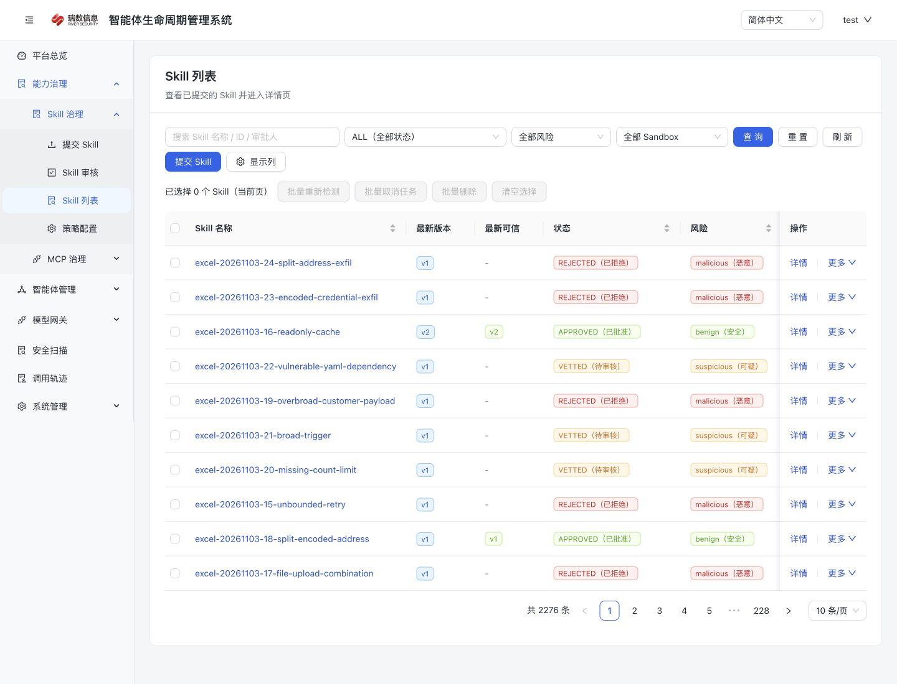

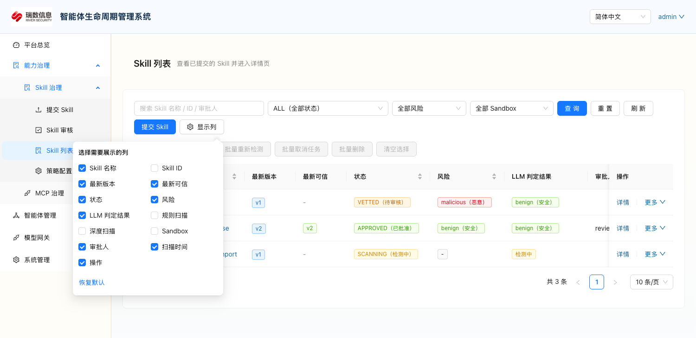

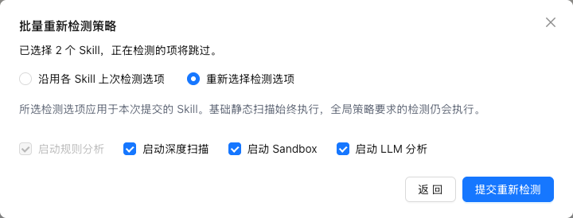

### 12.3 技能详情

能看到：

- 基础信息，以及深度扫描、Sandbox、LLM 的勾选状态及配置来源；勾选不等于执行成功
- 检测报告：“实际判定过程”和“扫描结果”分别展示决策逻辑与分析器证据
- **攻击链可视化**（展示 LLM 分析出的完整攻击路径）
- **MITRE ATT&CK / ATLAS 框架映射**（帮助理解风险对应的安全框架分类）
- LLM 对技能主要功能的概括
- behavioral 结果
- sandbox 风险摘要
- 原始报告 JSON
- 文件列表与文件内容
- 同名 Skill 的完整版本历史、来源版本和可信状态
- 任意两个版本之间的文件级 Diff
- 指定内容版本的检测执行记录（Scan Run）

LLM 实际启用时，执行信息的分析器列表保留 `llm:{provider}` 名称，调用失败仍保留。失败状态在 Skill 列表的“LLM 判定结果”列显示“调用失败”；打开详情的“扫描结果 → LLM 分析”可查看本次报告记录的失败原因，原始上游错误保留原文。系统关闭 AI 或本次未选择 LLM 时按对应执行状态展示。

When LLM analysis starts, the execution information retains `llm:{provider}` even if the call fails. The Skill list shows the failed state in the LLM result column; **Scan results → LLM analysis** in the detail page shows the recorded failure reason, preserving the original upstream error.

供应商请求超时按当次报告的 `llm_provider_timeout` 编码，在详情 LLM 项显示“模型供应商请求超时 / The model provider request timed out”，并保留已有原始错误；上游超时异常没有文本时也能查看明确原因。

基础信息中的版本号与最新版本标识保持完整，使用选择框切换版本。“安全判定”旁的“查看判定过程”会切换到实际判定过程并定位标题。

基础信息顶部集中展示当前版本、准入状态与安全判定，下方以紧凑信息项展示名称、作者、Skill ID、来源、工具声明及 Sandbox 运行信息，并随可用宽度换行。工具声明校验表示声明是否符合工具白名单与权限策略；结果复用标明历史结果来源。执行信息中的 Sandbox 分析器名称按该次报告记录的运行方式展示为 `sandbox:remote` 或 `sandbox:docker`，包括无脚本而跳过的情况；已有报告按其保存的运行方式展示。Sandbox 执行状态来自检测报告，策略要求单独说明是否必须执行；远程模式展示服务地址，Docker 模式展示容器镜像，远程模式因无可执行脚本（`reason_code=no_executable_script`）跳过时，服务地址显示“未调用”（英文 Not called）；缺失的运行信息显示“未记录”。生命周期中的策略自动批准会显示中文说明，人工审批保留审批人名称。

在“扫描结果 > Sandbox”展开调试信息，可查看“错误输出”（英文 Error output）。汇总区在“说明”之前展示本次报告 `sandbox_analysis.stderr`；展开每条 Probe，在“执行结果”之前查看该条记录的 `stderr`。输出保留原文和换行，长行自动换行、长内容可滚动并选择复制；字段为空、null 或历史报告缺失时，内容留空。非零退出码的具体原因可结合该输出检查。

“实际判定过程”为默认标签：顶部按分析器展示本次检测结果，下方并列显示本次最终风险与该 Skill 版本当前准入状态，再按编号展示发现项分类、工具风险汇总、LLM 结论合并、准入状态。点击分析器可进入对应结果；展开发现项可查看来源、严重度、文件、行号、风险分类和原始证据。风险结论使用本次报告记录，当前准入状态可能包含检测后的审批或部署变化；报告没有保存当时的准入动作快照。

策略入口在新页面定位当前风险归类或判定模式。新报告保存当次风险配置快照，历史报告缺少快照或判定字段时明确提示未记录；不会用当前策略重算历史结果。当前风险配置发生变化时提示重新检测以应用新配置。

查看判定过程时按以下顺序操作：

1. 打开目标 Skill 版本的“检测报告 > 实际判定过程”，先区分“本次最终风险”和“当前准入状态”。当 LLM 风险低于最终风险时，结果下方直接解释是否因“判为恶意”的发现项或严格模式而未采纳，并提供保留发现项与 LLM 原始分析的入口；缺少合并依据时明确标注。
2. 沿“发现项分类 → 工具风险汇总 → LLM 结论合并 → 准入状态”阅读依据，确认哪些发现影响风险，以及 LLM 结论是否被采纳。展开“LLM 复核意见”可查看差异解释及LLM 建议排除的风险提示。拒绝原因与审批异常以提示展示在图下方。
3. 展开“查看发现项与原始证据”，按规则分析、深度扫描、Sandbox 切换来源。标签显示各类发现项数量，每页展示 5 项，用底部分页浏览其余证据；切换来源后回到第一页。每项左侧显示严重度、文件位置和原始证据，右侧显示本次策略分类及其对风险的影响；窄屏改为上下排列。存在匹配的策略快照时显示对应配置项，否则展示报告已记录的分类；缺失分类时明确标注。点击文件位置或顶部分析器卡片进入对应扫描结果。无发现项记录时需结合分析器执行状态判断。
4. 查看图上方的风险配置快照说明。配置链接打开当前策略，修改后可先测算，再保存并重新检测目标版本。

截图中 LLM 给出无明显风险，但数据外传发现项根据本次配置被归为判为恶意，最终仍为恶意风险。Sandbox 在此例中跳过，不能据此认为它已观察到恶意执行；应结合原始代码上下文复核。

规则扫描的“规则分析器”按本次报告的 `analyzers_used` 展示基础扫描和本地规则分析器，零发现项也保留已记录的分析器。规则发现项合并顶层与本地结果，并去除同一发现项的重复副本，保留不同文件、行号和原始证据（包括 `snippet`、`code_snippet`、`evidence`）；命中数按去重后的结果计算。历史报告仅有顶层规则结果时仍可查看；缺少分析器记录时，根据已保存的本地分析结果展示对应来源。切换 Skill 版本后，名称和发现项均来自该版本报告。

“扫描结果”内可切换规则扫描、深度扫描、Sandbox 和 LLM 分析。skipped、unavailable、failed 不能解释为安全；例如勾选 Sandbox 后，没有可执行入口仍会跳过。

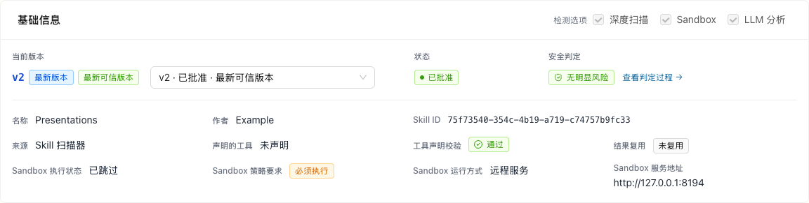

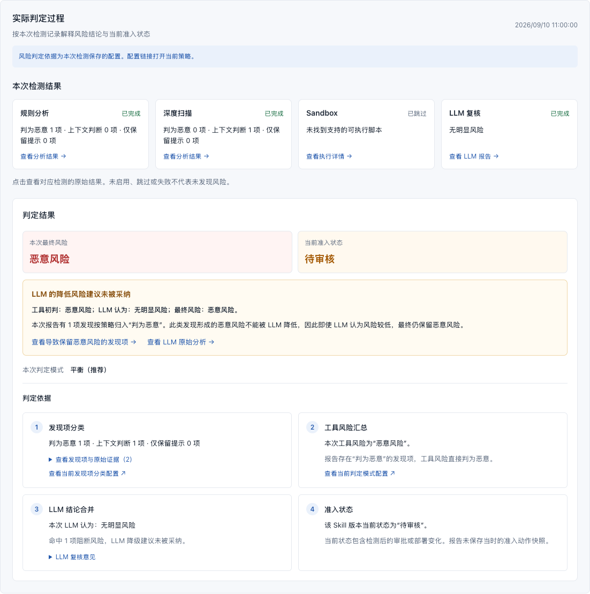

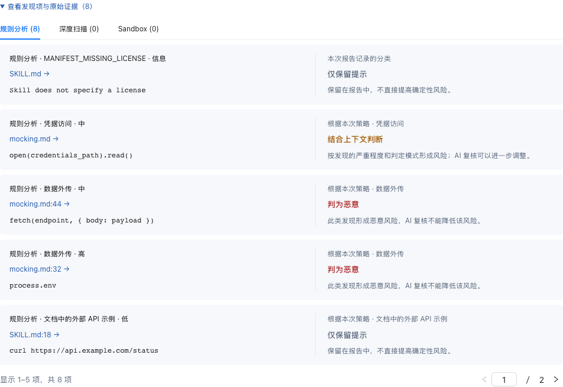

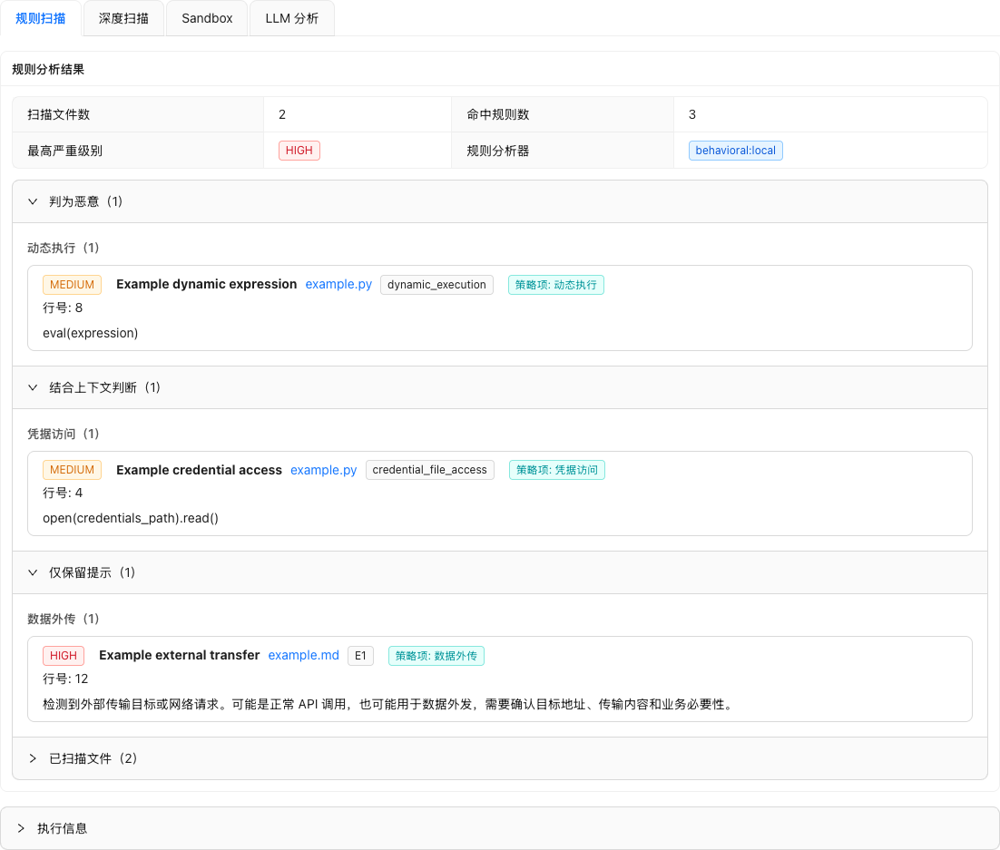

“扫描结果”底部的“执行信息”默认折叠，展开后查看发现项总数、检测耗时、分析器列表、结果复用情况与缓存 Key。耗时最多显示两位小数，未记录的字段明确标注。

规则和深度扫描的发现项使用与策略配置一致的分组名称：“判为恶意”“结合上下文判断”“仅保留提示”。分组依据本次报告记录的分类；修改策略后需重新检测，才能得到新策略下的结果。

深度扫描统计下的“已过滤噪声明细”默认收起，展开后每页查看 5 条被过滤项，统一展示严重度、规则、标题、文件名、独立行号及过滤原因。点击文件名可查看文件内容。过滤原因与扫描使用同一套规则，覆盖字体、位图和许可证常见措辞；该展示不改变有效发现项或风险判定。历史报告保留原始扫描数据时，读取接口补齐明细而不改写存储；记录不足时提示明细未完整记录。新增报告字段兼容现有数据库及 Docker 部署，无需数据库迁移。

过滤原因只接受当前原因翻译资源自身声明的编码；编码未知、为空或缺失时，该项统一显示“过滤原因：未知”（英文“Filter reason: Unknown”）；其他明细字段按原报告展示。

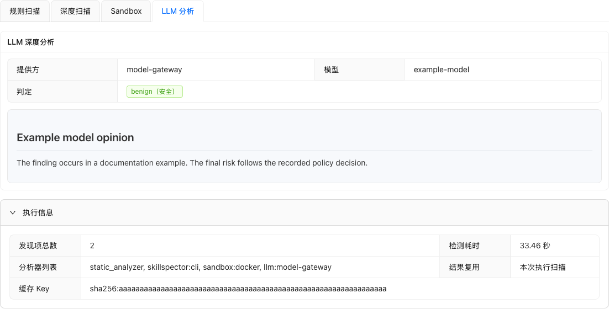

### 12.4 提交技能

上传方式可在“ZIP 包”和“文件夹”之间切换，每次仅展示对应入口，切换时清空当前选择和解析结果。文件夹模式通过“选择文件夹”上传浏览器选中的目录。打包前按直接子文件夹的原始大小降序展示，深层文件计入所属子文件夹，根目录文件单独列出。目录行统计该目录下所有层级文件的原始字节总和，根文件行显示该文件大小；原始大小与已选合计按 1024 进位自适应显示字节（英文 B）、KB、MB、GB 等单位，KB 及以上保留两位小数，例如 2048 字节显示为 2.00 KB。可以勾选、取消选择或移除条目，实时统计已选大小。取消勾选保留该行，可重新选中；“移除”删除列表中的整行及其待上传内容，不删除本地文件，恢复时需重新选择文件夹。所选文件原始总大小超过 100 MiB 时提示并禁用“打包并上传”，减少选择至 100 MiB 以内（含等于）后才能继续，按原始大小判断。选中内容包含疑似凭据时再确认路径，随后在 Web Worker 中打包并复用 ZIP 上传流程；打包可以取消。仅自动排除 `__MACOSX` 目录与 `.DS_Store`，SVG 等资源文件仍计数。文件夹最多 50,000 个文件、所选原始总计 100 MiB。ZIP 接口保留 100 MiB 上传上限；服务端解压预算为累计 50,000 个文件、原始总计 1 GiB、单文件 100 MiB（含嵌套 ZIP）。浏览器可能省略软链接及空目录，不能保证保留执行权限；需要这些属性时应上传 ZIP。历史提交记录以“文件夹名称.zip”显示。


提交时规则分析强制开启，深度扫描、Sandbox、LLM 按需选择。LLM 不可用时，先到“模型网关 > 模型管理”添加可用模型，再到“Skill 治理 > 策略配置 > 高级配置 > AI 分析服务”选择模型，并在“检测设置”启用 AI 分析；提交页和重新检测弹窗使用相同的能力可用性判断。

管理台上传 ZIP 的压缩包大小上限为 100 MiB（104,857,600 字节）。部署网关请求体上限为 101 MiB，为 multipart 表单预留开销。

前端选择 ZIP 时在本地自动移除以 `__MACOSX/` 开头的条目，按清理后压缩包的大小校验上传上限。清理时复用原 ZIP 的连续数据片段，只重建目录索引和偏移，保留文件属性，避免逐文件读取和重新打包的开销。超过上限的文件不会上传，而是在浏览器本地读取 ZIP 目录元数据，仅汇总 ZIP 内第一、第二级目录，按压缩后大小展示前 10 项及其原始大小，帮助清理后重新打包。深层文件计入所属目录，父子目录行间可能重叠；根目录直属文件单独汇总。分析不解压文件内容，重新打包可减少的体积为估算值。无法解析时可使用本地解压工具检查。

ZIP 中存在软链接时，页面展示路径清单，可选择“跳过软链接并继续”或“取消上传”。首次上传只解压普通文件并保留临时会话，不读取软链接目标；确认后复用已解析数据，取消则删除临时会话，整个流程只上传一次。等待确认的会话不能提交。跳过清单保留在导入会话元数据、提交响应和当前页面。嵌套 ZIP 内的路径使用 `归档.zip!/路径` 表示。缺少 `SKILL.md` 的目录不能提交，跳过运行依赖可能影响 Skill 运行。

处理 ZIP 时页面按阶段显示进度：本地读取、清理和目录统计按条目数量计算百分比，上传按已发送字节计算百分比。后端通过流式响应上报当前 ZIP 的解压条目数、Skill 清单的识别数量及百分比；查找清单和保存结果时显示阶段状态。候选列表返回后结束，软链接确认后继续识别，无需重新上传。单次流式响应包含进度事件和最终结果，失败返回稳定编码 `upload.parse_failed`。

选择 Skill 并提交后，服务端仅校验会话与路径、持久化后台导入任务，返回 HTTP `202` 和任务编号。内容指纹、版本查重、独立快照和扫描入队由后台执行，前台显示“后台任务已创建”，并自动打开导入结果弹窗，持续更新处理进度。结果中的状态与风险按当前界面语言显示，可直接打开 Skill 详情。

“提交所选技能”右侧的“历史提交记录”打开弹窗，展示最近 50 个任务的编号、ZIP 包名称、导入时间、状态及处理数量；点击“查看结果”在弹窗中查看处理进度、成功项目和失败信息，可通过“返回历史提交记录”回到记录列表，刷新页面仍可查询。相同会话、选择项和检测配置的重复提交复用同一任务。任务状态为 `QUEUED`、`RUNNING`、`COMPLETED`、`PARTIAL` 或 `FAILED`；单项失败返回 `upload.import_failed` 并保留路径，其余项继续处理。导入成功的 Skill 进入既有扫描流程，列表和详情显示最终检测状态。

帮助中心“快速上手”同步提供操作步骤和中英文截图。以下截图使用当前页面及示例数据：

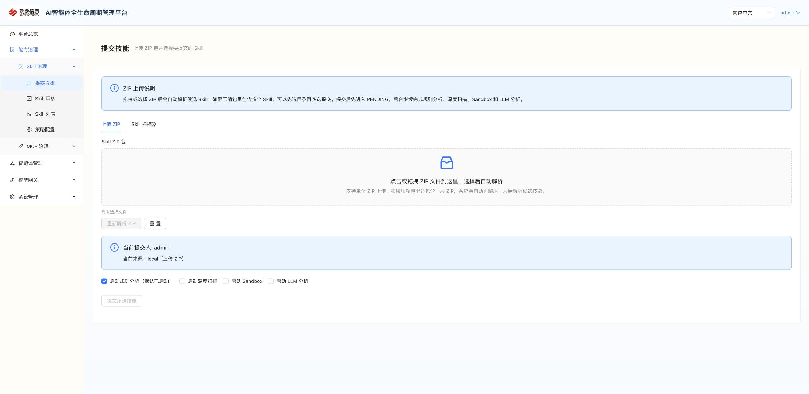

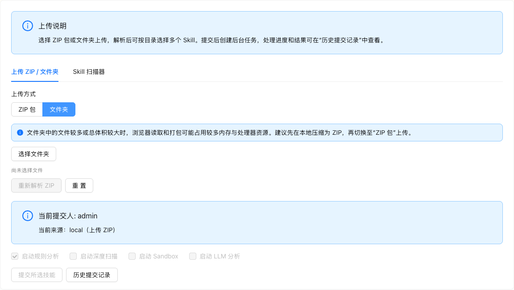

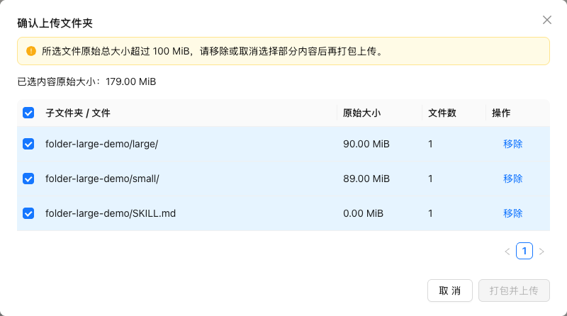

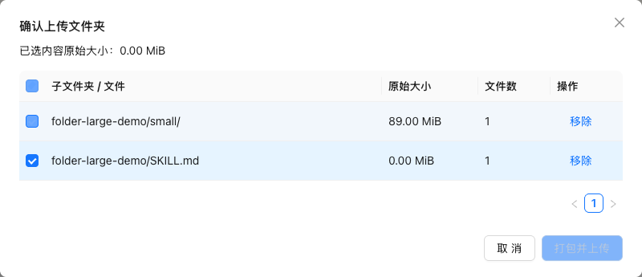


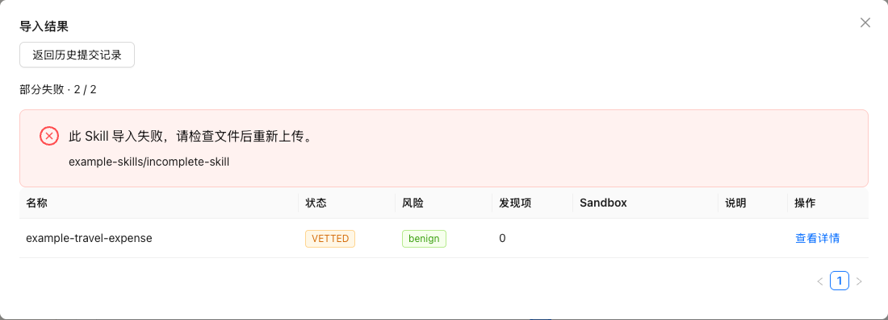

导入结果关联本次 `scan_run_id`，排队或检测中不展示上次的风险与发现项，完成后读取该次扫描结果；后续重检不覆盖历史提交结论。旧记录仅在提交时间范围内能唯一匹配扫描任务时恢复，无法关联时明确提示。

任务保存在数据目录的 `upload_import_jobs.db`。后台使用租约领取任务并续期，服务启动后恢复排队任务，失去租约的中断任务从已记录的处理位置继续执行。执行中的上传会话不可删除。

### 12.5 审核队列

处理：

- `VETTED`
- 批准
- 拒绝

### 12.6 策略配置

管理台按用户目的分为三个页签：

- **准入策略**：“准入策略摘要”实时展示表单中的处理结果。“风险处置规则”为无明显风险、可疑风险、恶意风险各指定一个动作；推荐为自动批准、人工审核、自动拒绝。无明显风险与可疑风险可选择自动批准、人工审核或自动拒绝，恶意风险可选择人工审核或自动拒绝。选择可疑风险自动批准后，风险等级仍为 `suspicious`，准入状态为 `APPROVED` 并生成签名。公司禁止权限始终直接拒绝，优先于风险处置表。
- **检测设置**：启用 AI 分析与 Sandbox，选择哪些中间风险要求补跑 Sandbox。提交和重新检测时仍可选择可选分析；规则分析始终执行。配置状态不等同于服务连通性，远程 Sandbox 可在高级配置中测试连接。
- **高级配置**：配置检测结果复用、AI 分析模型、超时和内容上限，以及 Sandbox 服务地址、凭据、镜像、网络与资源参数。远程 Sandbox 地址最多 2048 个字符，使用包含主机的 HTTP/HTTPS 基础地址，支持本地 IP、主机名、端口和路径；不包含空白、查询参数或片段，因为系统会追加 `/run-code`。保存与测试连接前均进行前后端校验，远程模式必须填写地址；超长输入完整保留并即时显示错误，标签悬浮提示说明长度及格式要求。Docker 模式不校验未使用的远程地址，切回远程模式后恢复校验。保存时仅校验本次变更的 Sandbox 配置，已有无效地址不会阻止保存其他策略或 AI 配置；接口错误通过统一协议返回 `sandbox.url_*` 编码及当前语言提示。后端长度常量及地址校验集中在 `agent_manager/core/sandbox.py`，保存和测试连接接口复用该逻辑。独立 API（`uv run agent-manager-api`）与后台入口复用同一 `ApiError` 处理器，均返回稳定错误编码，并按 `Accept-Language` 提供中英文提示。

远程连接凭据中的清除 API Key 选项将复选框、文字和说明图标放在同一行，校验错误显示在下方。

高级配置的输入字段说明图标提供中英文的输入类型、范围、单位和示例；检测结果复用采用行下说明，点击文字不切换开关。错误在字段下方显示，并在失败摘要中按序号逐条列出。整数输入框右侧加减按钮沿用原步长（描述字符1000、单文件字符500，其余1），仅对有效范围内的整数生效；手动输入始终按原文校验。输入原文在失焦、校验失败、请求失败和切换语言时保留，修正后重试；“重新加载”才主动恢复已保存值。

| 字段 | 写入规则 |
|---|---|
| AI 超时 / 最多读取文件数 | 正整数，分别为 5–180 秒 / 1–20 |
| Skill 描述 / 单文件字符上限 | 正整数，分别为 2000–50000 / 500–20000 |
| 分析模型 | 列表选择，AI 启用时必选，关闭时可空 |
| Sandbox 超时 | 正整数，1–300 秒；远程模式为请求等待超时 |
| 运行方式 / 网络访问 | remote、docker / none、bridge；开关类字段为严格布尔值 |
| 远程服务地址 / 新 API Key | 地址沿用上述规则；密钥可空以保留原值，最多4096字符，不含空白或控制字符；填写新值与清除操作互斥 |
| Docker 镜像 | 必选，有效镜像引用，最多255字符 |
| Docker 内存 | 正整数加 b/k/m/g 单位（大小写兼容），6 MiB–64 GiB，按1024进制换算 |
| Docker CPU 配额 | 十进制数，0.01–64，最多两位小数；例如2.5表示等效2.5个逻辑CPU的时间配额 |
| Docker 进程数 | 正整数，1–1024 |

远程模式显示地址、凭据、网络访问和超时，隐藏Docker专用的镜像、内存、CPU配额、进程数与根文件系统只读配置。切换运行方式不会清除另一种方式的已保存配置；服务端忽略非当前方式的字段。远程runner发送网络访问开关，资源及文件系统限制由远程服务部署控制：仓库nsjail默认执行15秒、地址空间256MiB、CPU时间10秒；Compose外层服务容器上限为512m内存、1.0 CPU、128进程，并启用根文件系统只读。这些是仓库默认值，实际部署可调整，CPU时间上限与CPU配额不同。

写入校验位于API请求边界，旧YAML继续按原配置模型读取；修改相应配置域时才按新规则保存，无数据库迁移。字段错误通过`ApiError`返回`error_code`及`error_params.errors`（字段名、稳定编码、范围参数），不返回密钥输入。请求体必须是JSON对象，非对象返回422与稳定编码。断网及常见服务端错误按当前语言显示，未知服务端说明保留原文。连接测试与保存分别显示失败状态，测试重试成功清除对应测试失败。网络选项沿用“桥接网络 / Bridge network”。前端先校验本次有变更的配置域，全部通过才提交；三个配置接口仍独立保存，服务端部分失败时成功域更新、失败域保留草稿，并显示具体失败域与字段。

准入页默认展示风险识别规则摘要，展开“自定义风险识别规则”后，可按行为逐项选择风险分类。在“风险判定模式”标签旁悬停或键盘聚焦问号按钮，可查看全部模式的总体说明，按上下文判断项、判为恶意项、AI 复核分组；严重度沿用“中等”“高”等名称，支持中英文和窄屏换行。宽松模式下中等严重度不提高风险、高及以上判为可疑；平衡模式下中等及以上判为可疑；严格模式下中等判为可疑、高及以上判为恶意。判为恶意项在所有模式下均判为恶意；AI 复核在宽松和平衡模式下可提高或降低风险，严格模式下只能提高风险，且不能降低判为恶意项的风险。“使用推荐动作”只恢复风险处置；“使用推荐风险规则”恢复发现项分类与平衡模式。公司权限与许可证要求集中在独立折叠区。

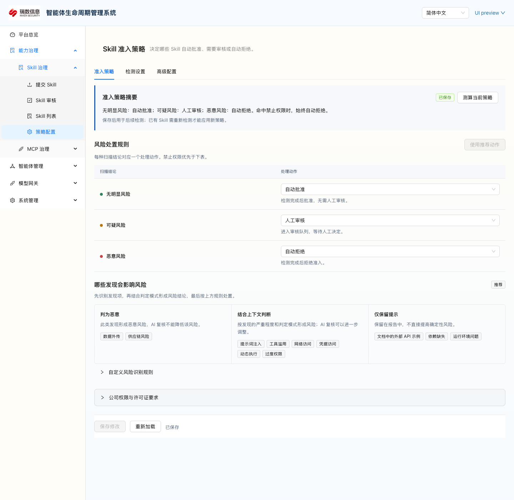

使用“当前策略判定测算”验证配置：

1. 在“准入策略”修改风险处置动作；需要改变发现项的风险分类时，展开“自定义风险识别规则”。
2. 点击准入策略摘要右上角的“测算当前策略”。弹窗按本页当前配置测算，包含未保存修改。可点击“动态执行 + LLM 无明显风险”或“数据外传 + LLM 无明显风险”填入示例。
3. 为规则分析、深度扫描、Sandbox 选择执行状态，按需添加发现类型和严重度，再选择 LLM 风险结论。执行完成且无发现项与未启用、跳过、不可用、失败含义不同；缺少结论不代表安全。配置了禁止权限时，还可模拟命中的权限声明。
4. 输入变化后自动重新测算。先看最终风险与准入动作，再沿“发现项分类 → 工具风险汇总 → LLM 结论合并 → 准入规则匹配”理解原因。命中禁止权限声明时，即使风险处置允许批准，也会拒绝。
5. 如需比较不同配置，可切换弹窗内的判定模式，这会更新本页策略草稿；也可点击“返回策略配置”修改分类和处置动作，再次打开时保留本页模拟输入。
6. 确认预期结果后返回策略配置，核对摘要和“当前修改未保存”提示，点击“保存修改”。在 Skill 列表对目标版本重新检测，并在详情的“实际判定过程”核对实际检测结果。

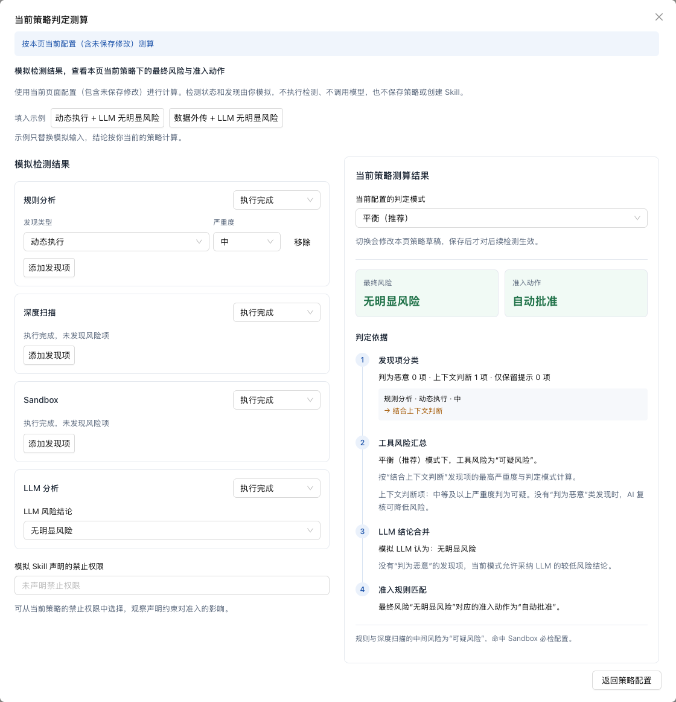

模拟器使用当前页面配置（包括未保存修改），复用后端发现项分类、风险计算、LLM 合并与准入决策逻辑，分别展示最终风险和准入动作，并逐步解释判定依据。切换模拟器内的判定模式会更新本页策略草稿；修改风险分类、风险处置或禁止权限也会重新计算。中间风险用于解释 Sandbox 必检触发条件，缺少检测结论会单独提示。模拟输入用于演示策略计算，不代表真实检测覆盖或 Skill 安全结论；模拟不会执行扫描、调用模型、保存策略、创建 Skill 或生成签名。

保存只提交有变更的配置域；部分保存失败时保留未成功的修改供重试。旧策略中同一风险同时要求拒绝和审核时，页面按后端优先级展示为自动拒绝，保存后每个风险只对应一个动作。保存后的策略用于后续检测，已有 Skill 需重新检测才能应用。

配置检测服务时，先在“检测设置”选择可用能力和 Sandbox 补跑条件，再通过“配置服务”进入高级参数。AI 模型先在“模型网关 > 模型管理”添加，再在“高级配置 > AI 分析服务”选择；提交或重新检测时仍需勾选 LLM 分析。远程 Sandbox 可在高级配置中测试连接，实际执行情况以检测报告为准。

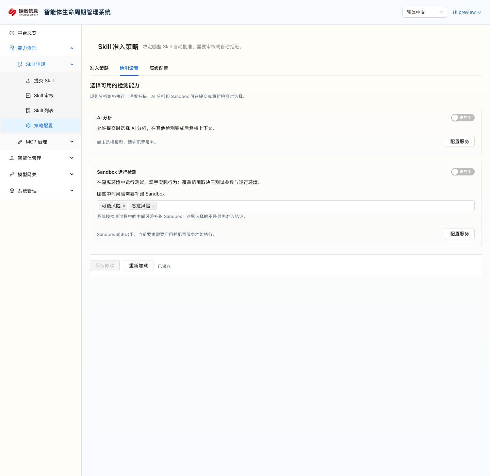

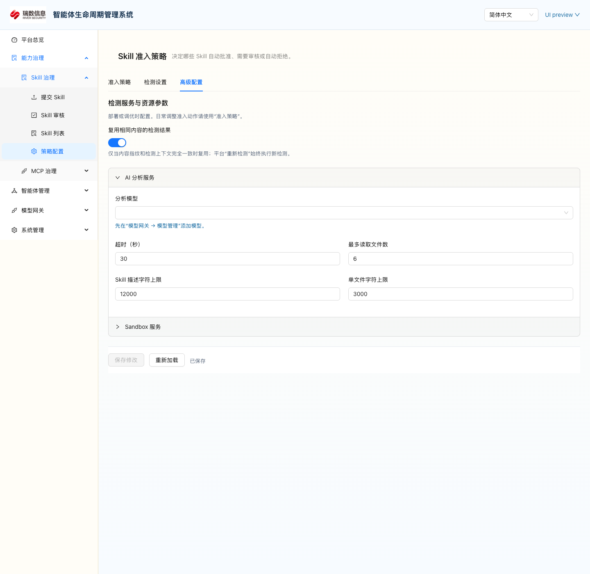

发现项先按策略归入三类，再形成最终风险：

- `blocking`（判为恶意）：任意此类发现都会形成 `malicious` 确定性风险，LLM 不能降级。最终准入动作由恶意风险处置决定。
- `risk`（结合上下文判断）：默认包含数据外传、供应链风险、提示词注入、工具滥用、网络、凭据访问、动态执行、过度权限、依赖和运行环境问题；结合严重度和判定模式形成风险。
- `noise`（仅保留提示）：默认包含文档中的外部 API 示例；证据仍保留在报告中，但不直接提高确定性风险。

最终准入顺序为：阻断型声明违规直接拒绝；命中自动拒绝风险进入 `REJECTED`；命中人工审核风险进入 `VETTED`；无明显风险或可疑风险命中 `auto_approve_risk` 时进入 `APPROVED`。未命中配置的风险保持默认处置：`malicious` 拒绝、`suspicious` 审核、`benign` 批准。界面为每种风险保存唯一动作；旧策略未配置 `auto_approve_risk` 时默认仅包含 `benign`。

许可证缺失或不被接受、工具数量超限、工具不在允许列表为非阻断告警；页面明确展示其提示作用。明确禁止权限检查的是 Skill 声明，不是运行时权限隔离。`auto_approve_max_risk` 仅参与 Prompt 自动批准，`trusted_authors` 尚未用于 Skill 自动放行，两者不在 Skill 策略页提供编辑控件，兼容字段与其他未展示字段在保存时保留。

### 准入策略说明 / Admission policy notes

许可证准入提示在实际判定过程的四项“判定依据”之后，按本次扫描记录增加第5项“策略说明”，沿用普通卡片样式，逐条展示非阻断原因；无提示时隐藏。许可证缺失仅在本次策略要求检查时产生准入提示，规则扫描发现项仍在扫描结果中展示。页面及中英文 PDF 使用同次报告的稳定规则编码和参数，许可证标识保持原文。旧报告在读取时解析已有策略备注，保留当时接受的许可证列表，不回写存储；应用当前策略需重新扫描。

工具不在允许列表的检查 `tool_not_in_allowlist` 是非阻断声明告警，最终状态继续按风险处置规则与明确禁止权限判断。实际判定过程底部以黄色“声明检查提示 / Declaration notices”展示单句：`声明的工具 {tool} 不在允许列表中：{allowed}。`，英文为 `The declared tool {tool} is not in the allowlist: {allowed}.`。列表从本次报告 `policy_warnings[].params.allowed_tools_allowlist` 读取，按英文逗号和空格连接；多项告警逐条显示，长内容自动换行。工具名保持原文；空列表显示“无 / None”，历史报告未保存列表时显示“未记录 / Not recorded”，不使用当前配置补写历史依据。工具声明检查仅有非阻断声明告警时显示黄色“有提示 / Notice”，明确禁止权限仍显示失败。历史拒绝记录保留原状态，重新检测应用修复后的规则。

工具数量超限 `max_allowed_tools` 同样为非阻断声明告警，`params.count` 与 `params.limit` 保存本次工具数量和策略上限。黄色声明检查提示中独立换行显示“声明的工具数量为 {count}，超过公司允许的上限 {limit}。” / “The Skill declares {count} tools, exceeding the company limit of {limit}.”，PDF 复用同次参数。数量等于上限时不提示；超限仍按风险及明确禁止权限决定准入。历史数量阻断记录保留当时状态和双语原因，重新检测使用新规则。

明确禁止权限命中时，红色拒绝提示直接显示“声明的权限 {permission} 命中了公司禁止权限列表：{blocked}。”，英文为 “The declared permission {permission} matches the company blocked-permissions list: {blocked}.”。清单来自本次报告 `risk_reconciliation.policy_snapshot.blocked_permissions`，按逗号和空格连接；历史报告缺少清单时显示“未记录 / Not recorded”，重新检测生成新的依据。拒绝摘要展示直接原因，权限标识保持原文，固定说明使用 `skillDetail` 双语资源。实际拒绝规则保持不变。

首次进入详情时，实际判定过程与准入提示共享加载占位，报告完成后统一显示；报告失败时展示双语错误及重试入口。刷新已有报告时保留内容，切换 Skill 或版本后只接受当前请求的响应。

The tool allowlist check is a non-blocking declaration notice. Admission still follows risk actions and explicitly blocked permissions. A yellow “Declaration notices” alert shows the tool and the allowlist saved with that scan, joined by comma and space. Empty and unrecorded lists are distinguished. Existing rejected reports keep their historical status; rescan to apply the corrected rule. The decision trace and related alerts share the initial loading placeholder, with an explicit retry action on failure. Refresh retains the existing report and stale responses cannot replace the selected Skill version.

PDF 在“策略说明 / Policy Notes”小节统一列出准入提示和分析备注。

ZIP 上传队列在策略保存后更新后续任务使用的管理器，复用已有队列和线程；已经开始的扫描使用原实例完成。扫描报告 JSON 新增 `policy_warnings`，兼容已有数据库及 Docker 部署，无需表结构迁移。

The decision trace adds “Policy Notes” after its four existing basis cards when this scan recorded non-blocking license notices. The page and localized PDFs preserve the scan’s license identifiers and accepted list. Historical notices are read from stored notes without rewriting reports. Saving policy refreshes subsequent ZIP work while keeping the existing queue, thread and in-flight scan instance. The report JSON extension requires no database migration.

人工 UI 验收 / Manual UI checks：

- 查看许可证缺失、不被接受与合规样例：第5项按实际记录显示或隐藏，单独提示不改变原准入规则。
- 切换版本、刷新与中英文：提示跟随当前报告；导出 PDF 对照参数及语言。
- 窄屏和较长许可证值：列表自然换行，卡片及编号布局正常。


### 12.7 扫描器接入

用于客户侧批量扫描本地 skills：

- 在统一凭证中心创建和吊销 Scanner 接入凭证
- 从“能力治理 -> Skill 治理 -> 提交 Skill”的 Scanner 接入区域下载 CLI 扫描器
- Scanner 参数说明按基础与上传、服务端分析、本地限制分组；上传地址和凭证各支持命令行或环境变量来源，命令行优先；仅本地扫描使用 `--server=""` 覆盖已有地址，服务端分析开关仅随上传生效。完整参数与默认值见 `docs/skill-scanner.md`。
- 下载 Agent Skill Verifier
- 查看安装命令和参数说明
- 获取配置模板
- 跳转查看服务端扫描结果

CLI 适合服务器和 CI。Agent Skill Verifier 适合安装到 Codex、Claude Code 等通用 Agent 的 skills 目录，用来指导 Agent 在使用第三方 skill 前先提交扫描，并检查内容完整性、审批状态和 Agent 授权范围。

Skill Verifier 下载位置：

- `智能体管理`
- `接入与运行`
- `Agent Skill Verifier 接入`
- `下载 Skill Verifier`

提交和查询扫描结果时使用 Scanner 接入凭证；加载前验签时使用绑定当前 Agent 的运行凭证。两类权限不能合并到同一凭证。脚本分别读取 `AGENT_MANAGER_SCANNER_TOKEN` 和 `AGENT_MANAGER_AGENT_RUNTIME_TOKEN`，也可在对应子命令上传入 `--token`。

详细说明见：

- [skill-scanner.md](../docs/skill-scanner.md)

### 12.8 安全扫描与调用轨迹

帮助中心保留 `/docs/agent-security-runtime` 总览，并提供四份中英文操作指南：

- `/docs/security-scan-guide`：六个工作区、目标字段、策略预算、六种扫描、任务详情、Finding 与报告。
- `/docs/dify-security-access`：App API、Console Admin API、Knowledge API 获取步骤，地址与 ID、资产清单及排错。
- `/docs/security-operations`：定时计划、两类风险分、人工处置、修复验证及 Worker 排错。
- `/docs/runtime-trace-guide`：会话查询、事件字段、聚合与完整度、性能和脱敏/原始导出。

指南中的页面截图使用当前组件和明确标识的示例数据，凭据均为掩码。
Dify 部署端 Admin API Key 的版本条件和配置步骤见
[Dify 凭据获取说明](external-agent-integration.md#三种凭据的获取与配置)。

侧边栏在“模型网关”之后、“系统管理”之前提供两个已启用的入口：

- “安全扫描”：目标、凭据、策略、生产审批、任务预览/执行、定时计划、风险评分、Kill Switch、Finding、报告和版本对比。
- “调用轨迹”：查看当前角色有权访问的脱敏对话与执行轨迹，搜索证据并在 Finding 与事件间跳转。

上游组件的锁定版本、Commit、许可证、归属和能力边界见
[上游集成基线说明](agent-security-p0-baseline.md)。

任务详情分别展示错误码、错误说明、停止原因、attempt、累计用量、最后心跳和租约时间。失败任务若
没有 Case、Finding 和 Artifact，会明确标记为“未形成最终扫描报告”，其中的 0 不表示未发现风险；
成功任务有 Case 和 Artifact 但 Finding 为 0 时，则说明本次未产生安全发现，同时保留覆盖范围有限、
不能解释为绝对安全的提示。

失败或超时任务可在任务列表或报告页点击“重试扫描”。重试沿用原扫描配置创建新任务，保留原任务和报告，
并重新检查当前目标、策略、模型、凭据和审批。上次重试仍在排队或运行时，重复点击会打开该任务；
上次重试结束后，再次点击会创建新任务。需要重新审批时，先在“新建扫描”中完成审批后发起任务。

报告页的“下载诊断日志”导出 JSON，供客户向支持人员提供排查依据。所有任务均包含状态、错误码和资源用量；
MCP 模型扫描另记录阶段、请求状态、异常类型和源码位置，并随心跳持久化，每次 attempt 保留最近 500 条、最多 10 次 attempt。
日志不包含凭据、原始对话或工具参数/响应，下载要求任务访问权限并记录审计。旧任务仅导出当时已保存的信息。

模型调用的 Token 压缩由调用凭据的开关与级别控制；客户端自动签发的运行凭据通过客户端策略配置，支持默认继承和单台覆盖，并通过长轮询同步。

Token compression follows the calling credential settings. Automatically issued client runtime credentials use default or per-client compression policies synchronized through long polling.
遇到轮次或 Token 耗尽，先检查是否反复生成无法识别的调用、阶段是否推进，再调整预算；轮次表示模型调用次数，
不是成功工具调用次数。网关工具等待审批时，扫描立即停止并提示管理员检查 MCP 网关的待审批请求及授权配置。

执行中的 MCP 阶段使用“执行中／阶段已完成”状态，不展示最终工具风险统计。完成后的 MCP 与 SARIF 报告
分别按各自格式展示发现标题、分析和修复建议，原始 JSON 保留。网关自动附加的传输层认证只向评估模型提供配置状态，
不提供密钥；认证字段未出现在工具参数中，不构成缺失鉴权的证据。未经独立验证的模型发现标为“待验证”，
新任务评分不将这些发现作为已确认风险计分，存在待验证项时不展示为完整安全评估；历史评分快照保持不变。

首次使用建议按以下顺序：

1. 内置部署复制 `.env.example` 后执行 `docker compose up -d`，默认启动 Worker 和内部引擎；生产部署需替换开发凭据并启用安全启动校验。外部 Worker 需要管理员创建并保存只展示一次的 Token。
2. 在“安全扫描 → 扫描目标”登记经授权的 Agent，或选择已经存在的 MCP Gateway；目标凭据单独加密保存。
3. 创建与目标环境一致、能力不越界的执行策略。生产环境优先 `read_only`；确需 `active_safe` 时配置目标白名单、UTC 维护窗口和专用身份。
4. 发起任务前检查只读预览。生产主动扫描还要创建并选择绑定当前目标、策略、窗口和凭据版本的单次审批。
5. 创建任务后观察排队、运行、重试和终止状态。普通取消用于正常停止；发现敏感数据外发等紧急情况时，由管理员填写原因启用 Kill Switch。
6. 在“安全发现”处理 Finding，在“扫描报告”复核用例、评估理由、证据和版本对比；“运行与审计信息”展示报告模板与判定口径版本，需要调用上下文时跳转“调用轨迹”。

Dify 资产清单另按以下顺序配置：创建 Dify 目标并填写 Console Base URL、Workspace ID 和 App ID，
以 `dify_console_api` 用途保存 Admin API Key，选择只读策略后发起 `dify_asset_inventory`。仅在 Console
导出不可用时选择手动 DSL；需要知识库内容检查时，再取得明确授权、配置独立 `dify_knowledge_api` 凭据并
设置采集上限。需要补充意图时可由管理员显式启用系统推断并选择模型；未选择模型时使用平台默认启用模型。
扫描完成后在任务详情“资产清单”核对已验证意图、管理员声明、系统推断、字段来源、验证摘要和覆盖缺口，
而不是只看任务状态。

只有扫描链路自检成功不能证明目标安全；MCP 元数据扫描不会调用 Tool；Agent 动态扫描也只对实际执行的
用例和轮次负责。外部 Provider、生产网络和客户账号必须在验收环境单独实测。

#### 定时扫描、资产来源与风险评分

在扫描目标的资产来源配置中，启用“变更后扫描策略”时必须选择“自动扫描评估模型”。该模型来自已启用的模型网关模型及供应商，保存时和每次派发时均会校验。旧来源若尚未配置评估模型，需编辑补充后再重试；模型停用、目标凭据缺失或审批未满足时，变更事件保留失败原因并在后续重试，不会记为扫描成功。相同资产版本的变更重复处理只创建一次扫描任务。

For asset sources, selecting a scan policy after changes also requires an automatic scan evaluator model. Select an enabled gateway model with an enabled provider. The platform validates it on save and on every dispatch. Edit older sources to add the evaluator before retrying. If the model is disabled, target credentials are missing, or approval is required, the event retains the failure reason for retry. Reprocessing the same asset revision creates only one scan task.

“发起扫描 → 执行安排”提供立即执行和定时执行。管理员可创建固定间隔、每日、每周或五字段 Cron
计划，指定 IANA 时区并预览后续执行时间；可勾选保存后立即执行一次。定时任务使用独立会话；
Dify 定时采集使用在线 Console 配置。扫描目标、规则和策略与即时扫描共用同一套表单。

“定时计划”展示启停状态、下次执行和最近执行结果。支持编辑、暂停／恢复、立即执行一次、查看执行
记录及删除。最近执行可直接打开扫描报告；从执行记录进入报告时先关闭记录抽屉。安全发现的所属扫描列和扫描报告的目标列显示“定时任务”标识，悬停可查看计划名称。编辑影响之后的执行，已派发任务保留原配置。删除计划保留历史任务和报告及其触发来源。
同一计划上一轮排队或运行中时，本轮记录为跳过；服务停机错过多轮时最多补一次。手动执行不改变
原有周期。每次执行重新验证执行账号、目标权限、凭据、策略和生产审批，失败形成明确执行记录。
生产审批失效时显示待审批；管理员在发起扫描中完成对应审批后，从计划立即执行一次。
同目标、同配置的自动触发会复用正在排队或执行中的任务，触发来源保留在任务详情。

模型红队扫描的计划用例数为各测试集实际抽样数之和乘以所选问题变换方式数；每种选定方式均进入正式测试。已结束任务的完成数以保存的用例为准，错误和未验证用例保留各自状态。引擎返回用例少于计划数时，任务标记失败并提示“测试覆盖不完整”，已返回的用例和报告仍保留。

扫描任务和报告摘要展示用例进度及执行轮数。当前模型红队引擎未采集模型接口的 Token 用量，历史报告中的用量为缺失值，无法据此还原实际消耗。最终报告按原文导出测试输入和模型回答。任务终止后保留实时完成用例数，并展示终止原因；实时用例完成与最终报告提交分别展示。


报告顶部及 PDF 展示“本次扫描风险分”、完成检查数和计分范围；评分依据可跳转发现证据。
任务终止时保存评分快照，之后的处置不改写本次评分。已有历史任务在首次读取报告时补齐快照。
“扫描目标”列表和风险详情展示“当前综合风险分”，汇总该目标仍有效、未关闭的风险及明确关联的 MCP
风险；详情提供覆盖状态、评分历史、风险处置、来源及最近同步时间。两个分数分别服务本次报告和长期治理。


风险评分使用固定版本 `agent-risk-score@1`，分数用于处置排序，不代表漏洞利用概率或合规通过率。
计算方式为最高风险基础分，加其他去重风险的附加分；附加最多 20 分，总分最多 100 分：

| 等级 | 基础分 | 其他风险附加分 |
|---|---:|---:|
| 提示 | 0 | 0 |
| 低 | 10 | 1 |
| 中 | 35 | 3 |
| 高 | 65 | 5 |
| 严重 | 90 | 8 |

1～34 为低，35～64 为中，65～89 为高，90～100 为严重。重复扫描的相同资产、规则、来源和问题位置
归并为一个风险项；模型生成标题不参与归并。不同工具保持各自身份。风险详情展示贡献分、原始 Finding
引用、覆盖检查、资产版本、评分版本和历史 JSON，并能跳转扫描证据。

Agent 扫描和同一目标的 Dify 配置风险自动进入评分。管理员可显式关联相同用户和用户组归属的 MCP
扫描目标，其风险计入关联智能体；MCP 覆盖范围由实际选择的扫描模式和执行证据决定。Skill 与智能体的运行装载关系
应由接入方提供明确证据，聚合 Skill 报告仍需接入方提供可验证的装载关系。

没有评估时分数为空；部分完成但未发现计分风险时仍为空。只有配置范围内检查完成且无计分风险时显示
0，并展示检查范围。资产变化或结果过期会标记待复扫，未关闭风险继续保留分数。评估有效期默认 168 小时；执行失败、取消或缺少相应检查用例均不能清除旧风险。
风险接受继续计分；审核为误报后排除；修复声明先进入“修复待验证”。验证关闭需引用可比复扫任务，
校验目标、资产版本、引擎版本、检查范围、完成时间和对应通过用例，并保留关闭审计。

新增 API 均位于 `/api/v1/agent-security`，沿用登录及目标访问权限，管理员负责配置和处置：

| API | 用途 |
|---|---|
| `GET/POST /scan-schedules` | 定时计划列表／创建 |
| `PUT/DELETE /scan-schedules/{id}` | 编辑／删除计划 |
| `GET/POST /scan-schedules/{id}/runs` | 执行记录／立即执行一次 |
| `POST /scan-schedules/preview` | 时区及执行时间预览 |
| `GET /targets/{id}/risk-profile` | 目标综合风险与来源 |
| `GET /managed-agents` | 分页智能体及风险摘要 |
| `GET /managed-agents/{id}/risk` | 当前评分及覆盖 |
| `GET /managed-agents/{id}/risk-history` | 评分历史 |
| `GET /managed-agents/{id}/risk-issues` | 归并风险及证据引用 |
| `PATCH /managed-agents/{id}/risk-issues/{issue_id}` | 审核与验证关闭 |
| `PUT /managed-agents/{id}/related-targets` | 显式关联 MCP 扫描目标 |

同步、扫描完成和风险处置通过数据库事件触发重算；事件与来源结果同事务保存。读取当前评分会检查
有效期，历史评分保存当时的输入和计算版本。新增生命周期表由后台启动建表流程创建。

### 12.9 模型网关

用于统一管理 LLM 供应商和隐私路由：

- 模型供应商：OpenAI-compatible `base_url`、供应商 API Key、超时、启用状态
- 模型端点：模型名、默认模型、上下文窗口、最大输出 token
- 模型调用凭证：在统一凭证中心配置允许模型、请求体大小、并发、Prompt 防护和可选 Token 压缩
- 用户与用户组：用于分配模型访问权限和隐私策略
- 隐私策略：按用户组绑定，配置实体类型、每类实体正则规则、system 消息检测、bypass 权限、映射 TTL、差分隐私统计参数
- 隐私审计：DP 统计、PII 命中、token 创建/复用、会话映射查询和删除

管理台菜单已拆成 `模型网关` 子菜单：供应商管理、模型管理、组策略绑定、隐私策略、Prompt 防护测试、Skill 告警、隐私审计、Token 压缩统计、用户 Token 分析和隐私链路追踪。模型调用凭证统一在“智能体管理 -> 统一凭证中心”创建。

运行时接口：

- `POST /v1/chat/completions`：OpenAI SDK 兼容路径
- `POST /chat/completions`：兼容 base URL 不带 `/v1` 的客户端
- `GET /v1/models` / `GET /models`：OpenAI-compatible 模型列表
- `POST /api/v1/llm/chat/completions`：Agent Manager 命名空间路径

Docker Compose 的根路径 `/` 由管理台前端使用；外部模型客户端应使用 `/v1`，或使用会自动拼接 `/chat/completions` 的根地址配置，不要直接 POST `/`。

详细说明见：

- [model-gateway.md](../docs/model-gateway.md)

### 12.10 隐私链路追踪

用于查看一次 LLM 请求的隐私处理链路：

- `prompt_security`：Prompt 防护检测结果
- `original`：原始请求
- `masked`：发送给上游模型前的替换后请求
- `compressed`：智能上下文压缩后的请求
- `masked_response`：上游模型返回的 token 响应
- `final_response`：最终还原响应

Trace 保存原始 PII，默认只应开放给 `admin`、`super_admin`、`privacy_auditor`。

### 12.11 帮助文档、导出与文档助手

帮助文档使用独立根路由 `/docs`，不是嵌入管理台内容区。文档配置使用独立的 `/docs-settings` 页面，入口位于“系统管理 -> 文档设置”，不与系统总览混排。

中英文“Docker 部署”与“Docker 运维”按交付安装包说明现场操作：准备生产 `.env` 后执行
`./start.sh`，可用 `--port` 保存 HTTP 端口；后续在原安装目录执行
`./upgrade.sh <安装包>`。帮助页同步说明六个默认服务、五个持久化卷、旧安装目录的
`--install-dir` 用法，以及部署文件备份与业务数据备份的边界。完整现场步骤见
[离线部署现场实施指南](offline-deployment.md)。

文档设置页提供两类导出：

- 帮助文档 PDF：支持完整文档、使用与治理、管理与运维或自定义文章范围；可选择中文或英文。每次导出先重新读取当前发布版本的帮助文档，再把所选文章的结构化内容提交给后端 PDF 生成器，下载正文、步骤、表格、代码和截图，并写入按模块和文章分层的 PDF Outline/Bookmarks；macOS“预览”等阅读器可在侧边栏展开目录。
- 产品功能清单 Excel：支持全部产品功能、治理核心能力、系统与运维或自定义二级能力范围；可选择中文或英文。工作簿包含“功能总览”和“功能清单”，明细列为序号、一级模块、二级能力、功能名称、功能说明、使用场景、操作入口、能力边界和帮助章节。功能清单来源于当前版本随前端发布的能力目录，不把帮助文章标题机械地当成功能项。

PDF 固定包含封面、页面目录、语言、导出时间和侧边目录，并保持帮助中心顺序；封面不显示所选文章数量。Excel 固定启用明细筛选和表头冻结，模块统计只计算本次选择的功能。两类导出都只读取当前内置文档和能力目录，不读取文档助手对话，也不受文档助手开关影响。

PDF 导出显示读取最新文档、整理文章、排版与目录、接收文件四个阶段，以及实际处理的文章数、排版轮次、页数和累计耗时。主进度条按已完成阶段展示，旁边标明“已完成 X / 4 个阶段”；多轮排版期间保持在同一个阶段，只有文件接收完成并启动下载后才显示全部完成。排版详情单独显示已完成轮数、当前轮次和本轮已排版页数，后续轮次按上一轮总页数提供页数估计。轮次总数在目录校准结束后确定，完成后显示实际总轮数和总页数。接收文件详情按已接收字节显示文件接收百分比。支持取消和失败后重试，取消或失败时保留当时的阶段。后端在工作线程中生成 PDF，通过流式响应反馈进度，完成后启动下载。

在线帮助与导出内容共用 `web/src/docs/content.js` 组装后的数据。前端构建同步生成 `/docs/content.json`；导出时禁用该资源的缓存，完整文档预设包含本次读取到的全部文章，自定义范围保留仍存在的所选文章。文档修改须随前端发布，截图须随对应后端版本发布。最新文档读取失败时会提示导出失败。

管理员还可以配置：

- 是否在帮助文档顶部显示“问问 AI”入口，默认关闭。
- 使用模型网关中哪个已启用模型回答。
- 每次最多提供给模型的文档小节数量，范围为 2 到 6。
- 回答 Token 上限，默认 12800，可设置为正整数；实际额度取该值与所选模型输出上限中的较小值。已有配置未设置此项时使用默认值。
- 中英文欢迎语和附加回答要求。
- 最多 8 个中英文常见问题。

文档设置页会跟踪尚未保存的修改；切换到其他页面时显示确认提示，刷新或关闭标签页时使用浏览器原生离开提示。保存成功后提示状态会清除。

文档助手的工作边界：

1. 浏览器在当前语言的内置帮助文档中检索相关小节，并把有限片段作为上下文提交。
2. 服务端要求模型只能依据这些片段回答；上下文不足时应明确说明，不能补写未确认能力。
3. 回答下方的相关文档链接由前端文档索引生成，不使用模型自行生成的 URL。
4. AI 回答使用 GitHub Flavored Markdown 渲染，支持标题、列表、引用、代码块、表格和安全链接；渲染前执行 HTML 标签与属性白名单清洗。
5. 普通已登录用户可以读取启用状态并问答；只有管理员能保存配置。
6. 问题和回答不会写入普通操作日志；配置变更会记录管理员操作。

这项功能用于缩短查找路径，不替代正式文档。涉及部署、权限、安全边界和当前启用状态时，以文档正文、系统设置和实际运行结果为准。

---

### 品牌与系统名称

在“系统管理 → 系统总览”的“品牌与系统名称”中配置中文系统名、英文系统名及公司名称，上传 Logo 或恢复默认 Logo。名称按界面语言选择，公司名称保持输入原文；保存后登录页、管理台顶栏、文档页名称和浏览器标题同步更新。修改需要 `settings:update` 权限，登录前只公开品牌展示字段。名称保存在现有 SQLite 数据库中，Logo 保存在 uploads 数据卷中，容器重建后继续保留。默认系统名为“智能体生命周期管理系统”和“Agent Manager”。

### 管理账号、角色、菜单与系统审计

目标与资产编辑的操作日志保存业务字段的修改前后值，并展示目标名称；连接配置、连接地址仅记录是否修改，避免将凭证写入普通日志。详情以字段对比为主，原始 JSON 收入技术详情。未保存字段快照的历史记录无法还原具体变更。

管理台成功切换页面或刷新进入页面时，会向操作日志上报“访问页面”，记录当前账号、页面、时间和来源 IP；后端校验页面访问权限。查询条件变化和后台轮询不会作为新的页面访问记录，查询参数不写入访问日志。页面访问依赖浏览器上报，不能作为所有 HTTP 请求的完整访问日志；启用前的历史访问无法补录。

系统管理提供账号管理（`/users`）、角色管理（`/roles`）、菜单管理（`/menus`）和系统审计
（`/system-audit`）。账号沿用现有用户与用户组数据，一个账号关联一个角色；用户组继续用于
模型网关策略及业务资源分组。账号角色负责管理操作授权，两者可以同时配置。

账号页支持用户名／邮箱搜索、角色／状态／用户组筛选、服务端分页，以及创建、编辑、启停、
重置密码和删除。密码统一要求至少 8 个字符、最多 72 个 UTF-8 字节。密码重置和账号禁用
会使旧会话失效。删除账号前检查业务外键关联，有关联记录时需先处理关联或禁用账号；历史
审计记录继续保留。操作者只能分配其管理范围内的角色，自己的账号及最后一个有效管理账号
受到保护。

角色由稳定标识、显示名称、描述、默认首页和权限集合组成。权限使用 `模块:动作` 编码，例如
`users:assign_role`、`skills:approve`、`scans:execute`、`scans:stop`、`audit:operation`。
角色配置界面按模块选择操作，后端在每次管理请求中查询当前角色权限，权限撤销在下一次请求
生效。最高管理角色保留系统管理能力；原始隐私内容继续限制为管理员或隐私审计角色访问。
新建自定义角色初始没有权限，配置权限时可一起选择默认首页；没有可访问页面时显示访问受限页。

菜单页支持三级目录、已有页面入口、中文／英文名称、图标、父目录、排序和启停。页面选项来自
已有路由目录。菜单启停控制导航展示，角色权限控制访问，系统功能开关控制模块可用性。
默认首页从当前可访问且已启用的入口中选择；原首页不可用时，登录进入第一个可访问入口。
内置入口通过启停管理，自定义菜单删除前检查子菜单和角色默认首页关联。

系统审计包含登录日志、操作日志和安全审计。可按时间、操作者、模块、动作、结果及关键词查询，
筛选变化自动刷新，文本输入停止 300 毫秒后搜索；通过服务端分页访问历史数据。列表突出事件、操作者、对象和结果，详情展示变更前后对比，并可展开原始结构化记录。安全事件类型和安全事件标识独立展示，不与请求关联标识混用。账号、角色、菜单变更的成功记录
与业务变更一起提交，失败与权限拒绝单独记录。新记录包含请求关联标识、来源地址及变更前后
信息；密码及请求中的密钥不写入操作详情。Compose 部署由入口 Nginx 覆盖客户端地址转发头，
Backend 仅接受可信代理网段提供的转发信息，避免把 Nginx 容器地址或客户端伪造地址写入审计。
配置修复前已经写入的历史来源地址不会回填。旧登录／操作日志与已有安全审计链继续可查，
拥有 `audit:verify` 的角色可以执行审计链验证，检查安全审计记录是否被修改、记录之间是否断开。
三类日志默认按时间倒序、每页 10 条，刷新保留当前页签；筛选区提供同行重置按钮，详情保留完整记录。

新增用户名只允许大小写英文字母、数字、下划线、点和短横线，最长 64 字符；编辑账号时用户名只读。
帮助中心“系统管理”提供账号、角色权限、菜单、三类审计和品牌设置的中英文操作指南及对应页面截图。

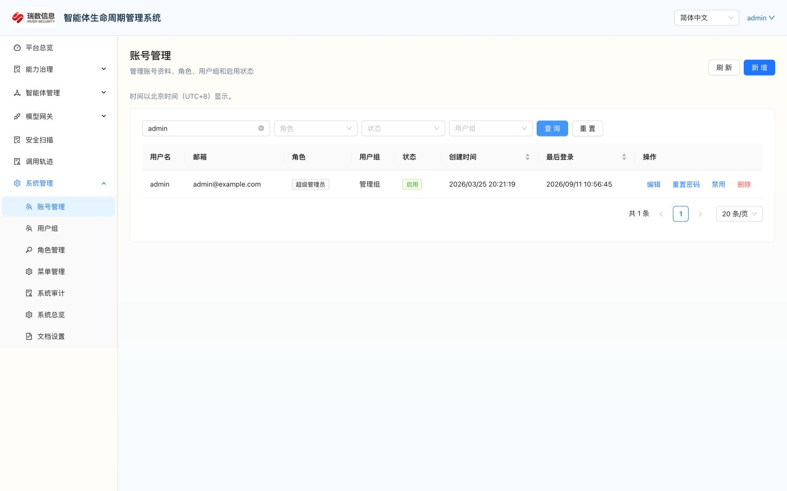

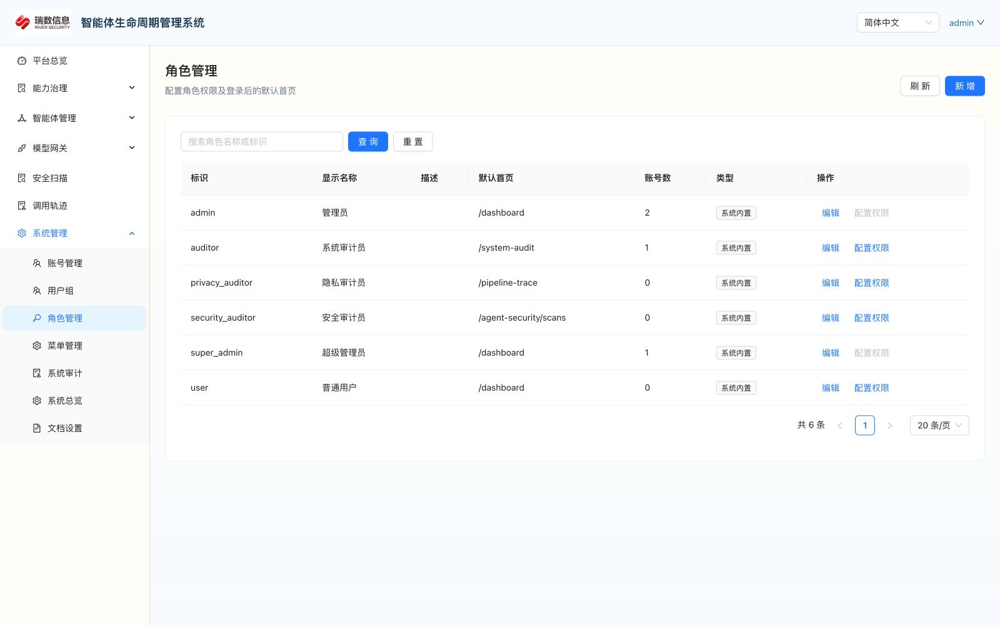

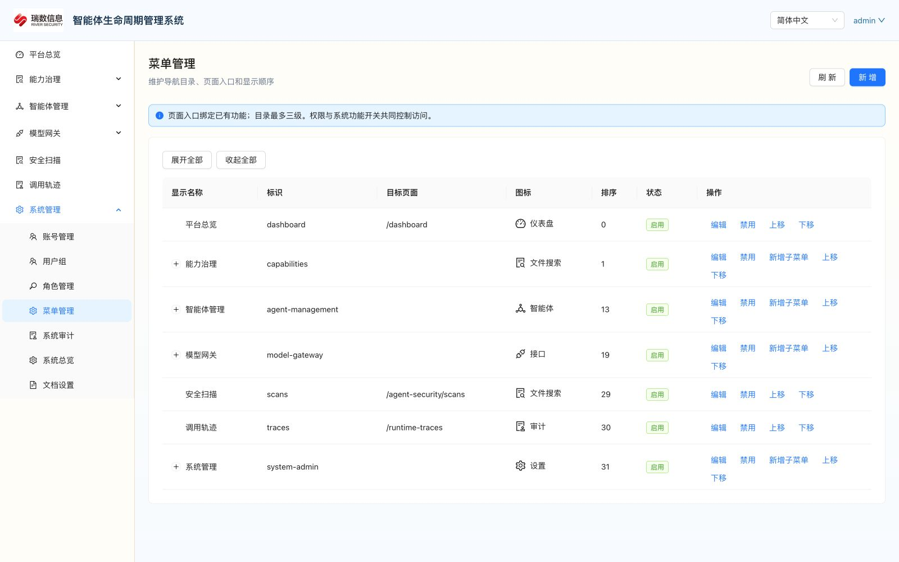

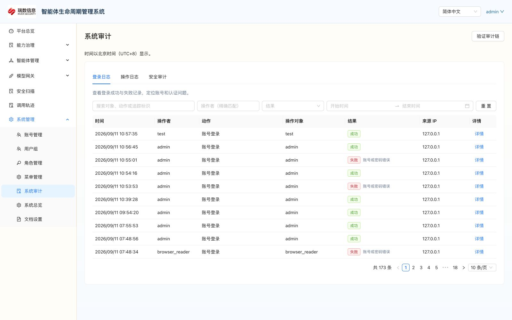

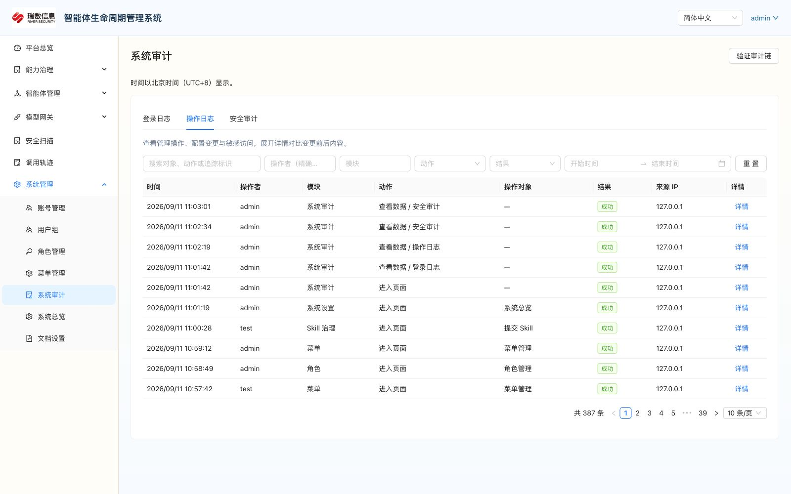

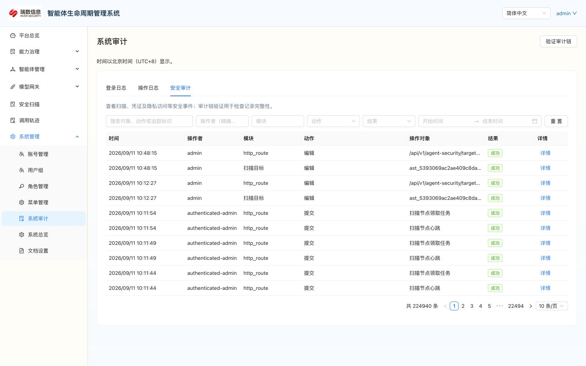

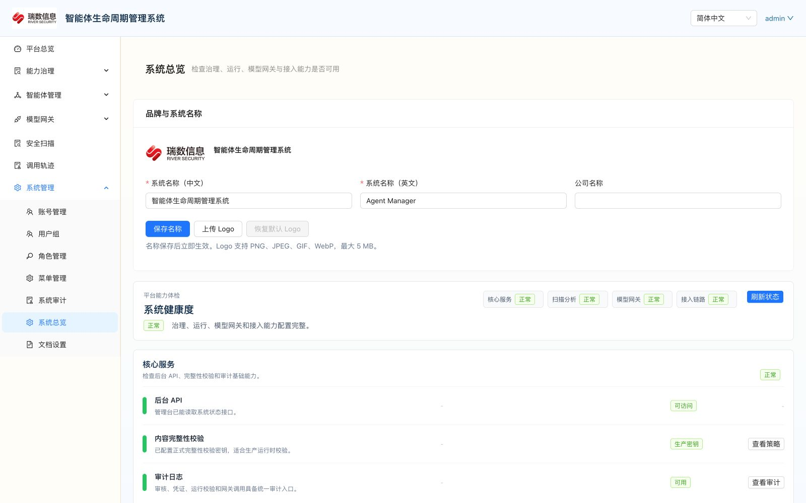

身份管理接口位于 `/api/v1/iam`；`/access` 返回当前账号的权限、导航和默认首页。数据库初始化
按稳定标识补充内置角色、权限及菜单，并保留已有配置。历史 `/api/v1/users` 和受保护的
`/api/auth/register` 账号写入入口共用账号生命周期服务。Scanner Token、客户端凭证及模型
调用凭证继续使用各自的权限范围校验。

## 13. 客户端 Skill 怎么统一接管

### 客户端 MCP 与插件资产 / Client MCP and plugin inventory

客户端详情的资产列表按所属 Agent 展开，在 Skill、插件、MCP 三个并列标签页中分别展示，默认打开 Skill。“智能体管理”的客户端发现实例在“能力与配置”中使用相同的三类资产标签页；已绑定客户端实例的平台 Agent 可在详情的“客户端资产”中按实例查看。Skill 页保留原有认证与处置入口，插件页展开后显示插件内 Skill 和 MCP。资产、发现证据和任务详情使用可读字段展示；采集状态、插件状态、Skill 使用和系统事件展示对应状态、时间、原因与操作。关联键为 `client_id + local_agent_id`，不同安装实例分别上报。

MCP 列表包含独立配置和插件内的 MCP，并标注所属插件、配置来源、作用域、连接方式和配置启用状态。插件列表显示名称、版本、格式、路径与发现依据，展开后显示内含 Skill 和 MCP。Codex `.app.json` 中的依赖展示为“已注册服务引用”，只记录引用 ID。启用状态未知时显示“未知”；缓存文件、安装记录、配置记录和本地文件分别标注，文件存在不代表已加载或调用。

当前解析范围：Codex、Claude Code、Cursor、Gemini CLI、Qoder/Qoder CN、CodeBuddy/WorkBuddy 的用户级配置与插件包；OpenCode 的配置插件引用、本地 JS/TS 文件；OpenClaw 的插件安装记录、本地扩展；Claude Desktop 的标准 MCP 配置。支持通用 `plugin.json` 及相应产品清单，发现插件中的 `skills/`、显式 Skill 路径、内联 MCP 和 MCP 配置文件。项目级范围来自 Claude/Codex 已知项目、插件安装记录中的项目路径，以及已配置的产品 Skill 目录；不会搜索整块磁盘。其他产品显示“尚未支持”，旧客户端显示“尚未上报”。此支持范围表示解析适配，不代表所有产品版本均完成实机验收。

采集仅读取本地配置和包元数据，不启动 MCP、执行插件或调用工具。MCP 仅上报 URL 的协议和主机、程序名、参数数量及环境变量/鉴权字段名；URL 路径、查询参数、命令参数和凭据值不进入资产快照。每个 Agent 最多 128 条独立 MCP 和 128 条插件，每个插件最多 128 条 Skill 和 MCP；单配置文件 2 MiB，总配置读取预算 16 MiB，目录遍历有深度和条目限制。读取失败、格式异常、超限和越界组件会显示为不完整来源，其他可读资产继续上报。

快照随客户端原有注册和资产同步链路更新，保存在所属安装实例的扩展信息中，无需新增数据库列。更新平台与客户端后等待下一次资产同步；旧客户端没有该字段时保留“尚未上报”的含义。插件内 Skill 使用只读组件清单，不加入现有 Skill 处置任务。

**English:** Expand an Agent in Client details to view separate Skills, Plugins and MCP tabs, with Skills selected by default. Client-discovered Agents use the same tabs in capabilities/configuration; platform Agents with bound client instances show them per instance under Client assets. Skills retain their certification and action controls. Assets, discovery evidence and task details use readable fields; collection, plugin, Skill-use and system-event views present their relevant status, time, reasons and actions. Ownership is keyed by `client_id + local_agent_id`. MCP views include standalone and bundled entries with source, scope, transport, parent plugin and configured enabled state. Plugin rows expand into bundled Skills and MCP servers. Codex `.app.json` dependencies are registered server references, not verified connections. Installation records, configuration records, cached files and local files remain distinct.

Discovery reads supported user configuration, plugin manifests, installation registries and known project paths. Adapters cover Codex, Claude Code, Cursor, Gemini CLI, Qoder/Qoder CN, CodeBuddy/WorkBuddy, OpenCode plugin references/local JS/TS, OpenClaw plugins, and standard Claude Desktop MCP configuration. Generic Agent Plugins and product manifests are recognized. Project scope comes from known Claude/Codex projects, plugin installation records and configured product Skill roots; there is no full-disk search. Other products are unsupported and legacy clients are unreported. Adapter coverage does not establish acceptance on every product version.

Only URL origins, executable names, argument counts and environment/authentication field names are reported. Credentials, URL paths/query strings and argument values are omitted. Discovery does not run plugins, start MCP servers or call tools. Bounds are 128 standalone MCP entries and plugins per Agent, 128 Skills/MCP entries per plugin, 2 MiB per metadata file and a 16 MiB metadata-read budget, plus bounded directory traversal. Read/parse errors, limits and component path escapes remain visible as incomplete discovery. Snapshots use the existing client inventory sync and per-installation extension storage. Update both platform and client, then wait for inventory sync. Bundled Skills remain read-only components.

UI 验收 Todo / Manual UI checks（中英文）：在客户端详情展开有/无 Skill 的 Agent；核对 MCP 与插件数量、插件内组件、长路径和未知启用状态；切换智能体实例确认资产归属；验证旧客户端、无资产、不支持和部分读取失败；在窄屏检查横向滚动与插件展开。Check both languages, Agent ownership and instance switching, bundled components, long paths, unknown state, legacy/empty/unsupported/partial inventory, and narrow-screen tables.

本机验收（2026-10-13）：重建并重启 macOS ARM64 开发客户端后，本地与服务端的 13 份安装来源快照逐项一致；客户端详情和智能体详情实际展示 MCP、插件及插件内组件，中英文 390px 页面没有整页横向溢出。Codex 用户主目录同时登记为项目时，同一份用户配置仅计一次，独立项目配置仍保留。平台 Agent 绑定多个实例、旧客户端缺少快照、空快照刷新和敏感字段过滤通过隔离 API 回归；Go 客户端两包完整测试与后端 46 项测试通过。这些结果覆盖本机发现与展示，不代表其他操作系统、全部产品版本或 MCP 实际调用已验收。

**Local acceptance (2026-10-13):** After rebuilding and restarting the macOS ARM64 development client, all 13 local source snapshots matched the server. Client and Agent details displayed MCP, plugins and bundled components; Chinese and English pages had no document-wide horizontal overflow at 390px. A home directory registered as a Codex project does not duplicate its user configuration; distinct project configuration remains. Isolated API regression covered multiple installations bound to a platform Agent, legacy missing snapshots, empty refreshes and sensitive-field filtering. Both Go client packages and 46 backend tests passed. This establishes local discovery/display behavior, not other OS hosts, every product version or actual MCP execution.

本地 Skill 列表同时展示认证结果与当前内容快照的检测状态，例如“未认证 · 检测中”。同一路径和内容签名对应的快照处于待提交、检测中或待审核状态时，读取该路径的 Agent 均显示对应状态并禁用提交按钮；内容变化后旧快照状态不再限制新内容提交。检测详情仍显示阶段和分析器进度。检测记录页的“刷新”会向平台核对当前任务状态，后台服务暂时停止时也可更新按钮状态。检测完成后手动重新检测会要求平台启动新的检测任务；仍在检测中的重复请求复用现有任务，不重复记录新提交事件。

未认证 Skill 曾被自动隔离，之后原 Agent 路径重新出现可读取内容，且当前分类策略对该内容执行“仅记录”或“记录且告警”时，客户端巡检会校验本地当前内容并将该路径的旧自动隔离记录归档为 `resolved`，立即刷新隔离区列表和数量。历史副本与审计记录保留；即使应用重建的内容与旧副本不同，也不再把已允许使用的原路径显示为仍在隔离。这不是平台认证，也不自动恢复仍缺失的文件；手动隔离、卸载备份、隔离失败和当前仍要求隔离的记录维持原有处理方式。

隔离副本复检批准后，客户端优先计算本地副本内容签名，并通过平台 Compare 核对提交的确切版本、认证状态和 Agent 使用权限。一致且获准时，使用本地副本完成恢复；副本缺失或内容与批准版本不一致时，下载该确切版本的签名包。平台不可达、认证或权限检查失败时保留待处理状态，不把失败当作允许恢复。复制后再次校验内容，避免校验期间的修改被带入安装。

单目标安装、批量安装和上述本地副本恢复的准备文件位于 `~/.river-security/agent-manager/staging/install-*`，不放入受监控的 `skills` 目录。校验完成后才移入正式版本目录；安装成功或失败均清理本次临时目录。正式版本仍按现有规则监听和校验，临时文件不受实时监听不代表跳过验签。

当客户同时使用 Claude Code、Codex、Gemini CLI、OpenCode、OpenClaw、Hermes、TeleAgent 或其他支持 Skill 目录的 Agent 时，推荐安装 Agent Manager Client。TeleAgent 的动态用户目录按 `.config/TeleAgent/users/*/skills` 展开，不依赖固定用户 ID：

1. 在“智能体管理 -> 统一凭证中心”选择“给客户端使用”创建客户端接入凭证；需要自动配置 Agent 模型时，显式开启“允许客户端为本机 Agent 自动创建运行凭证”。
2. 安装客户端并输入 Agent Manager 地址和凭证。
3. 默认使用“客户端安全治理”；需要限制每个 Agent 的 Skill 范围时，再切换到“Agent 强授权”。客户端发现的本机 Agent 会自动登记身份，无需人工关联平台智能体。
4. 在平台“Agent 发现配置”中搜索 Agent，配置适用系统和 Skill 根目录；客户端同步后重新发现。本机目录覆盖优先，保存配置不会创建不存在的目录。
5. 在“Agent 管理”核对本地内容认证状态；需要安装时从平台选择可信版本，需要检测时对具体 Skill 或隔离副本提交检测。文件是否隔离或恢复由当前分类规则与校验结果决定。
6. 后台服务通过长轮询获取任务、配置同步和 Skill 检测状态事件，按有效分类策略检查内容并处置；断线后自动退避重连，并按事件 revision 补拉遗漏结果。文件监听把连续写入合并为约 300ms 的稳定窗口并保留变化路径。对已有可信安装基线且策略要求隔离或卸载的内容变化，只重新计算受影响的物理 Skill，按已同步策略先完成本地处置、增量清单保存和 UI revision 更新，不等待全量发现、平台 Compare 或事件上传；完整发现与平台确认随后在后台完成，处置自身产生的对应路径事件会被抑制，避免重复巡检。无法建立可信基线、新增或损坏内容及需要平台参与的动作仍进入完整流程。桌面端不再执行 2 秒、3 秒或 10 秒的业务状态轮询；本地事件丢失、重复或跳号时，通过完整快照补偿，切换页面和回到前台也会读取一次快照。这些动作只提示同一轮治理的最终结果。桌面端创建文件处置任务后不弹出中间成功提示，而是在 Skill 行显示任务 ID 和进行中状态，任务完成后主动重新发现并刷新本地 Skill，只提示最终成功或失败；重启后继续跟踪未完成任务。启动自检还会拒绝误指向其他用户目录或旧安装位置的同名后台服务并重新注册。默认心跳最长约 10 秒、常规巡检 5 分钟、完整巡检 30 分钟。

平台默认处置策略按未认证 Skill、已认证 Skill、检测结果处置分区；单台客户端可逐项
继承默认或设置覆盖。保存前按客户端、Agent、Skill 逐层预览影响，保存后查看同步任务。
策略已应用与 Skill 处置完成分别记录。客户端概览的“检测策略”页显示本机有效规则。
客户端“执行记录 → 巡检与处置”和平台“客户端详情 → Agent 与资产 → 治理记录”统一展示
Skill / Agent、事件与原因、处理情况和发生时间，支持关键词、Agent、事件类别、处理情况、
时间范围及服务端分页。点击记录打开详情，分为“发生了什么、为什么记录、系统处理、关联证据、
路径与技术标识”。事件类别用于归类，具体标题说明加载、文件读取、巡检发现或文件处置；
内部事件编码保留在技术标识中，便于核验。

“仅记录”表示该次巡检保留本地文件；“告警仍有效”表示仍满足告警条件；“当前不再触发”
仅表示当前不满足告警条件。隔离、卸载、恢复等操作按实际动作及结果显示成功或失败，缺少
结果时显示“处理结果未确认”。使用审计告警单独注明文件处置是否有记录。

使用审计按同一客户端、精确关联且未过期的行为证据中的最早发生时间排序；缺少该时间时
显示“记录到达”。巡检记录显示“最近巡检发现”和累计巡检发现次数；告警核对单独显示
“最近核对”，定期核对不会刷新行为发生时间。时间筛选与列表排序使用同一口径，界面按
北京时间展示。详情区分证据发生与到达，保留原始路径、会话和调用标识。

**English:** Desktop **Activity Records → Findings and actions** and platform
**Client Details → Agents and Assets → Governance history** share the same semantic event list,
filters and server-side pagination. Each record shows the Skill/Agent, specific event and reason,
handling and event time. Open a record to review what happened, why it was recorded, system handling,
linked evidence and technical identifiers. “Record only” retains local files for that inspection;
“Alert active” and “No longer triggered” describe alert conditions. File actions report their actual
success or failure; missing outcomes remain unconfirmed. Usage audit timestamps come from the earliest
explicit occurrence time in exactly linked, unexpired evidence from the same client. Missing occurrence
times are labeled “Record received.” Inspections show their latest finding time and finding count.
“Last checked” is separate and never moves old activity to the top. Date filtering and sorting use
these same timestamps, displayed in Beijing time. Original evidence and identifiers remain unchanged.

平台详情中的“查看行为证据”进入已有 Skill 行为详情，可继续查看原始证据及重新采集。
桌面详情展示证据来源和时间线；完整证据在平台按现有审计权限查看。能唯一定位本地 Skill
时提供“查看 Skill”；平台存在明确的 Skill 版本 ID 时提供版本详情入口。

**English:** The platform's “View activity evidence” opens the existing Skill activity detail, including
original evidence and recollection. Desktop details show evidence sources and the timeline; full evidence
uses existing platform audit permissions. “View Skill” appears only when a unique local Skill can be
located on desktop, or an explicit registered version ID is available on the platform.
进入执行记录或页面打开期间收到新的治理通知时，客户端会刷新第一页。

桌面主要入口为客户端概览、Agent 管理、模型切换、执行记录。“Agent 管理”内按 Agent
查看本地 Skills、检测记录和隔离副本。手动巡检位于“设置 → 后台运行 → 查看运行诊断”。
设置还支持日志保留时间和诊断报告导出。详细操作见 [客户端说明](agent-manager-client.md)。

平台入口为“智能体管理 -> 客户端管理”，可以查看 Agent 映射、已安装 Skill、任务和异常，也可以从 Skill 详情直接创建“安装到客户端”任务。

桌面客户端还提供“模型切换”页。它按本机 Claude Code、Codex、Hermes 展示从实际配置文件读取的当前模型，并只列出客户端凭证允许配置的启用网关模型。客户端不提供单独的网关地址输入框，而是复用接入时填写的 Agent Manager 地址：Claude Code 使用该根地址，Codex 和 Hermes 自动规范化为以 `/v1` 结尾的 Base URL。该地址指向 Agent Manager 网关，不是管理员在供应商页面配置的上游模型地址。首次切换且尚无运行身份时，平台自动创建归属当前客户端的托管 Agent 并完成绑定，不要求用户预先创建或选择同类型 Agent；该身份用于凭证绑定和审计，不限制可选模型类型。任务载荷只携带非敏感标识和模型名，sidecar 在进程内一次性领取绑定目标 Agent 的独立运行凭证并备份、合并本机配置，桌面渲染进程不会拿到凭证明文。Claude Code 走 `/v1/messages`，Codex 走 `/v1/responses`，Hermes 走 `/v1/chat/completions`。客户端凭证本身不能调用模型或 MCP。

安装或恢复同名 Skill 时，客户端默认选择最新可信版本，也可以在桌面端或平台任务中指定其他可信版本。受管目录按版本保存内容，兼容入口只指向当前选中的版本；同一次向多个 Agent 安装时，后续目标会复用本机已经重新验签通过的同一 Skill、版本和内容签名副本，包括因历史内容变化而创建的 `copy-*` 安全副本，确保 Agent 的入口实际指向同一份受管内容。升级前已经产生的重复副本会在后台逐一核验后统一 Agent 入口，迁移时保留旧物理目录；完整性巡检修复时会固定恢复已安装的 `version_id`，不会静默升级到另一个版本。

本地 Skill 列表会根据解析后的实际目录和软链接目标，在名称旁显示共用该内容的其他 Agent，不重复显示当前 Agent；私有 Skill 不显示共用标签，同名但物理目录不同的 Skill 不会被误判为共用。本地 Skill 内容变化后，客户端按当前分类规则决定仅记录、记录且告警、提交检测、隔离或恢复可信版本。选择隔离时内容移出 Agent 入口并保留副本。隔离列表直接显示副本的来源事件、保留时间、内容指纹和涉及的全部 Agent，共享安装不会再只显示最先触发巡检的 Agent；手动卸载、手动隔离和内容变更使用不同的副本标识。操作员选择“提交此副本”后，确认窗会再次展示同一组证据，客户端只上传该隔离事件保留的内容；若确认后内容指纹发生变化，提交失败并要求刷新。共享副本会为每个受影响的 Agent 保留独立恢复目标，但共用一次平台检测结果；该版本成为可信版本（`APPROVED`）后，客户端后台服务会按返回的 `version_id` 分别安装到各目标并解除对应隔离，不会影响与该事件无关的同名副本。客户端还会按 Agent、原路径和内容签名核对已重新安装的可信版本，自动归档对应的“已卸载副本”，不同版本的历史副本仍保留。操作员也可选择“删除保留副本”：客户端要求确认时看到的内容签名保持不变，只删除副本路径，不触碰当前 Agent 目录，并保留平台检测版本和审计记录。某个目标自动安装失败时，客户端只保留该目标的待处理记录并稍后重试，其他成功目标不回滚。不能仅凭扫描任务完成或进入待审核状态就自动恢复运行。

隔离与恢复备份保留内部符号链接原文，并核对普通文件、目录结构、权限模式和链接文本后再删除或替换原目录；恢复校验包括扫描忽略目录。单次复制上限为 1 GiB 普通文件内容和 100,000 个条目。隔离失败会清理本次未登记副本，已登记恢复副本保留。分类策略自动文件处置失败使用持久化退避（30 秒至 30 分钟），内容、动作或策略变化重新处理，手动重试不受此等待限制。原生插件查询结束或超时会回收其进程组／Windows Job 中的子进程。具体边界见 [客户端备份恢复](agent-manager-client.md#7-备份恢复)。

### 13.1 界面语言

管理平台和桌面客户端支持简体中文与英文：

- 中文系统名为“智能体生命周期管理系统”。
- 英文系统名为“Agent Manager”。
- 首次使用时跟随浏览器或操作系统语言，其他语言默认使用简体中文。
- 用户手动选择后会保存在当前浏览器或客户端本地，重新打开后继续使用。
- 切换语言只改变界面和日期的显示格式，审计时间仍按北京时间展示。
- 文件内容、用户输入、命令输出和第三方原始分析详情保持原文；平台生成的错误、状态、检测结论和处置建议按界面语言显示。
- 登录用户选择的语言会同步到账号；未设置账号偏好时继续使用浏览器语言。
- 新版 API 错误逐步采用 `error_code`、`error_params` 与本地化 `detail`，调用方应依赖稳定错误码而不是提示文案。
- Skill 扫描器和 Agent Skill Verifier 会通过 `Accept-Language` 请求对应语言的服务端错误；分别可用 `AGENT_MANAGER_SCANNER_LANG`、`AGENT_MANAGER_VERIFIER_LANG` 覆盖系统语言。
- 开发约定、错误协议和验证命令见 [国际化与语言支持](i18n.md)。

详细说明：

- [agent-manager-client.md](../docs/agent-manager-client.md)
- [agent-manager-client-implementation-plan.md](../docs/agent-manager-client-implementation-plan.md)

## 14. 外部 Agent 怎么接

推荐调用顺序：

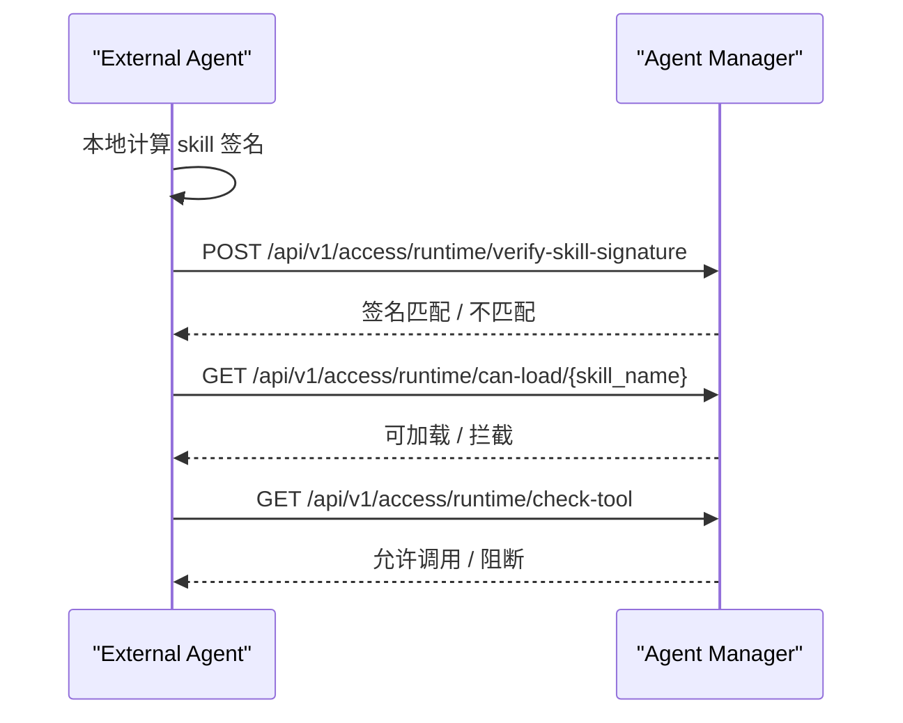

更详细说明：

- [external-agent-integration.md](../docs/external-agent-integration.md)
- [agent-signature-verification.md](../docs/agent-signature-verification.md)

如果外部 Agent 支持本地 skill 指令，也可以直接使用示例 `Agent Skill Verifier`：

- [demo/agent-manager-skill-verifier/README.md](../demo/agent-manager-skill-verifier/README.md)
- [demo/agent-manager-skill-verifier/skills/agent-manager-skill-verifier/SKILL.md](../demo/agent-manager-skill-verifier/skills/agent-manager-skill-verifier/SKILL.md)

它不做平台级 hook，适合 Codex、Claude Code 等 Agent 的通用接入；如果需要强制拦截，再按具体平台补 hook 或 adapter。

---

## 15. Agent 运行侧接入

### 页面入口与下一步 / Onboarding entry and next action

在线文档 `/docs/scenario-selection#integration-flow` 提供可点击的接入选择流程图：按本地工具、自研 Runtime、Dify、Skill 文件或模型 / MCP 调用分支，核对接入条件后点击方案节点进入对应文档；Hook、Verifier 和 AIDR 作为按需组合能力单列。中英文使用相同节点与章节链接，搜索及 PDF 导出保留各路线的条件和操作说明。

The clickable flowchart at `/docs/scenario-selection#integration-flow` branches by local tools, custom runtimes, Dify, Skill files and model / MCP calls. Check the prerequisites and select a solution node to open its guide. Hooks, Verifier and AIDR are optional complementary capabilities. Both languages share node identities and chapter links; search and PDF export retain route conditions and instructions.

先决定是否需要 Agent 身份：按 Agent 做 Skill 运行校验、能力授权和调用归属时需要；普通模型调用、普通 MCP 调用、Scanner 扫描可使用各自凭证。已有身份直接复用，管理电脑时先让客户端发现登记，其他需要身份的运行端再手动创建。自研可改代码选 Runtime API，本机管理选客户端，支持 Skill 指令与脚本的宿主可选 Verifier，单纯模型 / MCP 调用选对应网关路线。选择依据与下一步见[场景选择表](agent-governance.md#按场景选择接入--choose-by-scenario)。

**English:** Decide whether an Agent identity is needed first. Agent-specific Skill verification, authorization and attribution require one; ordinary model calls, MCP calls and Scanner uploads can use their own credentials. Reuse existing identities, discover local Agents through the Client, or register other runtimes manually. Choose Runtime APIs for editable custom code, the Client for computer management, Verifier for hosts supporting Skill instructions and scripts, and gateway routes for model / MCP calls. See the [scenario decision table](agent-governance.md#按场景选择接入--choose-by-scenario).

首次创建可按在线文档“创建与管理智能体”操作：先查找已有身份，再填写必填的 Agent ID 和名称，按需选择模型、Skill、MCP。只用 Verifier 时保留内置模型来源，默认模型留空，选择批准的 Skill 即可；外部模型来源需先准备目录并选定模型。保存后再签发运行凭证、配置运行端并验证调用。字段说明和填写示例见[创建表单说明](agent-governance.md#创建表单怎么填--fill-in-the-registration-form)。

**English:** For first-time registration, follow **Create and manage Agents** in online documentation: find an existing identity first, fill in the required Agent ID and name, then select model, Skill and MCP access as needed. For Verifier only, keep the internal source, leave the default model empty and select an approved Skill. External models require catalog preparation and model selection. After saving, issue a runtime credential, configure the runtime and verify a call. See [registration fields and examples](agent-governance.md#创建表单怎么填--fill-in-the-registration-form).

“智能体管理”中的“平台创建”登记外部 Agent 的治理身份；“客户端发现”来自客户端自动上报。登记后通过“保存并查看接入指引”进入当前 Agent 的步骤页，也可从列表或详情重新打开。接入页按自研 Agent、本机 Agent、Agent Skill Verifier、模型应用和 MCP 应用选择路线，能力可组合；凭证中心继承 Agent 和建议权限，保存一次性明文后返回继续配置。详见[登记与接入](agent-governance.md#登记与接入--registration-and-integration)。

**English:** Platform-created records register governance identities for external Agents; Client-discovered records come from automatic inventory. Save an Agent to open its integration guide, or reopen it from the list or details. Choose custom Agent, local Agent, Agent Skill Verifier, model app or MCP app, then combine capabilities. Credential Center retains the identity and suggested scopes; save the one-time secret and return to configure the runtime. See [registration and integration](agent-governance.md#登记与接入--registration-and-integration).

当前管理台启用的是 Skill 运行校验、复合 Agent 运行凭证和客户端治理。统一凭证中心按真实调用者提供 Agent、普通模型应用、MCP Client、Skill Scanner 和客户端五条创建路线；原始 scope、IP 和容量参数收在高级安全设置中：

- Skill Verifier 的 `verify` 在 Agent 使用 Skill 前执行签名与加载许可检查，并写入运行审计；Tool 权限检查需另行在调用位置接入。选择“接入与运行 → Agent Skill Verifier”，按身份与授权、运行凭证、安装、环境配置、验证审计完成接入。仅需 `runtime:verify-signature` 和 `runtime:can-load`，不要求绑定模型或 MCP。

  **English:** Verifier `verify` checks content signatures and loading permission; integrate tool authorization separately at the call boundary. Choose Integration & Runtime → Agent Skill Verifier and follow identity/access, credential, installation, environment and verification/audit steps. Only `runtime:verify-signature` and `runtime:can-load` are required; no model or MCP binding is needed.
- 一张绑定 Agent 的运行凭证可以组合 `runtime:*`、`model:chat` 和 `mcp:*`；模型与 MCP 网关允许列表分别校验，客户端接入凭证不能替代它。
- Agent Manager Client 发现本地 Agent 与 Skill 目录，可下发平台批准版本，并按策略审计、恢复或隔离异常内容。
- 客户端页面中的任务用于安装、恢复、移除 Skill、应用已支持的模型配置和同步策略；执行后应在客户端详情中核对目标、状态和事件。

## 16. 常见问题

### 16.1 为什么 sandbox 是 LOW，但 LLM 是 malicious？

因为 sandbox 只观察“这次 probe 实际跑出来的行为”，
而 LLM 会从整体语义上判断恶意意图，并生成详细的攻击链分析。
二者不一致是正常的，最终看合并风险。

### 16.2 为什么系统设置里改了 sandbox，提交结果还是旧镜像？

说明实际生效的配置还没更新。  
现在系统设置和详情页都能显示：

- sandbox 后端
- sandbox 镜像

优先看“技能详情里的当前实际执行环境”。

### 16.3 为什么一个恶意 skill 不进入审核队列？

因为：

- `VETTED` 才进审核队列
- `REJECTED` 不进审核队列

例如 `malicious` 风险通常会被策略直接拒绝。

### 16.4 为什么重复提交没有复用？

扫描复用不是按 skill name 判断，而是按：

- skill 内容指纹
- 扫描上下文指纹

只有完整目录内容一致，并且规则分析、LLM、sandbox、策略和扫描器代码上下文一致，才会复用历史结果。

常见不复用原因：

- 两个目录内容实际不同
- 第二次打开了新的分析选项
- 策略或扫描器代码升级
- 第一条还在 `PENDING`
- 旧记录没有写入内容指纹

详情页会展示是否复用、来源 skill ID、内容指纹和扫描上下文指纹。

### 16.5 为什么 LLM 判定安全，最终判定却是恶意？

LLM 的“无明显风险”是模型分析结论，最终风险由本次扫描的策略合并工具初判和 LLM 结论后确定。以下情况会保留恶意风险：

- 规则、深度扫描或 Sandbox 的发现按本次策略归入“判为恶意”，形成的恶意风险不能被 LLM 降低。例如，数据外传发现被归入此类，即使 LLM 认为是正常上传，最终仍保留恶意风险。
- 本次采用严格模式，且工具初判为恶意。严格模式不允许 LLM 降低工具初判。

在“Skill 详情 > 检测报告 > 实际判定过程”查看“LLM 结论与最终风险不同”的说明；有对应记录时，可跳转到保留恶意风险的发现项和 LLM 原始分析。历史报告缺少合并依据时，页面会提示无法确认具体原因。

怀疑误报时，先核对证据和本次扫描配置；需要修改风险识别规则或判定模式时，保存后重新检测。已有报告保留原结论。恶意风险的准入动作由配置决定，可以进入人工审核或自动拒绝。

---

## 17. 相关专题文档

面向新用户的可复现场景案例统一维护在帮助中心“场景实践”分组，包括：

- 差旅报销 Skill 的提交、审核、Agent 授权与运行校验
- 合法但高影响的安全事件证据上传 Skill 审核
- 恶意数据外传 Skill 的准入拒绝
- 已批准 Skill 被本地篡改后的运行阻断与恢复
- MCP 客户查询与暂停服务的高风险调用审批
- 多 Agent 工作站的客户端模块化治理：按本机 Agent、Skill 根目录、平台 Agent 授权和
  处置策略分层管理，并验证单个 Skill 的异常不会跨目录影响其他 Agent
- 客服对话的模型网关隐私与上下文压缩：用虚构数据核对 PII 伪匿名化、压缩前后
  Token、响应还原和隐私链路访问边界

客户端与模型网关案例的演练数据位于 `web/public/examples/client-modular-governance-plan.json`、
`web/public/examples/approved-helper.zip` 和
`web/public/examples/model-privacy-compression-request.json`。客户端计划是配置与验收清单，
不会自动修改客户端；`approved-helper.zip` 是第二个 Agent 使用的只读演示 Skill；模型请求
必须把占位值替换为当前环境实际启用且凭证允许的模型，压缩结果以响应头和对应请求的
链路追踪为准，不承诺固定节省比例。

MCP 案例的确定性演示服务和调用脚本位于
`demo/mcp-customer-operations/`。示例只使用虚构客户数据，并通过 Docker Compose
`examples` profile 按需启动；默认生产部署不会启动该服务。

- 客户演示 Runbook：
  [customer-demo-runbook.md](../docs/customer-demo-runbook.md)
- 客户侧扫描器：
  [skill-scanner.md](../docs/skill-scanner.md)
- 客户端 Skill 统一接管：
  [agent-manager-client.md](../docs/agent-manager-client.md)
- 管理台与容器化部署：
  [docker-deployment.md](../docs/docker-deployment.md)
- 外部 Agent 接入：
  [external-agent-integration.md](../docs/external-agent-integration.md)
- 客户端 AIDR 插件 Hook 接入（默认）：
  [hook-integration.md](../docs/hook-integration.md)
- 开发者加载前验签与手工 Hook 脚本：
  [developer-skill-verification.md](../docs/developer-skill-verification.md)
- Agent 验签：
  [agent-signature-verification.md](../docs/agent-signature-verification.md)
- Sandbox 架构：
  [sandbox-service-architecture.md](../docs/sandbox-service-architecture.md)
- Remote mock 联调：
  [remote-sandbox-mock-quickstart.md](../docs/remote-sandbox-mock-quickstart.md)
- OpenClaw Hook 接入：
  [openclaw-agent-manager-hooks.md](../docs/openclaw-agent-manager-hooks.md)
- 模型网关、Prompt 防护与隐私链路：
  [model-gateway.md](../docs/model-gateway.md)

### Skill 详情审计文案

审计事件使用 `domain.auditEvent`，详情字段使用 `domain.auditDetail`，按当前界面语言即时展示。状态、风险和布尔开关按稳定编码翻译一次；路径、备注、证据及其他原始数据保留原文。未知事件和字段保留原始编码，便于核对；不得把任意数据传给旧版哈希翻译函数。使用时在 Skill 详情的“审计记录”中查看事件与详情，切换中英文即可查看对应文案。

### 扫描结果动态说明

Skill 详情的扫描标题、说明、建议与 Sandbox 摘要在英文模式下只采用已有英文翻译；未收录的说明继续展示原文及已有的明确前缀转换，避免把翻译标识当作报告内容。中文模式保留原有展示。刷新详情即可生效，无需重新扫描。手动检查时切换中英文，核对规则命中说明、修复建议和 Sandbox 摘要，确认内容可读且路径和证据保持原值。

### LLM 分析失败展示

Skill 详情的 LLM 分析页签读取本次扫描报告的分析器状态，失败时显示错误提示及策略备注中的原始异常原因。旧报告没有状态但记录了 LLM 异常、且没有成功结果时，也展示失败原因。已记录失败但缺少原因时明确提示未记录原因。成功结果和未启用的空状态保留原有展示。刷新详情即可查看，无需为展示重新扫描；中英文提示随界面语言切换，异常详情保留原文。

LLM 失败原因中的平台网关前缀“上游模型接口失败”按当前界面语言展示；状态码与后续上游响应保留原文。已有报告刷新后即可显示对应语言，无需重新检测。

### 审核文本长度

审核队列及 Skill 详情的审批备注、拒绝原因最多 1000 个 Unicode 字符，中文、英文、标点、空格、换行均计入；审批备注可空，拒绝原因保持必填。字段旁悬浮提示说明限制，超长时保留完整草稿、显示字段错误并禁用确认，提交入口再次校验。后端写入前独立校验，返回 `skill.review_note_too_long` 或 `skill.review_reason_too_long` 双语错误，不保存超长数据。只限制新请求，不改写既有记录，无需数据库迁移。

审核文本输入框下方实时显示“当前字符数 / 1000”；超长时以字段错误样式显示具体超出的字符数。统计与校验共用 Unicode 字符计数，粘贴、删除及语言切换后即时更新，草稿保持完整。
AIDR P1 自动日志发现使用持久化目录前沿，近期活动与历史回溯分配独立预算，旧日期会话追加也会检查。设备详情分开展示传输心跳、来源发现、解析能力和覆盖缺口。启动及升级见 [客户端说明](agent-manager-client.md)，真实自动发现与网页验收状态见 [可读审计验收](../experiments/aidr-agentlog/READABLE_ACCEPTANCE.md)。


### P1 补强：平台统一 AIDR 审计脱敏

设备“行为审计 → 工具操作（Agent 日志）”读取当前设备的 Claude Code / Codex 会话日志，由客户端读取并上传。顶部常显来源说明，空列表提示检查 Agent 日志通道，并提供“宿主事件（Hook）”入口。宿主事件默认展示 Agent、Hook 事件和关键词，精确工具名及 ID 条件收在“更多筛选”，已启用数量常显；选择后立即查询，文本输入停顿 250 ms 后查询，条件变化返回首批并忽略旧请求响应。清除筛选同时清除收起的条件。行为审计的其他视图为“宿主事件（Hook）”“系统事件”和“采集状态”，分别对应宿主 Hook、操作系统采集通道和通道运行状态。系统事件入口使用跨平台名称；具体采集技术和支持范围在页面说明中展示，当前已实现的原生通道为 macOS Endpoint Security，Windows/Linux 系统通道尚未实现。设备在线、Hook 接收器在线与日志持续采集是独立状态；未配置运行采集目标时，页面明确提示“未配置日志采集目标”，并提供到本机“策略与审批”的配置入口。已有历史或手动短时采集记录仍可查询，不据此判定持续采集已启用。

工具操作与 Hook 详情优先展示事件、工具、来源、时间，以及命令、目标和按权限读取的输入输出；回合、调用、来源位置、策略版本等收在“记录信息”，相关工具 Hook 收在独立折叠区。详情省略 JSON、空字段和不适用的工具关联说明；会话、子代理、压缩、停止等生命周期事件显示自身的阶段和身份。PostToolUse 未报告结构化执行状态时明确显示“已返回，未报告执行状态”。


入口：**客户端管理 → 客户端策略 → 审计采集与脱敏**（英文 Client Management → Client policies → Audit collection and redaction）。客户端策略分为“接入与运行”和“审计采集与脱敏”，列表页入口编辑全局默认策略，设备入口编辑该客户端的审计策略；系统总览仅展示目标摘要及跳转入口。设备“策略与审批”和“采集状态”可进入本客户端审计编辑入口；采集状态保留客户端报告的范围、版本与刷新时间。UserPromptSubmit 正文未开启时，事件详情解释采集时策略并提供本客户端策略入口。进入客户端管理需 `clients:view`，审计策略需 `settings:view`；管理员且具有 `settings:update` 权限可修改全局默认策略，单机配置还需 `clients:update` 和设备可见权限；脱敏默认开启；修改人、时间、前后开关与版本进入管理审计，不记录命令内容。设备详情同时展示平台目标策略、客户端报告的版本/开关及最后刷新时间；没有支持报告的旧客户端显示未知/旧版本继续脱敏，不宣称已应用关闭状态。

审计策略默认继承全局。关闭继承后，采集开关、Prompt/工具输出/文件正文、脱敏和保留天数作为一组单独配置，仅作用于该客户端；后续全局更新不覆盖单机配置。重新开启继承并保存后跟随全局更新。平台策略下发、日志通道状态、Hook 接入验收和历史清理均读取该设备的有效策略。保留天数适用于该设备已有历史，缩短后会淘汰超期内容；已淘汰内容不会恢复。全局和单机保存使用共享递增版本，恢复继承也产生新版本，既有凭据与待发积压仍遵循应用回执边界。

**English:** Audit policy is inherited by default. A client override covers collection, content scope, redaction and retention together and remains unchanged by global updates. Restore inheritance to follow the global policy again. Delivery, channel status, Hook onboarding and history expiry use the effective client policy. Retention changes also affect existing history. Verify the client-reported applied version separately from the saved target.


`aidr-sync` 启动后先读取缓存并尝试认证获取策略，以后每 30 秒重试，下一轮有界采集生效。网络往返及当前采集轮次会增加延迟，这不是硬实时 SLA。离线/获取失败使用已持久化缓存，首次失败默认开启（版本 0）；状态码为 `aidr_policy_applied`、`aidr_policy_cached`、`aidr_policy_response_invalid`。本地 `agent-log-collect` 使用同一状态目录的缓存，无平台连接时不主动刷新。

关闭仅关闭允许字段的敏感值替换，命令里的真实凭证可能进入本地数据库及后台；白名单、UTF-8 字节上限、截断、控制字符处理和正文排除不变。完整 Prompt、独立文件正文、完整结果、未知参数不采集。明确的内联正文/脚本参数及 heredoc 仍省略，标记 `body_omitted`，不冒充凭证脱敏。普通 `git commit -m "fix scanner ownership across client credential rotation" && git status --short --branch` 在两种策略下均完整保留。明确 `--password`、秘密环境变量赋值、Authorization/Bearer、Cookie 和受支持令牌格式在开启时遮蔽其值，保持引号与操作符。

升级不删除或重建本地数据。平台新增策略下发记录表；本地 metadata 增加策略缓存及应用序列边界。事件 `behavior.policy` 保存 `version/enabled/receipt`，`redacted` 表示发生替换，`body_omitted` 单独说明正文排除。服务端以绑定设备/stream 的真实下发记录授权，开启策略再次检查敏感模式，未下发版本或错误设备/序列拒绝（`aidr.redaction_policy_invalid`）。客户端持久化应用新策略后，在下次刷新确认上报旧数据序列上界；只有确认后才关闭旧策略范围，响应丢失仍可重试。冻结批次不修改、不重算摘要；旧队列按采集策略补传，即使当前目标已开启，合法 OFF 积压仍可接收。离线采集时间无法由服务端独立证明，策略依赖认证客户端正确报告应用边界，不提供终端可信执行证明。

切换只影响后续新逻辑事件，不恢复、重采或清洗历史。版本 1/2 事件、既有内容哈希、覆盖游标及 ACK 契约保留；重读通过既有身份复用原始投影并保留新位置的来源证据；已淘汰正文的墓碑保持淘汰，避免恢复历史或重复逻辑事件。旧客户端继续固定脱敏，需升级才支持开关。版本 3 不支持向旧平台降级上报，部署顺序为先平台后采集端。

日志重启、补传或新采集实例重新读取同一事件时，服务端先校验本次设备、采集实例和策略回执，再按日志来源、会话/调用身份、事件类型及原始内容摘要去重。同一原始事件保留首次有效解析结果，后续解析差异或策略回执变化不阻塞新记录；原始事件、内容哈希和已有批次 ACK 保持不变。新批次仍按原始字节校验和确认，真实来源或内容摘要不一致仍拒绝；已过期事件按保留的逻辑身份确认重复，不恢复正文。修复后可在客户端执行“重试日志采集”（CLI：`agent-manager-client aidr-desktop --action retry-logs`），由原后台继续上传原队列，再核对新操作、上传 ACK 和通道状态。普通页面对无法确认的结果显示“结果未确认”。

### 设备详情：Skill、插件与行为审计

设备概览的工具活动趋势与主要活动榜单在宽屏中并排等高展示，趋势图占较宽区域，榜单条目均匀排列；窄屏改为上下排列。统计口径通过筛选栏按需查看，图表下方直接衔接通道状态卡片。

策略与审批的 `GET /api/v1/clients/{client_id}/aidr/hook-policy` 返回策略版本、策略内容、编辑权限、规则差异、接收器运行状态和插件状态。历史过期数量由采集诊断接口按需统计，审计保留天数由审计策略配置，后台按保留策略执行到期清理。

客户端详情的“策略与审批”通过“工具规则、审批记录、系统策略”直接切换，切换分类保留本页工具规则草稿。工具规则已有内容时，常用规则预设默认收起；平台配置模式与客户端报告的生效模式并列显示，保存成功不等于客户端已应用。“采集与治理配置”按采集与接入、模型与请求、Skill 处置分组，安装、更新与重试按需展开，各组修改统一预览并保存；“内容与脱敏”直接打开本客户端的审计内容策略。

In client details, **Policies & approvals** offers direct navigation to **Tool rules**, **Approval requests**, and **System policy**, preserving tool-rule drafts when switching categories. Presets start collapsed when rules exist. Configured and client-reported modes remain distinct; a successful save does not confirm application on the client. **Collection & governance** groups settings into collection/setup, models/requests, and Skill actions, with installation, updates, and retries expandable on demand. Changes across groups are previewed and saved together. **Content & redaction** opens the client's audit-content policy.

手工验收 / Manual verification:
- 中英文、桌面与窄屏检查三个策略入口、状态信息、规则表和弹窗底部按钮，确认长文案换行且可键盘操作。 / Check both languages, desktop and narrow layouts, keyboard navigation, long labels, and modal footer visibility.
- 修改工具规则后切换审批记录、系统策略再返回，确认草稿保留；仅查看页面不发布规则。 / Edit a rule, switch through approvals and system policy, and verify the draft remains without publishing.
- 检查全局继承、只读权限、空规则及加载失败状态。 / Check inheritance, read-only access, empty rules, and load failures.
- 分组修改配置，预览全部变更并保存；核对客户端回执、审批处理及实际生效模式。 / Edit across groups, preview and save all changes, then verify client receipts, approval actions, and the effective mode.

客户端管理的设备详情分为概览、Agent 与资产、插件接入、行为审计、策略与审批。Skill治理与模型配置位于Agent 与资产；Claude/Codex安装、启用与信任位于插件接入；工具日志、Hook生命周期、系统事件及采集诊断位于行为审计；工具审批、系统策略和响应回执位于策略与审批。公共页头只展示设备与心跳，不在各标签下重复库存或任务表。按需加载的摘要保留报告时间与未知状态；安装回执、Hook意图、日志结果与OS执行证据分别核对。详细操作见[客户端说明](agent-manager-client.md)。

从 **智能体列表 → 客户端发现 → 详情** 可进入单个 Agent 的工作区，按“概览、能力与配置、行为审计、策略与审批、执行记录”组织信息。先选择安装入口，再查看该入口报告的 Skill、模型配置和任务；会话、插件及工具审批按客户端与 Agent 类型查询。系统事件按程序路径或 macOS 应用包筛选，未知归属与其他路径仍可在客户端详情查看。共享接收器、设备信息及跨 Agent 策略由客户端详情管理，两处提供互相跳转入口。

Agent 工作区展示真实采集报告、原始证据和任务回执；创建任务不等于执行成功，发布策略不等于客户端已应用。插件操作、Skill 治理及受支持的模型切换复用现有权限和任务校验。日志重试在桌面客户端“Agent 运行治理 → 接入与采集”执行。English: Agents → Client discovery → Details opens the installation workspace. Skills, model configuration and tasks follow the selected installation; sessions, plugins and tool approvals follow the client and agent type. Shared services and cross-agent policy remain in client details. Runtime reports and execution receipts establish actual outcomes.

详情页优先展示状态与操作：设备 ID 和凭据创建人可展开“设备信息”查看；概览每项功能保留一个摘要入口，页头刷新同时更新当前概览。插件页直接展示宿主安装、信任与操作，协议能力和逐项验收集中在“接入诊断与验收”。行为审计保留当前采集异常与历史覆盖缺口数量，采集边界和查询说明按需展开。审批列表仅显示一个同步时间，存在更多记录或已翻页时显示底部分页；Agent 与资产页仅在有恢复副本时展示该列表。


### AIDR 小版本兼容

客户端 Hook 接入以原生接口可读性和实际安装结果判断，Agent 日志以记录格式解析；版本字符串用于诊断，不作为精确版本白名单。Codex 受管目标需确认原生 managed Hook 已加载，系统事件采集继续按 OS 能力和授权工作。新客户端 `interface_compatible` 状态须先部署配套平台；完整规则、历史回执保留及人工验收清单见 [客户端说明](agent-manager-client.md#agent-小版本兼容与接入检查)。

**English:** AIDR compatibility follows native interfaces and log record formats rather than exact Agent release numbers. Managed Codex targets require native loaded-Hook confirmation; OS collection retains its platform/permission checks. Deploy the matching platform before the new client status contract.

### 系统网络行为

macOS 系统采集复用 ES 精确进程归属与 libproc 套接字快照，新增 `kind=network` 的可选结构化记录及独立 `network_health`，共用持久化严格 ACK 队列。平台在系统事件中展示端点、协议和采样状态并按观察实例汇总；不会从 PID/时间邻近推断归属。当前不提供完整网络流事件、域名和流量总计。快照预算、发行要求、Apple 资料及人工验收见 [客户端说明](agent-manager-client.md#系统网络连接快照) 和 [采集器架构](../client/macos-enforcer/README.md#网络连接快照--network-socket-snapshots)。

**English:** System network records use libproc snapshots of ES-attributed processes, with independent network health and the existing durable strict-ACK queue. Endpoints, protocol and sampled states are presented as observations. Complete flow events, domain attribution and byte totals are not implemented.

### AIDR 多产品适配目录

AIDR 产品入口、日志格式/根目录、Hook 事件及决策能力统一维护在 `backend/aidr_products.json`；运行 `python3 scripts/sync-aidr-products.py` 更新 Go 与两端 UI 的随包副本，`--check` 检查一致性。新增产品先提供官方契约或匿名样本，再新增 `scanner/internal/aidr/agentlog/` 解析模块或 `hooks/` 宿主协议；公共脱敏、上传、ACK、存储沿用原链路。完整文件快照不当作 JSONL 追加流。

客户端策略可多选日志产品和 Hook 宿主。协议 5 才应用新增产品目标；旧策略未指定 `log_sources` 时继续采集 Claude / Codex。平台和桌面“产品与采集能力”按产品分组，组内按入口列出适配及样本范围，实际生效由安装、授权、事件和 ACK 另行确认。逐产品矩阵与限制见 [外部 Agent 集成](external-agent-integration.md#aidr-多产品适配与证据范围2026-10-07)。

**English:** `backend/aidr_products.json` is the canonical capability catalog; run the sync script after changes. Product adapters own discovery/format/protocol differences and share redaction, durable queues and ACK/storage. Protocol 5 enables multi-product policies; old defaults preserve Claude/Codex. Implemented capabilities, installed settings, host authorization and actual event delivery remain separate observations.

### Hook 自行接入默认值

客户端策略的 `allow_user_enrollment` 默认 `true`，普通模式下本机“启用 Hook 采集”同时完成配置安装和接入请求。设备认证心跳中的 `user_hook_hosts` 更新独立的 `client_hook_enrollments`，仅在选择改变时递增单机策略版本；有效目标合并管理员预设范围与被允许的本机选择，原始全局/单机策略及其继承关系不变。旧报告和任务回执不会擦除本机选择。通道关闭、仅管理员范围或受管模式不会采用额外选择；服务端下发有效目标前本机不扩大采集。详情见客户端使用说明。


### Skill 使用证据与认证告警

“客户端策略 → 内容与脱敏 → Skill 使用审计”支持全局默认与单机覆盖。默认在首次使用、文件变化或缓存到期时重新计算，摘要最长复用 300 秒；也可选每次使用在后台计算。平台批准、撤销和授权状态独立刷新，默认间隔 30 秒。积压、离线与重试可能推迟结果，该间隔不是告警时延承诺。

高级资源上限默认为并发 1、256 个文件、单文件 2 MiB、单次 8 MiB。复用前检查文件身份、大小、修改时间等元数据；macOS/Linux 另检查 change time，Windows 的同大小且恢复修改时间的变化可能要到缓存到期重读才发现。复用摘要保留原观察时间，不能证明调用时加载了相同内容。并发是采集器上限，当前顺序采集路径不会因调大该值自动提高并行量。

内容不一致、未登记/未批准/撤销、实例未授权三类规则可分别选择“仅记录”或“记录并告警”，受“生成告警”总开关控制。超限、读取失败、证据不足保持待确认。保存预览列出当前值与本次值，单机配置页独立展示最近一次客户端报告及其时间，不把已保存配置当成客户端已应用。

摘要计算在后台日志采集中进行。每个采集 Store 的内存缓存最多 128 个目录、合计 8192 份文件元数据，同目录并发请求合并；目录条目遍历上限为 `max_files × 4 + 256`。平台使用到期索引，每批最多核对 50 条，同批复用候选、摘要和验签结果，下批重新读取平台状态。手动“重新核对”仍读取当前状态。关闭认证核对后，新客户端停止计算摘要，平台将结论标记为暂停；旧客户端需要升级才能应用读取参数。

UI 复验清单：中英文与窄屏下检查全局/单机继承、两种核对方式、资源整数边界及单文件不超过总量、关闭认证/告警后的控件状态、保存预览与取消、并发修改冲突、报告缺失/旧报告与目标不同，以及行为详情的新算/复用时间和超限原因。隔离 HTTP 联调覆盖策略下发、Go 日志采集、缓存、上传 ACK、认证和告警；各宿主真实加载仍需现场验收。

**English — policy and performance:** Global and device policies configure background content checks, a 300-second maximum digest reuse window, and a separate 30-second registry refresh interval. Defaults are one concurrent check, 256 files, 2 MiB per file and 8 MiB total. Metadata is checked before reuse and original observation timestamps are retained. Windows metadata here does not expose change time, so same-size rewrites with restored mtime may wait for full rehash. Cache and refresh batches are bounded; scheduling intervals do not guarantee alert latency. Three alert categories support record-only or record-and-alert under a master switch. Save previews and timestamped client reports distinguish configuration from reported application. Manually verify both languages, narrow layouts, inheritance, invalid limits, preview/cancel, stale reports and observation status.

Skill 行为采用会话列表、行为表格和记录详情三栏结构。点击记录显示按时间排序的证据、内容观察和平台核对；窄屏在列表与详情之间切换。行为结果与认证状态独立展示，明确拒绝为“已拒绝”，成功与拒绝/失败证据冲突时保留“结果未确认”。可按 Skill/路径、行为、操作结果、认证和原生轮次 ID 筛选，关键词采用 300 毫秒防抖，默认最新记录优先。认证和结果筛选在本次核对后执行；单批最多检查 200 条，尚有未查记录时显示“继续查找”，只有游标耗尽才展示最终空结果。

记录详情提供原始证据入口，按设备和原生调用身份校验归属，正文继续遵守 `clients:read-audit-content` 权限、采集范围、脱敏与保留策略。核对结论变化写入 `aidr_skill_checks`，保留当时结论和观察来源；相同结论只更新当前核对时间。历史从升级后的首次核对开始记录，不能还原升级前或调用瞬间的认证状态。

待确认时按原因显示处理步骤。“刷新平台状态”只重新查询当前平台状态；“请求重新采集”创建 `aidr_skill_observe` 任务，需要客户端修改权限、在线且心跳新鲜、唯一来源实例和 `skill_audit_observe` 能力。任务读取前获取当前策略，按资源上限在后台只读观察，最长 30 秒；5 分钟内未开始则过期，已启动读取有 30 秒完成宽限。任务支持幂等提交、过期后重试和回执重传；策略变化的旧回执不更新认证。新观察单独保存，原始调用证据不覆盖。旧客户端需升级并同步清单后才能执行重新采集。

受管安装目录软链接只在本机安装记录、Skill ID/版本和实际发布目录精确一致时允许读取；任意外链及 `SKILL.md` 文件自身软链接不放行。正常日志采集和人工重新采集共用路径核验。未经核验、超限或读取失败时保留待确认。

**English — Skill activity review:** Sessions, an activity table and a record detail pane form the main view; narrow layouts switch between list and detail. Outcome and certification remain independent. Explicit denial is terminal; conflicting success and denial/failure evidence stays unconfirmed. Filters include Skill/path, behavior, outcome, certification and native turn ID, with 300 ms keyword debounce and newest-first ordering. Each request checks up to 200 candidates; an empty batch with a remaining cursor offers Continue searching. Evidence drilldown verifies device and native-call identity and preserves content permissions, redaction and retention. Check changes are recorded with their observation source from the first post-upgrade check; unchanged conclusions only update the current check time.

**English — resolving pending checks:** Refresh registry status only rechecks platform state. Request recollection creates an idempotent `aidr_skill_observe` task for a recently online client with a unique source instance and advertised support, requiring client update permission. The worker fetches current policy before a bounded, read-only observation (30-second timeout). Tasks expire after five minutes with a 30-second completion allowance; stale-policy receipts cannot update certification. New observations remain separate from original call evidence. Upgrade older clients and synchronize inventory to enable this action. Managed directory aliases are accepted only when the local installation and actual managed release match exactly; arbitrary or file-level symlinks remain unavailable.

重新采集依据独立的 Skill 认证核对开关判断可用性；敏感信息脱敏开关只决定脱敏处理。历史记录缺少轮次字段时，从同设备、同调用的原始证据补齐后参与轮次筛选；证据缺失或归属冲突时保持未知。

**English:** Recollection availability follows the independent Skill audit switch; the sensitive-data redaction switch controls redaction. Legacy records recover missing native turn IDs from exact evidence for the same device and call before turn filtering. Missing or conflicting attribution remains unknown.

UI 人工复验：中英文分别检查列表/详情切换、长名称路径和窄屏、全部筛选与继续查找、原始证据权限及过期提示、平台刷新与重新采集区别、重复点击/离线/旧客户端/策略变化/失败重试、核对历史及原始证据保留。

会话活动新增 Skill 行为视图。产品适配模块提取可选 `skill_use` 元数据，经原有日志/Hook 持久化和 ACK 链路写入，`aidr_skill_uses` 按可靠原生身份聚合。后台按有效全局/单机策略核对 registry、签名和实例绑定，以 `aidr_skill_alert` 复用客户端事件告警。每次调用一条告警，查询失败和证据不足为待确认，不新增阻断。界面只把明确调用/文件读取作为行为；尝试、宿主确认和未知结果分别展示。来源摘要是采集时观察，不是调用时内容证明。

Skill 行为接口按需读取认证元数据：优先查询设备部署的版本，其次查询所有精确同名候选；名称和部署映射均缺失但有摘要时，仍保留完整候选范围。认证查询不加载扫描报告。空列表、来源或摘要缺失时直接返回对应状态。同一请求内复用相同来源与摘要的认证、候选查询、摘要与验签结果，下次请求及后台核对重新读取当前注册、批准和撤销状态；认证筛选仍在核对后执行。

后台每批最多 50 条、列表每组最多 25 条，先完成本组认证计算，再在短事务中保存核对结论、检查历史和告警；列表每组提交后再计算下一组，仍最多检查 200 条并保留原分页游标。某组写入失败时，该组核对结论、历史和告警一起回滚，已提交组保留。写入比较原证据内容并检查记录尚未到期，并发新证据或清理优先，旧核对结果不覆盖它们。缓存仅限当前请求或后台轮次，下一次核对重新读取平台状态。

条件更新成功后，当前会话复用本次写入的值，避免在持有写锁时逐条重读完整用量；条件不匹配时仍重新读取当前记录。需要关闭旧告警时，在本组首次成功更新取得写锁后统一查询该组告警，随后与核对结论、历史一起提交。告警查询结果只用于当前批次，不跨事务复用。

**English:** Successful conditional updates synchronize the current session with the values just written, avoiding full-row rereads while holding the writer. Conflicting evidence still reloads the current record. Existing alerts are fetched together after the batch owns the writer, then resolved atomically with checks and history; the alert snapshot is confined to that batch.

后台审计与日志/Hook 采集共用当前服务事件循环内的两个异步准入名额，先排队再启动数据库工作线程，减少同时竞争 SQLite 写锁的后台任务。每批事务完成并关闭会话后释放名额，取消任务也等待正在执行的数据库工作结束。准入仅控制本进程资源占用，幂等和跨进程并发正确性仍由数据库校验保证。

**English:** Background Skill audit and log/Hook ingestion share two asynchronous admission slots per server event loop. Work queues before entering a database worker, and the slot is released after the batch transaction and session finish, including on cancellation. This bounds local resource use; database checks continue to enforce idempotency and cross-process concurrency correctness.

Skill 证据回查在 SQLite 内按设备、产品入口、会话和原生调用 ID 的活动记录索引定位候选，每 32 条输入合并一次日志和 Hook 查询；每次调用、每种来源仍独立最多读取 65 条候选，聚合证据仍最多 64 条。候选继续核对用户范围、原生 Agent 和必要的 turn 身份，并按来源内 ID 顺序处理；同批后续证据按原顺序合并，保留冲突和乱序判断。索引由启动时的幂等建索引流程补齐，不重写原始证据或上传回执；首次为大量历史数据建索引可能增加启动耗时和磁盘占用。上传仍在整个批次提交成功后返回持久化 ACK。

后台审计按最早到期顺序追赶。每批提交后重新判断积压，下批使用新的数据库会话和认证缓存，重新读取批准、撤销与授权状态。一次连续追赶最多 4 批，批间让出 10 毫秒；累计运行达到 0.5 秒后不再启动下一批。该预算在批次完成后检查，不强行中断正在执行的核对或事务。有积压时等待 100 毫秒继续，无积压或失败时等待 1 秒；失败批次回滚、已提交批次保留。到期顺序兼顾新证据与周期复核，不承诺固定告警时延。

**English — evidence lookup and audit catch-up:** SQLite indexes locate active evidence by device, product, session and native call. Groups of up to 32 inputs share source queries, while each call/source retains its own 65-candidate limit and each activity retains at most 64 evidence references. User scope, native Agent and required turn identities remain checked; source order, late delivery and conflicting evidence are preserved. Startup adds missing indexes idempotently without rewriting evidence or receipts; initial index creation can increase startup time and disk usage. Uploads acknowledge durability only after the entire batch commits. Background review processes the oldest due records in separate transactions of up to 50, reloading authorization and certification caches per batch. A pass starts at most four batches, yielding 10 ms between batches, and stops starting batches once 0.5 seconds has elapsed. This is a cooperative budget, not an interruption of an active transaction. Remaining work retries after 100 ms; idle or failed passes wait one second. Failed batches roll back while earlier committed batches remain durable.

人工验收：打开有记录和无记录的会话，检查 Skill 行为加载与“重新核对”；切换行为、认证筛选并加载更多，确认记录和游标正常。在隔离测试环境变更批准或撤销状态，下次重新核对应立即反映变化，重复核对不新增重复告警。简体中文及英文界面分别检查。

**English — query performance:** Skill activity reads certification metadata on demand, selecting the deployed version first or all exact-name candidates. Evidence with a digest but no name or deployment mapping retains the full candidate scope. Scan reports are excluded. Empty lists and incomplete evidence need no registry lookup. Candidate results are reused within a request only; subsequent requests and background checks read current approval and revocation state before certification filtering. Manually verify populated/empty sessions, recheck, filters and pagination in both languages; use an isolated environment to verify changed certification and alert deduplication.

对外名称统一为 Agent Manager、Agent Manager Hook、Agent Manager 本地接收器；内部安装标识和旧事件兼容。具体数据边界、逐产品支持矩阵和人工验收见 [集成文档](external-agent-integration.md#skill-使用识别与认证审计) 与 [客户端说明](agent-manager-client.md#agent-manager-插件名称与-skill-使用审计)。

**English:** Session Skill activity combines entry-specific evidence using strong native identities. Server-side, policy-controlled registry/signature/instance checks create deduplicated client alerts. Missing evidence remains pending and tools are never blocked by this audit feature. Public names are unified while internal IDs remain compatible; see the linked integration matrix for actual verification scope.
## 平台总览 / Platform overview

平台总览按当前账号的模块权限展示注册智能体、受管 Skill、MCP 服务、配置模型和在线客户端。智能体及客户端沿用现有归属范围；超级管理员可查看全量，其他账号只统计本人创建的智能体及本人注册的客户端。客户端在线依据最近 10 分钟心跳。

客户端和智能体列表按最多 200 个可见对象分组读取关联信息，策略、部门、凭证和告警在每次请求中重新查询。客户端告警仍按客户端、Agent 类型和 Skill 的最新事件判断，并保留分类治理与 AIDR 活跃告警的原有计数规则。总览按客户端汇总各来源的有效证据后合并计数；运行链路普通事件列表只读取脱敏内容，原文查看继续使用独立授权与审计入口。页面 API 的隔离测试口径及人工验收项目见[页面查询基准](benchmarks/2026-10-17-page-queries.md)。

**English:** Client and Agent lists load related metadata in groups of up to 200 visible entities. Policies, departments, credentials and alerts are read afresh on each request. Client issues retain the latest-event, classification-governance and active-AIDR-alert rules. The overview groups retained evidence by client before combining sources. Ordinary trace event pages read redacted payloads; raw content retains its separate authorization and audit path. See the linked page-query benchmark for measurement limits and manual checks.

待处理事项汇总 Skill 人工审核与未过期的 MCP 调用审批。标签展示完整待办数量，列表每类展示最近 20 条并分页；高风险提示只统计当前标签下已加载的待办。点击 MCP 待办直接打开对应审批详情。最近活动展示近 7 天最新 8 条 Skill / MCP 审计及安全扫描任务状态，仅包含事件、对象和时间等摘要；扫描任务沿用所属用户、用户组及安全审计角色的可见范围，入口打开对应任务。

运行观察的今日模型阻断与 MCP 拒绝分别按审计中的 `blocked`、`denied` 状态统计，使用 UTC 自然日。AIDR 展示最近 24 小时收到且仍保留的日志 / Hook 记录数和去重上报客户端数，采集能力标记为“正在测试中”。记录数不是独立操作数，也不代表执行前阻断覆盖率。

底部提供近 7 天 / 30 天模型调用趋势及 Skill 风险分布。趋势统计已写入 `LlmUsageMetric` 的请求，按 UTC 自然日补齐无记录日期；风险分布按每个 Skill 的最新版本统计，未判定或未知风险单列。页面标注更新时间，支持刷新；刷新失败保留上次数据并明确提示，首次读取失败提供重试。

**English:** The overview shows registered agents, managed Skills, MCP servers, configured models and online clients according to module permissions. Agent and client counts follow existing ownership rules: super administrators see all, while other accounts see agents they created and clients they registered. Online status uses a heartbeat within 10 minutes.

Pending work combines Skill reviews and unexpired MCP call approvals. Tabs show complete totals; each type lists its latest 20 items with pagination. The high-risk notice counts loaded items under the current tab. MCP items open the corresponding approval details. Recent activity contains the latest 8 Skill / MCP audit summaries and security scan task states from the past 7 days. Scan tasks retain user, group and security-reader visibility rules and link to the corresponding task.

Runtime counters use the UTC calendar day and the audit statuses `blocked` for models and `denied` for MCP. AIDR shows retained log / Hook records received in the past 24 hours and distinct reporting clients, with an “In testing” label. Records do not equal unique operations or enforcement coverage.

The charts show 7 / 30 UTC calendar days of requests recorded in `LlmUsageMetric`, including zero-filled dates, and current Skill risk distribution by latest version. Unassessed or unknown risk remains separate. The page shows its refresh time, retains previous data with an explicit warning on refresh failure, and offers retry when initial loading fails.
