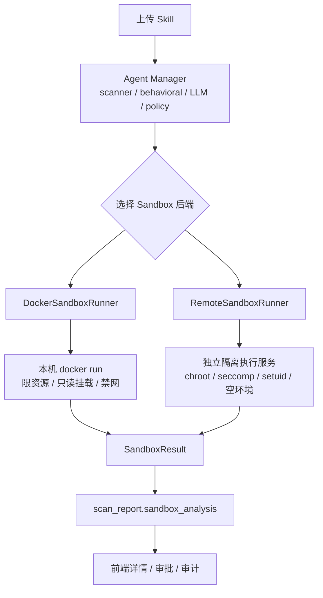
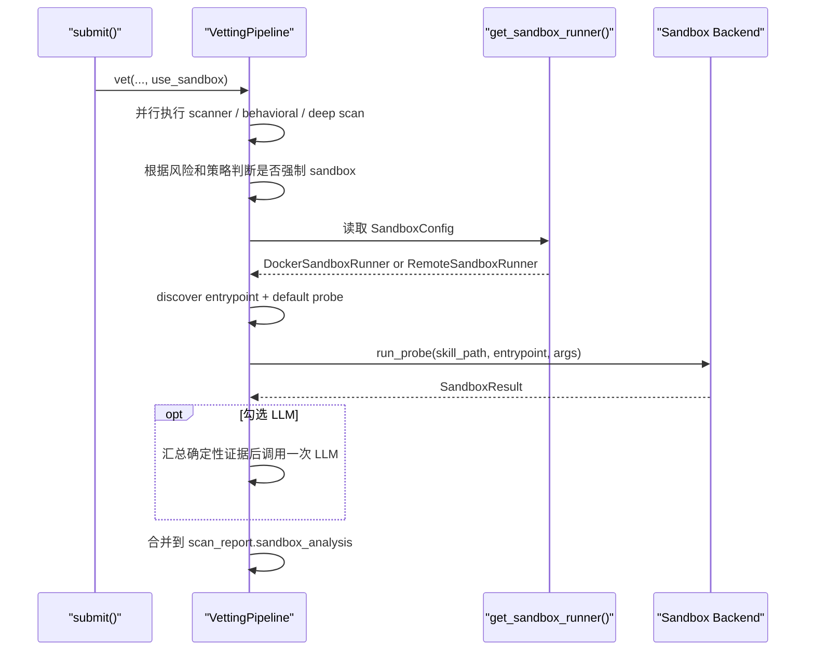

# Sandbox Service Architecture

这个文档描述 Agent Manager 的 Sandbox 演进方向：

- 当前方案：本机 Docker probe
- 目标方案：独立隔离执行服务

这里参考了 [langgenius/dify-sandbox](https://github.com/langgenius/dify-sandbox?tab=readme-ov-file) 的思路，但实现命名保持中性，不把外部项目名称直接写进代码。

## 目标

Agent Manager 负责治理：

- skill 提交
- scanner / behavioral / LLM
- 风险分级
- 审批和部署
- 运行时校验

Sandbox 负责执行：

- 在受限环境里运行 skill 的 probe
- 记录 stdout / stderr / exit code
- 观察网络、文件系统、动态执行等信号
- 把结果回填到 `scan_report.sandbox_analysis`
- 从 Skill 中选择一个真实脚本入口，执行一个保守的默认 probe

## 架构对比



## 当前实现

代码位置：

- [agent_manager/core/sandbox.py](../agent_manager/core/sandbox.py)
- [agent_manager/core/vetting.py](../agent_manager/core/vetting.py)

当前已经支持：

- `DockerSandboxRunner`
- `RemoteSandboxRunner`
- `get_sandbox_runner()` 工厂切换
- 一个生产版独立服务基线实现：
  [services/isolated-sandbox-service/README.md](../services/isolated-sandbox-service/README.md)

说明：

- `DockerSandboxRunner` 适合本地开发、单机试跑
- `RemoteSandboxRunner` 是独立执行服务适配层骨架，适合后续接 Linux 上的隔离执行服务

## 选择逻辑



## Probe 生成策略

默认情况下，sandbox 会先做保守 probe：

- 从 `scripts/` 和 Skill 根目录自动发现一个 `.py`、`.sh` 或 `.js` 入口
- 如果入口脚本看起来是 CLI，例如使用 `argparse`、`click`、`typer`，默认 probe 会用 `--help`
- 否则用空参数执行一次

当前 Vetting 流程只执行这一个默认 probe。没有支持的入口时会跳过，不执行 `SKILL.md` 中的 shell 命令块，也不调用 LLM 生成额外 probe。LLM 只在所选确定性分析器完成后做一次最终语义研判。
- 不允许生成破坏性参数
- 不保证覆盖所有恶意分支

最终报告中会出现：

- `sandbox_analysis.probe_cases`
- `sandbox_analysis.probe_results`
- `sandbox_analysis.llm_probe_plan`

其中 `probe_results` 会保留每个 case 的 stdout、stderr、exit code、风险信号和耗时。

Skill 详情的 Sandbox 调试信息在“说明”之前展示整行“错误输出”，读取汇总报告的 `sandbox_analysis.stderr`；每条 Probe 展开详情在“执行结果”之前展示自身 `stderr`。均以纯文本保留原文及换行，长行换行、内容最高显示 280px 并滚动。标签通过 `skillDetail.sandboxErrorOutput` 提供中英文；stderr 为空、null 或缺失时内容留空。复用已有报告字段，无需数据库迁移或新增部署配置。

## RemoteSandboxRunner 设计

`RemoteSandboxRunner` 的目标不是替代治理逻辑，而是把高风险 skill 的试跑从主服务进程中拆出去。

推荐对接的独立服务能力：

- 受控语言运行时
- 空环境变量
- chroot 或等价文件系统隔离
- seccomp 或等价 syscall 限制
- setuid / setgid 降权
- 请求级网络开关

Agent Manager 需要的只是一个稳定返回结果的 HTTP API，不关心对方具体实现细节。

### 请求 schema

`RemoteSandboxRunner` 当前向远程服务发送：

```json
{
  "language": "python3",
  "code": "print('hello')",
  "preload": "",
  "enable_network": false,
  "metadata": {
    "entrypoint": "scripts/run.py",
    "args": ["--help"],
    "probe_name": "default"
  }
}
```

### 响应 schema

当前兼容两种返回：

1. 包裹型响应，适合独立执行服务

```json
{
  "code": 0,
  "message": "success",
  "data": {
    "stdout": "ok",
    "stderr": "",
    "exit_code": 0,
    "duration_ms": 12
  }
}
```

2. 扁平型响应，适合轻量代理层

```json
{
  "stdout": "ok",
  "stderr": "",
  "exit_code": 0,
  "duration_ms": 12,
  "message": "success"
}
```

如果远程服务返回非零 `code`，Agent Manager 会把这次 probe 记为未执行成功，并把 `message` 写进 `sandbox_analysis.reason`。

## 配置

当前代码支持以下环境变量：

- `AGENT_MANAGER_SANDBOX_RUNTIME=docker|remote`
- `AGENT_MANAGER_SANDBOX_ENABLED=true|false`
- `AGENT_MANAGER_SANDBOX_URL=http://sandbox:8194`
- `AGENT_MANAGER_SANDBOX_API_KEY=...`
- `AGENT_MANAGER_SANDBOX_TIMEOUT_SECONDS=15`
- `AGENT_MANAGER_SANDBOX_NETWORK_MODE=none`
- `AGENT_MANAGER_SANDBOX_IMAGE=python:3.12-slim`
- `AGENT_MANAGER_SANDBOX_MEMORY_LIMIT=256m`
- `AGENT_MANAGER_SANDBOX_CPU_LIMIT=1.0`
- `AGENT_MANAGER_SANDBOX_PIDS_LIMIT=64`

也支持通过 API 和系统设置页保存到本地配置文件：

- `GET /api/v1/sandbox-config`
- `PUT /api/v1/sandbox-config`

默认配置文件路径：

- `~/.agent-manager/sandbox.yaml`

## 为什么保留 Docker 后端

短期不建议直接切掉 Docker probe，原因有两个：

1. 本地开发更简单
2. 远程隔离执行服务通常更依赖 Linux 环境和额外运维

推荐模式：

- 开发环境：`docker`
- 高风险或生产：`remote`

## 后续建议

1. 对高风险 skill 在 sandbox 不可用时收紧策略，改为直接进入 `VETTED` 或 `REJECTED`
2. 为远程 sandbox 增加更强的文件访问和进程审计
3. 提交结果和 vetting 结果中保留这些可观察字段：
   - `sandbox_triggered`
   - `sandbox_required_by_policy`
   - `sandbox_runtime`
   - `sandbox_analysis.probe_cases`
   - `sandbox_analysis.probe_results`

## Sandbox 调试信息悬浮说明

Skill 详情的调试信息、Probe 列表及展开详情复用 `SandboxDebugHelp.vue`，双语文案位于 `skillDetail.sandboxHelp`。术语与全部取值含义集中在字段名或表头的说明图标；缺失信息的 `-` 也在对应字段说明中解释。运行时显示“远程服务 / 本地 Docker”或英文名称。网络尝试直接显示次数（如 `0次 / 0 attempts`）。

将鼠标移至说明图标或使用键盘聚焦，可查看说明。`cli-help` 表示平台传入 `--help`，让入口脚本显示使用方法和可用参数。退出码说明分为通用、本地 Docker 模式和远程服务模式：0 为正常结束，Docker 125/126/127 分别表示容器启动失败、命令无法执行和命令未找到，其余非零值说明为异常结束。具体原因查看错误输出或 Sandbox 服务日志。Probe 参数说明按报告区分空数组（未附加参数）与字段缺失或 null（未提供参数信息）。

