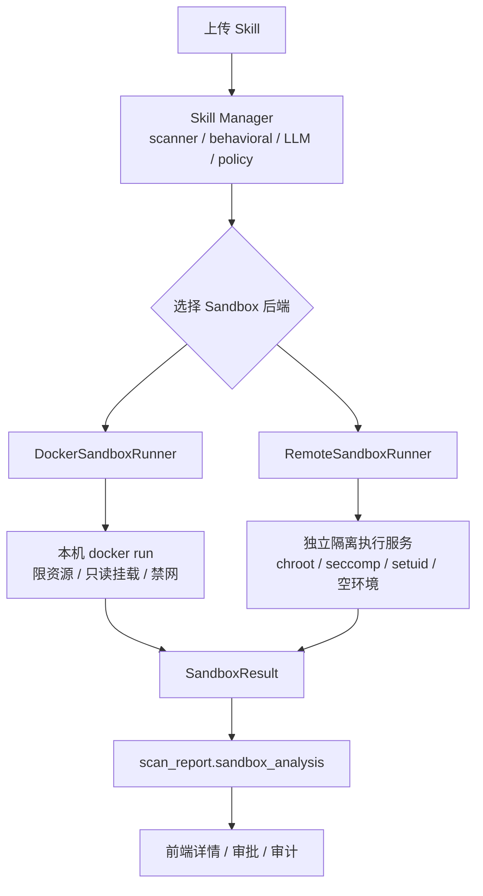
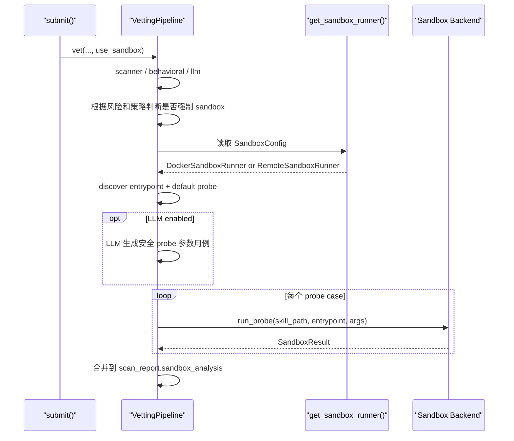

# Sandbox Service Architecture

这个文档描述 Skill Manager 的 Sandbox 演进方向：

- 当前方案：本机 Docker probe
- 目标方案：独立隔离执行服务

这里参考了 [langgenius/dify-sandbox](https://github.com/langgenius/dify-sandbox?tab=readme-ov-file) 的思路，但实现命名保持中性，不把外部项目名称直接写进代码。

## 目标

Skill Manager 负责治理：

- skill 提交
- scanner / behavioral / LLM
- 风险分级
- 审批和部署
- 运行时校验

Sandbox 负责执行：

- 在受限环境里运行 skill 的 probe
- 记录 stdout / stderr / exit code
- 观察网络、文件系统、动态执行等信号
- 把结果回填到 `scan_report.sandbox_analysis`
- 在 LLM 启用时，支持由 LLM 生成额外的安全 probe 参数用例

## 架构对比



## 当前实现

代码位置：

- [skill_manager/core/sandbox.py](/Users/huangluguang/Desktop/Project/skill-manager/skill_manager/core/sandbox.py)
- [skill_manager/core/vetting.py](/Users/huangluguang/Desktop/Project/skill-manager/skill_manager/core/vetting.py)

当前已经支持：

- `DockerSandboxRunner`
- `RemoteSandboxRunner`
- `get_sandbox_runner()` 工厂切换
- 一个生产版独立服务基线实现：
  [services/isolated-sandbox-service/README.md](/Users/huangluguang/Desktop/Project/skill-manager/services/isolated-sandbox-service/README.md)

说明：

- `DockerSandboxRunner` 适合本地开发、单机试跑
- `RemoteSandboxRunner` 是独立执行服务适配层骨架，适合后续接 Linux 上的隔离执行服务

## 选择逻辑



## Probe 生成策略

默认情况下，sandbox 会先做保守 probe：

- 自动发现 `scripts/*.py`、`scripts/*.sh`、`scripts/*.js`
- 如果入口脚本看起来是 CLI，例如使用 `argparse`、`click`、`typer`，默认 probe 会用 `--help`
- 否则用空参数执行一次

当提交时同时启用 `Sandbox` 和 `LLM 分析` 时，Skill Manager 会额外请求 LLM 生成最多 4 组命令行参数型 probe case。  
这不是让 LLM 生成代码，而是只允许它生成参数列表，例如：

```json
{
  "probes": [
    {
      "name": "safe-file-input",
      "description": "用 /tmp 下的占位文件触发文件读取路径",
      "args": ["--input", "/tmp/nonexistent.txt"]
    }
  ]
}
```

限制：

- 不允许生成 shell 管道
- 不允许生成真实凭证
- 不允许生成真实内网目标
- 不允许生成破坏性参数
- 不保证覆盖所有恶意分支

最终报告中会出现：

- `sandbox_analysis.probe_cases`
- `sandbox_analysis.probe_results`
- `sandbox_analysis.llm_probe_plan`

其中 `probe_results` 会保留每个 case 的 stdout、stderr、exit code、风险信号和耗时。

## RemoteSandboxRunner 设计

`RemoteSandboxRunner` 的目标不是替代治理逻辑，而是把高风险 skill 的试跑从主服务进程中拆出去。

推荐对接的独立服务能力：

- 受控语言运行时
- 空环境变量
- chroot 或等价文件系统隔离
- seccomp 或等价 syscall 限制
- setuid / setgid 降权
- 请求级网络开关

Skill Manager 需要的只是一个稳定返回结果的 HTTP API，不关心对方具体实现细节。

### 请求 schema

`RemoteSandboxRunner` 当前向远程服务发送：

```json
{
  "language": "python3",
  "code": "print('hello')",
  "preload": "",
  "enable_network": false,
  "metadata": {
    "entrypoint": "scripts/run.py",
    "args": ["--help"],
    "probe_name": "default"
  }
}
```

### 响应 schema

当前兼容两种返回：

1. 包裹型响应，适合独立执行服务

```json
{
  "code": 0,
  "message": "success",
  "data": {
    "stdout": "ok",
    "stderr": "",
    "exit_code": 0,
    "duration_ms": 12
  }
}
```

2. 扁平型响应，适合轻量代理层

```json
{
  "stdout": "ok",
  "stderr": "",
  "exit_code": 0,
  "duration_ms": 12,
  "message": "success"
}
```

如果远程服务返回非零 `code`，Skill Manager 会把这次 probe 记为未执行成功，并把 `message` 写进 `sandbox_analysis.reason`。

## 配置

当前代码支持以下环境变量：

- `SKILL_MANAGER_SANDBOX_RUNTIME=docker|remote`
- `SKILL_MANAGER_SANDBOX_ENABLED=true|false`
- `SKILL_MANAGER_SANDBOX_URL=http://sandbox:8194`
- `SKILL_MANAGER_SANDBOX_API_KEY=...`
- `SKILL_MANAGER_SANDBOX_TIMEOUT_SECONDS=15`
- `SKILL_MANAGER_SANDBOX_NETWORK_MODE=none`
- `SKILL_MANAGER_SANDBOX_IMAGE=python:3.12-slim`
- `SKILL_MANAGER_SANDBOX_MEMORY_LIMIT=256m`
- `SKILL_MANAGER_SANDBOX_CPU_LIMIT=1.0`
- `SKILL_MANAGER_SANDBOX_PIDS_LIMIT=64`

也支持通过 API 和系统设置页保存到本地配置文件：

- `GET /api/v1/sandbox-config`
- `PUT /api/v1/sandbox-config`

默认配置文件路径：

- `~/.skill-manager/sandbox.yaml`

## 为什么保留 Docker 后端

短期不建议直接切掉 Docker probe，原因有两个：

1. 本地开发更简单
2. 远程隔离执行服务通常更依赖 Linux 环境和额外运维

推荐模式：

- 开发环境：`docker`
- 高风险或生产：`remote`

## 后续建议

1. 对高风险 skill 在 sandbox 不可用时收紧策略，改为直接进入 `VETTED` 或 `REJECTED`
2. 为远程 sandbox 增加更强的文件访问和进程审计
3. 提交结果和 vetting 结果中保留这些可观察字段：
   - `sandbox_triggered`
   - `sandbox_required_by_policy`
   - `sandbox_runtime`
   - `sandbox_analysis.probe_cases`
   - `sandbox_analysis.probe_results`
