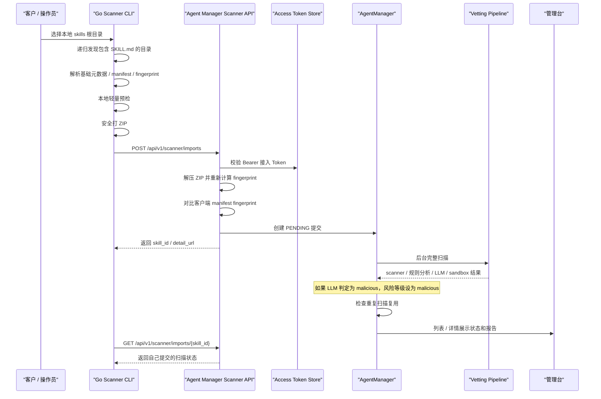

# 客户侧 Skill Scanner 使用说明

本文档说明客户侧 Go 扫描器的定位、CLI 使用方式、接入 Token、服务端接入接口、下载发布和重复扫描复用机制。

---

## 1. 定位

客户侧 Skill Scanner 用于扫描客户本地的 skills 目录，并把发现的 skill 安全提交到 Agent Manager 后台治理流程。

它解决的是这类场景：

- 客户已有一批本地 skills，不方便逐个在管理台上传。
- 客户环境不希望安装 Python、Node 或 Docker。
- 需要一个单二进制工具递归发现 `SKILL.md`，做本地轻量预检，再上传服务端做完整扫描。
- 客户侧只能拥有 scanner 最小权限，不能拥有审批、部署、策略修改、用户管理等管理权限。

当前提供两个版本：

- `skill-scanner-cli-*`：命令行版本，适合服务器、CI、批处理。

---

## 2. 总体流程



---

## 3. 接入凭证

Scanner 和外部 Agent Runtime 都不应该使用管理员登录态，而是使用管理台创建的最小权限接入凭证。

### 3.1 创建位置

管理台进入：

- `智能体管理`
- `统一凭证中心`
- 创建凭证，调用者选择 `给 Skill Scanner`（英文 `For Skill Scanner`）

创建后只展示一次明文凭证。服务端只保存 hash。

### 3.2 权限范围

扫描器默认权限：

- `scanner:submit`
- `scanner:read-own-results`
- `scanner:read-own-sessions`

Runtime Agent 加载校验权限：

- `runtime:verify-signature`
- `runtime:can-load`
- `runtime:check-tool`

凭证必须按用途拆分：

- 客户本地扫描器：只选 scanner 权限。
- Agno / LangGraph 等外部 Agent：只选 runtime 权限。
- Codex / Claude Code 等通用 Skill Verifier：`submit` 和 `status` 使用 Scanner 凭证，`verify` 使用绑定当前 Agent 的运行凭证。
- 同一个测试环境既扫描又加载：仍然创建两张凭证，不把 scanner 和 runtime 权限合并到同一张凭证。

不要给接入凭证授予：

- 审批权限
- 部署权限
- 策略修改权限
- 用户管理权限
- 凭证管理权限

### 3.3 安全控制

接入凭证支持：

- 禁用 / 吊销
- 允许 IP / CIDR
- 最大上传大小
- 最大并发任务数
- 审计日志

凭证明文可以通过 CLI 参数或环境变量配置，不应硬编码到二进制里。Go Scanner 使用 `SKILL_SCANNER_TOKEN`；Agent Skill Verifier 分别使用 `AGENT_MANAGER_SCANNER_TOKEN` 和 `AGENT_MANAGER_AGENT_RUNTIME_TOKEN`，避免 scanner 凭证和运行时凭证混用。

---

## 4. Agent Skill Verifier

`Agent Skill Verifier` 是给 Codex、Claude Code 等通用 Agent 使用的示例 skill。它不依赖 hook，也不绑定某个 Agent 平台；安装后，Agent 在安装、加载或调用第三方 skill 前，可以按 skill 指令先提交扫描，再检查内容完整性、审批状态和 Agent 授权范围。

它和 Go Scanner 的定位不同：

- Go Scanner：面向客户侧批量发现和上传本地 skills，适合命令行、服务器和 CI 批量扫描。
- Agent Skill Verifier：面向 Agent 运行过程，强调“第三方 skill 使用前必须先过 Agent Manager”。

### 4.1 下载

管理台进入：

- `智能体管理`
- `接入与运行`
- 找到 `Skill Verifier 接入`
- 点击 `下载 Skill Verifier`

对应后端接口：

```http
GET /api/v1/scanner/skill-verifier/download
```

下载文件名为：

```text
agent-manager-skill-verifier.zip
```

ZIP 内包含：

- `agent-manager-skill-verifier/SKILL.md`
- `agent-manager-skill-verifier/scripts/agent_manager_skill_verifier.py`

### 4.2 Token 权限

Skill Verifier 使用两张最小权限凭证：

Scanner 凭证用于 `submit` 和 `status`，至少需要：

- `scanner:submit`
- `scanner:read-own-results`
- `scanner:read-own-sessions`

Agent 运行凭证用于 `verify`，必须绑定当前 Agent，并至少需要：

- `runtime:verify-signature`
- `runtime:can-load`
- `runtime:check-tool`

环境变量示例：

```bash
export AGENT_MANAGER_VERIFIER_BASE_URL="http://localhost"
export AGENT_MANAGER_AGENT_RUNTIME_TOKEN="amat_runtime_xxx"
export AGENT_MANAGER_SCANNER_TOKEN="amat_scanner_xxx"
export AGENT_ID="<agent-id>"
```

只执行 `verify` 时不需要设置 `AGENT_MANAGER_SCANNER_TOKEN`。Verifier 只提交无密钥内容摘要，不需要也不允许持有服务端签名私钥。

旧版本变量仍作为兼容回退保留，但新接入应使用上面的用途专用变量。

不要把 Go Scanner 使用的 `SKILL_SCANNER_TOKEN` 当作 Agent 运行凭证。

### 4.3 安装到 Codex

```bash
mkdir -p ~/.codex/skills
unzip agent-manager-skill-verifier.zip -d ~/.codex/skills/
```

安装后重启 Codex，或刷新 Codex 的 skill 列表。

### 4.4 安装到 Claude Code

```bash
mkdir -p ~/.claude/skills
unzip agent-manager-skill-verifier.zip -d ~/.claude/skills/
```

安装后重启 Claude Code，或刷新 Claude Code 的 skill 列表。

### 4.5 使用命令

提交本地第三方 skill 扫描：

```bash
python <skills-dir>/agent-manager-skill-verifier/scripts/agent_manager_skill_verifier.py submit \
  --path /path/to/third-party-skill \
  --behavioral \
  --deep-scan
```

查看提交状态：

```bash
python <skills-dir>/agent-manager-skill-verifier/scripts/agent_manager_skill_verifier.py status \
  --skill-id <skill-id>
```

使用前检查内容完整性、审批状态和 Agent 授权范围：

```bash
python <skills-dir>/agent-manager-skill-verifier/scripts/agent_manager_skill_verifier.py verify \
  --path /path/to/third-party-skill
```

默认策略是阻断优先：未提交、扫描中、待审核、已拒绝、未形成可信版本、内容不匹配、状态不可加载或 API 错误，脚本都会返回非 `0`，并输出中文阻断原因。Agent 不应提供“用户确认后继续”的默认绕过路径。

`submit` 不再默认启用 LLM。需要更完整分析时显式增加 `--deep-scan`、`--sandbox` 或 `--llm`。检测结果是否复用由平台“策略配置”全局控制；需要强制重新检测时，在平台 Skill 版本列表中发起。

---

## 5. CLI 使用

### 5.1 下载

管理台进入：

- `能力治理 -> Skill 治理 -> 提交 Skill`
- 打开 Scanner 接入区域并选择 `下载扫描器`

选择对应平台的 CLI 文件，例如：

- `skill-scanner-cli-darwin-arm64`
- `skill-scanner-cli-darwin-amd64`
- `skill-scanner-cli-linux-amd64`
- `skill-scanner-cli-linux-arm64`

下载列表来自：

- `scanner/releases/`

如果页面显示没有可下载文件，需要先在服务端构建发布文件，见本文第 10 节。

### 5.2 基本命令

```bash
chmod +x skill-scanner-cli-darwin-arm64
./skill-scanner-cli-darwin-arm64 scan /path/to/skills \
  --server http://localhost \
  --token "$SKILL_SCANNER_TOKEN" \
  --host-id customer-prod-01 \
  --behavioral \
  --sandbox \
  --llm \
  --output skill-scan-report.json
```

也可以使用环境变量：

```bash
export SKILL_SCANNER_SERVER="http://localhost"
export SKILL_SCANNER_TOKEN="amat_xxx"
export SKILL_SCANNER_HOST_ID="customer-prod-01"

./skill-scanner-cli-darwin-arm64 scan /path/to/skills --behavioral --sandbox --llm
```

### 5.3 页面运行示例

提交 Skill 的“Skill 扫描器”区域按四个场景组织命令：

| 场景 | 行为 |
| --- | --- |
| 本地轻量预检 | 使用 `--server=""`，只做发现、fingerprint、预检与打包。 |
| 上传平台基础扫描 | 设置平台地址和凭证，不主动请求四项可选分析。 |
| 按需启用分析能力 | 分别展示规则、深度扫描、Sandbox、LLM，以及规则与深度扫描的部分组合。 |
| 全能力扫描 | 同时请求 `--behavioral --deep-scan --sandbox --llm`。 |

各上传场景独立提供地址和凭证配置；页面示例平台地址为 `http://10.10.71.35`。将 `amat_xxx` 替换为统一凭证中心创建的实际 Scanner 凭证。规则分析、深度扫描、Sandbox 和 LLM 在服务端执行，Sandbox 与 LLM 还需服务端启用及完成配置；服务端策略仍可能要求执行 Sandbox。

### 5.4 参数说明

本地扫描只需路径；上传还需平台地址和 Scanner 凭证。每项分别选择命令行或对应环境变量，命令行优先，地址和凭证的来源可混用。设置地址即自动上传，仅配置凭证不会上传。

仅本地扫描时，使用以下独立命令覆盖终端已有的平台地址：

```bash
./skill-scanner scan /path/to/skills --server="" --output skill-scan-report.json
```

#### 基础与上传配置

平台地址和凭证是上传所需的两项配置，不是两套必须同时填写的参数。

| 配置项 | 何时需要 | 填写方式 / 默认值 | 作用及关系 |
| --- | --- | --- | --- |
| 扫描路径：`scan <path>` | 必填 | 本机可读目录，如 /opt/openclaw/skills；含空格时加引号。 | 可填单个 Skill 或多个 Skill 的根目录；递归发现 SKILL.md，一次只支持一个路径。 |
| 平台地址：`--server <URL>` / `SKILL_SCANNER_SERVER` | 上传时必需 | 任选一种；默认未配置。例：https://agent-manager.example.com | 命令行优先；有地址即上传。填写扫描机器可访问的平台基础地址，不是 API 路径；127.0.0.1 指扫描机器自身。 |
| Scanner 凭证：`--token <TOKEN>` / `SKILL_SCANNER_TOKEN` | 上传时必需 | 任选一种；默认未配置。amat_xxx 仅为示例，请替换为实际凭证。 | 命令行优先；凭证中心生成的 Scanner 凭证，包含 scanner:submit。只填 Token，不加 Bearer 前缀。 |
| 显式上传：`--upload` | 可选，通常省略 | 默认关闭；只写开关。 | 仍需地址和凭证；缺地址会报错。已有地址时自动上传，--upload=false 也不能抵消；仅本地扫描用 --server=""。 |
| 本地报告：`--output <PATH>` | 可选 | 默认 skill-scan-report.json | 相对路径以命令当前目录为基准，目录需可写。报告包含 fingerprint、本地预检结果和上传状态；上传成功后，`skills[].submission` 中包含 `skill_id` 等服务端结果，不等待全部后台分析完成。 |
| 来源标识：`--host-id <ID>` / `SKILL_SCANNER_HOST_ID` | 可选 | 任选一种；默认未填写。例：customer-prod-01 | 命令行优先；随上传提交以区分主机/环境，不切换平台、凭证或扫描对象。 |
| 请求超时：`--timeout <DURATION>` | 可选，仅上传时生效 | 默认 120s。建议正时长。 | 限制上传 HTTP 请求时长，不是服务端整个扫描任务的耗时上限。 |

#### 服务端分析

仅上传时生效；四个分析开关默认关闭，可独立组合，需服务端对应能力可用。

| 配置项 | 何时需要 | 填写方式 / 默认值 | 作用及关系 |
| --- | --- | --- | --- |
| 规则分析：`--behavioral` | 按需，上传时生效 | 默认关闭；只写开关。 | 请求服务端规则/行为分析，不在客户机执行 Skill 脚本。 |
| 静态深度扫描：`--deep-scan` | 按需，上传时生效 | 默认关闭；只写开关。 | 不自动启用 LLM；与 --llm 组合时，证据交给最终 LLM 汇总。 |
| Sandbox 分析：`--sandbox` | 按需，上传时生效 | 默认关闭；只写开关。 | `--sandbox` 仅请求分析；还需在服务端启用 Sandbox 运行检测并完成可用配置，才会执行。未传此开关时，服务端策略仍可能要求执行。 |
| LLM 分析：`--llm` | 按需，上传时生效 | 默认关闭；只写开关。 | `--llm` 仅请求分析；还需在服务端启用 AI 分析并配置模型和凭据，才会调用模型。服务端未启用时显示“未启用”；不自动启用其他分析开关。 |
| 风险判定模式：`--judgement-mode <MODE>` / `SKILL_SCANNER_JUDGEMENT_MODE` | 可选，上传时生效 | strict（严格）、balanced（平衡）、permissive（宽松）。 | 命令行优先；未配置沿用服务端策略。不依赖 --llm。 |

即使 Scanner 传入 `--llm`，服务端关闭 AI 分析时仍接受上传并继续其他检测；本次报告 `analyzer_timings.llm` 记录 `status=disabled`、`reason=llm_analysis_disabled`。列表、详情和版本摘要显示未启用；详情说明本次未调用模型。开启后的配置错误或模型调用异常仍显示调用失败。原始提交选项保留用户请求，不反推实际执行状态。

`--llm` only requests analysis. AI analysis must also be enabled on the server with a configured model and credentials. When disabled, upload and other analysis continue; the report records `status=disabled` and `reason=llm_analysis_disabled`. The list, detail and version summary show Disabled. Configuration and model request errors while enabled remain Failed. `--sandbox` likewise requires server-side Sandbox runtime detection to be enabled and configured; server policy may still require execution when the switch is omitted.

#### 本地处理限制

每个 Skill 单独计算，与是否上传无关。超限的 Skill 不上传，其他 Skill 可继续。大小单位按 1024 × 1024 字节计算；默认值不是固定最大可填值。建议正整数；当前实现中，0 或负数关闭对应本地限制。上传仍受服务端及凭证配额约束。

| 配置项 | 何时需要 | 填写方式 / 默认值 | 作用及关系 |
| --- | --- | --- | --- |
| 单文件大小：`--max-file-mb <N>` | 可选 | 默认 20；例：--max-file-mb 20 | 纳入打包的单文件大小上限。 |
| 单个 Skill 总大小：`--max-total-mb <N>` | 可选 | 默认 50；例：--max-total-mb 50 | 纳入打包的原始文件大小总和，不是 ZIP 压缩后大小。 |
| 单个 Skill 文件数：`--max-files <N>` | 可选 | 默认 2000；例：--max-files 2000 | 纳入打包的文件数量上限。 |
| 忽略名称：`--ignore <NAMES>` | 可选 | 默认 .git,.venv,node_modules,__pycache__,dist,build | 逗号分隔名称，不是路径或通配符。 |

### 5.5 本地报告

CLI 会生成 JSON 报告及对应打包目录。报告记录本地预检与提交状态，不等待全部服务端分析完成；完整结果在管理台 Skill 列表查看。内容包括：

- 扫描根目录
- 发现的 skills 数量
- 每个 skill 的路径、名称、描述、文件数、大小
- 本地轻量预检结果
- 每个 Skill 的 `fingerprint` 和上传状态 `submitted`
- 上传成功后的 `skills[].submission.skill_id`
- 服务端返回状态
- 详情页链接

最终完整扫描报告以 Agent Manager 服务端详情页为准。

---

## 6. 本地轻量预检

客户侧 scanner 的本地预检只做低成本静态检查，不执行客户代码。

预检目标是提前发现明显问题，例如：

- 超大文件
- 文件总量过大
- 常见忽略目录
- 危险扩展名
- 明显危险关键词
- 打包路径逃逸风险

本地预检不是最终结论。最终风险等级由服务端完整扫描、策略、LLM 和 sandbox 汇总决定。

---

## 7. 服务端接口

Scanner 使用专用 API，不复用管理员接口。

### 7.1 提交

```http
POST /api/v1/scanner/imports
Authorization: Bearer <scanner-token>
Content-Type: multipart/form-data
```

表单字段：

- `file`：skill ZIP 包
- `manifest`：scanner 生成的 manifest JSON
- `use_behavioral`：是否启用规则分析
- `use_llm`：是否启用 LLM 分析
- `use_sandbox`：是否启用 sandbox
- `scanner_version`：scanner 版本
- `host_id`：客户侧主机 / 环境标识

服务端会：

1. 校验接入 token。
2. 检查上传大小。
3. 解压 ZIP，支持嵌套压缩包解包。
4. 重新计算 skill fingerprint。
5. 对比客户端 manifest fingerprint。
6. 持久化上传目录。
7. 创建 `PENDING` skill。
8. 后台执行完整扫描。

### 7.2 查询自己的提交

```http
GET /api/v1/scanner/imports/{skill_id}
Authorization: Bearer <scanner-token>
```

只能读取当前 token 自己提交的结果。

---

## 8. 重复扫描复用

服务端会尽量避免重复扫描完全相同的 skill。

### 8.1 复用条件

必须同时满足：

- skill 内容指纹一致。
- 扫描上下文指纹一致。
- 已经存在完成扫描的历史记录。

内容指纹来自完整目录树：

- 文件相对路径
- 文件大小
- 文件 SHA256

扫描上下文指纹包含：

- 当前策略内容
- 是否启用规则分析
- 是否启用 LLM
- 是否启用 sandbox
- scanner / policy / vetting 相关代码版本
- LLM 配置和 prompt 源
- 如果启用了模型网关，还包括网关 URL 和内部 metadata 配置
- sandbox 配置和 runner 源

### 8.2 页面显示

如果发生复用，技能详情会显示：

- 是否复用扫描结果
- 复用来源 skill ID
- 内容指纹
- 扫描上下文指纹
- scan cache key

原始报告 JSON 里也会包含：

- `scan_reused`
- `reused_from_skill_id`
- `content_fingerprint`
- `scan_context_fingerprint`
- `scan_cache_key`

### 8.3 为什么没有复用

常见原因：

- 两个 skill 内容并不完全一致。
- 一个开启了 LLM，另一个没开启 LLM。
- 一个开启了 sandbox，另一个没开启 sandbox。
- 策略或扫描器代码升级导致扫描上下文变化。
- 第一条还在 `PENDING`，没有完成结果可复用。
- 旧记录是在复用功能上线前生成的，没有内容指纹。

服务端现在除了查 `scan_cache/index.json`，还会在 cache miss 时从 registry 里查找已完成的相同指纹记录，并自动重建 cache。

---

## 9. 构建和发布扫描器

### 9.1 本地构建

```bash
cd /path/to/agent-manager/scanner
go test ./...
go build -o skill-scanner ./cmd/skill-scanner
```

### 9.2 生成发布目录

```bash
cd /path/to/agent-manager/scanner
./scripts/package.sh
```

脚本会生成版本号目录，例如：

```text
scanner/releases/2026.04.16-399cdd8c/
```

同时会把最新二进制同步到：

```text
scanner/releases/
```

管理台提交 Skill 页中的 Scanner 接入区域只读取 `scanner/releases/` 下的顶层文件：

- `skill-scanner-cli-*`

所以如果页面显示“当前可下载文件为空”，先检查：

```bash
ls -lh /path/to/agent-manager/scanner/releases
```

### 9.3 支持的平台

CLI 默认尝试构建：

- macOS arm64
- macOS amd64
- Linux amd64
- Linux arm64

Windows CLI 需要显式打开：

```bash
BUILD_WINDOWS_CLI=1 ./scripts/package.sh
```

---

## 10. 服务端页面

管理台提交 Skill 页中的 Scanner 接入区域提供：

- CLI 下载
- Agent Skill Verifier 下载
- Codex / Claude Code 安装示例
- 安装命令
- 参数说明
- 配置模板
- 最近扫描会话和结果入口

接入凭证的创建、查看和吊销统一在 `智能体管理 / 统一凭证中心` 页面完成。

扫描完成后看结果的位置：

- CLI 本地报告：看本地 `skill-scan-report.json`
- 服务端最终结果：管理台 `Skill 列表` 和 `Skill 详情`
- 审计：管理台 `智能体管理 / 审计追踪`

---

## 11. 相关代码

- [scanner/cmd/skill-scanner/main.go](../scanner/cmd/skill-scanner/main.go)
- [scanner/internal/runner/runner.go](../scanner/internal/runner/runner.go)
- [demo/agent-manager-skill-verifier/skills/agent-manager-skill-verifier/SKILL.md](../demo/agent-manager-skill-verifier/skills/agent-manager-skill-verifier/SKILL.md)
- [demo/agent-manager-skill-verifier/skills/agent-manager-skill-verifier/scripts/agent_manager_skill_verifier.py](../demo/agent-manager-skill-verifier/skills/agent-manager-skill-verifier/scripts/agent_manager_skill_verifier.py)
- [agent_manager/api/scanner_router.py](../agent_manager/api/scanner_router.py)
- [agent_manager/core/scanner_tokens.py](../agent_manager/core/scanner_tokens.py)
- [agent_manager/core/scan_cache.py](../agent_manager/core/scan_cache.py)
