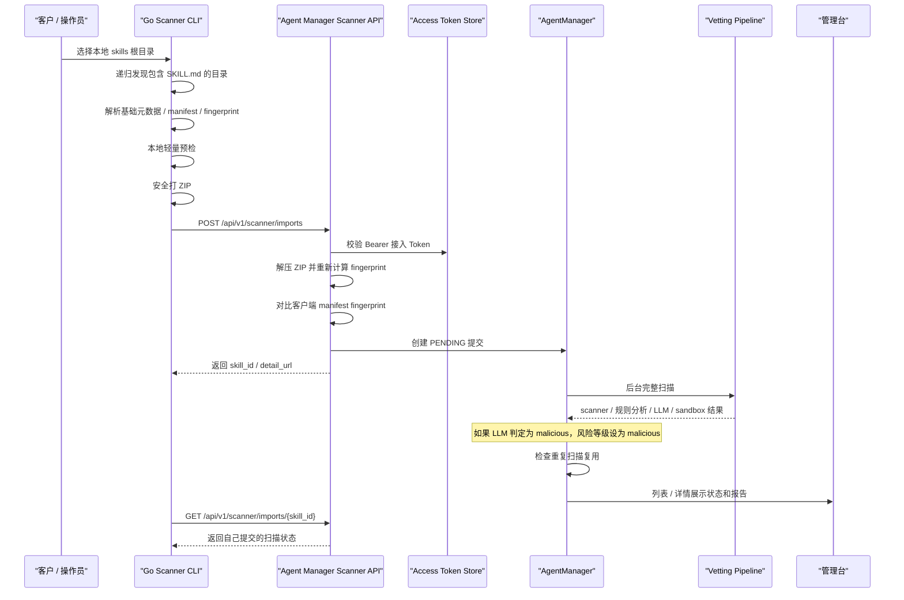

# 客户侧 Skill Scanner 使用说明

本文档说明客户侧 Go 扫描器的定位、CLI 使用方式、接入 Token、服务端接入接口、下载发布和重复扫描复用机制。

---

## 1. 定位

客户侧 Skill Scanner 用于扫描客户本地的 skills 目录，并把发现的 skill 安全提交到 Agent Manager 后台治理流程。

它解决的是这类场景：

- 客户已有一批本地 skills，不方便逐个在管理台上传。
- 客户环境不希望安装 Python、Node 或 Docker。
- 需要一个单二进制工具递归发现 `SKILL.md`，做本地轻量预检，再上传服务端做完整扫描。
- 客户侧只能拥有 scanner 最小权限，不能拥有审批、部署、策略修改、用户管理等管理权限。

当前提供两个版本：

- `skill-scanner-cli-*`：命令行版本，适合服务器、CI、批处理。

---

## 2. 总体流程



---

## 3. 接入凭证

Scanner 和外部 Agent Runtime 都不应该使用管理员登录态，而是使用管理台创建的最小权限接入凭证。

### 3.1 创建位置

管理台进入：

- `智能体治理`
- `凭证管理`
- 创建凭证，类型选择 `Scanner 接入凭证`

创建后只展示一次明文凭证。服务端只保存 hash。

### 3.2 权限范围

扫描器默认权限：

- `scanner:submit`
- `scanner:read-own-results`
- `scanner:read-own-sessions`

Runtime Agent 加载校验权限：

- `runtime:verify-signature`
- `runtime:can-load`
- `runtime:check-tool`

常见配置：

- 客户本地扫描器：只选 scanner 权限。
- Agno / LangGraph 等外部 Agent：只选 runtime 权限。
- Codex / Claude Code 等通用 Skill Verifier：选择 `scanner:submit`、`scanner:read-own-results` 和全部 runtime 权限。
- 同一个测试环境既扫描又加载：可以同时选择 scanner 和 runtime 权限。

不要给接入凭证授予：

- 审批权限
- 部署权限
- 策略修改权限
- 用户管理权限
- 凭证管理权限

### 3.3 安全控制

接入凭证支持：

- 禁用 / 吊销
- 过期时间
- 允许 IP / CIDR
- 最大上传大小
- 最大并发任务数
- 审计日志

凭证明文可以通过 CLI 参数或环境变量配置，不应硬编码到二进制里。Go Scanner 使用 `SKILL_SCANNER_TOKEN`，Agent Skill Verifier 使用 `AGENT_MANAGER_VERIFIER_TOKEN`，避免 scanner 凭证和运行时凭证混用。

---

## 4. Agent Skill Verifier

`Agent Skill Verifier` 是给 Codex、Claude Code 等通用 Agent 使用的示例 skill。它不依赖 hook，也不绑定某个 Agent 平台；安装后，Agent 在安装、加载或调用第三方 skill 前，可以按 skill 指令先提交扫描，再检查内容完整性、审批状态和 Agent 授权范围。

它和 Go Scanner 的定位不同：

- Go Scanner：面向客户侧批量发现和上传本地 skills，适合命令行、服务器和 CI 批量扫描。
- Agent Skill Verifier：面向 Agent 运行过程，强调“第三方 skill 使用前必须先过 Agent Manager”。

### 4.1 下载

管理台进入：

- `扫描器接入`
- `Agent Skill Verifier 接入`
- 点击 `下载 Skill Verifier`

对应后端接口：

```http
GET /api/v1/scanner/skill-verifier/download
```

下载文件名为：

```text
agent-manager-skill-verifier.zip
```

ZIP 内包含：

- `agent-manager-skill-verifier/SKILL.md`
- `agent-manager-skill-verifier/scripts/agent_manager_skill_verifier.py`

### 4.2 Token 权限

Skill Verifier 首版使用一个合并 token。至少需要：

- `scanner:submit`
- `scanner:read-own-results`
- `scanner:read-own-sessions`
- `runtime:verify-signature`
- `runtime:can-load`
- `runtime:check-tool`

环境变量示例：

```bash
export AGENT_MANAGER_VERIFIER_BASE_URL="http://localhost:8001"
export AGENT_MANAGER_VERIFIER_TOKEN="amat_xxx"
export AGENT_ID="<agent-id>"
# 仅当服务端启用 AGENT_MANAGER_SIGNING_KEY 时需要，且必须与服务端一致
export AGENT_MANAGER_SIGNING_KEY="和服务器 .env 中保持一致"
```

旧版本变量 `AGENT_MANAGER_BASE_URL`、`AGENT_MANAGER_API_TOKEN`、`AGENT_MANAGER_ACCESS_TOKEN` 仍兼容，但不推荐继续使用。

不要复用 `SKILL_SCANNER_TOKEN`；Verifier 需要 Agent 运行凭证。

### 4.3 安装到 Codex

```bash
mkdir -p ~/.codex/skills
unzip agent-manager-skill-verifier.zip -d ~/.codex/skills/
```

安装后重启 Codex，或刷新 Codex 的 skill 列表。

### 4.4 安装到 Claude Code

```bash
mkdir -p ~/.claude/skills
unzip agent-manager-skill-verifier.zip -d ~/.claude/skills/
```

安装后重启 Claude Code，或刷新 Claude Code 的 skill 列表。

### 4.5 使用命令

提交本地第三方 skill 扫描：

```bash
python <skills-dir>/agent-manager-skill-verifier/scripts/agent_manager_skill_verifier.py submit \
  --path /path/to/third-party-skill \
  --behavioral \
  --deep-scan
```

查看提交状态：

```bash
python <skills-dir>/agent-manager-skill-verifier/scripts/agent_manager_skill_verifier.py status \
  --skill-id <skill-id>
```

使用前检查内容完整性、审批状态和 Agent 授权范围：

```bash
python <skills-dir>/agent-manager-skill-verifier/scripts/agent_manager_skill_verifier.py verify \
  --path /path/to/third-party-skill
```

默认策略是阻断优先：未提交、扫描中、待审核、已拒绝、未形成可信版本、内容不匹配、状态不可加载或 API 错误，脚本都会返回非 `0`，并输出中文阻断原因。Agent 不应提供“用户确认后继续”的默认绕过路径。

`submit` 不再默认启用 LLM。需要更完整分析时显式增加 `--deep-scan`、`--sandbox`、`--llm` 或 `--no-cache`。

---

## 5. CLI 使用

### 5.1 下载

管理台进入：

- `扫描器接入`
- `下载扫描器`

选择对应平台的 CLI 文件，例如：

- `skill-scanner-cli-darwin-arm64`
- `skill-scanner-cli-darwin-amd64`
- `skill-scanner-cli-linux-amd64`
- `skill-scanner-cli-linux-arm64`

下载列表来自：

- `scanner/releases/`

如果页面显示没有可下载文件，需要先在服务端构建发布文件，见本文第 10 节。

### 5.2 基本命令

```bash
chmod +x skill-scanner-cli-darwin-arm64
./skill-scanner-cli-darwin-arm64 scan /path/to/skills \
  --server http://localhost:8000 \
  --token "$SKILL_SCANNER_TOKEN" \
  --host-id customer-prod-01 \
  --behavioral \
  --sandbox \
  --llm \
  --output skill-scan-report.json
```

也可以使用环境变量：

```bash
export SKILL_SCANNER_SERVER="http://localhost:8000"
export SKILL_SCANNER_TOKEN="amat_xxx"
export SKILL_SCANNER_HOST_ID="customer-prod-01"

./skill-scanner-cli-darwin-arm64 scan /path/to/skills --behavioral --sandbox --llm
```

### 5.3 参数说明

| 参数 | 说明 |
| --- | --- |
| `scan <path>` | 扫描根目录。scanner 会递归发现包含 `SKILL.md` 的目录。 |
| `--server URL` | Agent Manager 服务端地址。设置后会自动启用上传。 |
| `--token TOKEN` | 接入 Token，需要包含 `scanner:submit`。也可用 `SKILL_SCANNER_TOKEN`。 |
| `--output PATH` | 本地 JSON 报告输出路径，默认 `skill-scan-report.json`。 |
| `--host-id ID` | 客户侧主机或环境标识，方便服务端审计来源。 |
| `--upload` | 显式上传到服务端。配置 `--server` 时会自动上传。 |
| `--behavioral` | 启用服务端规则分析。界面里显示为“规则分析”。 |
| `--sandbox` | 启用服务端 sandbox 动态执行验证。 |
| `--llm` | 启用服务端 LLM 分析。需要系统设置里已配置 LLM，或已通过模型网关环境变量配置隐私路由。 |
| `--no-cache` | 禁用扫描缓存。强制服务端重新执行完整分析，不复用历史结果。 |
| `--timeout` | HTTP 请求超时时间，默认 `120s`。 |
| `--max-file-mb` | 单文件打包大小上限，默认 `20`。 |
| `--max-total-mb` | 单个 skill 包总大小上限，默认 `50`。 |
| `--max-files` | 单个 skill 最大文件数，默认 `2000`。 |
| `--ignore` | 忽略目录名，默认 `.git,.venv,node_modules,__pycache__,dist,build`。 |

### 5.4 本地报告

CLI 会生成 JSON 报告，内容包括：

- 扫描根目录
- 发现的 skills 数量
- 每个 skill 的路径、名称、描述、文件数、大小
- 本地轻量预检结果
- 上传后的 `skill_id`
- 服务端返回状态
- 详情页链接

最终完整扫描报告以 Agent Manager 服务端详情页为准。

---

## 6. 本地轻量预检

客户侧 scanner 的本地预检只做低成本静态检查，不执行客户代码。

预检目标是提前发现明显问题，例如：

- 超大文件
- 文件总量过大
- 常见忽略目录
- 危险扩展名
- 明显危险关键词
- 打包路径逃逸风险

本地预检不是最终结论。最终风险等级由服务端完整扫描、策略、LLM 和 sandbox 汇总决定。

---

## 7. 服务端接口

Scanner 使用专用 API，不复用管理员接口。

### 7.1 提交

```http
POST /api/v1/scanner/imports
Authorization: Bearer <scanner-token>
Content-Type: multipart/form-data
```

表单字段：

- `file`：skill ZIP 包
- `manifest`：scanner 生成的 manifest JSON
- `use_behavioral`：是否启用规则分析
- `use_llm`：是否启用 LLM 分析
- `use_sandbox`：是否启用 sandbox
- `scanner_version`：scanner 版本
- `host_id`：客户侧主机 / 环境标识

服务端会：

1. 校验接入 token。
2. 检查上传大小。
3. 解压 ZIP，支持嵌套压缩包解包。
4. 重新计算 skill fingerprint。
5. 对比客户端 manifest fingerprint。
6. 持久化上传目录。
7. 创建 `PENDING` skill。
8. 后台执行完整扫描。

### 7.2 查询自己的提交

```http
GET /api/v1/scanner/imports/{skill_id}
Authorization: Bearer <scanner-token>
```

只能读取当前 token 自己提交的结果。

---

## 8. 重复扫描复用

服务端会尽量避免重复扫描完全相同的 skill。

### 8.1 复用条件

必须同时满足：

- skill 内容指纹一致。
- 扫描上下文指纹一致。
- 已经存在完成扫描的历史记录。

内容指纹来自完整目录树：

- 文件相对路径
- 文件大小
- 文件 SHA256

扫描上下文指纹包含：

- 当前策略内容
- 是否启用规则分析
- 是否启用 LLM
- 是否启用 sandbox
- scanner / policy / vetting 相关代码版本
- LLM 配置和 prompt 源
- 如果启用了模型网关，还包括网关 URL 和内部 metadata 配置
- sandbox 配置和 runner 源

### 8.2 页面显示

如果发生复用，技能详情会显示：

- 是否复用扫描结果
- 复用来源 skill ID
- 内容指纹
- 扫描上下文指纹
- scan cache key

原始报告 JSON 里也会包含：

- `scan_reused`
- `reused_from_skill_id`
- `content_fingerprint`
- `scan_context_fingerprint`
- `scan_cache_key`

### 8.3 为什么没有复用

常见原因：

- 两个 skill 内容并不完全一致。
- 一个开启了 LLM，另一个没开启 LLM。
- 一个开启了 sandbox，另一个没开启 sandbox。
- 策略或扫描器代码升级导致扫描上下文变化。
- 第一条还在 `PENDING`，没有完成结果可复用。
- 旧记录是在复用功能上线前生成的，没有内容指纹。

服务端现在除了查 `scan_cache/index.json`，还会在 cache miss 时从 registry 里查找已完成的相同指纹记录，并自动重建 cache。

---

## 9. 构建和发布扫描器

### 9.1 本地构建

```bash
cd /Users/huangluguang/Desktop/Project/skill-manager/scanner
go test ./...
go build -o skill-scanner ./cmd/skill-scanner
```

### 9.2 生成发布目录

```bash
cd /Users/huangluguang/Desktop/Project/skill-manager/scanner
./scripts/package.sh
```

脚本会生成版本号目录，例如：

```text
scanner/releases/2026.04.16-399cdd8c/
```

同时会把最新二进制同步到：

```text
scanner/releases/
```

管理台“扫描器接入”页面只读取 `scanner/releases/` 下的顶层文件：

- `skill-scanner-cli-*`

所以如果页面显示“当前可下载文件为空”，先检查：

```bash
ls -lh /Users/huangluguang/Desktop/Project/skill-manager/scanner/releases
```

### 9.3 支持的平台

CLI 默认尝试构建：

- macOS arm64
- macOS amd64
- Linux amd64
- Linux arm64

Windows CLI 需要显式打开：

```bash
BUILD_WINDOWS_CLI=1 ./scripts/package.sh
```

---

## 10. 服务端页面

管理台 `扫描器接入` 页面提供：

- CLI 下载
- Agent Skill Verifier 下载
- Codex / Claude Code 安装示例
- 安装命令
- 参数说明
- 配置模板
- 最近扫描会话和结果入口

接入凭证的创建、查看和吊销统一在 `智能体管理 / 凭证管理` 页面完成。

扫描完成后看结果的位置：

- CLI 本地报告：看本地 `skill-scan-report.json`
- 服务端最终结果：管理台 `Skill 列表` 和 `Skill 详情`
- 审计：管理台 `智能体管理 / 审计追踪`

---

## 11. 相关代码

- [scanner/cmd/skill-scanner/main.go](/Users/huangluguang/Desktop/Project/skill-manager/scanner/cmd/skill-scanner/main.go)
- [scanner/internal/runner/runner.go](/Users/huangluguang/Desktop/Project/skill-manager/scanner/internal/runner/runner.go)
- [demo/agent-manager-skill-verifier/skills/agent-manager-skill-verifier/SKILL.md](/Users/huangluguang/Desktop/Project/skill-manager/demo/agent-manager-skill-verifier/skills/agent-manager-skill-verifier/SKILL.md)
- [demo/agent-manager-skill-verifier/skills/agent-manager-skill-verifier/scripts/agent_manager_skill_verifier.py](/Users/huangluguang/Desktop/Project/skill-manager/demo/agent-manager-skill-verifier/skills/agent-manager-skill-verifier/scripts/agent_manager_skill_verifier.py)
- [agent_manager/api/scanner_router.py](/Users/huangluguang/Desktop/Project/skill-manager/agent_manager/api/scanner_router.py)
- [agent_manager/core/scanner_tokens.py](/Users/huangluguang/Desktop/Project/skill-manager/agent_manager/core/scanner_tokens.py)
- [agent_manager/core/scan_cache.py](/Users/huangluguang/Desktop/Project/skill-manager/agent_manager/core/scan_cache.py)
